# Buildx、BuildKit 与 Builder：概念、驱动与本地 / 远程构建

> 视频来源：YouTube 视频 [Buildx, BuildKit and Builders ｜ Create and Inspect a Builder ｜ Local vs Remote Builders](https://www.youtube.com/watch?v=1JRkxhYUfe4)（频道 **DevOps Made Easy**，约 35 分钟，英文）。本文基于视频演说图文稿整理，时间戳可跳转到原视频对应位置；配图取自视频画面。
>
> 本条目的另外两篇配套阅读：[《用 buildx 一次构建多种系统架构的镜像》](【Docker教程】使用buildx构建多种系统架构支持的Docker镜像.md) 是 buildx 多架构的动手实操，[《没有 Docker 也能构建镜像：用 BuildKit 构建并推送》](下一代镜像构建工具Buildkit使用分享 ｜ 没有Docker环境也能构建镜像.md) 讲在无 Docker 环境下直接用 BuildKit。

## 本讲要解决的核心问题（SCQA）

**背景**：我们天天敲 `docker build`，但对它背后到底用了什么工具、什么叫「Builder」，往往说不清楚。而这几个词——**Buildx、BuildKit、Builder**——听起来又特别像，极容易混淆。

**冲突**：概念没厘清，实践中就会卡壳：为什么构建多架构镜像必须**新建一个 builder**？为什么在 Docker Desktop 里能看到**好几个 Builder**？`docker buildx ls` 里那些 **driver** 各是什么意思？本地 builder 和**远程 builder**（Docker Build Cloud）又差在哪？

**疑问**：这三个词到底是什么关系？Builder 怎么**列出、创建、启动、检查、切换**？什么样的情况下才需要换一个 Builder？

**回答（中心思想）**：`docker build` 走的是一套**客户端 / 服务端架构**——**客户端是 Buildx（CLI），服务端是 BuildKit（守护进程 daemon）**，而 **BuildKit 本身就是一个 Builder**。Builder 按 **driver（驱动）** 分成 `docker`、`docker-container`、`kubernetes`、`remote` 几类：默认的内嵌 builder 只支持单平台，想要**多平台构建**或**远程构建**，就得用对应 driver 新建一个 Builder。

---

## 一、`docker build` 背后的两件套：Buildx 与 BuildKit

`docker build` 是把 Dockerfile **构建成镜像**的基础命令，它通过 **Builder 的概念**来构建镜像（[00:29](https://www.youtube.com/watch?v=1JRkxhYUfe4&t=29)）。

- **早期** Docker 用的是 **Legacy Builder（传统构建器）**——速度慢，而且**不支持多平台镜像**；
- **现在** Docker 改用一套新工具实现构建架构（[00:54](https://www.youtube.com/watch?v=1JRkxhYUfe4&t=54)）：
  - **客户端**叫 **Buildx**；
  - **服务端**叫 **BuildKit**。

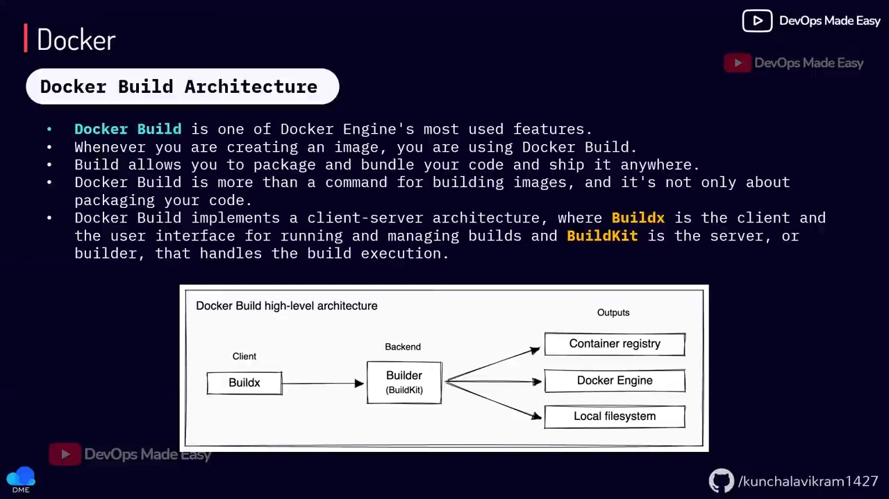

几个要点：

- 二者都已**内置在最新版 Docker Desktop 和 Docker Engine 里**，**不用单独安装**（[00:79](https://www.youtube.com/watch?v=1JRkxhYUfe4&t=79)）。Docker Engine **23.0 及以后**同样内置了 Buildx（[02:43](https://www.youtube.com/watch?v=1JRkxhYUfe4&t=243)）。
- **BuildKit 是守护进程（daemon）**，是一个管理构建的「软件」，**它也被称作一个 builder**（[01:04](https://www.youtube.com/watch?v=1JRkxhYUfe4&t=104)）。
- **Buildx 是 CLI 工具**，和 `docker` 命令一样是个命令行工具；它是**旧版 `docker build` 客户端的替代品**（[01:16](https://www.youtube.com/watch?v=1JRkxhYUfe4&t=116)）。新版 Docker 里，**你敲 `docker build`，后台用的其实就是 Buildx** 作为客户端。
- 如果你用的是**旧版 Docker**、又想用 Buildx 的功能，就要**显式加上 `docker buildx`**（[01:94](https://www.youtube.com/watch?v=1JRkxhYUfe4&t=194)）。
- **Buildx 不只是个简单 CLI**：它还能**创建 Builder**（[02:19](https://www.youtube.com/watch?v=1JRkxhYUfe4&t=219)）。

一句话理清：**Buildx = 客户端（CLI），BuildKit = 服务端（daemon / builder）**。所谓「Builder」，本质上就是一个 **BuildKit 守护进程**。

## 二、BuildKit 比 Legacy Builder 强在哪

用 BuildKit 后，构建过程会**自动被优化**（[03:60](https://www.youtube.com/watch?v=1JRkxhYUfe4&t=360)）：

1. **只传需要的文件**：传统构建器通常把上下文**整个**复制过去；而 Buildx 会**识别出哪些文件是构建真正需要的，只把这些文件发给 daemon**（[03:60](https://www.youtube.com/watch?v=1JRkxhYUfe4&t=360)）；
2. **跳过无用阶段**：多阶段构建里如果某些 stage 根本没被用到，Legacy Builder **照样会构建**，而 BuildKit 会**检测并跳过未使用的 stage**，让构建快很多（[04:10](https://www.youtube.com/watch?v=1JRkxhYUfe4&t=410)）；
3. **并行构建**：一个 Dockerfile 里若有多个 stage，**BuildKit 可以并行构建**，而 Legacy Builder 一直是**串行**的（[04:35](https://www.youtube.com/watch?v=1JRkxhYUfe4&t=435)）；
4. **跳过无用上下文文件**：构建上下文里没被用到的文件，BuildKit 也能检测并跳过；
5. **支持多平台镜像**。

## 三、Builder 与 build driver：四种类型

安装 Docker 时，它会**自动创建一个基于 BuildKit 的默认 builder**（[05:16](https://www.youtube.com/watch?v=1JRkxhYUfe4&t=516)）。列出机器上所有 builder 用（[05:69](https://www.youtube.com/watch?v=1JRkxhYUfe4&t=569)）：

```bash
docker buildx ls
```

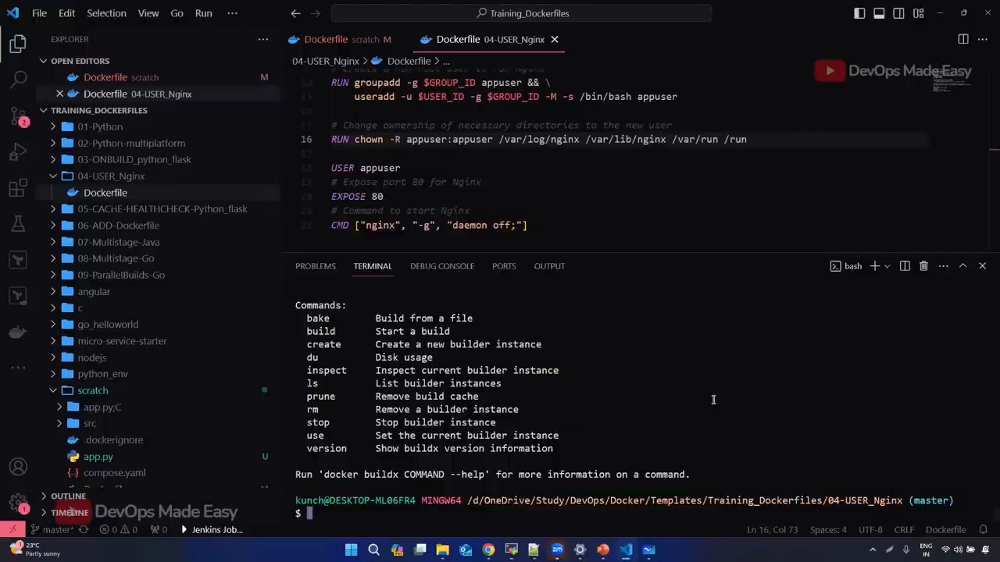

默认的 builder 负责**本地所有构建**。但如果你想和**远程 Builder**（比如 Docker Build Cloud）对话，就要借助 **build driver（构建驱动）** 来创建特定类型的 builder（[05:94](https://www.youtube.com/watch?v=1JRkxhYUfe4&t=594)）。

> 打个比方：就像 `docker network` 有 **bridge / host / none** 几种驱动一样（[06:23](https://www.youtube.com/watch?v=1JRkxhYUfe4&t=623)），Builder 也有几种**驱动类型**（[06:45](https://www.youtube.com/watch?v=1JRkxhYUfe4&t=645)）：

| driver | 说明 |
|---|---|
| **`docker`** | **默认 builder**。使用**内嵌在 daemon 里的 BuildKit 库**，处理所有本地 `docker build`。 |
| **`docker-container`** | 构建在**一个（已创建的）独立容器**里进行。**创建多平台镜像就靠它**。 |
| **`kubernetes`** | 把构建放到 **Kubernetes pods** 里执行。 |
| **`remote`（cloud）** | 把构建放到**远程机器 / Docker Build Cloud** 上执行。 |

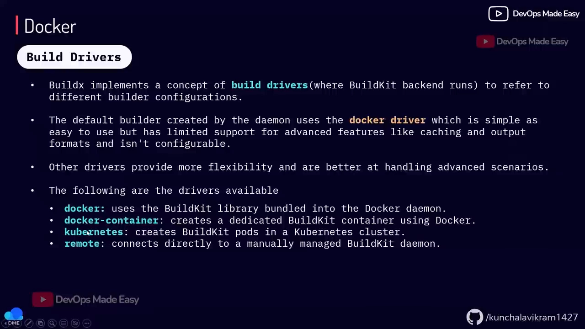

其中 `docker-container` 的意义是：执行 `docker build` 时，构建会在**一个独立的容器**里发生——**要创建多平台镜像，就靠它**（[07:20](https://www.youtube.com/watch?v=1JRkxhYUfe4&t=720)）。

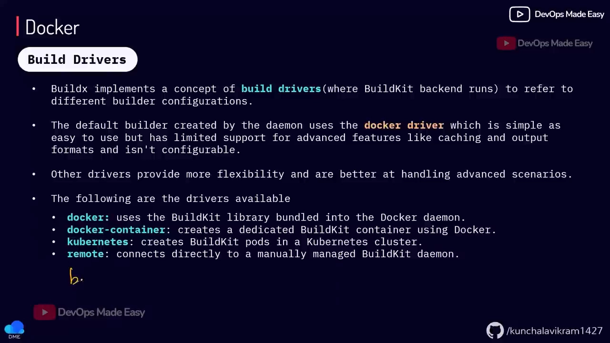

**为什么默认 `docker` builder 不够用？** 因为它**可能不支持构建多架构镜像**（[07:70](https://www.youtube.com/watch?v=1JRkxhYUfe4&t=770)）；而 `docker-container`、`remote`、`kubernetes` 这几类**都支持多架构**，还能**把镜像导出成 tar 输出**，并带有 BuildKit 配置（[07:95](https://www.youtube.com/watch?v=1JRkxhYUfe4&t=795)）。

在 **Docker Desktop → Builders** 面板里，你能看到装好的 Builder（[08:36](https://www.youtube.com/watch?v=1JRkxhYUfe4&t=836)）：视频里有两个——默认的 `docker` builder 和 `desktop-linux`，**两个都在运行**，但默认用的是 `docker` 那个。

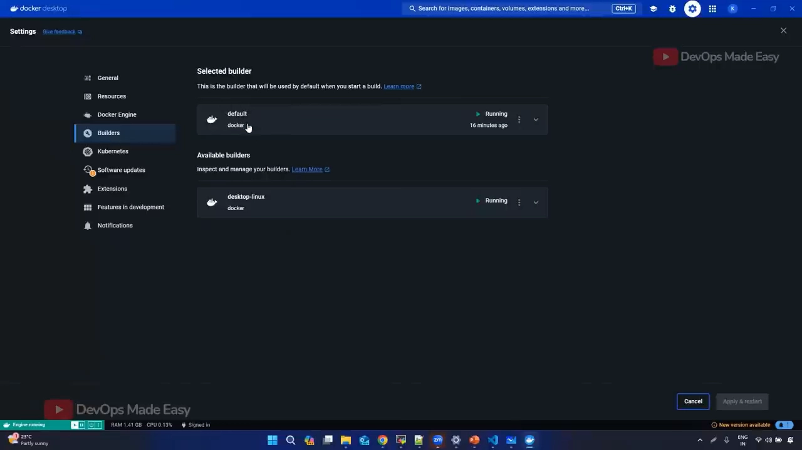

> 视频特别强调：**别被底部「支持所有架构」的字样骗了**——单个平台它是支持的，但**一条命令里同时构建多架构**它不行（[09:11](https://www.youtube.com/watch?v=1JRkxhYUfe4&t=911)）。真到多平台构建时会直接**失败并提示该 Builder 不支持**（[09:36](https://www.youtube.com/watch?v=1JRkxhYUfe4&t=936)）。

## 四、动手：列出、创建、启动、检查、切换 Builder

所有这些操作都由 **`docker buildx`** 提供（[09:54](https://www.youtube.com/watch?v=1JRkxhYUfe4&t=954)）。它会和 BuildKit 通信，`docker buildx` 后面有很多子命令：list、create、delete、`rm`、`prune` 等等（[10:46](https://www.youtube.com/watch?v=1JRkxhYUfe4&t=1046)）。

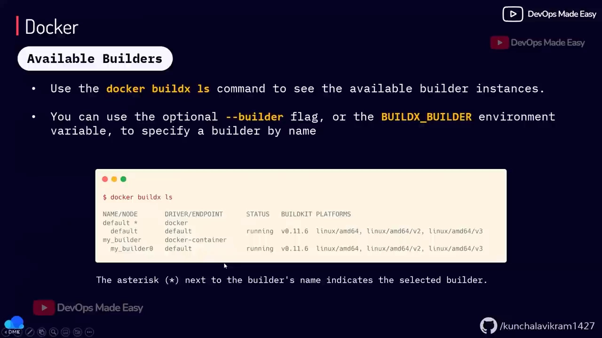

### 创建（create）

`create` 的帮助里让你**选 driver**：可以是 `cloud`、`kubernetes`、`docker-container` 或 `remote`，也可以同时给个名字（[10:71](https://www.youtube.com/watch?v=1JRkxhYUfe4&t=1071)）。

```bash
docker buildx create --name test        # 省略 --driver 时，默认用 docker-container
```

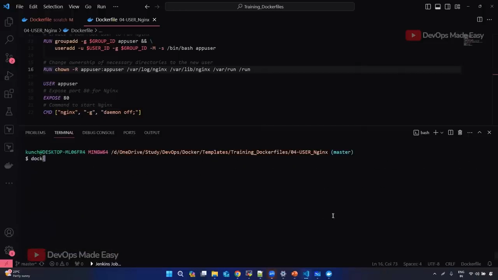

**如果不写 `--driver`，Buildx 默认就用 `docker-container`**（[10:90](https://www.youtube.com/watch?v=1JRkxhYUfe4&t=1090)）。创建后用 `docker buildx ls` 看，能看到 `test` 这个 Builder 用的正是 `docker-container` 驱动（[11:03](https://www.youtube.com/watch?v=1JRkxhYUfe4&t=1103)）。

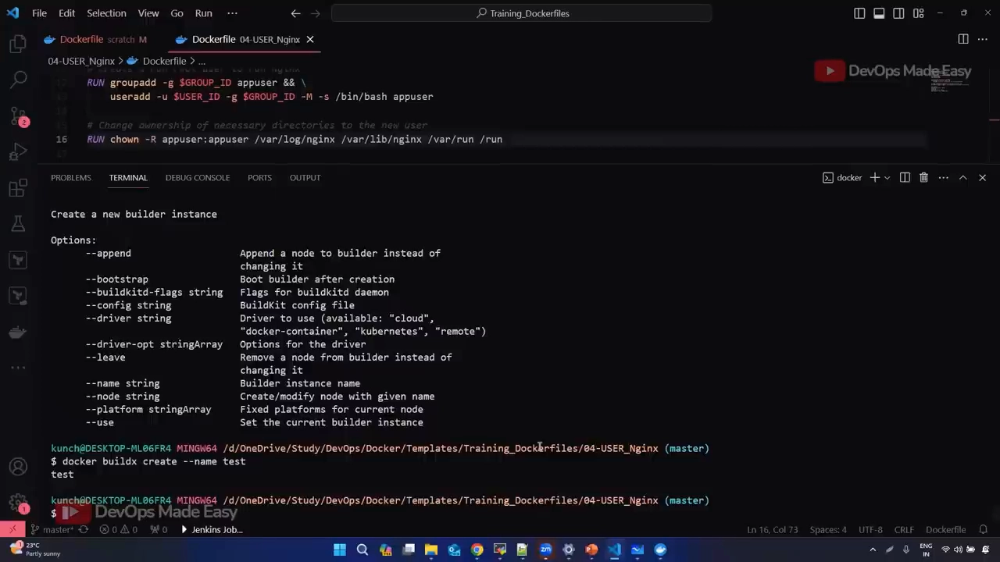

> **一个重要限制**：`docker` 驱动**只能有一个** Builder。想再建一个用 `docker` 驱动的 Builder 会**直接报错**（[11:79](https://www.youtube.com/watch?v=1JRkxhYUfe4&t=1179)）。

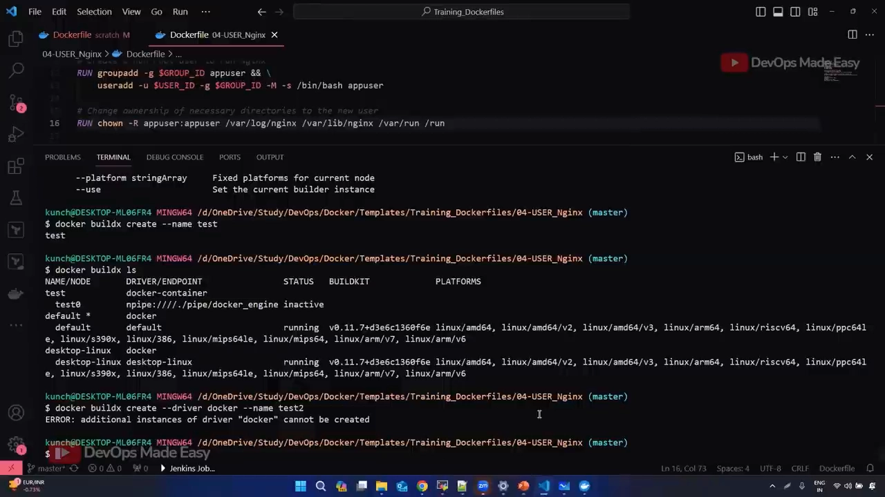

### 启动（bootstrap）与检查（inspect）

刚创建的 builder **还没运行**。这时用 `inspect` 会**报错说 Builder 未运行**（[12:04](https://www.youtube.com/watch?v=1JRkxhYUfe4&t=1204)）；需要用 **`bootstrap`** 把它**启动起来**——它会去**拉起那个容器**（而这个容器需要先有镜像）：

```bash
docker buildx inspect test        # 未启动时会报错
docker buildx inspect --bootstrap test   # 用 bootstrap 启动它
```

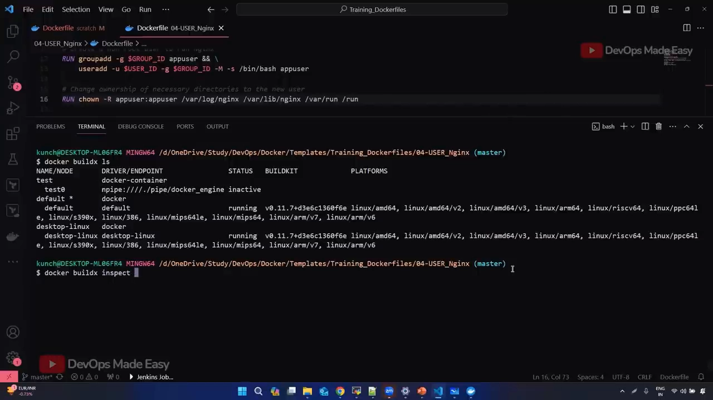

启动后再 `docker buildx ls`，可以看到 `test` 已处于**运行状态**——而且因为之前 `use` 过，它还成了**默认 builder**（[16:26](https://www.youtube.com/watch?v=1JRkxhYUfe4&t=1626)）。

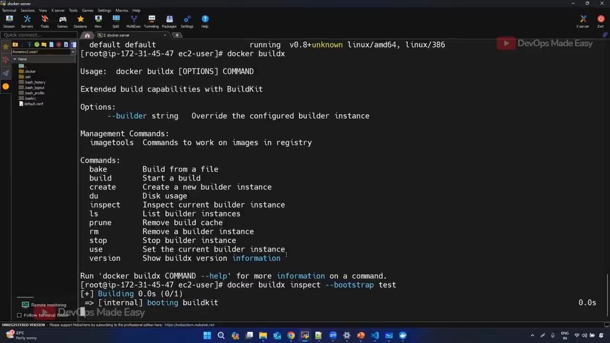

### 指定与切换

- 构建时**指定用哪个 builder**：在 `docker build` 上加 `--builder <名字>`（[10:17](https://www.youtube.com/watch?v=1JRkxhYUfe4&t=1017)）：

  ```bash
  docker build --builder test -t <名字> .
  ```

- **切换默认 builder**：`docker buildx use <名字>`，会把它设为当前默认（[14:33](https://www.youtube.com/watch?v=1JRkxhYUfe4&t=1433)）：

  ```bash
  docker buildx use test
  ```

- **看磁盘占用**：Builder 要存**构建缓存**，所以会占空间，用 `docker buildx du` 查看（视频里示例占了 **6.5 GB**）（[13:02](https://www.youtube.com/watch?v=1JRkxhYUfe4&t=1302)）。
- `docker-container` builder 相比默认 builder 的额外优势：**cache export（缓存导出）、tarball 输出、多架构构建**等（[16:86](https://www.youtube.com/watch?v=1JRkxhYUfe4&t=1686)）。

## 五、远程 Builder：Docker Build Cloud

如果不想在本机构建、而是想**在远程机器上构建**，就可以用 **Docker Build Cloud**——Docker 官方提供的云，你可以连上它的 VM 来做构建（[05:16](https://www.youtube.com/watch?v=1JRkxhYUfe4&t=516)）。

使用门槛（[17:40](https://www.youtube.com/watch?v=1JRkxhYUfe4&t=1740)）：需要**注册 Docker 账号**并开通 **Docker Build Cloud dashboard**。它有**免费额度**（作者口述先是 15 分钟，随后更正为 **50 分钟**免费构建分钟数），**需要绑定信用卡做验证，但不会收费**。

它的好处（[17:65](https://www.youtube.com/watch?v=1JRkxhYUfe4&t=1765)）：**支持多架构构建、缓存存在远程、构建更快**。视频建议去 Docker 官方文档的「Docker Build Cloud」一节，了解它为什么被引入、有什么优势、怎么用。

## 六、多架构镜像：为什么需要、怎么拉取与验证

**什么是多架构镜像？** 先看现实：常用的架构有 **AMD（x86_64）** 和 **ARM**（[18:33](https://www.youtube.com/watch?v=1JRkxhYUfe4&t=1833)）。如果你在 **Mac M1（ARM）** 上构建镜像，这个镜像**只能在 ARM 上跑**；而你的 **EC2 实例和很多 AWS 服务都在 AMD 架构**上——**ARM 上构建的镜像拿到 AMD 上跑不了**（[18:63](https://www.youtube.com/watch?v=1JRkxhYUfe4&t=1863)）。这正是**要构建多架构镜像**的原因。

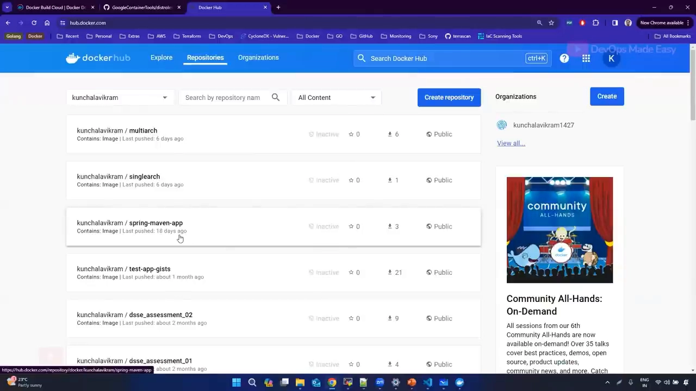

- 作者展示了自己构建的镜像：tag 里可以看到**它只支持 amd64**（[18:77](https://www.youtube.com/watch?v=1JRkxhYUfe4&t=1877)）；
- 而在 **Docker Hub** 上找 `nginx` 这样的热门镜像、随便点一个 tag，能看到它**支持多个架构**（[18:93](https://www.youtube.com/watch?v=1JRkxhYUfe4&t=1893)）。

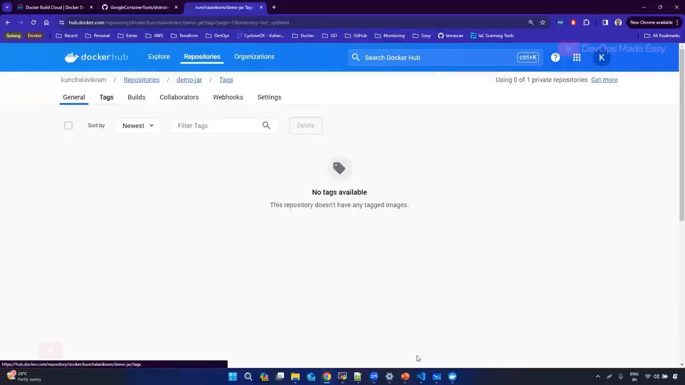

**拉取时要不要手动指定平台？** 不需要（[19:05](https://www.youtube.com/watch?v=1JRkxhYUfe4&t=1905)）——**Docker CLI 会自动检测你的架构，只拉取对应的那一份**。如果你偏要拉一个**不属于本机架构**的镜像，**能拉下来，但跑不起来**。

想**指定平台**拉取，可以用 `docker pull --platform`（[19:35](https://www.youtube.com/watch?v=1JRkxhYUfe4&t=1935)）。视频演示拉了一个 **`armv5`** 的 `nginx`：

```bash
docker pull --platform linux/arm/v5 nginx
```

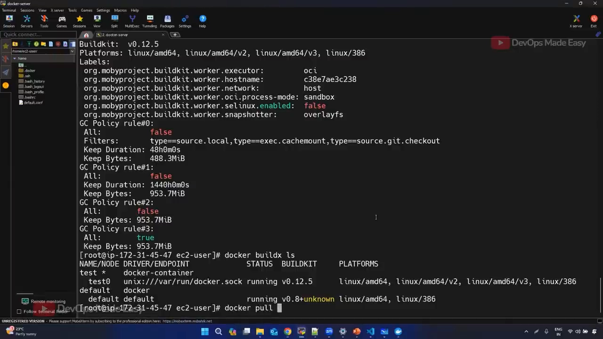

拉完 `inspect` 该镜像，能看到它的架构是 **`rv5`（armv5）**（[19:86](https://www.youtube.com/watch?v=1JRkxhYUfe4&t=1986)）；再 `docker run` 它就会**失败**——因为架构不符。

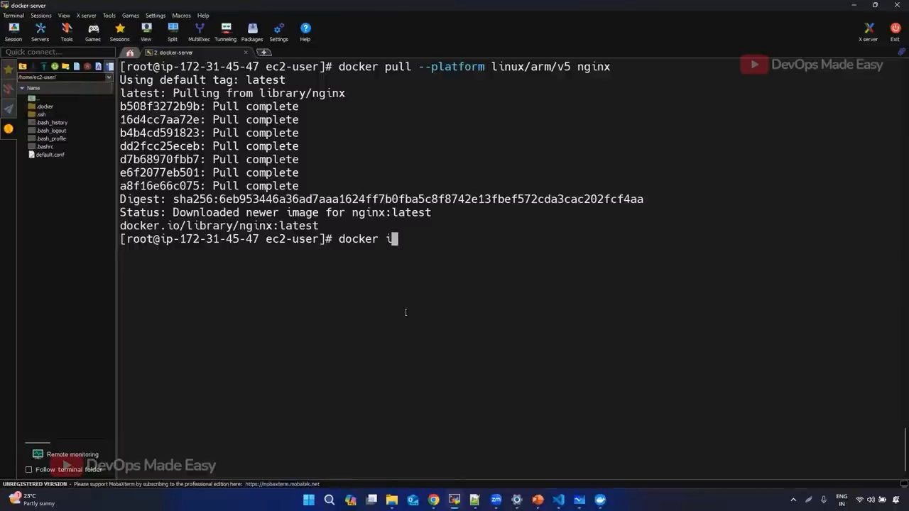

最后两个常见问答（[20:24](https://www.youtube.com/watch?v=1JRkxhYUfe4&t=2024)）：

- **不指定平台拉取会怎样？** 会自动拉本机平台那一份并落到本地文件系统；所以本地 `nginx` **永远只指向一个架构**，你在本机**看不到多架构镜像**。
- **能不能用不同 driver 去「跑」ARM 镜像？** 不能——**driver 只用于构建（build）**。想跑异架构镜像，只能在**目标操作系统**上跑（[20:86](https://www.youtube.com/watch?v=1JRkxhYUfe4&t=2086)）。至于「Mac M1 上能不能构建 AMD 镜像」，答案是**可以**，用的是多平台构建，留到后续课程讲。

## 小结

- **三者关系**：`docker build` → 客户端 **Buildx** + 服务端 **BuildKit**；**BuildKit 本身就是一个 Builder**（daemon）。
- **BuildKit 相比 Legacy Builder**：只传必要文件、跳过无用 stage、并行构建、支持多平台。
- **Builder 按 driver 分类**：`docker`（默认，内嵌 daemon 的 BuildKit，**单平台**）、`docker-container`（**多平台构建必备**）、`kubernetes`、`remote`（Docker Build Cloud）。
- **Builder 的生命周期命令**：

  ```bash
  docker buildx ls                 # 列出
  docker buildx create --name test # 创建（默认 docker-container 驱动）
  docker buildx inspect --bootstrap test  # 检查 / 启动
  docker buildx use test           # 设为默认
  docker build --builder test ...  # 指定 builder 构建
  docker buildx du                 # 查看磁盘占用
  ```

- **多架构镜像**是为跨架构（ARM / AMD）分发而生；**拉取时自动选平台**，本地只会保留本机那一份。
