# 用 buildx 一次构建多种系统架构的镜像

> 视频来源：Bilibili 视频 [【Docker 教程】使用 buildx 构建多种系统架构支持的 Docker 镜像](https://www.bilibili.com/video/BV1Z84y1j77H/)（UP 主 **学亮编程手记**，约 25 分钟）。本文基于视频演说图文稿整理，时间戳可跳转到原视频对应位置；配图取自视频画面。
>
> 本条目的另外两篇配套阅读：[《没有 Docker 也能构建镜像：用 BuildKit 构建并推送》](下一代镜像构建工具Buildkit使用分享 ｜ 没有Docker环境也能构建镜像.md) 讲不装 Docker 用 BuildKit 构建，[《Buildx、BuildKit 与 Builder：创建、检查与本地/远程》](Buildx, BuildKit and Builders ｜ Create and Inspect a Builder ｜ Local vs Remote Builders.md) 把三者概念讲清。

## 本讲要解决的核心问题（SCQA）

**背景**：我们写好的镜像，往往要同时跑在**不同 CPU 架构**的机器上——比如本机是 **ARM**（Mac M 系列），而线上的云服务器大多是 **AMD（x86_64）**。

**冲突**：架构不同，镜像是**不能互相跑**的。默认情况下，你在 ARM 机器上构建出来的镜像只能在 ARM 上跑；想在 AMD 上跑，就得**另找一台对应架构的机器**再构建一遍——「多套环境」的传统做法既麻烦又低效，而且 **Docker 默认的 build 实例根本不支持一次指定多个平台**。

**疑问**：能不能用**一条命令**、在**一台机器**上，就构建出同时支持多种架构的镜像？这多个架构的镜像又怎么用**同一个名字**分发出去？

**回答（中心思想）**：用 **`buildx`**。它是 Docker 的**多平台构建插件**，通过 `--platform` 参数可以一次性构建多种架构；而「同名的多架构镜像」则是靠 **`docker manifest`（镜像清单）** 实现的——清单把不同架构的镜像「聚」在一个名字下，拉取时由 Docker 按你的平台**自动挑选**对应那一份。

---

## 一、多架构镜像的原理：`--platform` + `manifest`

要让多架构镜像**共用一个名字**，必须借助前面讲过的 **`docker manifest` 命令**（[00:50](https://www.bilibili.com/video/BV1Z84y1j77H/?t=50)）：

- 一个 manifest 下可以**推送多个镜像**，它们**沿用统一的镜像名称**；
- 但不同架构对应的 manifest **值不同、层不同**——对使用者而言，它就像**同一个名字的镜像**，里面装着多种架构。

这个能力在 **Docker 19.03 之后的版本**开始支持（[01:00](https://www.bilibili.com/video/BV1Z84y1j77H/?t=100)）。而构建端的入口，就是 `buildx` 的 `build` 命令——它支持 **`--platform`** 参数，可一次构建多种架构（[01:25](https://www.bilibili.com/video/BV1Z84y1j77H/?t=125)）。

> 术语小抄：**平台（platform）** 是「操作系统 + CPU 架构」的组合，写作 `linux/amd64`、`linux/arm64`；**manifest（清单）** 则是把多个平台的镜像登记在一个名字下的索引文件。

## 二、为什么必须新建一个 build 实例

传统思路是「准备多套环境」，但 Docker **默认的 build 实例不支持同时指定多个 platform**（[02:25](https://www.bilibili.com/video/BV1Z84y1j77H/?t=145)）。所以在构建多架构镜像前，要**先创建一个专用的 build 实例**。整条流程分几步走（[02:50](https://www.bilibili.com/video/BV1Z84y1j77H/?t=170)）：

1. 安装**多平台构建的模拟器**（Binfmt）；
2. 创建一个新的 build 实例；
3. 切换到该实例；
4. 用 `buildx build` 构建并推送；
5. 验证镜像的多架构信息。

### 第一步：安装模拟器（Binfmt）

异架构构建需要**模拟器**支持。视频用的是 `tonistiigi/binfmt` 这类镜像，**用 `latest` 标签**即可（[02:50](https://www.bilibili.com/video/BV1Z84y1j77H/?t=170)）。这一步记得先把它跑起来。

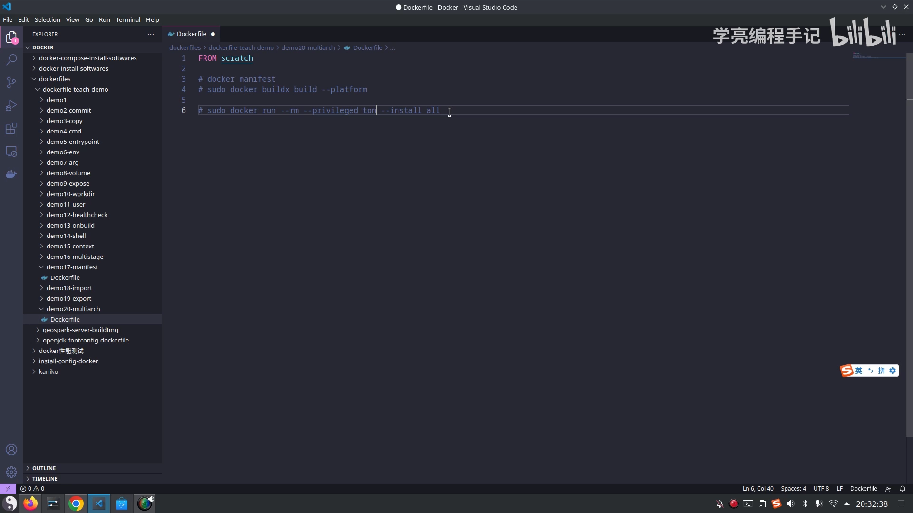

### 第二步：创建新的 build 实例

默认 Docker build 实例不支持多个 platform，所以要新建一个 build 实例（[03:50](https://www.bilibili.com/video/BV1Z84y1j77H/?t=230)），并指定 **driver（驱动）**（[04:25](https://www.bilibili.com/video/BV1Z84y1j77H/?t=265)）：

```bash
docker buildx create --name mybuilder --driver docker-container
```

想拉取镜像快一点，可以**用国内环境**的镜像。创建完成后会看到它和默认的 `default` 实例并存。

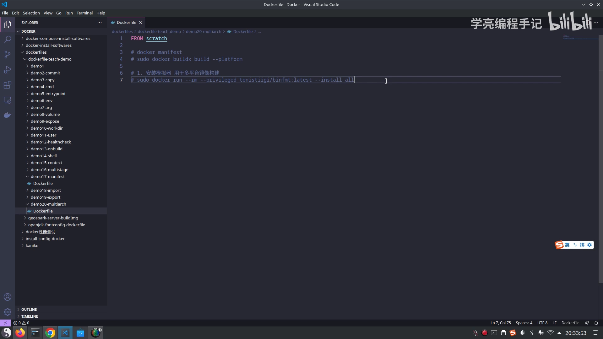

### 第三步：确认与切换实例

用 `docker buildx ls` **列出已有实例**、确认创建成功（[05:50](https://www.bilibili.com/video/BV1Z84y1j77H/?t=350)）：

```bash
docker buildx ls
docker buildx use mybuilder
```

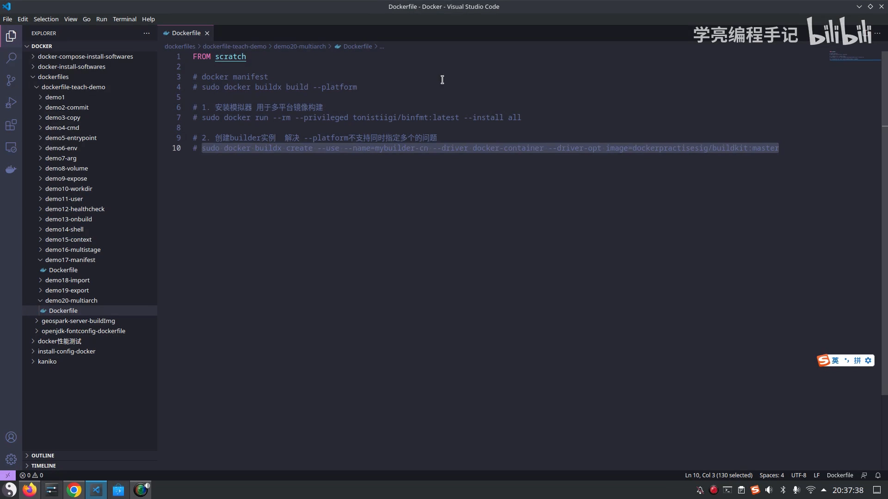

> 亲身踩坑：名字**一定要对上**。视频里 `use` 时名字写错了一次，导致后面构建出问题（[06:50](https://www.bilibili.com/video/BV1Z84y1j77H/?t=410)）；发现镜像名称有误时，可以用 **`docker buildx rm <实例名>`** 把实例删掉、重新创建（[16:00](https://www.bilibili.com/video/BV1Z84y1j77H/?t=960)）：

```bash
docker buildx rm mybuilder
docker buildx create --name mybuilder --driver docker-container
docker buildx use mybuilder
```

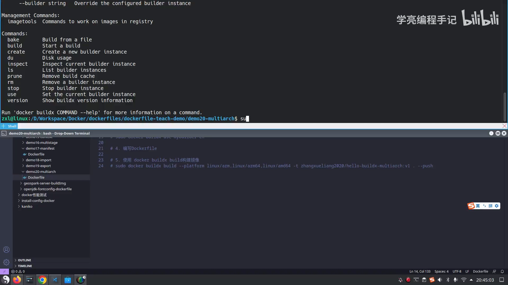

## 三、用 `--platform` 一次构建多架构

前置准备好后，就可以写 Dockerfile、执行构建了（[11:40](https://www.bilibili.com/video/BV1Z84y1j77H/?t=700)）。演示里用一个**最简单的镜像**做例子，`--platform` 指定要支持的平台（[13:20](https://www.bilibili.com/video/BV1Z84y1j77H/?t=800)）：

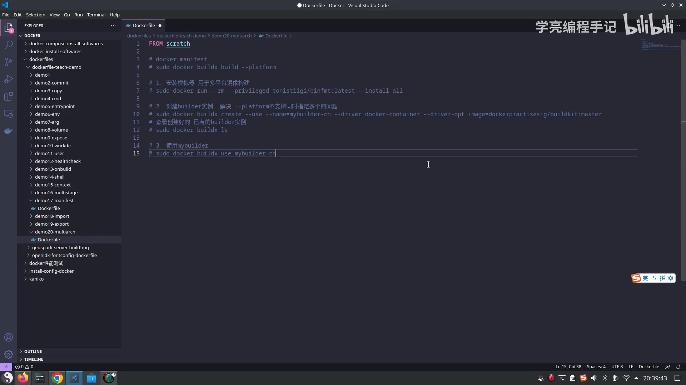

```bash
docker buildx build \
  --platform linux/arm64,linux/amd64 \
  -t hello-buildx:v1 \
  --push .
```

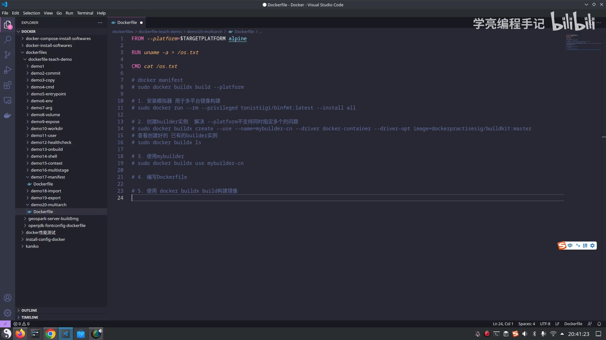

- `--platform linux/arm64,linux/amd64`：一次指定**多个平台**，这是普通 `docker build` 做不到的；
- `-t hello-buildx:v1`：给镜像打上**统一的名称和版本**（多架构共用这一个名字）；
- `--push`：构建完成后**直接推送到远程仓库**。

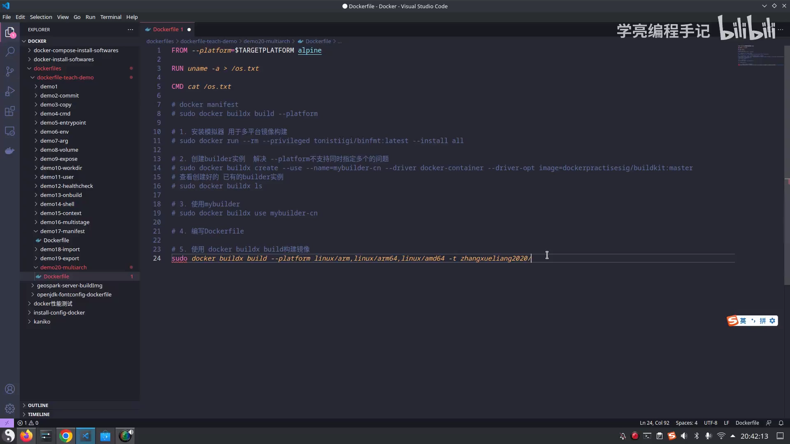

## 四、验证：`imagetools inspect` 与远程仓库

构建推送之后，怎么确认它真的包含多架构？可以用 **`docker buildx imagetools`**（[19:18](https://www.bilibili.com/video/BV1Z84y1j77H/?t=1158)）：

```bash
docker buildx imagetools inspect hello-buildx:v1
```

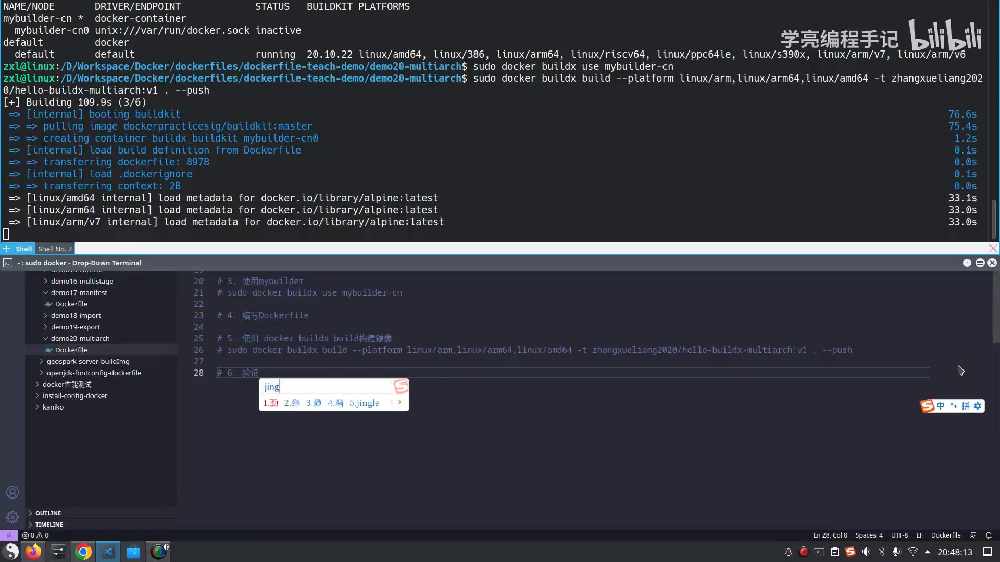

一个**容易困惑的现象**：推送完执行 `docker images`，**本地却看不到**这个镜像（[20:33](https://www.bilibili.com/video/BV1Z84y1j77H/?t=1233)）。这是**正常机制**——用了 `--push` 后，镜像**直接被推到了远程仓库，本地不保留**。所以要看结果，得去**远程仓库**里看。

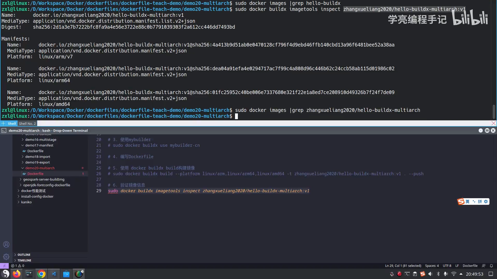

在远程仓库里能看到这个镜像（[21:23](https://www.bilibili.com/video/BV1Z84y1j77H/?t=1283)），并且可以看到它登记了**多条 digest**——这正是因为 `--platform` 指定了**多个平台**，每个平台各有一条清单记录（视频里作者提到自己指定了三个平台，因此能看到三条）（[22:33](https://www.bilibili.com/video/BV1Z84y1j77H/?t=1353)）。

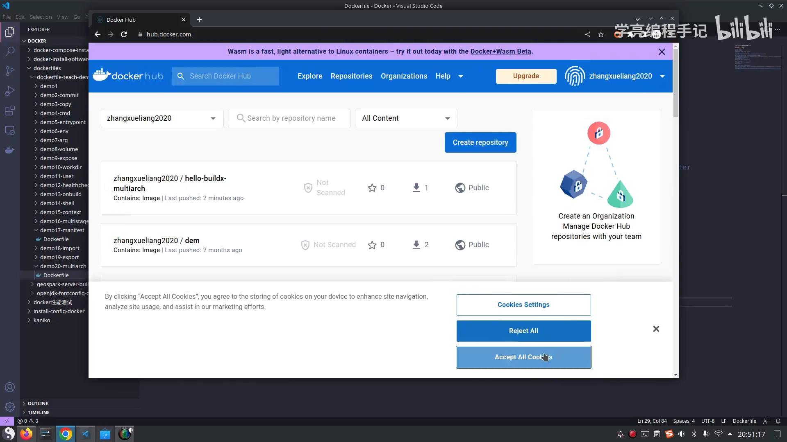

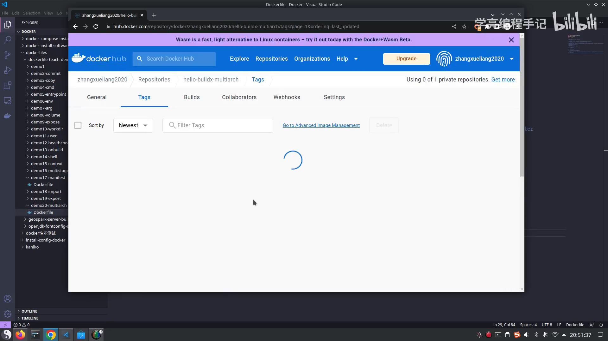

**`--platform` 到底支持哪些值？** 视频建议直接去查 **buildx 官方文档**（[23:05](https://www.bilibili.com/video/BV1Z84y1j77H/?t=1365)）。

## 小结

- **多架构镜像是「同名、多清单」**：靠 `docker manifest` 把不同架构的镜像聚在同一个名字下，拉取时自动选对应平台。
- **`buildx` 的 `--platform` 一次构建多平台**，这是普通 `docker build`（默认实例）做不到的——所以要先 `docker buildx create` 一个 `docker-container` 驱动的实例，并 `use` 切换到它。
- **典型命令**：

  ```bash
  docker buildx create --name mybuilder --driver docker-container
  docker buildx use mybuilder
  docker buildx build --platform linux/arm64,linux/amd64 -t <名字>:<版本> --push .
  docker buildx imagetools inspect <名字>:<版本>
  ```

- **注意 `--push` 的机制**：镜像直接进远程仓库，本地 `docker images` 不会出现。
- **拉取端零负担**：不同架构拉取时**名字不用变**，Docker 会按运行平台自动取对应那一份。

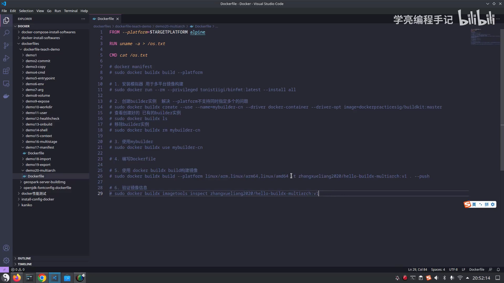
