# 没有 Docker 也能构建镜像：用 BuildKit 构建并推送

> 视频来源：Bilibili 视频 [下一代镜像构建工具 Buildkit 使用分享 ｜ 没有 Docker 环境也能构建镜像](https://www.bilibili.com/video/BV12qrTBvEhU/)（UP 主 **程序员暮闲**，约 19 分钟）。本文基于视频演说图文稿整理，时间戳可跳转到原视频对应位置；配图取自视频画面。
>
> 本条目的另外两篇配套阅读：[《用 buildx 一次构建多种系统架构的镜像》](【Docker教程】使用buildx构建多种系统架构支持的Docker镜像.md) 讲多架构构建，[《Buildx、BuildKit 与 Builder：创建、检查与本地/远程》](Buildx, BuildKit and Builders ｜ Create and Inspect a Builder ｜ Local vs Remote Builders.md) 从概念层面厘清三者关系。

## 本讲要解决的核心问题（SCQA）

**背景**：过去我们要构建镜像，机器上装着 Docker，敲一条 `docker build` 就行了。但随着云原生不断发展，机器上其实**已经不太需要安装完整的 Docker**——Docker 一直要常驻一个 `dockerd` 守护进程，还会带来网络、存储是否与 K8s 兼容的问题。我们真正需要的往往只是最核心的那部分：**容器运行时**，比如 `containerd`、`CRI-O`。

**冲突**：问题来了——**没有 Docker，就没有 `docker build`**。那我们还需要构建镜像（比如给 K8s 里跑的服务打新镜像），怎么办？

**疑问**：在不装 Docker、甚至只装 `containerd` 的机器上，还能不能构建镜像？能不能**复用机器里已经存在的镜像**当基础镜像、避免重复拉取？构建完又怎么**推送到镜像仓库**？

**回答（中心思想）**：用**下一代构建工具 BuildKit**。它把「构建」这件事从 Docker 里彻底拆了出来——**一个 `buildkitd` 守护进程负责实际干活，一个 `buildctl` 客户端负责发指令**，两者可以分开部署。于是：装 BuildKit 简单到只是解压一个二进制包；构建时可以用 containerd 里已有的镜像当 base；推送则通过**手写一份认证文件**来完成，和 `docker push` 略有不同。

---

## 一、BuildKit 是什么：`buildkitd` 与 `buildctl` 的 C/S 分离

先记住两个核心命令（[04:51](https://www.bilibili.com/video/BV12qrTBvEhU/?t=291)）：

- **`buildkitd`**：BuildKit 的**守护进程**，真正「干活」的那个，负责执行构建；
- **`buildctl`**：**客户端命令**，我们用它向 `buildkitd` 下达构建指令。

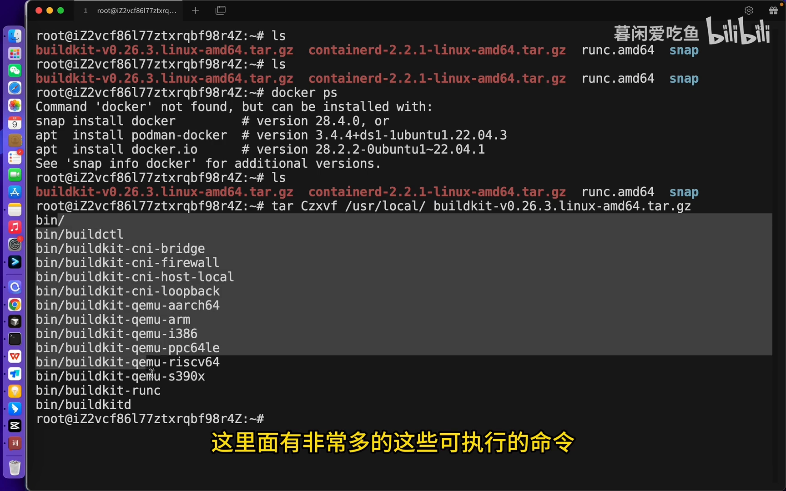

这种「**客户端 / 服务端分离**」的设计带来一个很实用的结论（[18:37](https://www.bilibili.com/video/BV12qrTBvEhU/?t=1117)）：**`buildkitd` 可以单独部署在某台机器上，`buildctl` 可以在任意地方发起构建**。也就是说，构建能力不再和「本机装没装 Docker」绑死。

要让它跑起来，常规做法是**开两个终端**（[05:26](https://www.bilibili.com/video/BV12qrTBvEhU/?t=326)）：一个终端里把 `buildkitd` 启动起来，另一个终端里用 `buildctl` 发构建命令。

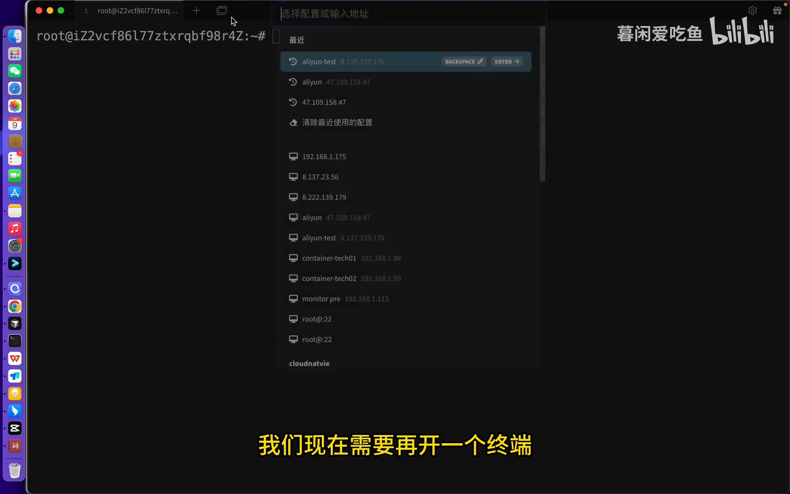

> 小贴士：如果嫌每次手动开终端麻烦，也可以把 `buildkitd` 做成**系统服务**，用 `systemctl` 来管理（[05:45](https://www.bilibili.com/video/BV12qrTBvEhU/?t=345)）。

## 二、安装：把二进制包解压到 `/usr/local` 就够了

BuildKit 的安装「简单到令人发指」，因为它本质就是**若干二进制命令**，放进环境变量能执行就行（[00:57](https://www.bilibili.com/video/BV12qrTBvEhU/?t=57)）。步骤只有两步：

1. **去 GitHub 下载安装包**：搜索 BuildKit，认准 **`moby` 开头的那个仓库**（也就是 `moby/buildkit`），在 **release** 里按自己的系统下载（[02:38](https://www.bilibili.com/video/BV12qrTBvEhU/?t=158)）。视频演示环境是一台**只装了 containerd 的阿里云 Linux 服务器**，所以下载的是 **Linux / amd64** 的压缩包（[03:33](https://www.bilibili.com/video/BV12qrTBvEhU/?t=213)），演示时的版本是 **0.26.3**，大小 80 多兆。
   > 版本说明：等你看视频时版本可能已经升级，**直接下最新版即可**，它是向下兼容的。
2. **解压到 `/usr/local`**：把压缩包传到服务器后，一条命令搞定（[04:28](https://www.bilibili.com/video/BV12qrTBvEhU/?t=268)）：

   ```bash
   tar -zxvf buildkit-v0.26.3.linux-amd64.tar.gz -C /usr/local
   ```

   因为包里本身带一个 `bin` 目录，所以**不用特意指定 `/usr/local/bin`**。解压后会看到很多可执行文件，但我们**核心只用 `buildctl` 和 `buildkitd`**。

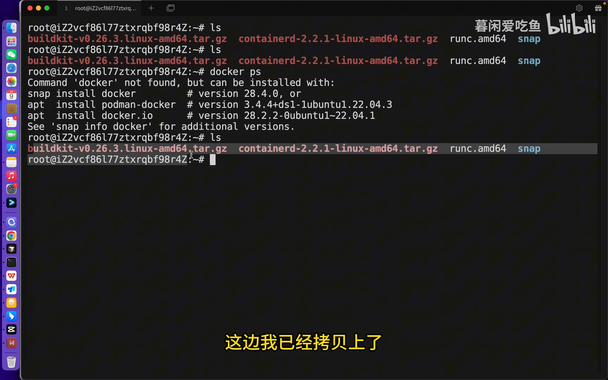

验证是否装好（[05:00](https://www.bilibili.com/video/BV12qrTBvEhU/?t=300)）：输入 `buildctl` 能 tab 补全，再执行 `buildctl --version` 能打印版本，就说明安装成功。

## 三、第一次构建：`buildctl build`

构建镜像和 Docker 是**同一套思路**——先写 Dockerfile，再执行构建，只是**执行构建的指令不一样**（[06:05](https://www.bilibili.com/video/BV12qrTBvEhU/?t=365)）。Dockerfile 的写法完全一致。

**第一步，准备基础镜像。** 视频直接用「**渡渡鸟**」这类国内镜像代理站找镜像（因为直接从 Docker Hub 拉取会失败），选用 **Ubuntu 22.04**，把页面上给出的国内可拉取地址复制到 Dockerfile 的 `FROM` 里（[06:35](https://www.bilibili.com/video/BV12qrTBvEhU/?t=395)）。

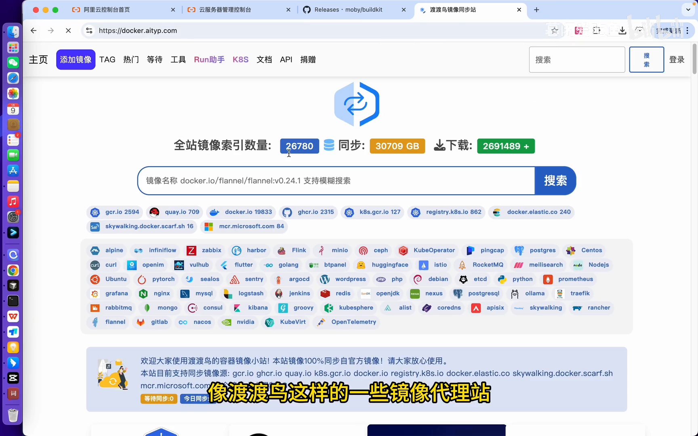

**第二步，写 Dockerfile。** 里面做一些基础操作，比如更新源、装个工具（[07:01](https://www.bilibili.com/video/BV12qrTBvEhU/?t=421)）：

```dockerfile
FROM <渡渡鸟代理的 ubuntu:22.04 地址>
RUN apt update && apt install -y curl
```

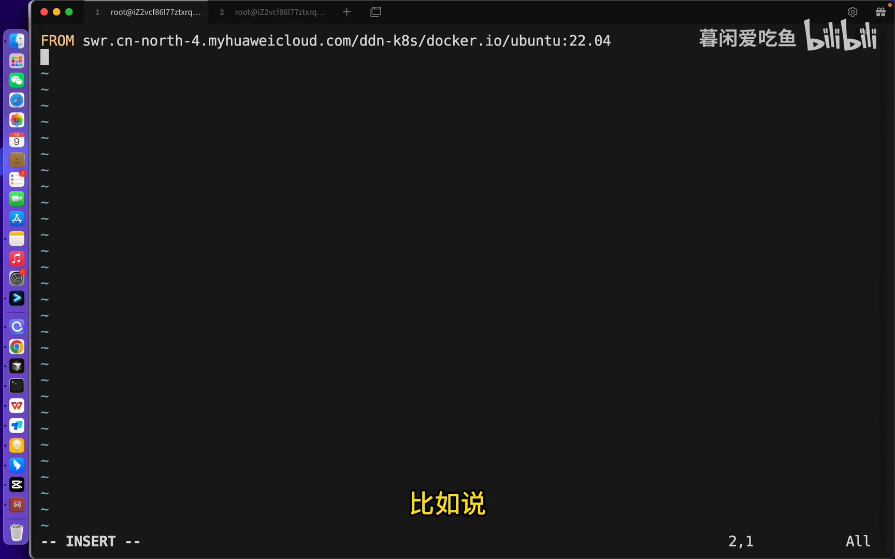

**第三步，用 `buildctl` 构建。** 命令的关键参数逐个看（[07:26](https://www.bilibili.com/video/BV12qrTBvEhU/?t=446)）：

```bash
buildctl build \
  --frontend dockerfile.v0 \
  --local context=. \
  --local dockerfile=. \
  --output type=image,name=<镜像地址>,push=true \
  --progress plain
```

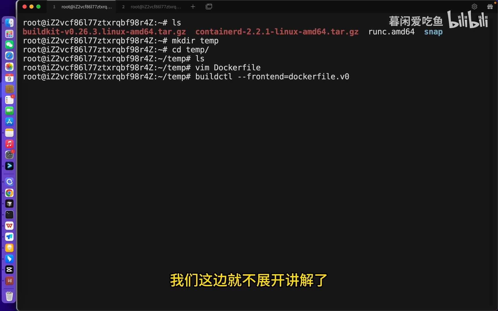

- `--frontend dockerfile.v0`：`frontend` 指「用什么东西来编排构建」，这里用 Dockerfile（BuildKit 还支持其它 frontend，视频未展开）；
- `--local context=.`：指定**构建上下文**，和 Docker 是同样的道理；
- `--local dockerfile=.`：指定 **Dockerfile 所在路径**；
- `--output type=image,name=<镜像地址>,push=true`：`output` 指构建完「往哪儿推」——`type=image` 表示推成镜像，`name` 是目标镜像地址，`push=true` 表示构建完直接推送；
- `--progress plain`：把构建日志以 `plain` 纯文本格式输出，看得更清楚（[10:04](https://www.bilibili.com/video/BV12qrTBvEhU/?t=604)）。

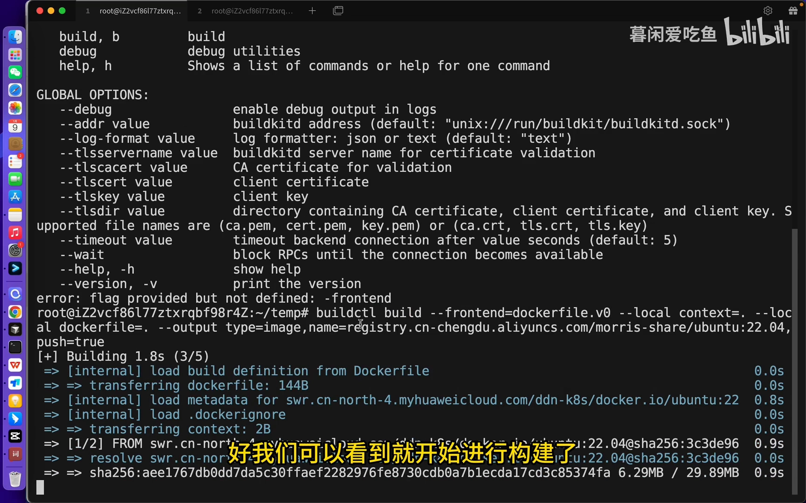

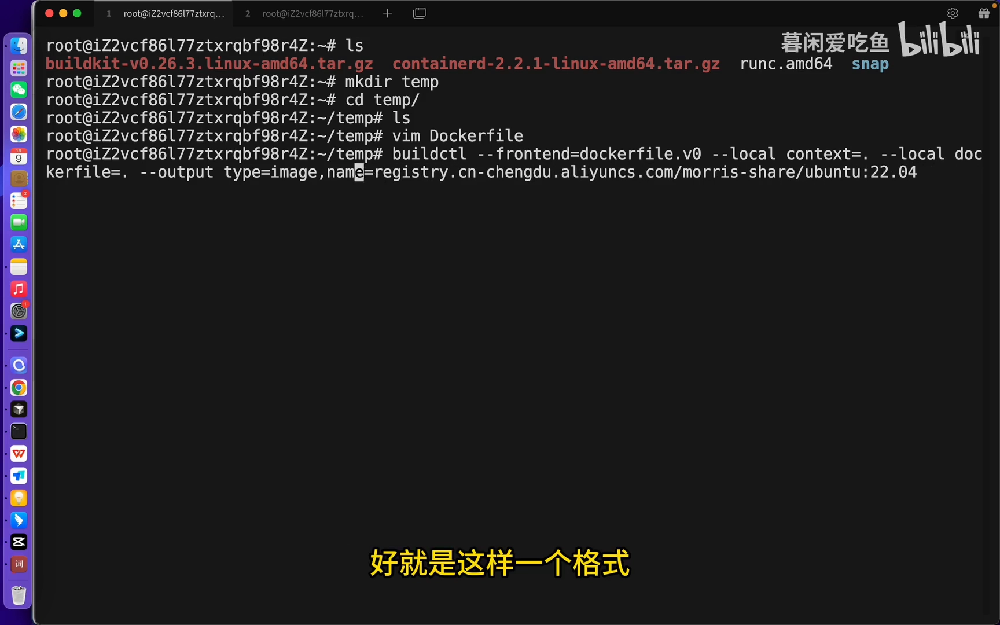

> 两个容易踩的坑：① `buildctl` 后面**还要再跟一个 `build` 子命令**，写成 `buildctl build ...`（[09:36](https://www.bilibili.com/video/BV12qrTBvEhU/?t=576)）；② 用它构建时输出的日志，和我们跑 `docker build` 看到的**几乎一模一样**——因为 **Docker 底层的构建工具本来就是 BuildKit**（[10:09](https://www.bilibili.com/video/BV12qrTBvEhU/?t=609)）。

若此时还没配认证信息，构建能成功，但**推送会报权限错误**（[10:36](https://www.bilibili.com/video/BV12qrTBvEhU/?t=636)）——这才是正常现象，认证放到最后一节讲。

## 四、进阶：把 containerd 里的镜像当作 base 镜像

这是本讲最实用的部分。在 K8s 这类云原生环境里，**容器运行时是 containerd**，镜像就存在 containerd 的命名空间里（K8s 用 `k8s.io`）。如果我们**直接拿 containerd 里已有的镜像当 base**，就能省掉重复拉取（[01:22](https://www.bilibili.com/video/BV12qrTBvEhU/?t=82)）。这在推理框架场景尤其有用——像 SGLang、VLM 这些镜像动辄几十个 G，**不可能每次构建都重新拉一遍**。

**怎么验证「确实用到了 containerd 里的镜像」？** 视频给了一个很聪明的办法（[11:44](https://www.bilibili.com/video/BV12qrTBvEhU/?t=704)）：在 containerd 里把已经拉下来的镜像**改个本地随便编的名字**（比如 `foo/bar`），因为这个名字在网络上并不存在，只要构建能成功，就证明用的是 containerd 里的那份。

```bash
# 在 k8s.io 命名空间里查看 / 拉取镜像
ctr -n k8s.io image list
ctr -n k8s.io image pull <渡渡鸟代理的 ubuntu:22.04 地址>

# 改一个「网络上不存在」的名字
ctr -n k8s.io image tag <原镜像> foo/bar
```

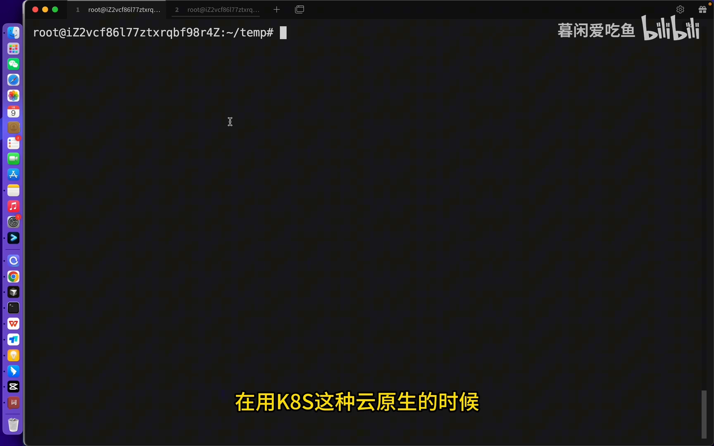

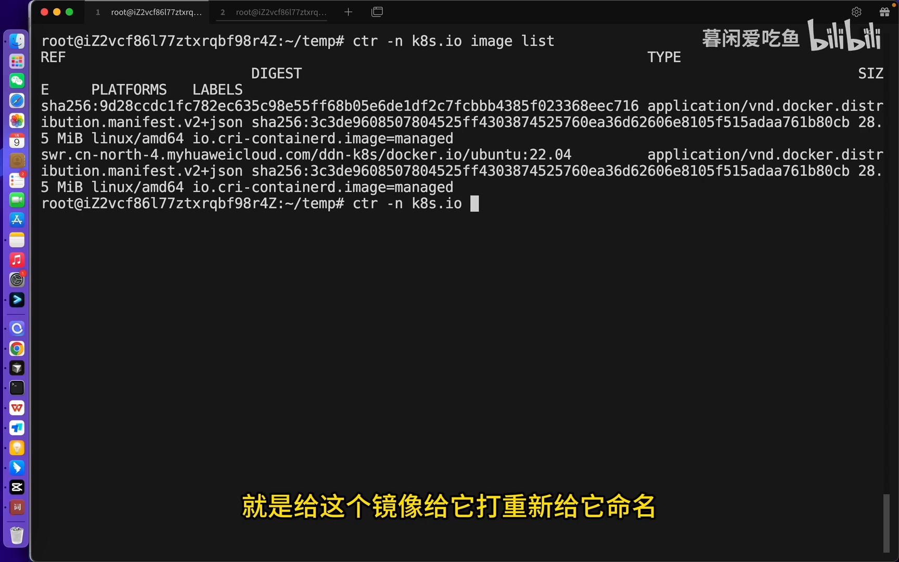

然后把 Dockerfile 的 `FROM` 换成 `foo/bar`。**关键坑点**：默认启动的 `buildkitd` 用的是 **OCI worker**，它**看不到** containerd 里的镜像——此时构建会在 `FROM` 这步直接报错（本地没有 `foo/bar`，去网上拉也拉不到）（[13:10](https://www.bilibili.com/video/BV12qrTBvEhU/?t=790)）。

解决办法是**换用 containerd worker**，重新启动 `buildkitd`（[13:30](https://www.bilibili.com/video/BV12qrTBvEhU/?t=810)）：

```bash
buildkitd \
  --containerd-worker \
  --oci-worker=false \
  --containerd-worker-namespace=k8s.io
```

- `--containerd-worker`：打开 containerd worker；
- `--oci-worker=false`：**打开一个就要关掉一个**——同时启用 containerd worker 时，必须把 OCI worker 关掉；
- `--containerd-worker-namespace=k8s.io`：指定用哪个命名空间下的镜像（这里就是 K8s 用的 `k8s.io`）。

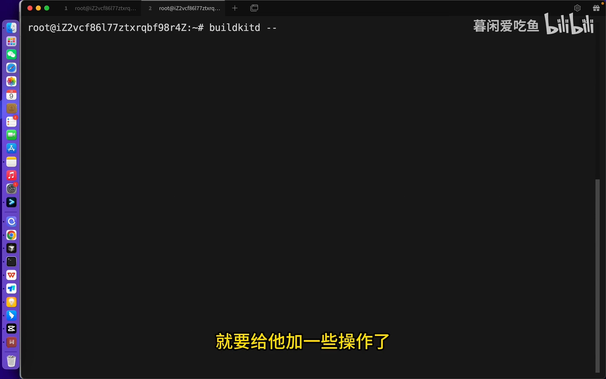

这样再构建，用 `foo/bar` 就**成功**了——也就证明了 `buildkitd` 确实能用 containerd 里的镜像做 base。

## 五、把构建好的镜像推送出去：手写 `~/.docker/config.json`

前面构建时推送总是失败，原因就是**没有认证信息**。Docker 里我们会 `docker login`，它把凭证写进 `~/.docker` 目录；但这台机器**没有 Docker**，凭证没法由 Docker 写入，只能**自己手写一份 `config.json`**（[15:14](https://www.bilibili.com/video/BV12qrTBvEhU/?t=914)）：

```json
{
  "auths": {
    "<镜像地址>": {
      "auth": "<base64(账号:密码)>"
    }
  }
}
```

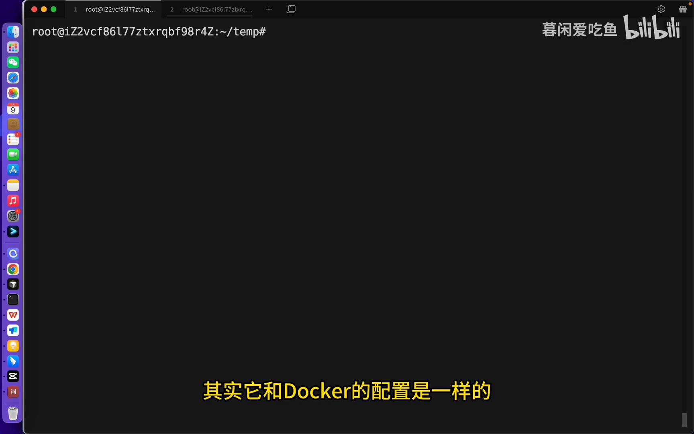

- key 就是**镜像地址**；value 里的 `auth` 字段是**账号:密码**经过 **base64 编码**后的字符串（[16:25](https://www.bilibili.com/video/BV12qrTBvEhU/?t=985)）。生成时建议用 `base64 -w0`（或 `base64 | tr -d '\n'`）去掉换行：

  ```bash
  echo -n "账号:密码" | base64 -w0
  ```

- **镜像地址要用「VPC 专用地址」**：在阿里云 ACR 容器镜像服务的命名空间里，点进一个仓库能看到专用的 VPC 地址，它比最外层展示的那个地址**走内网、明显更快**（[16:14](https://www.bilibili.com/video/BV12qrTBvEhU/?t=974)）。配认证和写 `--output name=` 时**都要用这个专用地址**。

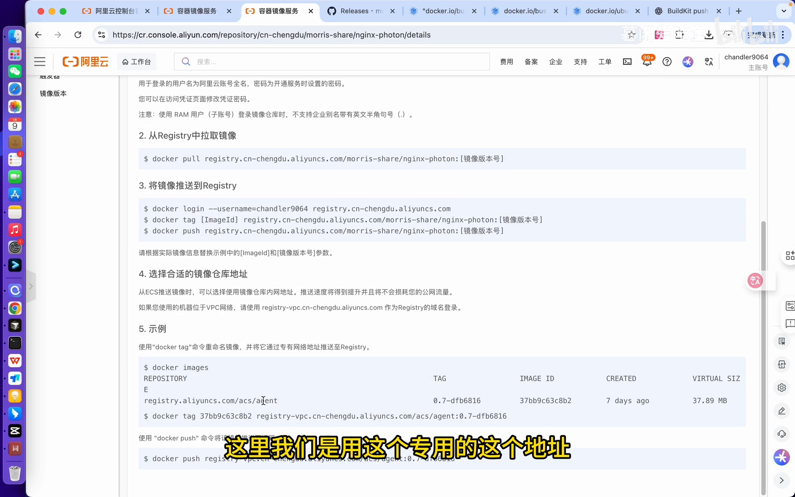

改好地址后重新执行第 3 节那条 `buildctl build ...` 命令，就能**快速推送成功**（[17:55](https://www.bilibili.com/video/BV12qrTBvEhU/?t=1075)）。

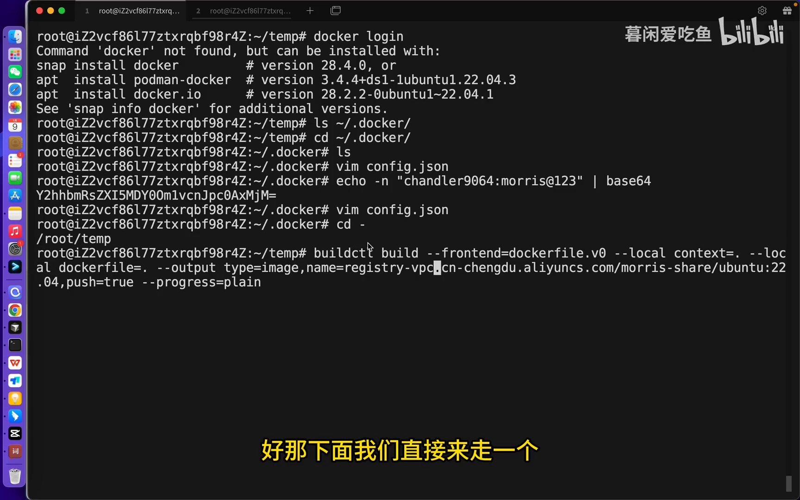到镜像仓库里刷新，能看到 `ubuntu` 仓库下已经有 `22.04` 版本；作者又随手改成 `22.05` 再推一次，两个版本都在（[18:23](https://www.bilibili.com/video/BV12qrTBvEhU/?t=1103)）。

## 小结

- **BuildKit 把构建能力从 Docker 里拆了出来**：`buildkitd` 干活、`buildctl` 发令，二者可分离部署——于是「不装 Docker 也能构建镜像」成立。
- **安装极简**：下载 release 里的二进制包，`tar` 解压到 `/usr/local` 即可。
- **构建**用 `buildctl build --frontend dockerfile.v0 --local ... --output type=image,name=...,push=true`，写法与 Dockerfile 通用。
- **复用 containerd 镜像**当 base 时，务必以 `--containerd-worker --oci-worker=false --containerd-worker-namespace=k8s.io` 启动 `buildkitd`。
- **推送认证**靠手写 `~/.docker/config.json`，镜像地址优先用走 VPC 的专用地址。

一句话记住全篇：**`buildkitd` 能单独部署，`buildctl` 能在任意地方构建、复用本机镜像、构建即推送。**

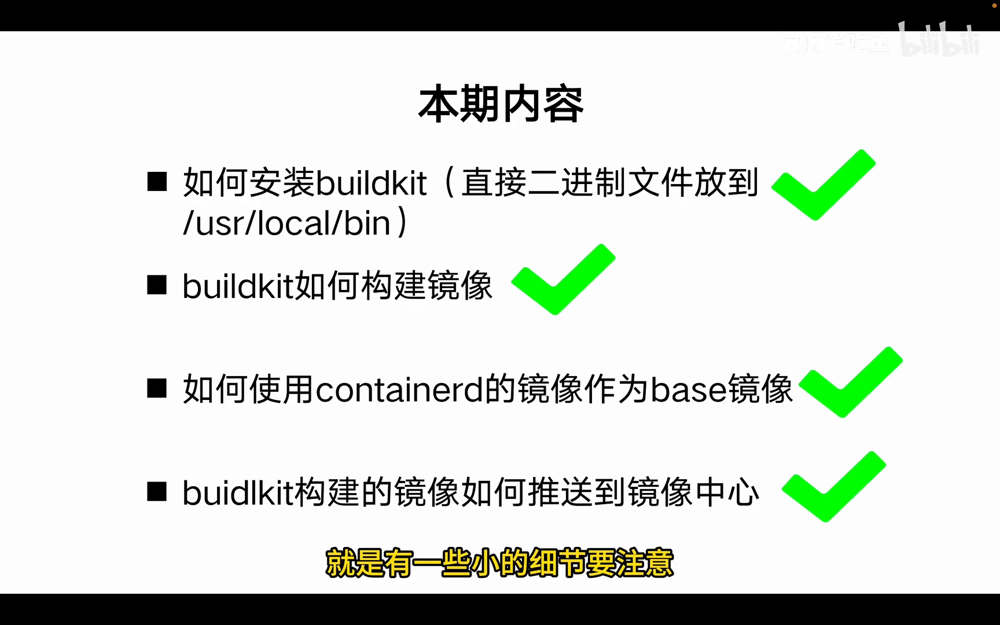
