# 联合挂载与 whiteout：被删掉的文件到底去哪了

> 视频来源：YouTube 视频 [Advanced Programming in the UNIX Environment: Week 3, Segment 6 - Union Mounts and Whiteout Files](https://www.youtube.com/watch?v=MkFExG9jhEE)（YouTube 频道 **cs631apue**，CS 631 课程，约 15 分钟）。本文基于视频演说图文稿整理；字幕为英文自动字幕，术语错拼已按上下文纠正；时间戳可跳转到原视频对应位置，配图取自视频画面。
>
> 配套阅读：[《联合文件系统：多个目录如何"叠"成一个，Docker 又怎么用它做镜像分层》]([技术]Docker核心原理 第3期 联合文件系统.md) 从 Docker 的视角讲联合文件系统的目录布局、只读层/可写层与写时复制实验。

## 本讲要解决的核心问题（SCQA）

**背景**：在 Unix 里，`struct stat` 的 `st_mode` 描述了一个文件的信息；我们熟悉的文件类型无非普通文件、目录、符号链接、socket 等几种。

**冲突**：有些系统上还会遇到一种罕见的文件类型——**whiteout（白障）文件**。它"明明列在那里"，却既读不到内容、也删不掉，让人一头雾水：这到底是什么？

**疑问**：whiteout 文件从哪来？它有什么用？要回答它，就必须先弄懂**联合挂载（union mount）**——把两个目录"叠"在一起以后，**同名文件谁覆盖谁**、**在联合视图里删掉一个文件又会发生什么**。

**回答（中心思想）**：联合挂载把下层（lower）与上层（upper）两个目录合并成一个视图，**同名的文件以上层为准**。而**删除一个下层也存在的文件**时，上层是只读以下无法真正删除下层那份；于是系统在上层生成一个 **whiteout 文件**，用它**遮住**下层同名文件，让它在联合视图里"消失"。理解 whiteout，就理解了"删除在联合文件系统里究竟意味着什么"。

---

## 一、whiteout 文件是什么：一句话先给结论

这期视频其实从一个常见疑问讲起：很多同学在学完 `struct stat`、看完文件类型之后，[会遇到一种没讲过的文件类型](https://www.youtube.com/watch?v=MkFExG9jhEE&t=42)——**whiteout 文件**。它的作用一句话就能说清：

> **当联合挂载的上层里某个文件被删除、而下层还留着同名文件时，系统用它来"藏住"下层那份文件。**

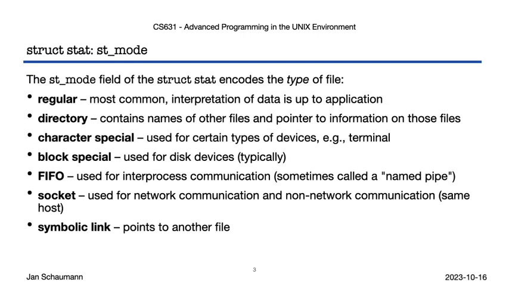

要真正理解它，得从**联合挂载**说起。

## 二、联合挂载（union mount）：把两个目录叠成一个

所谓**联合挂载**，就是**把一个目录挂到另一个目录之上**，让两个目录的内容**合并到同一个位置**一起可见。

设想两个目录：目录 1 里有一个子目录和几个文件，目录 2 里也有一个子目录和几个文件。把目录 2 **挂到**目录 1 之上以后，我们看到的就是两者的**并集**——子目录 1、子目录 2，以及所有的文件。

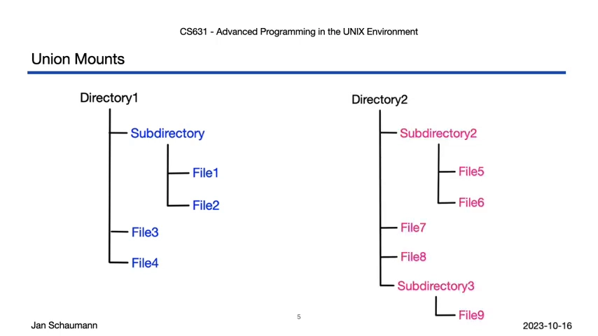

麻烦出现在**两个目录里有同名文件**的时候。下面这两个目录里，各自都有一个子目录和一个 `file three`：

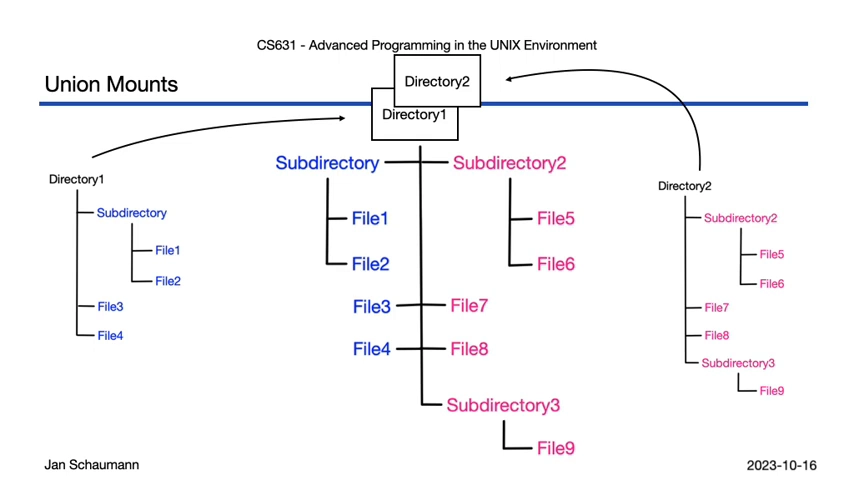

答案由"谁在上层"决定：这次是**目录 2 挂到了目录 1 之上**，所以**目录 2 在上层**。于是：

- 两个子目录会**合并**：既能看见目录 2 里的 `file five`，也能看见目录 1 里的 `file one`、`file two`；
- 而同名的 `file three`，**上层（目录 2）的那份覆盖了下层（目录 1）的那份**。

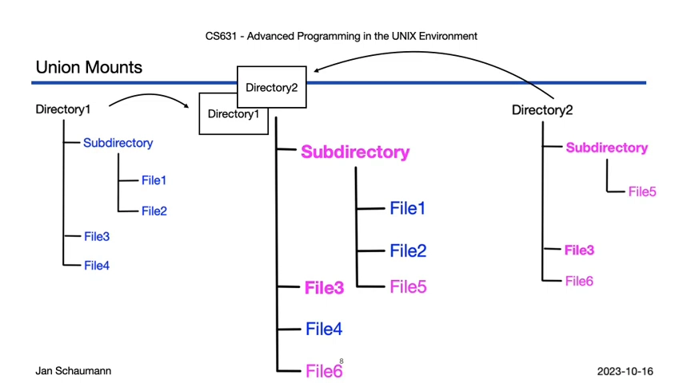

## 三、同名文件怎么覆盖、删掉的文件去哪了

覆盖清楚了，但**删除**才引出了 whiteout。

假如我们现在在联合视图里**把 `file three` 删掉**——注意，删除动作发生在**上层（目录 2）**里，于是目录 2 里的 `file three` 没了。可**下层的目录 1 里，`file three` 还在**。

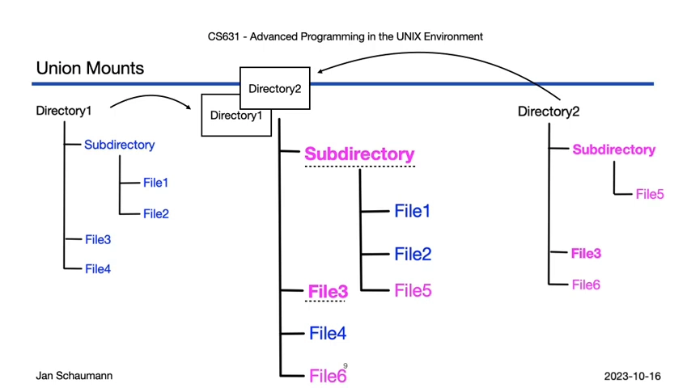

问题来了：如果此时**下层的 `file three` 又冒出来**，用户会觉得莫名其妙——"我明明删了它"。所以系统需要一种办法，**把下层那个文件盖住、让它看不见**。

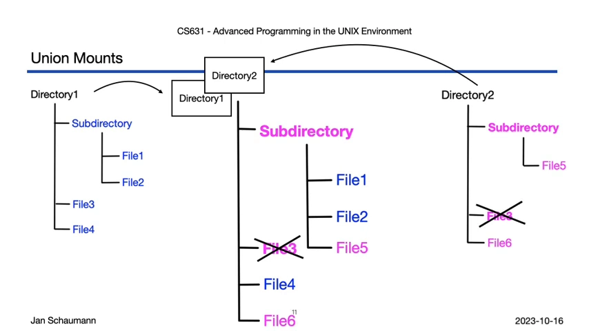

于是 **whiteout 文件登场**：联合文件系统意识到"上层删掉了一个下层仍存在的文件"，就**当场生成一个 whiteout 文件**把下层那份藏起来。等你把联合文件系统卸载之后，会剩下原来的两个目录，而那个 whiteout 文件也随之消失（按理论如此）。

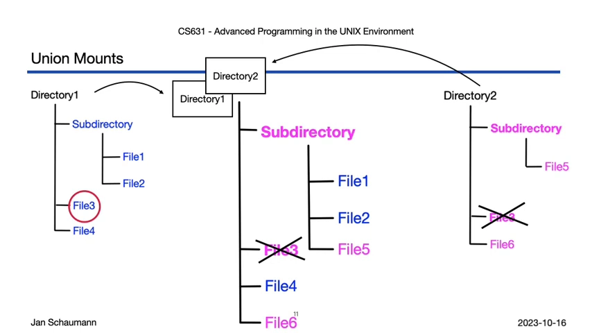

## 四、动手：手工做一次 union mount

光讲概念不够，视频在 **NetBSD**（课程的参考平台）上做了实测。先看一眼 `mount_union` 的手册页——它描述的正是上面那套逻辑：把一个目录挂到另一个之上，让两者的内容一起可见。

实验准备了两套目录：

- 一个 **lower（下层）目录**；
- 一个 **upper（上层）目录**，用于**挂到 lower 之上**。

两个目录里都放了若干目录和普通文件：upper 里有 `udeer`（子目录）等；lower 里除了一部分**与 upper 同名**的文件（`file one`、`file two`，以及 `udeer` 子目录里的 `file three`）之外，还有名字不同的 `file four`、`file five`。为了直观，两个目录里同名文件的**内容不同**——下层那份会写明"这是下层目录里的 file one"，上层同理。

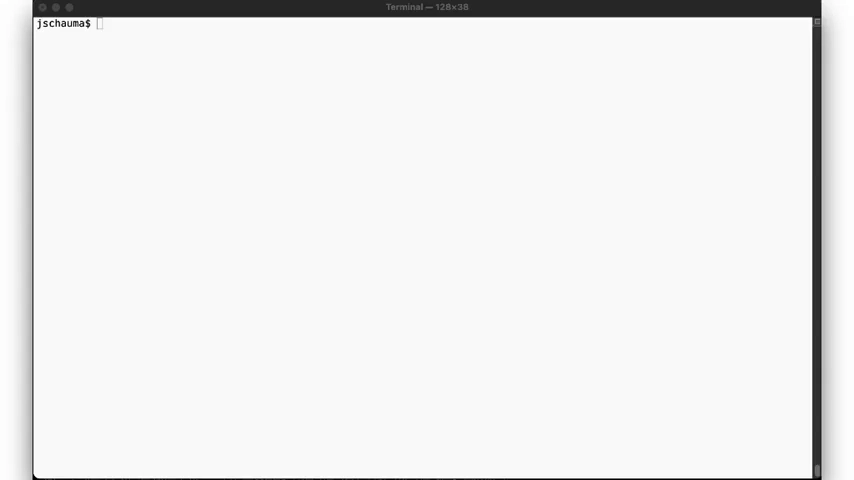

然后执行 `mount_union` 命令，把 upper 挂到 lower 之上，再进入合并后的目录。视频里还特意先建了一个名为 `union` 的符号链接指向 lower 目录，好提醒自己"现在站在哪一层"。

在这个目录里 `ls -l`，看到的正是**两个目录的并集**：`udeer` 里的 `file one`、`file two`，以及 upper、lower 各自的文件都在；子目录 `udeer` 里同样能看到两层的 `file three`。再 `cat file one`，读到的是**上层（upper）的版本**——正如预告，同名文件**上层覆盖下层**。

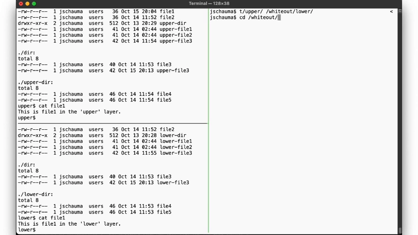

## 五、whiteout 文件长什么样

接下来做个**关键动作**：在联合视图里 **`rm file one`**。

果然，文件从联合视图里消失了；单独去看 upper 目录，它也确实不在那儿了。但——请用带 **`W`** 标志的 `ls`（让 whiteout 文件显形）再看一次，会发现出现了一个**名字叫 `file one` 的文件**。

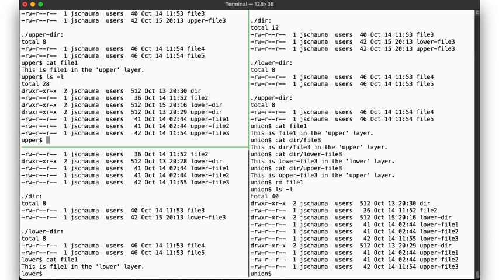

这个文件很"另类"：它的**类型是 `w`（whiteout）**，**硬链接数为 0、文件大小为 0 字节**，而且**删不掉**——它**并不是一个真实存在的文件**，只存在于联合挂载之中，专门用来盖住下层那个仍然存在的 `file one`。

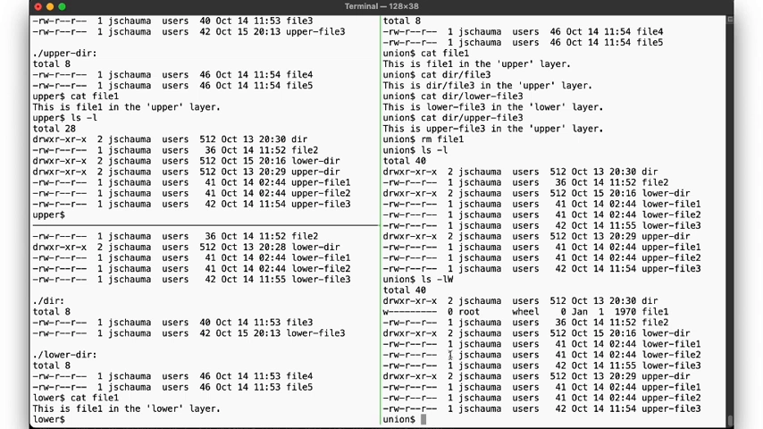

## 六、卸载之后：lower 不变，upper 记下变化

再把联合文件系统**卸载**，去看两个原始目录的变化：**lower 里的 `file one` 依然健在**，而 **upper 里已经没有它了**。换句话说，**"删除"这个动作发生在上层、只改动了 upper，下层原封未动**。

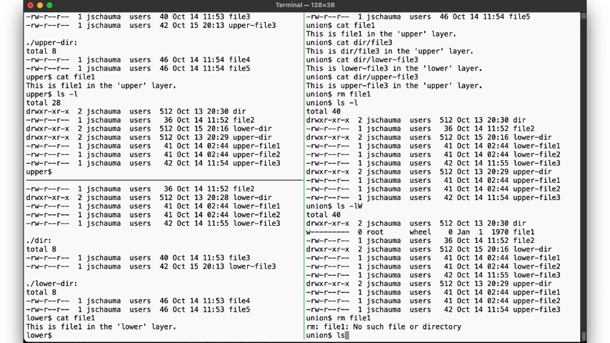

反过来也能验证：重新挂载联合文件系统，这次在联合视图里**编辑（重建）`file one`**，那么它会被**创建在上层**，同时那个 whiteout 文件自然也就不需要了、随之消失。卸载后再看——lower 里的 `file one` 还是老样子，而上层里**新创建的那份会保留下来**。

## 七、影子目录：upper 里为什么凭空多出一个 lower 目录

实验里还有个耐人寻味的现象：某次观察 upper 目录时，**upper 里突然冒出一个名为 `lower` 的目录**，长得跟下层那个 `lower` 目录很像，但**里面是空的**。

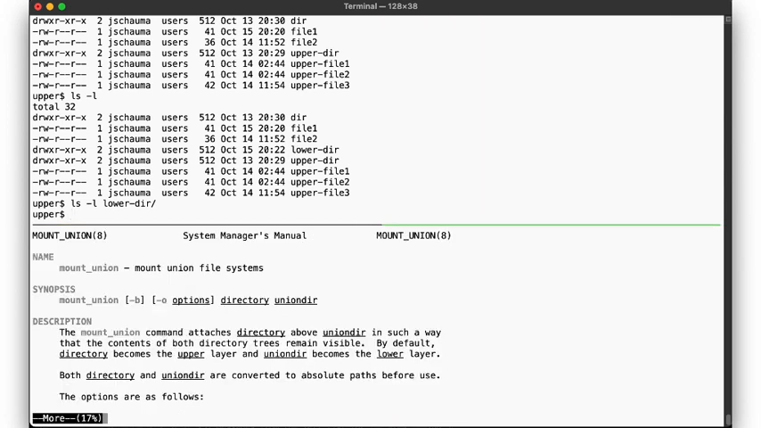

手册页给出了解释：查找文件名时，**先查上层、再查下层**；**如果某个目录的名字在上层里没有对应项，就会创建一个"影子目录（shadow directory）"**。也就是说，**当我们第一次去访问一个只存在于下层的目录时，联合文件系统会在上层把对应目录创建出来**——所以**遍历一次联合挂载，就会把整个目录层级在上层复制出来**。

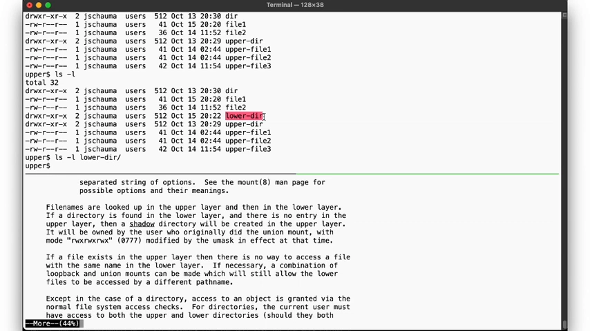

## 小结

视频最后用一页幻灯片做了回顾，联合挂载的几条规则可以总结成：

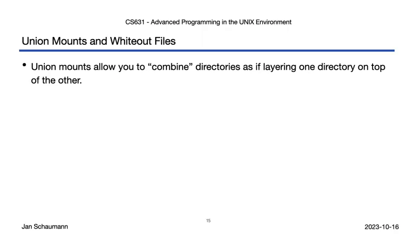

- **联合挂载**在操作系统支持时，能把多个目录**像叠积木一样叠起来**、让内容一起可见；
- **同名文件以上层为准**，上层的那份"盖住"下层；
- 如果上层要**删除**一个下层仍存在的文件，就会生成一个 **whiteout 文件**把它藏住；
- 访问只存在于下层的目录时，会在上层生成**影子目录**；
- `ls -W` 能列出 whiteout 文件，代码里可用 **`S_ISWHITEOUT`** 这类宏来判定它（和判断其它文件类型的方式一致）。

> **平台差异提醒**：whiteout 文件和联合文件系统的支持情况**因操作系统而异**——视频演示基于 **NetBSD**，别的 Unix 版本未必以相同方式支持。实际使用时，务必查一下**本机的手册页**。
