# 联合文件系统：多个目录如何"叠"成一个，Docker 又怎么用它做镜像分层

> 视频来源：Bilibili 视频 [[技术]Docker核心原理 第3期 联合文件系统](https://www.bilibili.com/video/BV1iY4y1o7mz/)（UP 主 **guangju_**，约 15 分 40 秒）。本文基于视频演说图文稿整理，时间戳可跳转到原视频对应位置；配图取自视频画面。字幕来自 B 站 AI 字幕，错拼已逐窗口核对纠正。
>
> 配套阅读：[《联合挂载与 whiteout：被删掉的文件到底去哪了》](Union_Mounts_and_Whiteout_Files.md) 从 Unix 系统编程的角度，用一个可动手的实验讲清联合挂载的查找规则、whiteout（白障）文件与影子目录。

## 本讲要解决的核心问题（SCQA）

**背景**：Docker 镜像是"一次构建、到处运行"的，同一个镜像可以同时跑起许多个容器，而镜像本身始终不被改动。

**冲突**：容器一跑起来总要写日志、改配置、生成临时文件。如果每个容器都去改动这份被共享的镜像内容，容器之间就会互相污染，镜像也就无法被复用。

**疑问**：一份**只读**的镜像，怎样才能让每个容器都"觉得自己独占一套文件系统"？来自不同地方的多个目录，又凭什么能被看成一个整体？

**回答（中心思想）**：靠**联合文件系统（Union File System，简称 unionfs）**。它把多个目录（分支）**联合挂载**到同一个挂载点，对外只呈现**一个单一的文件系统**；再配合**只读层 + 可写层**和**写时复制（copy-on-write）**，多个容器就能共享同一份只读镜像层，各自只在上面的可写层里做修改，从而互不影响。**联合文件系统是 Docker 三大核心技术的最后一块拼图**（另外两块是命名空间和 cgroups）。

---

## 一、什么是联合文件系统：多个目录，一个视图

[先记住一句话](https://www.bilibili.com/video/BV1iY4y1o7mz/?t=5)：联合文件系统是一种**分层的、轻量级的文件系统**，它能把**多个目录的内容联合挂载到同一个目录下，形成一个单一的文件系统**。也就是说，我们对外只看到一个普通目录，背后却是由好几层拼出来的——这里的"文件系统"更多是一个**概念**，实现它的具体方式有很多种。

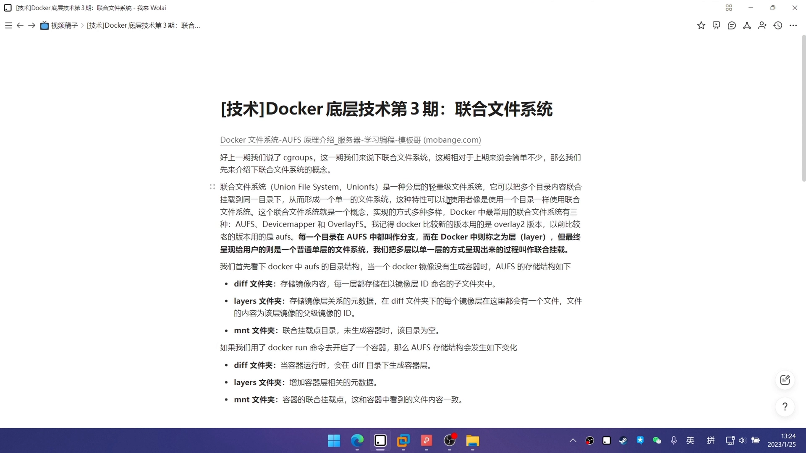

Docker 里最常用的联合文件系统主要有三种，其中**较新的 Docker 版本默认用 overlay2**，**较老的版本则用 aufs**（正是本讲要做实验的那一种）。有个称呼上的差异要记住：**在 aufs 里每个目录叫"分支"，而在 Docker 里把它叫作"层"**。

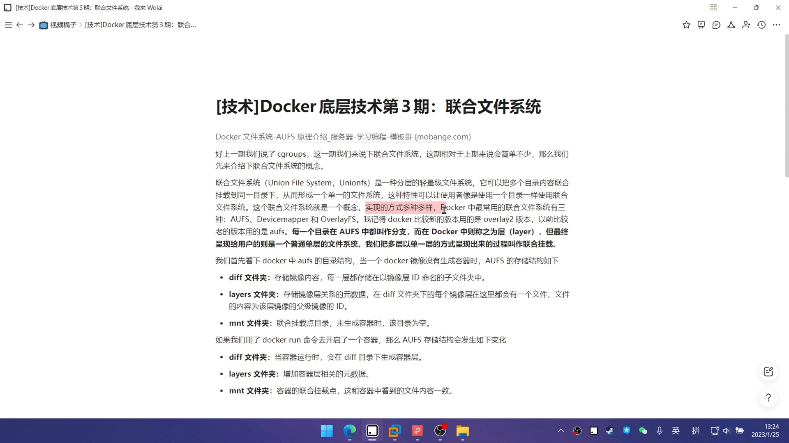

把多层（多个分支）**用单一层的方式呈现出来**的过程，就叫**联合挂载**——说白了，就是把多个文件夹挂到同一个文件夹上。

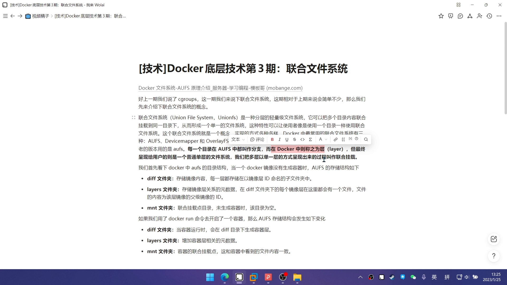

## 二、Docker 里 aufs 的目录布局：layers、diff、mnt

接着看 Docker 内部是怎么摆这些层的。先说明一点：**aufs 需要较老的 Linux 内核**才支持，较新的内核已经不再支持它（可以用命令查一下当前内核是否支持这个文件系统）。

aufs 默认的文件系统位置在 `/var/lib/docker/aufs` 下，[分为三个文件夹](https://www.bilibili.com/video/BV1iY4y1o7mz/?t=133)：`layers`、`diff`、`mnt`。实验开始前这三个文件夹都是空的（因为既没有镜像、也没有容器）。

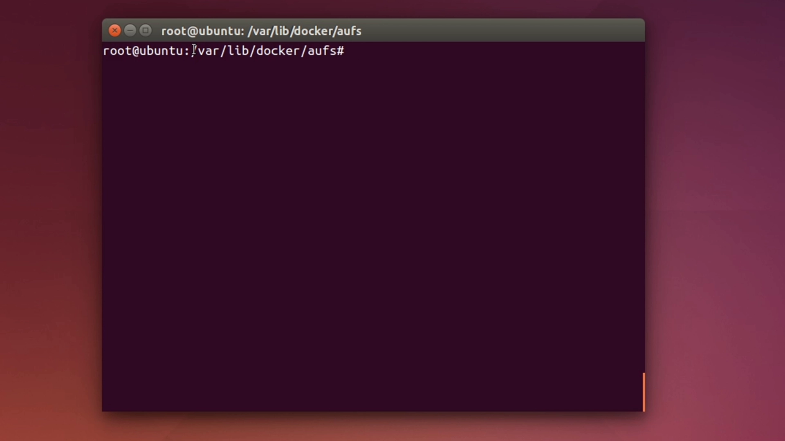

拉取一个 Ubuntu 镜像之后，再逐个看这三个目录：

- **`layers`**：存的是**镜像层之间的关系**。它为每个镜像层生成一个文件，**文件名就是该层的 id，文件内容记录的是这一层的父（上层）镜像 id**。这里有四个文件，说明这个镜像一共四层。
- **`diff`**：**真正存放镜像文件内容**的地方。它同样为每个镜像层生成一个以层 id 命名的子文件夹，进去就能看到 `etc`、以及 Linux 的根目录等真实内容。
- **`mnt`**：容器的**联合挂载点**，也就是我们真正去读写操作的那个目录。

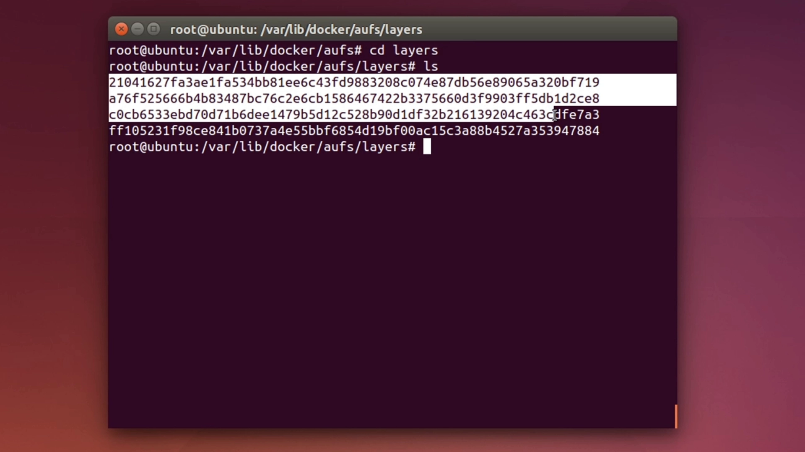

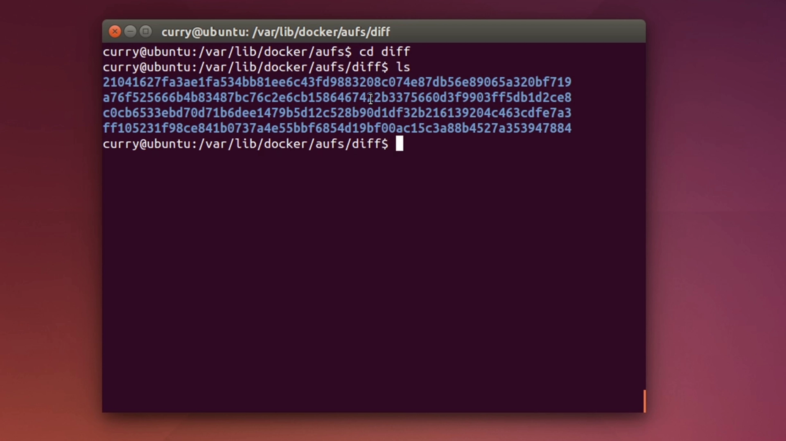

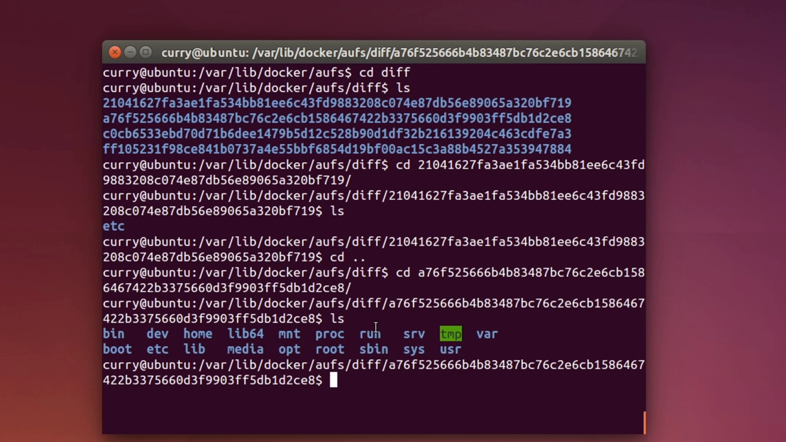

## 三、启动容器：多出一个只读层和一个可写层

运行一个容器后再看 `layers`，会发现比之前[多出两个新文件](https://www.bilibili.com/video/BV1iY4y1o7mz/?t=356)。原因是 **docker run 启动容器时，Docker 会额外创建两层**：

- 一个**只读层**：用来存放与这个容器内环境相关的内容；
- 一个**读写层**：用来承载容器运行中的所有写操作。

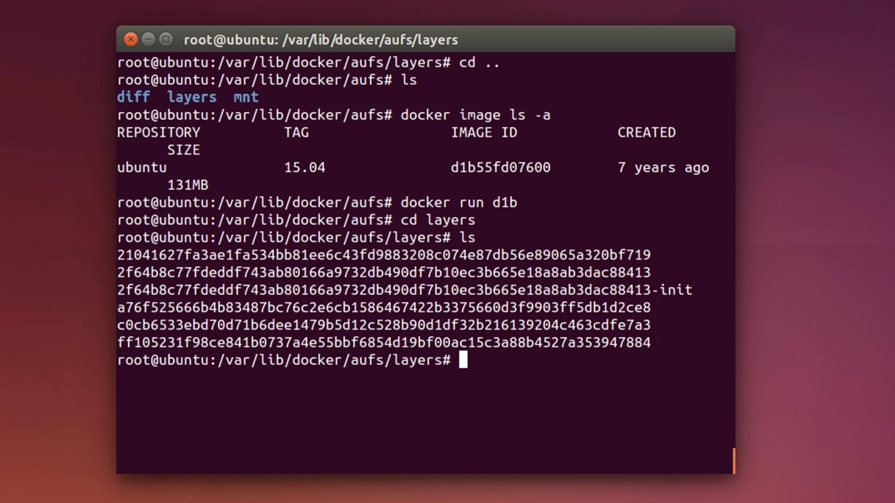

这也解释了一个常见现象：**容器停掉后，这两层对应的文件依然还在**；只有**把容器删除**，它们才会一起消失——也就是"重启容器不丢数据，删除容器才丢"。

## 四、aufs 的工作原理：写时复制与删除的处理

aufs 对文件修改采用的核心机制是**写时复制（copy-on-write）**：当我们**第一次修改**某个文件时（例如在容器内改一个文件），aufs 会**先把文件从镜像层复制到容器层，再在容器层里对它进行修改**。这样镜像层永远保持原样。

**删除**要更巧妙一些：因为**镜像层是只读的**，没法直接在里面删掉文件。aufs 的做法是**创建一个特殊的文件（或目录）**，用它来**"挡住"对下层同名文件的访问**——就像在容器里贴了一张封条，让这个文件在联合视图里"消失"，但它在下层其实原封未动。

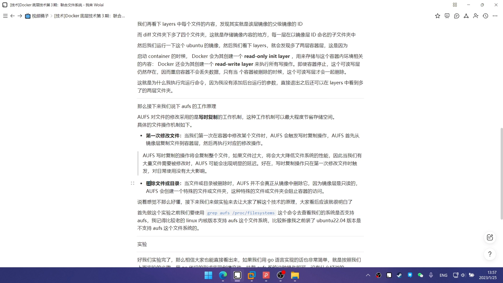

> 这个"特殊文件"在配套文章里会专门展开，它就是 **whiteout（白障）文件**。

## 五、亲手验证写时复制

最后用一个小实验把写时复制看个真切。先在一个目录下建立一个 aufs 工作目录，依次创建**一个容器层**和**两个镜像层**，并在里面各放一个文件、各写一句话；再建一个**挂载点**，用挂载命令把它们联合挂载起来。

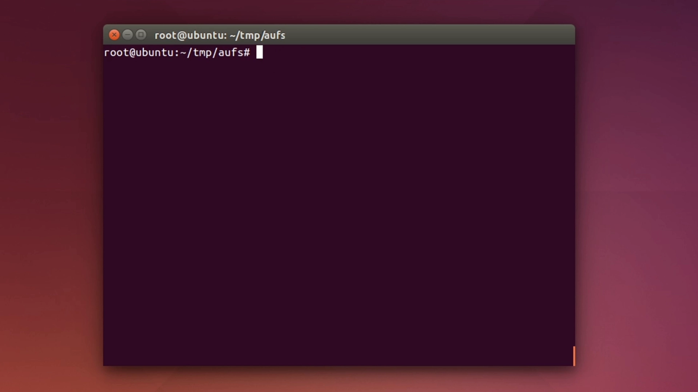

挂载成功后动手改一改：先去改"镜像一"里那个文件的内容，再看各层的变化。

- **镜像层里的文件没有改变**——证明它始终没被写入；
- **容器层里却多出了一个同名文件**，内容正是我们刚才改过的值——说明 aufs 在第一次修改时**自动把文件从镜像层复制到了容器层**。

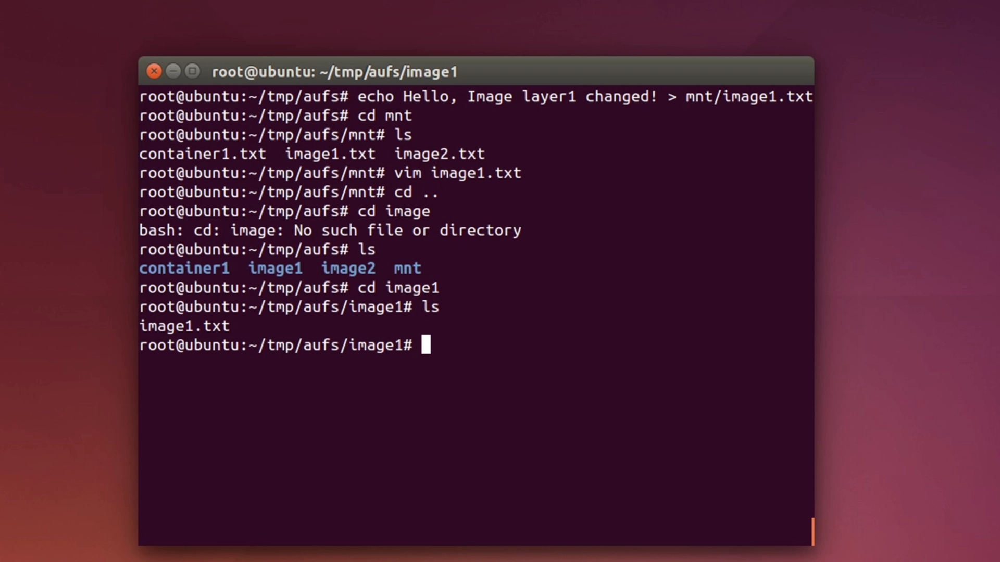

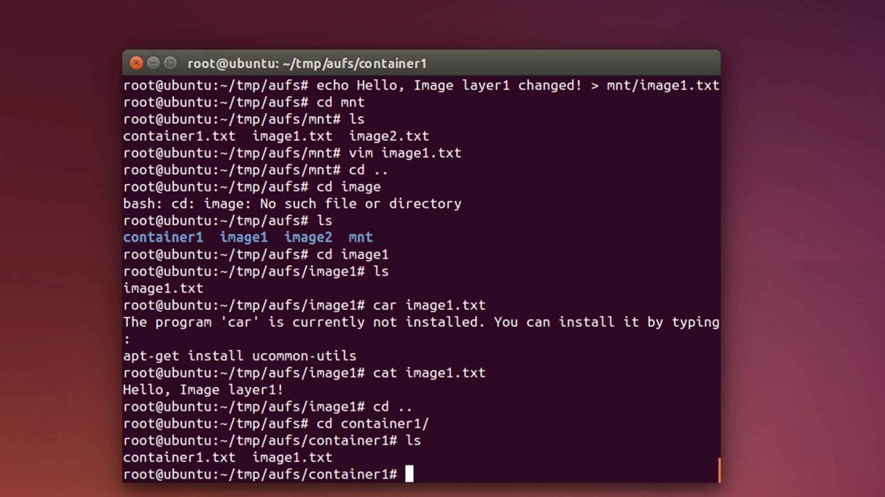

这就完整印证了 aufs 最典型的特性——**写时复制**：**第一次修改镜像内文件时，aufs 先把文件复制到容器层，然后在容器层对它进行修改**。作者也顺带提到，如果要用 Go 自己实现一套，按同样的步骤（创建文件 + 挂载 aufs 文件系统）去做，其实就是这么简单。

## 小结

- **联合文件系统**把多个目录（分支）**联合挂载**成**一个单一的文件系统视图**，这是容器镜像"分层"的基础；
- Docker 中常见的实现有 **aufs、overlay2** 等，新版本默认 `overlay2`、老版本用 `aufs`；aufs 里叫"分支"、Docker 里叫"层"；
- Docker 的 aufs 目录下三件套：**`layers` 存层间关系、`diff` 存真实内容、`mnt` 是联合挂载点**；
- 启动容器会**新增一个只读层和一个可写层**，容器删除时这两层才消失（重启不丢数据）；
- **写时复制（copy-on-write）**：改文件时先把文件从镜像层复制到容器层再改，**镜像层永远只读**；
- **删除**因为镜像层只读而不真删，而是**创建一个特殊文件把下层文件"挡住"**——这个机制就是下一篇文章的主角。

## 关键术语速查

| 术语 | 一句话解释 |
| --- | --- |
| 联合文件系统（unionfs） | 把多个目录联合挂载成单一视图的分层文件系统，是容器分层的基础 |
| 分支（branch）/ 层（layer） | 同一概念的两种叫法：aufs 里叫分支，Docker 里叫层 |
| 联合挂载（union mount） | 把多个分支合并成一个视图的过程 |
| 只读层 / 可写层 | 容器中镜像层只读、容器层可写，改动只落在可写层 |
| 写时复制（copy-on-write） | 改文件时先复制到上层再改，下层保持只读不变 |
| whiteout（白障）文件 | 删除下层文件时创建的特殊文件，用来在下层"遮住"它 |
