# 从零看懂容器文件系统：OverlayFS 如何用 lower/upper/merged 搭出容器 rootfs

> 视频来源：YouTube 视频 [Docker Storage Deep Dive: How OverlayFS Builds Container Filesystems](https://www.youtube.com/watch?v=vsYb3_xjCz8)（约 17 分 30 秒，英文讲解）。本文基于视频演说图文稿整理，时间戳可跳转到原视频对应位置；配图取自视频画面。字幕来自平台自动字幕（英文 ASR），术语与错拼已逐窗口核对纠正。
>
> 配套阅读：内核机制层可看[《OverlayFS 实战：upper/lower 目录、copy-up 与 whiteout 文件》](Understanding%20OverlayFS%20｜%20OverlayFS%20｜%20Docker.md)，中文全流程演示见[《overlay2 文件系统：Docker 默认存储驱动如何把多个目录合并成一个》](深入理解docker和kubernetes（k8s）-5.overlay2文件系统.md)。

## 本讲要解决的核心问题（SCQA）

**背景**：上一讲我们**用 rootfs 从零搭出过一个容器文件系统**，但那样**每个容器都得复制一份**，磁盘开销随容器数量线性增长，**完全无法规模化**。

**冲突**：既要让所有容器**共享同一份基础镜像**，又要让每个容器**感觉自己独占一套文件系统**、改动互不干扰——这两件事看起来是矛盾的。

**疑问**：容器究竟是怎么做到"大家共用一个底座、却能各自独立"的？我们自己能不能**不借助 Docker/Podman、只用 Linux 原语**搭出同样的东西？

**回答（中心思想）**：靠 **OverlayFS**。它用**只读的 lower 目录（基础镜像层）** + **可写的 upper 目录（容器改动）** 合成一个 **merged 视图**，而这个视图**在磁盘上并不真实存在、是运行时"算"出来的**。**读**时 overlayfs 自上而下逐层查找（upper 优先），**写**时全部落进 upper（新建直接放 upper、修改走 copy-on-write、删除用 whiteout 遮挡）。把 **namespaces + overlayfs** 合起来，就是容器。本讲先拆解真实容器，再**亲手从零把一个容器文件系统搭出来**。[【跳转到 00:00】](https://www.youtube.com/watch?v=vsYb3_xjCz8&t=0)

---

## 一、先建立心智模型：lower / upper / merged 与"视图即决策"

先看一张必须记住的图。它把容器的文件系统拆成三块：[【跳转到 00:33】](https://www.youtube.com/watch?v=vsYb3_xjCz8&t=33)

- **lower 目录（右侧的方块）**：代表**基础镜像**，里面已经有 `file1.txt`、`config.txt` 之类的文件。**铁律是：我们绝不修改这一层**——把它想成一份**只读的参考底本**。
- **upper 目录**：容器**所有变化**都进这里——**修改进这里、新建进这里、删除也记在这里**。
- **merged（合并视图，最上面）**：**容器看到的、应用直接交互的那个视图**。

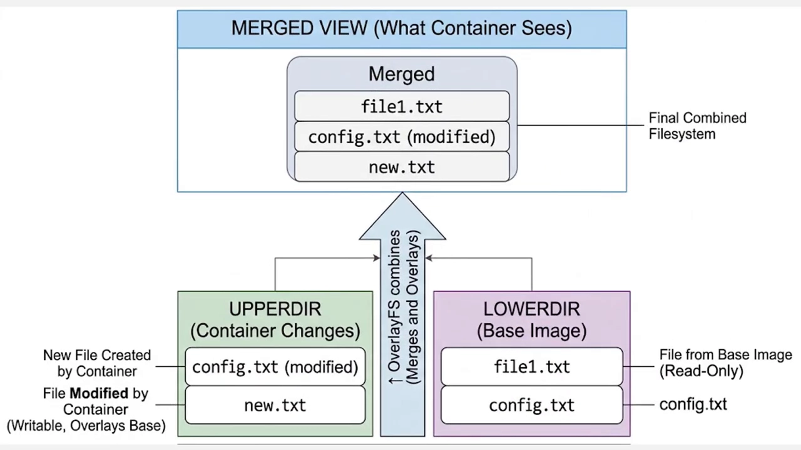

最关键的一点必须理解透：**磁盘上并没有发生任何真正的"合并"**，merged 是**运行时计算**出来的。当进程索取 `config.txt` 时，overlayfs **先查 upper**，找不到再查 lower。所以记住这句话——**merged 视图是一个"决策"，不是一次"拷贝"**。

## 二、动手：检查内核支持并搭好目录

要自己搭，先得确认**内核是否支持 overlayfs**：`grep overlay /proc/filesystems`，如果能看到 `overlay`，就说明内核支持。[【跳转到 01:28】](https://www.youtube.com/watch?v=vsYb3_xjCz8&t=88)

接着建立演示目录：`mkdir overlay-demo` 进去后，创建**四个各司其职的目录**——`lower`、`upper`、`working`、`merged`。它们的角色和心智模型一一对应：[【跳转到 01:58】](https://www.youtube.com/watch?v=vsYb3_xjCz8&t=118)

- **lower**：基础镜像，**只读参考**；
- **upper**：容器产生的改动；
- **working**：内核要求的**内部工作区**；
- **merged**：进程最终看到的视图。

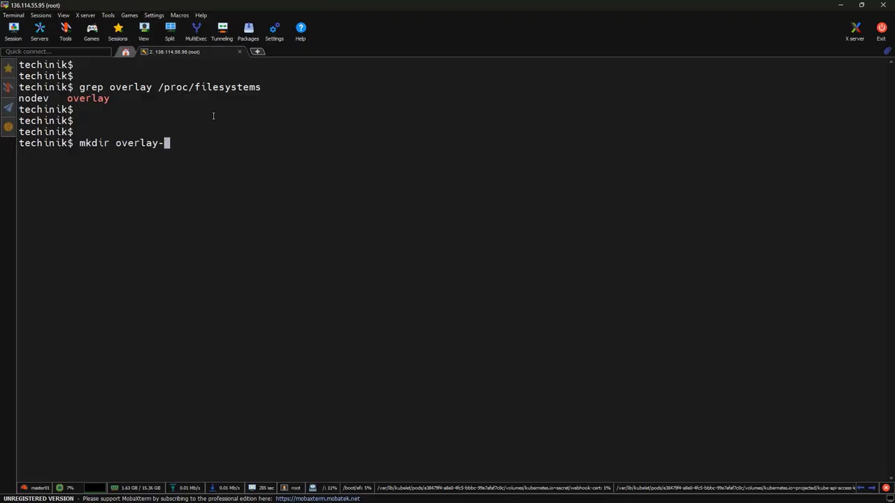

> 这套结构与容器文件系统**内部真实的组织方式完全一致**——不是教学玩具。

随后**模拟一个容器镜像**：在 `lower` 里手动造文件——`echo "hello from base image" > lower/file1.txt`、`echo "config v1" > lower/config.txt`，再 `mkdir lower/data` 并写入 `lower/data/info.txt`。把这一步想象成 **`docker pull` 下来一个镜像**：底座里已经有应用文件和配置文件。

## 三、挂载：一条命令把目录"连"起来

用 `mount -t overlay overlay -o lowerdir=lower,upperdir=upper,workdir=working merged` 把一切连起来。[【跳转到 03:38】](https://www.youtube.com/watch?v=vsYb3_xjCz8&t=218)

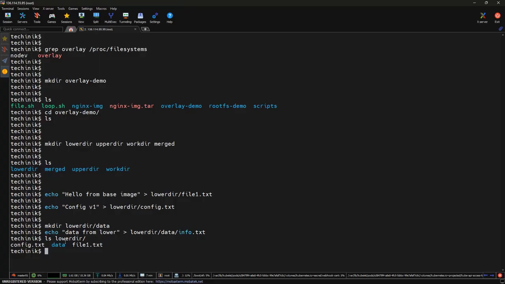

拆开看这条命令：`-t overlay` 告诉 Linux 用 overlayfs；后面依次指定 **lower 目录（基础层）**、**upper 目录（可写层）**、**working 目录（临时工作区）**，最后是 **merged 目录（最终视图暴露处）**。注意：**这条命令并不复制文件，它创建的是一个虚拟的文件系统视图**——这正是 Docker 内部所做的。

挂载后用 `df -h` 就能看到 `merged` 上挂了一个 **overlay** 类型的文件系统。[【跳转到 04:28】](https://www.youtube.com/watch?v=vsYb3_xjCz8&t=268)

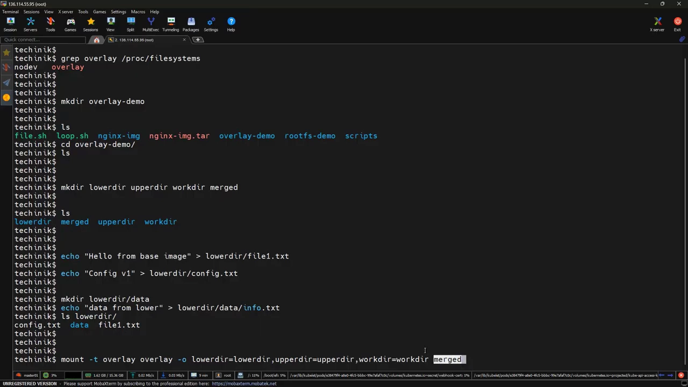

## 四、验证"读"：文件看起来在 merged 里，其实没有被复制

`ls merged` 会有个有意思的现象：这些文件**看起来就存在于 merged 目录里，但它们并没有被物理复制过去**——只是**从 lower 动态读取**，由 overlayfs 决定该展示什么。[【跳转到 04:40】](https://www.youtube.com/watch?v=vsYb3_xjCz8&t=280)

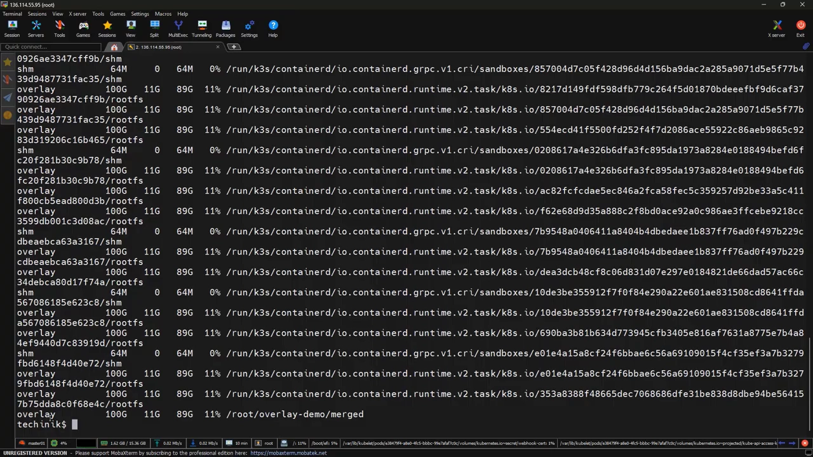

逐步核对：

- `cat merged/config.txt` 与 `cat lower/config.txt` 内容**相同**——前者从 merged 视图读、后者直接从基础层读，基础层**保持不变**；
- `ls upper` 此刻是**空的**——因为还没新建、也没修改任何东西。

## 五、验证"写"：新建进 upper，修改走 copy-on-write

在 merged 里新建一个文件：`echo "new file" > merged/new.txt`。再看 `ls upper`——**`new.txt` 也出现在了 upper 里**，内容一致；而 `ls lower` 里**没有** `new.txt`。这说明**新建文件是直接创建在 upper 里的**：upper 是可写层，承载修改与新建，**不会去更新 lower**。[【跳转到 05:40】](https://www.youtube.com/watch?v=vsYb3_xjCz8&t=340)

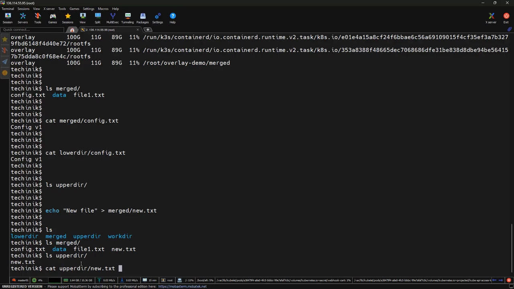

这就是 **copy-on-write（写时复制）** 的思路——**先复制、再修改**。它也正是**容器之所以快**的原因：容器**不会在启动时把所有东西都复制一遍**，而是**按需复制**。

## 六、验证"删"：删除不是移除，而是遮挡

接下来是**最容易让人困惑的部分——删除**。如果要删的文件**存在于基础层**，又不能改基础层，那怎么"删"？在 merged 里 `rm merged/file1.txt`，然后看点内部发生了什么：[【跳转到 07:10】](https://www.youtube.com/watch?v=vsYb3_xjCz8&t=430)

- `ls merged`：`file1.txt` **不见了**；
- `ls upper`：**出现了 `file1.txt`，但它是一个 whiteout 文件**——不是真实文件；
- `ls lower`：`file1.txt` **依然存在**，内容也还在。

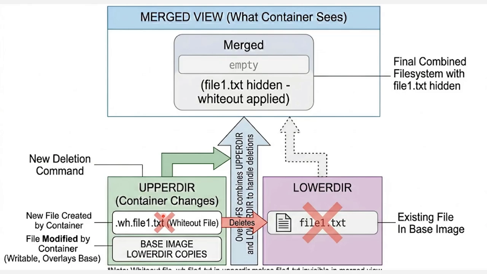

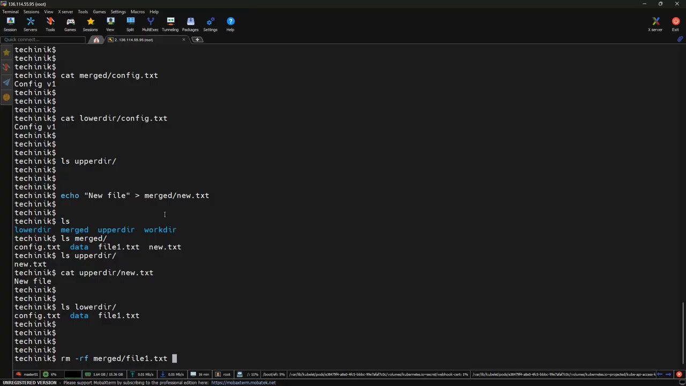

用图来解释：因为 overlayfs **无法删除 lower**，它干脆在 upper 里放一个**标记**，告诉系统"**从最终视图里把这个文件藏起来**"。所以——**删除不是移除，只是遮挡**：文件仍在 lower 里活着，只是容器再也看不见它了。

## 七、把整幅图拼起来：OverlayFS 是如何工作的

[【跳转到 08:39】](https://www.youtube.com/watch?v=vsYb3_xjCz8&t=519) 这是容器文件系统的**全貌**：

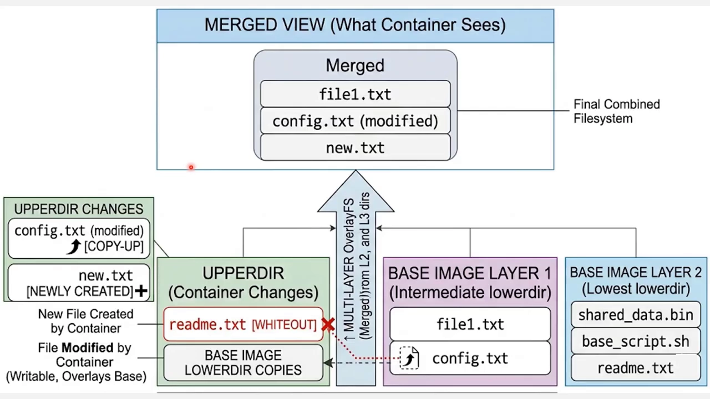

- **最上方是 merged 视图**：容器真正"看到"、应用交互的对象。里面可能有 `file1.txt`、`config.txt`、`new.txt`，其中 `config.txt` 是被修改过的那份。它**看起来**像一个普通文件系统，但**不是真的**——**这个视图是算出来的，不是存出来的**。
- **左侧是 upper 目录**：代表容器做过的全部改动。被改的 `config.txt` 是**先从 lower 复制到 upper、再修改**的；新建的 `new.txt` 直接放在 upper；还有一个被"删除"的 `readme.txt`——它**其实没被删，只是用 whiteout 标记遮住了**。**upper 里只有变化**。
- **右侧是基础镜像层**：比如 layer 2 有 `shared data`、`bin`、一个 bash 脚本和 `readme.txt`，layer 1 有 `file1.txt` 与 `config.txt`。**每一层只存"差异"，没有哪一层存着完整的文件系统。**
- **中间是 overlayfs**：它就是"魔法"发生的地方。它**不把所有内容真的合并**，而是创建一个**逻辑上的层叠栈**。当进程索取文件时：**先查 upper，再查最上面的层，再往下逐层查**——**自上而下**遍历。

由此得到三条简单规则：[【跳转到 10:08】](https://www.youtube.com/watch?v=vsYb3_xjCz8&t=608)

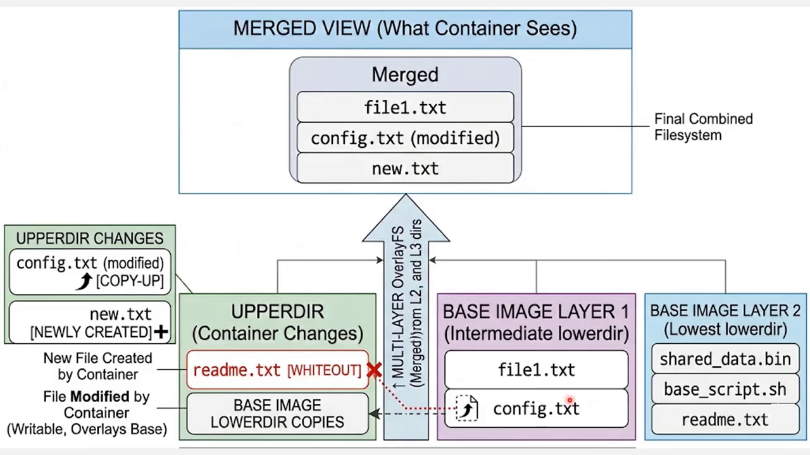

1. **upper 永远优先**：文件若在 upper 里，就用它，**不论下层是否存在同名版本**；
2. **删除不改下层，只用 whiteout 遮挡**；
3. **只在需要时才复制**：文件默认不复制，**被修改时才复制**——这就是只读层保持不变、容器又轻又快的原因。

把这几块连起来：**lower 有镜像层、upper 有容器改动、merged 是进程所见、overlayfs 负责决定展示哪个版本**。所以——**容器没有"自己的文件系统"，它们有的是"自己的一套文件系统视图"。**

## 八、回到真实容器：看看 Podman 内部到底是什么结构

以上都不只是理论，它正是**容器运行时每天在做的事**。先起一个真实容器：`podman run -d --name mynginx nginx`，`podman ps` 能看到它。[【跳转到 11:18】](https://www.youtube.com/watch?v=vsYb3_xjCz8&t=678)

再用 `podman inspect <容器ID> | jq .GraphDriver.Data` 查看它的**文件系统细节**。[【跳转到 11:43】](https://www.youtube.com/watch?v=vsYb3_xjCz8&t=703)

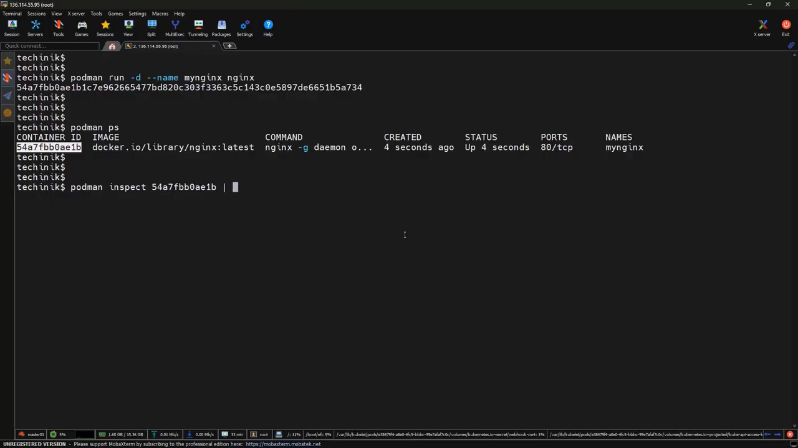

逐项解码，会发现它和我们手工搭的结构**一模一样**：

- **lowerdir**：里面有**多个层**——它**不是单个目录**，而是**多个层叠起来**，**每个路径对应一个镜像层**；而且**第一个路径是最上层、最后一个是最底层**（overlayfs 自上而下查找）；
- **upperdir**：**单个目录**，就是**容器的可写层**——我们前面手工制造的那些改动，在真实容器里就落在这里；
- **merged**：**容器最终看到的那份文件系统**。

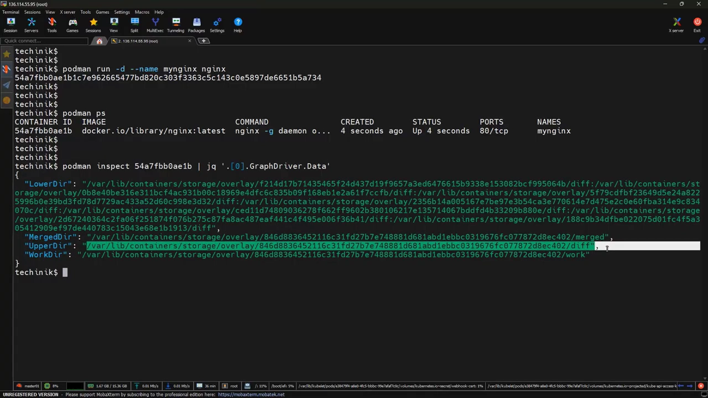

我们手工搭过的东西，**Podman / Docker 只是在自动完成而已**。

## 九、亲手从零搭一个容器：namespaces + overlayfs

最后演示**多数教程会跳过**的一步——**不用 Docker、不用 Podman，只用 Linux 原语造一个容器**。先记住：容器 = **隔离的文件系统 + 隔离的进程 + 隔离的网络**。[【跳转到 13:34】](https://www.youtube.com/watch?v=vsYb3_xjCz8&t=814)

第一步，用 **`unshare`** 造出隔离环境：`unshare --mount --uts --ipc --net --pid --fork --mount-proc bash`。进到新 shell 后 `echo $$` 会看到 **PID 1**。接着**把我们的分层文件系统挂进来**，还是那条 `mount -t overlay overlay -o lowerdir=... upperdir=... workdir=... /mnt` 命令，只不过这次是在**隔离环境里**执行。[【跳转到 13:59】](https://www.youtube.com/watch?v=vsYb3_xjCz8&t=839)

（视频里这里**打错了一个参数**：把 `lower directory` 误写成 `lower`，纠正后重新执行即成功——提醒我们目录名要严格对应。）

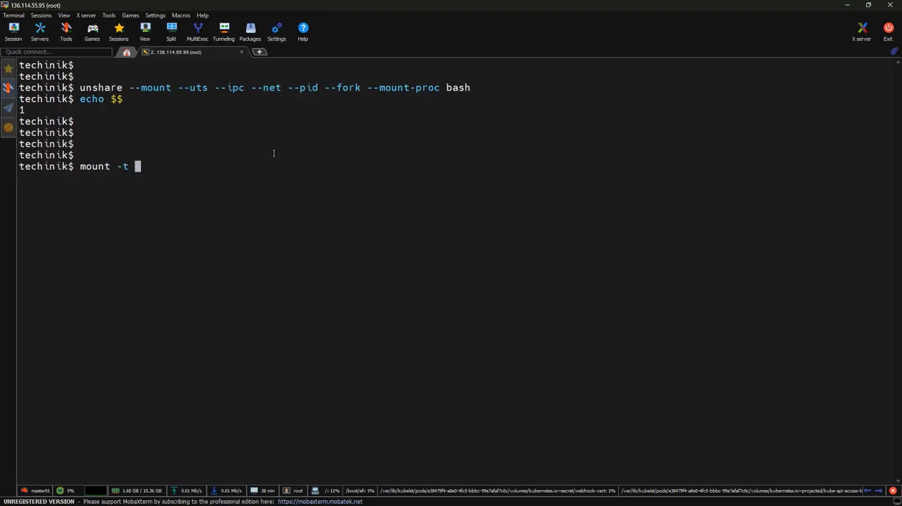

挂好后 `df -h`：新增了一项 `/mnt`，**文件系统类型是 overlay**——**`/mnt` 不再是一个普通目录，而是一整个 overlayfs 文件系统**。也就是说，`/mnt` 之前的"内容"不存在，是我们用一条 mount 命令**凭空造出了一个被 overlayfs 支撑的新视图**，Linux 把它当普通文件系统对待，因此也出现在 `df -h` 里。这正是**容器拿到文件系统的方式**：**一个挂载出来的 overlay，而不是一份复制出来的磁盘**。[【跳转到 14:49】](https://www.youtube.com/watch?v=vsYb3_xjCz8&t=889)

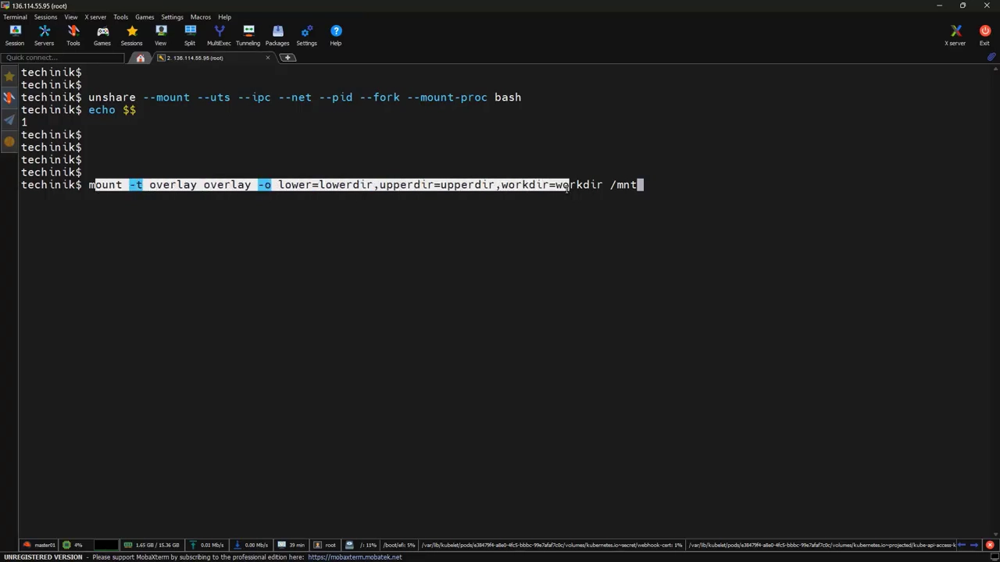

顺带注意它的**大小显示为 100 GB**——这个容量**来自底层文件系统**；overlayfs **本身并不永久存储数据**，它只是**借用**底层文件系统。

## 十、为什么容器高效：lower 共享、upper 独有

最后用量化实验收尾。在 `overlay-demo` 里执行 `du -sh lower directory` 和 `du -sh upper`：[【跳转到 16:03】](https://www.youtube.com/watch?v=vsYb3_xjCz8&t=963)**lower 占用很大**（它是基础镜像），而 **upper 很小**（它只有改动）。

放到真实系统里：当你跑 **100 个容器**时，它们**共享同一个 lower 目录**，只有 **upper 目录因容器而异**。这就是**容器轻量**的根因。至此，你不只是"用"容器，而是理解了**文件如何被共享、改动如何被隔离，而又不必复制基础镜像**。视频最后留下一个钩子：容器**不只用分层文件系统，还会把根目录整个换掉**——那就是 **pivot_root**，下一讲的主题。

## 小结

- 容器文件系统的心智模型：**lower（只读底座）+ upper（改动）= merged（容器所见）**；**merged 是运行时算出来的"决策"，不是磁盘上的拷贝**；
- **读**：overlayfs 从 upper 开始**自上而下**逐层查找，**upper 永远优先**；
- **写**：新建直接落 upper；修改走 **copy-on-write**（先复制到 upper 再改）；删除用 **whiteout** 遮挡（不真删下层）；
- **每条规则**：upper 优先、删除即遮挡、**只在需要时才复制**——这正是容器轻快的来源；
- 用 `grep overlay /proc/filesystems` 可查内核支持；手搭结构就是 `lower/upper/work/merged` 四目录 + 一条 `mount -t overlay`；
- **真实容器**（`podman inspect` 的 graphdriver.data）就是这个结构：**lowerdir 多个层、upperdir 一个可写层、merged 一处视图**；
- **namespaces（unshare）+ overlayfs（mount）= 一个容器**；100 个容器共享 lower、各有 upper，所以**轻量**。

## 关键术语速查

| 术语 | 一句话解释 |
| --- | --- |
| OverlayFS | Linux 联合文件系统，容器文件系统的实现基础 |
| lower 目录 | 只读的镜像层（可多层叠加） |
| upper 目录 | 可写的容器改动层，只有一个 |
| merged 视图 | 运行时计算出的、容器所见的文件系统视图 |
| working 目录 | 内核要求的内部工作区 |
| copy-on-write | 修改时才把文件从 lower 复制到 upper 再改 |
| whiteout 文件 | 删除时在 upper 放置的遮挡标记，文件并未真删 |
| graphdriver.data | `podman/docker inspect` 里暴露的 lowerdir/upperdir/merged 详情 |
| unshare | 创建 namespaces 隔离环境的命令，可与 overlay 挂载组合成容器 |
