# OverlayFS 实战：upper/lower 目录、copy-up 与 whiteout 文件

> 视频来源：YouTube 视频 [Understanding OverlayFS | OverlayFS | Docker](https://www.youtube.com/watch?v=hXbXSRLXiS8)（约 12 分 30 秒，英文讲解）。本文基于视频演说图文稿整理，时间戳可跳转到原视频对应位置；配图取自视频画面。字幕来自平台自动字幕（英文 ASR），术语与错拼已逐窗口核对纠正。
>
> 配套阅读：B 站姊妹篇[《overlay2 文件系统：Docker 默认存储驱动如何把多个目录合并成一个》](深入理解docker和kubernetes（k8s）-5.overlay2文件系统.md) 用中文把同一套规则演示了一遍；容器视角请看[《从零看懂容器文件系统：OverlayFS 如何搭出容器 rootfs》](Docker%20Storage%20Deep%20Dive：%20How%20OverlayFS%20Builds%20Container%20Filesystems.md)。

## 本讲要解决的核心问题（SCQA）

**背景**：overlayfs 是 **Linux 内核内置**的一种**联合（union）文件系统**，Docker 在**构建镜像**和**启动容器**时都会用到它。

**冲突**：它会把多个目录"叠"在一起对外呈现为一个目录，但其中**下层的目录是只读的**——应用想**修改**或**删除**里面的文件时，并不能真的去动它。

**疑问**：既然下层不能改、也不能删，overlayfs 靠什么机制让应用"感觉自己改成功了、也删成功了"？挂载时那几个目录参数又分别是什么意思？

**回答（中心思想）**：overlayfs 把**若干只读的 lower 目录**和一个**可写的 upper 目录**联合起来。**修改**下层文件时走 **copy-up（向上复制）**：把文件复制到可写的 upper 层再改，下层原封不动；**删除**下层文件时走 **whiteout（白障）**：在 upper 层放一个**字符设备类型的标志文件**标记"此文件已删除"；而查找文件时**从最高层逐层向下**，一旦在上层命中就停下。下面用一个 Ubuntu 上的实战把这些机制逐个跑一遍。[【跳转到 00:00】](https://www.youtube.com/watch?v=hXbXSRLXiS8&t=0)

---

## 一、overlayfs 是"目录叠罗汉"：多个 lower + 一个 upper

overlayfs 的本质是**多个目录的联合**——这些目录**层层堆叠**。设想有 `L1`、`L2`、`L3`、`L4` 四个目录，每个里面各放一个文件（`l1.txt`、`l2.txt`…）。[overlayfs 做的事，就是把这些目录叠起来，让我们像访问**一个目录、一个文件系统**那样访问它们](https://www.youtube.com/watch?v=hXbXSRLXiS8&t=25)。[【跳转到 00:25】](https://www.youtube.com/watch?v=hXbXSRLXiS8&t=25)

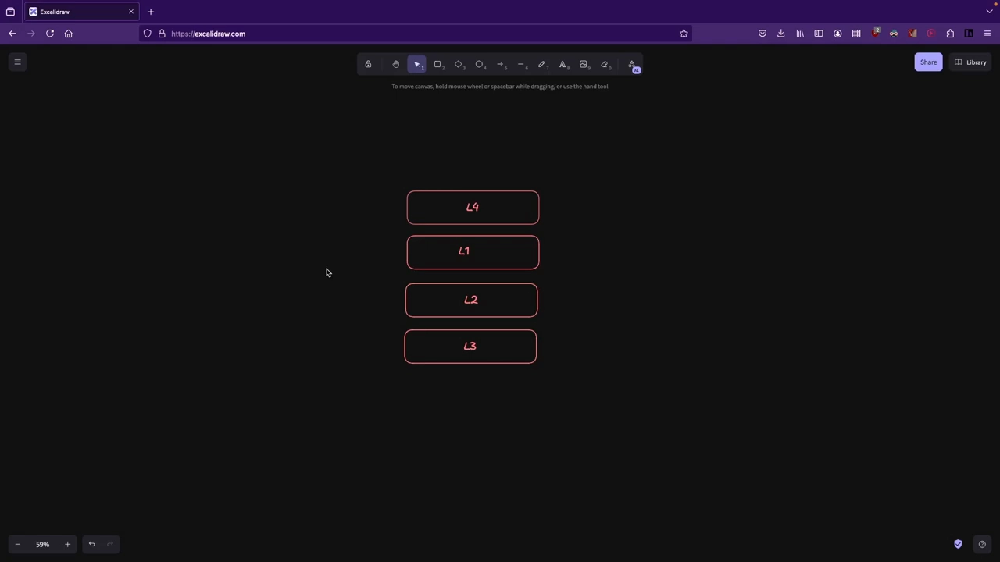

这里要引出两个关键概念——**upper 目录**与**lower 目录**：

- **lower 目录**：**只读**的目录。哪怕你去改它里面文件的内容，也**不会被真正修改**；想去删它里面的文件，也**删不掉**。这正是 **copy-up** 和 **whiteout** 两种机制要上场的地方。
- **upper 目录**：**可写**的目录。放在这里的文件可以随便编辑，改动就实实在在地发生在这个目录里。

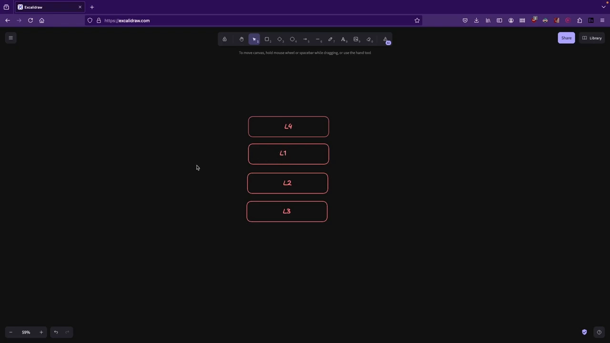

挂载 overlayfs 时你会给出两组值：**一个 lower 目录列表**，和**一个 upper 目录**（upper 只能有一个，lower 可以有多个）。挂载完成后，进入挂载点 `ls` 一下，你会看到**所有目录里的文件都出现在同一个层级**——虽然它们其实分散在不同目录里。[【跳转到 02:30】](https://www.youtube.com/watch?v=hXbXSRLXiS8&t=150)

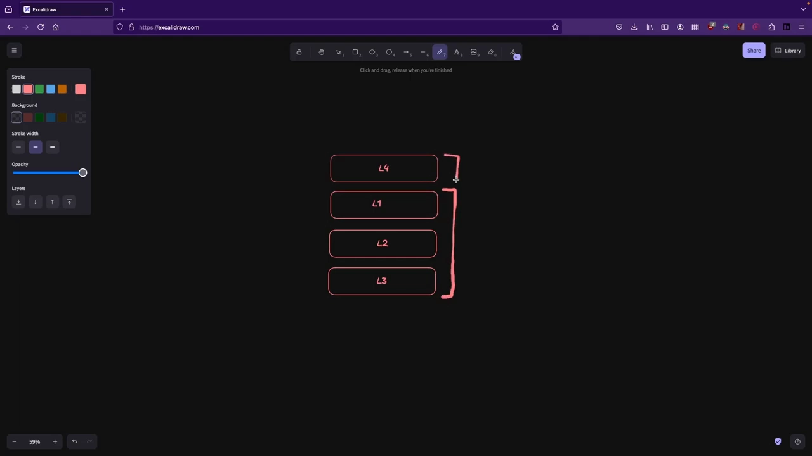

## 二、改文件：copy-up（向上复制）

下层是只读的，那应用**修改**下层文件时会怎样？overlayfs 的做法是 **copy-up（向上复制）**：[把文件从只读层复制到可写层，之后的修改都保存在可写层，而原文件所在的那一层保持不变](https://www.youtube.com/watch?v=hXbXSRLXiS8&t=200)。例如编辑 `L1` 里的 `l1.txt`，overlayfs 会把它复制到上面的可写层 `L4`，你后续的改动都会落到 `L4` 里的 `l1.txt` 上，而**不会写回 `L1`**。

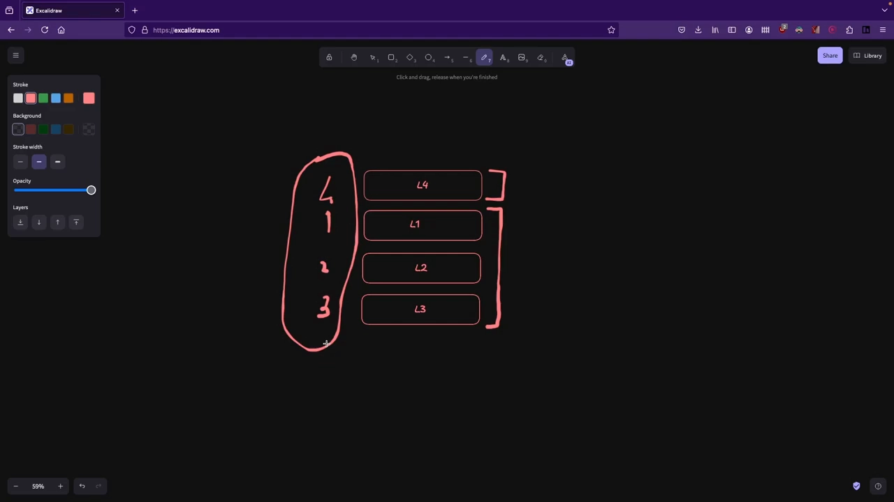

这条规则对**下面任意一层**的文件都成立——哪怕是 `L3` 里的 `3.txt`，被修改时同样先被复制上来，改动保存在 `L4`。

## 三、删文件：whiteout（白障）文件

如果应用要**删除**只读层里的文件呢？由于下层删不掉，overlayfs 会**创建一个叫 whiteout 的文件**——它是一种**字符设备类型（character device）**的文件。它的作用是**给 overlayfs 做一个标记**：当用户或应用在挂载点里查找这个文件时，overlayfs 会认为**它已被删除，不该再返回给用户**。[【跳转到 04:10】](https://www.youtube.com/watch?v=hXbXSRLXiS8&t=250)

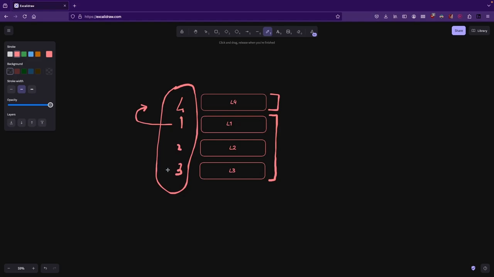

之所以"标记一下就能让文件消失"，是因为 **overlayfs 查找文件是从最高层往最低层走的**：一旦在高层遇到一个同名 whiteout 文件，它就明白**这个文件该删、不应再返回**。[【跳转到 05:00】](https://www.youtube.com/watch?v=hXbXSRLXiS8&t=300)

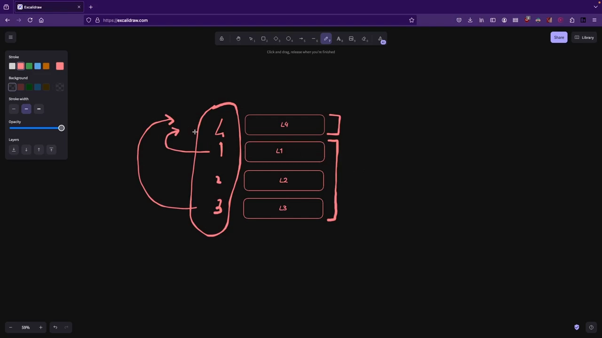

## 四、实战准备：目录结构与挂载命令

理论讲完，动手看效果。视频在 Ubuntu 上建立了一个 `overlay-example` 目录（`cd` 进去 `ls`），里面有：**四个层目录 `L1 L2 L3 L4`**、**一个挂载点 `mount`**、以及**一个 `work` 目录**。这个 **`work` 目录是 overlayfs 用来存放元数据的**（本讲不深入它）。[【跳转到 05:25】](https://www.youtube.com/watch?v=hXbXSRLXiS8&t=325)

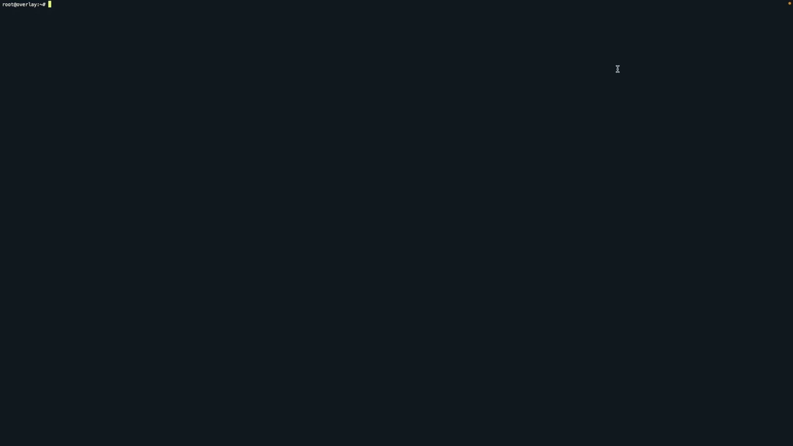

其中 **`L1 L2 L3` 是只读层，`L4` 是可写层**。用 `tree` 看结构相当"扁平"：`L1` 里有 `l1.txt`、`L2` 里有 `l2.txt`…而挂载点里是这几层的**联合**。[【跳转到 06:15】](https://www.youtube.com/watch?v=hXbXSRLXiS8&t=375)

挂载命令形如：`mount -t overlay overlay -o lowerdir=L1:L2:L3,upperdir=L4,workdir=work mount`。[【跳转到 06:40】](https://www.youtube.com/watch?v=hXbXSRLXiS8&t=400)

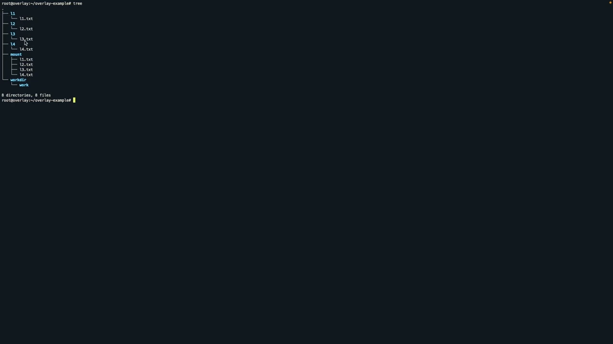

其中 **lowerdir 用冒号分隔，从左到右表示从上层到下层**：这里 `L1` 在最上面（最靠上的只读层），`L3` 在最下面；**upperdir 是可写层**（本例就是 `L4`，只能一个）。最后给出 overlayfs 的挂载点。

## 五、实战：验证 copy-up

进入挂载点，先 `cat L3.txt`（注：即 `l3.txt`）看到 `layer 3 text file`；接着 `echo "copy up test" >> l3.txt` 追加内容。[【跳转到 07:55】](https://www.youtube.com/watch?v=hXbXSRLXiS8&t=475)

- 在**挂载点**里 `cat l3.txt` → 能看到追加后的内容（`layer 3 text file` + `copy up test`）；
- 但是回到**真正存放该文件的 `L3`** 里 `cat l3.txt` → **还是原来的 `layer 3 text file`**，没变；
- 再到可写层 **`L4`** 里 `ls` → **多出一个 `l3.txt`**，它是从 `L3` 复制过来的副本，内容已含修改。

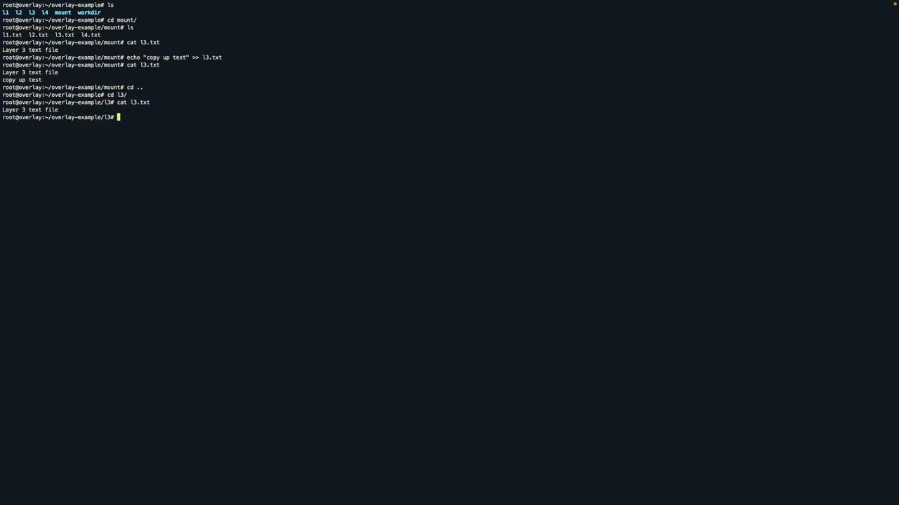

原因正如前面所说：**文件查找自最高层向下，在 `L4` 命中后就停止**，于是返回的是最高层的版本。这样就做到了**从不去改那些不可修改的层**——这就是 copy-up。

## 六、实战：验证 whiteout

再回到挂载点，`ls` 后 `rm l2.txt`，再 `ls` 会发现它**消失了**；`cat l2.txt` 会报 **no such file or directory**。但**其实 `L2` 里的 `l2.txt` 依然存在**——`cd L2` 后 `cat l2.txt` 能正常看到内容。[【跳转到 09:35】](https://www.youtube.com/watch?v=hXbXSRLXiS8&t=575)

秘密在于：overlayfs 在**可写层**里创建了一个**字符设备类型的 whiteout 文件**。回到 `L4` 里 `ls`，能看到一个名为 `l2.txt` 的**颜色不同的（偏黄绿色）文件**；对它做 `stat`，权限位以 **`c`** 开头，说明它是**字符特殊文件**，**无法读取**。它只是给 overlayfs 的标记：谁在挂载点访问 `l2.txt`，就返回"文件不存在 / 已被删除"。

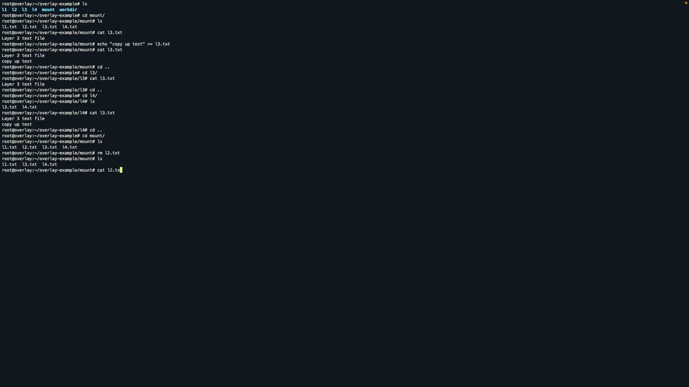

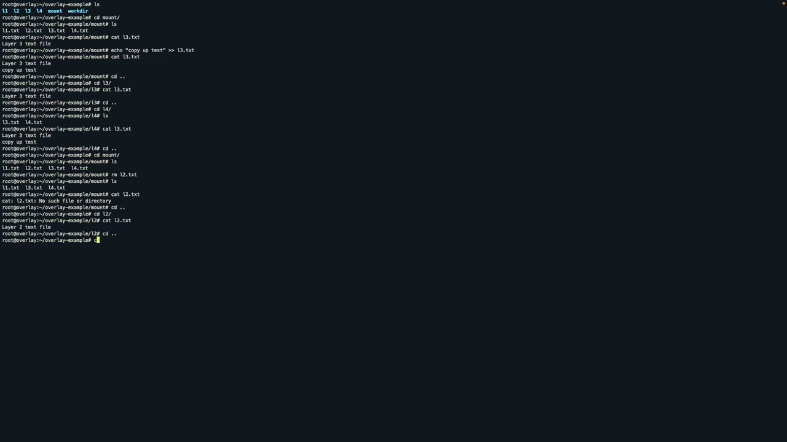

至此，**下层只读文件的"修改"和"删除"**就都讲清楚了：修改走 copy-up，删除走 whiteout。

## 七、最后：在可写层里直接改

如果在**可写层 `L4`** 里直接改动（比如 `echo ... >> l4_2.txt`），改动就实实在在地发生在 `L4` 里。[【跳转到 11:15】](https://www.youtube.com/watch?v=hXbXSRLXiS8&t=675)这也再次印证：**upper 层才是一切改动的落点**。

## 小结

- **overlayfs** 是 Linux 内核的**联合文件系统**，Docker 构建镜像、运行容器都用它；
- 它把**多个只读 lower 目录**与**一个可写 upper 目录**联合成**一个挂载点视图**；
- **lower 只读**：改不了、删不掉；
- **改文件 → copy-up**：把文件从只读层复制到可写层再改，原层不变；
- **删文件 → whiteout**：在可写层放一个**字符设备类型的标志文件**，标记该文件"已删除"；
- **查找自顶向下**：在最高层命中即停，这就是上层能"盖住"下层的原理；
- `work` 目录是 overlayfs 存放元数据所要求的。

## 关键术语速查

| 术语 | 一句话解释 |
| --- | --- |
| overlayfs | Linux 内核的联合文件系统，Docker 的存储基础之一 |
| lower 目录 | 只读的下层目录，可挂多个 |
| upper 目录 | 可写的上层目录，只有一个 |
| 挂载点（mount point） | 所有层联合后对外暴露的目录 |
| copy-up | 改只读层文件时，先复制到可写层再改的机制 |
| whiteout（白障）文件 | 删只读层文件时，在可写层放置的字符设备标志文件 |
| work 目录 | overlayfs 存放元数据所需的目录 |
