# overlay2 文件系统：Docker 默认存储驱动如何把多个目录合并成一个

> 视频来源：Bilibili 视频 [深入理解docker和kubernetes（k8s）-5.overlay2文件系统](https://www.bilibili.com/video/BV1YVL4zpEe6/)（约 24 分钟）。本文基于视频演说图文稿整理，时间戳可跳转到原视频对应位置；配图取自视频画面。字幕来自 B 站 AI 字幕，错拼已逐窗口核对纠正。
>
> 配套阅读：[《联合文件系统：多个目录如何"叠"成一个》](../3.3.1_联合文件系统/[技术]Docker核心原理 第3期 联合文件系统.md) 讲清了"分层 + 联合挂载"这一思路，以及老版本用的 aufs；本文接着讲**当前 Docker 真正默认使用的 overlay2**，用大量命令演示它如何处理新建、修改、删除、改名。另有两篇姊妹篇分别从内核机制（[《OverlayFS 实战：upper/lower 目录、copy-up 与 whiteout 文件》](Understanding%20OverlayFS%20｜%20OverlayFS%20｜%20Docker.md)）和容器视角（[《从零看懂容器文件系统》](Docker%20Storage%20Deep%20Dive：%20How%20OverlayFS%20Builds%20Container%20Filesystems.md)）展开。

## 本讲要解决的核心问题（SCQA）

**背景**：Docker 镜像可以被许多容器共享，同一份镜像跑起十个容器，磁盘上并不会出现十份镜像内容；而容器一跑起来，又要能随手新建、修改、删除文件。

**冲突**：镜像是**只读**的，容器却必须能**写**。如果每个容器都去改动共享的那份镜像内容，容器之间就会互相污染，镜像也无法被复用。

**疑问**：Docker 到底用哪个文件系统，把**只读的镜像层**和**可写的容器层**拼成一个容器看到的目录树？它又是怎么"改"和"删"只读层里的文件的？

**回答（中心思想）**：Docker 默认用的是 **overlay2**。它是一种**堆叠式的文件系统**，把**多个 lower 目录**和**一个 upper 目录**合并成一层 **merge（合并层）**：**上层覆盖下层、下层只读**；用户只在 merge 层操作，于是所有写操作（**新建、修改、删除、改名**）都会被以特定方式**记录进 upper 层**——其中"删除"和"改名"并不是真的动下层文件，而是**在 upper 里放一个特殊的屏蔽文件把下层遮住**。理解了这套规则，就理解了容器"共享镜像却互不影响"的全部秘密。[【跳转到 00:00】](https://www.bilibili.com/video/BV1YVL4zpEe6/?t=0)

---

## 一、为什么必须理解 overlay2：它就是 Docker 的默认存储驱动

打开 Docker 的存储信息就能看到它的身份。[执行 `docker info`](https://www.bilibili.com/video/BV1YVL4zpEe6/?t=15)，其中有一项叫 **Storage Driver（存储驱动）**，值就是 **overlay2**；下面还有一项叫 **Backing Filesystem（后端文件系统）**，是 **XFS**。换句话说，在这台机器上，overlay2 是**架在 XFS 之上**的——这也解释了为什么它和 XFS 有一定关系。

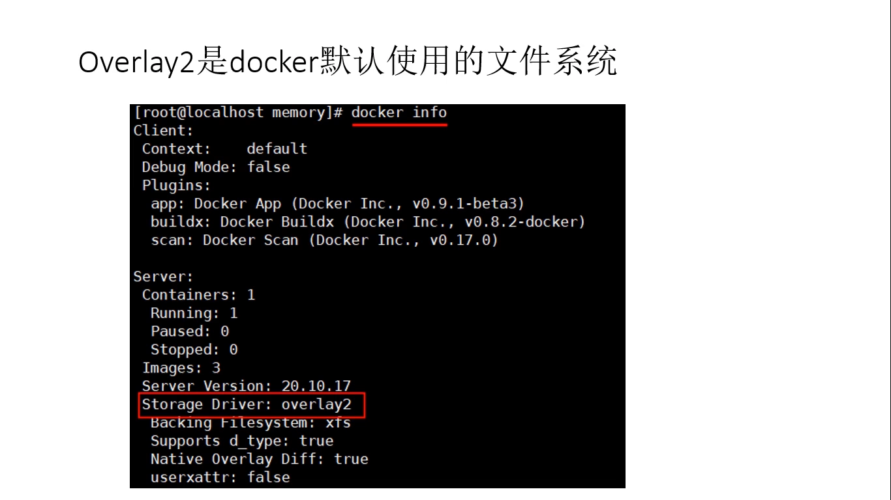

所以我们要真正理解容器、理解镜像，就必须理解 overlay2。

**overlay2 是一种"堆叠式"的文件系统**，它**依赖并建立在其它文件系统之上**。[【跳转到 00:53】](https://www.bilibili.com/video/BV1YVL4zpEe6/?t=53)

这里有一个容易混淆的点：overlay2 **不会**像 XFS、ext4 那样去**创建**文件系统（也就是没有 make fs / 格式化这个动作），它只是**把底层文件系统中不同的目录合并起来，再呈现给用户**——用户看到的根目录下的全部内容，就是挂载时指定的那些目录的**合集**。[【跳转到 01:21】](https://www.bilibili.com/video/BV1YVL4zpEe6/?t=81)

> 一句话区分：XFS/ext4 负责"在磁盘上划地、建房子"，overlay2 负责"把已经建好的几间屋子打通成一个大厅"。

## 二、overlay2 的结构：lower、upper 与 merge

overlay2 挂载时会指定**很多个目录**，它们被分成两类：[【跳转到 01:46】](https://www.bilibili.com/video/BV1YVL4zpEe6/?t=106)

- **lower 层（下层）**：可以有**多个**，是**只读**的；
- **upper 层（上层）**：**只有一个**，是**可写**的。

lower 和 upper 共同合并成一层，叫 **merge（合并层）**，**用户看到的就是合并后的结果**。合并时难免遇到**同名文件**，规则很简单——**上层覆盖下层，看到的永远是 upper 里的内容**。比如 upper 下有一个 `f1`、lower 目录 a 下也有一个 `f1`，最终看到的是 upper 的 `f1`；而 `f2` 只有 lower a 里有，就**直接映射**到 merge 层。[【跳转到 02:11】](https://www.bilibili.com/video/BV1YVL4zpEe6/?t=131)

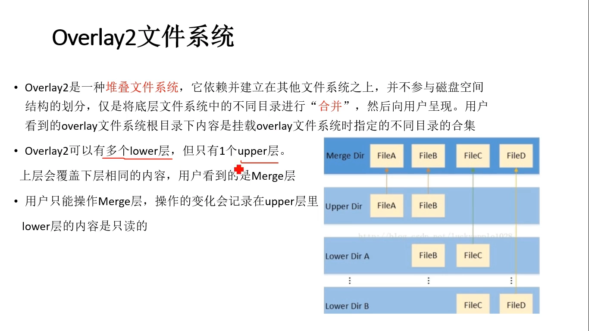

紧接着是一条**基本原则**：**用户的一切操作都在 merge 层进行，产生的变化记录到 upper 层里；下面的 lower 层只读，不能改动它。**[【跳转到 03:26】](https://www.bilibili.com/video/BV1YVL4zpEe6/?t=206)

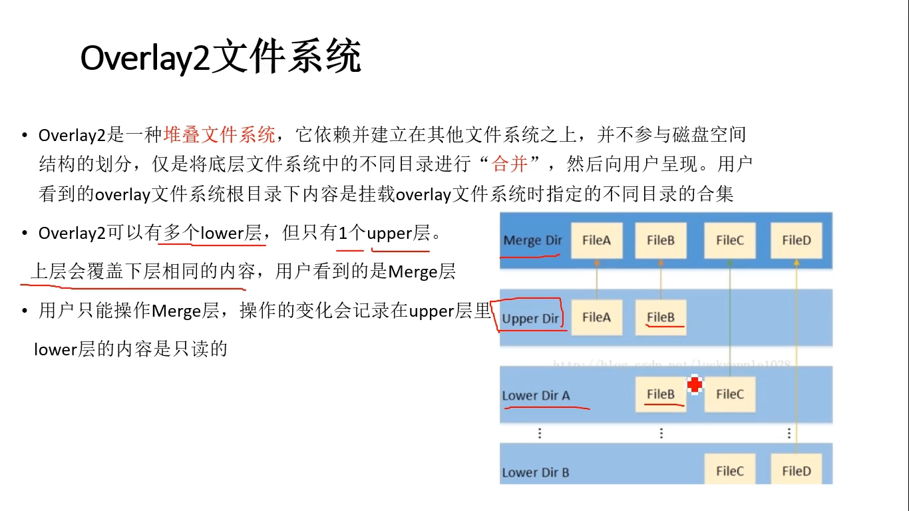

## 三、动手做一次 overlay 挂载

光说规则不够，直接搭一个目录结构来验证。视频里构造的目录大概是这样的：[【跳转到 03:47】](https://www.bilibili.com/video/BV1YVL4zpEe6/?t=227)

- **两个底层目录**：`lower1`、`lower2`，下面各有一些子目录和文件；
- **一个上层目录** `upper`：一开始是**空**的；
- **一个合并目录** `merged`：由 lower1、lower2 共同组成；
- **一个工作目录** `work`：这是 **overlay 文件系统要求的临时工作目录**。

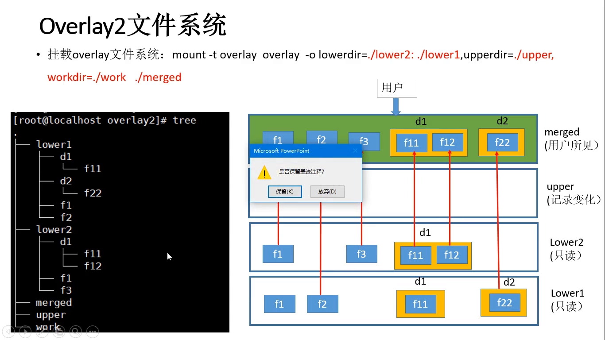

用 `mount` 命令就能挂载，格式是 `mount -t overlay overlay ...`：`-t` 指定文件系统类型为 overlay，`-o` 后面跟参数。[关键参数有三组](https://www.bilibili.com/video/BV1YVL4zpEe6/?t=277)：

- **`lowerdir`**：指定底层目录有哪些，多个之间用**冒号**分隔；
- **`upperdir`**：就是 `./upper`；
- **`workdir`**：就是 `./work`。

**lower 的顺序有讲究**：越靠右写的越在**更底层**。[【跳转到 05:02】](https://www.bilibili.com/video/BV1YVL4zpEe6/?t=302)挂载完再 `df -hT` 就能看到 `merged` 已经挂上了一个 overlay 文件系统。[【跳转到 07:45】](https://www.bilibili.com/video/BV1YVL4zpEe6/?t=465)此时进入 `merged`，会发现它不再是空的，里面出现了 `d1`、`d2`、`f1`、`f2`、`f3`。

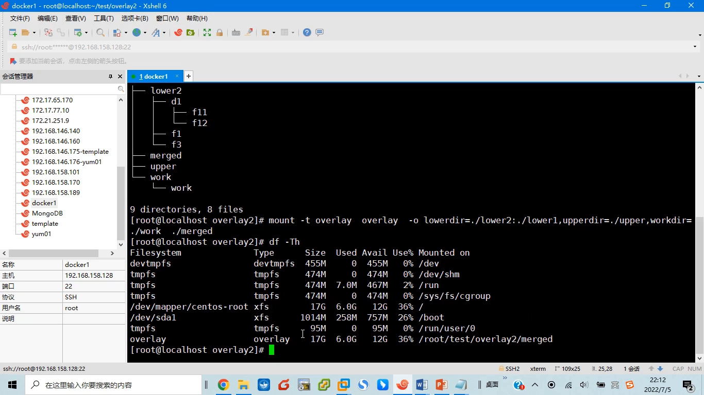

## 四、验证合并规则：上层覆盖下层

现在把合并结果与底层逐一对照：

- **`f1`**：lower1 和 lower2 里都有。因为 **lower2 比 lower1 更高一层**，所以 merge 里看到的是 **lower2 的 f1**——正是"上层覆盖下层"。[【跳转到 08:49】](https://www.bilibili.com/video/BV1YVL4zpEe6/?t=529)
- **`f2`**：只有 lower1 里有，于是**直接映射**到 merge 层，内容与 lower1 的 f2 一致。[【跳转到 09:43】](https://www.bilibili.com/video/BV1YVL4zpEe6/?t=583)
- **同名目录 `d1`**：lower1 和 lower2 里都有 d1，两个目录的**内容要合并**；合并时若出现同名文件（比如两边都有 `f11`），仍遵循**高层覆盖低层**，看到的是 **lower2 的 f11**。[【跳转到 10:12】](https://www.bilibili.com/video/BV1YVL4zpEe6/?t=612)
- **目录 `d2`**：只有 lower1 里有，直接映射到 merge 层。

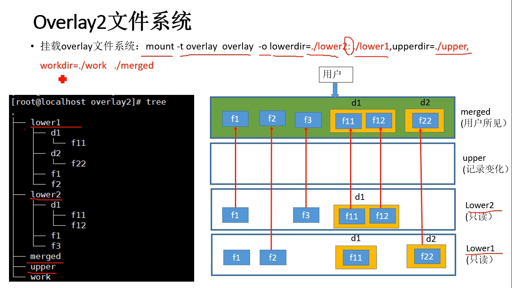

顺带记住一句话：**lower 层是只读的，我们不能改变它**，能改的只有 upper。

## 五、写操作怎么落到 upper 层：写时复制与屏蔽文件

从这一点起，我们**只在 merge 层操作**，看它是如何把四种写操作（新建、修改、删除、改名）记进 upper 的。

### 5.1 新建文件：直接在 upper 里创建

在 merge 里新建一个文件，比如 `f4`，能看到它还**会出现在 upper 层里**。这正体现了"upper 层记录变化"的原则——**新建操作就是直接在 upper 里创建一个同名文件**。[【跳转到 11:06】](https://www.bilibili.com/video/BV1YVL4zpEe6/?t=666)

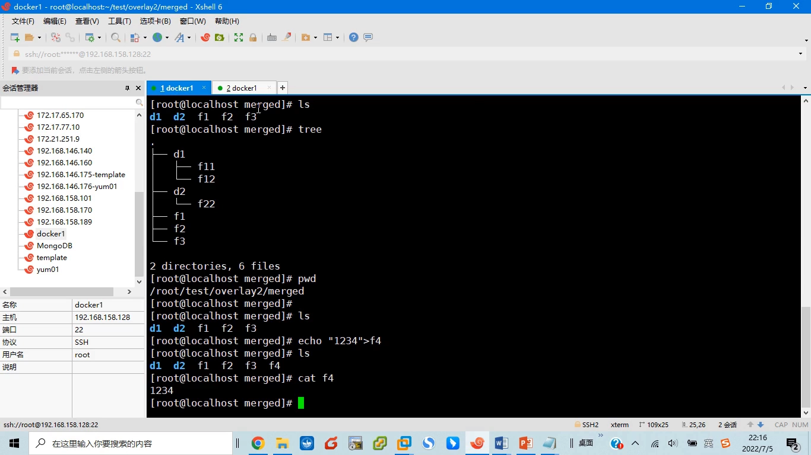

### 5.2 修改文件内容：先复制上来，再改（copy-on-write）

接着改一下 `f1` 的内容（原本是 lower2 的 `f1 in lower2`，改成四个 1）。回到 merge 看，`f1` 变成了四个 1。看看 upper 层发生了什么：**upper 里出现了一个 `f1` 文件，内容是四个 1**。因为**高层要覆盖低层**，upper 的 `f1` 同名，就把 lower1、lower2 里的 `f1` 盖住了。

这就是 **copy-on-write（写时复制）**：**要修改的文件若在 lower 层，先把它拷贝一份到 upper 层，再在 upper 里改**，文件名还沿用原来的名字，从而自然屏蔽掉底层。[【跳转到 13:09】](https://www.bilibili.com/video/BV1YVL4zpEe6/?t=789)

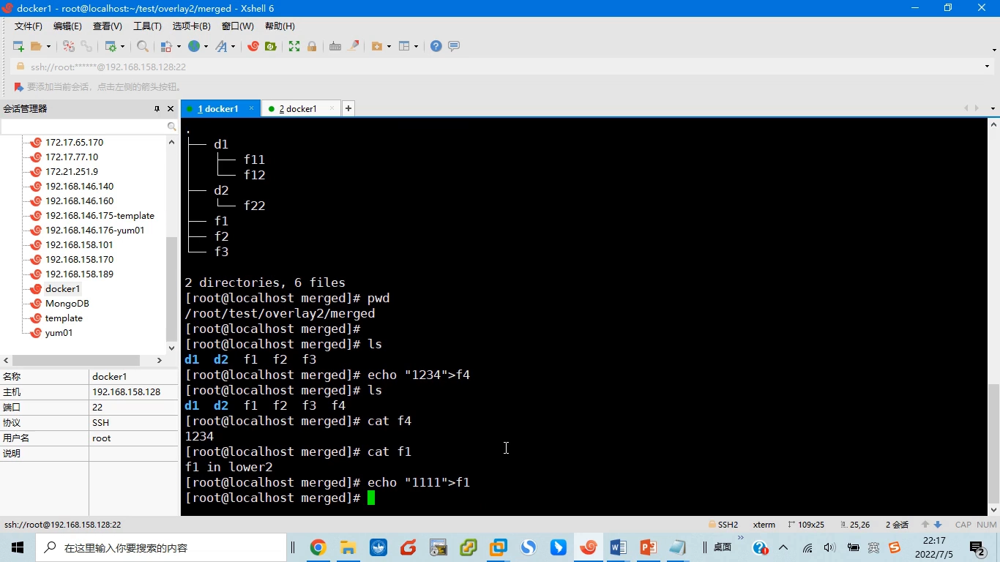

### 5.3 删除文件：不是真删，而是"屏蔽文件"

`rm f2` 把 f2 删掉。这个 `f2` 其实来自底层 **lower1**。[那么 lower1 里的 f2 被删掉了吗？**没有**](https://www.bilibili.com/video/BV1YVL4zpEe6/?t=820)——lower 层是只读的。但从 merge 的角度看，f2 确实"没了"。

秘密还是记录在 upper 层：upper 里出现了一个**特殊文件 `f2`**，它被标成黄色，**字节数是 0，是一个字符设备类型的文件**。

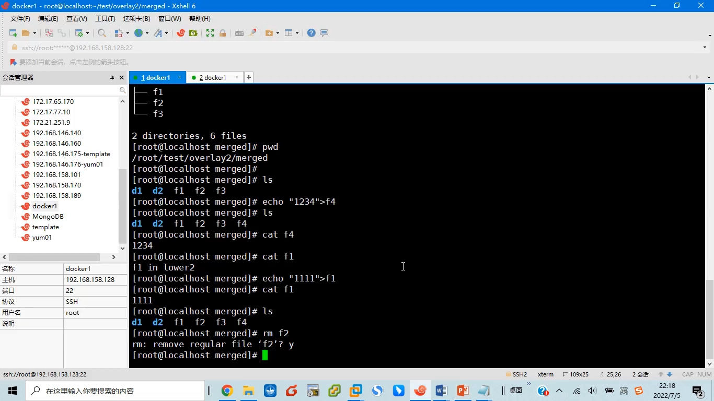

它的作用就是**利用"上层覆盖下层"把底层的 f2 遮住**——对 overlay 而言，这个 f2 就是在告诉 merge：**这个文件要删掉，别显示它**。所以本质上，**它是用一个特殊文件把底层同名文件屏蔽/隐藏掉**。[【跳转到 14:21】](https://www.bilibili.com/video/BV1YVL4zpEe6/?t=861)

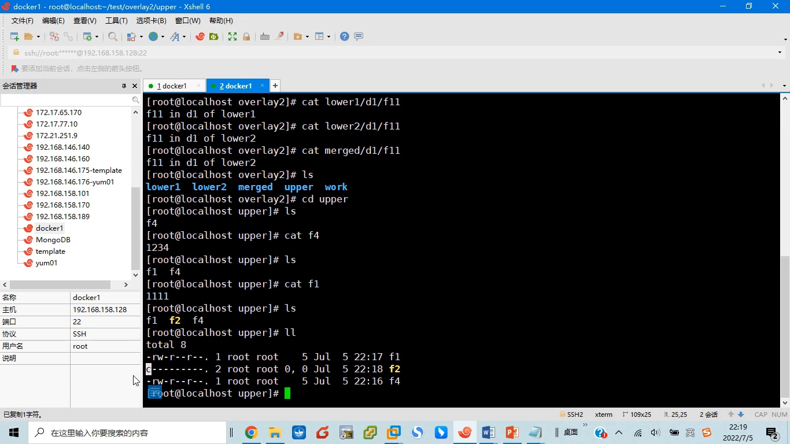

> 这个"特殊文件"就是 **whiteout（白障）文件**，姊妹篇里有更细的介绍。

### 5.4 改文件名：复制一份 + 屏蔽原名

把 `f3` 改名成 `f33`。改完 merge 里确实变成了 f33，内容没变（只是名字变了）。低层 lower2 里的 `f3` **依旧是 f3**——它只读，不能变。变化还是在 upper 里：**upper 里先出现一个特殊的 `f3`（黄色，用来把底层的 f3 彻底隐藏），然后新建一个 `f33`，内容就是原来 f3 的内容**。

由此可猜出**改名的实质**：**先把 f3 拷贝一份上来、改名成 f33，再创建一个特殊的 f3 把底层那个 f3 隐藏掉**。[【跳转到 17:03】](https://www.bilibili.com/video/BV1YVL4zpEe6/?t=1023)

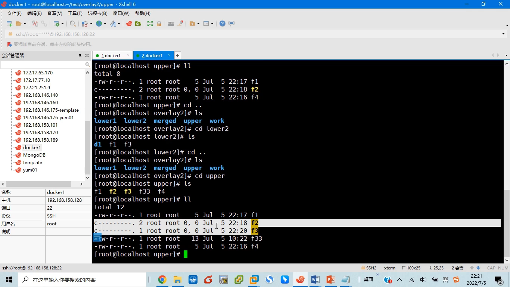

## 六、目录操作同理：目录也是"文件"

**[【跳转到 18:18】](https://www.bilibili.com/video/BV1YVL4zpEe6/?t=1098)** 目录的操作与文件完全一样，因为**在 Linux 里目录本质上也是文件**。

- **新建目录**：新建 `d3`，变化照样反映到 upper 里；
- **目录改名**：把 `d1` 改成 `d11`，内容不变——backstage 的做法是**先把原 d1 目录复制一份到 upper、复制时直接改名 d11，再创建一个特殊的 `d1` 把底层 d1 隐藏**[【跳转到 19:15】](https://www.bilibili.com/video/BV1YVL4zpEe6/?t=1155)；
- **删除目录**：`rm -rf d2`。lower1 里的 d2 **还在**（只读），但 merge 里看不到了——同样是在 upper 里**建一个特殊文件把下层 d2 隐藏掉**[【跳转到 20:23】](https://www.bilibili.com/video/BV1YVL4zpEe6/?t=1223)。

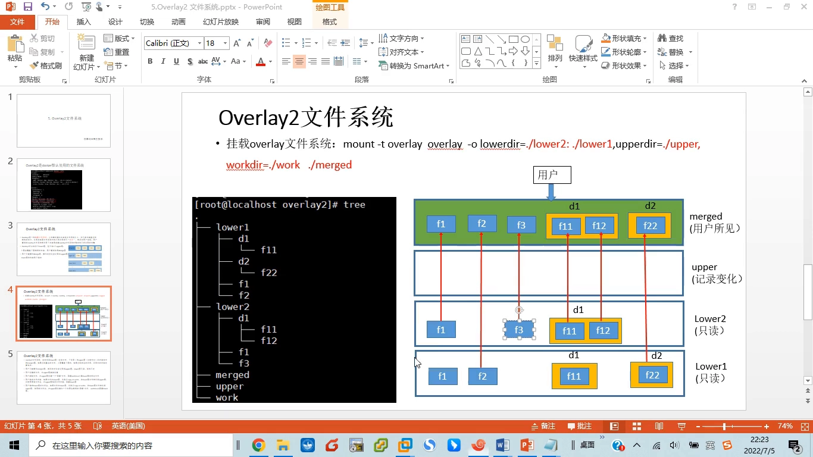

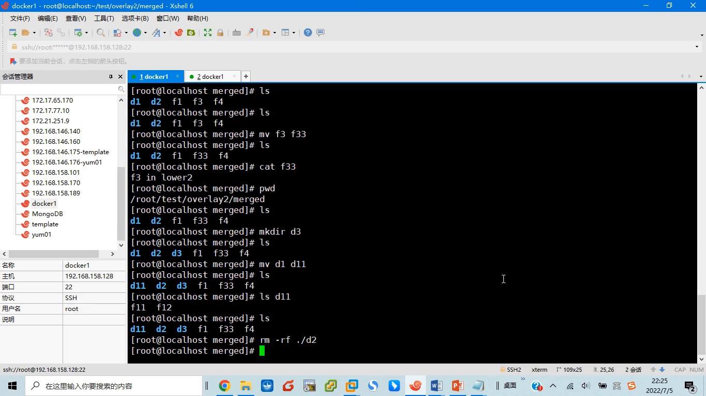

## 七、一张总结图：overlay 的工作原理

视频最后用一页幻灯片把全部规则收了尾。[【跳转到 21:44】](https://www.bilibili.com/video/BV1YVL4zpEe6/?t=1304)

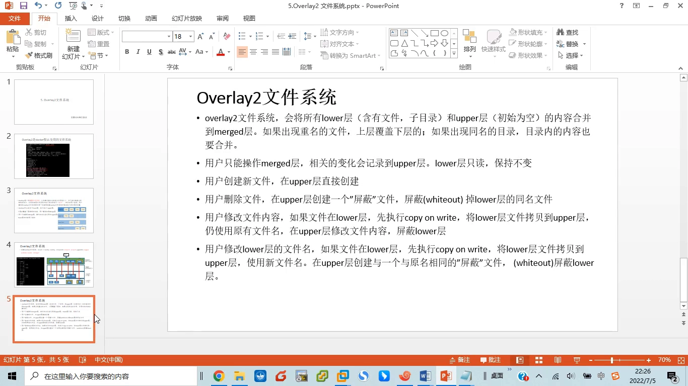

- overlay2 把所有 **lower 层**（含目录、子目录）与 **upper 层**（一般初始为空）合并成一个 **merge 层**；
- 出现**重名文件**，**上层覆盖下层**；出现**同名目录**，**目录内容合并**，合并时重名文件仍上层覆盖下层；
- 用户看到并操作的只有 **merged 层**，所有**写操作**（删除、修改、改名等）都记录进 **upper 层**，而 **lower 层只能读、始终不变**；
- **新建**：在 upper 里直接创建；
- **删除**：在 upper 里建一个屏蔽文件，屏蔽掉由 lower 映射上来的同名文件（若删的是 upper 里新建的文件，直接删即可）；
- **修改内容**：文件若在 lower，先 **copy-on-write** 拷贝到 upper 再改，沿用原名，自然屏蔽底层；
- **改名**：文件若在 lower，先拷贝到 upper 用新名保存，再在 upper 建一个与原名字相同的屏蔽文件把 lower 屏蔽掉。

## 小结

- **overlay2 是 Docker 的默认存储驱动**，它是一种**堆叠式文件系统**，架在 XFS 等底层文件系统之上，只合并目录、不创建文件系统；
- 结构三分：**lower（多个、只读）+ upper（一个、可写）= merge（用户所见）**；
- **合并规则**：上层覆盖下层；同名目录合并内容，其中同名文件仍上层覆盖下层；
- **用户只操作 merge，变化一律记入 upper，lower 永远只读**；
- 四种写操作的落地方式：**新建**→upper 直接建；**修改**→copy-on-write 到 upper 再改；**删除/改名**→upper 里放一个特殊（屏蔽）文件遮住下层同名文件；
- 这一点正是容器能"共享同一份只读镜像、各自写自己的那一层"的底层原因。

## 关键术语速查

| 术语 | 一句话解释 |
| --- | --- |
| overlay2 | Docker 默认的堆叠式（联合）文件系统存储驱动 |
| 堆叠式文件系统 | 依赖其它文件系统、把多个目录合并后呈现的文件系统 |
| lower 层 | 只读的下层目录，可以有多个 |
| upper 层 | 可写的上层目录，只有一个，记录所有写变化 |
| merge（合并层） | lower 与 upper 合并后用户看到的最终视图 |
| work 目录 | overlay 挂载所要求的临时工作目录 |
| 上层覆盖下层 | 同名文件以更高层者为准的合并规则 |
| 写时复制（copy-on-write） | 修改 lower 文件时先复制到 upper 再改，lower 保持只读 |
| 屏蔽文件 | 删除/改名时在 upper 里创建的特殊文件，用来遮住下层同名文件 |
| whiteout（白障）文件 | 屏蔽文件的具体形态：一张 0 字节的字符设备文件 |
