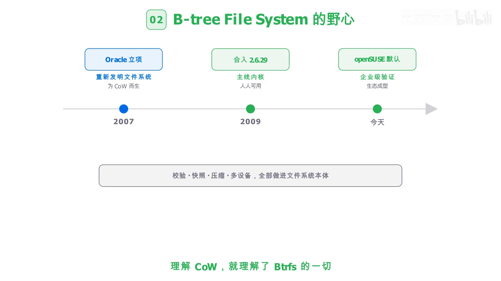
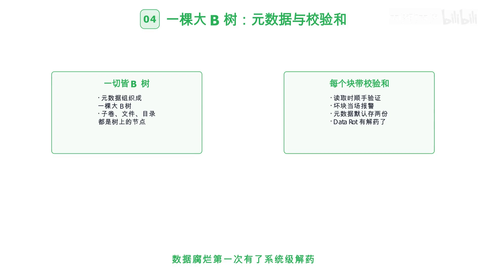
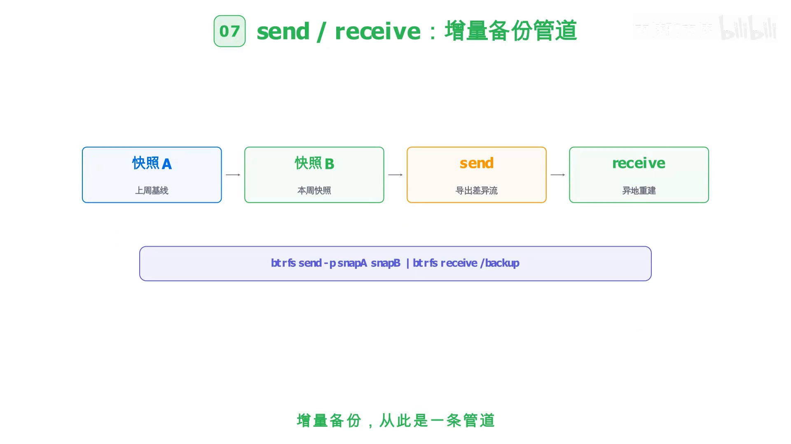
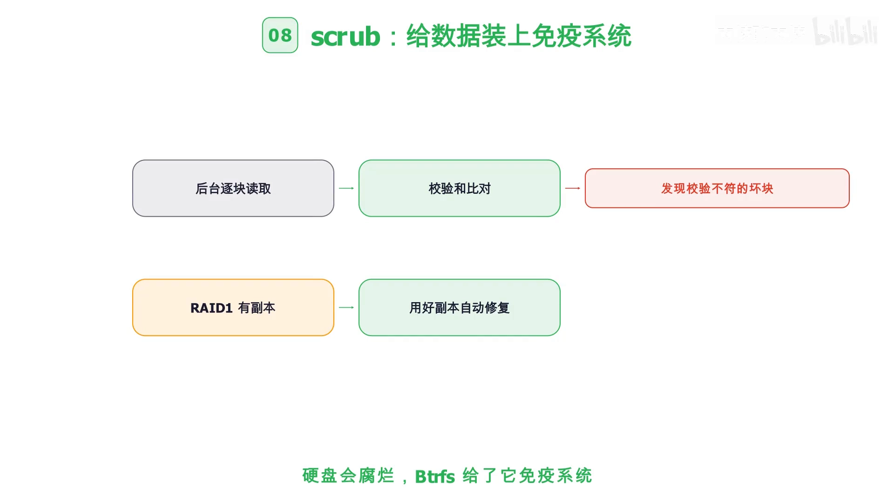
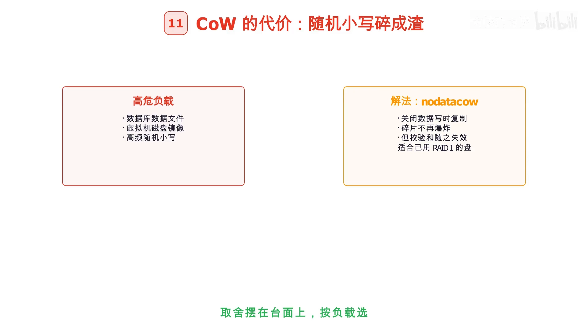
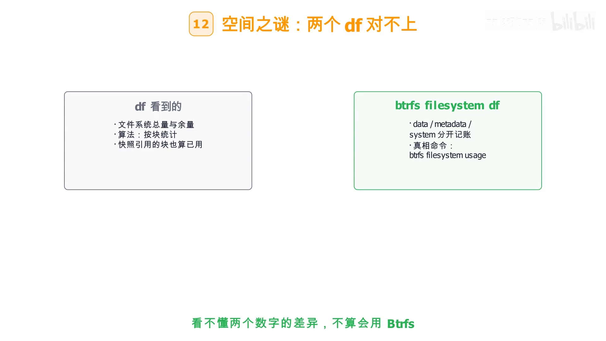
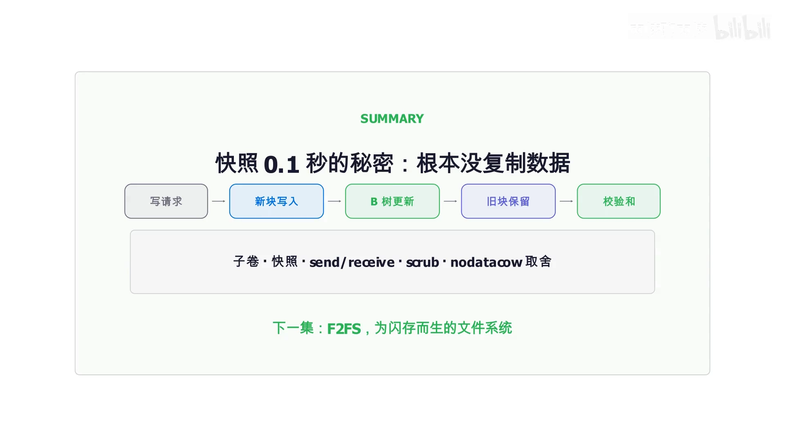

# Btrfs 快照为什么只要 0.1 秒？拆解文件系统层面的写时复制与数据自愈

> 视频来源：Bilibili [《Btrfs 快照为什么只要 0.1 秒？写时复制与数据自愈完整拆解！》](https://www.bilibili.com/video/BV1mDHk69EuL/)（内核聊内核，约 5 分 09 秒）。本文基于视频演说图文稿整理，时间戳可跳转到原视频对应位置；配图取自视频画面。字幕来自 B 站 AI 字幕，术语与错拼已逐窗口核对纠正。
>
> 配套阅读：CoW 在**内存管理**里如何实现，见[《内核视角拆解 Copy-on-Write：fork 为什么能在微秒级完成？》](Copy-on-Write内核实现解析.md)；CoW 的**通用原理、数据结构与排查工具**，见[《第 15 天：Copy-on-Write 机制》](第15天：Copy-on-Write%20机制：写时复制的核心原理与性能优化.md)。

## 本讲要解决的核心问题（SCQA）

**背景**：在 Btrfs 上，右键点一下就能创建快照——**0.1 秒**完成一块 **100 GB** 磁盘的快照，而且**几乎不占空间**。而传统做法里，备份 100 GB 总得花时间、也总得占地方。

**冲突**：它既**不是压缩**，也**不是去重**——那凭什么一块 100 GB 的盘，能瞬间「复制」出一整个文件系统视图，还几乎不额外占空间？这听起来像是违反守恒定律。

**疑问**：快照到底「复制」了什么、又「没复制」什么？写时复制在**文件系统层面**的形态，和内存里的 CoW 有什么异同？它又能顺带带来哪些能力（备份、校验、自愈）？

**回答（中心思想）**：**它根本没复制数据。** Btrfs 的核心思想就是**写时复制（Copy-on-Write）**——**从不原地改写**：要改一个块，就把**新内容写到新位置，再更新指针，旧数据原封不动**。快照只是**子卷的写时复制副本**：**只复制 B 树的根节点，数据块全部共享引用**，所以**0.1 秒就能完成、几乎不占空间**。而「旧数据不丢」这一点，正是**快照、校验和与崩溃一致性**共同的**地基**。[【跳转到 00:00】](https://www.bilibili.com/video/BV1mDHk69EuL/?t=0)

---

## 一、Btrfs 是谁：一个「把一切都做进文件系统」的野心

BTRFS 的名字来自 **B-tree File System**。它的时间线：[【跳转到 00:25】](https://www.bilibili.com/video/BV1mDHk69EuL/?t=25)

- **2007 年** Oracle 立项；
- **2009 年**合入 Linux 内核 **2.6.29**；
- 今天它是 **openSUSE 与 SUSE 企业版的默认文件系统**，Fedora 也长期默认。

它的**野心写在名字里**：把**校验、快照、压缩、多设备**全部做进**文件系统本体**——不是靠外部工具拼出来的。用视频里的话说：**理解 CoW，就理解了 Btrfs 的一切。**



## 二、核心思想：从不原地改写

传统文件系统改一个块，是**直接覆盖旧块**——旧数据**即刻消失**，万一断电还可能**只写了一半**。Btrfs 走的是另一条路——**写时复制**：[【跳转到 00:50】](https://www.bilibili.com/video/BV1mDHk69EuL/?t=50)


| | 原地改写（传统） | 写时复制（Btrfs） |
| :--- | :--- | :--- |
| 写一个块 | **直接覆盖旧块** | **新块写到新位置** |
| 旧数据 | **即刻消失** | **旧块完整保留** |
| 崩溃风险 | **断电可能写一半** | **指针原子切换** |

一句话记住：**改一个块 = 新内容写到新位置 + 更新指针，旧数据原封不动。** 而**快照、校验、一致性，共用这一个地基**。

## 三、一切都建在这套地基上：B 树、校验和、子卷

**一切皆 B 树。** Btrfs 把**元数据组织成一棵大 B 树**，并且**每个块都带校验和**：[【跳转到 01:15】](https://www.bilibili.com/video/BV1mDHk69EuL/?t=75)

- 读取时**顺手验证**校验和，遇到**坏块当场报警**；
- 子卷、文件、目录**都是树上的节点**；
- **元数据默认存两份**——数据腐烂（**Data Rot**）第一次有了**系统级的解药**。



这里要先厘清一个容易混淆的概念——**子卷（subvolume）**：

> 子卷**不是分区**，也**不是镜像文件**，而是一个**可以独立挂载的目录树**；一个 Btrfs 卷里可以建**任意多个子卷**，各自**配额、各自快照、各自挂载参数**。

## 四、快照：只复制根节点，所以 0.1 秒

**快照就是子卷的写时复制副本。** 它**只复制 B 树的根节点**，而**数据块全部共享引用**——所以能**0.1 秒完成、几乎不占空间**。[【跳转到 01:40】](https://www.bilibili.com/video/BV1mDHk69EuL/?t=100)


这就是本讲开头那个「悖论」的答案：**快照复制的是树的指针结构，而不是数据本身**。再加上**只读标记**，它就成了一份**不可变的备份**——**原始数据再怎么改，快照里的世界纹丝不动**。

## 五、send/receive：把快照变成一条增量备份管道

有了快照，备份就可以做成**增量**的。**`btrfs send` / `btrfs receive`** 把**两个快照之间的差异导出成一条流**，在另一块盘或另一台机器上**重建增量备份**。[【跳转到 02:05】](https://www.bilibili.com/video/BV1mDHk69EuL/?t=125)



从此备份就是**一条管道**：

```bash
# 每周打快照、send 出差异、异地落地
btrfs send -p snapA snapB | btrfs receive /backup
```

## 六、scrub：给数据装上免疫系统

**`btrfs scrub`** 在**后台逐块做校验和检查**，一旦发现校验不符、**又有副本可用**时，就**自动用好副本把坏块修回来**。[【跳转到 02:30】](https://www.bilibili.com/video/BV1mDHk69EuL/?t=150)



在 **RAID** 配置下，这就是**数据自愈**——**硬盘会腐烂，Btrfs 给了它一套免疫系统**。

顺带一个能力——**透明压缩**：用 **ZSTD**，**写时压、读时解**，文本与代码类数据**能省一半空间**；**写入量变少，SSD 寿命反而更长**；挂载时一个 `compress` 参数**全局生效**。

## 七、多设备：野心，也是争议区

Btrfs 可以把**几块盘组成一个卷**：[【跳转到 02:55】](https://www.bilibili.com/video/BV1mDHk69EuL/?t=175)

- **成熟可用**：`RAID0` 条带、`RAID1` 镜像、`RAID10` 组合；
- **谨慎对待**：**`RAID5/6` 官方至今仍在警告别上生产环境**。

多设备是它的野心，也是它的**争议区**。

## 八、写时复制的代价：`nodatacow` 与「空间之谜」

CoW 不是免费的。**数据库、虚拟机镜像这类高频随机小写入**会被 CoW **放大成碎片**——随机小写会**碎成渣**。[【跳转到 03:20】](https://www.bilibili.com/video/BV1mDHk69EuL/?t=200)



- **高危负载**：数据库数据文件、虚拟机磁盘镜像、高频随机小写；
- **解法**：**`nodatacow` 挂载选项**，关闭数据写时复制，**碎片不再爆炸**——**但校验和也随之失效**；
- 它**适合已经用 RAID1 的盘**——因为此时你要的是「不碎片」，而不是「Btrfs 的校验」。

**空间之谜**：`df` 和 `btrfs filesystem df` 的数字**经常对不上**。

| `df` 看到的 | `btrfs filesystem df` |
| :--- | :--- |
| 文件系统总量与余量 | `data` / `metadata` / `system` **分开记账** |
| 算法：按块统计 | **快照引用的块也算已用** |

因为**写时复制让旧块仍被快照引用**，**空闲空间本身也被碎片化**——想看**真相**要用 **`btrfs filesystem usage`**。

> **看不懂这两个数字的差异，就不算真正会用 Btrfs。**

## 九、工具箱：btrfs 子命令家族

日常最常用的几条命令：[【跳转到 03:45】](https://www.bilibili.com/video/BV1mDHk69EuL/?t=225)



```bash
$ mkfs.btrfs /dev/sdb1 /dev/sdc1              # 建卷（可多设备）
$ btrfs subvolume create /mnt/@snap           # 建子卷
$ btrfs subvolume snapshot -r @ snapA         # 打只读快照
$ btrfs scrub start /mnt                      # 后台校验
$ btrfs filesystem usage /mnt                 # 看真实空间
```

外加 **`balance`（重新平衡分配）** 和 **`quota`（组配额）**——**一个二进制管所有子命令**。

## 十、快照实战与选型边界

**快照实战就练一个用法**：大版本升级前**打一个只读快照**，升级出问题就**一条命令回滚到升级前**——这就是「**系统级的撤销键**」。[【跳转到 04:10】](https://www.bilibili.com/video/BV1mDHk69EuL/?t=250)


| Btrfs 强项 | 谨慎使用 | 明确不用 |
| :--- | :--- | :--- |
| 快照与备份密集 | 大型数据库 | **RAID5/RAID6**（官方长期警告，生产环境回避） |
| 桌面与工作站 | 高频随机写（或 `nodatacow`） | —— |
| 容器存储后端 | —— | —— |

**边界清楚，才是成熟的标志。**

## 十一、把 Btrfs 串起来

最后把整个链路串一遍：[【跳转到 04:35】](https://www.bilibili.com/video/BV1mDHk69EuL/?t=275)

**写请求 → 落成新块 → 元数据 B 树更新 → 旧块被快照引用而保留 → 校验和随读记账。**

于是四件套齐了：**子卷、快照、send/receive、scrub**。



回到标题的那个问题——**Btrfs 快照为什么只要 0.1 秒？因为它根本没复制数据**，它只复制了指向数据的**那棵树**。下次再看到 `df` 和 `btrfs filesystem df` 的数字对不上时，你会知道：那不是 bug，而是**写时复制留下的痕迹**。

> 下一集：F2FS，为闪存而生的文件系统。[【跳转到 05:00】](https://www.bilibili.com/video/BV1mDHk69EuL/?t=300)
