# 内核视角拆解 Copy-on-Write：fork 为什么能在微秒级完成？

> 视频来源：Bilibili [《Copy-on-Write内核实现解析》](https://www.bilibili.com/video/BV1fGdaBfEeZ/)（DeeparchWorks，约 12 分 19 秒）。本文基于视频演说图文稿整理，时间戳可跳转到原视频对应位置；配图取自视频画面。字幕来自 B 站 AI 字幕，术语与错拼（如「写实复制」「紫禁城」「PROXCMM」等）已逐窗口核对纠正。
>
> 配套阅读：想看 CoW 的通用原理、数据结构与排查工具，见[《第 15 天：Copy-on-Write 机制：写时复制的核心原理与性能优化》](第15天：Copy-on-Write%20机制：写时复制的核心原理与性能优化.md)；想看文件系统层面的 CoW（快照、send/receive、scrub），见[《Btrfs 快照为什么只要 0.1 秒？》](Btrfs快照为什么只要%200.1%20秒？写时复制与数据自愈完整拆解！.md)。

## 本讲要解决的核心问题（SCQA）

**背景**：在 Linux 里 `fork()` 创建一个子进程，父进程可能已经占了好几个 GB 内存。

**冲突**：如果 fork 真要把这些内存全复制一遍，那就该慢得离谱、还得瞬间吃掉双倍内存——可现实中 fork 却总是**微秒级**返回。难道内核偷偷用了什么障眼法？

**疑问**：fork 到底**复制了什么**？页面复制如果没在 fork 时发生，那它又是在**哪一刻、由谁**完成的？内核为此动了哪些手脚？

**回答（中心思想）**：内核用的是**写时复制（Copy-on-Write，CoW）**——**不到万不得已，绝不复制一个字节**。fork 时只把页表复制一份、并把父子两边的页表项（PTE）都**标记成只读**，物理页仍被共享；真正的复制被**推迟**到有进程尝试写入的那一刻，由**缺页异常 + `do_wp_page`** 接手完成。一句话概括它的哲学：CoW 的本质不是「如何复制」，而是「**如何不复制**」。[【跳转到 00:00】](https://www.bilibili.com/video/BV1fGdaBfEeZ/?t=0)

---

## 一、先建立直觉：一家复印店

要理解 CoW，先想象你和室友合租，桌上有一份**租房合同**。[【跳转到 00:25】](https://www.bilibili.com/video/BV1fGdaBfEeZ/?t=25)

- **传统做法**：各自复印一份，占了**两倍空间**，可实际上你们大部分时间根本不会改动它。
- **写时复制的做法**：先**共用同一份原件**，谁要改谁才去复印。更精妙的是，内核在原件上贴了一张**「只读」标签**——谁拿笔要写，标签就触发「警报」（缺页异常），「复印店阿姨」（内核）赶来，**只给写入方复印一份**。

注意最后一句：合同有 100 页，你**只改了第三页**，那就**只复印第三页**。这个「按需、按页复制」的粒度，正是 CoW 高效的关键。


说到 CoW 的实现，不得不提 **Linus Torvalds**——他把 CoW 在 Linux 内核中推向了极致。他的设计哲学是「**能推迟的事就推迟做**」，而 CoW 就是这套哲学的最佳代言人：从页表标记到缺页处理，每一步都是对「延迟」思想的精准实践。[【跳转到 00:50】](https://www.bilibili.com/video/BV1fGdaBfEeZ/?t=50)

## 二、CoW 的实现横跨五个层次

CoW 不是某一个函数的魔法，而是一条**贯穿五个层次**的链路。少一层都玩不转：[【跳转到 01:07】](https://www.bilibili.com/video/BV1fGdaBfEeZ/?t=67)

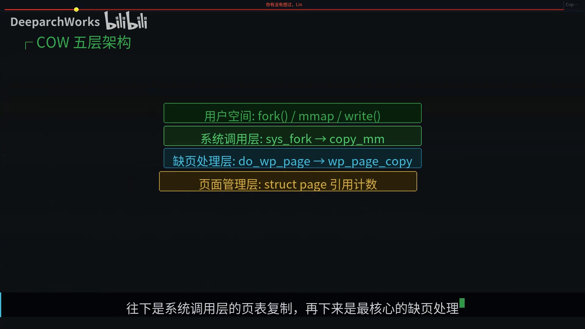

1. **用户空间**：`fork()` / `mmap()` / `write()` 这些调用是入口；
2. **系统调用层**：`sys_fork` → `copy_mm`，负责**页表复制**；
3. **缺页处理层**：`do_wp_page` → `wp_page_copy`，**最核心**的一层，CoW 的「正片」就在这里；
4. **页面管理层**：`struct page` 的**引用计数**，判断页面还有几个使用者；
5. **硬件层**：**MMU** 的页表权限位支持——没有 CPU 硬件配合，只读标记就无从「报警」。

## 三、CoW 的三个触发场景

什么时候会走到 CoW？主要有三类：[【跳转到 01:32】](https://www.bilibili.com/video/BV1fGdaBfEeZ/?t=92)

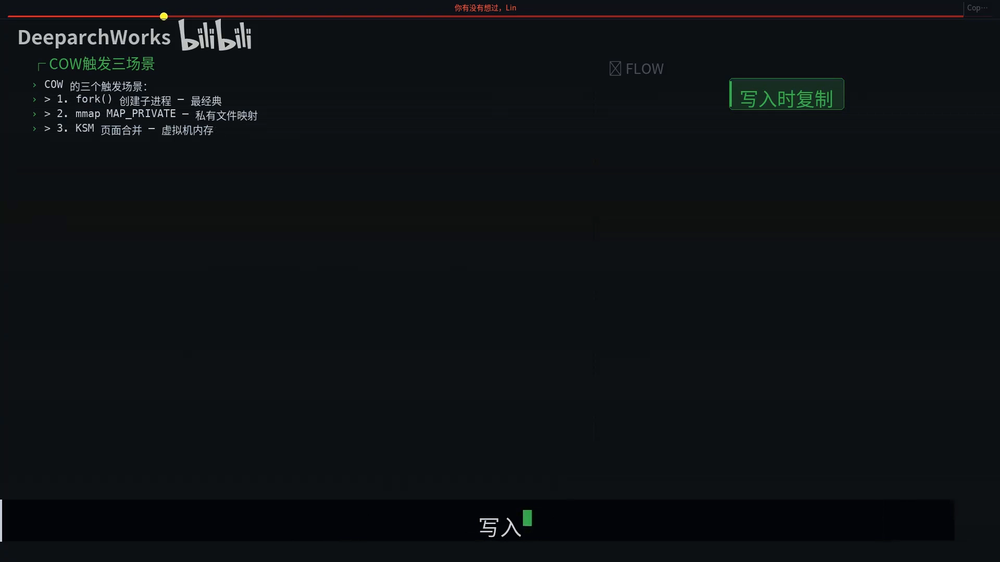

- **`fork()` 创建子进程**——最经典，父子起初共享页面；
- **`mmap` 的 `MAP_PRIVATE`（私有文件映射）**——写入时**不会回写原文件**，而是走 CoW 复制一份；
- **KSM 页面合并**——虚拟化场景下把内容相同的页面合并为一份，写入时再拆开。

不管哪个场景，**本质都一样：共享只读，写入时复制**。

## 四、一个容易被忽略的细节：父进程的页表也变只读

这里有个关键细节，初学者常常漏掉：**fork 的时候，不只是子进程的页表被标记为只读，父进程自己的页表也被改成了只读。**[【跳转到 01:57】](https://www.bilibili.com/video/BV1fGdaBfEeZ/?t=117)

为什么？因为要保护的是**共享状态**，而不是「谁是子进程」——**谁先写入，谁就触发复制**。如果只把子进程标只读，父进程一写就会**直接改动共享的物理页**，子进程的数据就被悄悄污染了。

看 `copy_one_pte` 这段代码，两个关键操作一目了然：[【跳转到 02:22】](https://www.bilibili.com/video/BV1fGdaBfEeZ/?t=142)

```c
static inline int
copy_one_pte(struct mm_struct *dst_mm, struct mm_struct *src_mm,
             pte_t *dst_pte, pte_t *src_pte, struct vm_area_struct *vma /* ... */)
{
    /* 第一行：把父进程的 PTE 改为只读 */
    ptep_set_wrprotect(src_mm, addr, src_pte);
    /* 第二行：写给子进程的 PTE 也标为只读 */
    /* ... */
    /* 最后：增加物理页的引用计数 */
    get_page(page);
}
```

注意还有 `is_cow_mapping` 的判断条件——**只有私有可写映射才需要 CoW**。共享映射的写入本来就要传播给所有映射方，所以不走 CoW；只读私有映射没人会写，也不走 CoW。

再看 fork 的**时序**：从用户空间调用 `fork` 到返回大约**一毫秒**，关键就在 `copy_page_range` 这一步——它**遍历父进程的每一个页表项，但只做标记，不复制任何物理页**。这就是 CoW 的威力：一个占用 **1 GB 内存**的进程，fork 的开销只是**复制页表的几百 KB**。[【跳转到 02:47】](https://www.bilibili.com/video/BV1fGdaBfEeZ/?t=167)

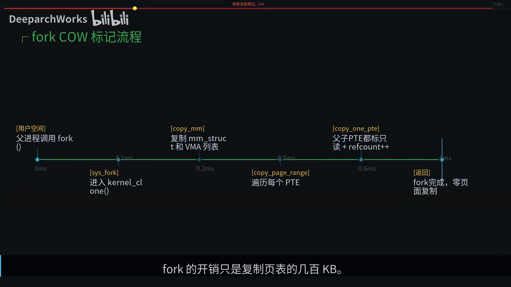

## 五、写入的那一刻：缺页异常 → `do_wp_page`

fork 阶段只做了标记，那**真正的页面复制什么时候发生**？答案是——**进程尝试写入的那一刻**。[【跳转到 03:12】](https://www.bilibili.com/video/BV1fGdaBfEeZ/?t=192)

子进程一写入，CPU 的 **MMU** 发现页表项是只读、但进程偏要写，于是触发一个**缺页异常（写保护违例）**，内核接管这一切。内核接手后先找到这个地址属于哪个 **VMA**，确认 VMA **确实允许写入**——这说明 PTE 只读不是因为真的不可写，而是 **CoW 标记**。[【跳转到 03:37】](https://www.bilibili.com/video/BV1fGdaBfEeZ/?t=217)

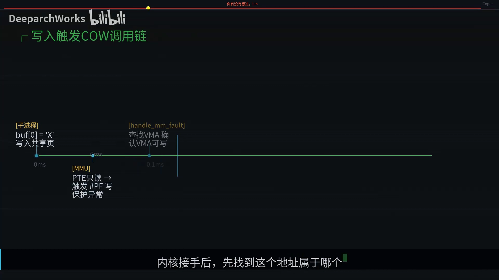

接下来进入 **`do_wp_page`，这是 CoW 的心脏**。它的逻辑出奇简洁，只做一个判断：**这个页面现在有几个映射在用它？**

- 如果**只剩我一个**（原来的共享方已经退出、或自己也拷走了）——连复制都不必，**直接把 PTE 改回可写**，这就是**快速路径**；
- 如果**还有别人在共享**——走**慢速路径**，老老实实**复制一份**。

把两条路径放一起对比：[【跳转到 04:02】](https://www.bilibili.com/video/BV1fGdaBfEeZ/?t=242)

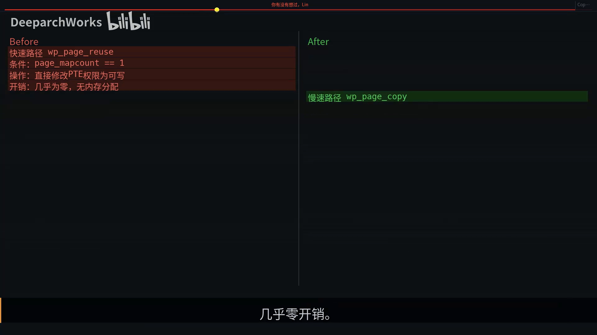

| | 快速路径 `wp_page_reuse` | 慢速路径 `wp_page_copy` |
| :--- | :--- | :--- |
| **条件** | `page_mapcount == 1`（只有我在用） | 还有多个映射共享 |
| **操作** | 直接改 PTE 权限为可写 | 分配新物理页、复制 4KB、更新 PTE、刷新 TLB |
| **开销** | 几乎为零，无内存分配 | 微秒级，高频场景下会累积 |

## 六、`wp_page_copy` 五步走与两个引用计数

慢速路径里真正干活的是 **`wp_page_copy`**，它五步完成复制：[【跳转到 04:27】](https://www.bilibili.com/video/BV1fGdaBfEeZ/?t=267)

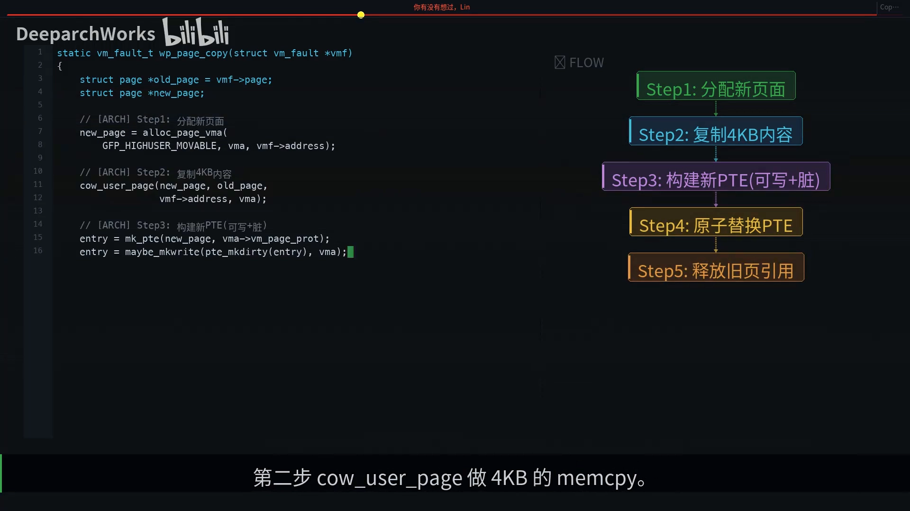

1. **分配新页面**：`alloc_page` 拿一个新的物理页；
2. **复制内容**：`cow_user_page` 做一次 **4 KB 的 memcpy**；
3. **构建新 PTE**：这次标记为「**可写 + 脏页**」；
4. **原子替换旧 PTE**；
5. **释放对旧页面的引用**：`put_page`，如果旧页引用计数降为零，它就会被回收。

每一步都是**原子的**，保证了并发安全。

那「还有几个人在用」这个判断，靠什么记录？答案是 `struct page` 的**两个关键引用计数**：[【跳转到 04:52】](https://www.bilibili.com/video/BV1fGdaBfEeZ/?t=292)


- **`_refcount`**：总引用数，**包括页表映射和内核引用**（比如内核的 buffer）；
- **`mapcount`**：**专门记录有多少个页表在映射这个页面**。

注意它的**起始值是 -1**：`-1` 表示**零个映射**，`0` 表示**一个映射**，`1` 表示两个映射……CoW 判断用的是 **`mapcount` 而不是 `_refcount`**，因为 `_refcount` 还包含内核引用，**不能准确反映有几个进程在用**。

## 七、硬件配合：x86 的 PTE 位布局

CoW 能工作，全靠 **CPU 硬件的配合**。x86-64 的每个 PTE 条目里有一个 **RW 位（bit 1）**：清 0 表示**只读**，置 1 表示**可写**。当进程写入一个 RW 位为 0 的页面时，**MMU 自动触发 page fault**，而异常错误码会告诉内核这是一次**写保护违例**——内核就是利用这个硬件机制来实现 CoW 的延迟复制。[【跳转到 05:17】](https://www.bilibili.com/video/BV1fGdaBfEeZ/?t=317)

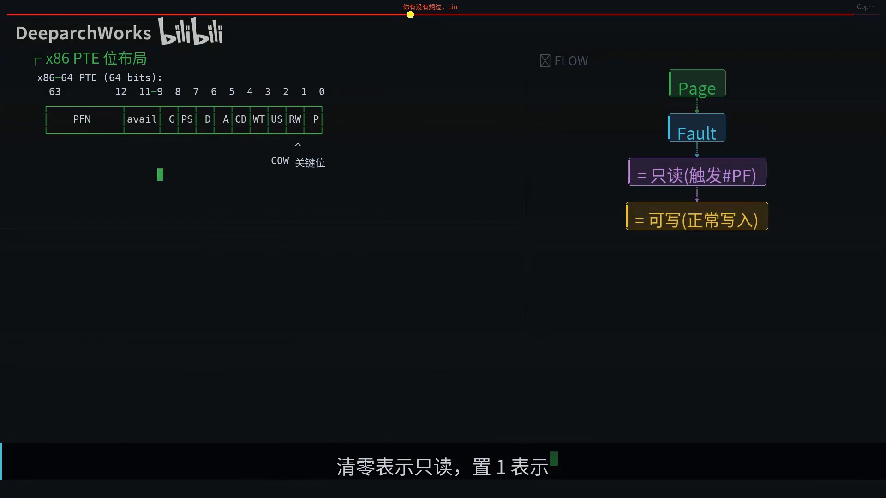

## 八、最大受益者：fork + exec

CoW 最大的受益者就是 **`fork + exec`** 这个经典模式。[【跳转到 05:42】](https://www.bilibili.com/video/BV1fGdaBfEeZ/?t=342)

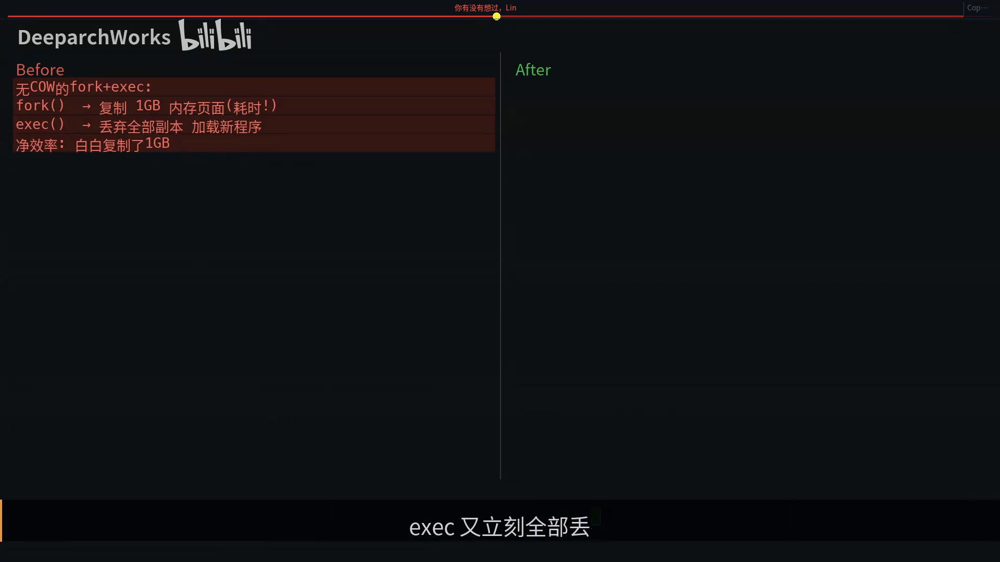

- **没有 CoW 的年代**：fork 要**复制进程全部内存**（比如 1 GB，耗时），exec 却**立刻把所有副本全部丢掉**加载新程序——净效率是**白白复制了 1 GB**，这是巨大的浪费；
- **有了 CoW**：fork **只复制几百 KB 的页表**，exec 再把页表一扔，**整个过程几乎零开销**。

这正解释了为什么 UNIX 可以优雅地用 `fork + exec`，而 Windows 需要相对笨重的 `CreateProcess`。

## 九、别被优雅迷住：四个性能陷阱

CoW 不是银弹——某些场景下它反而会成为**性能杀手**。[【跳转到 06:07】](https://www.bilibili.com/video/BV1fGdaBfEeZ/?t=367)

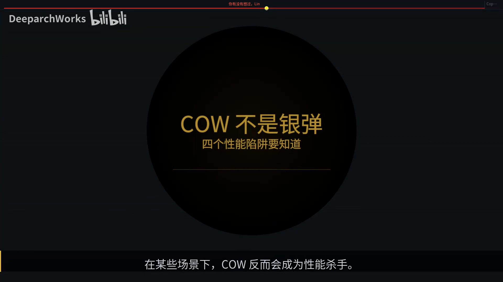

1. **大量写入陷阱**：fork 后**父子都疯狂写入**时，每一页都要走一遍「缺页中断 + 分配 + 拷贝 + TLB 刷新」，累积起来**反而比一次性复制更慢**：[【跳转到 06:32】](https://www.bilibili.com/video/BV1fGdaBfEeZ/?t=392)
   > 总开销 = N 次（缺页 + 分配 + 拷贝 + TLB flush），当 N 逼近总页数时，CoW 就亏了。
2. **大页（Huge Pages）放大效应**：普通 CoW 只复制 **4 KB**，但大页的 CoW 要复制整整 **2 MB**。Redis 在做 BGSAVE 时如果开了大页，CoW 的内存放大效应是**灾难性**的。
3. **TLB shoot-down**：修改 PTE 后，必须通过 **IPI（核间中断）** 通知**所有 CPU 核心**刷新 TLB 缓存——这是一个昂贵的**跨核同步**操作。
4. **Dirty COW（CVE-2016-5195）**：这第四个陷阱直接是**安全漏洞**。[【跳转到 06:57】](https://www.bilibili.com/video/BV1fGdaBfEeZ/?t=417)

## 十、Dirty COW：CoW 与 `get_user_pages` 的竞态

2016 年曝光的 **Dirty COW** 漏洞，利用的是 **CoW 和 `get_user_pages` 之间的竞态条件**，让**非特权用户**可以修改**只读文件**，影响了几乎所有 Linux 系统。[【跳转到 07:30】](https://www.bilibili.com/video/BV1fGdaBfEeZ/?t=450)

攻击原理很巧妙：[【跳转到 07:45】](https://www.bilibili.com/video/BV1fGdaBfEeZ/?t=465)


- **线程 A** 不断调用 `madvise` **释放 CoW 副本页面**；
- **线程 B** 通过 **`/proc/self/mem`** 写入；
- 在**竞态窗口**里，写入可能**落在原始的只读页上**，而不是 CoW 副本上——因为副本刚好被线程 A 释放了。结果就是**非特权用户修改了只读文件**。

修复方案是在 `get_user_pages` 和 CoW 之间加入**更严格的同步机制**。这场维护战中，Linux 内存管理子系统的核心维护者 **Andrew Morton** 主导了一系列内存子系统加固，堵住了 CoW 与 `get_user_pages` 之间的竞态窗口；而 **Hugh Dickins**（Google 的 Linux 内核开发者、Linux MM 核心贡献者）长期维护 CoW / swap / tmpfs 关键代码路径，**对 `mapcount` 语义的精确定义和各种边界条件的修复贡献尤其突出**——`do_wp_page` 里那个精妙的快速路径优化，背后就有他的大量工作。[【跳转到 08:10】](https://www.bilibili.com/video/BV1fGdaBfEeZ/?t=490)

## 十一、`mapcount` 状态机与 `is_cow_mapping`

`mapcount` 的状态转换其实就是一个小型**状态机**：[【跳转到 08:27】](https://www.bilibili.com/video/BV1fGdaBfEeZ/?t=507)

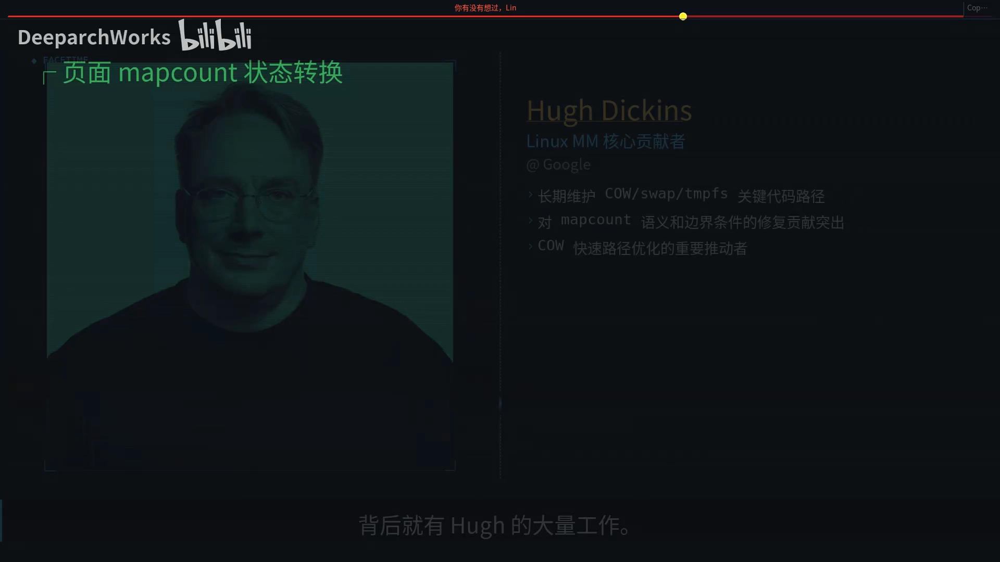

| 阶段 | `mapcount` 含义 |
| :--- | :--- |
| 页面刚分配 | `-1`，**未映射** |
| 一个进程映射后 | `0`，**单映射** |
| `fork` 之后 | `1`，**双映射** |
| CoW 触发后 | 旧页面**减一**，新页面从**单映射**开始 |
| 回到 `0` | 下一次写入就走**快速路径**了 |

而 `is_cow_mapping` 的判断条件值得单独看一眼：它检查两个标志位——**`VM_SHARED` 不能设置**（必须是私有映射），**`VM_MAYWRITE` 必须设置**（VMA 允许写入）。这意味着：**共享映射不走 CoW**（写入本就要传播给所有映射方），**只读私有映射也不走 CoW**（没人会写）。


## 十二、串一遍 CoW 的完整生命周期

最后把 CoW 从头到尾串一遍：[【跳转到 08:52】](https://www.bilibili.com/video/BV1fGdaBfEeZ/?t=532)

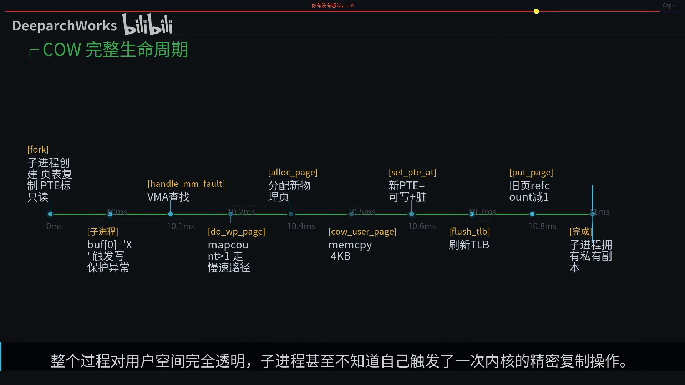

1. **fork**：子进程创建页表、复制 PTE，父子 PTE **都标只读**，`refcount++`——**约 1 ms**，**不复制物理页**；
2. **写入**：子进程写共享页，MMU 触发 `#PF` 写保护异常，`handle_mm_fault` 查找 VMA 确认可写；
3. **`do_wp_page` 判断**：发现还有共享方，走**慢速路径**；
4. **复制**：`alloc_page` 分配新物理页 → 复制 4 KB → `set_pte_at` 设新 PTE 为**可写 + 脏** → `put_page` 让旧页 `refcount` 减一；
5. **完成**：全程**不到一毫秒**，且对用户空间**完全透明**——子进程甚至不知道自己触发了一次内核精密的复制操作。

## 十三、几个常见问题

**Q：fork 后父子的页表完全一样吗？**
PTE 的**值几乎一样**，但**页表页面本身是独立的副本**，两边的 PTE 都指向**同一物理页**，而且**都被标记为只读**——这就是 CoW 的精髓：**结构独立，数据共享**。

**Q：Dirty COW 的根本原因是什么？**
本质是 **CoW 和 `get_user_pages` 之间的竞态**：一个线程拿着只读页的**引用**，另一个线程触发 **CoW 写入**，在竞态窗口里写入可能落在**原始页**上而非副本上。修复方案是在两者之间加入更严格的同步。[【跳转到 09:42】](https://www.bilibili.com/video/BV1fGdaBfEeZ/?t=582)

**Q：CoW 对 Redis 持久化的影响？**
Redis 用 **fork 做 BGSAVE**（生成快照）时，如果客户端**还在不停写入**，每个被修改的页面都会**触发 CoW**。在一个 **10 GB 的 Redis 实例**上，若全部页面都被修改，**额外内存消耗可能接近 10 GB**——这就是 Redis 官方建议**留出一倍内存余量**的原因。[【跳转到 10:07】](https://www.bilibili.com/video/BV1fGdaBfEeZ/?t=607)

**Q：`vfork` 和 `fork` 有什么区别？**
`vfork` **更极端**——连页表都不复制，子进程**直接用父进程的地址空间**，父进程被**挂起**。这意味着 `vfork` 后子进程**不能修改任何数据**（否则会污染父进程），只能执行 `exec` 一族函数，因此**完全不会触发 CoW**，效率更高。[【跳转到 10:32】](https://www.bilibili.com/video/BV1fGdaBfEeZ/?t=632)

## 十四、知识点回顾

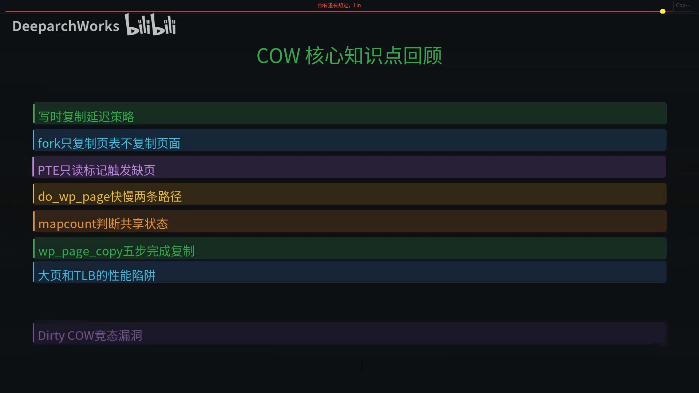

- **写时复制是延迟策略**：`fork` 只复制页表，不复制页面；
- **PTE 只读标记触发缺页**；
- **`do_wp_page` 快慢两条路径**；
- **`mapcount` 判断共享状态**；
- **`wp_page_copy` 五步完成复制**；
- **大页和 TLB 的性能陷阱**；
- **Dirty COW 竞态漏洞**。

回到最初的问题：fork 之所以能在微秒级完成，是因为它**根本没有复制内存**——它只复制了一张**页表**，再把「真正复制」这件事**推迟**到写入发生的那一刻。下一次你在终端里敲下命令、看着进程瞬间创建的时候，可以想一想：这背后是内核最优雅的**「偷懒」艺术**。[【跳转到 12:04】](https://www.bilibili.com/video/BV1fGdaBfEeZ/?t=731)
