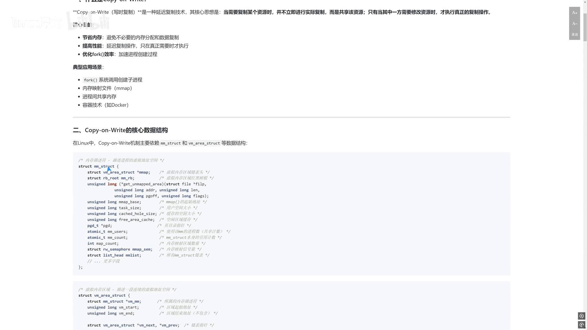
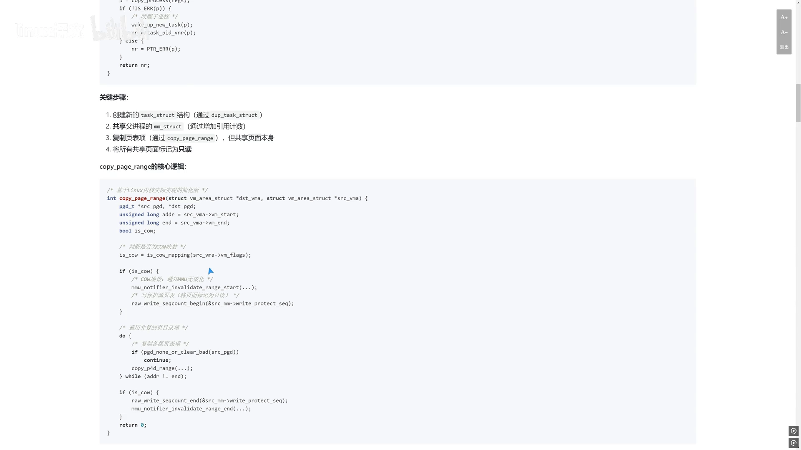
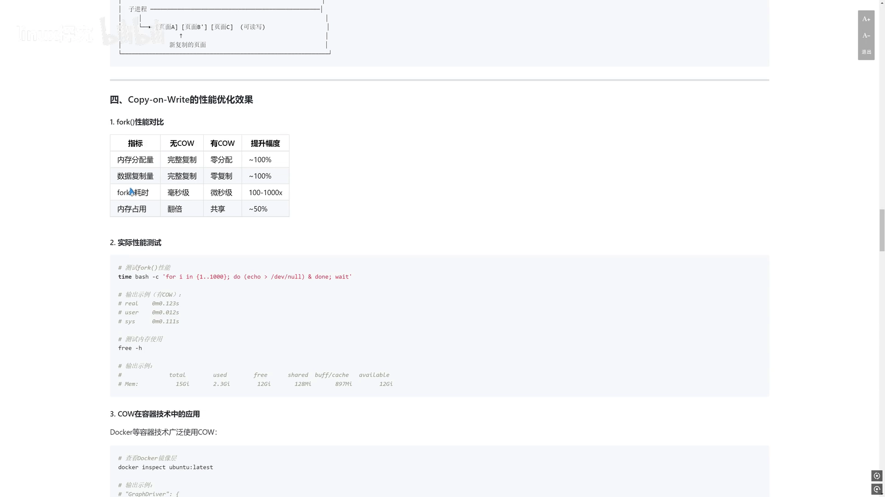
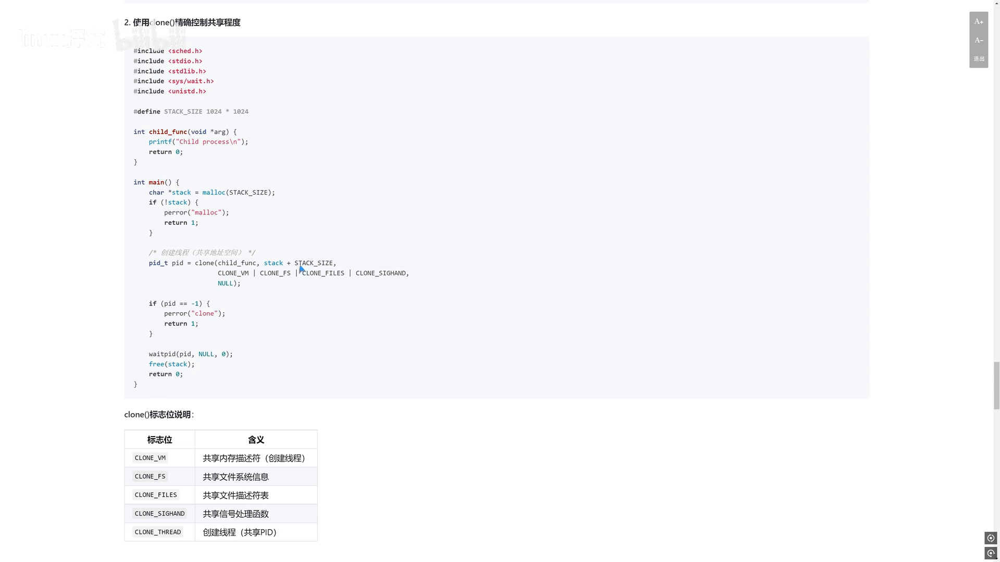

# 从「共享笔记」到「按需复制」：读懂 Linux 的 Copy-on-Write 机制

> 视频来源：Bilibili [《第 15 天：Copy-on-Write 机制：写时复制的核心原理与性能优化》](https://www.bilibili.com/video/BV1gH5T6GEjW/)（linux 探究，约 11 分 08 秒）。本文基于视频演说图文稿整理，时间戳可跳转到原视频对应位置；配图取自视频画面。字幕来自 B 站 AI 字幕，术语与错拼已逐窗口核对纠正。
>
> 配套阅读：想看 CoW 在内核里的**代码级实现**（PTE 标记、`do_wp_page`、`wp_page_copy`、Dirty COW），见[《内核视角拆解 Copy-on-Write：fork 为什么能在微秒级完成？》](Copy-on-Write内核实现解析.md)；想看**文件系统层面**的 CoW（Btrfs 快照、send/receive、scrub），见[《Btrfs 快照为什么只要 0.1 秒？》](Btrfs快照为什么只要%200.1%20秒？写时复制与数据自愈完整拆解！.md)。

## 本讲要解决的核心问题（SCQA）

**背景**：写时复制（Copy-on-Write，CoW）是操作系统里一个非常核心的优化思路，不只用在**内存管理**里，在**文件系统**和**容器技术**里也都会用到。

**冲突**：它的名字听起来像是「写的时候才复制」，可这样岂不是「又多了一次复制」？那它到底**省在哪里**、又是**凭什么**能提升性能？

**疑问**：CoW 究竟是一种什么样的技术？它靠哪些**数据结构**落地？`fork`、`mmap`、容器镜像分层这些场景里，它分别是怎么起作用的？我们又该怎么**验证**它真的被触发了？

**回答（中心思想）**：CoW 是一种**延迟复制**技术——复制资源时**不马上复制**，而是**先共享**，等**真正要修改**时才复制被改的那部分。它靠 **`mm_struct` / `vm_area_struct` 数据结构**、**页表项权限位**和**物理页引用计数**三者配合来实现：`fork` 时只创建 `task_struct`、让子进程共享父进程的内存并**把页面标记为只读**，写入触发页错误后再由内核**按需复制**。它本质是一种**「时间换空间」**的策略，主要目的是**提高资源利用率和性能**。[【跳转到 00:00】](https://www.bilibili.com/video/BV1gH5T6GEjW/?t=0)

---

## 一、先搞清楚「共享笔记」的比喻

先想象一个场景：你和同事要共同编辑一份重要的项目文档。为了**节省时间和空间**，你们决定**先共享同一份文档**，只有当其中一人**需要修改内容**时，才**复制一份副本**进行编辑。[【跳转到 00:25】](https://www.bilibili.com/video/BV1gH5T6GEjW/?t=25)

这个「聪明的策略」正是 Linux 里 CoW 的核心思想：**延迟复制**——**不会在复制资源时马上复制一份，而是等到你真正要修改时才去复制**。所以它其实是一种**「时间换空间」**的策略。这样做最大的好处是：

- **节省内存**：避免不必要的内存分配和数据复制；
- **提高性能**：延迟复制操作，只在真正需要时才执行；
- **优化 `fork` 效率**：加速进程创建过程。



## 二、CoW 用在哪些场景

CoW 的应用场景非常多：[【跳转到 00:50】](https://www.bilibili.com/video/BV1gH5T6GEjW/?t=50)

1. **`fork` 创建新进程**：Linux 里 fork 一个新进程时，**不会马上把父进程的内存全部复制一份**，而是让**父子进程先共享同一块内存**，只有当其中一个进程要修改这块内存时，才把**被修改的那部分内存页**复制一份。
2. **内存映射文件**：`mmap` 可以把文件映射进内存，写入时按需复制。[【跳转到 01:15】](https://www.bilibili.com/video/BV1gH5T6GEjW/?t=75)
3. **进程间共享内存**；
4. **容器技术（如 Docker）**：它的**镜像分层和容器创建**都用到了 CoW——多个容器可以**共享同一份基础文件系统**，每个容器**只记录自己的修改**，从而节省大量**磁盘空间和内存**。

## 三、支撑 CoW 的核心数据结构

Linux 内核里靠哪些数据结构实现 CoW？主要是 **`mm_struct`** 和 **`vm_area_struct`**。[【跳转到 01:40】](https://www.bilibili.com/video/BV1gH5T6GEjW/?t=100)

- **`mm_struct`**：**内存描述符**，描述一个进程的**整个虚拟地址空间**；
- **`vm_area_struct`**：描述虚拟地址空间里**一段连续的区域**（一个 VMA）。

展开看 **`mm_struct`** 里和 CoW 相关的字段：[【跳转到 02:05】](https://www.bilibili.com/video/BV1gH5T6GEjW/?t=125)

```c
/* 内存描述符 —— 描述进程的虚拟地址空间 */
struct mm_struct {
    struct vm_area_struct *mmap;   /* 虚拟内存区域链表头 */
    struct rb_root mm_rb;          /* 用红黑树组织的区域 */
    /* ... */
    unsigned long mmap_base;       /* mmap() 的起始地址 */
    unsigned long task_size;       /* 用户空间大小 */
    unsigned long map_count;       /* 有多少个内存映射区域 */
    /* ... */
};
```

- **`mmap` 和 `mm_rb`**：分别用**链表**和**红黑树**来组织虚拟内存区域（两种结构各有查找优势）；
- **`map_count`**：记录进程**有多少个内存映射区域**。

再看 **`vm_area_struct`**：[【跳转到 02:30】](https://www.bilibili.com/video/BV1gH5T6GEjW/?t=150)

- **`vm_start` / `vm_end`**：标记这段地址空间的**起始和结束地址**；
- **`vm_flags`**：记录这个区域的**权限和属性**——比如它是不是共享的、是不是可写的。**这些标志位会直接决定 CoW 到底会不会被触发。**
- 还有 **`vm_file`**（映射的文件，如果有）和 **`vm_private_data`**（私有数据）等。

`vm_flags` 里与 CoW 关系特别大的标志位：[【跳转到 02:55】](https://www.bilibili.com/video/BV1gH5T6GEjW/?t=175)

| 标志位 | 含义 | 与 CoW 的关系 |
| :--- | :--- | :--- |
| `VM_SHARED` | 共享映射 | 通常**不**触发 CoW |
| `VM_PRIVATE`（私有映射） | 私有映射 | 写入时**可能**触发 CoW |
| `VM_MAYWRITE` | 允许写入 | 写入时**可能**触发 CoW |
| `VM_WRITE` | 已启用可写 | 一般要和 `VM_SHARED` 配合使用 |

## 四、`fork` 时内核到底干了什么

有了数据结构的基础，就能看 CoW 的工作原理了。当我们调用 `fork` 创建子进程时，内核**并不会马上把父进程的内存全部复制**给子进程，它做的是：[【跳转到 03:20】](https://www.bilibili.com/video/BV1gH5T6GEjW/?t=200)

1. 创建一个新的 **`task_struct`**；
2. 让子进程的 **`mm_struct` 指向父进程的 `mm_struct`**；
3. 把父进程的**所有页表项也都复制过来**——但此时**页面本身仍被父子进程共享**，并且**都被标记为只读**。

具体到代码，关键是 **`copy_page_range`** 这个函数。它在处理 CoW 时：**先判断映射是不是 CoW 映射**；如果是，就**通知 MMU 把相关页表项无效掉**，再把这些**原页表项设置为写保护（只读）**；然后**遍历所有页表项，把每一个都复制过去**；最后**更新 MMU 和写保护的计数器**。[【跳转到 03:45】](https://www.bilibili.com/video/BV1gH5T6GEjW/?t=225)

## 五、写入时怎么触发复制：`do_cow_fault`

当父子进程**任何一个尝试去写一个共享页面**时，CPU 就会产生一个**页错误异常**，这时 Linux 内核通过 **`do_cow_fault`** 函数来处理。[【跳转到 04:35】](https://www.bilibili.com/video/BV1gH5T6GEjW/?t=275)



这个函数的关键步骤：

1. **准备匿名 VMA**，用来追踪新分配的页面；
2. 调用 **`alloc_page_vma`** 给新页面**分配空间**，同时考虑这个 VMA 的**内存策略**；
3. 如果系统开启了**内存控制组（cgroup）**，还要做一些**内存计费**操作；
4. 调用 **`do_fault`** 处理底层的页错误——比如可能要从**文件或交换区把数据读进来**；
5. 调用 **`copy_user_highpage`**，把**原页面的内容复制到新分配的页面**里；
6. 最后调用 **`finish_fault`** 更新页表，把新页面**设置为可写**，并让虚拟地址**真正映射到新的物理页面**上。[【跳转到 05:00】](https://www.bilibili.com/video/BV1gH5T6GEjW/?t=300)

复制完成之后，父子进程对这些内存页面的关系就变了：**一旦复制完成，父进程和子进程就各自拥有自己页面的副本**——之前它们共享同一组页面，现在**彻底分开**，各自操作自己那一份数据，**彼此之间不会再互相影响**。[【跳转到 05:25】](https://www.bilibili.com/video/BV1gH5T6GEjW/?t=325)

## 六、性能优化效果：fork 几乎「瞬间」完成

那 CoW 对 `fork` 的性能提升到底有多大？[【跳转到 05:50】](https://www.bilibili.com/video/BV1gH5T6GEjW/?t=350)

- **有 CoW 时**，`fork` **几乎瞬间就可以完成**——因为它**不需要分配新的内存**，也**不需要复制原有的数据**，只是做了一些**页表设置**，所以速度非常快、内存占用也非常少；
- 代价是复制被推迟，改到写入时才付出。

在容器里，CoW 带来的实际好处同样明显：**Docker 利用 CoW 实现镜像的分层和共享**——多个容器可以**共享同一个基础镜像**，只有当**需要修改某个文件**时，才把这个文件**复制到容器的本地空间**里进行修改。所以容器**启动非常快**，也**节省大量磁盘空间**。你可以通过 `docker inspect` 去看镜像的**层**，就能看到它是怎么组织这些**共享的和私有的文件系统层**的。[【跳转到 06:15】](https://www.bilibili.com/video/BV1gH5T6GEjW/?t=375)



## 七、实现细节：页表项标记 + 引用计数

CoW 在实现细节上靠两样东西配合：[【跳转到 07:05】](https://www.bilibili.com/video/BV1gH5T6GEjW/?t=425)

1. **页表项（PTE）的权限位**：内核会在页表项里设置权限位，用来标记这个页面**是不是 CoW 页面**（比如把 RW 位清 0 表示只读）；
2. **每个物理页的引用计数**：记录**有多少个虚拟地址映射到了这个物理页面**。当你「复制」一个页面时，其实只是把这个**引用计数加一**；**只有当你去写这个页面**时，内核才会去检查引用计数**是不是大于一**——**如果大于一，才真正去复制这个页面**，然后把这个引用计数**减一**。

这就是 CoW 判断「还有没有人在共享」的机制。

## 八、围绕 CoW 的优化系统调用

有几个系统调用就是为了更好地利用 CoW 而存在的：[【跳转到 07:30】](https://www.bilibili.com/video/BV1gH5T6GEjW/?t=450)

- **`vfork`**：一个很老的系统调用，和 `fork` 的区别在于——`vfork` 创建的子进程会**完全共享父进程的地址空间**，所以它**完全不会触发 CoW**，效率更高；但你在子进程里**只能执行 `exec` 一族函数**，**不能修改任何内存**，否则会影响到父进程。[【跳转到 07:55】](https://www.bilibili.com/video/BV1gH5T6GEjW/?t=475)
- **`clone`**：比 `fork` 更**灵活**，可以通过标志位来指定**要共享哪些资源**——比如地址空间、文件描述符等等，所以它**经常用来实现线程**；
- **`mmap`**：可以用来创建**私有的匿名映射**，它也**支持 CoW**——你可以用它来分配大块内存，**只有在真正写的时候才会分配物理页面**。

## 九、动手验证：用 `/proc`、`pmap`、`perf` 观察 CoW

怎么**实际观察** CoW 的行为？写一个简单的 C 程序，里面调用 `fork` 创建子进程，然后在子进程里**修改一个共享变量**，这样就会**触发 CoW**。[【跳转到 08:45】](https://www.bilibili.com/video/BV1gH5T6GEjW/?t=525)



- **`pmap <PID>`**：能看到这个进程的**内存映射情况**——哪些页面被**标记为只读**、哪些页面**已经被复制出来、变成可写的了**。
- **`/proc/<PID>/maps`**：直接看虚拟内存区域的**详细信息**，比如**权限、偏移、映射的文件**。[【跳转到 09:10】](https://www.bilibili.com/video/BV1gH5T6GEjW/?t=550)
- **`perf`**：一个**性能分析工具**，可以用来**统计进程运行过程中产生的缺页异常次数**——包括**主要缺页（major）和次要缺页（minor）**，你就能很清楚地看到 **CoW 到底有没有被触发**。

## 十、局限性与注意事项

CoW 也不是没有代价，有几个场景会带来额外问题：[【跳转到 09:35】](https://www.bilibili.com/video/BV1gH5T6GEjW/?t=575)

1. **内存峰值问题**：如果**父子进程同时去写大量的共享内存**，这个时候就会导致**内存使用量瞬间翻倍**；
   ```c
   /* 可能导致内存耗尽的情况 */
   pid_t pid = fork();
   if (pid == 0) {
       /* 子进程写入所有页面，每页触发 CoW */
       for (int i = 0; i < large_buffer_size; i++)
           large_buffer[i] = i;
   } else {
       /* 父进程也写入所有页面，每页触发 CoW */
       for (int i = 0; i < large_buffer_size; i++)
           large_buffer[i] = i * 2;
   }
   ```
2. **页面碎片问题**：如果 **CoW 太频繁**，可能会导致**内存碎片**——内存会变得很零碎。这时可以通过 **`cat /proc/buddyinfo`** 去看内存碎片的情况。[【跳转到 10:00】](https://www.bilibili.com/video/BV1gH5T6GEjW/?t=600)

监控与调优建议：可以用 **`vmstat`** 命令，**一秒钟采集一次数据**，观察 **`si` 和 `so`** 这两列——它们主要反映**内存交换（swap）的情况**。如果你的**缺页异常非常多**，那可能就要分析：是不是 CoW 用得不太合理，或者**内存是不是快不够用了**。

## 十一、一句话总结

从原理到代码，再到实际性能测试，这一讲把 CoW 拆了一遍：它是**「时间换空间」的延迟复制**，靠**页表权限位 + 引用计数**判断「该不该复制」，靠 **`copy_page_range` 标记 / `do_cow_fault` 复制**完成整个闭环。它的收益是 `fork` 与容器创建快到几乎无感，它的代价是**写入时可能内存翻倍、以及碎片与缺页抖动**——理解这两面，才算真正用好了这套机制。[【跳转到 10:25】](https://www.bilibili.com/video/BV1gH5T6GEjW/?t=625)
