# Docker 存储驱动深潜：写时复制，以及 aufs / Device Mapper / Btrfs / overlayfs 的取舍

> 视频来源：YouTube 视频 [Deep dive into Docker storage drivers](https://www.youtube.com/watch?v=9oh_M11-foU)（Montreal-Python 演讲，约 23 分 02 秒，英文讲解）。本文基于视频演说图文稿整理，时间戳可跳转到原视频对应位置；配图取自视频画面。字幕来自平台自动字幕（英文 ASR），术语与错拼已逐窗口核对纠正（如 "a ufs"→aufs、"better FS"→Btrfs、"X t4"→XFS、"colonel"→kernel、"Centaurs"→CentOS）。
>
> 配套阅读：本条目另有一篇实操姊妹篇[《Docker Internals Session 2：存储驱动把镜像层与容器可写层拼起来》](Docker%20Internals%20Session%202%20Storage%20Drivers.md)，用一台 CentOS 7 机器把 overlay2 的分层、构建缓存与写时复制亲手跑了一遍。

## 本讲要解决的核心问题（SCQA）

**背景**：`docker run` 一条命令就能在几十毫秒内起一个容器，而且同一台机器上跑成百上千个容器也不会把磁盘撑爆。Docker 之所以能做到这一点，靠的是一种叫**写时复制（copy-on-write，CoW）**的机制：起容器时**不整份拷贝镜像**，只记录"相对镜像改动了什么"。

**冲突**：可是写时复制本身不是 Docker 发明的，它早就用在内存、虚拟机快照、存储系统里；而且 Linux 上能给 Docker 当"存储驱动"的 CoW 方案**不止一种**——aufs、Device Mapper、Btrfs、overlayfs、ZFS、VFS……它们的 CoW 分别发生在**文件级**还是**块级**、有什么优缺点，初学者很容易搞混。

**疑问**：写时复制到底怎么工作？它又是**怎样**被塞进 Docker 的？面对这么多存储驱动，我到底该选哪个？

**回答（中心思想）**：写时复制是一种"**先不复制、真要写时才复制那一小块**"的机制：内存里靠 MMU + 页错误实现，磁盘上则用于快照与"瘦供给"。Docker 把各种 CoW 文件系统做成可插拔的**存储驱动**，让多个容器**共享同一份只读镜像层**、各自只保留一层薄薄的可写层，从而把启动时间和磁盘占用都压到最低。选驱动没有绝对答案：**高密度**场景优先 **aufs / overlayfs**（内存高效）；要处理**大文件**或需要**每容器独立虚拟磁盘**时用 **Btrfs / Device Mapper**；而在老内核或要移植到非 Linux 平台时，**VFS** 是"不做 CoW、只做整份拷贝"的保底方案；最后一条最实用的建议是——**用你最熟悉的那一个**。[【跳转到 00:00】](https://www.youtube.com/watch?v=9oh_M11-foU&t=0)

---

## 一、写时复制：让"秒起容器"和"省磁盘"同时成立的魔法

### 1.1 一次 `docker run` 里"没有发生"的事

先把 Docker 的日常用法摆出来。`docker run -ti python bash` 的意思是：让 Docker 取 **python 镜像**，用它**创建一个容器**并在里面运行一个 bash shell。进入容器后装个 `IPython`，你会得到一个新的文件系统——它看起来**像是 python 镜像的一份拷贝**，同时你还有自己的网络栈、进程空间等。[【跳转到 02:00】](https://www.youtube.com/watch?v=9oh_M11-foU&t=120)

但关键在于**没有发生**的事：Docker **没有**把几百兆的 python 镜像整份复制一遍。安装是**发生在容器里**，而不是镜像里；python 镜像本身**没被修改**，也**没有影响**任何其它使用这个镜像的容器。[【跳转到 02:59】](https://www.youtube.com/watch?v=9oh_M11-foU&t=179)

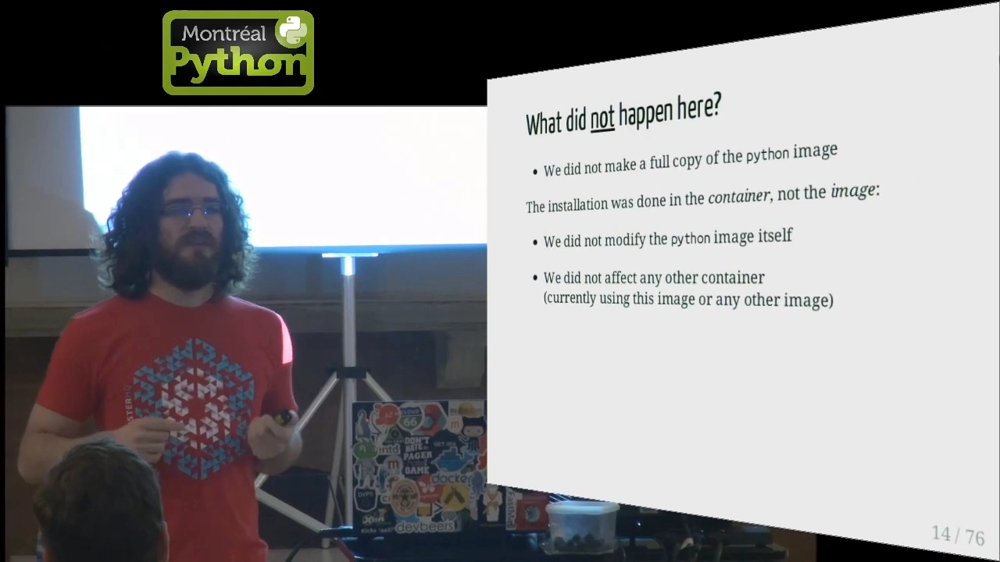

它用的是**写时复制**：与其整份拷贝 python 镜像，不如只**记录镜像与容器之间的差异**。收益是惊人的——一个容器**不到 1 MB**，启动**不到 0.1 秒**。

> **一句话理解写时复制**：多个使用者先"共享"同一份原始数据；只有当某个人真的要**写**的时候，才把**他要改的那一小部分**复制出来给他独用，其余部分继续共享。共享是常态，复制是例外。

### 1.2 没有写时复制，就没有今天的 Docker

作者给这一页起了个浪漫的标题——"写时复制与 Docker：一段爱情故事"。它列了没有写时复制会怎样：[容器启动会慢到无法忍受、容器会占用大量空间](https://www.youtube.com/watch?v=9oh_M11-foU&t=599)；更严重的是，**在你桌面的 Linux 机器上，Docker 根本用不起来**，也就不会有 Docker，更不会有今晚这场聚会。

这正是本讲的主线：**写时复制不是锦上添花，而是 Docker 成立的前提**。

## 二、写时复制的原理：先在内存里讲清楚

### 2.1 内存里的 CoW：`fork()` 与 `mmap()`

写时复制最早、最经典的用武之地是**内存管理**。两个系统调用最能体现它：[【跳转到 04:09】](https://www.youtube.com/watch?v=9oh_M11-foU&t=249)

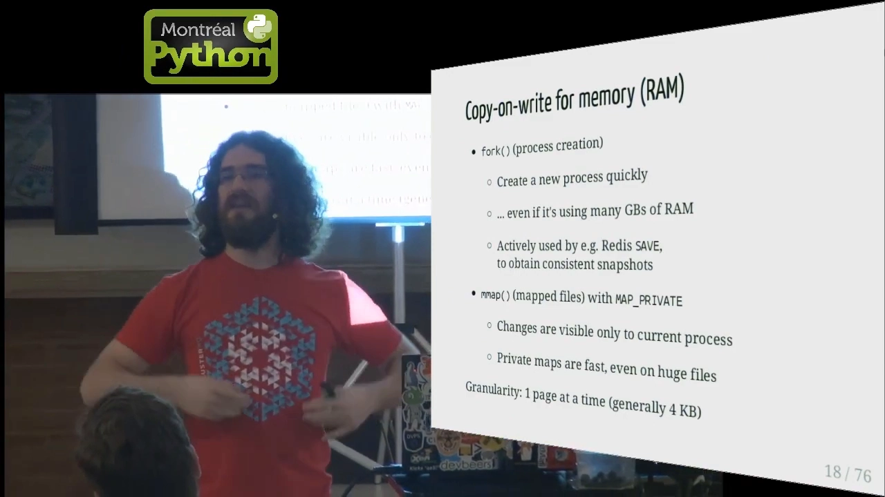

- **`fork()`（创建进程）**：创建一个新进程可以非常快，**哪怕它要用掉好几 GB 内存**——因为父子进程一开始共享同一批物理页，谁要写才复制。Redis 的 `SAVE` 就靠它拿到一致的快照。
- **`mmap()` + `MAP_PRIVATE`（私有文件映射）**：对文件的改动**只对当前进程可见**，而且即使文件巨大，私有映射也很快。
- **粒度**：一次一页（一般 **4 KB**）。

### 2.2 靠什么实现？MMU 与"页错误"

内存写时复制能成立，全靠一块硬件——**MMU（Memory Management Unit，内存管理单元）**。每一次内存访问都要经过它，它把"内存访问"（地址 + 读/写/执行）翻译成**实际的物理位置**，或者触发一次**页错误（page fault）**。[【跳转到 05:10】](https://www.youtube.com/watch?v=9oh_M11-foU&t=310)

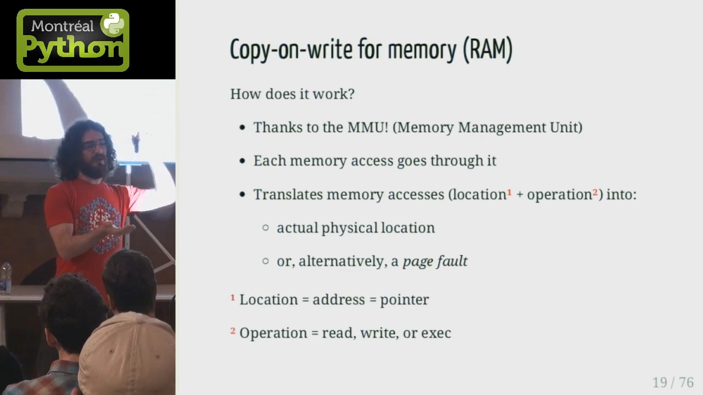

发生页错误时，MMU 通知操作系统，之后分几种情况处理：[【跳转到 06:36】](https://www.youtube.com/watch?v=9oh_M11-foU&t=396)

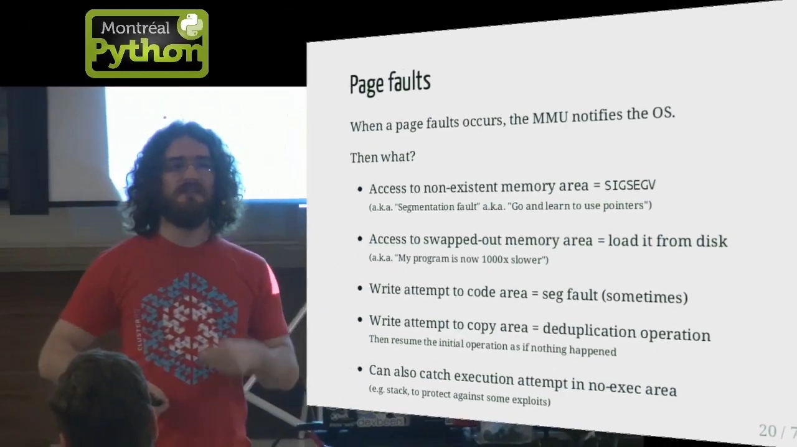

- 访问**不存在的内存** → `SIGSEGV`（段错误，俗称"回去把指针学好");
- 访问**被换出的内存** → 从磁盘换入（程序一下子慢 1000 倍）；
- 写**代码区** → 有时也段错误；
- 写**"影子副本"区域** → 执行一次**去重/复制操作**（这不就是写时复制吗）。

处理完再让原来的操作继续，仿佛什么都没发生。给个类比：你从图书馆借到一本"魔法书"，每一页只是真实页面的**影子副本**；当你的笔尖即将落到某页上时，书才把**那一页换成真正的纸**，让你在上面写字——那就是你私有的副本。[【跳转到 04:45】](https://www.youtube.com/watch?v=9oh_M11-foU&t=285)

### 2.3 磁盘上的 CoW：快照与"瘦供给"

写时复制同样存在于**磁盘**上，最初主要用于**快照**。动机很实际：一台数据库正在不停地读写，你想在**磁盘层面**给它做一次备份，但**磁盘很慢**——如果一边写、一边拷，备份里会出现"一半是旧账户、一半是新账户"的**不一致**状态。[【跳转到 07:24】](https://www.youtube.com/watch?v=9oh_M11-foU&t=444)

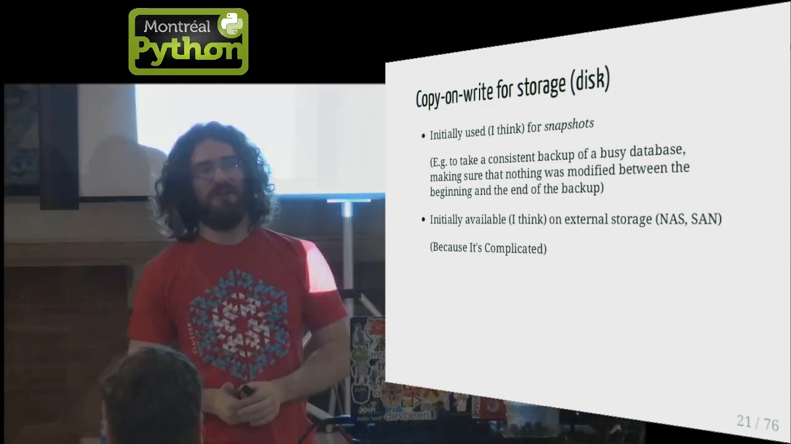

做法是先对当前存储空间做一份**写时复制版本**，再对这个版本做快照：备份对着 CoW 版本慢慢拷，真实数据库则继续在"被复制的页"上运行。于是备份冻结在**开始那一刻**的数据，数据库**照常工作**。

把同样的思路用到虚拟机上，就是"**瘦供给（thin provisioning）**"：系统镜像放在 CoW 存储上，每台机器只创建一个 CoW 实例；镜像里已经装好大量软件，人们几乎不需要再装东西，于是**每台机器只为自己的数据占用磁盘**——省空间，也因缓存而更快。注意这不只适用于虚拟机，**物理机（网络启动）和容器同样受益**。[【跳转到 08:07】](https://www.youtube.com/watch?v=9oh_M11-foU&t=487)

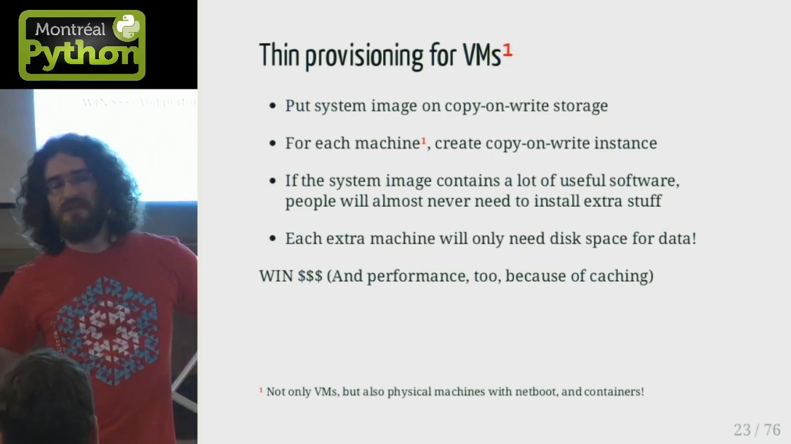

### 2.4 写时复制走进了桌面系统

曾经，写时复制只存在于 NetApp 这类**昂贵的大存储系统**里；最近五到十年，它开始出现在普通桌面上，这份（不完整）清单里就有：Linux 的 **LVM**、Solaris/FreeBSD/Linux 上的 **ZFS**、Linux 上的 **Btrfs**、**aufs / Union Mount / overlay**、以及虚拟机监控器里的**虚拟磁盘**。[【跳转到 09:29】](https://www.youtube.com/watch?v=9oh_M11-foU&t=569)

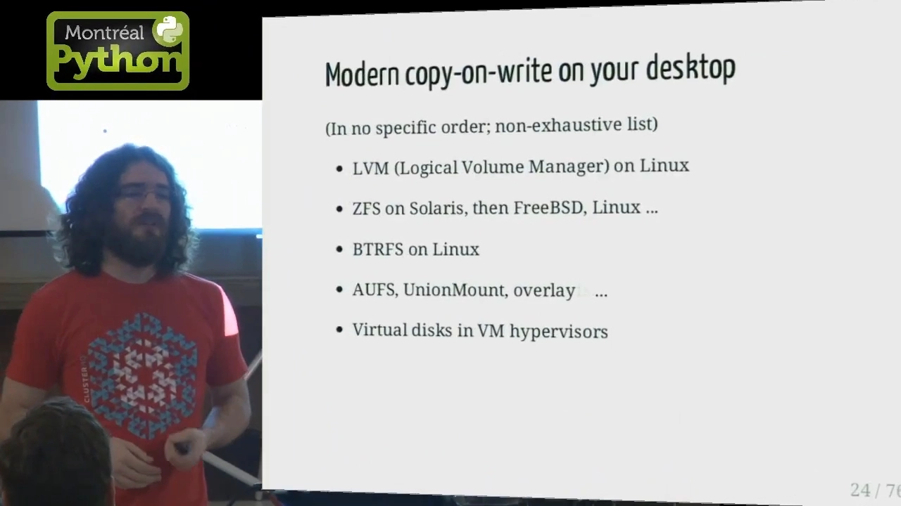

**这组技术对 Docker 极其重要**：没有它们，`docker run` 每次都会整份拷贝镜像，既慢又没人愿意用——也就不会有今天的 Docker。

## 三、CoW 怎么装进 Docker：可插拔的"存储驱动"

### 3.1 第一代：aufs 与它的历史包袱

Docker 刚发布时只支持**一种** CoW 方案——**aufs（Another Union File System，另一套联合文件系统）**，因为它当年做 dotCloud（后来的 Docker）时就在用它，经验丰富，单机跑几百个容器不在话下。[【跳转到 10:49】](https://www.youtube.com/watch?v=9oh_M11-foU&t=649)

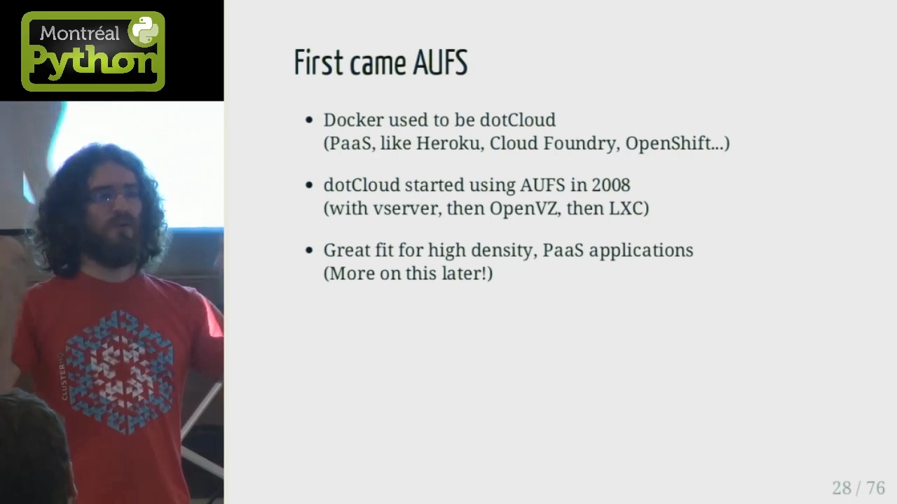

问题在于：**aufs 不在内核主线里**。你从 kernel.org 拉源码编译，是找不到 aufs 的；要自己下补丁加上去。Debian、Ubuntu 默认内核带 aufs（用于 Live CD 等场景），因此 Docker 一开始只面向 Ubuntu/Debian；而 **Red Hat 系（Fedora、CentOS、RHEL）用户就无缘 Docker**。[【跳转到 11:52】](https://www.youtube.com/watch?v=9oh_M11-foU&t=712)

### 3.2 转折：Red Hat 把 Device Mapper、Btrfs、overlayfs 贡献进来

后来 Red Hat 用户强烈要求在自己的发行版上用 Docker，Red Hat 公司决定促成此事，于是**贡献了 Device Mapper 驱动**，随后是 **Btrfs 驱动**，再后来是 **overlayfs 驱动**（同时也把存储驱动做成**可插拔**的接口，方便替换）。作者特地致谢了 Alexander Larsson、Vincent Batts 等贡献者。[【跳转到 12:12】](https://www.youtube.com/watch?v=9oh_M11-foU&t=732)

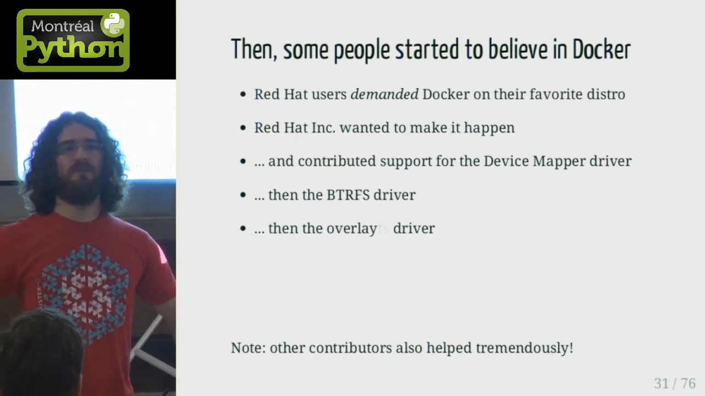

**没有他们，今天就只有跑着 Ubuntu/Debian 的少数人能玩 Docker。**

## 四、aufs：多个"分支"叠加，读取自顶向下

aufs 的核心思路是**把多个目录（称为分支/branch、层/layer）按特定顺序叠加在一起**：一般**底部至少一个只读分支**、**顶部恰好一个可读写分支**（当然也可以有别的组合）。每个分支就是一个普通目录。[【跳转到 13:07】](https://www.youtube.com/watch?v=9oh_M11-foU&t=787)

### 4.1 打开文件的规则：读向下降、写向上提（copy-up）

**以只读方式打开文件**时，aufs **从最上层开始，逐层向下查找**，找到就打开那一层里的文件。

**以写方式打开**时则分三种情形：

- 文件**哪里都找不到** → 在**顶层**新建它；
- 文件**在中间某层** → 把它**复制到顶层**（叫 **copy-up，向上复制**）再打开——因为只有顶层可写。注意：如果文件很大，这次复制**会花时间**，在能动手之前你得先等它拷完；
- 文件**就在顶层** → 直接打开。

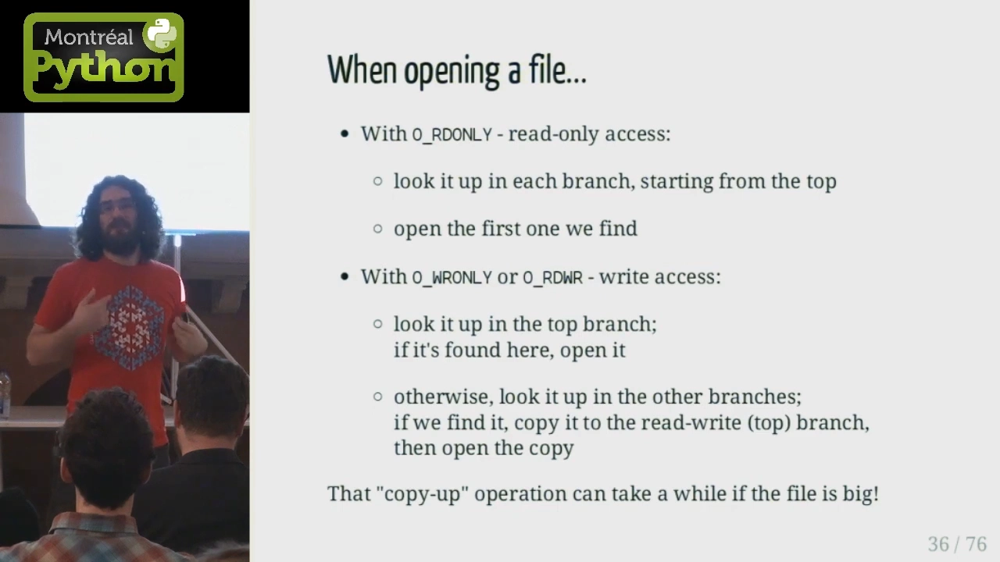

### 4.2 删除文件：whiteout（白障）

删除某个下层文件时，aufs 会在上层放一个特殊的**whiteout（白障）文件**——就像纸上涂的白色修正液。查找时一看到 whiteout，就回答"这里没有这个文件"，从而**遮住**下层那个真实存在的文件。[【跳转到 14:44】](https://www.youtube.com/watch?v=9oh_M11-foU&t=884)

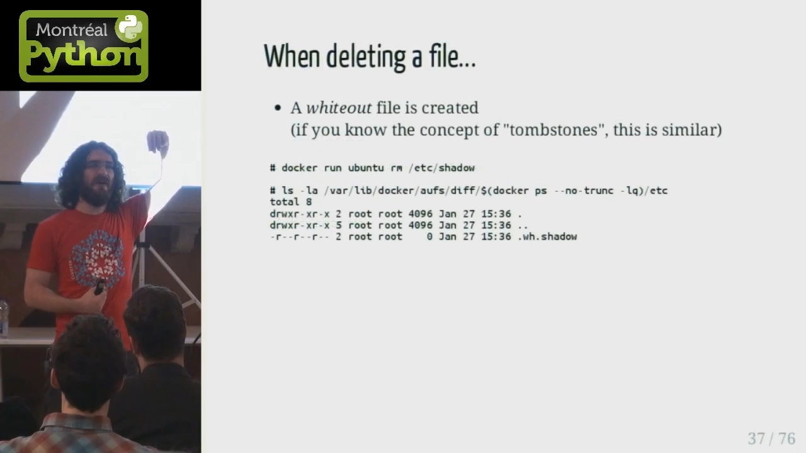

### 4.3 aufs 的优缺点：内存高效，但"stat 爆炸"

**优点**：久经考验、非常**内存高效**——起 1000 个同镜像的容器，页缓存只占一份。

**缺点**：主要是 **open() 的开销**，体现在两个场景：[【跳转到 15:26】](https://www.youtube.com/watch?v=9oh_M11-foU&t=926)

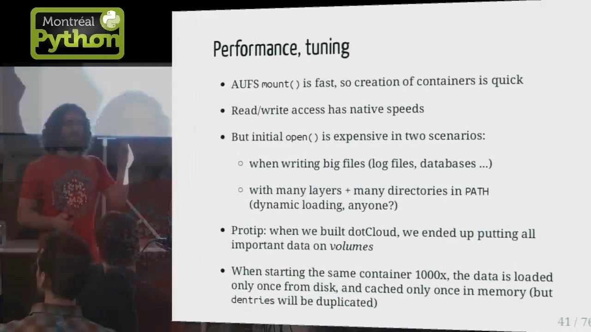

- **写大文件**（日志、数据库）时，要先 copy-up 再说；
- **层多、且 PATH 里目录多**时，一次查找要逐层 × 逐目录反复尝试——作者称之为 **"stat 爆炸"**：比如 Python PATH 有 100 个目录、又有好几层，一次 `import` 找不到模块就要做 `100×100×3` 次系统调用。

**实用建议**：当年做 dotCloud 时，他们把**重要数据统统放到 volume（卷）里**，绕开 CoW 的性能坑。

## 五、Device Mapper：把 CoW 下沉到"块级"

### 5.1 先弄清楚"Device Mapper"指什么

Device Mapper 是 Linux 里一个**很复杂**的子系统，能做 RAID、加密设备、**快照（即写时复制）**等等。但在 Docker 的语境里，说"Device Mapper 驱动"，指的其实是 **Device Mapper 子系统 + 它的 thin provisioning target（瘦供给目标，简称 "thinp"）**。[【跳转到 16:32】](https://www.youtube.com/watch?v=9oh_M11-foU&t=992)

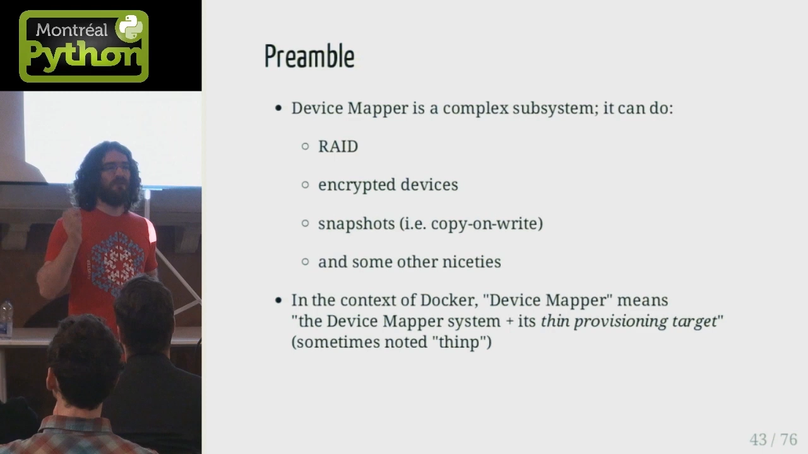

### 5.2 与 aufs 的根本差别：CoW 发生在块级

aufs 的写时复制发生在**文件级**；Device Mapper 则发生在**块级**。它位于技术栈的**最底层**——上面是 XFS 这类文件系统，当你按路径打开文件时，文件系统把路径翻译成磁盘上的块号，Device Mapper 就在**块**这一层做写时复制：要写的块若属于只读快照，就**复制**一块给它，其它人继续看公共的那一份。[【跳转到 17:22】](https://www.youtube.com/watch?v=9oh_M11-foU&t=1042)

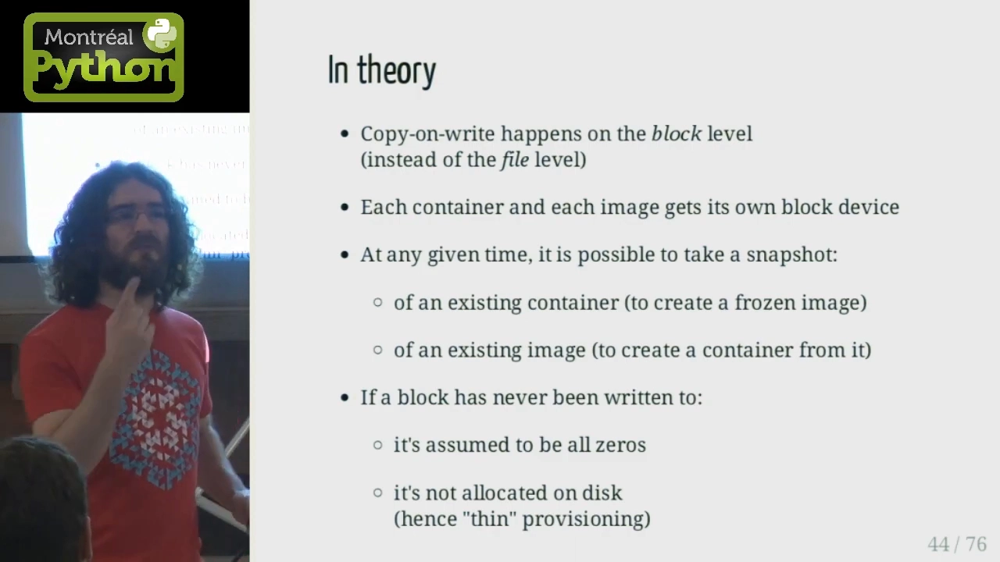

**优点**：每个容器都有自己的**虚拟磁盘**——这让"虚拟机 ↔ 容器"之间的迁移更容易，也**便于限制容器磁盘配额**（磁盘满就是满）。

**缺点**：默认要用两个大文件（**data** 与 **metadata**）来存块映射，而它们默认是**稀疏文件**，写时又要先去池子里找空闲块分配，导致**默认性能很差**。调优的钥匙是 `--storage-opt` 参数，比如把 data/metadata 放到真实设备上：

```bash
dockerd --storage-opt dm.datadev=/dev/sdb1 --storage-opt dm.metadatadev=/dev/sdc1
```

（记得先停 Docker、改参数、清空 `/var/lib/docker` 再重启。）

## 六、Btrfs：把 CoW 做在"文件系统级"

Btrfs 处在两者之间：它的**快照发生在文件系统层面**。你可以把一个目录声明为 **subvolume（子卷）**，随时对任意子卷做**快照**——即使数据有几十 GB，快照也是**瞬间**完成，原始数据不受影响。对"几个 G 的代码"或许无感，但对"60 GB 的地理数据库"就非常有价值。[【跳转到 19:30】](https://www.youtube.com/watch?v=9oh_M11-foU&t=1170)

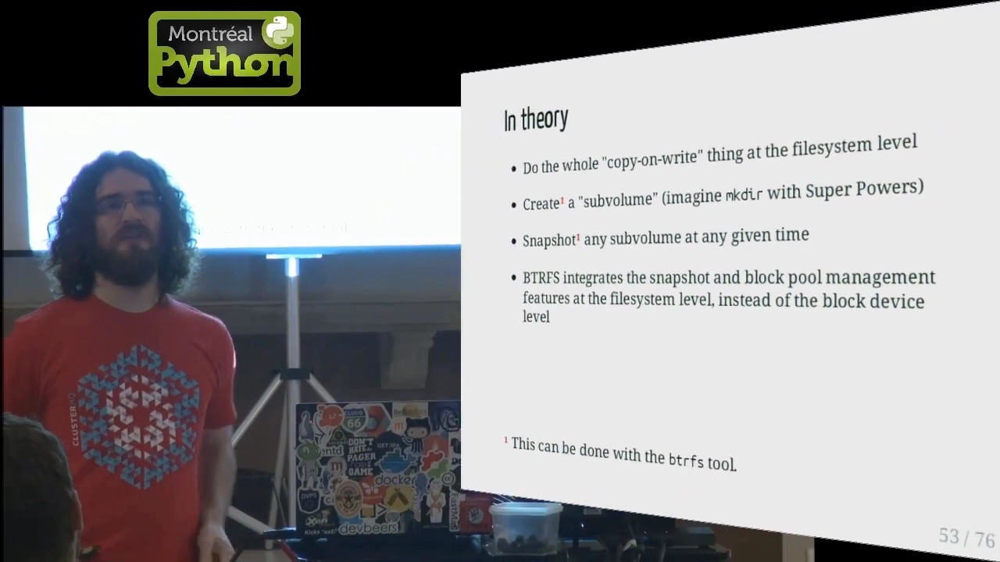

**一个要当心的坑**：Btrfs 把存储分成一个个 **chunk**，每个 chunk 要么是 metadata、要么是 data。你会遇到 `No space left on device`，**即使 `df` 显示还有空余**——因为那些 chunk 没写满。快速修复：

```bash
btrfs filesystem balance start -dusage=1 /var/lib/docker
```

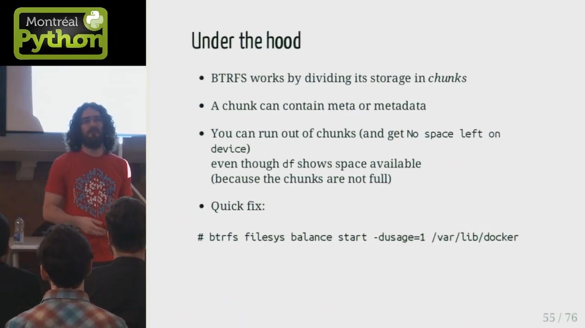

## 七、VFS：不做 CoW 的"整份拷贝"保底方案

VFS 严格说**不是**写时复制，而是"**copy on copy（拷贝就是拷贝）**"：用它跑 `docker run python`，就是**整份复制** python 镜像。它**不依赖任何花哨的内核特性**，因此：

- 适合把 Docker **移植到新平台**（如 FreeBSD、Solaris）；
- 适合在**老内核、任务关键**的环境里求稳（宁可慢，也不要冒险）；
- 代价是**低效**：慢、占内存和空间。[【跳转到 20:54】](https://www.youtube.com/watch?v=9oh_M11-foU&t=1254)

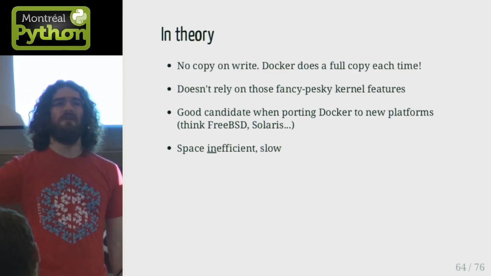

## 八、到底该选哪个存储驱动？

作者开场就调侃："Docker 存储驱动最美妙的地方，就是**有这么多可挑**。" 结论——**没有唯一答案，看场景**：[【跳转到 21:43】](https://www.youtube.com/watch?v=9oh_M11-foU&t=1303)

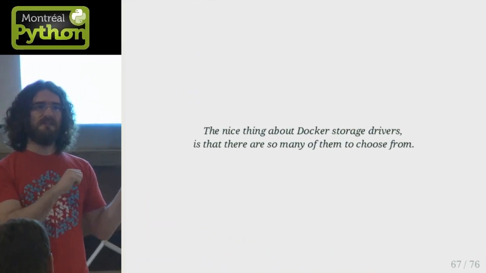

- 做 **PaaS / 高密度**部署 → 用 **aufs**（若系统支持）或 **overlayfs**，它们**内存高效**；
- 要处理**大文件、大只读数据集**（如 OpenStreetMap 数据）→ 用 **Btrfs 或 Device Mapper**，可以整份数据集共享、不必每次整拷；
- 实在拿不定主意 → **用你最熟悉的那一个**：玩过 LVM 就用 Device Mapper，玩过 Btrfs 就用 Btrfs；
- 否则就**都试一试、跑基准测试**，看哪个最适合你的工作负载。

## 小结

- **写时复制（CoW）**：默认共享，真要写才复制那一小块——是 Docker"秒起容器、省磁盘"的根基；
- **内存里的 CoW**：`fork()`/`mmap(MAP_PRIVATE)` 共享物理页，靠 **MMU** 判定，写时触发**页错误**再做私有复制（粒度一页 ≈ 4 KB）；
- **磁盘上的 CoW**：源自**快照**（给繁忙数据库做一致备份）与 **thin provisioning**（瘦供给，多机共享镜像、各占各的数据）；
- Docker 把各类 CoW 文件系统做成**可插拔存储驱动**，让容器共享只读镜像层、只保留一层薄可写层；
- **aufs**：多个分支叠加，读自顶向下、写走 **copy-up**、删走 **whiteout**；内存高效，但初始 `open()` 在写大文件、层多目录多时昂贵（"stat 爆炸"）；
- **Device Mapper**：**块级** CoW，每容器独立虚拟磁盘、便于限配额，但默认用稀疏文件 → 性能差，需 `--storage-opt` 调优；
- **Btrfs**：**文件系统级** CoW，subvolume + 瞬时快照，注意 `chunk` 导致的"假空间不足"；
- **VFS**：不做 CoW、整份拷贝，慢但稳、可移植，是老内核/跨平台保底；
- **选型**：高密度 → aufs/overlayfs；大文件 → Btrfs/Device Mapper；不确定 → 用你最熟的并做基准测试。

## 关键术语速查

| 术语 | 一句话解释 |
| --- | --- |
| 写时复制（copy-on-write, CoW） | 先共享数据，只在真正写入时才复制被改的那一小块 |
| MMU | 内存管理单元，负责把内存访问翻译成物理地址或触发页错误 |
| 页错误（page fault） | 访问受限/不存在内存时 CPU 触发的异常，操作系统借机做复制、换入等处理 |
| 瘦供给（thin provisioning） | 存储按需分配：没写过的块不占真实磁盘 |
| 存储驱动（storage driver） | Docker 里负责镜像层与容器可写层的可插拔后端（aufs/overlayfs/…） |
| 分支 / 层（branch / layer） | 构成联合文件系统的单个目录（层） |
| copy-up（向上复制） | 要写只读层里的文件时，先把它复制到可写层再改 |
| whiteout（白障） | 删下层文件时在上层放置的标志文件，用来"遮住"下层文件 |
| Device Mapper | Linux 块级子系统；Docker 用其 thin provisioning target 做块级 CoW |
| 子卷（subvolume） | Btrfs 中可独立做快照的目录单元 |
| chunk | Btrfs 的存储分配单元，可能造成"df 有余量但报空间不足" |
| VFS | Docker 中不做 CoW、只做整份拷贝的保底存储驱动 |
