# Docker Internals 第二讲：存储驱动把镜像层与容器可写层拼起来

> 视频来源：YouTube 视频 [Docker Internals Session 2: Docker Storage Drivers](https://www.youtube.com/watch?v=3BkCaBxq5Ag)（约 22 分 50 秒，英文讲解）。本文基于视频演说图文稿整理，时间戳可跳转到原视频对应位置；配图取自视频画面。字幕来自平台自动字幕（英文 ASR），术语与错拼已逐窗口核对纠正（如 "copy and write"→copy-on-write、"Centaurs"/"sent to a 7"→CentOS、"dogger"/"Dhaka"→Docker、"/var/log/docker"→/var/lib/docker、"Murli"→merely）。
>
> 配套阅读：本条目另有一篇原理姊妹篇[《Docker 存储驱动深潜：写时复制，以及 aufs / Device Mapper / Btrfs / overlayfs 的取舍》](Deep%20dive%20into%20Docker%20storage%20drivers.md)，讲清写时复制的底层原理与各驱动优缺点；本篇则在 CentOS 7 上把这些概念**亲手跑一遍**。

## 本讲要解决的核心问题（SCQA）

**背景**：上一讲我们弄清了容器的隔离靠 cgroups 与 namespaces。但光有隔离还不够——在容器里跑任何应用都需要一大串 OS 库与依赖，如果**每个容器都单独复制一份**，启动会慢到让人放弃 Docker。

**冲突**：Docker 用**写时复制**和**联合文件系统**避开了整份拷贝，可这些机制在**幕后**到底怎么落地？`docker build` 的每一行指令、`docker run` 的每一次挂载，究竟在磁盘上生成了什么？

**疑问**：存储驱动在磁盘上到底是怎样的结构？镜像的"**层**"、容器的"**可写层**"分别在哪、长什么样？构建缓存和写时复制又是怎么发生的？

**回答（中心思想）**：存储驱动（这里以 **overlay2** 为例）把**镜像**实现为**一层或多层只读 layer 的联合**，把**容器**实现为"**只读镜像层 + 一层容器专属可写层**"的联合挂载。镜像的每一行构建指令对应一个只读层，只存与本层的**差异**；容器的一切改动都落在**最顶层的可写层**，容器一删、可写层即消失；而要修改只读层里的文件时，**写时复制**会把该文件拷到可写层再改，且**不影响**共享同一镜像的其它容器。理解这套结构，你的构建会更快、镜像会更小。[【跳转到 00:00】](https://www.youtube.com/watch?v=3BkCaBxq5Ag&t=0)

---

## 一、为什么容器离不开存储驱动

### 1.1 没有存储驱动，Docker 根本跑不动

构建一个隔离的运行环境只解决了**一半**的问题。如果没有存储驱动，启动容器会**慢到低效得无法承受**——Docker 也绝不会达到今天的规模。**存储驱动是 Docker 作为容器技术成功的主因之一**。[【跳转到 00:32】](https://www.youtube.com/watch?v=3BkCaBxq5Ag&t=32)

原因很朴素：在容器里跑应用，需要一长串 OS 库和依赖；如果每个容器都**单独复制**一份，启动容器的时间会长到让人看不出它比传统虚拟机强在哪。

### 1.2 写时复制 + 联合文件系统 = 避免整份拷贝

存储驱动的解法是：用**写时复制（copy-on-write，也常被称为 implicit sharing / shadowing）**配合**联合文件系统**，有效**共享**容器之间的文件与库，从而**避免整份拷贝**。写时复制并非新概念，历史上一直用于**内存资源管理**，也用于存储与**快照**技术。[【跳转到 01:17】](https://www.youtube.com/watch?v=3BkCaBxq5Ag&t=77)

### 1.3 历史小传：从打补丁的 aufs 到百花齐放

当年 Docker（还叫 dotCloud）在**aufs（Advanced Union File System）**里找到了第一款合适的 CoW 驱动。但那时**内核主线并不内置**任何 CoW 能力，得靠 Docker 团队**外部打补丁**，既繁琐又麻烦。[【跳转到 01:42】](https://www.youtube.com/watch?v=3BkCaBxq5Ag&t=102)

随着 Docker 走红，各 Linux 发行版意识到集成 Docker 的重要性，开始把 CoW 能力**融入内核**。于是陆续有了多种被 Docker 支持的 CoW 存储驱动：**aufs、Btrfs、Device Mapper（也用于 LVM）、overlayfs、ZFS**。

### 1.4 存储驱动的两大阵营：文件级 vs 块级

这些驱动主要按**工作层级**分为两类——**文件级（file level）**与**块级（block level）**：[【跳转到 02:44】](https://www.youtube.com/watch?v=3BkCaBxq5Ag&t=164)

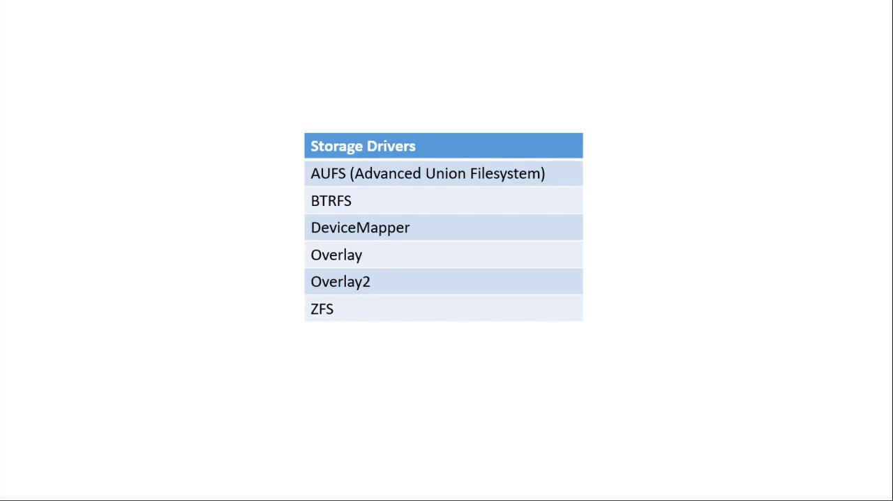

- **文件级**：以**文件和目录**为单位做写时复制，如 aufs、overlayfs、ZFS；它们直接建立在宿主机的原生文件系统（如 XFS）之上。
- **块级**：以**磁盘块**为单位做写时复制，如 Device Mapper、Btrfs。

**今天的主角**是 **overlay2**——Red Hat 系与 CentOS 7 现在的**默认存储驱动**，也是本讲要用 `docker info` 看到、并动手拆解的那个。overlayfs 是**联合文件系统（union file system）的现代版本**。

## 二、存储驱动的地基：联合文件系统与镜像分层

### 2.1 overlayfs：layer 叠加 + 从顶部合并出"统一视图"

联合文件系统用**分层**的方式存储文件与目录——这些文件和目录**本质上仍存在宿主机原生文件系统**（如 XFS）上；联合文件系统的职责是**从顶部把底层各层累积成一个统一的合并视图**。overlayfs 也属于联合文件系统，它把单个文件/目录当作**分支或层（branch/layer）**，再对这些层做**虚拟合并**，对外提供一个统一视图。注意：**这些底层 layer 可以位于不同的卷、甚至不同的文件系统上**。[【跳转到 03:24】](https://www.youtube.com/watch?v=3BkCaBxq5Ag&t=204)

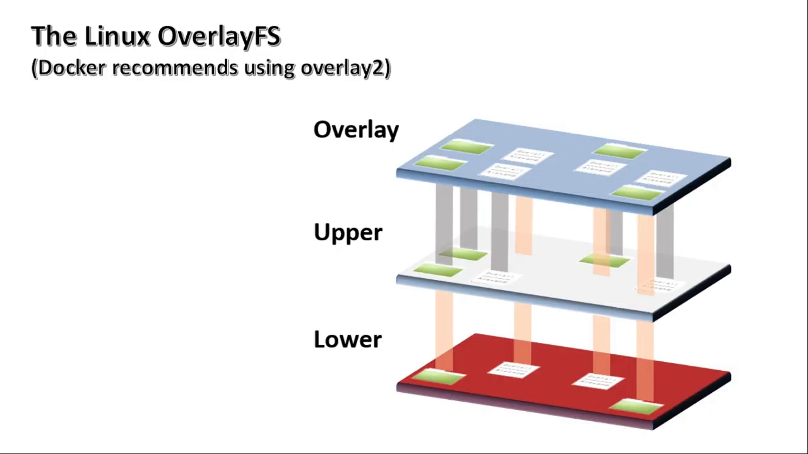

这种分层最核心的价值是：**让镜像层可以在多个容器之间共享**。

### 2.2 Docker 镜像 = 一层或多层只读层的联合

**Docker 镜像**其实就是**对一个或多个只读层的联合的引用**。镜像是用**一行行指令**构建出来的，**每一行指令就是"如何构建一层"的说明**。而构建镜像的工具叫 **Dockerfile**——一个**文本文件**，里面按行写着创建各层的指令。[【跳转到 04:32】](https://www.youtube.com/watch?v=3BkCaBxq5Ag&t=272)

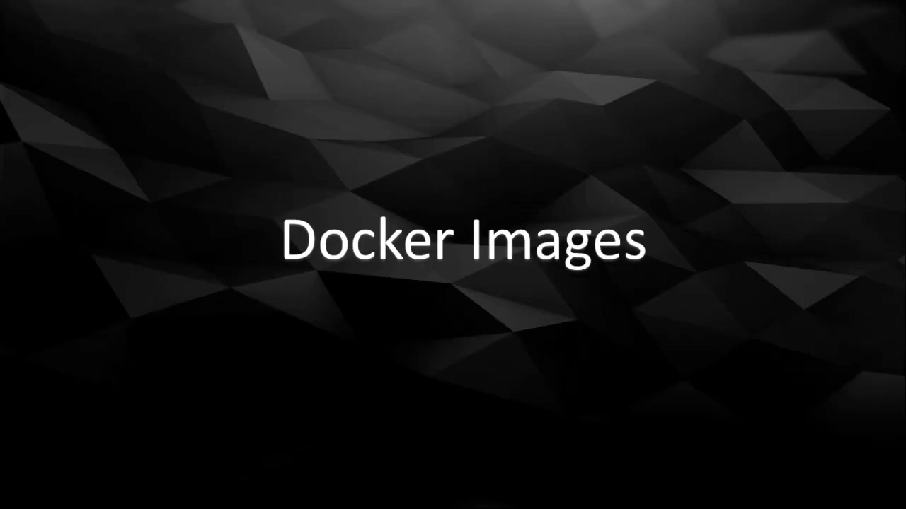

Docker 默认会从 **Docker Hub**（云端镜像仓库）下载你本地没有的镜像——几乎所有的 Linux 发行版与常见应用在上面都能找到。镜像的 **tag（标签）**可以理解为一种版本标记，默认是 `latest`，你也可以自定义标签向使用者传达版本信息。常用命令：

```bash
docker image ls                 # 列出本地镜像
docker image pull centos:7      # 从 Docker Hub 拉取 centos:7
```

（CLI 的基本语法是 `docker <组件> [OPTIONS] COMMAND [ARGS]`，组件即 image、container、network、volume 等。）

## 三、动手：走进 `/var/lib/docker/overlay2`

### 3.1 Docker 的后端存储目录

拉到一个基础 **CentOS 7** 镜像后，我们到默认存储目录 `/var/lib/docker` 去看看 Docker 到底在背后做了什么。**重要提醒：永远不要直接改动这个目录下的任何文件**，它完全由 Docker 托管，手改可能损坏整个环境。进到 `overlay2/` 后，你会看到**每个 overlay 层各有一个目录**，目录名是**对层的内容做哈希**得到的（因此是又长又怪的一串）。[【跳转到 07:50】](https://www.youtube.com/watch?v=3BkCaBxq5Ag&t=470)

```bash
[root@localhost ~]# cd /var/lib/docker
[root@localhost docker]# ls
builder  buildkit  containers  image  network  overlay2  plugins  runtimes  swarm  tmp  trust  volumes
[root@localhost docker]# cd overlay2/
[root@localhost overlay2]# ls
backingFsBlockDev  ea14c370b022d83c4f519df4e9a5ca94e7e8d9190311e4dcce8e9abea19b4cf6
```

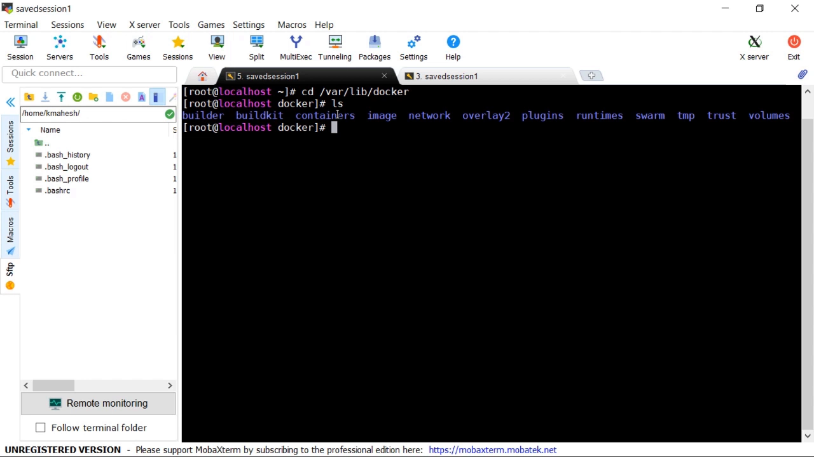

### 3.2 一个层里有什么：`diff`、`link`、`lower`

进入刚下载的 CentOS 7 镜像对应的层目录，你会看到 **`diff` 目录**和 **`link` 文件**：[【跳转到 08:15】](https://www.youtube.com/watch?v=3BkCaBxq5Ag&t=495)

```bash
[root@localhost overlay2]# cd ea14c370b022.../
[root@localhost ea14c370b022...]# ls
diff  link
```

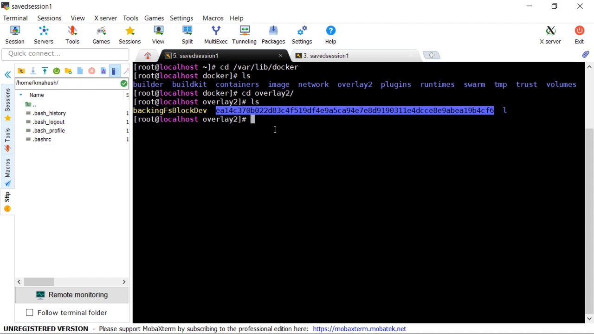

- **`diff` 目录**：本层包含的**所有文件与目录**（这里就是 CentOS 7 的库与目录）。名字叫 `diff` 的原因，等到创建新层时会更好理解——**每层只存与下层的差异**；
- **`link` 文件**：存一个**缩短的符号链接标识符**，用来规避 mount 选项对长名字的限制。

## 四、用 Dockerfile 构建镜像：每行指令 = 一个层

### 4.1 写一个 Dockerfile

Dockerfile 就是一份"如何构建镜像"的指令清单，按**分层格式**书写——**每一行指令在后台都会转换成 overlayfs 的一个层**。标准格式是"**指令 + 参数**"。本讲只用到最简单的 `FROM` 和 `RUN` 两条：[【跳转到 09:44】](https://www.youtube.com/watch?v=3BkCaBxq5Ag&t=584)

```dockerfile
FROM centos:7
RUN mkdir /test1 && echo "Hello" > /test1/file.txt
```

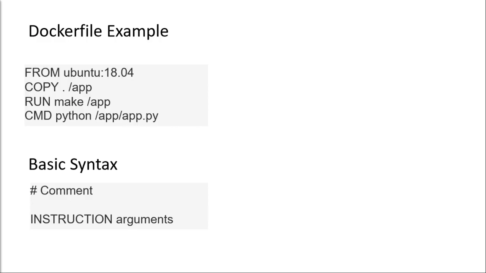

- **`FROM` 必须放在最前面**，它指定我们的**基础镜像**（这里是刚下载的 CentOS 7），后续层都叠在它之上；
- **`RUN`** 在构建时执行 shell 命令（这里创建 `/test1/file.txt`）。

### 4.2 构建：每条指令创建一个层

```bash
[root@localhost ~]# docker image build -t testimage1 .
```

构建时可以看到**每条指令被逐步执行，后台为它创建一个对应的 overlay 层**（若尚不存在）。回头再看 `overlay2`，你会发现**新增了一个层**；进入它的 `diff/`，里面**只有 `test1` 目录**——**因为每层只存相对下层的差异**。[【跳转到 10:34】](https://www.youtube.com/watch?v=3BkCaBxq5Ag&t=634)

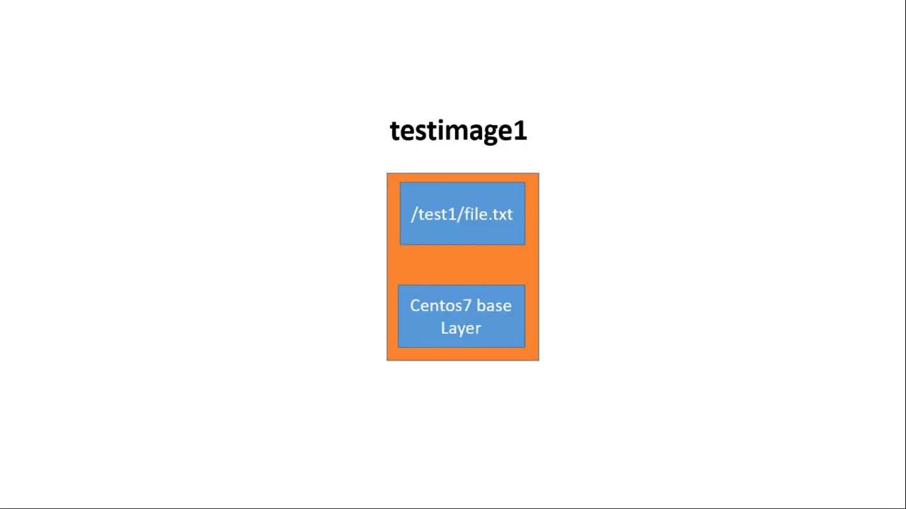

这里还能看到一个叫 **`lower`** 的新文件：里面存着**它下面那一层（CentOS 7 基础层）的缩短名字**。overlayfs 驱动最终就用这些信息拼出统一视图。

> **记住**：**层本身并不"属于"某个镜像**，它仅仅是文件和目录的集合；**是镜像记录了它由哪些层组成**（用 `docker image inspect <镜像>` 可以看到组成该镜像的各个 overlay 目录，`docker image history <镜像>` 则显示逐层的构建指令）。

### 4.3 构建缓存：能复用的层不再重建

再构建一个镜像 `testimage2`，前两条指令相同、只加一条 `RUN mkdir /test2`。构建时注意 **"Using cache"** 字样——Docker 用了**构建缓存（build cache / layer caching）**，避免重复造层、优化构建过程。[【跳转到 12:30】](https://www.youtube.com/watch?v=3BkCaBxq5Ag&t=750)

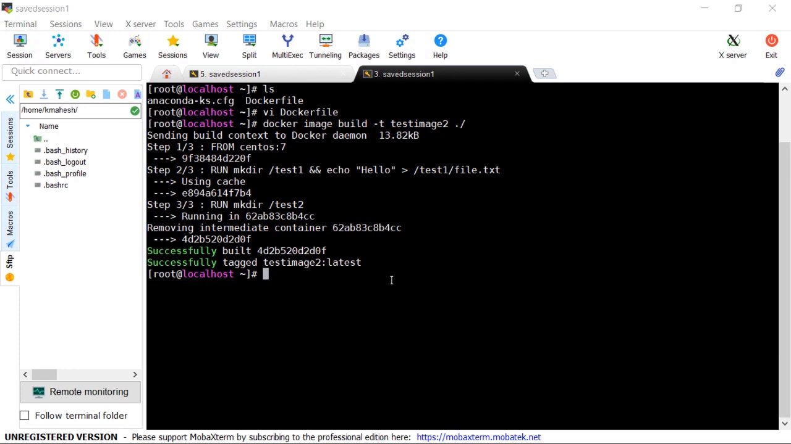

```text
Step 1/3: FROM centos:7
 ---> 9f38484d220f
Step 2/3: RUN mkdir /test1 && echo "Hello" > /test1/file.txt
 ---> Using cache
 ---> e894a614f7b4
Step 3/3: RUN mkdir /test2
 ---> Running in 62ab83c8b4cc
 ---> 4d2b520d2d0f
Successfully built 4d2b520d2d0f
```

**层缓存主要作用于 `COPY`、`RUN`、`ADD` 指令**：Docker 会保存历史构建的缓存，把新构建的指令与缓存逐一比对——**指令内容相同且顺序相同**，就复用已有的层，而不是新建。于是这两个镜像**共享前两层**，只在磁盘上多出一个含 `test2` 的新层。

### 4.4 缓存的坑：输出"每次都不同"的指令会被误复用

层缓存也有**副作用**。如果某条 `RUN` 的输出**每次都不一样**（例如 `git pull` 每次都要拉新代码，或向文件写入随机内容），Docker 仍会**把指令视为"重复"而直接复用旧层**，导致你**拿不到本应更新的内容**。[【跳转到 14:47】](https://www.youtube.com/watch?v=3BkCaBxq5Ag&t=887)

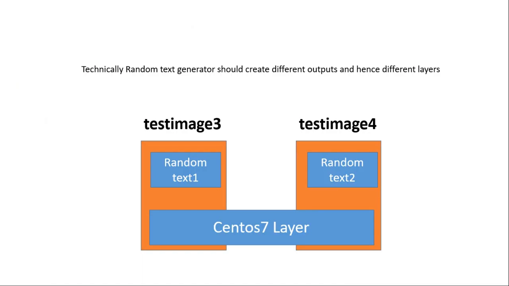

绕过办法之一是加 **`--no-cache`** 选项，强制 Docker **不查缓存**、为每条构建指令新建层。所以**Dockerfile 的设计**很关键：[【跳转到 15:36】](https://www.youtube.com/watch?v=3BkCaBxq5Ag&t=936)

- 把**重复性高、产出相似层**的指令**尽量放在前面**，把**每次都变（非重复）**的指令**放到最后**——这样层能在镜像间被更有效地共享；
- **顺序很重要**：一旦检测到**第一个不匹配**，Docker 会**重建它之后的所有层**。

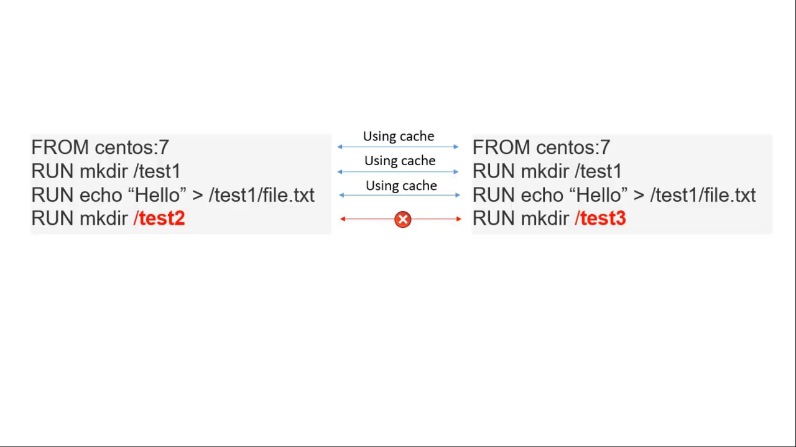

## 五、启动容器：只读镜像层 + 一层容器专属可写层

### 5.1 启动时到底挂载了什么

从 OS 角度看，容器就是**在 cgroups + namespaces 造出的隔离运行环境里跑着的进程**。要启动一个容器，Docker **先创建这个隔离环境**，然后**挂载 overlay 层**——底下是**镜像提供的、被共享的只读层**，顶上再叠**一层该容器专属的可写层**。[【跳转到 17:02】](https://www.youtube.com/watch?v=3BkCaBxq5Ag&t=1022)

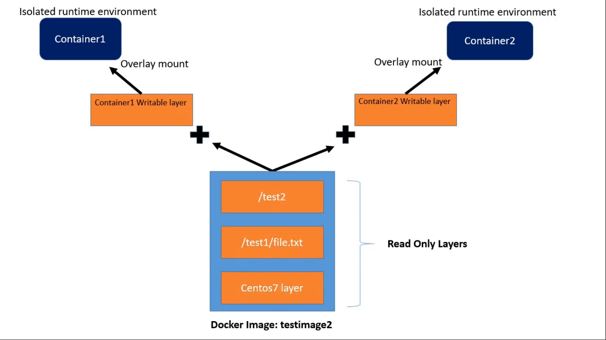

容器里的一切操作**只会落在最顶层的可写层**；可写层与容器**同生命周期**——**容器一删，可写层里的数据也随之丢失**。

### 5.2 后端的真实模样

在终端里跑两个来自 `testimage2` 的容器：

```bash
docker container run -it testimage2 bash     # 在另一个标签页再跑一个
docker container ls
```

回到 `overlay2` 目录，你会看到**每个容器各自多出一个顶层可写层**——它们都**含一个 `merged` 目录**，便于辨认。当前这些可写层的 `diff/` 还是空的（容器里还没存东西）。另外还有带 **`-init` 后缀**的层目录：它们是**容器专属的只读层**，用来**初始化每个容器必需的一些文件**（如 `hosts`、`hostname` 等）。[【跳转到 18:12】](https://www.youtube.com/watch?v=3BkCaBxq5Ag&t=1092)

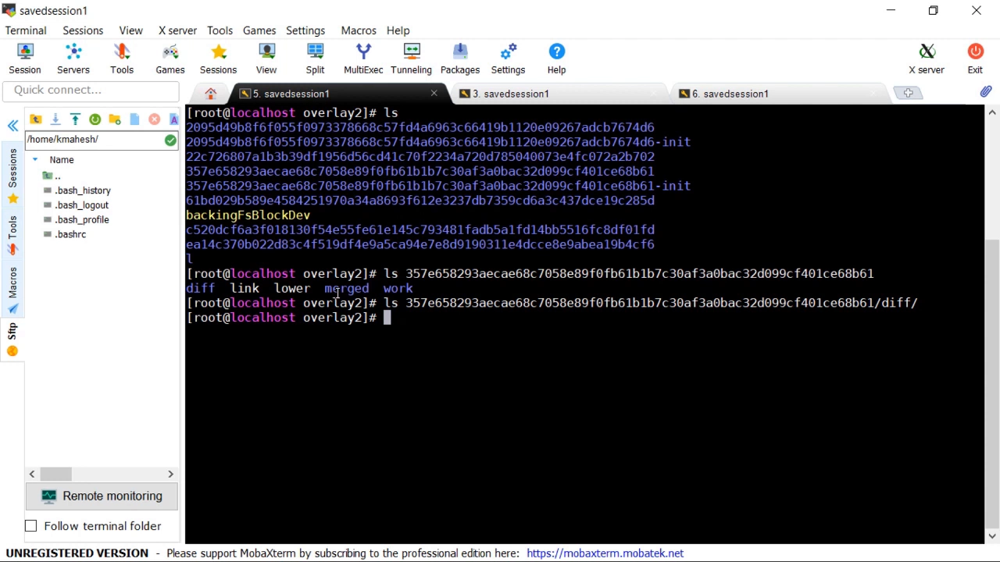

**注意**：在容器启动之前，这些"层"不过是原生 Linux 文件系统上的一堆**普通目录**；**只有启动容器时**，overlay 驱动才介入、**把它们合并成一个统一的 `merged` 视图**挂进容器。

进入某个容器的 `merged/`，你会看到**所有下层的合并结果**（CentOS 基础目录 + `test1` + `test2`）；再 `mount | grep overlay`，就能看到**正是这个 `merged` 目录**被以 **overlay** 类型挂进了容器。[【跳转到 19:20】](https://www.youtube.com/watch?v=3BkCaBxq5Ag&t=1160)

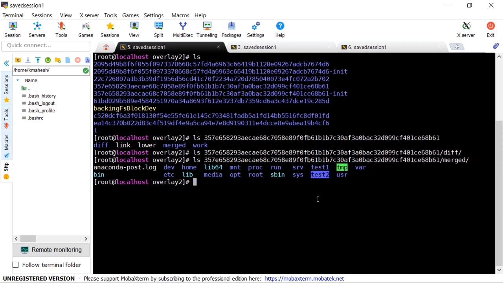

### 5.3 写时复制实战：改只读层的文件

现在演示**写时复制**——作者特意先不讲定义，而是**直接跑给你看**。前提已经明确：容器级操作都记在最顶层的可写层，**容器不能修改底下的只读镜像层**，这样**一个容器里的改动就不会传播到共享同一镜像的其它容器**。[【跳转到 20:11】](https://www.youtube.com/watch?v=3BkCaBxq5Ag&t=1211)

那如果**确实需要修改只读层里的文件**呢？这正是**写时复制**登场的地方：**一旦你试图修改只读层中的文件或目录，它就会被复制到最顶层的可写层**，于是容器拥有了一份**本地副本**可供操作。[【跳转到 20:36】](https://www.youtube.com/watch?v=3BkCaBxq5Ag&t=1236)

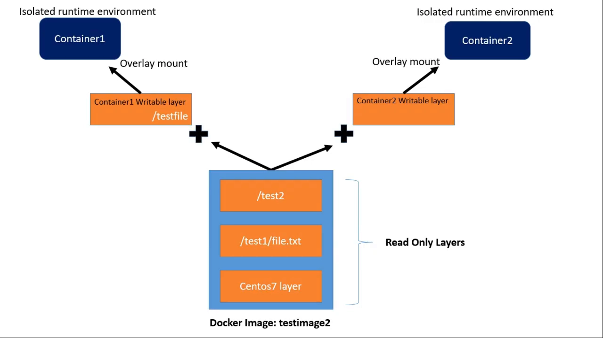

在容器里修改 `/test1/file.txt`（它本来属于下面的只读层），保存退出后，到后端去看那个容器的可写层，会发现里面**多了一份本地的 `test1/file.txt` 副本**。**更能说明问题的是**：从**另一个**容器里读同一个文件，内容**仍是旧的、没被改过**——尽管两个容器**共享同一份底层镜像**。

```bash
# 另一个容器里：
[root@32e67318086a /]# cat /test1/file.txt
Hello
```

**实用建议**：设计镜像层时，应尽量**避免让容器内进程去修改/写只读镜像层**——因为对**较大文件**做写时复制相当**耗资源**，可能拖累性能。[【跳转到 21:26】](https://www.youtube.com/watch?v=3BkCaBxq5Ag&t=1286)

## 六、可写层的生命周期：别把它当存储用

务必记住：**容器的可写层与容器同生命周期**——**容器一删，可写层里的数据就丢了**。[【跳转到 22:10】](https://www.youtube.com/watch?v=3BkCaBxq5Ag&t=1330)

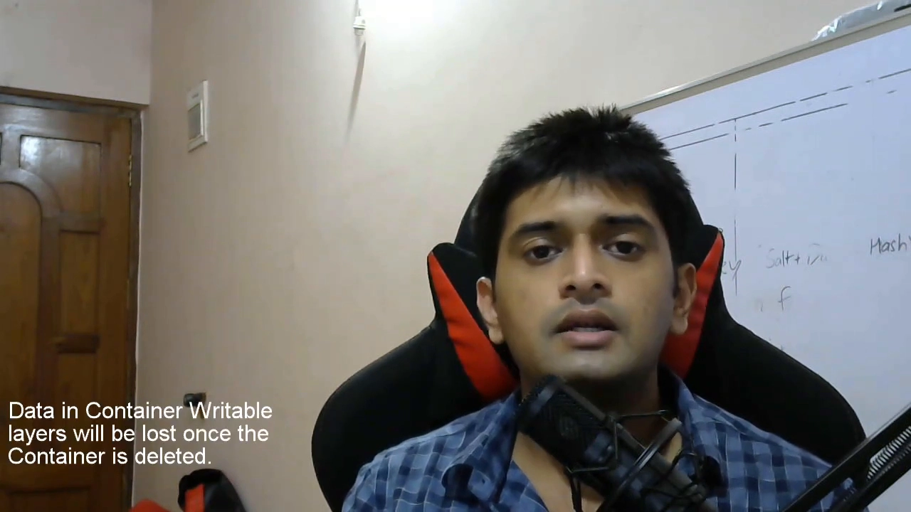

所以它**很少被当作存储手段**。真正要长期保存数据时，你会用到挂载进容器的 **Docker 数据卷（volume）**——持久卷或非持久卷，数据都**存在容器之外**（这部分留到后续课程）。但无论如何，**理解 Docker 存储层是熟悉 Docker 内部原理与运行机制的关键**，也会实实在在提升你的使用体验。

## 小结

- **存储驱动**是 Docker 成功的关键之一：它靠**写时复制 + 联合文件系统**共享容器间的文件与库，避免整份拷贝，否则启动容器会慢到不可用；
- 存储驱动分**文件级**（aufs/overlayfs/ZFS）与**块级**（Device Mapper/Btrfs）；**overlay2** 是 CentOS 7 / Red Hat 系的默认驱动；
- **联合文件系统**把多个**层**从顶部合并成一个**统一视图**，底层 layer 可分布在不同卷/文件系统上，核心价值是**跨容器共享**；
- **Docker 镜像**是对一层或多层**只读层联合**的引用，由 **Dockerfile** 逐行构建，**每行指令对应一个只读层**；
- 磁盘后端在 `/var/lib/docker/overlay2`，**每层一个哈希目录**，内含 **`diff`**（本层内容）、**`link`**、**`lower`** 等；
- **每层只存与下层的差异**；**层不属于镜像**，是镜像记录了它由哪些层组成；
- **构建缓存**复用相同指令/顺序的层以加速构建，但会让"输出每次不同"的指令被误复用，可用 `--no-cache` 强制重建；Dockerfile 应**把重复指令放前、易变指令放后**；
- **启动容器** = 创建隔离环境 + 把**共享只读镜像层**与**一层容器专属可写层**合并挂载进容器；
- 容器改动只落在**最顶层可写层**，**随容器删除而丢失**；要改只读层文件时发生**写时复制**，且**不影响其它容器**；
- 持久数据应放在**数据卷**里，而不是容器的可写层。

## 关键术语速查

| 术语 | 一句话解释 |
| --- | --- |
| 存储驱动（storage driver） | 负责镜像层与容器可写层落地的后端，如 overlay2、aufs、Device Mapper |
| 写时复制（copy-on-write） | 修改只读数据时才把被改部分复制到可写层，其余继续共享 |
| 联合文件系统（union file system） | 把多个层从顶部合并成一个统一视图的文件系统机制 |
| 层 / layer | 镜像的组成单位，只存与下层的差异 |
| diff 目录 | overlay2 中存放某一层实际内容的目录 |
| link / lower 文件 | 层的短标识符、以及指向下一层的引用 |
| Dockerfile | 逐行描述如何构建镜像的文本文件，每行指令对应一个层 |
| 构建缓存（build cache） | 复用指令与顺序都相同的已有层，加速构建 |
| 可写层（writable layer） | 容器专属的最顶层，容器改动都落在这里，随容器删除而丢失 |
| merged 目录 | 各层合并后的统一视图，被挂进容器 |
| 数据卷（volume） | 存放在容器之外、可持久的 Docker 数据存储 |
