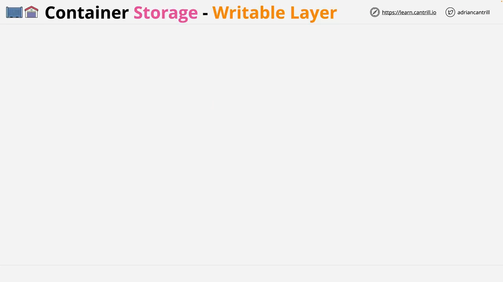
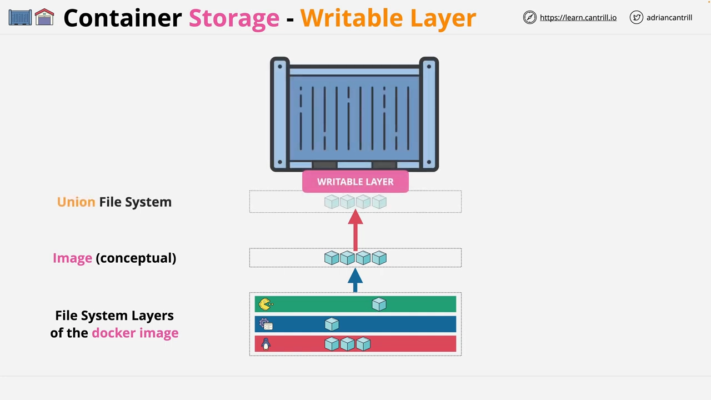
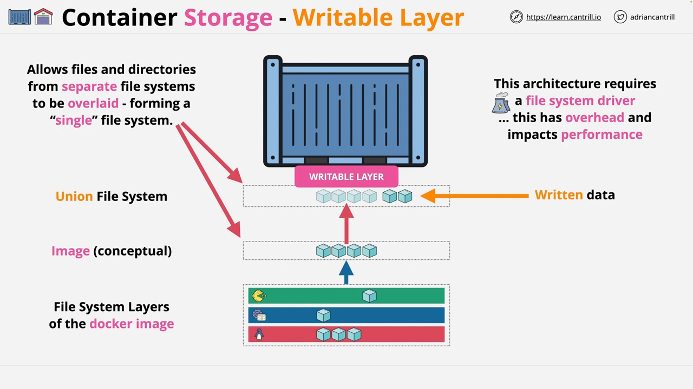
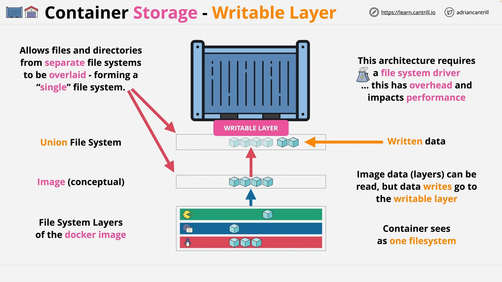
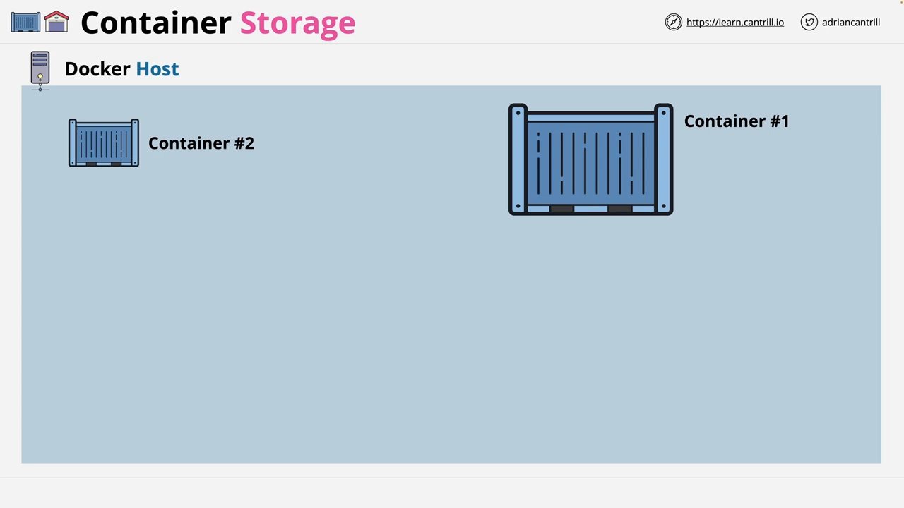
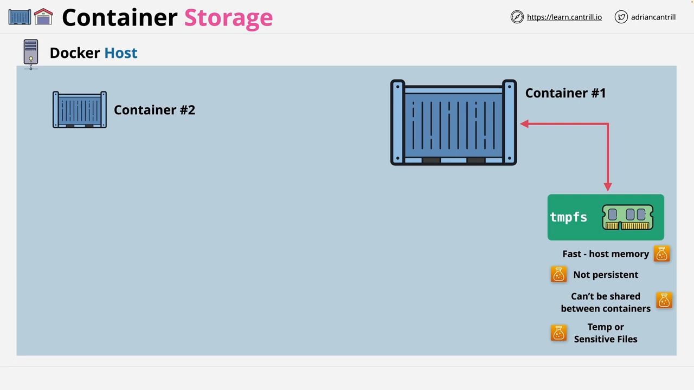
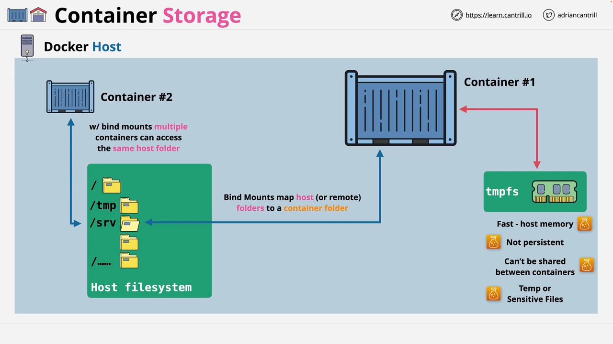
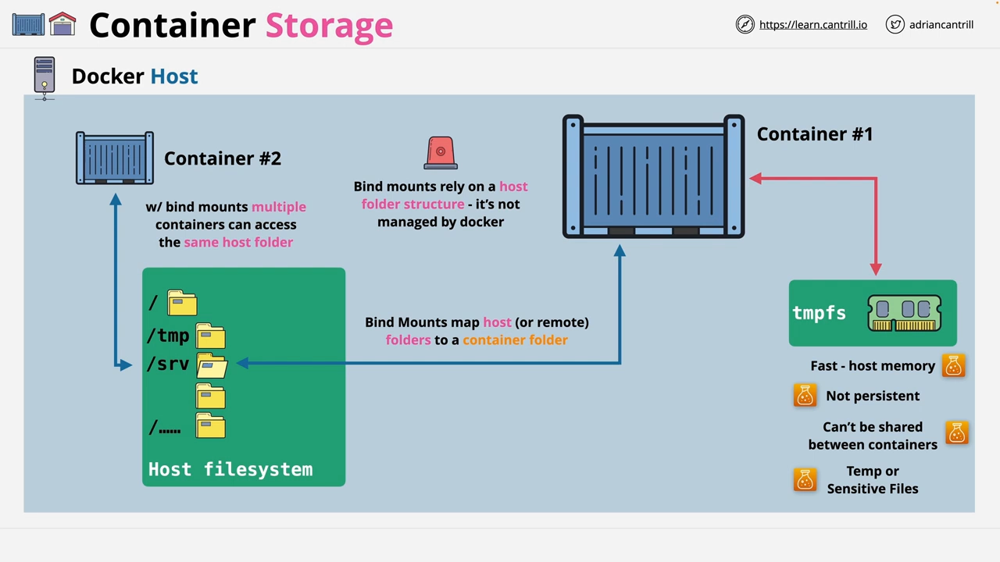

# Docker Storage：可写层、绑定挂载与卷

> 视频来源：YouTube 视频 [Free Docker Fundamentals Course - Docker Storage - Writable Layer, Bind Mounts & Volumes](https://www.youtube.com/watch?v=OAeVsjwRVe8)（LearnCantrill 出品，约 5 分 12 秒，英文讲解）。本文基于视频演说图文稿整理，时间戳可跳转到原视频对应位置；配图取自视频画面。字幕来自平台自动字幕（英文 ASR），术语与错拼已逐窗口核对纠正（如 "writeable"→writable、"tempfs"→tmpfs、"life cycle"→lifecycle）。

## 本讲要解决的核心问题（SCQA）

**背景**：理解存储，是**有效使用 Docker 容器**的关键——它既能**避免数据丢失**，也能让容器按你预期的方式运行。

**冲突**：容器的**第一种、也是默认的存储**，就是启动时叠加的那个**可写层（writable layer）**。它让每个容器成为"独一无二"的实例，看起来很方便；但它同时有**两个致命短板**：它**与容器的生命周期绑定**、无法在容器之间迁移或共享，而且它依赖文件系统驱动、**有性能开销**。

**疑问**：可写层到底能做什么、不能做什么？如果数据不能靠它持久化，Docker 还提供了哪些存储选项？它们各自适合什么场景？

**回答（中心思想）**：可写层是容器"**拥有自己系统状态**"的默认方式——它位于只读镜像层之上，**读写都经它中转**，但它**随容器生灭、无法迁移**，还带一点性能代价。要在容器之间**共享数据**或让数据**活得比容器久**，就要用另外三类存储：**tmpfs**（内存、临时、不共享）、**绑定挂载 bind mount**（主机目录映射进容器，但降低可移植性）、**卷 volume**（由 Docker 管理、独立于容器生命周期）。[【跳转到 00:00】](https://www.youtube.com/watch?v=OAeVsjwRVe8&t=0)

---

## 一、可写层：容器存储的"默认选项"

容器内可用的**第一种存储**，就是前面课程提到过的**可写层**。回顾一下：假设你有一个由**三层**组成的 Docker 镜像，概念上它被表示为**一个单一的文件系统**。**当你运行容器时，会在这之上增加一个可写层，它使用联合文件系统（union file system）**。[【跳转到 00:19】](https://www.youtube.com/watch?v=OAeVsjwRVe8&t=19)

结果是：你**能看到镜像里所有文件系统层的现有数据**；而**任何新数据都存储在这个可写层里**——这既包括被**覆盖**的数据，也包括**全新**的数据。[【跳转到 00:43】](https://www.youtube.com/watch?v=OAeVsjwRVe8&t=43)

联合文件系统允许把**来自不同文件系统的文件和目录**，叠加成**一个概念上的单一文件系统**——正是它让这个可写层能够**叠加在 Docker 镜像的只读层之上**。

### 1.1 可写层让每个容器"独一无二"，但有代价

**这个可写层，正是让每个容器成为独一无二个体的东西**。但要注意：这种架构**需要文件系统驱动**，而驱动**有额外开销，会影响性能**。所以在架构容器化应用时，你必须把这一点放在心上。[【跳转到 01:08】](https://www.youtube.com/watch?v=OAeVsjwRVe8&t=68)

### 1.2 三条要记住的关键结论

关于可写层，关键要点是：

1. **镜像的层可以被读取，但任何写入都会进入这个可写层**；
2. **容器把这两部分看作一个单一的文件系统**；
3. **可写层与容器的生命周期绑定**——它**不能被迁移**，因此任何写入的数据，概念上都**属于那一个容器**。[【跳转到 01:33】](https://www.youtube.com/watch?v=OAeVsjwRVe8&t=93)

> **一句话记住**：可写层是容器的"**本地临时状态**"——它让容器能改文件、能有自己的系统状态，但它**只为容器而生，也随容器而灭**，不是用来长期保存数据的。

## 二、换个视角：单一 Docker 主机上的三类存储

接下来看**其它可用的存储选项**。先把视线聚焦到**一台 Docker 主机**上，假设这台主机上运行着**两个容器**。[【跳转到 01:58】](https://www.youtube.com/watch?v=OAeVsjwRVe8&t=118)

### 2.1 tmpfs：内存里的快速存储，但不持久

第一种存储选项是 **tmpfs**（tempfs）。它是一个**对特定容器可见**的文件系统，**使用 Docker 主机的内存**。简单说：把它看成**快速的内存存储**，但它**不持久**（因为不落在磁盘上），也**不能在容器之间共享**。[【跳转到 02:08】](https://www.youtube.com/watch?v=OAeVsjwRVe8&t=128)

所以，**它只适合临时存储**——比如你**不想让敏感文件在磁盘上停留太久**，或者只在处理、访问期间**短期持有**的数据。[【跳转到 02:33】](https://www.youtube.com/watch?v=OAeVsjwRVe8&t=153)

### 2.2 绑定挂载：把主机目录映射进容器

第二种存储叫**绑定挂载（bind mount）**。除了主机上运行的容器，我们还有**主机的文件系统**：其中有根目录，根目录下是 `/tmp`、`/srv` 之类的文件夹（名字不重要）。**绑定挂载允许你把主机上的某个文件夹（比如 `/srv`）挂载到容器里**；而且主机上的**一个文件夹可以被同一主机上的多个容器访问**。[【跳转到 02:58】](https://www.youtube.com/watch?v=OAeVsjwRVe8&t=178)

如果你需要**共享存在主机上的数据**，这是种不错的方式。但好处也带来一个负面：**任何依赖它的容器，同时也依赖主机上存在特定的目录结构，这会降低可移植性**。比如，一个配置了绑定挂载的容器，**只有 `/srv` 文件夹存在时才能工作**——而当你把容器拿到我的机器或你的机器上运行时，它可能并不存在。[【跳转到 03:23】](https://www.youtube.com/watch?v=OAeVsjwRVe8&t=203)

另外，绑定挂载因为**存在于容器之外**，所以**能活得比容器更久**；它们在主机上使用的文件夹，本身**也可以是网络文件夹**，比如通过 NFS 远程挂载的目录。[【跳转到 03:48】](https://www.youtube.com/watch?v=OAeVsjwRVe8&t=228)

### 2.3 卷：由 Docker 管理、独立于容器的存储

最后是**卷（volume）**。它和绑定挂载类似——都是**对容器可见的存储**——但区别在于：**卷由 Docker 管理**。[【跳转到 04:13】](https://www.youtube.com/watch?v=OAeVsjwRVe8&t=253)

- 卷**由 Docker 按需创建**；
- 卷**存在于容器生命周期之外**，所以**使用它的容器被移除后，卷仍可保留**；
- 卷**可以在容器之间移动**，甚至**挂载到多个容器上**。

不过要小心一点：**卷没有文件锁（file locking）**，所以你**必须特别留意多个容器中的多个进程同时访问同一批文件**的情况。

## 三、三类存储对照总结

| 存储类型 | 数据位置 | 持久性 | 可在容器间共享 | 主要短板 |
| :--- | :--- | :--- | :--- | :--- |
| **可写层** | 容器本地（联合文件系统之上） | 随容器生灭 | ✗ | 与容器生命周期绑定、有性能开销 |
| **tmpfs** | Docker 主机**内存** | 不持久 | ✗ | 不落盘、仅适合临时/敏感数据 |
| **绑定挂载** | 主机文件系统上的目录 | 比容器活得久 | ✓ | 依赖主机目录结构、**降低可移植性** |
| **卷** | Docker 管理的存储区域 | 独立于容器生命周期 | ✓ | 无文件锁，多容器并发访问需谨慎 |

视频最后强调：这些只是**最基础层面的理论**，你会在课程后面的部分获得**动手实践**的机会。[【跳转到 04:38】](https://www.youtube.com/watch?v=OAeVsjwRVe8&t=278)

---

> **配套阅读**：本条目另有[《容器可写层：容器里的数据到底存在哪？》](Docker存储和数据管理.md)，用"镜像层 / 可写层 / 数据卷"三条主线讲透数据存哪、为什么丢，并总结持久化的四种最佳实践；以及[《镜像和容器有什么区别？》](镜像和容器有什么区别.md)，用"模具与蛋糕"的比喻把"可写层为什么不改变镜像"讲得最直观。
