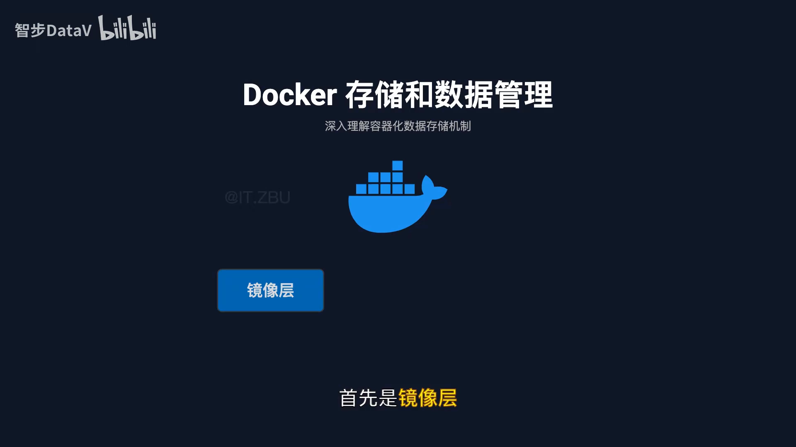
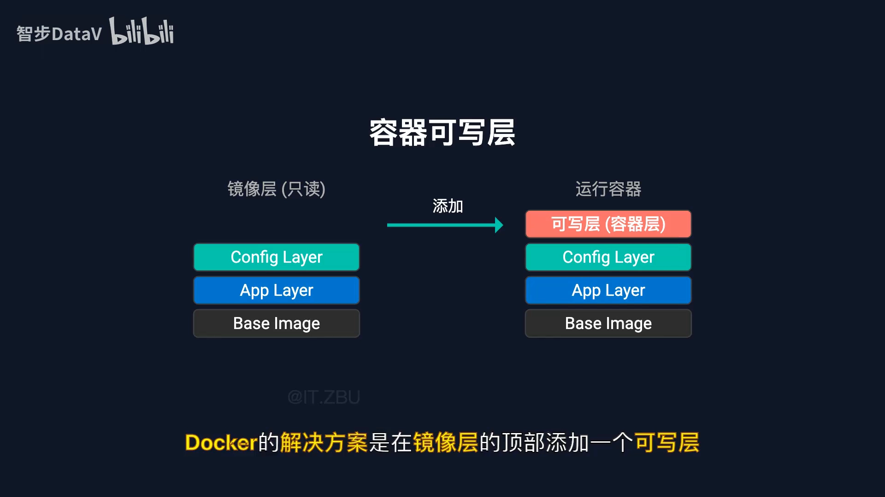
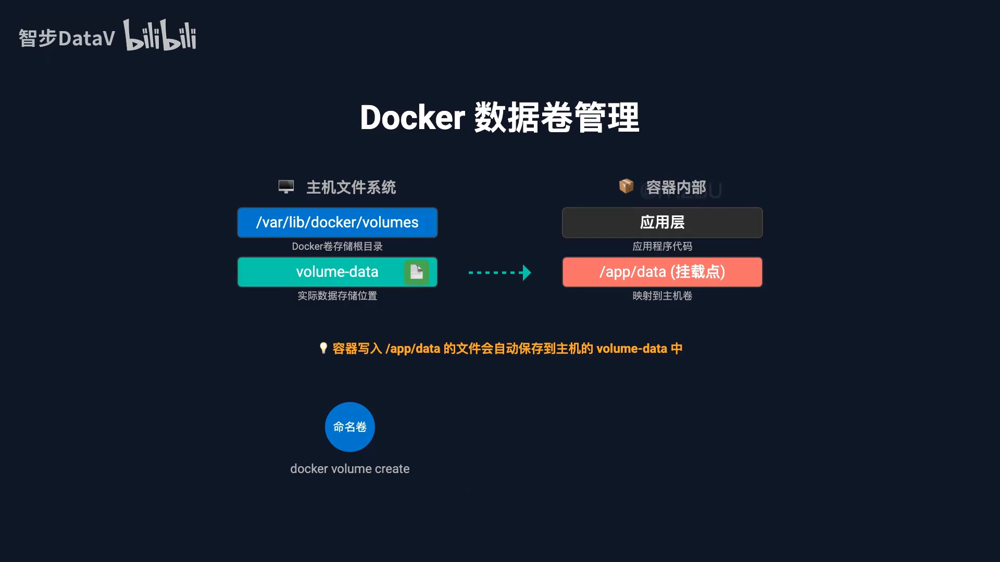
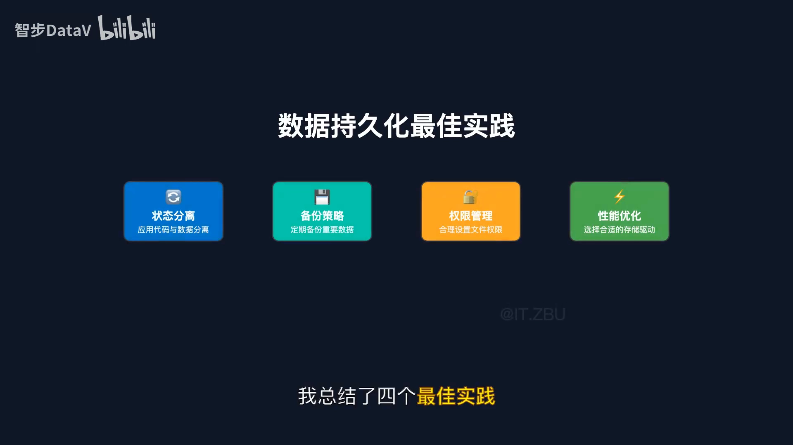

# 容器可写层：容器里的数据到底存在哪？镜像层、可写层与数据卷

> 视频来源：Bilibili 视频 [Docker存储和数据管理](https://www.bilibili.com/video/BV1pVnmzrE8H/)（约 4 分 48 秒，中文讲解）。本文基于视频演说图文稿整理，时间戳可跳转到原视频对应位置；配图取自视频画面。字幕来自 B 站 AI 字幕，已逐窗口纠正错拼（如 "ABUNU"→Ubuntu、"alpinelinux"→Alpine Linux、"copyonwrite"→copy-on-write、"TMPFS"→tmpfs）。

## 本讲要解决的核心问题（SCQA）

**背景**：你可能已经在用 Docker，但未必真的清楚**容器里的数据是怎么存的**。一个镜像明明是一个整体，为什么能同时跑几十个容器还不把磁盘撑爆？

**冲突**：更让人困惑的是**数据消失与否不一致**——为什么删除一个容器后，你在里面做的修改全没了；可另一些数据（比如挂载出来的目录）却能在容器删掉后**安然无恙**地留在主机上？

**疑问**：容器的数据到底写在哪里？为什么有的会丢、有的能留？我该怎样正确地保存重要数据？

**回答（中心思想）**：Docker 把存储拆成**三个核心概念**——**镜像层（只读、可共享）**、**容器可写层（每个容器独有、随容器生灭）**、**数据卷（独立于容器生命周期的持久化存储）**。搞清楚这三者，你就能彻底理解"容器里的数据去哪了"，也才知道该把数据放到哪里才安全。[【跳转到 00:00】](https://www.bilibili.com/video/BV1pVnmzrE8H/?t=0)

---

## 一、镜像层：只读、可叠加、可共享的分层存储

很多人以为 Docker 镜像就是**一个完整的文件**，其实不是。Docker 用的是一种非常巧妙的**分层存储技术**：一个完整的镜像，实际上是**由多个层叠加而成**的。[【跳转到 00:25】](https://www.bilibili.com/video/BV1pVnmzrE8H/?t=25)



自下而上，一个典型的应用镜像通常是这样的四层：

1. **最底层**：基础操作系统，比如 Ubuntu 或者 Alpine Linux；
2. **运行时环境**：比如 Node.js 或者 Python；
3. **你的应用程序代码**；
4. **配置文件和启动脚本**。[【跳转到 00:50】](https://www.bilibili.com/video/BV1pVnmzrE8H/?t=50)

这种分层设计最大的好处是：**这些镜像层都是只读的**，而且**多个容器可以共享相同的镜像层**。比如说，如果你有十个基于同一镜像的容器，它们实际上**共享底层的镜像数据**——这能大大节省存储空间。就像多个人共用同一套参考书，但每个人都可以有自己的笔记本一样。

## 二、容器可写层：一个容器一层，薄薄的、随容器生灭

既然镜像层是只读的，那**容器运行时产生的数据**写到哪里去呢？Docker 的方案是：**在镜像层的顶部添加一个可写层**。[【跳转到 01:15】](https://www.bilibili.com/video/BV1pVnmzrE8H/?t=75)

**当容器启动时，Docker 会创建这样一个薄薄的可写层**，所有对文件系统的修改都会写入这一层。具体来说：

- **读文件**时，系统会**直接从镜像层读取**；
- **改文件**时，系统会使用一种叫 **copy-on-write（写时复制）** 的机制：**先把文件从镜像层复制到可写层，然后在可写层中修改**，原始的镜像层始终保持不变。[【跳转到 01:40】](https://www.bilibili.com/video/BV1pVnmzrE8H/?t=100)



这就解释了一个最常见的问题——**为什么删除容器后，所有的修改都会丢失**：因为**可写层是随着容器一起被删除的**。可写层是"容器专属"的一层，它跟着容器的生命周期走，容器没了，它也就没了。

> **一句话记住**：镜像层**共享且只读**，可写层**独有且易失**。容器可以随便改，是因为改动都落在可写层；容器一删就回到"出厂设置"，也是因为可写层被一起删掉了。

## 三、数据卷：让数据活过容器的生命周期

那么问题来了：如果我们希望**数据能够持久保存**，怎么办？这就需要用到 Docker 的**数据卷（volume）**功能了。[【跳转到 02:05】](https://www.bilibili.com/video/BV1pVnmzrE8H/?t=125)

数据卷的工作原理是这样的：

1. 在**主机的文件系统中创建一个专门的存储区域**；
2. 把这个区域**挂载到容器内部的某个目录**；
3. 这样容器内部对挂载目录的所有操作，实际上都是在**操作主机文件系统上的真实文件**；
4. 于是**即使容器被删除了，主机上的数据依然存在**。[【跳转到 02:27】](https://www.bilibili.com/video/BV1pVnmzrE8H/?t=147)

Docker 提供了**三种主要的数据卷类型**：

| 类型 | 说明 | 适用场景 |
| :--- | :--- | :--- |
| **匿名卷** | 由 Docker 统一管理、自动创建 | 最常用，不想关心路径时 |
| **绑定挂载（bind mount）** | 直接把主机的某个目录挂载进容器 | 需要指定主机路径、双向互访 |
| **tmpfs 挂载** | 把数据存在**内存**里 | 临时数据、不想落盘的敏感文件 |

选择哪种方式，主要看你的具体需求。[【跳转到 02:52】](https://www.bilibili.com/video/BV1pVnmzrE8H/?t=172)



## 四、四条最佳实践

了解了基本原理后，视频总结了在真实项目里正确使用这些存储机制的**四个最佳实践**：

1. **状态分离**：把应用代码和数据**完全分开**——应用代码打包在镜像里，数据存储在卷中；
2. **制定备份策略**：重要数据一定要**定期备份**，不要把鸡蛋放在一个篮子里；
3. **注意权限管理**：合理设置文件权限，避免安全问题；
4. **性能优化**：根据使用场景**选择合适的存储驱动**。[【跳转到 03:14】](https://www.bilibili.com/video/BV1pVnmzrE8H/?t=194)

实际操作中最常用的两条命令是：

```bash
# 创建并挂载一个数据卷到容器的 /app/data 目录
docker run -v my-volume:/app/data <镜像>

# 预先创建一个数据卷
docker volume create my-volume
```



## 五、一页总结

Docker 存储机制的核心要点有四个：[【跳转到 03:39】](https://www.bilibili.com/video/BV1pVnmzrE8H/?t=219)

1. **镜像层**采用分层存储，**只读且可共享**——这是 Docker 高效的基础；
2. **容器层（可写层）**实现 copy-on-write 机制，**保证了镜像的不可变性**；
3. **数据卷**提供持久化存储方案，让数据能够**独立于容器生命周期**；
4. **合理的存储策略**能显著提升应用性能。[【跳转到 04:04】](https://www.bilibili.com/video/BV1pVnmzrE8H/?t=244)

掌握了这些，你就不会再困惑于"容器的数据为什么会丢失"，也知道该如何正确地保存重要数据了。[【跳转到 04:29】](https://www.bilibili.com/video/BV1pVnmzrE8H/?t=269)

---

> **配套阅读**：本条目另有两篇姊妹篇——[《镜像和容器有什么区别？》](镜像和容器有什么区别.md)用"模具 / 蛋糕"的比喻把"可写层为什么不改变镜像"讲得最直观；[《Docker Storage：可写层、绑定挂载与卷》](Docker%20Storage%20-%20Writable%20Layer%2C%20Bind%20Mounts%20%26%20Volumes.md)从"可写层与容器生命周期绑定"出发，系统对比 tmpfs / 绑定挂载 / 卷三类存储。若想深入可写层底下的文件系统机制，可继续看同小节的 [3.3.1 联合文件系统](../3.3.1_联合文件系统/)、[3.3.2 OverlayFS 结构](../3.3.2_OverlayFS结构/) 与 [3.3.3 写时复制机制](../3.3.3_写时复制机制/)。
