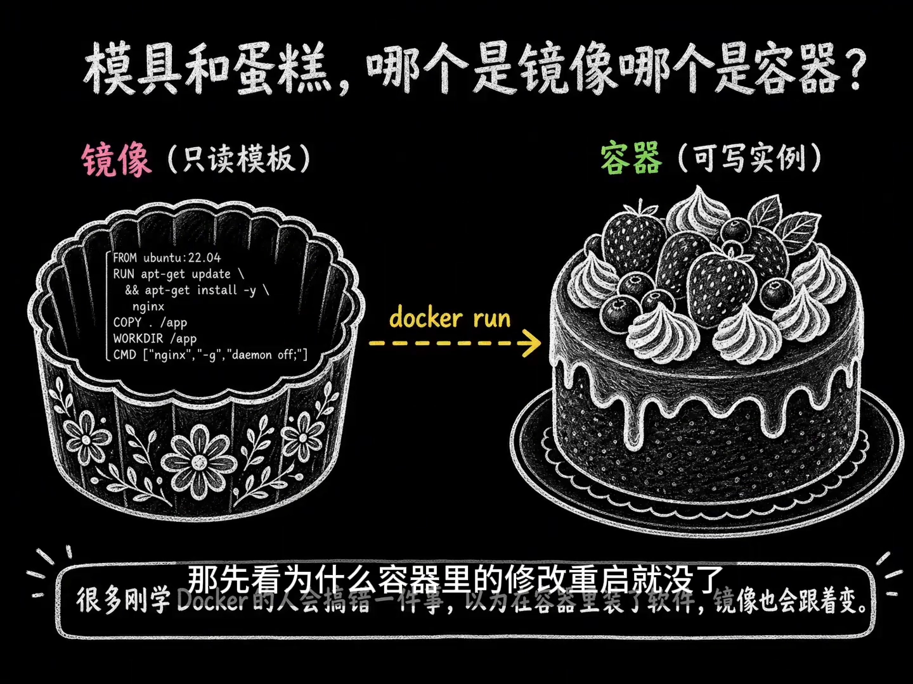
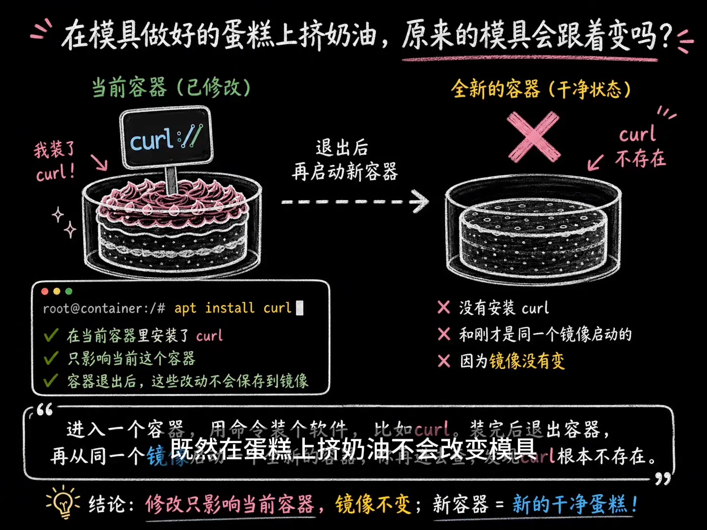
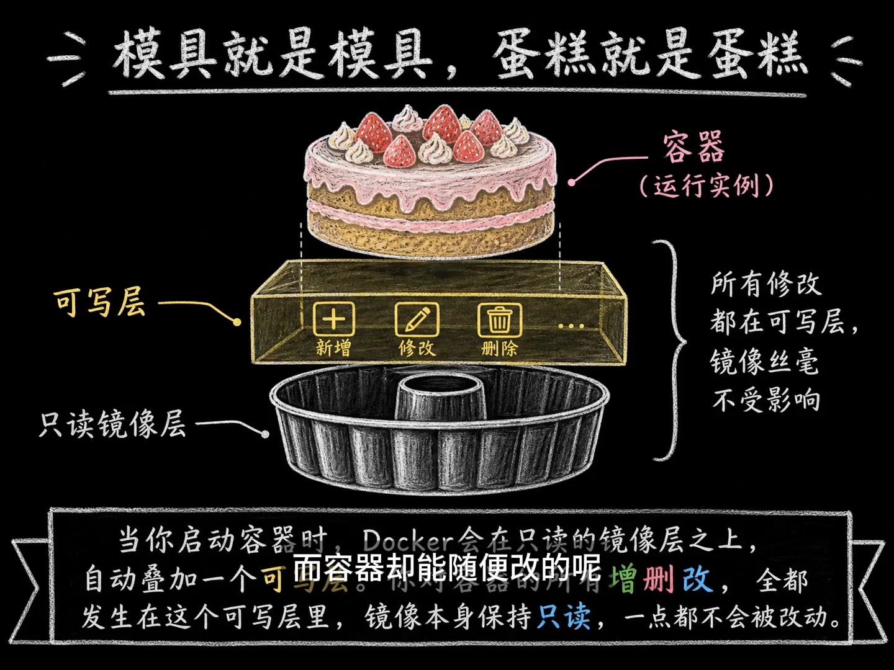
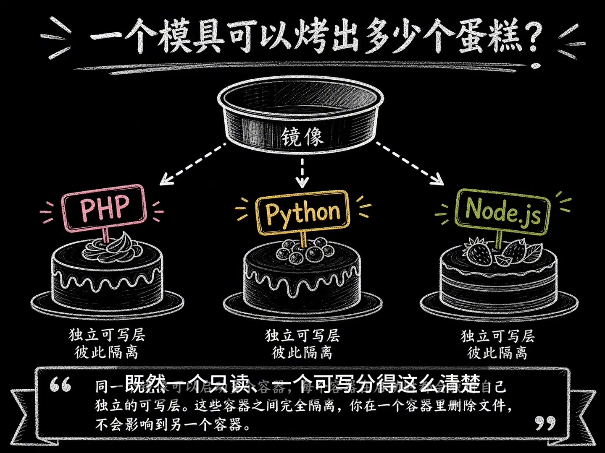

# 镜像和容器有什么区别？用"模具与蛋糕"讲清可写层

> 视频来源：Bilibili 视频 [镜像和容器有什么区别？](https://www.bilibili.com/video/BV1RrNX6XEJy/)（约 2 分 43 秒，中文讲解）。本文基于视频演说图文稿整理，时间戳可跳转到原视频对应位置；配图取自视频画面。字幕来自 B 站 AI 字幕，已逐窗口纠正错拼（如 "KERO"→curl）。

## 本讲要解决的核心问题（SCQA）

**背景**：刚学 Docker 的人，几乎都会把**镜像（image）**和**容器（container）**搞混。最常见的误解是：以为在容器里装了软件，镜像也会跟着改变，下次再启动这些修改就还在。

**冲突**：可现实恰恰相反——**镜像是只读的，容器是可写的**。你在容器里做的任何改动，都**只影响当前这一次运行**；容器一旦被删除，这些临时修改就**彻底消失**。那 Docker 到底是怎么做到"镜像一直不变、容器却能随便改"的？

**回答（中心思想）**：记住一组厨房比喻就够了——**镜像是蛋糕模具，容器是烤出来的蛋糕**。镜像是一份**只读模板**，容器是它的**可写实例**。区分它们关键看三点：**为什么修改重启就没了、可写层怎样保持镜像不变、同一镜像能启动多少个容器**。[【跳转到 00:00】](https://www.bilibili.com/video/BV1RrNX6XEJy/?t=0)

---

## 一、厨房比喻：模具 vs 蛋糕

镜像和容器为什么总被搞混？别急，先记住一个厨房比喻：

- **镜像 = 蛋糕模具**：模具里只包含**最基础的环境和文件**，就像模具上刻着固定的花纹；
- **容器 = 烤出来的蛋糕**：当你用镜像启动容器时，相当于**往模具里倒入面糊、烤出一个蛋糕**——这个蛋糕才是真正在运行的程序。[【跳转到 00:22】](https://www.bilibili.com/video/BV1RrNX6XEJy/?t=22)

很多刚学 Docker 的人会搞错一件事：以为在容器里装了软件，镜像也会跟着变。**实际上镜像是只读的，容器是可写的**——你在容器里做的任何改动，都只影响当前的蛋糕，**不会跑回模具里**。就像在蛋糕上挤奶油、放水果，模具始终干干净净。[【跳转到 00:47】](https://www.bilibili.com/video/BV1RrNX6XEJy/?t=47)

## 二、验证一下：在容器里装软件，镜像真的不变

光说不够，我们来验证一下：**进入一个容器，用命令装个软件，比如 curl**；装完后退出容器；再从**同一个镜像**启动一个**全新的容器**，你再进去查——**发现 curl 根本不存在**。[【跳转到 01:01】](https://www.bilibili.com/video/BV1RrNX6XEJy/?t=61)

这就是镜像和容器最典型的区别：

- **镜像永远保持原样**；
- 你在容器里的所有操作，**都只在这一次运行中生效**；
- 容器一旦被删除，这些临时修改就**彻底消失**了。

## 三、秘密武器：可写层让"镜像不变、容器随便改"同时成立

那 Docker 到底是怎么做到镜像一直不变、而容器却能随便改呢？核心在于：

**当你启动容器时，Docker 会在只读的镜像层之上，自动叠加一个可写层**。你对容器的所有**增、删、改**，全都发生在这个可写层里；**镜像本身保持只读，一点都不会被改动**。[【跳转到 01:31】](https://www.bilibili.com/video/BV1RrNX6XEJy/?t=91)

这就像你往蛋糕上挤奶油、放水果，模具始终干干净净，下次还能烤出原味的蛋糕。

> **一句话记住**：**可写层 = 容器专属的"改动记账本"**。镜像层是只读的底稿，所有修改都被记在这本独属于当前容器的账本上，底稿始终不动。

## 四、一个模具能烤几个蛋糕？同一镜像能起多个容器

既然一个只读、一个可写分得这么清楚，那手里的一个模具是**只能烤一个蛋糕**，还是**能重复烤很多个**？当然可以烤很多个：

- **同一个镜像可以启动多个容器**；
- **每个容器在启动时都会获得自己独立的可写层**；
- 这些容器之间**完全隔离**——你在一个容器里删除文件，**不会影响**到另一个容器。[【跳转到 01:53】](https://www.bilibili.com/video/BV1RrNX6XEJy/?t=113)

比如用**同一个镜像**同时跑三个容器，你可以给第一个容器装一个工具、给第二个容器装 Python——它们**各自安好、互不干扰**。

## 五、一页总结

镜像和容器最该记住的区别就是：**镜像不变，容器可变**。[【跳转到 02:18】](https://www.bilibili.com/video/BV1RrNX6XEJy/?t=138)

从同一个镜像启动的所有容器，**一开始环境完全一样**；但之后的任何修改，**都只属于各自**——既不会写回镜像，也不会传给其他容器。

所以下次你再看到 Docker，别忘了：**镜像就是那个可以反复使用的模具，而容器是你从模具里烤出来的、独一无二的蛋糕**。[【跳转到 02:23】](https://www.bilibili.com/video/BV1RrNX6XEJy/?t=143)

---

> **配套阅读**：本条目另有[《容器可写层：容器里的数据到底存在哪？》](Docker存储和数据管理.md)——它把镜像层、可写层、数据卷三个概念串成一条主线，并给出持久化的四种最佳实践；还有[《Docker Storage：可写层、绑定挂载与卷》](Docker%20Storage%20-%20Writable%20Layer%2C%20Bind%20Mounts%20%26%20Volumes.md)，从"可写层与容器生命周期绑定"讲到三类存储的取舍。
