# 用 Syft 生成 SBOM：软件供应链安全实战

> 视频来源：[Generating SBOM's using Syft](https://www.youtube.com/watch?v=PiSTpHNM0T0)（YouTube · Pradeep Loganathan · 约 23 分钟）
> 所属：容器技术 · 第 3 章 镜像、文件系统与供应链 · 3.4 镜像供应链 · 3.4.1 SBOM

## 本讲要解决的核心问题（SCQA）

**背景**：我们每天 `npm update`、引入一个 Maven 包、一个 Go 包或 .NET 包，都是在把别人的代码搬进自己的软件里。软件供应链因此成了攻击者眼中"赢面很大"的目标。

**冲突**：这条链上的任何一环都可能被攻破——开发者提交的代码、源码托管平台、构建平台、包仓库、外部的依赖仓库……一旦某一环被注入恶意代码，破坏就会顺着依赖一路扩散。而含混的是：**我们往往并不知道自己的软件里到底有哪些包**。

**疑问**：有没有办法既知道"我的软件由什么组成"，又能据此**扫描漏洞**并把结果落进 CI/CD？

**回答（中心思想）**：这套内容给出两个抓手——**用 SBOM 说清软件成分**，**用漏洞扫描器把成分和已知漏洞对上**。视频里用两个开源工具把这套流程跑了一遍：**Syft 生成 SBOM**、**Grype 做漏洞扫描**，并演示了如何在本地、在 Kubernetes 集群里、在 CI/CD 流水线中运行它们。

## 一、软件供应链为什么是重点攻击目标

讲者用一张"攻击面"图开场：软件供应链是一个很宽广的攻击向量，恶意代码可以从很多环节注入（[【跳转到 00:31】](https://www.youtube.com/watch?v=PiSTpHNM0T0&t=31)）：

- **开发者提交了坏代码**——无意或有心，都会污染源码；
- **源码托管（source control）被攻破**，源码被篡改；
- **源码托管与构建平台之间**被修改；
- **构建平台被攻破**，构建产物被污染；
- **包仓库被攻破**，分发包被污染；
- **内部构建所依赖的外部包仓库被攻破**，进而让构建产出被污染。

也就是说，从"写代码"到"发布包"的每一站都可能出事，因此整条供应链需要被保护起来。

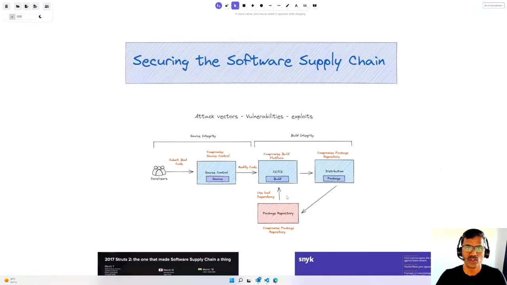

而且攻击确实在增长：**针对软件供应链的攻击数量持续上升**，相关报道也越来越多（[【跳转到 01:21】](https://www.youtube.com/watch?v=PiSTpHNM0T0&t=81)）。

## 二、两起著名供应链攻击

### 2.1 Apache Struts（2017）

**Apache Struts** 是一个被 Java Web 应用广泛使用的 **MVC 框架库**。它爆出漏洞后，漏洞被公开披露，随后被攻击者用来入侵大量系统（[【跳转到 01:36】](https://www.youtube.com/watch?v=PiSTpHNM0T0&t=96)）。

值得警醒的是：补丁其实很快就发布了，但**很多供应链系统并不敏感**——它们不知道自己用的还是不是最新版本，结果**有漏洞的版本仍在继续被部署**，导致更多系统沦陷。漏洞在 3 月 7 日被报告、几天内就有了补丁，可近一年后（直到 2018 年 3 月）仍有大型系统受影响（[【跳转到 02:26】](https://www.youtube.com/watch?v=PiSTpHNM0T0&t=146)）。

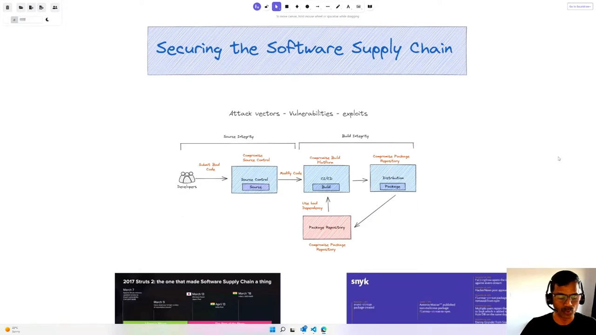

### 2.2 event-stream（2018）

**event-stream** 是一个很老的 JavaScript / npm 包，2011 年出现、一度被广泛使用，2015 年后热度下降。2018 年，一起**社会工程**攻击发生了：一位新的维护者接手了这个包，并**在里面注入了恶意代码**（[【跳转到 02:26】](https://www.youtube.com/watch?v=PiSTpHNM0T0&t=146)）。

结果是：任何人更新这个包，就会把恶意代码一并引入自己的系统。可见供应链当时**并不"聪明"到能识别**这是一次通过依赖注入恶意代码的攻击（[【跳转到 03:16】](https://www.youtube.com/watch?v=PiSTpHNM0T0&t=196)）。

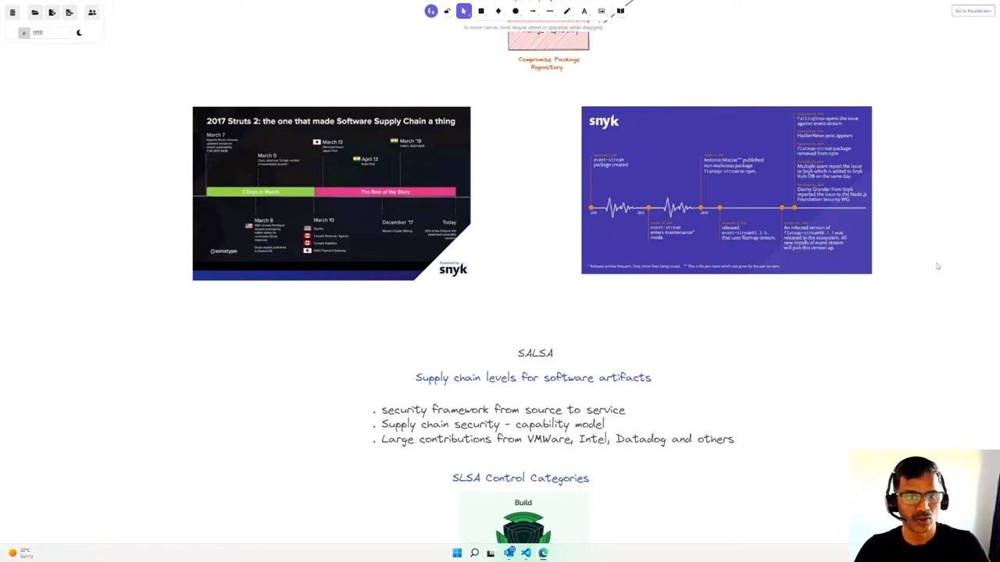

讲者由此提醒：作为开发者要清醒地意识到——**每次 npm update、每引入一个 Maven/Go/.NET 包，都是在冒引入恶意代码的风险，也可能在无意中成为攻击的"帮凶"**。

## 三、社区的回应：SLSA 框架

面对愈演愈烈的供应链攻击，社区组织起来提出了一系列措施，其中之一就是 **SLSA 框架**（[【跳转到 03:41】](https://www.youtube.com/watch?v=PiSTpHNM0T0&t=221)）。

**SLSA（Supply-chain Levels for Software Artifacts，软件工件供应链级别）**是一个从"源码到服务"保护软件的安全框架，本质是一套**供应链安全能力模型**，用若干能力级别来告诉你怎么一步步提升供应链安全。它得到了 VMware、Intel、Datadog 等组织的众多贡献（[【跳转到 04:08】](https://www.youtube.com/watch?v=PiSTpHNM0T0&t=248)）。

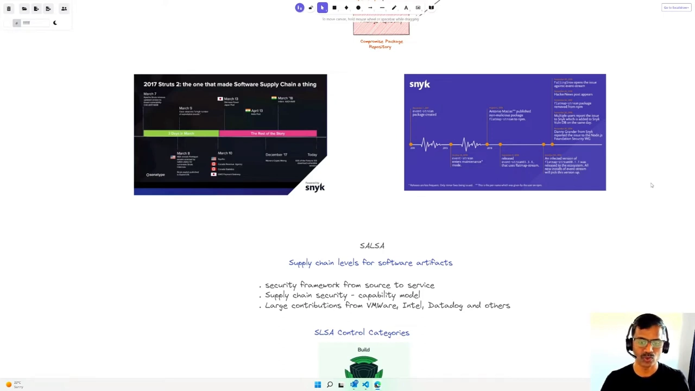

SLSA 定义了**四个主控制类别**（[【跳转到 04:53】](https://www.youtube.com/watch?v=PiSTpHNM0T0&t=293)）：

| 类别 | 主要防御措施举例 |
| --- | --- |
| **Source（源码）** | 源码纳入版本控制、有可验证的历史、源码长期保留、至少两人评审 |
| **Build（构建）** | 构建脚本化、以"构建即代码"部署、构建环境是一次性的（ephemeral）、构建可复现 |
| **Provenance（来源）** | 来源信息可用、经过认证、不可伪造、由服务生成 |
| **Common（通用）** | 安全访问控制、超级用户访问控制等 |

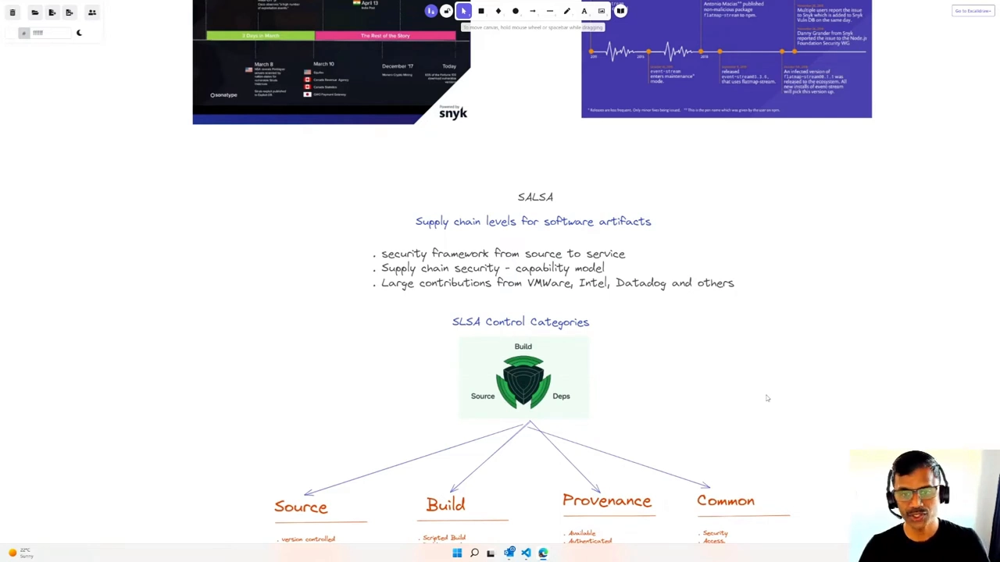

在后续讨论里，重点落在 **provenance（来源）**上——它能证明软件包的更多信息，确保包经过认证、其呈现的信息**不可伪造且由服务生成**。而生成 provenance 的方式之一，就是用 **SBOM**（[【跳转到 05:18】](https://www.youtube.com/watch?v=PiSTpHNM0T0&t=318)）。

## 四、SBOM 是什么：软件的"配料表"

**SBOM（Software Bill of Materials）是一份制品，包含了一件软件里所有包依赖、文件、许可证等资产的完整清单**（[【跳转到 05:43】](https://www.youtube.com/watch?v=PiSTpHNM0T0&t=343)）。

讲者给了一个生活化的类比：就像你在超市买一瓶意面酱，**瓶身上的配料表**告诉你里面有什么——如果某样成分你不喜欢或对你不好，你就能避开。SBOM 之于软件也是如此：它把软件包里的所有"配料"列出来（[【跳转到 06:08】](https://www.youtube.com/watch?v=PiSTpHNM0T0&t=368)）。

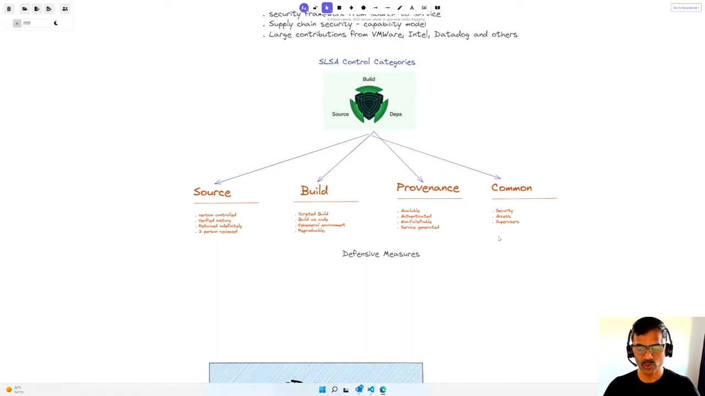

### 4.1 一份 SBOM 包含什么

一份 SBOM 通常涵盖以下几类信息（[【跳转到 06:33】](https://www.youtube.com/watch?v=PiSTpHNM0T0&t=393)）：

- **所有软件组件**的清单；
- 每个组件的**版本**；
- 组件之间的**依赖关系**，包括**传递性依赖**（某个依赖又依赖别的，于是形成两三层甚至更深的依赖链）；
- 所有的**许可证信息**；
- 所有的 **OS 包**——例如为容器生成 SBOM 时，连**基础 OS 包**也会列进去。

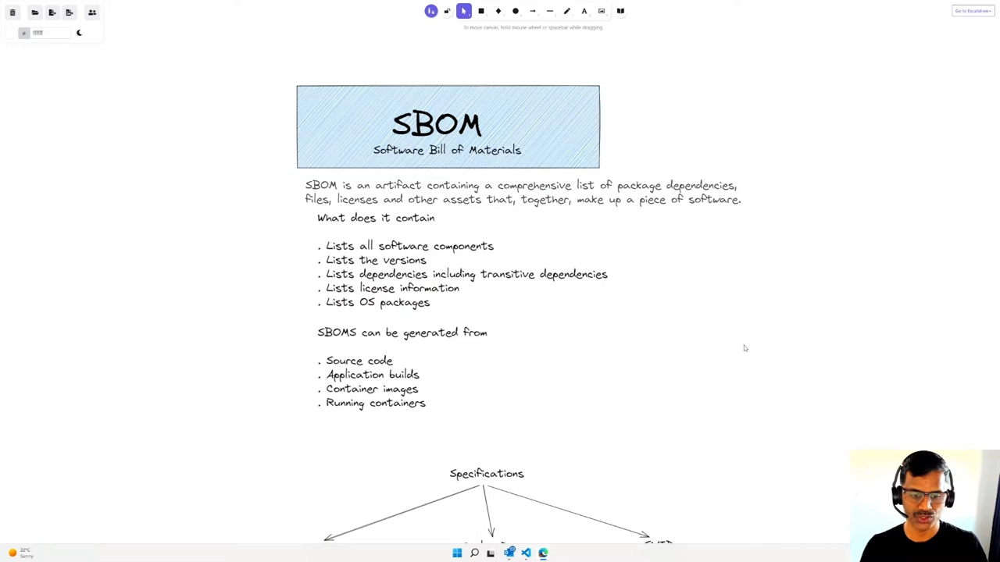

### 4.2 SBOM 能从哪来

SBOM 可以从多种来源生成（[【跳转到 07:23】](https://www.youtube.com/watch?v=PiSTpHNM0T0&t=443)）：

- **源代码**：把生成工具指向存放源码的目录，它会根据能获取到的信息生成 SBOM；
- **应用构建产物**：指向构建产物，它会把构建里包含的东西写进 SBOM；
- **容器镜像**：镜像有很多层，其上又叠着应用依赖，工具能把这些 catalog 出来；
- **运行中的容器**：这点很关键，因为容器运行时，其内部的层**可能被更新、变化或新增**，所以也可以对运行中的容器生成 SBOM。

## 五、三种主流格式

SBOM 主要有三种规范（[【跳转到 07:48】](https://www.youtube.com/watch?v=PiSTpHNM0T0&t=468)）：

| 格式 | 初版时间 | 出身 | 输出格式 |
| --- | --- | --- | --- |
| **SPDX** | 2010 年 | Linux 基金会 | RDF、SPDX、XML、JSON 等 |
| **CycloneDX** | 2017 年 | OWASP，安全导向更强 | XML、JSON 等 |
| **SWID** | 2009 年 | ISO/IEC 技术委员会 | XML、CBOR 等 |

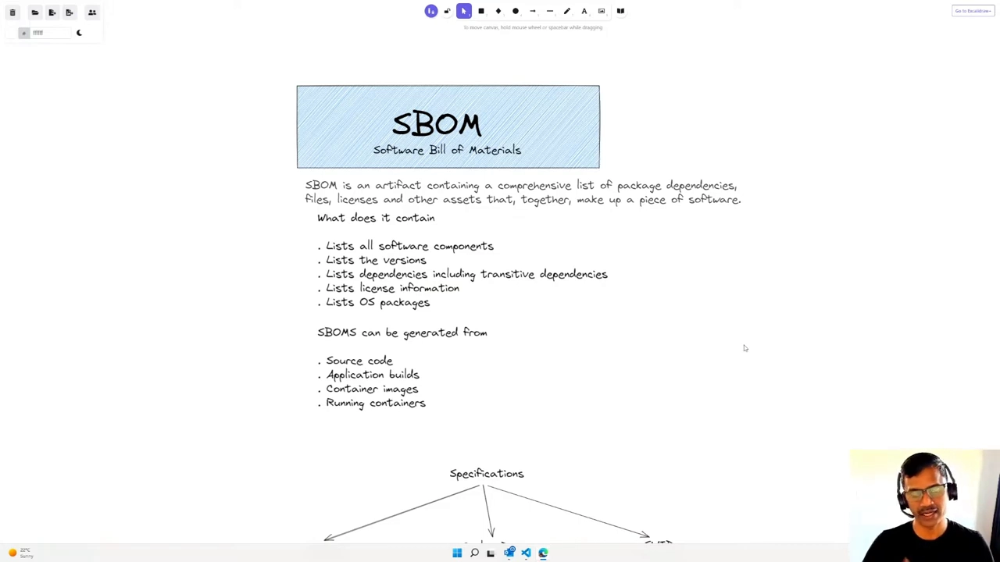

## 六、SBOM 的用途与法规要求

SBOM 被用于**合规审查、安全评估、许可证合规、集成验证**等场景，是确保所用软件包**来源可信**的关键，也是防范各种供应链攻击的**第一道防线**。它提供了理解"我们到底在引用/使用什么"的关键信息（[【跳转到 08:38】](https://www.youtube.com/watch?v=PiSTpHNM0T0&t=518)）。

一个标志性变化是：**美国第 14028 号行政令（EO 14028）要求，联邦机构采购的所有软件都必须提供 SBOM**。这意味着对联邦机构使用的任何软件包而言，生成 SBOM 都变得关键而必要（[【跳转到 09:03】](https://www.youtube.com/watch?v=PiSTpHNM0T0&t=543)）。

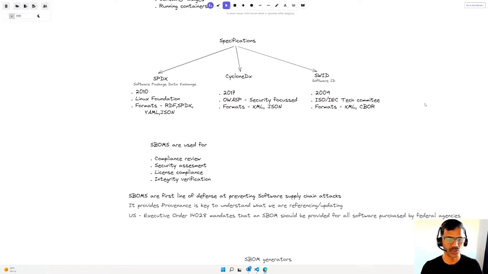

市面上已有多款 SBOM 生成器，知名的如 **Syft** 和 **Tern**，社区与 Docker 生态里也提供了一些（[【跳转到 09:28】](https://www.youtube.com/watch?v=PiSTpHNM0T0&t=568)）。接下来就用 **Syft** 做演示。

## 七、实战：用 Syft 生成 SBOM

安装很简单：下载 Syft 可执行文件放进 `bin` 目录即可（[【跳转到 09:58】](https://www.youtube.com/watch?v=PiSTpHNM0T0&t=598)）。

### 7.1 扫描镜像：nginx 里有 143 个包

直接对着 **nginx** 镜像运行 Syft，就生成了该镜像的 SBOM——它包含 **143 个包**，并列出各自版本（[【跳转到 10:23】](https://www.youtube.com/watch?v=PiSTpHNM0T0&t=623)）。

```bash
# 生成 nginx 镜像的 SBOM（摘要表）
syft nginx
# 输出为 JSON，携带更多元数据
syft nginx -o json > nginx.json
```

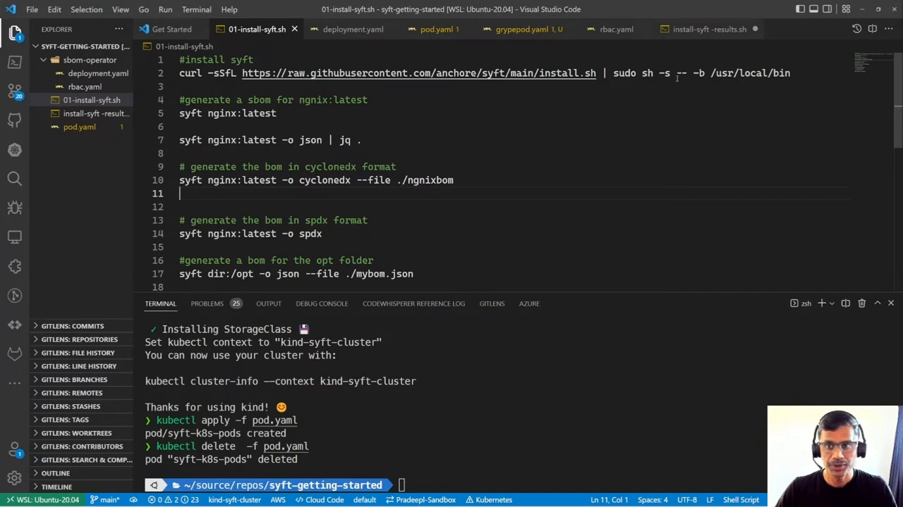

### 7.2 换输出格式：CycloneDX

还可以把 SBOM 按 **CycloneDX 规范**输出到指定文件（比如 XML 格式），后续可以拿这份文件去做漏洞扫描（[【跳转到 11:13】](https://www.youtube.com/watch?v=PiSTpHNM0T0&t=673)）。

```bash
# 以 CycloneDX 规范（XML）输出到文件
syft nginx -o cyclonedx-xml > nginx.cdx.xml
```

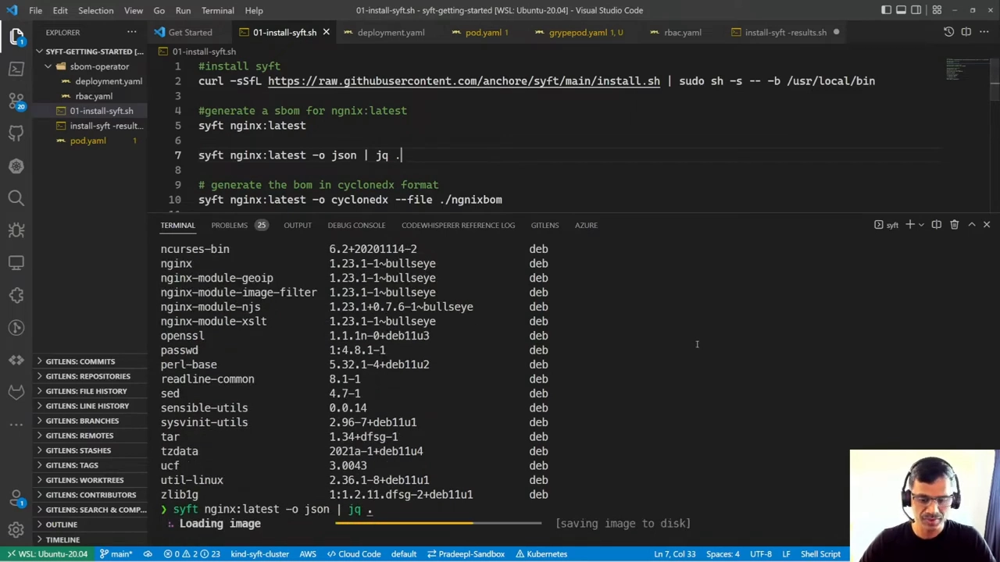

### 7.3 扫描目录：源文件也能生成 SBOM

Syft 还能指向**某个目录**，为该目录下的包生成 SBOM——比如指向 `/opt`，就能把其中的 Python 库、Azure AZ 可执行文件以及一堆其它包识别出来。这在想为**源码**生成 SBOM 时很有用（[【跳转到 12:03】](https://www.youtube.com/watch?v=PiSTpHNM0T0&t=723)）。

```bash
# 扫描本地目录 /opt，列出其中的包
syft /opt
```

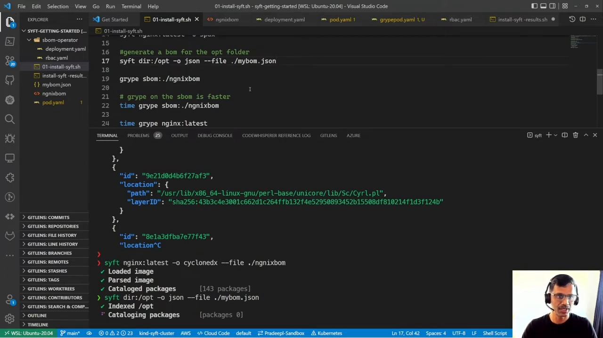

## 八、实战：用 Grype 扫描漏洞

### 8.1 用 Syft 的成果喂给 Grype

Syft 生成的 SBOM 还能**交给 Grype**（一个漏洞扫描器）使用（[【跳转到 12:53】](https://www.youtube.com/watch?v=PiSTpHNM0T0&t=773)）：先生成并保存 nginx 的 SBOM，再让 Grype 基于这份 SBOM 去**报告其中已知的漏洞**。

```bash
# 生成并保存 SBOM
syft nginx -o json > nginx.sbom.json
# 让 grype 基于已有 SBOM 做漏洞扫描
grype sbom:nginx.sbom.json
```

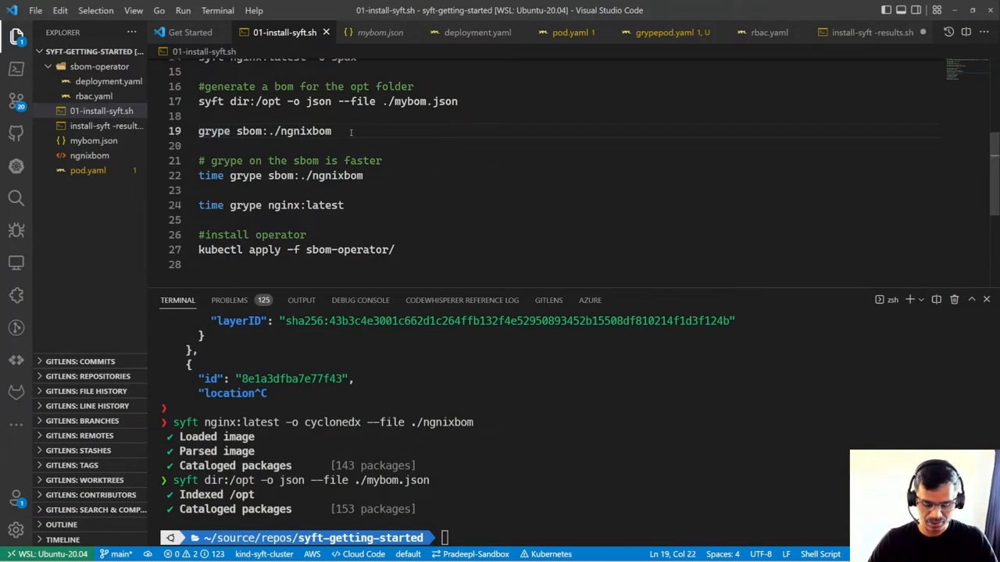

### 8.2 安装 Grype 并扫描镜像

Grype 的安装与 Syft 类似：把可执行文件下载进 `bin` 目录。它可以扫描**容器镜像、本地文件夹、应用产物**等（[【跳转到 17:13】](https://www.youtube.com/watch?v=PiSTpHNM0T0&t=1033)）。

对 nginx 镜像做扫描，Grype 识别出 **143 个包、151 个漏洞**，其中不少是 **High/Critical** 级别。它的原理是：**自己先生成一份 SBOM，再用已知漏洞数据库**去比对、识别这些包里存在的漏洞（[【跳转到 17:38】](https://www.youtube.com/watch?v=PiSTpHNM0T0&t=1058)）。

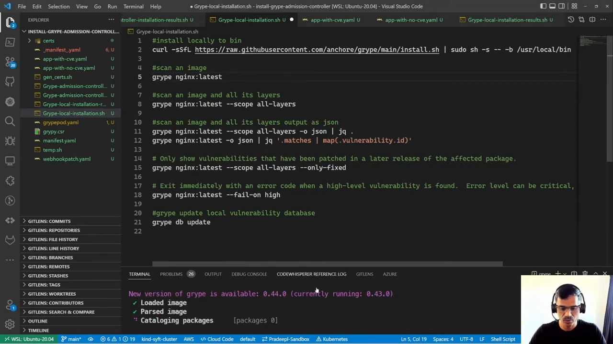

### 8.3 扫描所有层、输出 JSON、筛选 CVE

Grype 还能**扫描镜像的所有层**，把其中的漏洞都报告出来（[【跳转到 18:03】](https://www.youtube.com/watch?v=PiSTpHNM0T0&t=1083)）；也可以把结果输出为 **JSON**，携带更丰富的元数据，再用 `jq` 之类的工具做进一步过滤、转换——例如"只列出发现的所有 CVE"、"只保留已修复/未修复的 CVE"等（[【跳转到 19:18】](https://www.youtube.com/watch?v=PiSTpHNM0T0&t=1158)）：

```bash
# 输出 JSON 并筛出所有 CVE
grype nginx -o json | jq '.[] | .matches[] | .vulnerability.id'
```

此外，Grype 每次运行都会**自动更新**漏洞数据库，你也可以**强制更新**（[【跳转到 19:43】](https://www.youtube.com/watch?v=PiSTpHNM0T0&t=1183)）。

## 九、把它放进 Kubernetes 与 CI/CD

### 9.1 在集群里生成 SBOM

由于 CI/CD 流水线如今多跑在 Kubernetes 里，我们自然希望在集群内也能生成 SBOM。讲者创建了一个**带 Syft 的 Pod**，让它对 nginx 生成 SBOM，然后查看该 Pod 的日志确认输出（[【跳转到 14:33】](https://www.youtube.com/watch?v=PiSTpHNM0T0&t=873)）。

### 9.2 在集群里做漏洞扫描

类似地，讲者也比较了通过一个**Kubernetes Pod**运行 Grype 扫描，并查看日志、拿到漏洞报告，实现了"在集群中完成漏洞扫描与报告"（[【跳转到 21:21】](https://www.youtube.com/watch?v=PiSTpHNM0T0&t=1281)）。

### 9.3 SBOM drift（成分漂移）检查

在流水线里，你可以在**各个阶段**生成 SBOM——源码检入时、执行构建时、构建晋级时、生成容器镜像时。然后做 **SBOM drift 检查**，确保软件制品里**只有你已知、来源可信的包与组件，不会有别的东西被悄悄加进来**（[【跳转到 16:23】](https://www.youtube.com/watch?v=PiSTpHNM0T0&t=983)）。

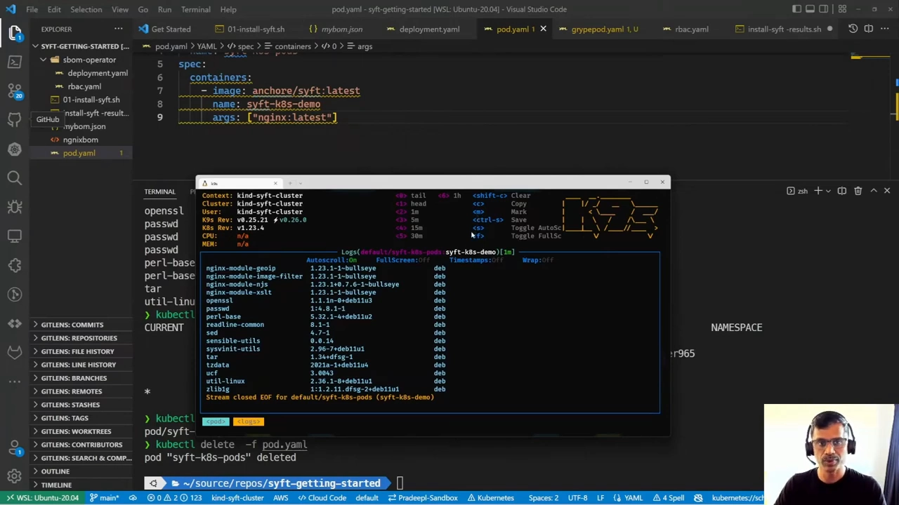

### 9.4 用 Operator 实现自动化

更进一步，**Grype 和 SBOM 生成器都有对应的 Operator**。借助它们，当集群发生任何更新时，就能**自动触发扫描**，无需人工干预。还可以配置**准入策略（admission policies）**：如果某次扫描发现严重（Critical）漏洞，就直接**阻止 Pod 被创建**（[【跳转到 22:05】](https://www.youtube.com/watch?v=PiSTpHNM0T0&t=1325)、[【跳转到 22:17】](https://www.youtube.com/watch?v=PiSTpHNM0T0&t=1337)）。

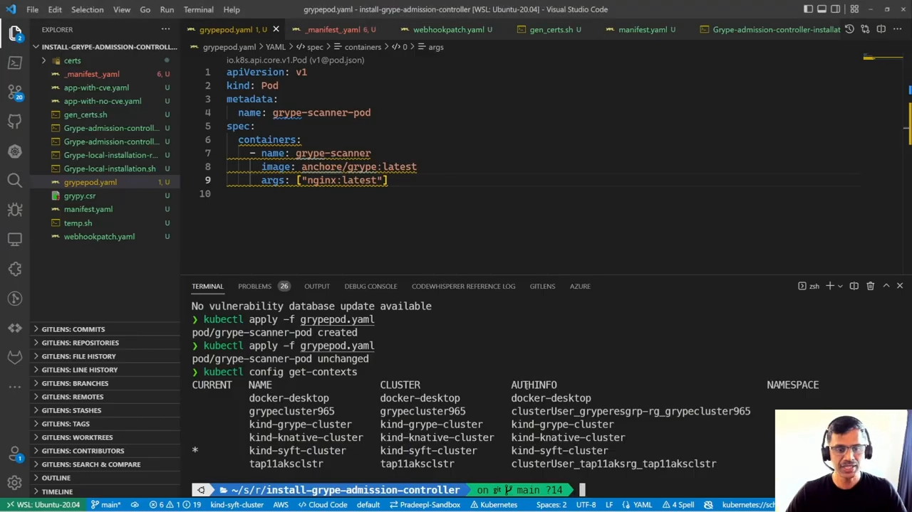

## 小结

- **软件供应链攻击面很广**：从开发者提交、源码托管、构建平台到包仓库，处处都可能被注入恶意代码；针对供应链的攻击持续增长。
- **两起著名案例**：Apache Struts（补丁已发布却仍被继续部署）与 event-stream（新维护者注入恶意代码）。
- **SLSA** 是社区应对措施之一，是一套从源码到服务的能力模型，含 **Source / Build / Provenance / Common** 四个控制类别；SBOM 是生成 **provenance** 的方式之一。
- **SBOM 是软件的"配料表"**：包含组件、版本、依赖（含传递依赖）、许可证、OS 包；可从源码、构建产物、容器镜像、运行中的容器生成。
- **三种格式**：SPDX、CycloneDX、SWID；用途覆盖合规审查、安全评估、许可证合规、集成验证；**EO 14028** 要求联邦采购软件必须提供 SBOM。
- **动手流程**：`syft nginx` 生成 SBOM（143 个包）→ 可输出 JSON / CycloneDX → `grype` 做漏洞扫描（151 个漏洞）→ 输出 JSON 并用 `jq` 过滤 CVE。
- **工程化**：可在 Kubernetes Pod 内运行、做 **SBOM drift** 检查、用 **Operator 自动化**、用**准入策略**拦截高危 Pod。这只是供应链安全的起点，还有更多工作要做。

## 关键术语速查

| 术语 | 一句话解释 |
| --- | --- |
| 软件供应链 | 从写代码、构建到分发打包的整条链路 |
| SBOM | 软件物料清单，软件的"配料表" |
| 传递性依赖 | 依赖的依赖，层层传导形成的间接依赖 |
| SLSA | 供应链安全能力模型，含 Source/Build/Provenance/Common 四类控制 |
| Provenance | 来源/出处信息，用于证明软件包可信、不可伪造 |
| SPDX / CycloneDX / SWID | 三种主流 SBOM 格式 |
| EO 14028 | 美国行政令，要求联邦采购软件提供 SBOM |
| Syft | 生成 SBOM 的开源工具 |
| Grype | 开源漏洞扫描器，可基于 SBOM 做漏洞匹配 |
| Tern | 另一款容器 SBOM 生成工具 |
| SBOM drift | 成分漂移，检查制品里是否出现了计划外的组件 |
| Operator / 准入策略 | Kubernetes 里实现自动扫描与高危拦截的机制 |
