# 为什么 SBOM 对网络安全至关重要

> 视频来源：[Why an SBOM is Critical for Cybersecurity](https://www.youtube.com/watch?v=Za6lmA0VyOQ)（YouTube · Anchore 网络研讨会 · 约 51 分钟）
> 主讲：Dan Nurmi（Anchore CTO / 联合创始人）、Alex Goodman（Anchore 高级工程师）
> 所属：容器技术 · 第 3 章 镜像、文件系统与供应链 · 3.4 镜像供应链 · 3.4.1 SBOM

## 本讲要解决的核心问题（SCQA）

**背景**：现代团队把"写代码 → 构建 → 测试 → 打包 → 部署"几乎全部自动化，每一次代码提交都可能触发一整套流水线，源源不断地产出新的软件制品（artifact）。

**冲突**：制品产出得越来越快、越来越多，但**没人真正清楚每个制品里到底装了什么**；而与此同时，软件供应链攻击（如 Log4j）层出不穷，客户、合规审计、联邦法规开始不断索要"你的软件成分信息"。

**疑问**：在这种高频、自动化的场景下，我们靠什么回答"这个制品里有什么、有没有漏洞、许可证是否合规"？

**回答（中心思想）**：**SBOM（软件物料清单）是这一切认知的基础**。它是一份随制品一起产生的"成分文档"，可以针对流水线上每个阶段的产物生成，既支撑内部的合规审查、安全评估、许可证检查，也满足对外的客户审计与法规要求。本讲从"SBOM 在 DevOps 中的位置 → 它包含什么 → 为什么要用它 → 三种主流格式 → 什么算好 SBOM → 用 Syft/Grype 落地"逐层展开。

## 一、先看现代 DevOps 工具链：SBOM 处在什么位置

### 1.1 一条典型的自动化流水线

Dan 先用一张全景图定位 SBOM。他服务的多数用户和客户，都在构建这样一条自动化流程（[【跳转到 00:59】](https://www.youtube.com/watch?v=Za6lmA0VyOQ&t=59)）：

- **左端**是应用的**源代码**，开发者在上面加功能、修 bug；
- **右端**是把成果打包发布给客户下载，或直接部署到内部环境使用；
- **中间**是一连串自动化环节：自动构建、为 QA 或功能测试做的测试、预发布环境、最后的**签名（signing）**与打包。

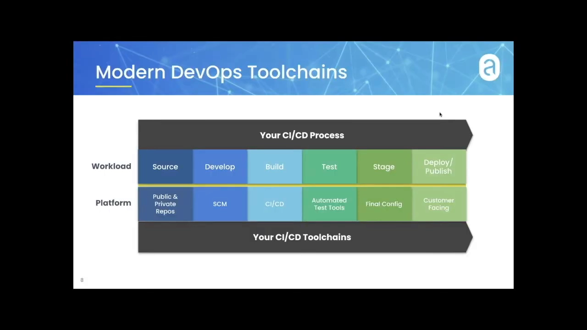

### 1.2 关键变化：自动化带来高频与多变

这条流水线的一个"新特点"是**自动化程度越来越高**，随之而来的是**产出频率和差异度大幅上升**。有些用户甚至做到**每一次提交**（无论是新功能、修 bug 还是安全更新）都会触发整套流程，在**每个阶段都生成新的软件与制品**。正是在这里，**SBOM 开始变得有意义**（[【跳转到 03:04】](https://www.youtube.com/watch?v=Za6lmA0VyOQ&t=184)）。

### 1.3 SBOM 可以挂在每个阶段的制品上

针对流水线上**任一阶段**生成的制品，都可以生成一份 SBOM 与之**关联**（[【跳转到 03:21】](https://www.youtube.com/watch?v=Za6lmA0VyOQ&t=201)）：

- 源代码阶段：制品就是**源码**，可以为这一具体版本的源码生成并关联 SBOM；
- 构建阶段：制品是**可执行文件**，同样可以生成并关联 SBOM；
- 往后还有**容器镜像**、**运行中的容器或已发布的软件**等制品，也是同理。

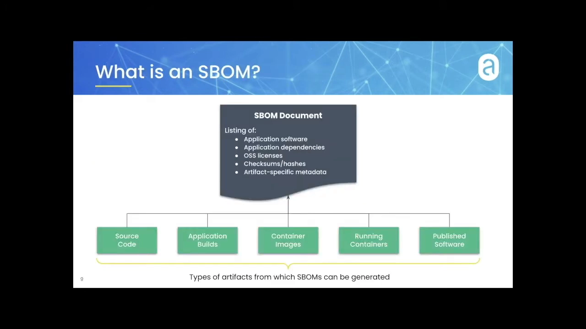

## 二、SBOM 里到底有什么

一份 SBOM 通常包含以下几类信息（部分取决于你针对哪个阶段/哪种制品生成），其中有些是所有制品共有的（[【跳转到 04:11】](https://www.youtube.com/watch?v=Za6lmA0VyOQ&t=251)）：

- **应用软件本身的信息**：名称、版本、校验和（checksum）等；
- **应用依赖**：这是大多数 SBOM 用途的重头戏，包括应用引入的开源依赖、厂商依赖，以及（对容器镜像而言）**操作系统依赖**；
- **开源许可证**：在投票中也被认定为 SBOM 的高频用途；
- **各元素的校验和与哈希**：让你能深挖、确认这些制品究竟由什么构成、如何组成；
- **制品相关的专门元数据**：这部分由 Alex 在后半程详细展开。

## 三、我们为什么需要 SBOM：内部用途

Dan 把用途分成"内部"与"跨组织"两大类，内部用途主要有四种（[【跳转到 05:45】](https://www.youtube.com/watch?v=Za6lmA0VyOQ&t=345)）：

1. **合规审查**：面向 PCI、HIPAA、NIST 等合规标准。合规团队做审查时，SBOM 能说明"每个时间点系统到底产出了什么"，既可作为**合规证明**，也能在**不合规时定位并补救**（[【跳转到 06:10】](https://www.youtube.com/watch?v=Za6lmA0VyOQ&t=370)）。
2. **安全评估**：把**公开漏洞信息**与 **SBOM 里的软件版本**两类数据结合起来，就能把安全漏洞**精确关联到具体制品**（[【跳转到 07:00】](https://www.youtube.com/watch?v=Za6lmA0VyOQ&t=420)）。
3. **许可证合规**：无论开源还是商业许可证，SBOM 都记录在案，可据此做合规检查（[【跳转到 07:25】](https://www.youtube.com/watch?v=Za6lmA0VyOQ&t=445)）。
4. **质量保证（QA）**：相对"微妙"的一项，稍后展开。

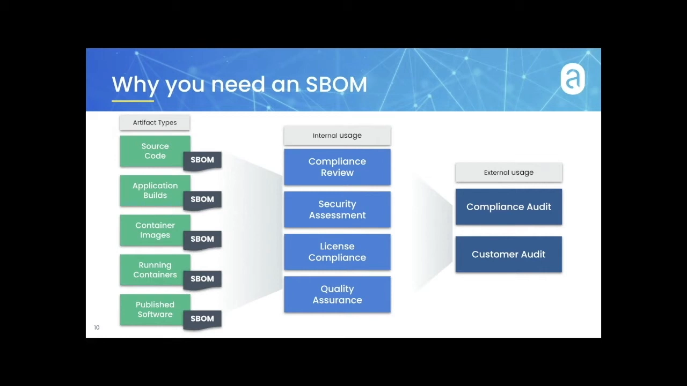

此外还有**跨组织用途**：当客户来问"刚买的软件用了哪些许可证"时，直接提供 SBOM 即可应答，同时也支撑**合同层面的客户审计**（[【跳转到 07:50】](https://www.youtube.com/watch?v=Za6lmA0VyOQ&t=470)）。

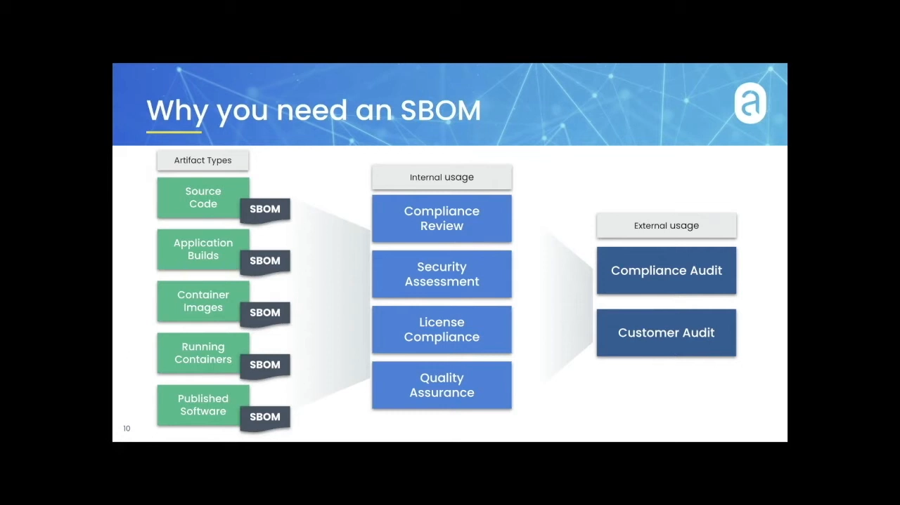

## 四、新兴场景：SBOM 正在变得更受关注

Dan 指出，"软件物料清单"越来越多地出现在安全事件、合规事件和跨组织协作的讨论里——大家逐渐意识到：**如果我们的 SBOM 更丰富、更普及、更可控，很多对话就能更有效地推进**（[【跳转到 08:40】](https://www.youtube.com/watch?v=Za6lmA0VyOQ&t=520)）。

### 4.1 安全事件驱动的索要

越来越多的组织在做安全评估或安全实践时，**要求在流程中生成 SBOM**。无论是**外部合规审计**还是**客户合同审计**，新客户会直接询问你的内部安全评估流程，而"能产出 SBOM"往往就能满足这类要求（[【跳转到 09:30】](https://www.youtube.com/watch?v=Za6lmA0VyOQ&t=570)）。

### 4.2 跨组织合规：从许可证扩展到质量

传统的跨组织合规主要围绕**开源许可证**（比如某些开源协议可接受、某些不可接受，用到了就必须知情）。现在则出现了**新问题**：外部大客户开始追问**质量保证**——不仅看许可证列表，还会留意你的依赖是不是**过旧、不健康**（[【跳转到 10:45】](https://www.youtube.com/watch?v=Za6lmA0VyOQ&t=645)）。

### 4.3 用 DevSecOps 自动化承载一切

当组织把合规审查、安全评估、许可证检查这些内部流程**持续、自动**地运行时，**只有不断在每个阶段生成 SBOM 才可能实现**。原因很直白：如果每次提交都产生一整套新制品，**靠人工逐个评估根本不可行**——这正是像 Anchore 这类项目和工具的用武之地（[【跳转到 12:00】](https://www.youtube.com/watch?v=Za6lmA0VyOQ&t=720)）。

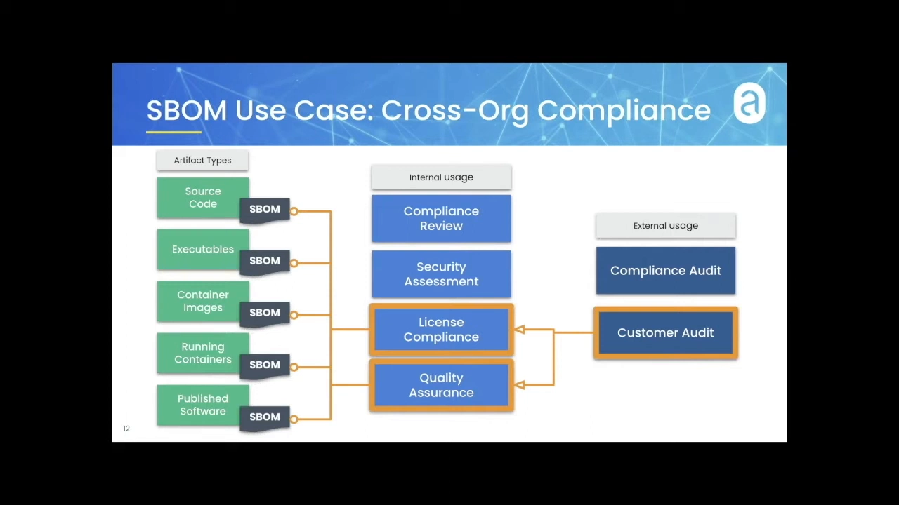

### 4.4 复杂性与"依赖是否够新"

最后一个微妙用途，与**应用的复杂度**和**高频产出**有关。客户开始索要**依赖的"新鲜度"报告**，确保提供的东西不是严重过时或不健康的。在内部，也有团队会盯着开发者：**应用代码本身可能更新很快，但容器的基础镜像可能很久没更新了**。SBOM 恰好能把这类信息"摊到桌面上"，让 DevSecOps 团队发现"哪一环掉队了"，推动整体保持大致一致的前进节奏（[【跳转到 14:05】](https://www.youtube.com/watch?v=Za6lmA0VyOQ&t=845)）。

## 五、为什么容器尤其需要 SBOM

容器在这套故事里格外重要，因为它是**最后一层"封装起来的"制品**——既可能是客户直接使用的成品，也可能是实际部署运行的东西。而拆开来看，容器里装的东西远不止应用代码（[【跳转到 14:48】](https://www.youtube.com/watch?v=Za6lmA0VyOQ&t=888)）：

- **密钥与凭据（secrets / credentials）**；
- **数据与其它支撑文件**；
- 支撑应用的**依赖与库**；
- 作为一个封装好的执行环境，通常还带着**近乎一整个轻量级操作系统**——于是又有了**操作系统包、系统配置和对应的开源许可证**。

一份容器的 SBOM 会把这些信息都囊括进来，而这正是外部客户会索要、内部场景也会用到的内容（[【跳转到 15:13】](https://www.youtube.com/watch?v=Za6lmA0VyOQ&t=913)）。

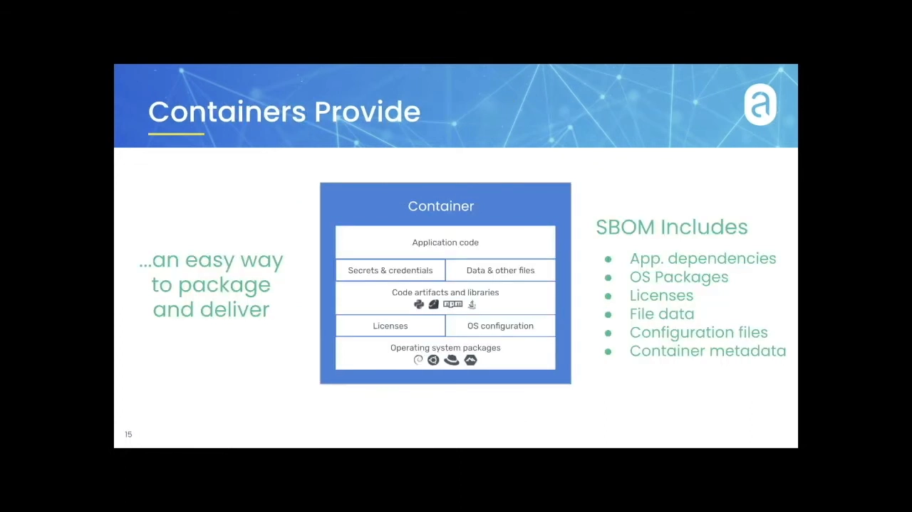

## 六、SBOM 的三种主流格式

接下来由 Alex 接手，介绍现有 SBOM 格式。世界上最流行的三种是 **SPDX、CycloneDX、SWID**（此外还有十来种没时间展开）（[【跳转到 16:26】](https://www.youtube.com/watch?v=Za6lmA0VyOQ&t=986)）。

| 格式 | 起始时间 | 出身与特点 |
| --- | --- | --- |
| **SWID** | 约 2009 年 | 最早的格式之一，正在起草基于 **CBOR** 的新格式，面向内存高效场景 |
| **SPDX** | 稍晚于 SWID | 最初面向**许可证管理**，对许可证细节的表达支持非常全面，支持多种输出格式 |
| **CycloneDX** | 较新 | 最初为 **OWASP Dependency-Track** 而生，格式**可扩展性强**（可自带扩展与属性），与 SPDX license id、PURL 等外部标识符兼容性好 |

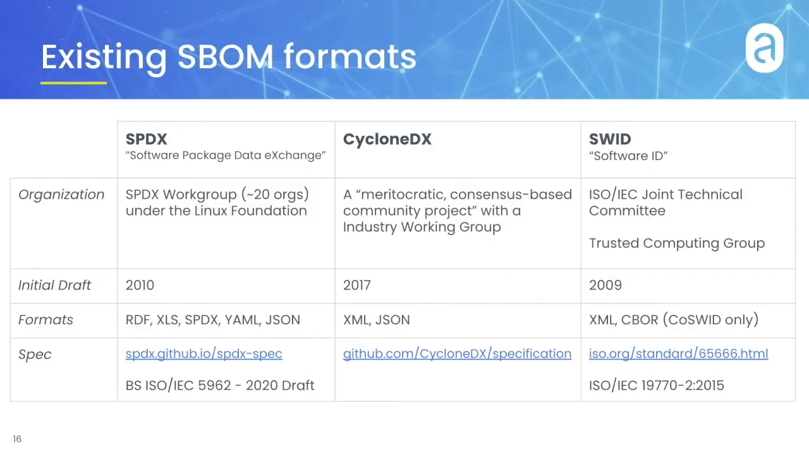

Alex 补充了各格式的**原始用途**（[【跳转到 18:06】](https://www.youtube.com/watch?v=Za6lmA0VyOQ&t=1086)）：SPDX 源于许可证管理，CycloneDX 源于依赖清单跟踪、后扩展到更多场景，SWID 则原本用于**清点与变更跟踪**——把 SWID 标签随软件一起分发，因此与软件的**构建、发布流程**深度绑定。

而**到今天的现状是：三者都在向"通用"演进**，用途已经超出了各自的初衷：它们都能记录**多个软件组件及其元数据**，也都能描述组件之间的**关系**；不再只是"一列包"，还能提供用于**校验软件组件及其组成部分完整性**的元数据（[【跳转到 18:31】](https://www.youtube.com/watch?v=Za6lmA0VyOQ&t=1111)）。

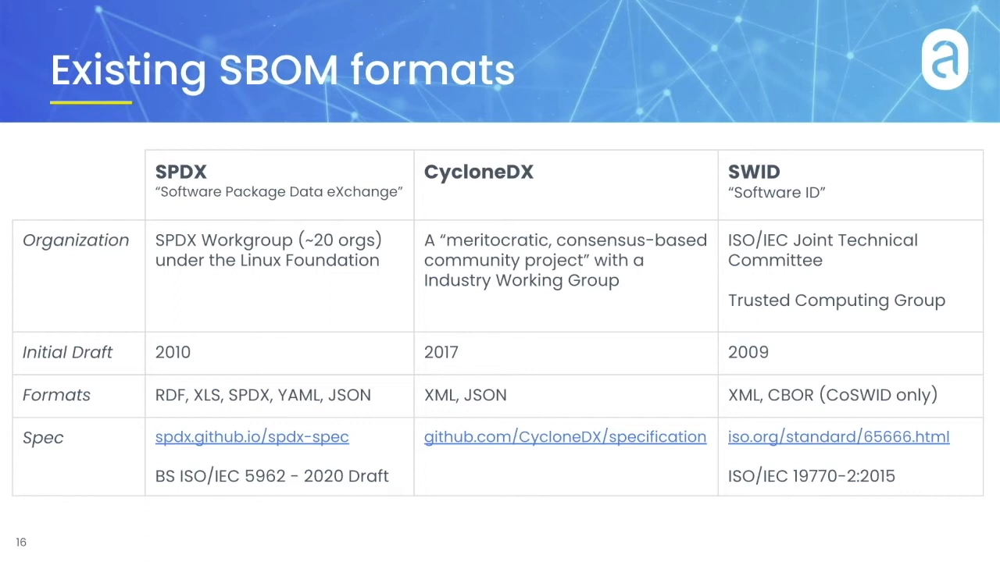

## 七、什么才是一份"好"的 SBOM

Alex 给出了评判标准。**一份"够用"的 SBOM 至少要做到**（[【跳转到 18:56】](https://www.youtube.com/watch?v=Za6lmA0VyOQ&t=1136)）：

1. **说明被编目的是什么东西**——是容器镜像、虚拟机、运行中的 VM、机器镜像，还是一个 tar 归档？
2. **对每个条目给出细节**——名称、版本，以及**唯一标识符**。因为即便是同一生态甚至跨生态，也可能出现**同名同版本**，唯一标识符就很有必要。
3. **描述条目之间的关系**——比如一个 jar 里嵌了另一个 jar，或某软件依赖另一个软件，或某包不在制品内、但其**源包（source package）**对下游有用。
4. **说明是谁做的编目**——绝大多数 SBOM 不是人工手写，所以要记录**生成工具及其配置**，让结果可复现。

### 7.1 一份"出色"的 SBOM 还应该

- **自我描述范围**：声明本次编目"包含什么、不包含什么"，例如搜索了哪些路径、排除了哪些路径、只找哪类包（[【跳转到 21:01】](https://www.youtube.com/watch?v=Za6lmA0VyOQ&t=1261)）；
- **记录异常情况**：比如"某个 jar 打不开、可能漏了包"，或"预期挂载的共享盘没挂上"。否则一份看起来"什么都编进去了"的 SBOM 可能悄悄漏了东西——要在文档里如实标注这些异常，而不是假装完整（[【跳转到 21:51】](https://www.youtube.com/watch?v=Za6lmA0VyOQ&t=1311)）；
- **保留对下游分析有用的元数据**：例如只记 Java 名和版本可能不够，还要抓取具体的 Java 包属性键值、特定许可证信息等（[【跳转到 22:41】](https://www.youtube.com/watch?v=Za6lmA0VyOQ&t=1361)）。

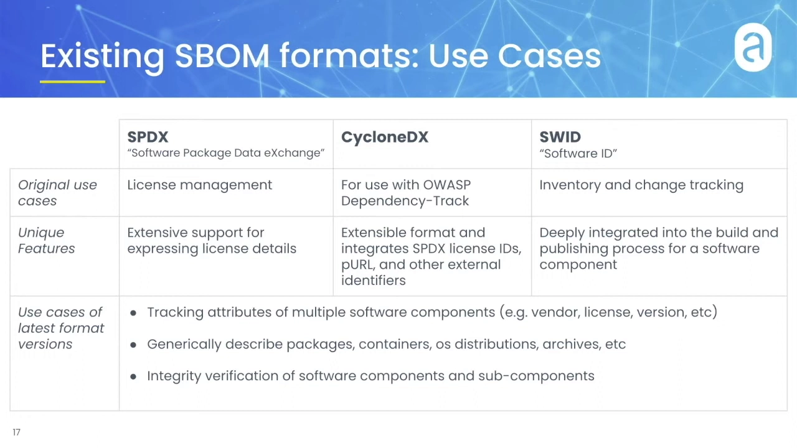

核心判据是：**SBOM 应该"自我说明"**——把它交给别人，对方就能推断出你搜了什么、用了什么工具和配置、想要什么、漏了什么、遇到什么问题，并能复现你的结果（[【跳转到 23:31】](https://www.youtube.com/watch?v=Za6lmA0VyOQ&t=1411)）。

## 八、工具实战：Syft 生成、Grype 扫描

### 8.1 Syft：生成 SBOM 的第一步

**Syft** 是 Anchore 的开源工具，能为**容器镜像**和**文件系统**生成 SBOM，支持多种打包生态、多种 Linux 发行版，以及多种输出格式（摘要表、JSON、CycloneDX，SPDX 即将支持）（[【跳转到 23:56】](https://www.youtube.com/watch?v=Za6lmA0VyOQ&t=1436)）。

在一整条生态里，Syft 是**第一步**：把要分析的容器镜像或源码/文件系统交给 Syft，它输出 SBOM 文档；随后这份 SBOM 可以导入 **Anchore Enterprise** 做漏洞分析与策略评估，或喂给开源漏洞扫描器 **Grype** 得到漏洞 JSON，也可带到任何其它下游系统中使用（[【跳转到 24:51】](https://www.youtube.com/watch?v=Za6lmA0VyOQ&t=1491)）。

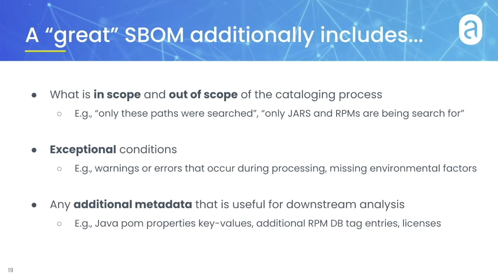

### 8.2 一个关键权衡：归一化 vs 保真

生成 SBOM 时要反复斟酌的问题是：**什么时候该把信息"归一化"，什么时候不该**。所有 SBOM 格式都要把原始来源里的信息归一化成标准数据表，而**归一化是有损的**——关键是在"标准化"和"保留信息"之间取得平衡，按你的具体用途来定（[【跳转到 26:11】](https://www.youtube.com/watch?v=Za6lmA0VyOQ&t=1571)）。

Alex 用 Syft 的 JSON 输出举了两个包的例子：**libhogweed**（Debian 包）与一个 Python 包。文档**上半部分**是归一化信息——所有生态共通的名字、版本、发现者、发现位置、许可证、语言等；**下半部分**是各生态特有的**键值对元数据**（如 dpkg 元数据、Python 包元数据）（[【跳转到 27:01】](https://www.youtube.com/watch?v=Za6lmA0VyOQ&t=1621)）。

一个例子说明了取舍：**libhogweed** 记录了它的**源包（source）**。若直接按 "libhogweed" 查漏洞，命中很少；但顺着**上游源包 nettle** 去查，命中的漏洞就多得多——因为维护者是在**上游源包**层面跟踪漏洞的。这正是要**保留生态特有信息**、服务于"漏洞扫描"这一具体用途的典型理由（[【跳转到 29:06】](https://www.youtube.com/watch?v=Za6lmA0VyOQ&t=1746)）。

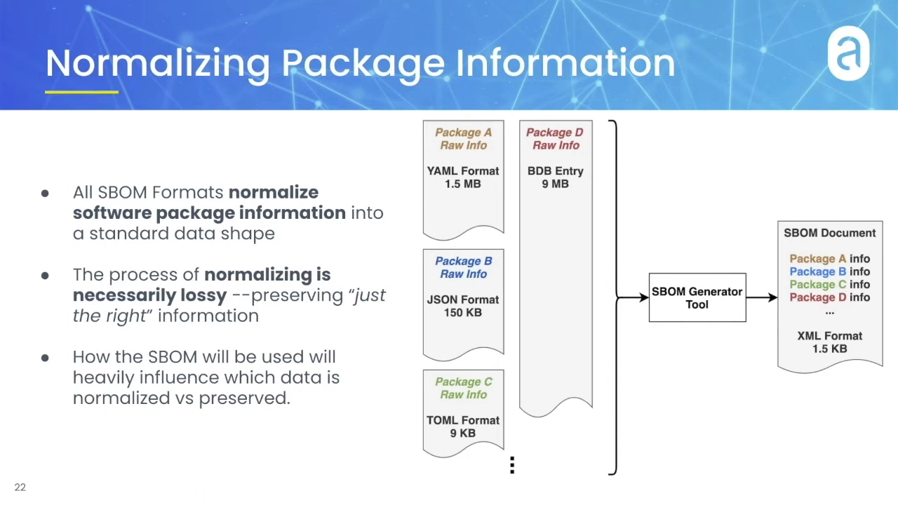

### 8.3 演示：给目录和镜像生成 SBOM

Alex 演示了用 Syft 扫描一个 **Prometheus** 的克隆仓库目录，识别出其中被引用的 Go 模块；也对 **ubuntu:latest** 基础镜像做了扫描，输出摘要表（显示 92 个包）、CycloneDX 格式，以及保留信息最全的自研 JSON 格式（[【跳转到 31:47】](https://www.youtube.com/watch?v=Za6lmA0VyOQ&t=1907)、[【跳转到 32:37】](https://www.youtube.com/watch?v=Za6lmA0VyOQ&t=1957)）。

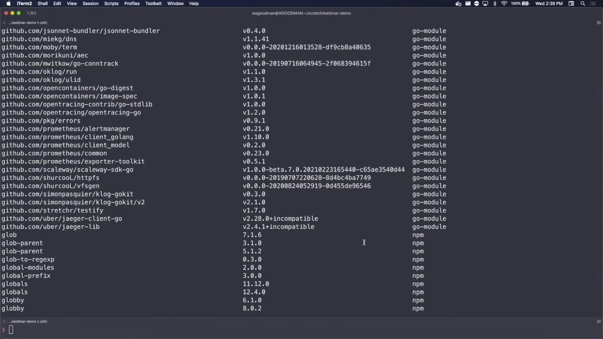

### 8.4 Grype：扫描漏洞

**Grype** 是 Anchore 的开源漏洞扫描器，可以扫描容器镜像、本地目录、应用产物等。以那个 ubuntu 镜像为例，它从中发现了 **143 个包、151 个漏洞**，其中不少是 **High/Critical** 级别。Grype 内部其实是**把 Syft 当库来用**：加载、解析、编目这几步都由 Syft 完成（生成 SBOM），最后一步才做**漏洞匹配**（[【跳转到 33:36】](https://www.youtube.com/watch?v=Za6lmA0VyOQ&t=2016)）。

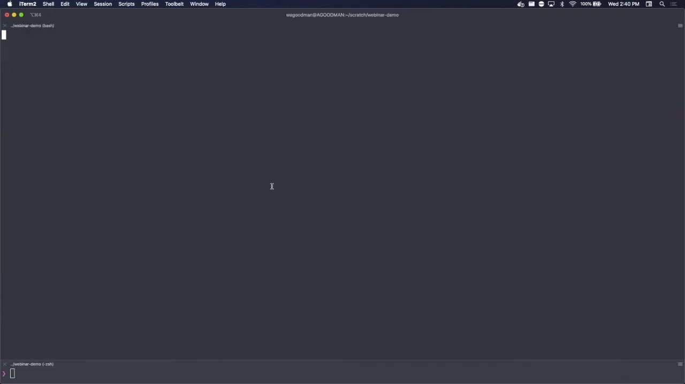

### 8.5 演示：保存 SBOM 能大幅加速后续扫描

Alex 做了一个对比实验（[【跳转到 34:51】](https://www.youtube.com/watch?v=Za6lmA0VyOQ&t=2091)）：**上排**让 Grype 从原始镜像开始（自己生成 SBOM 再扫描）；**下排**直接把**已经生成好的 SBOM（JSON）**喂给 Grype。结果下排约 **10 秒**就扫完，上排要约 **40~50 秒**。

由此引出一条最佳实践：**创建镜像时顺手生成并保存 SBOM，把它和制品放在一起**。因为漏洞每天都在被发现、数据库持续更新，你需要**比"创建镜像"更频繁地扫描**；而拿现成的 SBOM 去扫，比每次拿原始镜像重扫**便宜得多**（[【跳转到 36:31】](https://www.youtube.com/watch?v=Za6lmA0VyOQ&t=2191)）。

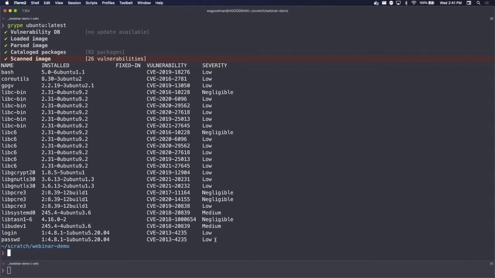

## 九、问答与总结

### 9.1 Dan 的总结要点

Dan 在结尾把整场分享收束为几条判断（[【跳转到 37:22】](https://www.youtube.com/watch?v=Za6lmA0VyOQ&t=2242)）：

- 很多安全实践都建立在**洞察与知情**之上，高质量的 SBOM 是提供这种信息的重要基础——不仅用于**漏洞预防**，也用于事故发生时的**取证与影响评估**；
- 要**根据自身需求选择 SBOM 标准**：三者各有特性，会影响你后续怎么用这些文档；
- 要选择**提供恰当细节层次**的生成工具或流程——合适的 SBOM 能一鱼多吃；
- **尽早**开始把 SBOM 与流水线产出的所有制品**关联保存**；
- 对**软件供应商**而言，跨组织（联邦政府、客户等）索要 SBOM 会越来越多，当**整条链上每个供应商都开始提供 SBOM** 时，全球的**供应链可见性**会显著提升（[【跳转到 39:52】](https://www.youtube.com/watch?v=Za6lmA0VyOQ&t=2392)）。

### 9.2 现场问答（Q&A）

**Q：未来会支持 .NET / NuGet 吗？**
会。**NuGet 正在为 Syft 开发中**，预计很快或稍后发布，GitHub 上已有对应的 issue 可跟踪（[【跳转到 41:42】](https://www.youtube.com/watch?v=Za6lmA0VyOQ&t=2502)）。

**Q：支持按许可证类别（宽松 / copyleft 等）分组吗，而不只是给出具体许可证？**
目前 Anchore 的工具**只产出各制品关联的许可证本身**，而"对许可证做评估和归类"被看作**更高层的数据操作**。当前确实**不做类别分组**，但会做一种分析：把同一已知许可证的多个措辞变体**归并**为一类（比如归结为 LGPL）。若使用 Anchore Enterprise，则可用**策略（policies）**来实现这类归类（[【跳转到 43:22】](https://www.youtube.com/watch?v=Za6lmA0VyOQ&t=2602)）。

**Q：给客户的报告长什么样？**
在 webinar 里演示的多是命令行原始输出；实际企业场景下，报告更像正式的**报告格式**——可以跨全部或过滤后的镜像做**汇总报告**，并把 **SBOM 信息、漏洞评估、策略评估**整合进同一份报告（[【跳转到 44:37】](https://www.youtube.com/watch?v=Za6lmA0VyOQ&t=2677)）。

**另一个提问：SBOM 会变化时，如何触发重新扫描？**
`syft` 和 `grype` 作为**独立工具**并不会自动联动；要落到更大的工作流里，就需要 **Anchore Enterprise** 这类平台来编排（例如指向你的 Docker Hub 仓库，一有推送就触发新扫描）。在**开源侧**，也可以与 GitHub、GitLab、Jenkins、CircleCI 等常见 CI/CD 集成，自己写个"每天重跑一次 Grype 扫描"的 GitHub Action 之类的流程（[【跳转到 47:57】](https://www.youtube.com/watch?v=Za6lmA0VyOQ&t=2877)）。

## 小结

- **SBOM 处在 DevOps 流水线的关键位置**：自动化产生的高频制品，每个都可能需要一份 SBOM。
- **SBOM 的内容**：制品本身信息、依赖（含 OS 依赖）、许可证、校验和，以及制品特有的元数据。
- **为什么要用**：内部用于合规审查、安全评估、许可证合规、质量保证；对外用于合规与客户审计。
- **新兴驱动力**：安全事件、跨组织合规、DevSecOps 自动化、应用复杂度带来的"依赖是否够新"的追问。
- **容器尤其需要 SBOM**：因为容器封装了应用代码、密钥、依赖乃至一整个轻量级 OS。
- **三种主流格式**：SPDX、CycloneDX、SWID，如今都向"通用成分与关系描述"演进。
- **好 SBOM 的标准**：说明编目对象、条目细节、关系与生成工具；出色的还要自我描述范围、记录异常、保留对下游有用的元数据。
- **工具链**：Syft 生成 SBOM，Grype 基于 SBOM 扫漏洞；**保存 SBOM 能让后续扫描更快更省**；anchore/grype/syft 均为开源。

## 关键术语速查

| 术语 | 一句话解释 |
| --- | --- |
| SBOM | 软件物料清单，随制品产生、记录其软件成分的文档 |
| Artifact（制品） | 流水线各阶段产出的东西，如源码、可执行文件、容器镜像 |
| Checksum / Hash | 校验和，用于核对成分与完整性 |
| Transitive dependency | 传递性依赖，依赖的依赖 |
| SPDX | Linux 基金会主导的 SBOM 格式，最初面向许可证管理 |
| CycloneDX | OWASP 背景的 SBOM 格式，可扩展性强 |
| SWID | 较早的软件标识格式，与构建发布流程深度绑定 |
| CBOR | 一种内存高效的二进制序列化格式，SWID 正在为其制定新版 |
| PURL | Package URL，跨生态的包唯一标识符 |
| Syft | Anchore 开源工具，为镜像/文件系统生成 SBOM |
| Grype | Anchore 开源漏洞扫描器，可基于 SBOM 做漏洞匹配 |
| 归一化（normalize） | 把原始信息压成标准字段的过程，会有信息损失 |
| source package | 上游源包，漏洞常在源包层面被跟踪（如 nettle） |
