# SBOM 入门：用「软件物料清单」守护开源软件供应链

> 视频来源：[openEuler 软件供应链安全 SBOM 介绍](https://www.bilibili.com/video/BV1xm4112746/)（Bilibili · BV1xm4112746 · 约 26 分钟）
> 所属：容器技术 · 第 3 章 镜像、文件系统与供应链 · 3.4 镜像供应链 · 3.4.1 SBOM

## 本讲要解决的核心问题（SCQA）

**背景**：现代软件大量复用开源组件。一个看上去"自己写的"应用，往往站在成百上千个第三方包的肩上，这些包又层层依赖别的包。

**冲突**：我们对这些"看不见的零件"其实并不了解，而它们出问题时却会连累整个软件——漏洞没人审查、许可证（license）没有声明、上游信息缺失，让整条"软件供应链"越来越不可控。2021 年的 Log4j 事件就是一个典型：一个被无数 Java 应用引用的日志组件爆出严重漏洞，影响面极广。

**疑问**：我们能不能清楚地回答两个问题——"我这个软件里到底有哪些成分？"以及"其中哪些出了问题、该找谁修？"

**回答（中心思想）**：**SBOM（Software Bill of Materials，软件物料清单）就是给软件做一张"配料表"**。它把软件的成分、依赖关系和许可证等信息，用标准化、机器可读的格式记录下来，让我们能够**追溯、排查、修复**。openEuler 社区围绕 SBOM 搭起了一套从"生成 → 存储 → 消费"的完整体系，本讲就按"为什么需要 → 是什么 → 标准生态 → openEuler 怎么落地 → 效果演示"的顺序讲清楚它。

## 一、为什么开源软件供应链需要 SBOM

### 1.1 开源软件的成分是"不透明、不可控"的

开源软件的行业特点决定了它天生带着一批**不可控的风险**，常见的几类：

- **漏洞没有被审查到**：依赖的某个组件已经爆出漏洞，但使用方毫不知情；
- **许可证（license）没有声明或声明不精确**：组件用了什么开源许可证、有没有版权约束，没有清晰记录；
- **上游信息缺失或不准确**：组件来自哪个社区、官方下载地址是什么，可能查不到。

随着公开披露的漏洞越来越多，整条开源软件链的管理难度也在持续上升。如图，讲者用常见的风险场景说明问题的普遍性。

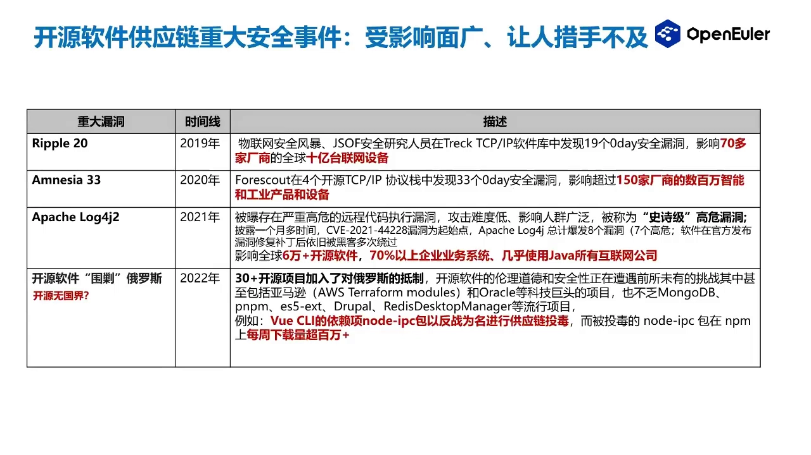

### 1.2 一个真实教训：Log4j 事件

讲者举了影响面最大的几起供应链重大安全事件之一——**2021 年的 Log4j 事件**。Log4j 是一个被海量 Java 应用引用的日志库，一旦出问题，**几乎所有使用 Java 的互联网公司都会被波及**，据讲者介绍这次的受影响开源软件数量非常庞大，是全球性的供应链事故。

还有一个容易被忽视的难点：**越往上游、越"高阶"的框架包，越难定位**。如果缺乏软件供应链分析能力，我们甚至定位不到是哪个高层框架引入了有问题的底层包，修复自然也就无从下手，难度大大增加（下图对应讲者对分析难点的说明）。

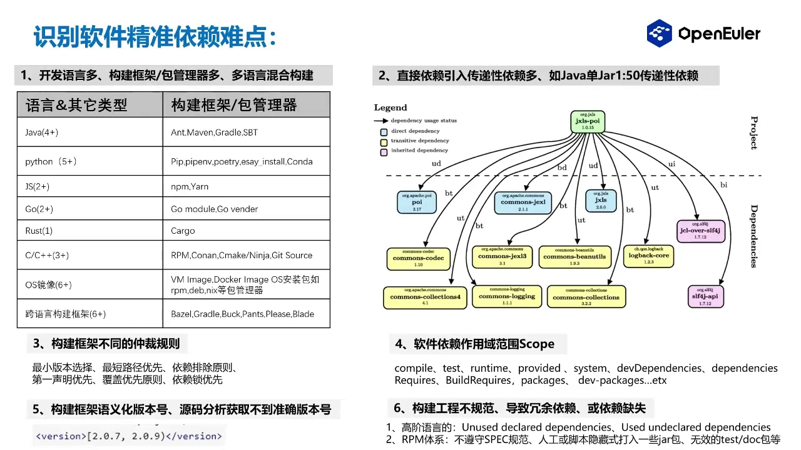

### 1.3 SBOM 要解决的两个核心问题

讲者把 SBOM 要解决的问题归纳为两条，它们也构成了后续整条技术路线的目标：

1. **判断"我是否受某个漏洞影响"**——需要在大规模软件产品中分析清楚"我依赖了谁、谁又依赖了我"，建立起软件的**正向依赖关系**与**反向依赖关系**，实现全链路追溯。有了这张关系网，才能圈定一个漏洞的真实影响范围（[【跳转到 01:24】](https://www.bilibili.com/video/BV1xm4112746/?t=84)）。
2. **把漏洞修掉**——在分析出影响范围后，需要建立现代化的软件工程体系，覆盖**依赖解析、类型分析、漏洞分析**等环节，把过去的人工排查升级为**工程化、自动化**的排查，从而省下大量人力（[【跳转到 01:49】](https://www.bilibili.com/video/BV1xm4112746/?t=109)）。

### 1.4 做 SBOM 难在哪里

在真正落地前，要正视几个客观难点：

- **语言与工具链太杂**：目前项目使用的编程语言很多，每种语言又有各自的**构建框架、包管理器、仲裁规则和环境性依赖**，规则各不相同，因此"**多语言混合**"的供应链分析非常难做，普通开源工具链难以胜任（[【跳转到 02:14】](https://www.bilibili.com/video/BV1xm4112746/?t=134)）。
- **元数据采集本身不可靠**：以 RPM 体系为例，`spec` 文件里的 license 是**人工填写**的，可能与软件实际的许可证不符；传递性依赖的信息需要人工补充；上游社区信息、官方下载地址也可能缺失或不准确；许可证库存在更新不及时的问题。
- **漏洞信息不完整**：部分漏洞缺少**修复配置**，导致我们无法判断该怎么修、影响哪些版本范围。

## 二、SBOM 是什么

### 2.1 官方定义

**SBOM 是一种正式的、标准化的、机器可读的元数据**，用来标识软件组件的成分、内容，以及它的版权、许可证等属性（[【跳转到 04:05】](https://www.bilibili.com/video/BV1xm4112746/?t=245)）。

换成大白话：SBOM 就是一份**软件成分清单**。因为它"机器可读"，所以既能被人查看，也能被各种工具自动解析、比对、分析，从而支撑后续的漏洞排查工作。

### 2.2 四个推动标准的组织

SBOM 不是某一家公司的私有格式，而是由多个标准化组织共同推动。讲者提到目前有**四个组织**在负责推动相关标准，其中像 **OpenChain** 这样的项目，要求企业提供一份软件的 SBOM 清单才能通过其认证（[【跳转到 04:30】](https://www.bilibili.com/video/BV1xm4112746/?t=270)）。

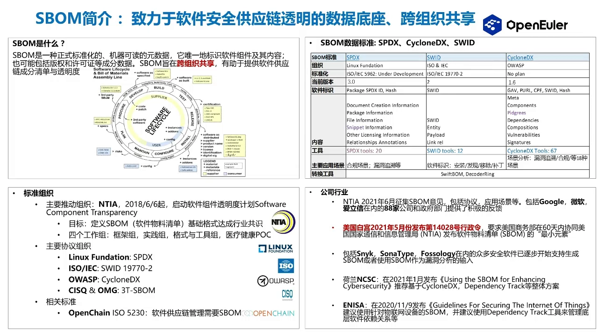

### 2.3 三种通用标准：SPDX / SWID / CycloneDX

业界目前通用三种 SBOM 标准，它们都能用来生成各自的 SBOM 文件格式（[【跳转到 04:55】](https://www.bilibili.com/video/BV1xm4112746/?t=295)）：

| 标准 | 说明 |
| --- | --- |
| **SPDX** | Software Package Data Exchange，Linux 基金会主导，对许可证信息的表达支持非常强 |
| **SWID** | Software Identification，来自 ISO/IEC 的技术委员会，偏"软件标识与清单跟踪" |
| **CycloneDX** | 由 OWASP 社区推动，偏安全导向，格式可扩展性强 |

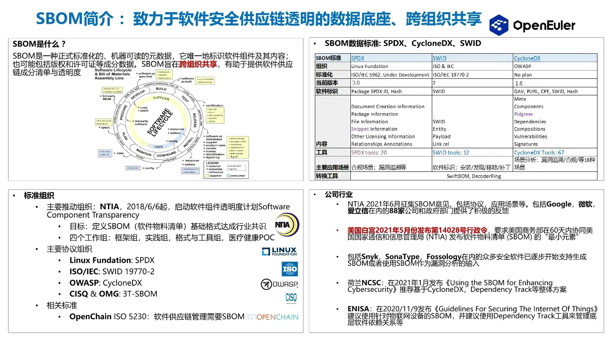

### 2.4 最小字段与推荐字段

SBOM 里到底要写什么？讲者引用了**美国国家电信和信息管理局（NTIA）**发布的**最小字段（minimum elements）**定义，无论你采用上面哪一种标准，这些字段都必须存在（[【跳转到 05:25】](https://www.bilibili.com/video/BV1xm4112746/?t=325)、[【跳转到 05:50】](https://www.bilibili.com/video/BV1xm4112746/?t=350)）：

- **供应商名称**
- **组件名称**
- **组件版本**
- **其它唯一标识符**
- **依赖关系**
- **SBOM 数据作者**
- **时间戳**

在此之上还有两个**推荐字段**：**组件哈希**和**生命周期阶段**。

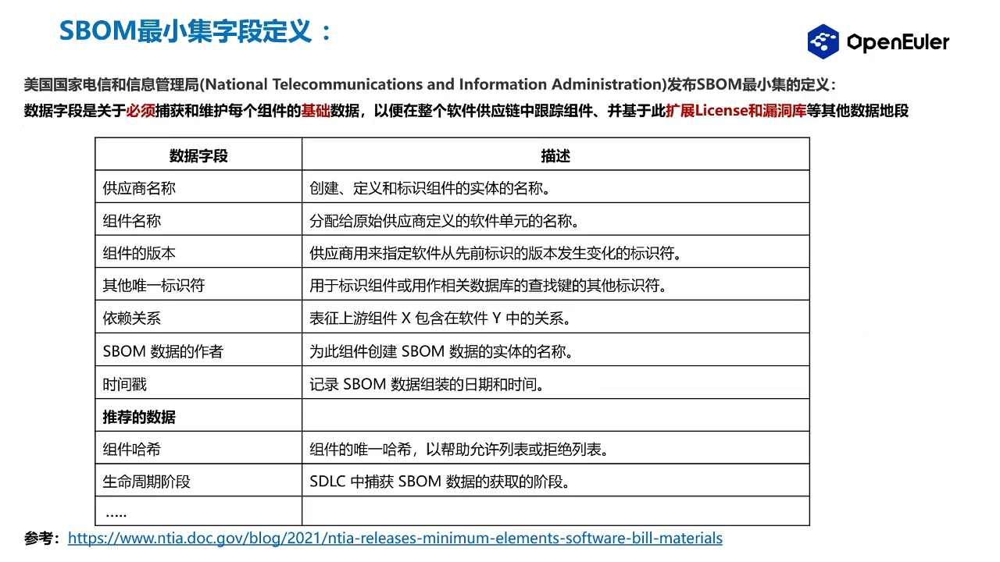

### 2.5 Package URL：软件包的"身份证号"

光有名字和版本还不够，因为同名同版本的包可能出现在不同生态里。为此引入 **Package URL（purl，文稿中音译为"package l/e l"）**——一种描述软件包唯一性的标准协议，可以跨编程语言、包管理器、数据库统一地定位一个软件包（[【跳转到 06:03】](https://www.bilibili.com/video/BV1xm4112746/?t=363)）。

可以把它理解为**软件包的"身份证号"**：无论包来自哪个生态，都能用统一格式识别。基于不同包管理器，purl 有不同的写法。

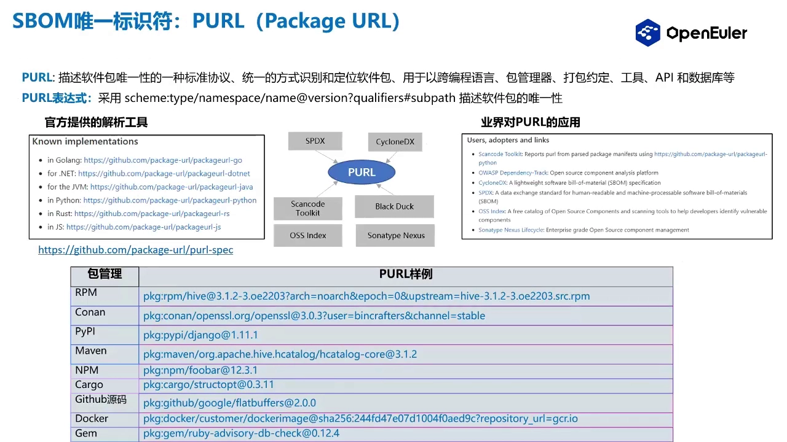

## 三、SBOM 的标准生态

### 3.1 生成、消费、转换三种角色

SBOM 的使用可以放进一个"生产—消费"的场景里：先有**生成体系**，生成出 SBOM；再进入**消费场景**，帮助软件供应商识别软件成分，进而排查 **license 风险**和**安全漏洞风险**（[【跳转到 06:47】](https://www.bilibili.com/video/BV1xm4112746/?t=407)）。

因为 SBOM 是**机器可读**的，相关标准社区会提供一整套基础设施，帮助开发者和厂商完成 SBOM 的**生成、消费、转换**。以 SPDX 标准为例，开源工具大致分为"**消费**"和"**转换**"两大类，其中消费类工具可用于分析许可证和漏洞风险（[【跳转到 07:37】](https://www.bilibili.com/video/BV1xm4112746/?t=457)）。

### 3.2 VEX：给漏洞状态做标记

除了 SBOM 本身，讲者还介绍了一个"**伴侣制品**"——**VEX（Vulnerability Exploitability eXchange，漏洞可利用性交换，文稿中音译为"VVX/VX"）**。它也是一种标准格式，作用是**收集漏洞信息、提供漏洞状态的视图**，帮助我们做出"基于漏洞的风险决策"（[【跳转到 08:45】](https://www.bilibili.com/video/BV1xm4112746/?t=525)）。

### 3.3 典型的开源与商业工具

- **多语言支持**：以 SPDX 社区为例，相关工具支持 **Java、Go、Python、JavaScript** 等主流编程语言；
- **ORT（OSS Review Toolkit）**：由 **Linux 基金会**基于 SBOM 提供的完整解决方案，对若干开源工具做了集成（[【跳转到 09:10】](https://www.bilibili.com/video/BV1xm4112746/?t=550)）；
- **微软的 SBOM 生成工具**：只做"生成"这一环，基于 SPDX 标准，支持很多平台和包管理器，甚至覆盖操作系统场景，可对 SBOM 进行生成与存储（[【跳转到 09:31】](https://www.bilibili.com/video/BV1xm4112746/?t=571)）。

## 四、openEuler 的 SBOM 体系

### 4.1 应用架构全景图

openEuler 社区基于 SBOM 搭建了一套应用架构，整体流程是（[【跳转到 10:01】](https://www.bilibili.com/video/BV1xm4112746/?t=601)）：

1. **代码门禁**触发流水线；
2. **流水线触发 SBOM 生成**；
3. **消费 SBOM**，分析软件的**正/反向依赖链路**、**合规性**与**漏洞**；
4. 基于分析结果**通知开发者**去管理和修复漏洞；相关数据存入数据库。

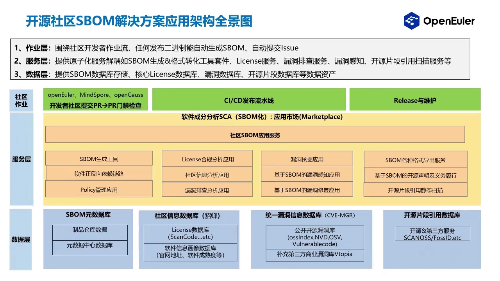

### 4.2 数据来源与数据库

支撑上面这套架构的，是几类数据存储：

- **源数据库**与**社区信息数据库**（文稿中提到的"貂蝉"服务属于这一层）；
- **统一漏洞信息数据库**：集成了**开源漏洞库**，并补充了一个**商业漏洞库**（[【跳转到 10:51】](https://www.bilibili.com/video/BV1xm4112746/?t=651)）；
- **开源片段引用数据库**：用于对**开源片段（snippet）**做静态扫描，识别"只抄了几段代码"这类片段级引入的风险（[【跳转到 11:16】](https://www.bilibili.com/video/BV1xm4112746/?t=676)）。

### 4.3 SBOM 数据流向：生产 → 存储 → 消费

SBOM 的完整数据流分为**生产、存储、消费**三段（[【跳转到 11:21】](https://www.bilibili.com/video/BV1xm4112746/?t=681)）：

- 通过**流水线**触发，发布 SBOM 数据并做**制品归档**；
- 借助**依赖解析工具**和**漏洞库集成的信息**构建 SBOM；
- 最终发布到 **SBOM 桌面（看板）**，在看板上查看包信息、漏洞信息以及 license 合规信息（[【跳转到 11:46】](https://www.bilibili.com/video/BV1xm4112746/?t=706)）。

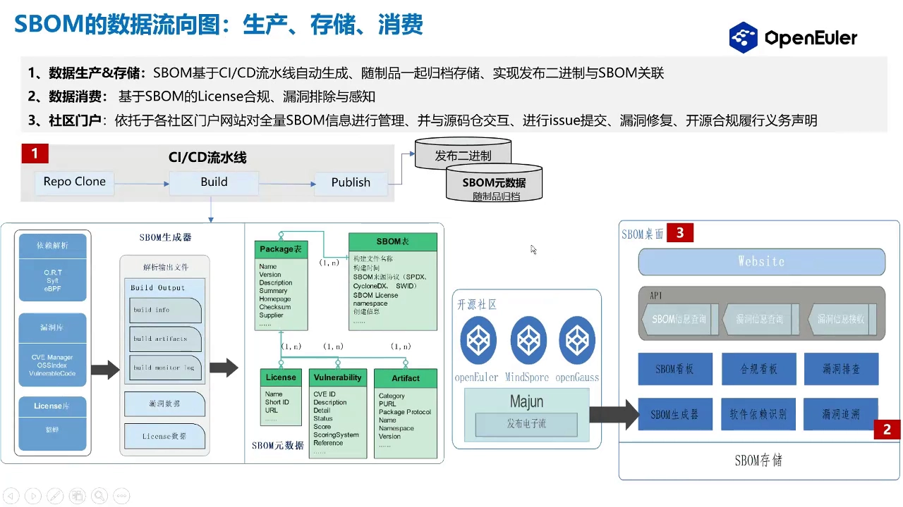

### 4.4 软件成分的四种采集场景

SBOM 的软件成分数据来自四种场景（[【跳转到 12:00】](https://www.bilibili.com/video/BV1xm4112746/?t=720)）：

1. **包管理器依赖解析**：对高阶语言，直接用其包管理器即可精准得到依赖成分；
2. **操作系统包体系**：如 RPM 体系，通过其**数据库（rpmdb）**读取包元数据；
3. **监控构建编译过程**：当没有包管理器时，通过监控整个构建过程来获取 SBOM 数据；
4. **容器镜像**：如果用容器镜像安装，镜像里会生成一份 **RPM database**，可从中解析出 SBOM 的元数据（[【跳转到 12:50】](https://www.bilibili.com/video/BV1xm4112746/?t=770)）。

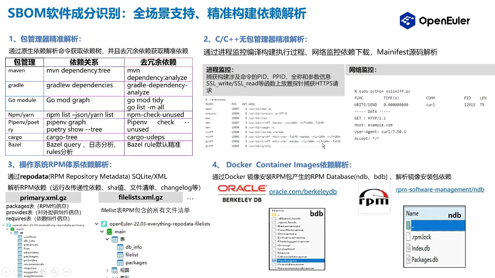

关于第 3 种"无包管理器"场景，讲者在答疑里进一步解释了原理：它借助 **eBPF** 技术，对涉及构建命令的进程、以及 **SSL 库函数**等位置**放探针**，捕获构建过程中发出的 **HTTPS 请求**，从而精准得知"你下载了哪些包"，进而还原出整条依赖构建过程（[【跳转到 21:57 / 22:16】](https://www.bilibili.com/video/BV1xm4112746/?t=1336)）。

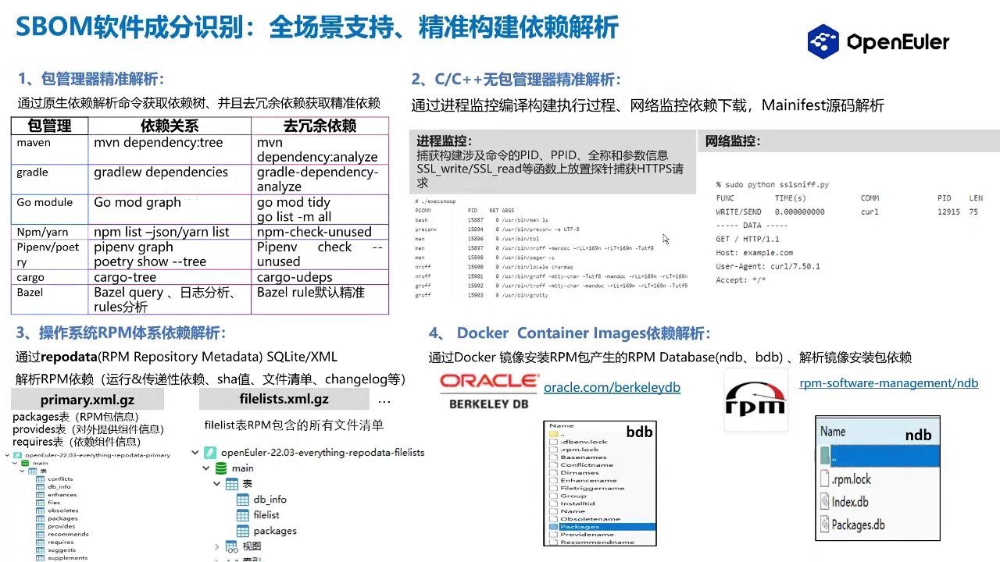

### 4.5 数据粒度：一包一 SBOM

SBOM 的数据组装粒度为：**面向软件包时，一个包对应一份 SBOM**，并且每个包都会分配一个 **Package URL** 作为唯一标识符（[【跳转到 13:00】](https://www.bilibili.com/video/BV1xm4112746/?t=780)）。讲者举了实例：基于 **openEuler 22.03 LTS** 版本生成一份整系统的 SBOM，也基于 **Log4j** 单独生成该软件包的 SBOM 文件（[【跳转到 13:25】](https://www.bilibili.com/video/BV1xm4112746/?t=805)）。

### 4.6 license 合规分析

license 合规是 SBOM 的重要消费场景。做法是给 SBOM 元数据**补充 license 与 copyright 信息**，并集成主流扫描工具（如 **ScanCode**）来分析代码片段、license 属性、copyright 生成、元数据审查甚至镜像类型分析；再通过 **license 调用关系**生成看板数据，辅助合规分析（[【跳转到 13:43】](https://www.bilibili.com/video/BV1xm4112746/?t=823)、[【跳转到 14:08】](https://www.bilibili.com/video/BV1xm4112746/?t=848)）。

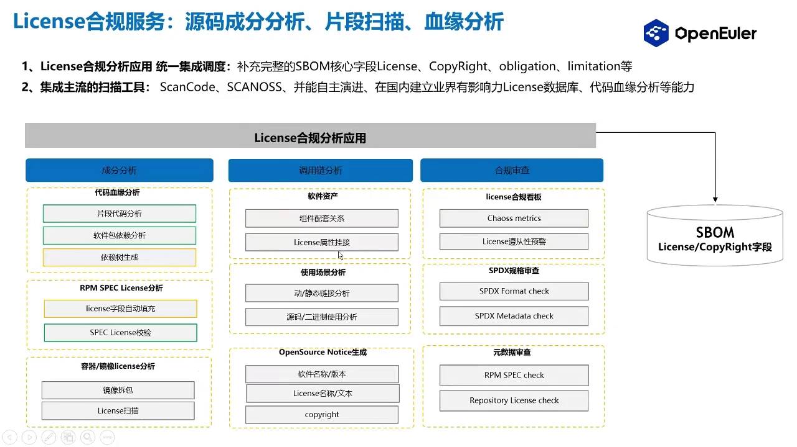

### 4.7 漏洞感知

漏洞感知的思路是：用 **Package URL** 这个唯一标识符，到**统一漏洞库**中查询，把感知到的漏洞信息推送到**漏洞应用服务**；应用服务据此得到"当前有哪些包关联到某个漏洞"，再由漏洞管理服务推送给社区，跟踪社区修复漏洞的整个过程（[【跳转到 14:38】](https://www.bilibili.com/video/BV1xm4112746/?t=878)、[【跳转到 15:03】](https://www.bilibili.com/video/BV1xm4112746/?t=903)）。

## 五、落地效果：看板演示

讲者展示了 openEuler 社区的实际落地效果（[【跳转到 15:15】](https://www.bilibili.com/video/BV1xm4112746/?t=915)）。

### 5.1 软件成分与漏洞关联

看板上首先是一份**软件成分列表**，可以看到某份 SBOM 包含的**软件包、版本号、漏洞信息以及 license 信息**，并支持**精准查询**。接着是**漏洞与软件包的关联视图**：受某个漏洞影响的所有软件包都会列出，并附仓库地址，便于跟踪修复（[【跳转到 15:40】](https://www.bilibili.com/video/BV1xm4112746/?t=940)）。

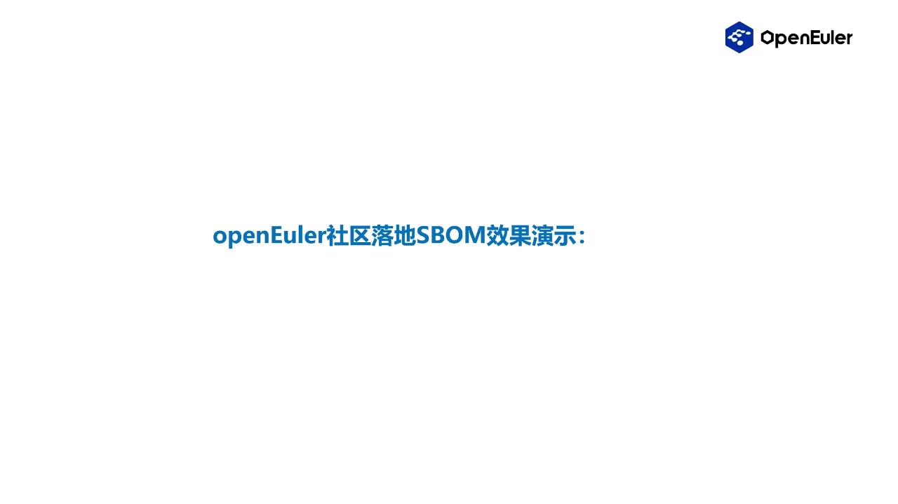

### 5.2 漏洞感染全路径与反向追溯

更关键的是**漏洞感染的全路径**展示：例如某个漏洞先感染两个组件，这两个组件又影响两个包，再通过**传递性依赖**一路影响下去，所有受影响的包都会被展示出来，保证**环境性依赖**这种复杂场景也能覆盖到（[【跳转到 16:05】](https://www.bilibili.com/video/BV1xm4112746/?t=965)）。

与之对应的还有**单软件反向追溯链**：可以反向查到"我这个包被谁依赖"，从而准确定位整条依赖链路，用于人工排查漏洞影响（[【跳转到 17:45】](https://www.bilibili.com/video/BV1xm4112746/?t=1065)）。

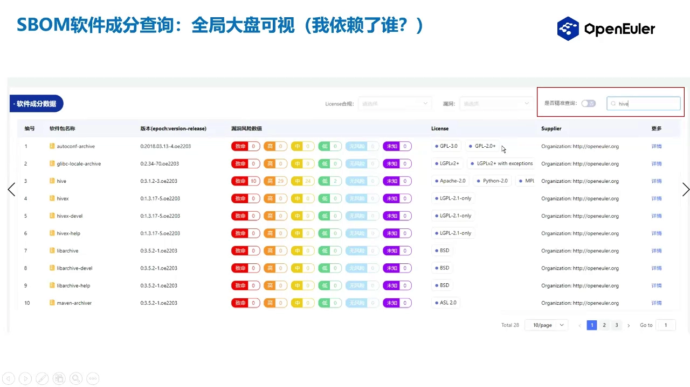

### 5.3 软件包的多维信息展示

看板还会展示软件的**元数据**：license 信息、漏洞、上游社区下载地址；具体的 **license 列表**；以及**软件包依赖**——包括包本身、子模块，以及"运行时/打包过程中依赖了哪些包"等信息（[【跳转到 16:30】](https://www.bilibili.com/video/BV1xm4112746/?t=990)、[【跳转到 17:20】](https://www.bilibili.com/video/BV1xm4112746/?t=1040)）。

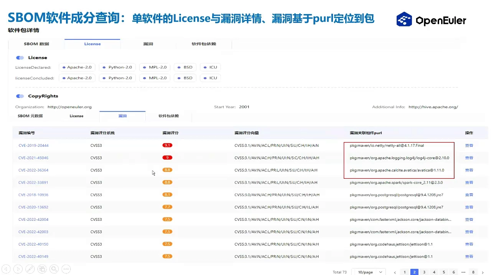

### 5.4 用漏洞评分判断修复优先级

面对一堆漏洞，看板会给出**漏洞关联的组件和漏洞评分**，据此判断**哪些漏洞需要优先修复**（[【跳转到 16:55】](https://www.bilibili.com/video/BV1xm4112746/?t=1015)）。

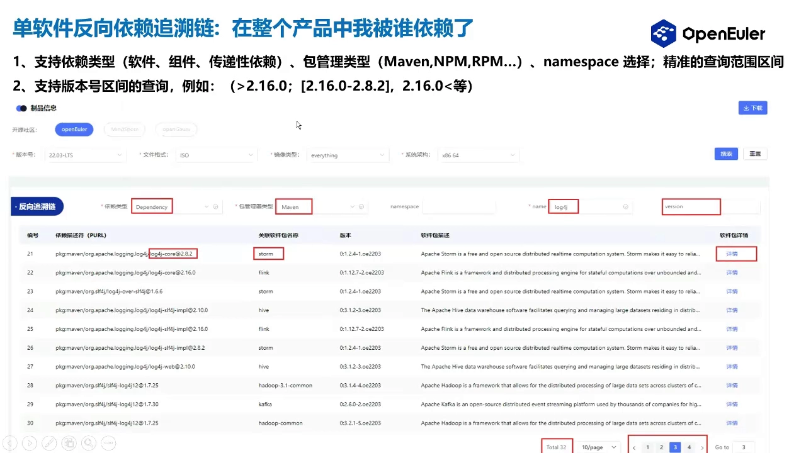

### 5.5 下一步规划

讲者也介绍了后续方向：加强**漏洞到组件的精准度**、推进 **SBOM 与 VEX 伴侣制品的联合**解决漏洞能力，并把相关测试等能力加进来，持续增强 SBOM 的应用消费能力（[【跳转到 18:15】](https://www.bilibili.com/video/BV1xm4112746/?t=1095)）。

## 六、常见问题解答（Q&A）

**Q1：SBOM 在 openEuler 上线了吗？**
当时**尚未正式对外发布**，讲者表示预计会在 openEuler 的后续版本中正式对外发布（[【跳转到 19:13】](https://www.bilibili.com/video/BV1xm4112746/?t=1153)）。

**Q2：如何检查二进制软件的 SBOM 是否准确？**
要分清两个概念（[【跳转到 19:38】](https://www.bilibili.com/video/BV1xm4112746/?t=1178)）：一是**文件完整性**——生成 SBOM 时会对其**签名**，可反向**验签**来甄别文件有没被篡改；二是**字段准确性**——字段仍来自 RPM 等的人工填写，需要**人工复查**来甄别。

**Q3：能否详细讲讲"进程监控"方式？**
就是 4.4 节说的无包管理器场景：用 **eBPF** 技术放探针，捕获构建命令相关进程、SSL 库函数及 HTTPS 请求，从而精准获取"下载了哪些包"，还原整个依赖构建过程（[【跳转到 22:16】](https://www.bilibili.com/video/BV1xm4112746/?t=1336)）。

**Q4：既然已经有了监控工具，为什么还需要 SBOM？**
两者是**两个概念**：监控工具负责**捕获软件成分信息**，SBOM 是被生成出来的**成品清单**；清单生成后，才轮到后续去做漏洞与 license 合规分析、修复管理（[【跳转到 23:31】](https://www.bilibili.com/video/BV1xm4112746/?t=1411)）。

**Q5：如何用 SBOM 识别和预防依赖风险？**
因为 SBOM 的成分数据能拿到**全量的包依赖信息**，在**消费场景**里就可以针对这些包数据去分析漏洞风险、license 不合规等问题（[【跳转到 24:21】](https://www.bilibili.com/video/BV1xm4112746/?t=1461)）。

**Q6：如何验证组件的许可证信息是否完整准确？**
先从 `spec` 文件获取一份 license（本身有不准的风险），再由 **"貂蝉"服务**扫描开源仓库、重新扫描整套源代码，得到已声明的 license 信息，两者**对比**后甄别出异常点，供人工排查（[【跳转到 25:11】](https://www.bilibili.com/video/BV1xm4112746/?t=1511)）。

## 小结

- **SBOM 是软件的"配料表"**：正式的、标准化的、机器可读的元数据，记录软件成分、依赖与许可证。
- 它要解决两件事：**判断漏洞影响范围**（靠正/反向依赖的全链路追溯）和 **修复漏洞**（靠工程化、自动化的分析体系）。
- 落地难点在于**多语言混合的工具链差异**和**元数据/漏洞信息本身的不完整**。
- 三种通用标准是 **SPDX、SWID、CycloneDX**；最小字段由 **NTIA** 定义，核心包括供应商、组件名、版本、依赖关系、作者与时间戳。
- **Package URL** 是软件包的唯一标识；**VEX** 是描述漏洞状态的伴侣制品；代表工具有 SPDX 生态工具、ORT、微软生成工具等。
- openEuler 的体系：**门禁→流水线→生成 SBOM→消费分析→通知修复**，数据来自四类采集场景，粒度是"一包一 SBOM"。
- 看板能力覆盖**成分列表、漏洞与包关联、漏洞感染全路径、反向追溯链、license 合规、修复优先级**。

## 关键术语速查

| 术语 | 一句话解释 |
| --- | --- |
| SBOM | 软件物料清单，软件的"配料表"，标准化、机器可读的成分元数据 |
| SCA / 软件供应链分析 | 分析软件用了哪些组件、谁依赖谁的技术 |
| SPDX | 由 Linux 基金会推动的 SBOM 标准，强于许可证表达 |
| SWID | 来自 ISO/IEC 的软件标识标准，偏清单与变更跟踪 |
| CycloneDX | 由 OWASP 推动的安全导向 SBOM 标准，扩展性强 |
| Package URL (purl) | 跨生态统一标识一个软件包的"身份证号" |
| VEX | 描述漏洞是否可被利用的状态交换格式，SBOM 的伴侣制品 |
| NTIA 最小字段 | 美国 NTIA 规定的 SBOM 必备字段集合 |
| 传递性依赖 | 依赖的依赖，层层传递形成的间接依赖 |
| ORT | Linux 基金会的 OSS Review Toolkit，集成式供应链方案 |
| eBPF | 内核可编程技术，用于监控构建过程以采集软件成分 |
| license 合规 | 检查软件所用开源许可证是否可接受、是否声明准确 |
