# SLSA 概览：用「出处证明」让软件制品可追溯、防篡改

> 视频来源：[An Overview on SLSA - Tom Hennen, Google & Joshua Lock, VMware](https://www.youtube.com/watch?v=8RT5bf6wEJk)（YouTube · CNCF · 约 15 分钟）
> 主讲：Joshua Lock（VMware 开源工程师、The Update Framework 联合维护者、SLSA 项目指导委员会成员）、Tom Hennen（Google 软件工程师、SLSA 项目贡献者）
> 所属：容器技术 · 第 3 章 镜像、文件系统与供应链 · 3.4 镜像供应链 · 3.4.2 构建来源证明

## 本讲要解决的核心问题（SCQA）

**背景**：今天的软件几乎都是「拼」出来的——你的容器镜像里装着基础镜像、一堆依赖库、还有你自己写的代码，这些部件又分别由不同的团队、甚至不同的公司在不同的机器上构建。任何人拿到一个二进制或镜像，都只能选择「相信它」。

**冲突**：但供应链攻击恰恰利用这种「只能相信」。攻击者只要污染其中某一环——篡改构建平台、往仓库里塞恶意代码、上传一个假冒的镜像版本——就能让恶意代码一路被签名、打包、发布，最终跑进你的生产环境。你怎么知道「你现在运行的，就是当初开发者写的那份代码」？

**疑问**：有没有一套公认的框架，能让我们**自动地**判断一个制品是否被篡改过、它是「从哪里、由谁、如何」构建出来的？

**回答（中心思想）**：**SLSA（Supply chain Levels for Software Artifacts，软件制品供应链级别）提供的就是这样一套框架**。它的核心产出是**出处证明（provenance）**——一份记录「这个制品由谁、用什么配方、基于哪些材料构建而成」的签名元数据；再配合**分级要求**和**三道信任边界**（源码、构建、准入），让下游使用者可以自动验证制品、并据此做出放行/拒绝的策略决策。本讲从「SLSA 是什么 → 分级如何工作 → 证明文档与出处证明 → 三个信任边界下的攻击演练 → 从 level 1 起步」逐层展开。

## 一、SLSA 是什么：把「防篡改」做成一套可分级的要求

### 1.1 一句话定义

SLSA 是一个缩写，全称 **Supply chain Levels for Software Artifacts**。它是一套**保护软件供应链免受篡改**的安全框架，关注点很明确（[【跳转到 00:45】](https://www.youtube.com/watch?v=8RT5bf6wEJk&t=45)）：

- **保护软件从源码到被使用的全过程**；
- 让使用者能够**自动判断**自己所用制品的完整性；
- 由一组**要求（requirements）** 组成——本质上就是行业里逐渐被公认的最佳实践；
- 通过**分级（leveling）** 让这些要求可以被**增量采纳**，每上一个级别，安全姿态就更好一层。

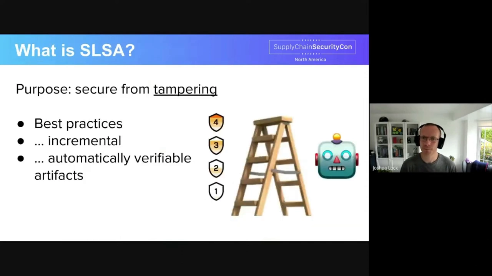

一个让主讲人觉得「豁然开朗」的关键点是：**当越来越多的软件部件开始产出并发布 SLSA 出处证明后，这些部件的使用者就能在把它们纳入自己供应链之前，自动完成验证**（[【跳转到 01:10】](https://www.youtube.com/watch?v=8RT5bf6wEJk&t=70)）。换句话说，防篡改的能力是「一层传一层」地被继承下去的。

### 1.2 分级：让安全可以「一步一个台阶」地提升

SLSA 的要求被组织成**级别（levels）**。这种显式分级带来两个好处（[【跳转到 02:00】](https://www.youtube.com/watch?v=8RT5bf6wEJk&t=120)）：

1. 采纳方可以**自行选择**想要达到的安全姿态；
2. 可以**增量推进**——每一级都建立在上一级的成果之上。级别越高，越多的要求会被**下沉到供应链的基础设施组件**里：从 **level 2 起要求「构建服务」**，从 **level 3 起要求「源码控制服务」**。

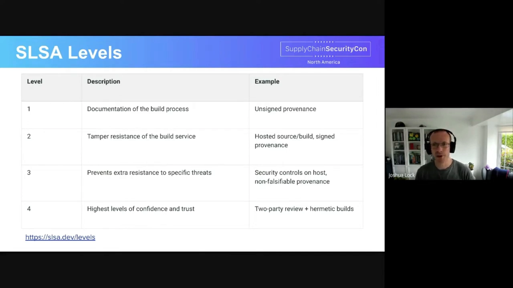

级别越高，攻击者要突破的「基础设施关卡」就越多——这正是下一节要展开的「信任边界」。

### 1.3 「篡改」的边界：像药瓶上的封膜

主讲人特意解释了 SLSA 所说的「篡改（tampering）」到底指什么（[【跳转到 02:40】](https://www.youtube.com/watch?v=8RT5bf6wEJk&t=160)）。用它的话说，这有点像**包装上的防拆贴纸，或者药瓶上的封口膜**——一旦被人打开过，你就能看出来自己拿到手之前「被动过手脚」。

同时要明确 SLSA 的**边界感**：软件供应链安全是一个非常大的领域，你甚至可以说「软件开发的每一个环节都属于供应链」。**SLSA 并不试图解决所有问题**，它聚焦于**防止「未经软件生产者授权的修改」**（[【跳转到 03:05】](https://www.youtube.com/watch?v=8RT5bf6wEJk&t=185)）。

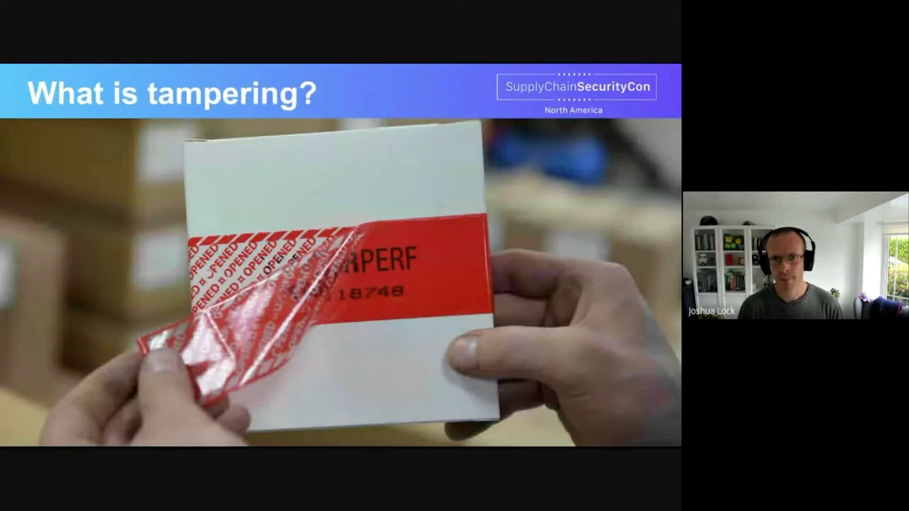

## 二、核心产物：证明（attestation）与出处证明（provenance）

### 2.1 要求怎么被「自动验证」：靠证明

SLSA 提出了一堆要求，但关键在于**它们如何被自动验证**。答案是：**提供遵守要求的「证据」**，这些证据以**证明（attestation）** 的形式被记录下来（[【跳转到 03:18】](https://www.youtube.com/watch?v=8RT5bf6wEJk&t=198)）。

一份证明本质上是一段元数据，它通常包含三部分：

- **制品本身的信息**——通常用**密码学摘要（digest）** 来指代被证明的那个制品；
- **制品的相关信息**——对 SLSA 而言，就是「这个制品是如何被生产出来的」；
- **生成这份证明的认证主体**——通常是一个**密码学签名**和一个**密钥标识（key identifier）**。

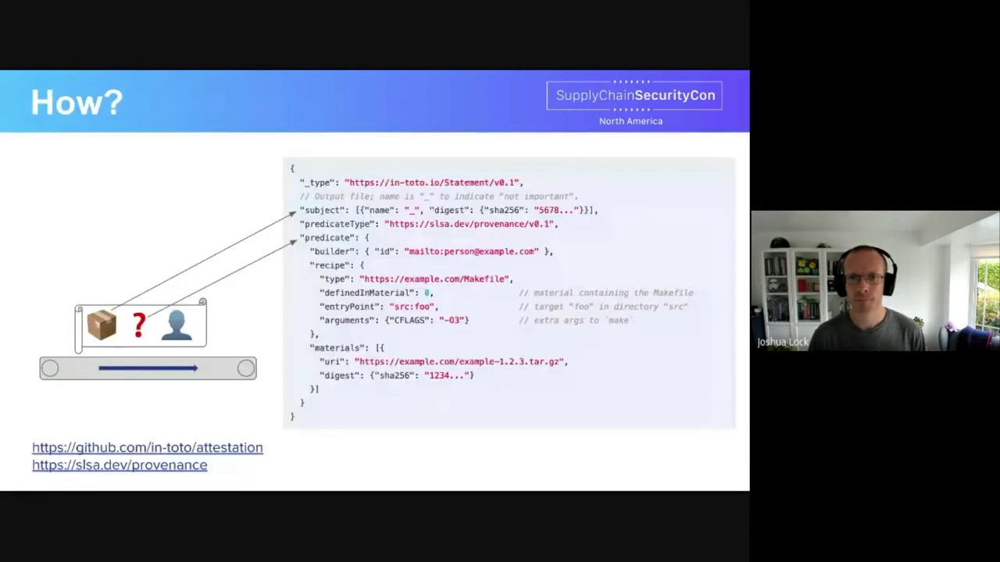

### 2.2 证明沿供应链「向后传递」

这些证明会在整条供应链上**一路生成、一路向后传递**（[【跳转到 03:43】](https://www.youtube.com/watch?v=8RT5bf6wEJk&t=223)），让下游的每一个使用者都能自动验证制品，并**基于这些证明做策略决策**。

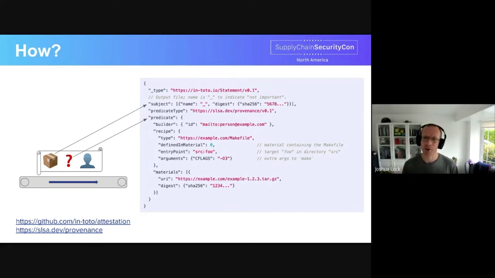

### 2.3 出处证明：SLSA 的标准「证明格式」

承载「是否遵守 SLSA 要求」这一信息的标准证明，就是 **SLSA 出处证明格式（provenance format）**（[【跳转到 04:08】](https://www.youtube.com/watch?v=8RT5bf6wEJk&t=248)）。一份出处证明会记录：

- **制品（artifact）**：被证明的对象；
- **构建者（builder）**：生成它的那个构建系统；
- **配方（recipe）**：生成该制品所用的步骤/构建指令；
- **材料（materials）**：参与了构建的其它输入（例如依赖、上游制品）。

理想情况下，出处证明会**与它对应的软件一起发布**，这样任何使用者在引入这个制品前都能自动完成验证（[【跳转到 04:33】](https://www.youtube.com/watch?v=8RT5bf6wEJk&t=273)）。

## 三、另一大手段：加固平台，形成三道信任边界

除了产出证明，SLSA 达到目标的另一大手段是**加固构成供应链的平台**——即保护**源码控制**与**构建编排**系统，避免它们被篡改（[【跳转到 04:58】](https://www.youtube.com/watch?v=8RT5bf6wEJk&t=298)）。

于是 SLSA 形成了**三道信任边界**：

1. **源码控制系统**（source control）；
2. **构建编排系统**（build orchestration）；
3. **准入网关**（pre-admission gateway，可以是自动或手动的）。

三者合起来，既能**阻止制品被篡改**，也能**阻止已被篡改的制品被使用**。

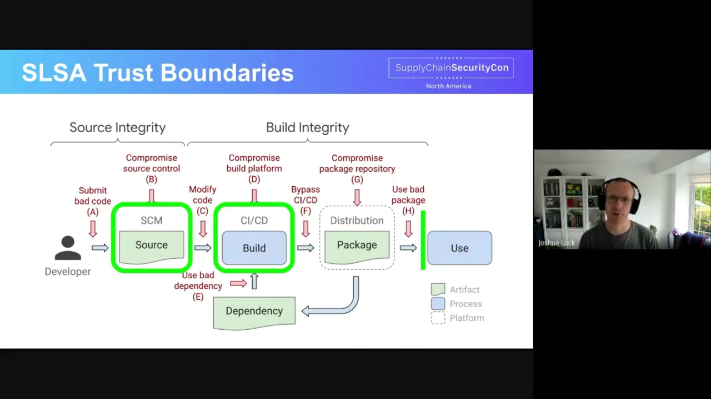

### 3.1 演练方式：跟着「小捣蛋鬼」逆流而上

为了说明 SLSA 如何起作用，主讲人设计了一个叙事：让攻击者（视频里叫 *gremlin*，小捣蛋鬼）**沿着供应链从下游往上游一步步尝试**，看看 SLSA 如何在每一道边界上把它的「性价比」压低（[【跳转到 05:23】](https://www.youtube.com/watch?v=8RT5bf6wEJk&t=323)）。由于时间有限，他们只取三个代表性攻击：

- 攻击 A：向仓库提交坏代码（对应源码边界）；
- 攻击 D：攻陷构建平台；
- 攻击 H：让使用者用到被篡改的软件。

下面的演练按视频顺序展开：先看攻击 H（使用环节），再回溯到攻击 D（构建环节），最后到攻击 A（源码环节）。

## 四、攻击 H：让使用者用到被篡改的软件

### 4.1 攻击场景

第一个攻击针对**准入边界**（[【跳转到 06:15】](https://www.youtube.com/watch?v=8RT5bf6wEJk&t=375)）：小捣蛋鬼设法**窃取了一个叫做 "fetcher" 的容器仓库凭据**，而这个 fetcher 镜像被上千个项目使用。它用这份凭据**上传了一个恶意版本的 fetcher 镜像**，然后坐等别人来下载。某个叫 "baxter" 的试验分析集群在一次例行更新时，拉取了最新版 fetcher 镜像并运行——于是小捣蛋鬼就拿到了该集群里所有的数据。

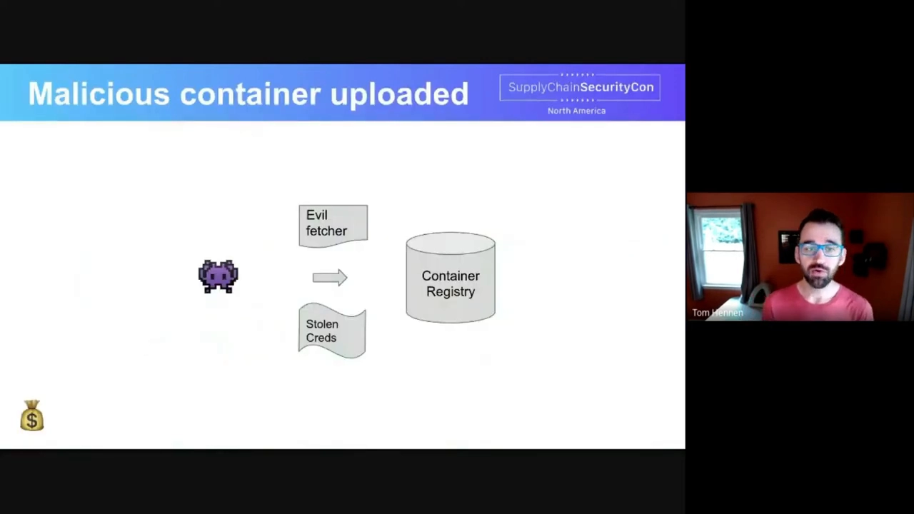

### 4.2 准入控制器用「策略」把它拦下来

「但事情本不必如此。」（[【跳转到 06:40】](https://www.youtube.com/watch?v=8RT5bf6wEJk&t=400)）如果这个集群由一个**准入控制器（admission controller）** 保护，而该控制器使用一个 **SLSA 策略检查器（policy checker）**，那么它在运行镜像之前，会拿**由构建者签名、一起发布出来的出处证明**去核对策略。小捣蛋鬼虽然偷到了仓库凭据，却**伪造不出对应的出处证明**，于是准入控制器**直接拦下了那个「邪恶的 fetcher」**。

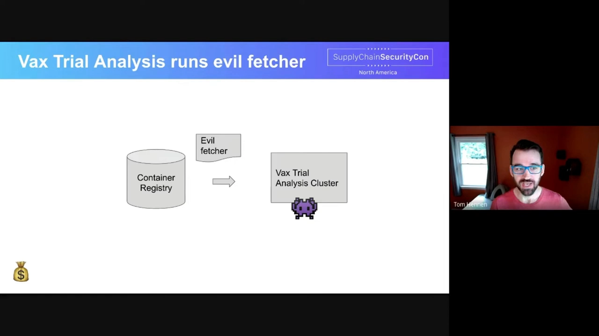

如果攻击者还想要访问权限，就必须**继续往供应链的上游走**，成本也随之上升（[【跳转到 07:05】](https://www.youtube.com/watch?v=8RT5bf6wEJk&t=425)）。

### 4.3 这份策略到底检查什么（一）：隐式检查

那么策略具体检查些什么呢（[【跳转到 07:17】](https://www.youtube.com/watch?v=8RT5bf6wEJk&t=437)）？先是有一些**总是存在、绕不过去的「隐式」检查**：

1. 检查**这个密钥是否被用来生成这个签名**；
2. 检查**这个签名能否验证这段 payload**；
3. 解码并验证 payload 之后，检查**信封（envelope）里引用的密钥 ID，对于 payload 里声明的「构建者 ID」是否是权威的**。

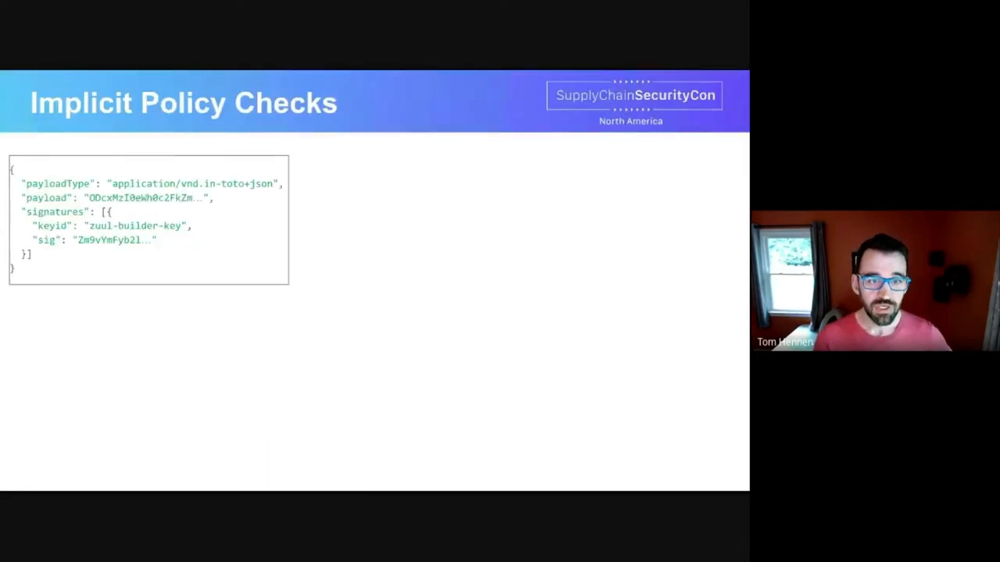

### 4.4 这份策略到底检查什么（二）：显式策略

在隐式检查之外，还有**显式策略（explicit policy）**（[【跳转到 08:07】](https://www.youtube.com/watch?v=8RT5bf6wEJk&t=487)）。主讲人坦承这还不是一门真实的策略语言（他们仍在做一个示例策略引擎），但语言很简单、易于用户理解和编写。它大致能表达这些约束：

- **scope（适用范围）**：这条策略作用于什么对象——比如「凡是要使用 fetcher 镜像的，就必须满足下列要求」；
- **用 SLSA 级别做简写**：策略引擎知道各级别的含义，作者可以直接写「要求出处里的构建者满足对应 SLSA 构建要求、源码满足对应源码要求」；
- **限定允许的构建者**：例如只允许由 **zuul-ci** 构建出来的镜像，攻击者就得先攻陷 ZUUL 才能产出恶意镜像；
- **限定允许的顶层源码仓库**：例如要求镜像必须由 **fetcher 这个 Docker GitHub 仓库**的源码构建而来；
- **限定构建入口**：例如指定必须用某个具体的 ZUUL job 来构建。

这里有一个很妙的点：**因为构建指令本身就存在源码控制里，策略不必包含「具体怎么构建」的细节**——那些被委托给构建指令。于是**策略的作者和评审者都不需要关心细节**；除非构建入口变了，否则构建方式改变时**也无需更新策略**（[【跳转到 09:22】](https://www.youtube.com/watch?v=8RT5bf6wEJk&t=562)）。

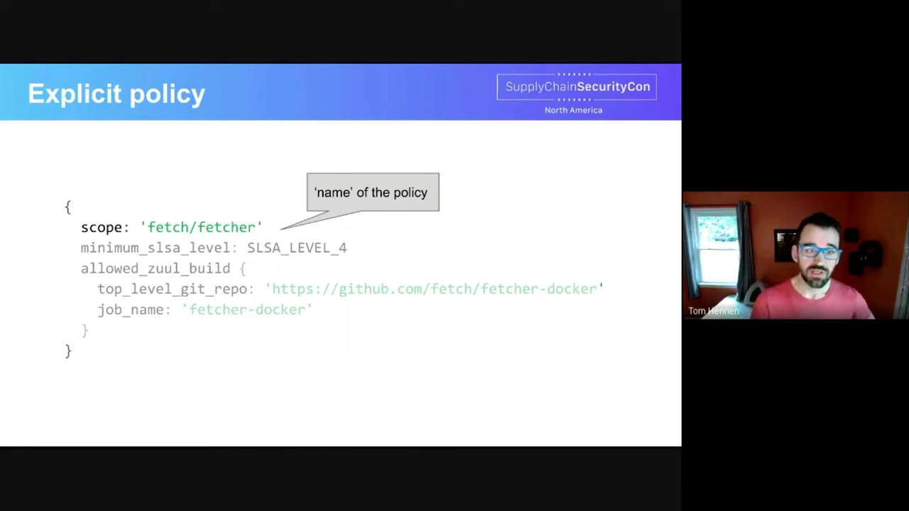

## 五、攻击 D：攻陷构建平台

### 5.1 攻击场景

使用者这一关被拦下后，小捣蛋鬼只好**再往前溯一步**，把目标换成另一个平台（[【跳转到 10:16】](https://www.youtube.com/watch?v=8RT5bf6wEJk&t=616)）。这一次它**设法拿到了某个公共工具「发布构建系统」的访问权限**——比如通过钓鱼骗到了该构建平台的超级用户凭据。它用这份特权，**在代码检出之后、构建开始之前替换掉源码**，从而神不知鬼不觉地把恶意代码塞进这个公共工具。随后，这段有问题的代码被**签名、发布给该工具的所有用户**，能干出挖矿、数据外泄等各种坏事。

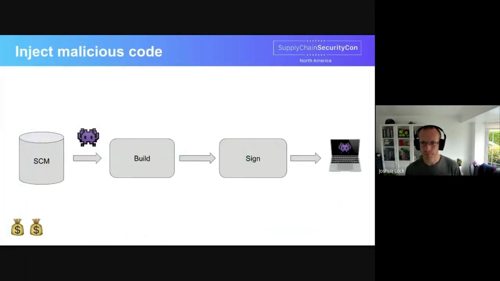

### 5.2 SLSA 的应对：多重审批、隔离构建、可复现

「当然，事情本不必如此。」SLSA 在这里贡献了一整套**通用要求（common requirements）**（[【跳转到 11:06】](https://www.youtube.com/watch?v=8RT5bf6wEJk&t=666)）：

- **SLSA level 4** 中的一项通用要求，是**对特权访问实行多方审批**——例如超级用户访问需要由**第二位平台管理员**批准；
- **SLSA level 3** 要求**隔离的、一次性的（ephemeral）构建环境**，让攻击者难以「持久化」潜伏；
- **SLSA level 4** 的**可复现构建（reproducible builds）** 让恶意代码注入**更容易在发布前被发现**——例如用一套并行基础设施，在签名与发布之前**可验证地重现构建结果**。

这些要求通过**平台加固与运维加固**抬高了攻击成本：恶意行为者**不能只靠钓到一个特权用户就完事**，还必须越过更多关卡。

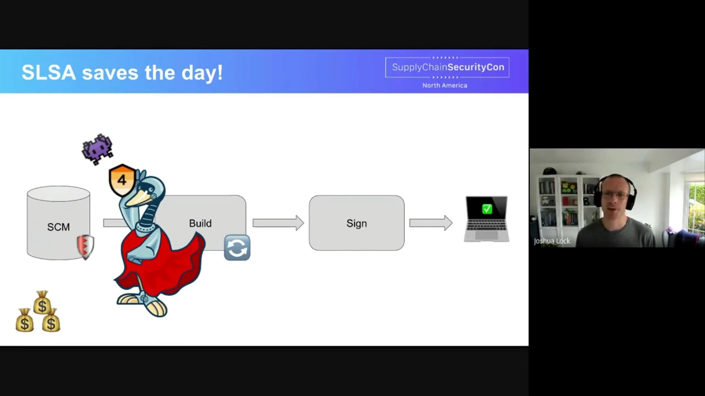

## 六、攻击 A：向源码库提交坏代码

### 6.1 攻击场景

在构建平台也被挡住后，小捣蛋鬼**只能再往前一步**，尝试往**源码平台**里提交坏代码（[【跳转到 11:44】](https://www.youtube.com/watch?v=8RT5bf6wEJk&t=704)）。它趁某台笔记本的主人分心参会时**获得了这台笔记本的实机访问权**，然后用它**强推（force-push）一段代码**到某个仓库——可以叫它一场「顺手牵羊式」的捣鬼。问题的关键在于：**安全密钥的威胁模型并不涵盖「站在机器前的物理攻击者」**，于是那些账号保护措施失效，代码被推进了仓库，而且**可能长时间无人察觉**——比如只是**多加了一个第三方依赖**这种看似无害的改动（哪怕这个依赖本身带毒）。

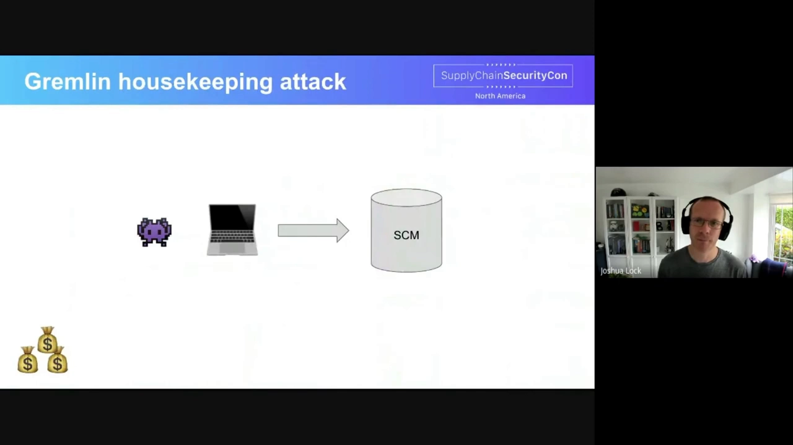

### 6.2 SLSA level 4 的应对：双人强认证代码评审

「但同样，事情本不必如此。」**SLSA level 4 要求由两位经过强认证（strongly authenticated）的用户进行代码评审**，这会**显著抬高攻击者的成本**（[【跳转到 12:22】](https://www.youtube.com/watch?v=8RT5bf6wEJk&t=742)）。在这样的评审下，一次成功的攻击必须变得「很精致」：

- 它得提供一个让评审人**愿意接受**的、有说服力的改动；
- 同时还要**夹带一处难以察觉的恶意改动**；
- 攻击者必须在**有限的实机访问时间内**把改动打磨好、投递出去；
- 还得**避免评审触发与作者本人的后续沟通**（所以改动必须看起来无害）；
- 更要**抹掉痕迹**——例如代码评审系统在有人提交时会发邮件给作者，攻击者还得删掉那封邮件，而这往往意味着**还得再拿下更多系统**。

所有这些，都让攻击成本与「被抓风险」大幅上升。

## 七、从 level 1 起步，但不要止步于 level 1

收尾时，主讲人回到**落地路径**（[【跳转到 13:20】](https://www.youtube.com/watch?v=8RT5bf6wEJk&t=800)）：在 SLSA 里，**采纳较低的级别被期望是「容易的」，而达到更高级别大概会「很难」**。这段旅程从 **SLSA level 1** 开始，但项目**不该停在这里**。他们认为 level 1 作为起点是有价值的：它**搭起了「创建、传递、使用出处证明」的基础设施**，也**暴露出供应链中最需要改进的地方**——比如「我们关心哪些系统、哪些项目需要改进」，从而形成一张路线图（[【跳转到 13:34】](https://www.youtube.com/watch?v=8RT5bf6wEJk&t=814)）。

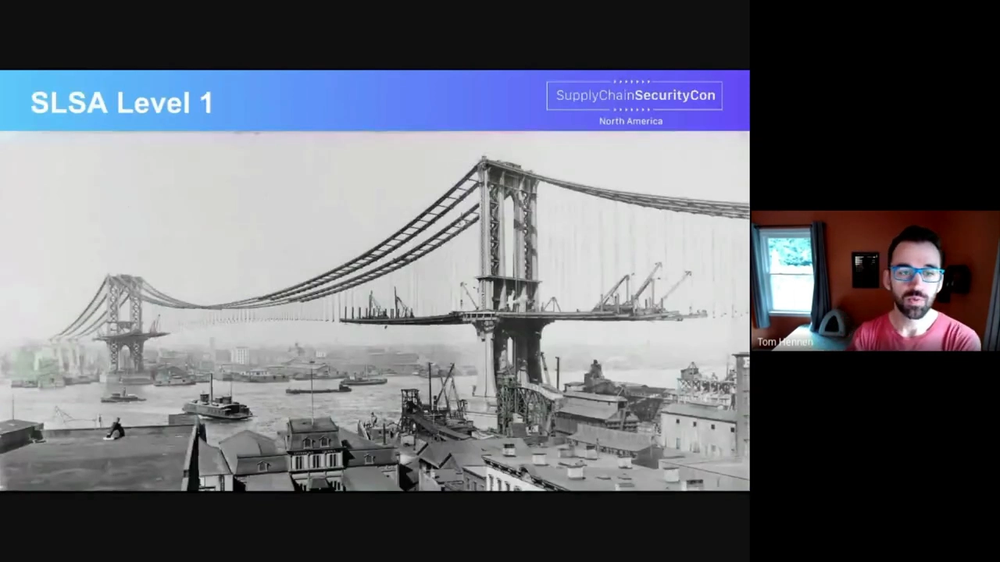

为什么要「继续往上」？主讲人给了两条现实理由（[【跳转到 13:59】](https://www.youtube.com/watch?v=8RT5bf6wEJk&t=839)）：

- **level 1 产出的出处证明是「未签名」的**，攻击者可以轻易篡改它；
- **level 1 的构建仍可能发生在开发者个人的工作站上**，这对攻击者来说更容易得手。

最后是「你也可以参与」的行动召唤（[【跳转到 14:29】](https://www.youtube.com/watch?v=8RT5bf6wEJk&t=869)）。SLSA 仍在开发中，当前正在推进的包括：如何**传递对构建与源码控制系统的信任**、各种语言的**生成 SLSA 证明的库**、**评估证明的策略引擎**，以及**级别要求的细化**。给不同角色的具体建议：

- **平台开发者**：产出 SLSA 出处证明；
- **项目开发者**：自动化你的构建，并使用「能产出 SLSA 出处证明」的平台；
- **使用者**：向你依赖的项目**索取并使用** SLSA 出处证明；
- **所有人**：反馈哪些做法行得通、哪些行不通。

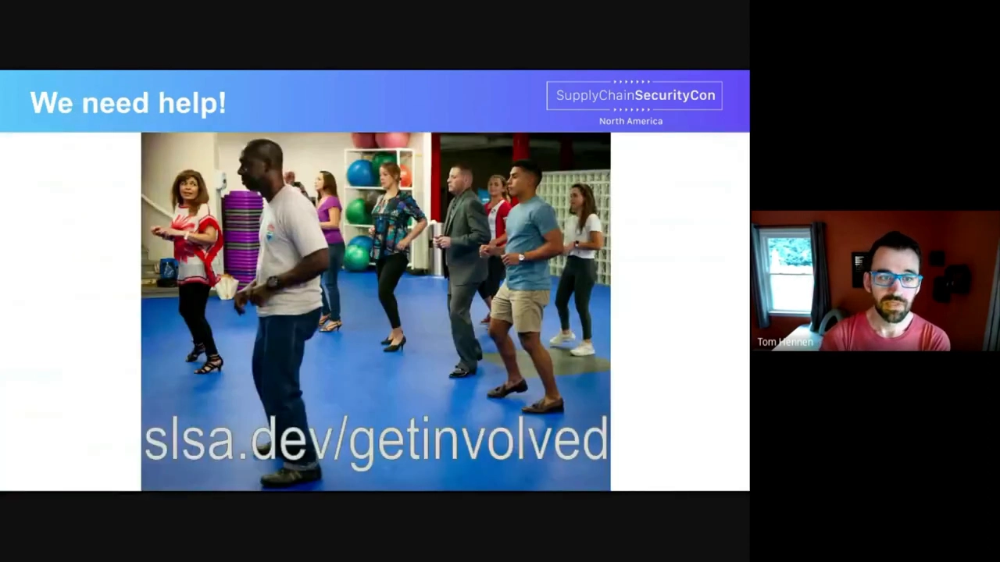

## 小结

- **SLSA 是什么**：一套保护软件供应链免受篡改的安全框架，全称 *Supply chain Levels for Software Artifacts*；它只聚焦「未经生产者授权的修改」，用**分级**让安全可以增量落地。
- **两大手段**：①产出**证明/出处证明（attestation / provenance）**；②**加固平台**，形成**源码控制、构建编排、准入网关**三道信任边界。
- **证明（attestation）** 是一段元数据：用**摘要**指向制品、说明**制品如何生产**，并由**签名 + 密钥 ID** 标明签发者；它沿供应链向后传递，供下游自动验证。
- **出处证明（provenance）** 是标准证明格式，记录 **artifact / builder / recipe / materials**，理想情况下与软件一起发布。
- **三次攻击演练**：攻击 H 被**准入控制器 + 策略检查器**拦下；攻击 D 被 **level 3/4 的隔离构建、多方审批、可复现构建**挡住；攻击 A 被 **level 4 的双人强认证代码评审**挡住。
- **策略**分两层：**隐式检查**（验签、校验 payload、确认密钥对构建者有效）与**显式策略**（scope、SLSA 级别简写、限定构建者/源码仓库/构建入口）。
- **落地**：从 **level 1** 起步（搭基础设施、暴露改进点），但不要止步——level 1 的证明未签名、构建可能发生在个人工作站上。

## 关键术语速查

| 术语 | 一句话解释 |
| --- | --- |
| SLSA | Supply chain Levels for Software Artifacts，保护软件供应链免受篡改的分级安全框架 |
| 篡改（tampering） | 未经软件生产者授权的修改，SLSA 的核心防护对象 |
| 证明（attestation） | 描述制品、其生产信息与签发者（签名）的元数据 |
| 出处证明（provenance） | SLSA 的标准证明格式，记录 artifact / builder / recipe / materials |
| 摘要（digest） | 用密码学哈希指代某个制品，用来「锁定」具体版本 |
| 信任边界（trust boundary） | 源码控制、构建编排、准入网关三道需要加固的关卡 |
| 准入控制器（admission controller） | 在制品被使用前用策略把关、决定放行或拦截的组件 |
| 策略检查器（policy checker） | 依据出处证明对制品做隐式与显式检查的引擎 |
| gremlin（小捣蛋鬼） | 视频里用来演示「沿供应链逆流而上」的攻击者角色 |
| level 1–4 | SLSA 的级别，越高越把要求下沉到基础设施组件（构建、源码） |
| 可复现构建（reproducible builds） | 用另一套基础设施可验证地重现构建结果，便于发现注入 |
