# SLSA 供应链安全框架：从「巧克力蛋糕的配料表」讲起

> 视频来源：[SLSA - A supply chain security framework - DevConf.CZ 2023](https://www.youtube.com/watch?v=xYA_y1-ovhw)（YouTube · DevConf.CZ 2023 · 约 14 分钟）
> 主讲：Roberto（Red Hat 高级软件工程师）
> 所属：容器技术 · 第 3 章 镜像、文件系统与供应链 · 3.4 镜像供应链 · 3.4.2 构建来源证明

## 本讲要解决的核心问题（SCQA）

**背景**：我们每天消费的软件，几乎都由各种**流水线（pipeline）** 自动构建出来——哪怕是你那把智能电动牙刷里的固件，也可能是某条 CI/CD 流水线的产物；而你只要用过 GitHub Actions、GitLab CI 或 Jenkins，其实就已经身在其中了。

**冲突**：流水线越复杂、往里加的环节越多，它就越**脆弱**。攻击者只要能污染其中一环（比如在构建时注入一小段脚本），恶意代码就会被**正常地签名、打包、发布**，一路送到用户手里。2020 年的 **SolarWinds 事件**就是这样一个真实案例——攻击者在构建环节注入了恶意代码。

**疑问**：怎样才能确保「**开发者写的那份代码，就是你电脑上实际运行的那份**」？怎么确认二进制里装的确实是你以为的东西，而不是中途被掉包或篡改的版本？

**回答（中心思想）**：**SLSA 是一套「可以增量采纳的加固指南」**。它未必能让你的供应链「坚不可摧」，但能通过**一套精确的共同语言**（在什么级别上意味着什么，白纸黑字）和**可验证的出处证明（provenance）**，帮助你判断「运行的代码是不是开发者写的那份」，从而**实实在在地提升供应链安全**。本讲按「为什么需要 → SLSA 是什么 → 核心是 provenance → 轨道与级别怎么划分 → 社区与工具」的顺序讲清楚它，并回答几个常见疑问。

## 一、为什么需要 SLSA：从「食品供应链」到「软件供应链」

### 1.1 一个类比：你怎么放心地吃一块巧克力蛋糕

讲者用「巧克力蛋糕」开场（[【跳转到 00:00】](https://www.youtube.com/watch?v=xYA_y1-ovhw&t=0)）：他很喜欢蛋糕，但很多人有过敏或不耐受，那么**你怎么确保吃了不会出事**？办法通常是**去看配料表（ingredient list）**。

可问题又来了：**你凭什么相信那张配料表**（[【跳转到 00:25】](https://www.youtube.com/watch?v=xYA_y1-ovhw&t=25)）？靠的是各国对**食品供应链**的一整套法规，以及处理食物的操作规范——比如在餐厅里，**手碰过含坚果的东西之后，就不能再去碰别的东西**。正因为有这些约束，我们通常不会因为吃到「状态不对」的食物而生病。

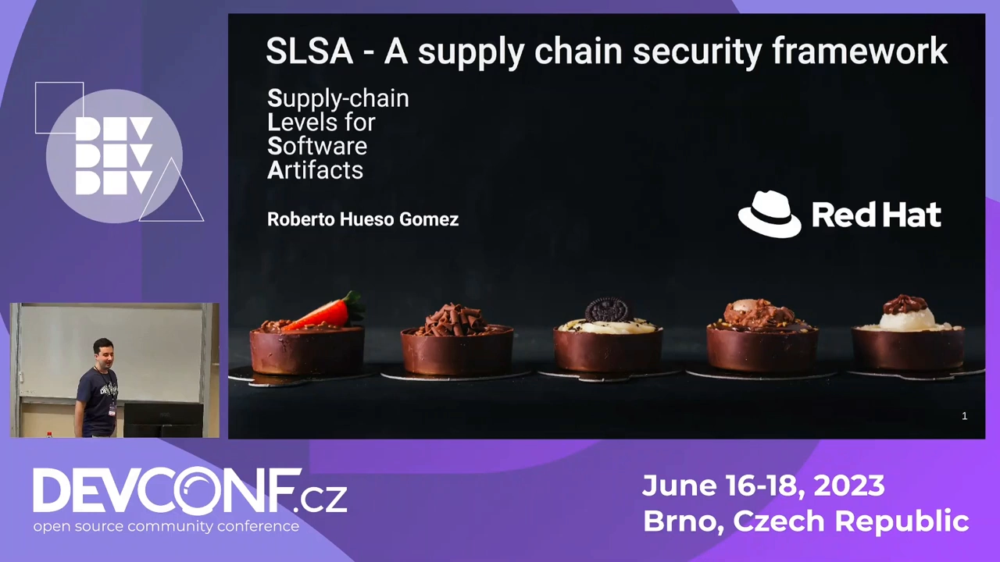

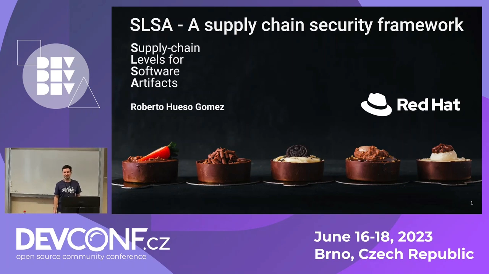

### 1.2 软件供应链：人人在用，却复杂而脆弱

**软件供应链和食品供应链非常相似**（[【跳转到 00:50】](https://www.youtube.com/watch?v=xYA_y1-ovhw&t=50)）：上图那样的流水线每天都在产出制品，被所有人消费。而且它**变得极其复杂**——每往流水线里加一个环节，就多一分被攻破的可能（[【跳转到 01:03】](https://www.youtube.com/watch?v=xYA_y1-ovhw&t=63)）。

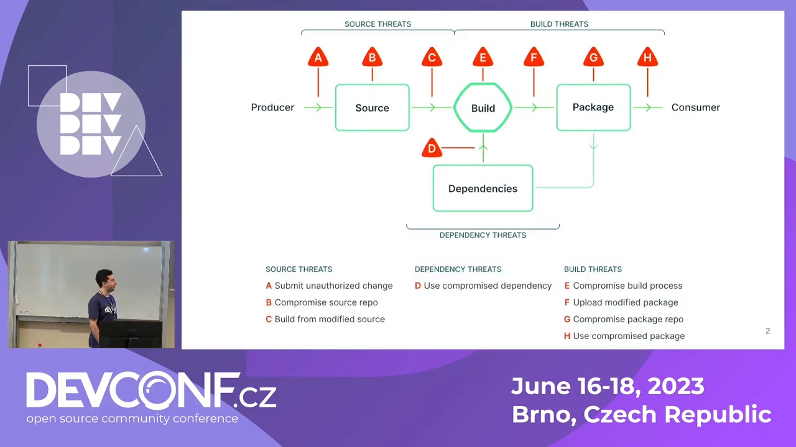

### 1.3 威胁地图与一个真实教训：SolarWinds

讲者展示了经典的**供应链威胁图**（[【跳转到 01:28】](https://www.youtube.com/watch?v=xYA_y1-ovhw&t=88)）：图上**每一个小三角都代表对流水线或供应链的一种威胁**——数量之多，多到「这场演讲里的东西其实都不用细读」。

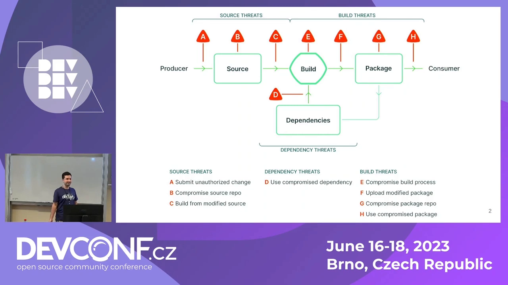

其中一个具体的威胁是：**在构建阶段，攻击者在某个构建器里放一小段脚本**，一旦检测到构建被触发，就往你正在构建的代码里注入恶意内容（[【跳转到 01:38】](https://www.youtube.com/watch?v=xYA_y1-ovhw&t=138)）。这**不是假设，而是真实发生过**——**2020 年的 SolarWinds 事件**就是一起非常著名的软件供应链攻击。

### 1.4 那么 SLSA 到底想解决什么

SLSA 要回答的正是上面那个问题（[【跳转到 02:43】](https://www.youtube.com/watch?v=xYA_y1-ovhw&t=163)）：**如何确保「开发者写的代码」就是「你机器上实际运行的代码」、二进制里装的确实是你以为的东西，而且中途没有被以任何方式篡改。**

## 二、SLSA 是什么：一套可增量采纳的「共同语言」

### 2.1 它不是「不可攻破」，而是「帮你加固」

SLSA 是**一组可以增量采纳的指南（incrementally adaptable guidelines）**（[【跳转到 03:08】](https://www.youtube.com/watch?v=xYA_y1-ovhw&t=188)）。它是一条**指南**：**不会让你的流水线或供应链变得「不可攻破」**，但应该能帮助你把供应链**加固**一些。

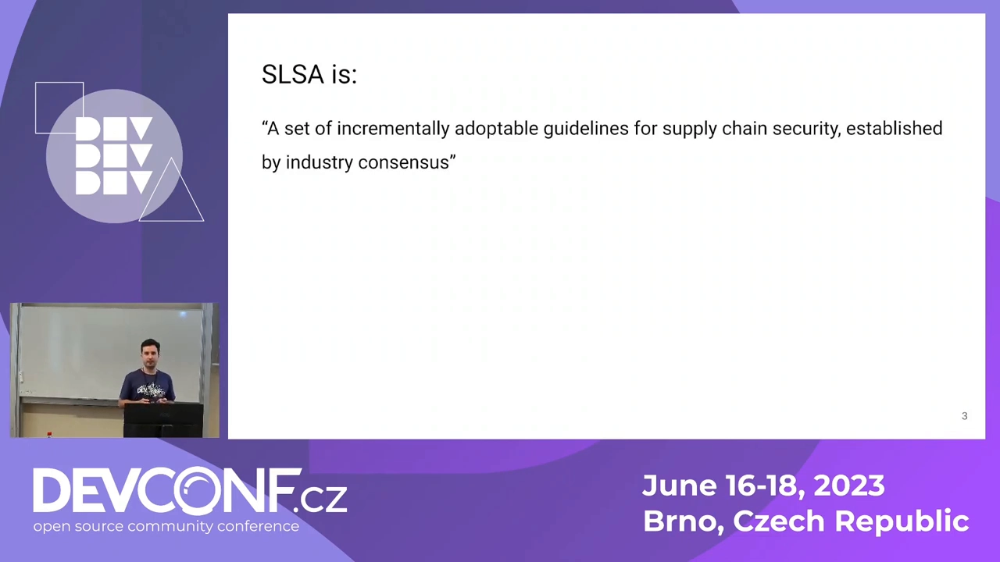

### 2.2 它带来的是「共同语言」与「可信评估」

SLSA 主要有两个价值：

- **提供一套共同语言**（[【跳转到 03:33】](https://www.youtube.com/watch?v=xYA_y1-ovhw&t=213)）：话术（words）很容易被扭曲，而企业往往特别擅长「包装说辞」，所以与其含糊地说「我们的供应链很安全」，不如直接说「**我们符合 SLSA level one**」——因为 SLSA 规范对「这意味着什么」写得**极其清楚**。讲者还提到，他**在 Arch Linux 用户仓库里见过有人给一些软件包申请 SLSA 认证**。
- **评估你「能多大程度上信任运行的代码就是开发者写的那份」**（[【跳转到 03:58】](https://www.youtube.com/watch?v=xYA_y1-ovhw&t=238)）：而**最重要的是**，它**确实能帮助你提升供应链的安全**，让流水线产出的制品**更不容易夹带恶意代码**。

### 2.3 与合规标准的关系：标准说「目标」，SLSA 说「怎么到那」

现实中有许多安全标准要遵守，例如 **NIST 的 Secure Software Development Framework（安全软件开发框架）**，美国还出台了**行政令（Executive Orders）** 要求强制执行（[【跳转到 04:23】](https://www.youtube.com/watch?v=xYA_y1-ovhw&t=263)）。但这些标准**通常只告诉你「最终状态应该长什么样」，并不告诉你「怎么才能到那里」**——而 SLSA 恰恰补上了「怎么走」这一段。

## 三、SLSA 的核心：出处证明（provenance）

### 3.1 三个（其实是四个）关键词：可验证的 where / when / how

SLSA 的**大部分内容都围绕 provenance（出处证明）** 展开（[【跳转到 05:18】](https://www.youtube.com/watch?v=xYA_y1-ovhw&t=318)）。讲者用几个词概括它的要害：**可验证地说明「在哪里（where）、什么时候（when）、如何（how）」构建的**——他打趣说「其实是四个词」。

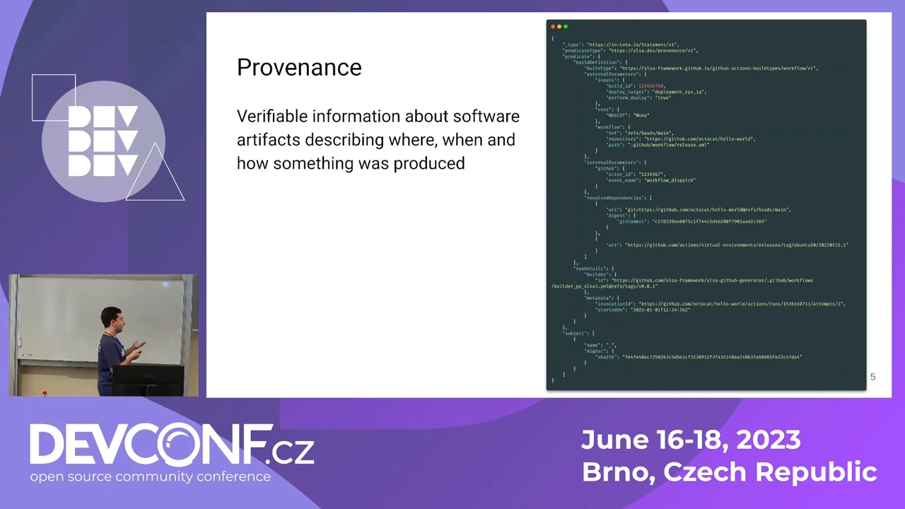

### 3.2 provenance 长什么样：一份说明构建过程的 JSON

用大白话说，provenance **可以是一份 JSON 文件**，用来陈述「某个制品是如何被构建的」（[【跳转到 05:43】](https://www.youtube.com/watch?v=xYA_y1-ovhw&t=343)）。举一个编译 C 程序的例子，它会记录：

- 用了**哪条命令**编译（哪个 `gcc`）；
- 用了**哪些编译选项（flags）**；
- 依赖了**哪些依赖**、**从哪里下载的**；
- 这些依赖的**数字签名 / 摘要（digest）**。

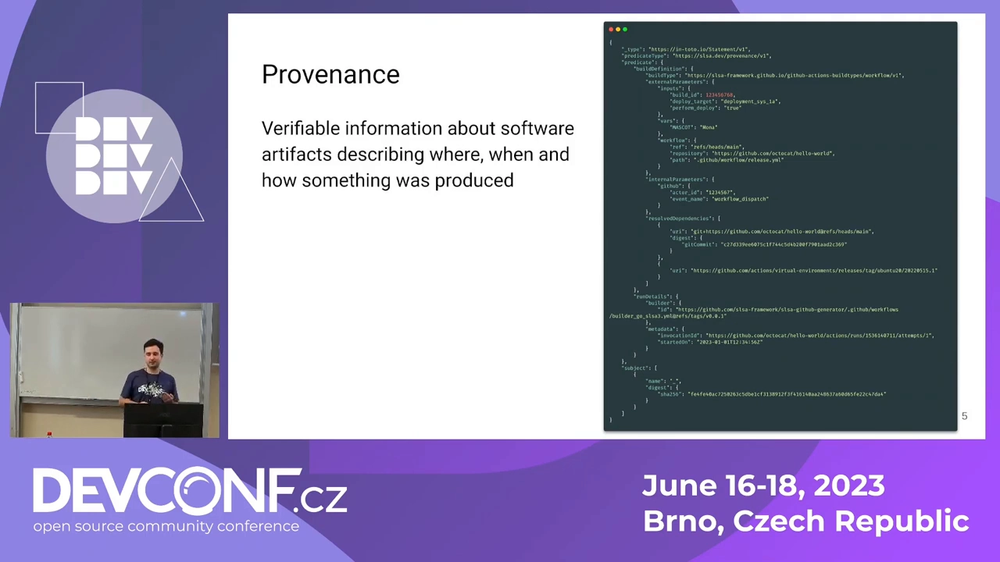

### 3.3 它把「怎么建的」串成一份可验证的文档

把这些信息连起来，你就得到**一份文档，精确地说明某个制品是怎么构建的**——无论它是容器镜像、二进制，还是别的什么（[【跳转到 06:08】](https://www.youtube.com/watch?v=xYA_y1-ovhw&t=368)）。所以 **provenance 这个概念非常重要**：它是一份解释「制品如何被构建」的文档，并且**让你能够验证这是真的**，而不只是一家之言。

## 四、SLSA 的结构：轨道（track）与级别（level）

### 4.1 三条轨道，每条四级；1.0 目前只覆盖 build 轨道

SLSA 被划分为**三条轨道**，每条轨道对应一种威胁来源（[【跳转到 06:38】](https://www.youtube.com/watch?v=xYA_y1-ovhw&t=398)）：

- **source track（源码轨道）**；
- **build track（构建轨道）**；
- **dependency track（依赖轨道）**。

每条轨道各有**四个认证级别**。当时的现状是：**SLSA 1.0 刚在同年 4 月 18 日发布**，还处于早期阶段，**只覆盖构建威胁与 build 轨道，且只覆盖到 level three**（level four 预计很快到来）。

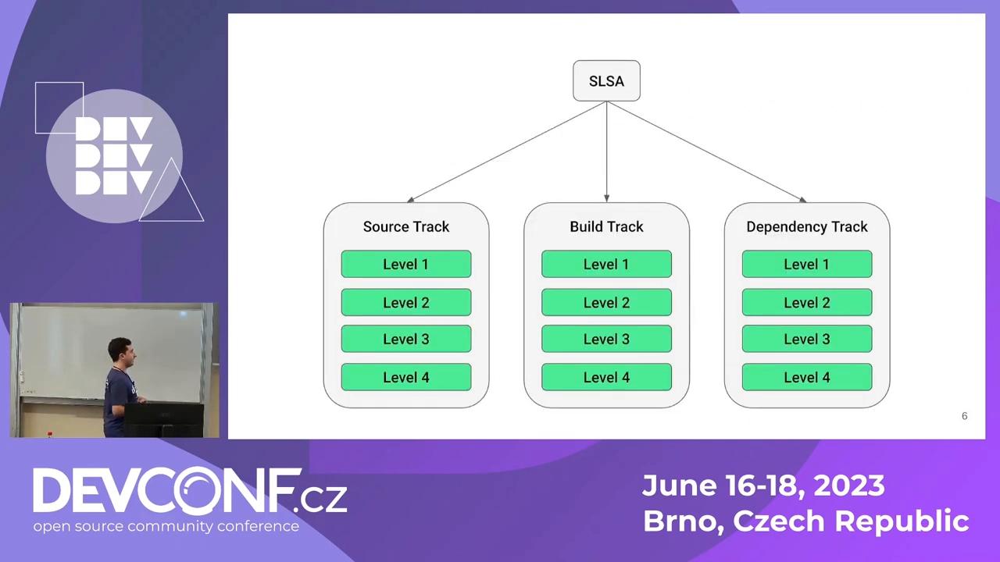

### 4.2 为什么规格推进得这么谨慎

制定这样一份规范并不容易（[【跳转到 07:03】](https://www.youtube.com/watch?v=xYA_y1-ovhw&t=423)）：如果你读过任何 RFC 规范，就会发现**其中的措辞精确到「它想说一就是一」**。而且 **SLSA 工作组把稳定性放在优先位置**——**他们不愿意把「做不到」或「他们自己都不认为是安全」的要求写进某一级**。再加上**参与的组织和个人众多**，**要就「什么是安全」达成一致本身就很棘手**（[【跳转到 07:53】](https://www.youtube.com/watch?v=xYA_y1-ovhw&t=473)）。

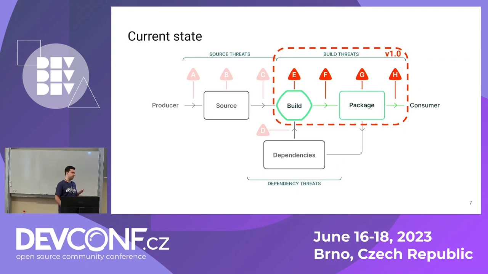

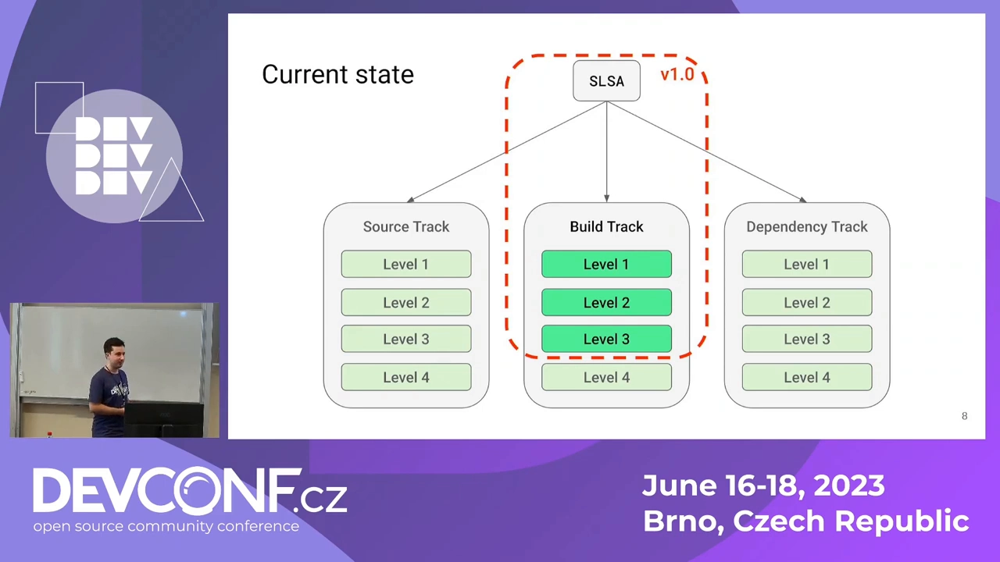

### 4.3 build 轨道各级别要求，逐级加码

以 **build 轨道**为例，各级要求是层层递进的：

- **level 1**（[【跳转到 08:11】](https://www.youtube.com/watch?v=xYA_y1-ovhw&t=491)）：只需要**存在一份 provenance 文档**——**不必经过验证、不必签名**。只要「有一份出处文档」，你就是 level 1。
- **level 2**（[【跳转到 08:36】](https://www.youtube.com/watch?v=xYA_y1-ovhw&t=516)）：还要求你有**托管的构建平台（hosted build platform）**——因为一个**用途非常专一**的构建系统**攻击面更小、更容易加固**；同时要求你**证明 provenance 是真实的**（在多数情况下就是**由构建者做数字签名**）。
- **level 3**（[【跳转到 09:01】](https://www.youtube.com/watch?v=xYA_y1-ovhw&t=541)）：还要求**所有构建者彼此隔离**，这样用于数字签名的**凭据或私钥就不会互相干扰、互相带坏**。

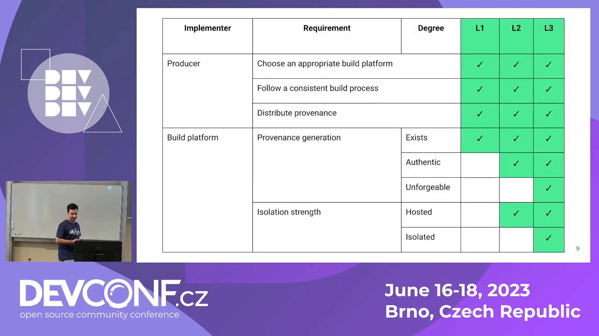

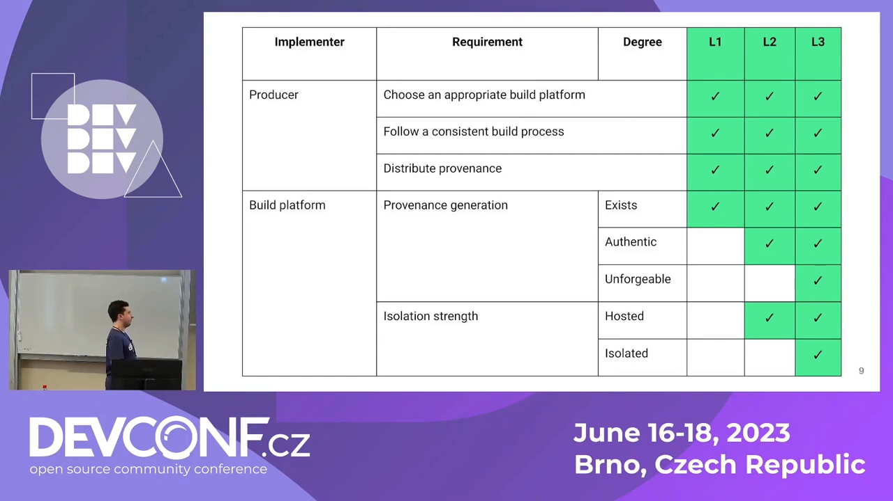

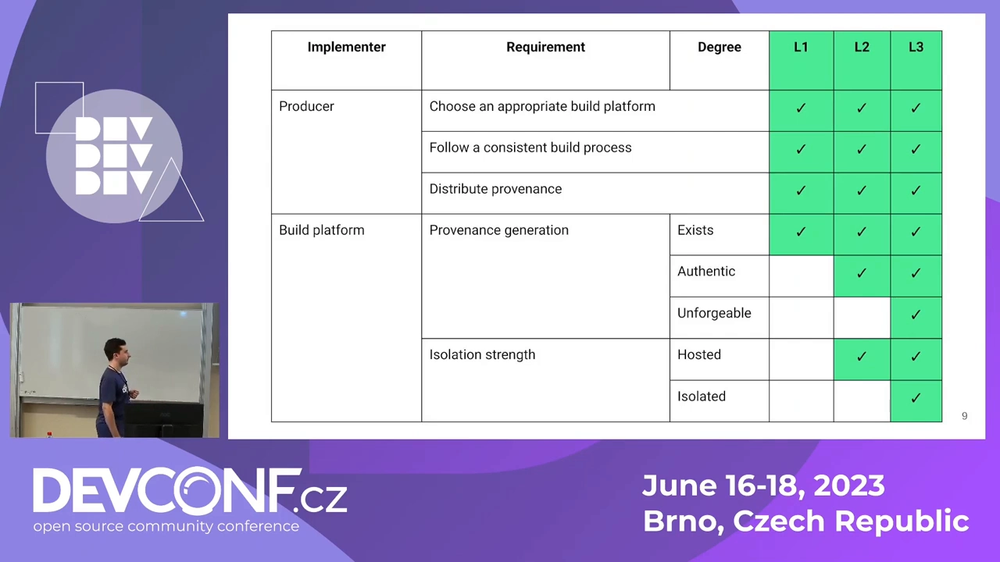

### 4.4 你不是孤军奋战：工具与生态

SLSA 很棒的一点是**它给你配好了工具**（[【跳转到 09:34】](https://www.youtube.com/watch?v=xYA_y1-ovhw&t=574)）：讲者个人认为，如果你有一个 GitHub Actions 任务（只要工作流不是特别复杂），**要让你的制品拿到 SLSA 认证其实相当容易**。SLSA 社区还在**Jenkins 上做概念验证**，并提供了 **SLSA verifier**。所以他强调：**你并不孤单**——这一点有别于那些「只告诉你最终要变成什么样、却不告诉你如何实现」的标准。

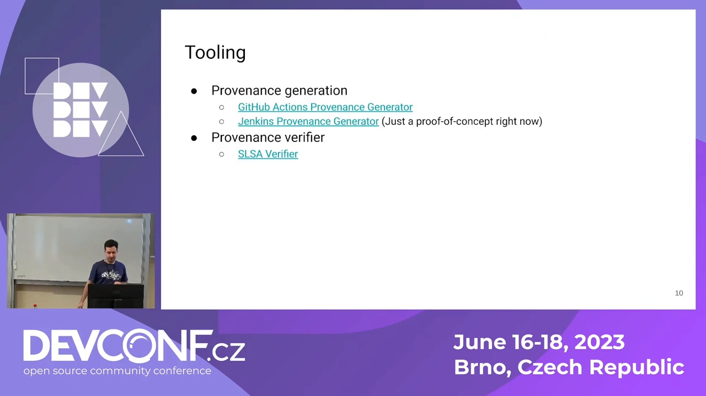

## 五、社区、生态与几个常见疑问

### 5.1 一个开放的社区，早期正是参与的好时机

SLSA 是一个**开放社区**（[【跳转到 09:59】](https://www.youtube.com/watch?v=xYA_y1-ovhw&t=599)）：任何人都可以在它的 GitHub 上做贡献，随手提评论、开 issue、发合并请求；还有**月度会议**和**邮件列表**可以参加。

讲者也坦率地给出个人判断：它**也许还不是「黄金标准」**，但**很有机会**成为（[【跳转到 10:24】](https://www.youtube.com/watch?v=xYA_y1-ovhw&t=624)）。而且退一步讲——**就算它最终没能成为那个「超级重要的标准」，你在工作流里落地的这些措施本身，就已经在保护你的供应链了**。更何况，处在**很早期**的阶段，也意味着**新贡献者能真正影响规范**：如果你觉得规范里有问题，可以去会议上提，或者开个 GitHub issue；工具侧你也可以做**新的实现**（比如刚才提到的 Jenkins 方向）（[【跳转到 10:49】](https://www.youtube.com/watch?v=xYA_y1-ovhw&t=649)）。

### 5.2 问答：SLSA 和 SBOM 是什么关系

在问答环节（[【跳转到 12:29】](https://www.youtube.com/watch?v=xYA_y1-ovhw&t=749)），讲者回答了两者的关系：**SLSA 与 SBOM 相互独立**——你完全可以有 SLSA 而没有 SBOM。但是：

- **从 SLSA provenance 里，很容易生成 SBOM**；
- 而**通常 SBOM 是以「不可验证」的方式生成的**；
- **有了 provenance，SBOM 才真正变得「可验证」**。

所以两者**很搭**，可以配合使用。

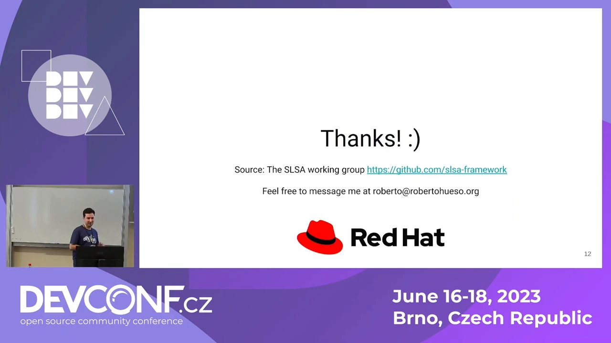

### 5.3 问答：这是不是「信任链」问题？该信任谁

有人问到「这像不像一条信任链（chain of trust）问题，是不是要留到后面解决」（[【跳转到 13:19】](https://www.youtube.com/watch?v=xYA_y1-ovhw&t=799)）。讲者的回答是：**最终由软件的消费者来决定「自己信任谁」**——就像浏览器里的**认证机构（certification authority）** 一样，或者像 Firefox 替你做的那些信任决策。**「你信任谁」，由你自己选择**——结构与既有体系非常相似。

## 小结

- **为什么要 SLSA**：软件供应链像食品供应链一样，靠「配料表」才能吃得放心；但流水线环节越多越脆弱，SolarWinds 这样的真实攻击就发生在构建环节。
- **SLSA 是什么**：一套**可增量采纳的加固指南**，不保证「不可攻破」，但提供**共同语言**（用级别精确表达安全状态）并**实际提升供应链安全**；它还补上了合规标准「只说目标、不说路径」的缺口。
- **核心是 provenance**：一份可验证的文档，说明制品**在哪里、何时、如何**构建——用大白话说就是一份记录编译命令、选项、依赖来源与摘要的 **JSON**。
- **结构**：分为 **source / build / dependency 三条轨道**，各四级；**1.0 只覆盖 build 轨道到 level 3**。
- **build 轨道要求逐级加码**：**L1** 有 provenance 即可（无需签名）→ **L2** 要托管构建平台 + 证明 provenance 真实 → **L3** 各构建者隔离。
- **不是孤军奋战**：GitHub Actions、Jenkins 概念验证、SLSA verifier 等工具可用；社区开放、早期可影响规范。
- **与 SBOM 的关系**：相互独立，但 **provenance 可生成可验证的 SBOM**；**信任谁由消费者自行决定**。

## 关键术语速查

| 术语 | 一句话解释 |
| --- | --- |
| SLSA | 一套可增量采纳的软件供应链加固指南，用级别精确表达安全状态 |
| 出处证明（provenance） | 说明制品「在哪里、何时、如何」构建的可验证文档，通常是一份 JSON |
| source / build / dependency track | SLSA 的三条轨道，分别对应源码、构建、依赖三类威胁 |
| level（级别） | 每条轨道上的认证等级，要求逐级加码 |
| 托管构建平台（hosted build platform） | 用途专一、攻击面更小的构建环境，level 2 起要求 |
| 构建者隔离 | level 3 要求，使各构建者及其签名凭据互不干扰 |
| SLSA verifier | SLSA 官方提供的、用于校验 provenance 的工具 |
| NIST SSDF | 美国 NIST 的安全软件开发框架，属于「只给目标」的合规标准之一 |
| SBOM | 软件物料清单；可由 provenance 生成，且借此变得可验证 |
| 信任链（chain of trust） | 「信任谁」的选择；SLSA 主张由软件消费者自行决定 |
