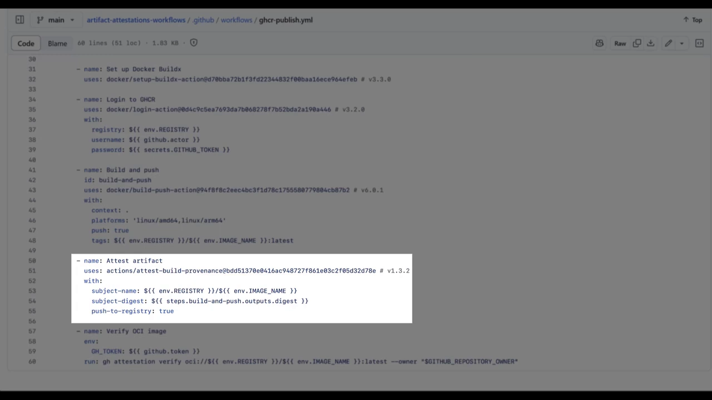
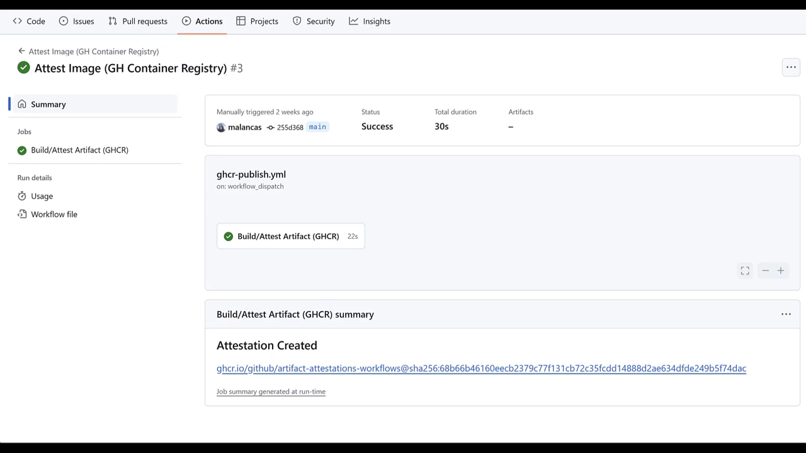
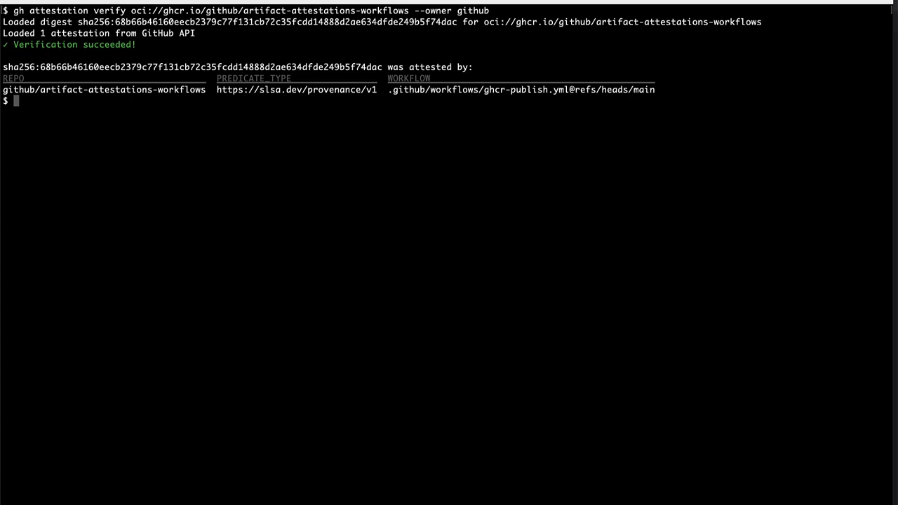
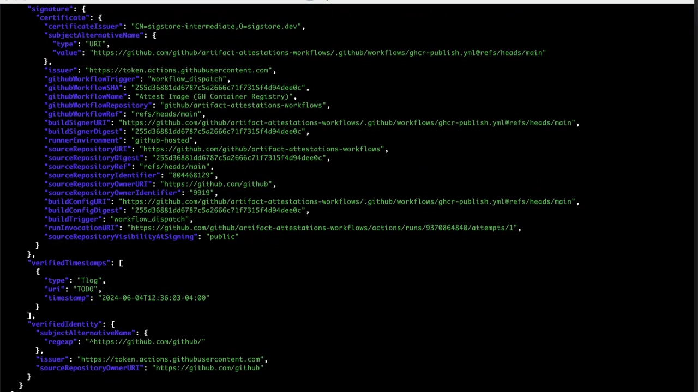
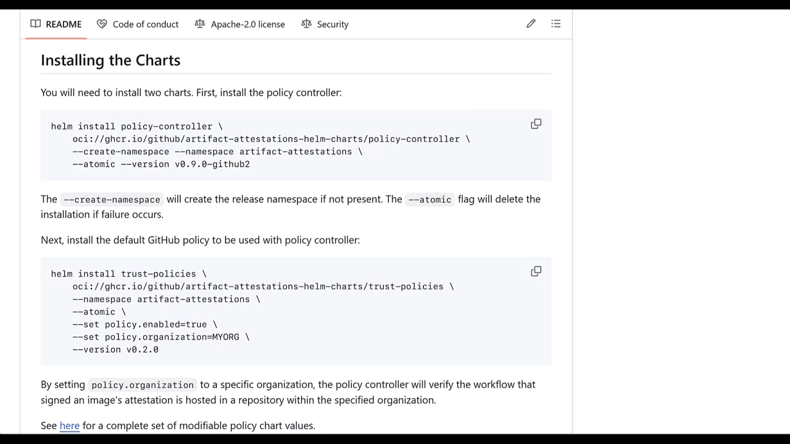
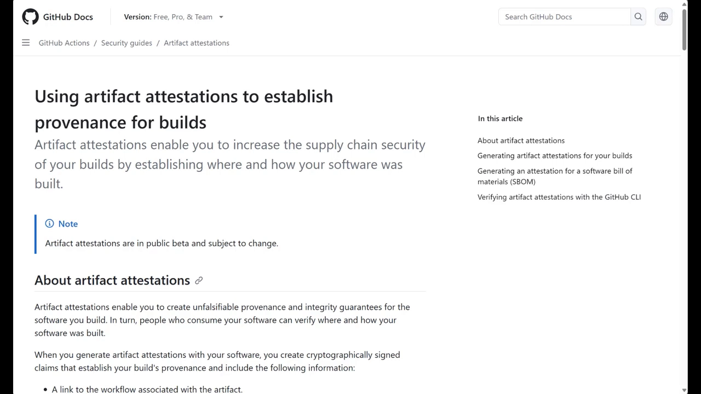

# 用 GitHub Artifact Attestations 给制品签名，并在 Kubernetes 里强制校验

> 视频来源：[Secure your cloud-native deployments with Artifact Attestations](https://www.youtube.com/watch?v=zTIHb-9c868)（YouTube · GitHub · 约 5.5 分钟）
> 所属：容器技术 · 第 3 章 镜像、文件系统与供应链 · 3.4 镜像供应链 · 3.4.2 构建来源证明

## 本讲要解决的核心问题（SCQA）

**背景**：容器镜像通常由 CI 流水线自动构建，然后再被发布到镜像仓库、部署到集群。这个链条一长，中间任何一个环节都可能被人掉包——你默认「仓库里的那个镜像就是流水线构建出来的那个」，其实只是一种**信任假设**。

**冲突**：如果有人在构建之后篡改了镜像，或者用一个来自**陌生仓库/组织**的镜像冒充你信任的来源，你凭什么能在**运行之前**就发现？靠人工核对镜像标签，既不可靠也不可自动化。

**疑问**：有没有办法让「**我构建的制品**」自带一份**可离线校验、不可篡改**的凭证，让下游（开发者本机、CI、Kubernetes 集群）都能**自动地**验证它确实出自我的流水线？

**回答（中心思想）**：**GitHub Artifact Attestations（制品证明）** 就是为此设计的。它在 GitHub Actions 构建制品时，**自动生成一份由 GitHub 签名、内容不可篡改的「证明」**，把制品**与它的源码和构建指令绑定起来**；随后你可以用一个简单的命令**在任何地方校验**它——本机用 **GitHub CLI**，Kubernetes 里用 **GitHub 版的 Sigstore 策略控制器（policy controller）**。这样你就获得了对「**只运行我构建的代码**」的**全新安全控制力**。本讲用一个「构建 Docker 镜像 → 生成证明 → CLI 验证 → Kubernetes 强制校验」的完整演示，把这条链路走一遍。

## 一、制品证明是什么，为什么你需要它

### 1.1 一句话：把制品「绑回」它的源码与构建指令

GitHub 的 Artifact Attestations 能生成一份**已签名文档**——也就是一份**证明（attestation）**——它把你在 **GitHub Actions 上构建出来的制品**，**链接回它的源代码与构建指令**（[【跳转到 00:00】](https://www.youtube.com/watch?v=zTIHb-9c868&t=0)）。拿到这份证明后，你可以：

- 用 **GitHub CLI**，在**任何地方**校验这个制品；
- 或者在 Kubernetes 场景下，使用 **GitHub 分发的 Sigstore 策略控制器**来强制校验。

一个关键性质是：**这些证明由 GitHub 签名，内容无法被篡改**。

### 1.2 为什么值得做：让你对「运行什么代码」更有选择权

为什么要为制品生成并校验证明（[【跳转到 00:05】](https://www.youtube.com/watch?v=zTIHb-9c868&t=5)）？因为很重要的一点是：你**要知道生产环境里跑的、或交付给终端用户的东西，确实就是你构建的那个**。

用制品证明，你还可以**围绕「允许来自哪些仓库、哪些组织」来执行策略**——也就是说，**你能更挑剔、更有选择性地决定「执行哪些代码、把哪些代码作为依赖引入」**。这给软件带来了一种**根本性的新安全控制**。

## 二、在 GitHub Actions 里生成证明

### 2.1 加几行 YAML，调用 `attest-build-provenance`

演示从一条**工作流**开始（[【跳转到 01:07】](https://www.youtube.com/watch?v=zTIHb-9c868&t=67)）：这条流水线会产出一个制品——演示里是一个 **Docker 镜像**，但它其实**可以是 zip、jar、Debian 包，磁盘上的任何文件或容器镜像**。你要做的只是**插入几行 YAML**，调用 **`attest-build-provenance`** 这个 action（[【跳转到 01:18】](https://www.youtube.com/watch?v=zTIHb-9c868&t=78)）：

构建过程会**基于该 action 的 OIDC token 中所包含的、已签名的信息**，为制品生成一份证明。

### 2.2 触发构建：产物推送仓库，证明存入专用数据存储

现在触发一次工作流运行（[【跳转到 01:32】](https://www.youtube.com/watch?v=zTIHb-9c868&t=92)）：它会构建出 Docker 镜像，并**推送到 GitHub 容器仓库（GHCR）**。这里有个**重要细节**：

- **制品不必存储在 GitHub 上，也可以被校验**——你完全可以用另一个对你有用的镜像仓库；
- 该 action 会把**证明保存到一个专用的数据存储**中，方便 CLI 在校验时取回。

## 三、用 GitHub CLI 校验制品

### 3.1 CLI 自带「信任根」，直接校验签名

接下来看校验长什么样（[【跳转到 01:37】](https://www.youtube.com/watch?v=zTIHb-9c868&t=97)）。讲者用 **GitHub CLI** 来检查证明：这个工具**内置了一个特殊的「信任根（trust root）」**，使它能够**校验来自 GitHub 根签名机构的签名**。CLI 会检查：**这个容器镜像是不是在 GitHub 上构建的、是不是由本 GitHub 组织里的某次工作流运行产出的**。结果**校验成功**（[【跳转到 01:59】](https://www.youtube.com/watch?v=zTIHb-9c868&t=119)），并给出了**基本信息**：它来自哪个仓库、仓库里的哪条工作流运行过。

### 3.2 拿到更多细节：导出 JSON，接 OPA 或 jq，还能离线验证

如果你想了解**更多信息**，比如「**到底是哪个提交（commit）构建了它**」，可以很方便地**把一大堆信息以 JSON 格式导出**（[【跳转到 02:24】](https://www.youtube.com/watch?v=zTIHb-9c868&t=144)）。往上翻能看到 **signature 段（signature stanza）** 里的大量信息，包括：

- **源仓库（source repository）**；
- **触发构建的事件（event）**；
- **commit 摘要（commit digest）** 等有用信息。

拿到 JSON 后，你有几种用法：

- **把 JSON 管道给像 Open Policy Agent（OPA）这样的工具**，用策略文档来检查它；
- 或者**用 jq 过滤（filter）提取字段**；
- 也可以**把证明下载下来，在不需要联网回连 github.com 的情况下做离线验证**。

## 四、在 Kubernetes 里强制校验：Sigstore 策略控制器

### 4.1 `ClusterImagePolicy` + 校验 webhook

如果你想让**Kubernetes 集群管理员**有能力确保「**只有他们构建的东西**」才真正在集群里运行（[【跳转到 02:49】](https://www.youtube.com/watch?v=zTIHb-9c868&t=169)），就要用 **GitHub 分发的 Sigstore 策略控制器**。它本质上是一个 **Kubernetes 的校验型 webhook（validating webhook）**，使用一个名为 **`ClusterImagePolicy`** 的新自定义资源（CRD）。这个资源**定义了准入控制器允许哪些容器镜像进入、哪些不允许**（[【跳转到 03:00】](https://www.youtube.com/watch?v=zTIHb-9c868&t=180)）。

### 4.2 先验证「要装的东西」本身

安装用的是一份 **Helm chart**（[【跳转到 03:25】](https://www.youtube.com/watch?v=zTIHb-9c868&t=205)）：安装时用到这份 chart 的源码，但**构建好的 chart 以 OCI bundle 的形式存放在 GitHub 容器仓库里**。可以看到这份 chart 会安装**单个容器镜像**。于是讲者**先校验它是否已被证明（attested）**——用 GitHub CLI 确认「Helm chart 将要安装的这个容器镜像，正是我期望的那个」。结果显示它确实**由预期的仓库、由 GitHub 组织构建**。

这里有个值得记住的点（[【跳转到 04:13】](https://www.youtube.com/watch?v=zTIHb-9c868&t=253)）：**这个策略控制器本身来自上游 Sigstore 项目**（GitHub 参与维护和治理）。**GitHub 拉取上游、构建出自己的发行版并为之生成证明**；而这份 Helm chart 同样是「上游版本、为 GitHub 稍作定制」的产物。讲者**复制 chart 的 URL，用 CLI 校验了 Helm chart**。

### 4.3 配置策略：只放行「本组织签名」的镜像

配置这些资源时，最需要留意的就是 **`ClusterImagePolicy`**（[【跳转到 04:32】](https://www.youtube.com/watch?v=zTIHb-9c868&t=272)）——它定义了**你要把什么接受进集群**。这里处理的**仍然是 JSON 格式的证明数据**，和你在 CLI 上看到的完全一样。演示里的目标是：**确保在叫 `fubar` 的命名空间里启动的一切，都由本组织签名**（演示里组织是 GitHub，实际使用时换成你自己的组织名）。

随后可以看到**策略控制器本身在集群里启动**，也能确认 `ClusterImagePolicy` 的内容**与预期完全一致**：**它只会放行由该 GitHub 组织签名的镜像**。

### 4.4 开箱即用的价值

讲者强调这非常强大（[【跳转到 05:14】](https://www.youtube.com/watch?v=zTIHb-9c868&t=314)）：**开箱即用**——他们从**无数组织**那里听到，大家最想做的其实就是**「验证容器镜像确实是由自己的构建过程签名产出的」**，而这个方案**恰好直接给到了这一点**。如果你想更进一步，**GitHub 的文档会介绍如何编写更深入的 `ClusterImagePolicy`**。

## 小结

- **制品证明（attestation）** 是一份**由 GitHub 签名、不可篡改**的文档，把在 GitHub Actions 上构建的制品**链接回其源码与构建指令**。
- **为什么要它**：确保「生产环境运行的 = 你构建的」，并让你能**围绕「信任哪些仓库/组织」执行策略**，从而更有选择性地决定运行什么代码。
- **怎么生成**：在构建工作流里**加几行 YAML**调用 **`attest-build-provenance`** action；它依据 **OIDC token** 的已签名信息生成证明，并存入**专用数据存储**。
- **制品不必存放在 GitHub**：证明可在**任意镜像仓库**上被校验。
- **本机校验**：**GitHub CLI** 内置**信任根（trust root）**，可校验 GitHub 根签名机构的签名；还能**导出 JSON**（源仓库、触发事件、commit 摘要），管道给 **OPA**、用 **jq** 提取，或**下载后离线验证**。
- **Kubernetes 强制校验**：用 **GitHub 版 Sigstore 策略控制器**（校验型 webhook + **`ClusterImagePolicy`** CRD），只放行「本组织签名」的镜像；**装之前先校验 chart 与本控制器镜像本身**。
- **最核心价值**：**开箱即用地确认「容器镜像确实由你自己的构建过程签名」**。

## 关键术语速查

| 术语 | 一句话解释 |
| --- | --- |
| 制品证明（artifact attestation） | GitHub 签名的文档，把制品绑定回其源码与构建指令 |
| `attest-build-provenance` | GitHub Actions 里用来生成构建出处证明的 action |
| OIDC token | 工作流运行时的身份令牌，其已签名信息是生成证明的依据 |
| 信任根（trust root） | GitHub CLI 内置的根签名机构，用于校验 GitHub 的签名 |
| GHCR | GitHub Container Registry，GitHub 的容器镜像仓库 |
| 离线验证 | 下载证明后，不联网回连 github.com 也能校验 |
| Sigstore 策略控制器 | GitHub 分发的 Kubernetes 校验 webhook，用于强制镜像签名策略 |
| `ClusterImagePolicy` | 定义「准入控制器放行哪些镜像」的自定义资源（CRD） |
| 准入控制（admission control） | 在容器被调度运行前拦截、按策略决定放行或拒绝的机制 |
| Helm chart（OCI bundle） | 以 OCI 制品形式存放在仓库里的 Chart，用于安装控制器 |
