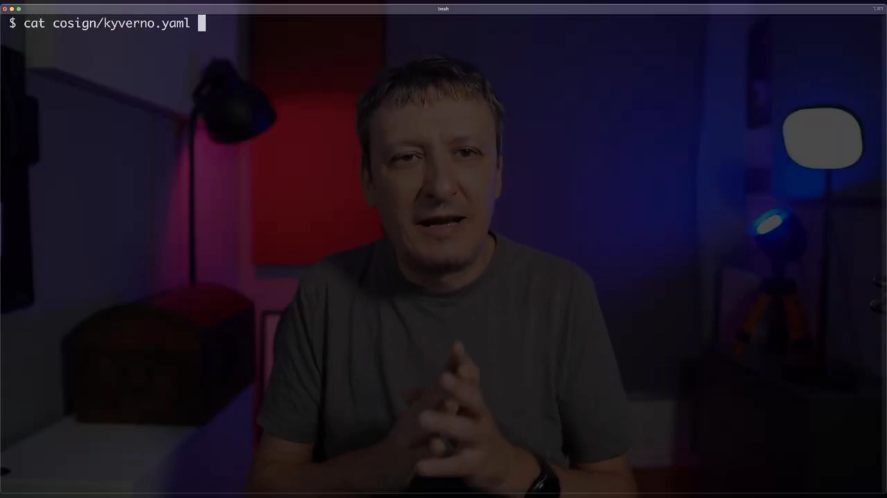
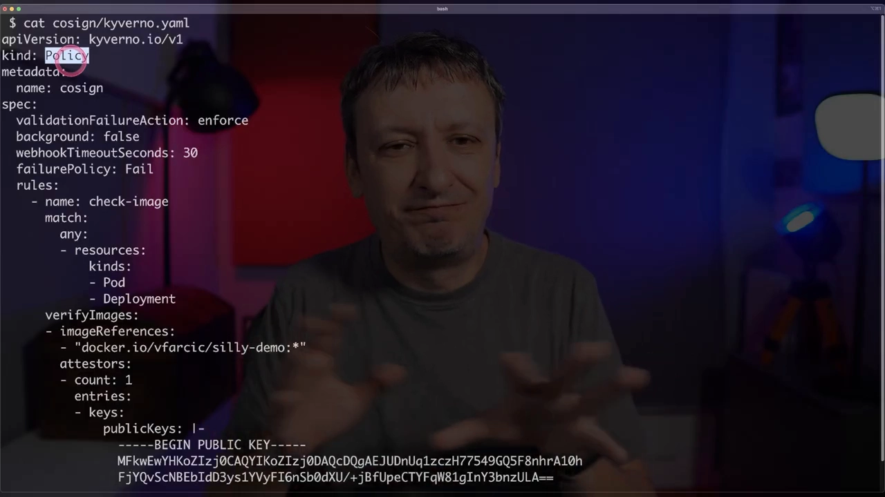
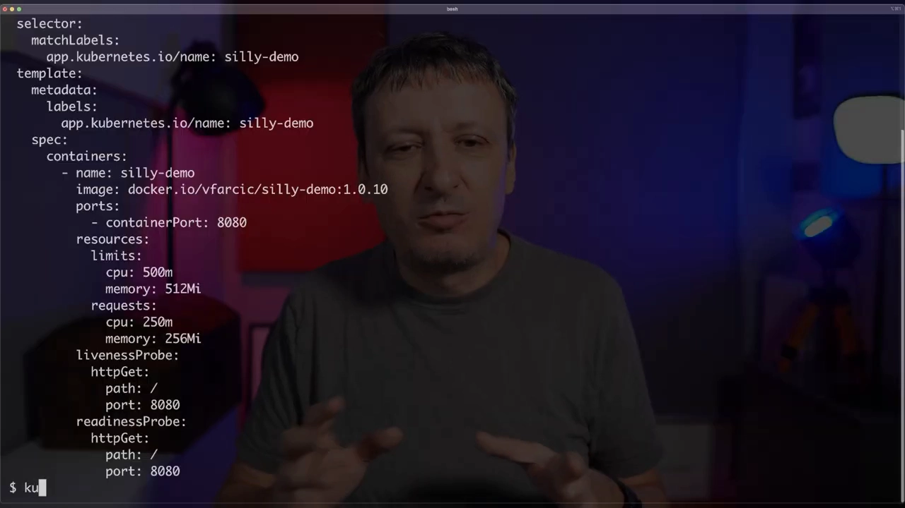
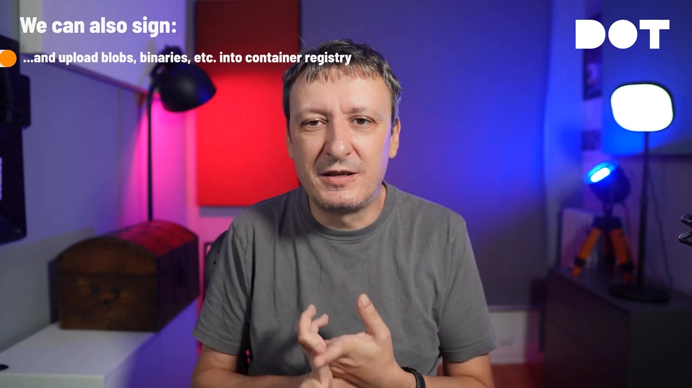

# 让集群自己拒绝未签名的镜像：cosign × Kyverno 准入控制实战

> 视频来源：[Signing and Verifying Container Images With Sigstore Cosign and Kyverno](https://www.youtube.com/watch?v=HLb1Q086u6M)（YouTube · 约 14 分钟）
> 所属：容器技术 · 第 3 章 镜像、文件系统与供应链 · 3.4 镜像供应链 · 3.4.3 镜像签名与验证

## 本讲要解决的核心问题（SCQA）

**背景**：我们把镜像构建出来、push 到容器仓库，再在 Kubernetes 里部署它。部署时用的往往是一个**人类可读的 tag**（比如 `silly-demo:10`）。

**冲突**：**tag 是可以被覆盖的**——只要有人往仓库里重新 push 一个同名同 tag 的镜像，集群就会拉到另一份东西；甚至可以让系统「以为」你用的还是你想要的那个 tag（[【跳转到 00:17】](https://www.youtube.com/watch?v=HLb1Q086u6M&t=17)）。于是「我部署的镜像，到底是不是我构建的那份？」这个问题，光靠 tag 回答不了。

**疑问**：有没有办法从机制上保证——**只有确确实实由我签过名、并且没被篡改的镜像，才允许进入我的集群**？

**回答（中心思想）**：**用 cosign 给镜像签名，用准入控制器（admission controller）在「进集群」这道关口强制校验签名。** 讲者先用「签合同要签字、要公证」的类比说明「签名」到底解决什么问题，再演示为什么**在客户端逐条跑 `cosign verify` 是很笨的做法**，最后用 Kyverno 写一条策略，让**未签名的镜像直接被集群拒绝**。核心结论一句话：**签名要一次做完，校验要交给集群统一强制，而不是散落在每个人、每条流水线里。**

## 一、为什么需要「签名」：从签合同到签镜像

### 1.1 起点：你无法回答「跑的是不是我构建的那份」

视频开门见山抛出一个问题（[【跳转到 00:00】](https://www.youtube.com/watch?v=HLb1Q086u6M&t=0)）：

> 你怎么知道集群里运行的镜像，**确实就是你构建的那一个**？你怎么知道**没有任何人篡改过**它？

如果你说「我部署的 tag 和构建时的 tag 一模一样」，那答案并不安全——**容器仓库里的 tag 相对容易被覆盖**（[【跳转到 00:11】](https://www.youtube.com/watch?v=HLb1Q086u6M&t=11)）。


**这个问题的解法，就是「签名」（signatures）**（[【跳转到 00:23】](https://www.youtube.com/watch?v=HLb1Q086u6M&t=23)）。

### 1.2 一个类比：为什么签字不够，还需要「第三方背书」

讲者先用现实世界做类比（[【跳转到 00:34】](https://www.youtube.com/watch?v=HLb1Q086u6M&t=34)）：**买房子、签劳动合同**时，你会拿到一份合同，但真正的问题是——**怎么确认这份合同在你和对方之间是有效的**？

人类用了**几百年**的办法是**签名**：如果合同上有你的签名，就大致可信（[【跳转到 00:52】](https://www.youtube.com/watch?v=HLb1Q086u6M&t=52)）。但讲者也很诚实地承认：**手写签名其实相当容易伪造**（[【跳转到 01:02】](https://www.youtube.com/watch?v=HLb1Q086u6M&t=62)）。所以后来我们引入了**第三方**——公证人、律师——来确认「**签的人确实是你**」，并核对签名与你的笔迹一致（[【跳转到 01:07】](https://www.youtube.com/watch?v=HLb1Q086u6M&t=67)）。

这还不够。进入数字时代后，我们改用**电子签名**（比如 DocuSign）：你雇主发来合同，你用某个服务去签，**通过这个流程确认「这确实是你想要的、你承诺的」**（[【跳转到 01:20】](https://www.youtube.com/watch?v=HLb1Q086u6M&t=80)）。

软件世界要回答的是**同一个问题的软件版本**。而且好消息是：**能给容器镜像签名的工具其实并不少**——「说没有工具是错的」（[【跳转到 01:43】](https://www.youtube.com/watch?v=HLb1Q086u6M&t=103)）。

## 二、cosign 与 Sigstore：一堆名字，其实分工很清楚

### 2.1 本讲只用 cosign，但先认识它的「家族」

本讲聚焦 **Sigstore 项目中的 cosign**（[【跳转到 02:05】](https://www.youtube.com/watch?v=HLb1Q086u6M&t=125)）。官方对 Sigstore 的描述相当「绕」（[【跳转到 02:10】](https://www.youtube.com/watch?v=HLb1Q086u6M&t=130)）：它让开发者能安全地签署软件制品——**发布文件、容器镜像、二进制、物料清单（BOM）等**，而这些制品通常存在某个公开日志里。

讲者用大白话把 Sigstore 的几个组件拆开（[【跳转到 02:33】](https://www.youtube.com/watch?v=HLb1Q086u6M&t=153)）：

| 组件 | 干什么 |
| --- | --- |
| **cosign** | 给**容器镜像**（以及任何能推进 registry 的东西）签名与验证 |
| **gitsign** | 给 **git commit** 签名 |
| **rekor** | 验证**透明日志**中的条目 |
| **fulcio** | 证书颁发机构（CA） |
| **policy-controller** | 在 Kubernetes 里执行策略 |

## 三、为什么不要「在客户端一条条验证」：这是本讲最重要的判断

### 3.1 先演示一下笨办法长什么样

讲者先演示了**最直观**的验证方式（[【跳转到 03:44】](https://www.youtube.com/watch?v=HLb1Q086u6M&t=224)）：

```bash
cosign verify --key cosign.pub <镜像地址>
```

因为他还没签名，输出是 **「no matching signature」**——即「没有匹配的签名，这个镜像根本没签过，或者不是用这把公钥签的」（[【跳转到 03:49】](https://www.youtube.com/watch?v=HLb1Q086u6M&t=229)）。

顺带说明密钥从哪来（[【跳转到 04:30】](https://www.youtube.com/watch?v=HLb1Q086u6M&t=270)）：公私钥由 `cosign generate-key-pair` 生成，存放方式非常自由——

- 放**本地文件系统**；
- 放 **Kubernetes Secret**（还可以用 sealed-secrets 加密后作为 manifest 存进 git 仓库）；
- 交给 **KMS**（AWS KMS、Azure Key Vault、Google KMS、HashiCorp Vault……）；
- 或用 **OpenID Connect** 直接签。

### 3.2 笨办法的致命问题：你无法保证它真的被执行

讲者明确说：**客户端逐条校验是很傻的做法**（"client-side validation today is silly"）（[【跳转到 05:54】](https://www.youtube.com/watch?v=HLb1Q086u6M&t=354)）：

- **很难保证这些命令真的被执行了**；
- 你得回到**所有流水线脚本**、以及一切需要校验的地方**一个个加上**它，**这是维护噩梦**。



### 3.3 更好的办法：把校验下沉到「准入」这一道关

既然「镜像引用」本身就是 **Kubernetes manifest 的一部分**，那就可以用**准入控制器**去保证：**只有满足条件的 manifest 才能被集群接受**——也就是**在镜像被应用之前，先确认它已签名**（[【跳转到 06:23】](https://www.youtube.com/watch?v=HLb1Q086u6M&t=383)）。

讲者提到 Sigstore 自带 policy-controller，但他要用「**更好的东西**」（悬念留到演示时揭晓）——那就是 **Kyverno**（[【跳转到 06:58】](https://www.youtube.com/watch?v=HLb1Q086u6M&t=418)）。他还顺手安利：不了解 Kyverno 的人「第一件事是该感到羞愧，第二件事是去看 Kyverno 的介绍视频」（[【跳转到 07:03】](https://www.youtube.com/watch?v=HLb1Q086u6M&t=423)）。



## 四、用 Kyverno 策略强制「镜像必须已签名且公钥匹配」

### 4.1 策略写了什么

讲者写了一个 `kyverno.yaml` 策略文件（[【跳转到 07:24】](https://www.youtube.com/watch?v=HLb1Q086u6M&t=444)），要点有三：

1. **是 `enforce` 而不是「仅提示」**——它不只是记个警告，而是**直接不允许**这类 manifest 被应用（[【跳转到 07:53】](https://www.youtube.com/watch?v=HLb1Q086u6M&t=473)）；
2. 用 **`verifyImages`** 指定**要校验哪个镜像**（演示里是 `silly-demo:10`）——你也可以要求**集群里不允许出现任何未签名镜像**；
3. 指定**用来校验的公钥**。

> 语义上是两个条件叠加（[【跳转到 08:18】](https://www.youtube.com/watch?v=HLb1Q086u6M&t=498)）：**第一，镜像必须已签名；第二，签名所用的公钥必须与策略里写的公钥一致。**

### 4.2 演示：未签名的镜像被拒之门外

先让策略生效，再部署一个使用 **未签名镜像 `silly-demo:10`** 的 Deployment（[【跳转到 08:31】](https://www.youtube.com/watch?v=HLb1Q086u6M&t=511)）：

```bash
kubectl apply -f .            # 先应用 Kyverno 策略
kubectl apply -f .            # 再应用 Deployment（含未签名镜像）
```

结果是被**准入 webhook 直接拒绝**——用讲者的玩笑话说就是「**no, thou shall not pass**」：它无法为该 tag 验证签名，所以不让你应用（[【跳转到 09:21】](https://www.youtube.com/watch?v=HLb1Q086u6M&t=561)）。



### 4.3 签名之后，同一个 Deployment 就能过了

按提示先给镜像签名（[【跳转到 09:54】](https://www.youtube.com/watch?v=HLb1Q086u6M&t=594)）：

```bash
cosign sign --key cosign.key <镜像地址>
```

签名会要求输入私钥密码；**Sigstore 会往容器仓库里推一份额外信息**（演示里是 Docker Hub）——也就是说签名是**跟着镜像存在仓库里**的。之后再用 `cosign verify` 验证，输出就变成了「**这个镜像确实由这把密钥签过**」（[【跳转到 10:29】](https://www.youtube.com/watch?v=HLb1Q086u6M&t=629)）。

现在重新 apply，**Deployment 正常创建、Kyverno 不再拦截**（[【跳转到 11:20】](https://www.youtube.com/watch?v=HLb1Q086u6M&t=680)）。

> **一个必须澄清的边界**（[【跳转到 10:54】](https://www.youtube.com/watch?v=HLb1Q086u6M&t=654)）：验证通过只说明「**我构建的镜像 = 我签名的镜像 = 将要运行的镜像**」，**并不代表这个镜像本身是安全的**——「还有很多很多地方可能出问题」。签名解决的是**来源与完整性**，不是漏洞问题。

## 五、cosign 的能力边界：不止容器镜像

讲者特别指出：**cosign 关注的重点其实不是「容器镜像」这个类别，而是「容器仓库里存放的任何东西」的签名与验证**（[【跳转到 11:54】](https://www.youtube.com/watch?v=HLb1Q086u6M&t=714)）：

- 容器镜像；
- 直接推到 registry 的 **blob / 二进制**；
- **SBOM（软件物料清单）**；
- **Tekton bundle**；
- **WebAssembly 模块**；
- ……几乎**任何能 push 进容器仓库**的制品。



## 六、结论：把 cosign 接进 CI，把强制交给准入控制器

讲者的建议很直接（[【跳转到 12:41】](https://www.youtube.com/watch?v=HLb1Q086u6M&t=761)）：

- 可以把 **cosign 当作「给容器镜像签名」的非官方事实标准**（不仅限于镜像，还包括任何能推进 registry 的东西）；
- **签名本身极其简单**，很容易就能加进 CI 流水线或任何构建、推送镜像的流程里——**「没有理由不给镜像签名」**；
- 再用 Kyverno（或任何准入控制器）**强制**这些镜像「必须已签名且验证通过」，**几乎零额外成本**；
- 最终结论：**cosign 是必用的**，现在就该采纳（[【跳转到 13:42】](https://www.youtube.com/watch?v=HLb1Q086u6M&t=822)）。


## 小结

- **问题的本质**：**tag 可被覆盖**，所以「按名字取镜像」不能回答「这份镜像是不是我构建的、有没有被篡改」。
- **签名解决什么**：像现实里「签字 + 第三方公证」一样，签名让镜像的**来源与完整性可被独立验证**。
- **不要碰的坑**：**在客户端逐条跑 `cosign verify`** 既难以保证执行，又要在无数流水线里重复维护——**是维护噩梦**。
- **正确姿势**：**准入控制器**（演示用 Kyverno 的 `verifyImages`，`enforce` 模式）在「进集群」这道关口统一强制「镜像必须已签名，且公钥匹配」，未签名镜像**直接拒绝**。
- **边界**：验证通过只代表「构建的 = 签名的 = 运行的」，**不代表镜像本身没有漏洞**。
- **适用范围**：cosign 能签的不只是镜像，而是**任何能推进容器仓库的制品**（二进制、SBOM、Tekton bundle、WASM…）。
- **落地建议**：签名一次放进 CI/CD，校验交给集群**机制化强制**。

## 关键术语速查

| 术语 | 一句话解释 |
| --- | --- |
| cosign | Sigstore 中给镜像（及 registry 中其它制品）签名/验证的工具 |
| Sigstore | 围绕签名与验证的一整套开源项目（cosign、gitsign、rekor、fulcio、policy-controller） |
| tag 可覆盖 | 同名同 tag 可以被重新 push，因此 tag 不能代表来源可信 |
| 透明日志 / rekor | 记录签名条目的公开日志，兼作发现机制与时间戳来源 |
| fulcio | Sigstore 的证书颁发机构，用于签发短时证书（keyless 模式） |
| Kyverno | Kubernetes 策略引擎，用 YAML 声明策略（含 `verifyImages`） |
| 准入控制器 / admission webhook | 请求进入集群前做策略校验，可拒绝不合规的 manifest |
| `verifyImages` | Kyverno 策略字段：校验 manifest 里引用的镜像是否已签名、公钥是否匹配 |
| `enforce` | 策略模式：真正拒绝，而非只记录告警 |
| SBOM | 软件物料清单，可随镜像一起签名并存入 registry |
| KMS / Sealed Secrets | 存放签名私钥的方式：云 KMS 托管，或加密后随 git 管理 |
