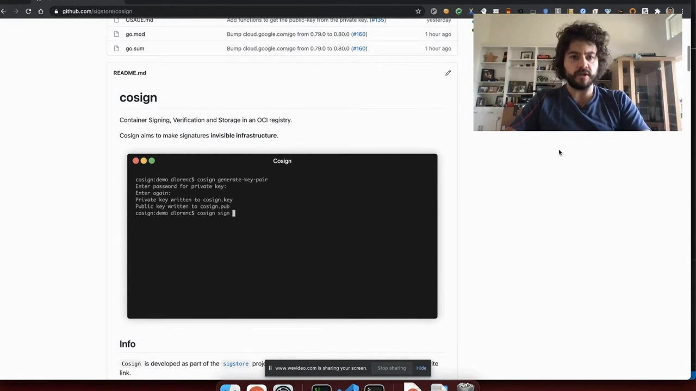
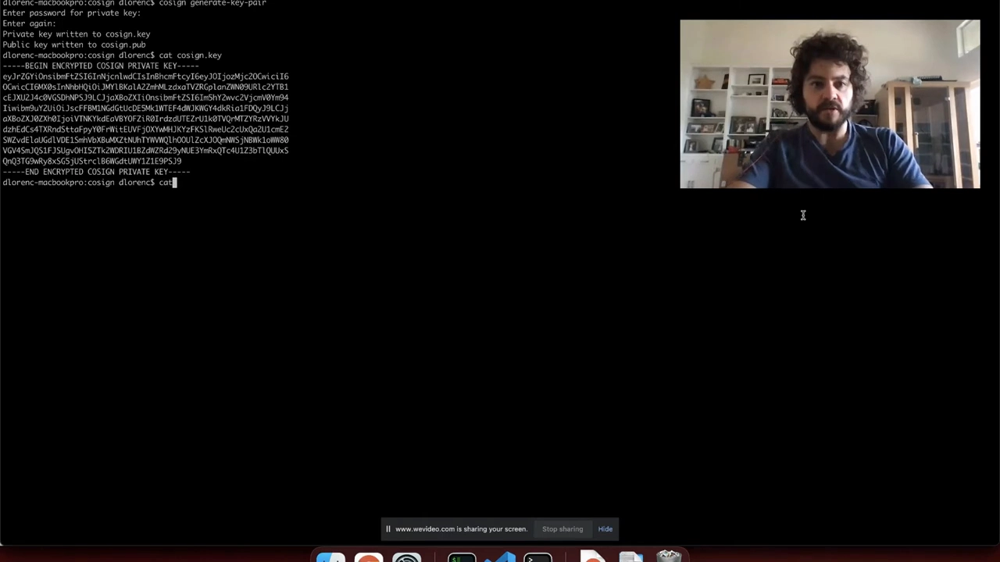
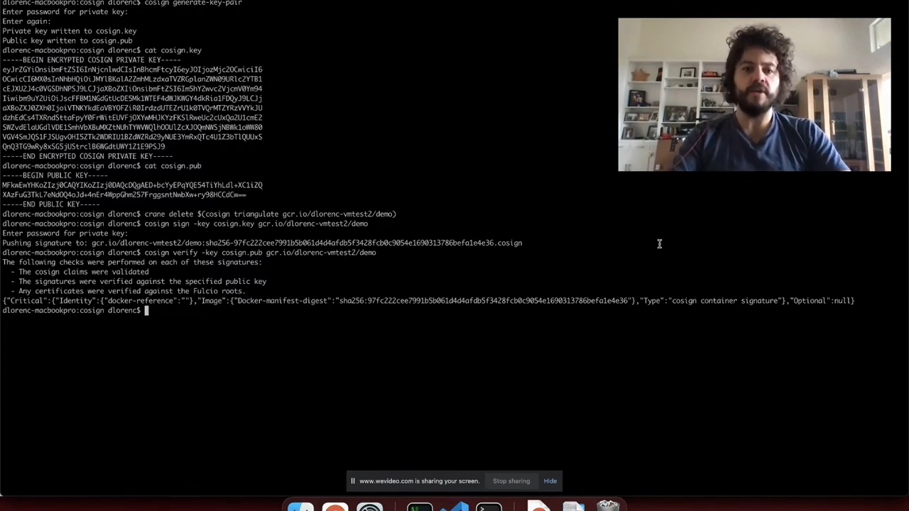
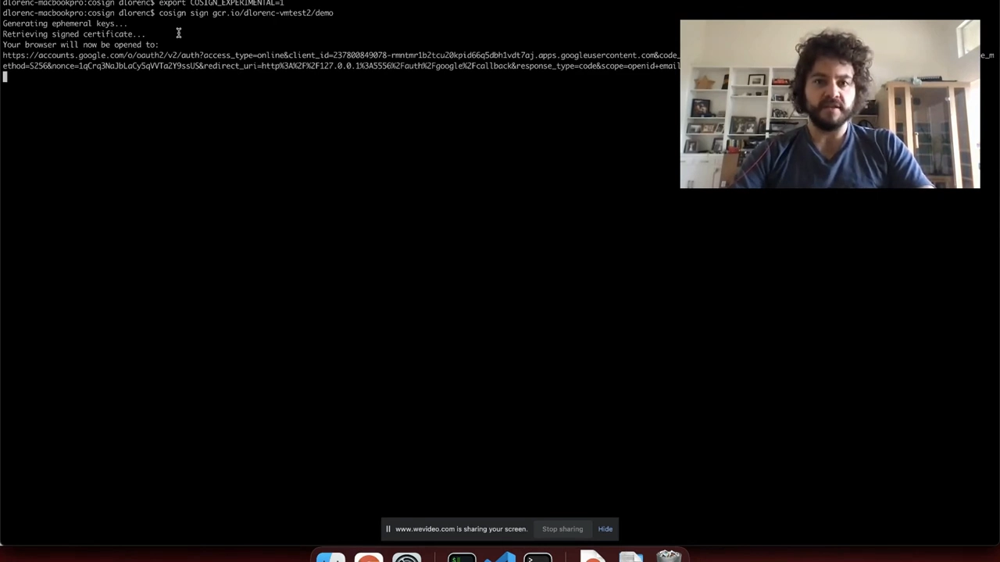
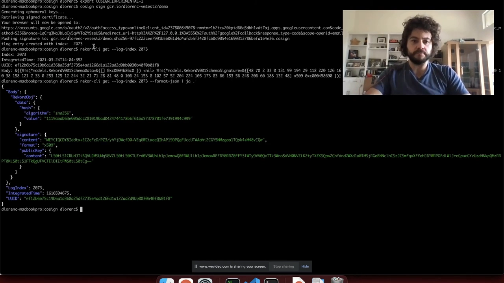
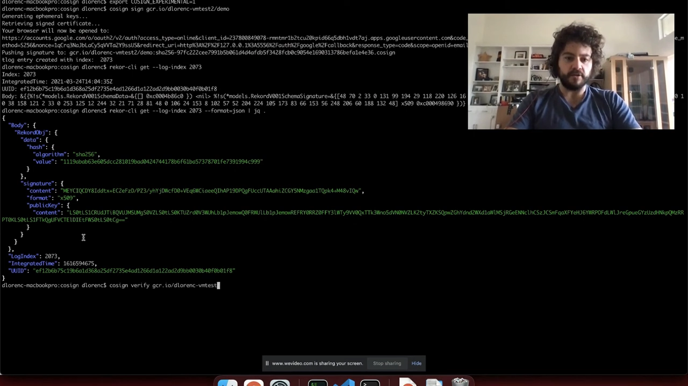

# cosign 实战演示：用固定密钥与 Keyless 两种方式签名、验证容器镜像

> 视频来源：[Sigstore demo with cosign](https://www.youtube.com/watch?v=gCi9_4NYyR0)（YouTube · 约 11 分钟）
> 所属：容器技术 · 第 3 章 镜像、文件系统与供应链 · 3.4 镜像供应链 · 3.4.3 镜像签名与验证

## 本讲要解决的核心问题（SCQA）

**背景**：上一讲我们知道要「给镜像签名」，也知道该用 **cosign**（Sigstore 项目下的开源工具）。但签名这件事**具体怎么落地**——命令怎么敲、密钥放哪、验证到底验了什么——还是黑箱。

**冲突**：一想到「签名」，直觉反应就是**「得自己生成一对公私钥，然后小心保管私钥」**。这确实是一种方式，但它意味着**私钥的管理成本**：加密、存放、分发、怕泄漏。对个人开发者和小团队来说，「管密钥」常常是让人放弃签名的那道门槛（[【跳转到 00:21】](https://www.youtube.com/watch?v=gCi9_4NYyR0&t=21)）。

**疑问**：cosign 到底提供哪几种签名方式？**有没有可能根本不用自己管密钥**，也能签出、验证一个可信的镜像？

**回答（中心思想）**：讲者用两个现场演示回答——**方式一：固定公私钥对（fixed key pair）**，自己生成、自己保管，最经典也最可控；**方式二：Keyless 无密钥模式（实验特性）**，**不落盘任何私钥**，靠一次 OpenID Connect 登录换取一张**短时证书**，签名再被记进**公共透明日志**，事后凭「身份（邮箱）+ 时间」就能验证。一句话：**cosign 让「签名」从「管理密钥」的重活，变成「敲一条命令」的轻活。**

## 一、cosign 是什么，本讲要演示哪两条路

讲者开门见山（[【跳转到 00:00】](https://www.youtube.com/watch?v=gCi9_4NYyR0&t=0)）：他是 Dan Lawrence，本讲要演示 **cosign 容器签名工具**的几个用法。cosign 与 Sigstore 都是开源项目，托管在 GitHub 上，地址分别是 `github.com/sigstore/cosign` 与 `github.com/sigstore`。

> **cosign 的设计目标**就是一个字：**简单**——让你**轻松地给容器签名**（[【跳转到 00:12】](https://www.youtube.com/watch?v=gCi9_4NYyR0&t=12)）。

本讲会走通**两种工作流**（[【跳转到 00:21】](https://www.youtube.com/watch?v=gCi9_4NYyR0&t=21)）：

1. **固定公私钥对**：用工具生成一对公私钥，**保护好私钥**，把**公钥分发**出去用于验证；
2. **Keyless 无密钥模式（实验性）**：让你**无需使用或管理任何密钥**就能签名与验证镜像——它靠的是 Sigstore 项目里的其它组件，讲者会边走边解释。



## 二、方式一：固定公私钥对

### 2.1 第一步：先生成密钥对

开始签名 / 验证之前，**第一步是生成密钥对**（[【跳转到 00:53】](https://www.youtube.com/watch?v=gCi9_4NYyR0&t=53)）——你**不需要别的工具**，cosign 自己就支持：

```bash
cosign generate-key-pair
```

它会提示你输入一个**密码**来加密私钥，输入并确认即可。讲者强调：**因为有密码加密，我们不必担心私钥留在磁盘上**（[【跳转到 01:18】](https://www.youtube.com/watch?v=gCi9_4NYyR0&t=78)）。他甚至说：

- 私钥**可以存在磁盘上**；
- **可以存进 git 仓库**，甚至放在**公开的开源项目**里——Sigstore 官方发布 cosign 时就是这么干的：仓库里就有一把你可以点开查看的密钥；
- **验证只需要公钥**。

### 2.2 公钥长什么样：一把标准的 X.509 公钥

讲者接着把公钥打印出来看（[【跳转到 01:43】](https://www.youtube.com/watch?v=gCi9_4NYyR0&t=103)）：这就是一把**标准的公钥**，存放在典型的 **X.509 / PKIX 格式**里，**能跟任何其它工具互通**。生成时用的是**椭圆曲线 P-256** 算法——**密钥体积小**、足够标准、**能在大多数硬件上工作**。



于是分工很清楚：**用私钥签名**，**用公钥验证**。

### 2.3 签名：cosign sign

为了演示干净，讲者先清掉镜像上已有的签名（[【跳转到 02:08】](https://www.youtube.com/watch?v=gCi9_4NYyR0&t=128)），然后签名：

```bash
cosign sign --key cosign.key <镜像名>
```

回车后提示输入密码。这里有一个**很关键的行为**（[【跳转到 02:33】](https://www.youtube.com/watch?v=gCi9_4NYyR0&t=153)）：

> 签名会被**直接推到镜像仓库里**去。也就是说，**谁能访问这个镜像，谁就能找到它的签名**——你**不需要另建一套存储**，也不用琢磨签名该怎么分发。

### 2.4 我们到底签的是什么：先哈希成 digest，再包进 JSON

签名完成后进行验证（[【跳转到 02:58】](https://www.youtube.com/watch?v=gCi9_4NYyR0&t=178)）：

```bash
cosign verify --key cosign.pub <镜像名>
```

它会**执行一整套检查**并打印出来。为了看清签名里的 JSON 载荷，讲者把输出**接到 `jq`** 上美化（[【跳转到 03:23】](https://www.youtube.com/watch?v=gCi9_4NYyR0&t=203)），顺便点明一个本质问题：

> **镜像不是一个能直接签名的物理实体**。你**只能拿它的某种「表示」来签**——而容器的**规范表示（canonical representation）就是它的 `sha256` digest**。所以，**我们签的就是这个 digest 字符串**。

那为什么还要**把它包进一层 JSON**？讲者解释（[【跳转到 03:48】](https://www.youtube.com/watch?v=gCi9_4NYyR0&t=228)）：**包一层就有了塞入额外元数据的机会**，这些元数据可以一并被签名保护起来。



### 2.5 附加元数据：用 `-a` 注解（annotations）

这条「额外元数据」就是 **annotation**，通过 **`-a` 标志**传入（[【跳转到 03:48】](https://www.youtube.com/watch?v=gCi9_4NYyR0&t=228)）：

```bash
cosign sign --key cosign.key -a foo=bar <镜像名>
```

讲者举了几个**真实用途**：可以把**构建容器时的 git commit**、**时间戳**之类信息写进去（[【跳转到 04:13】](https://www.youtube.com/watch?v=gCi9_4NYyR0&t=253)）。这些元数据都会被放进签名本身，**以后可以据此验证**。

一个镜像**可以被签多次**：重新验证时就能看到**两个签名**——**一个带 `foo=bar` 注解，一个不带**。验证时同样可以**用 `-a` 过滤**：

```bash
cosign verify --key cosign.pub -a foo=bar <镜像名>
```

于是只剩带该注解的那一个签名（[【跳转到 05:03】](https://www.youtube.com/watch?v=gCi9_4NYyR0&t=303)）。

> **注解的价值**：你可以借此**搭出复杂的工作流**——比如**时间戳**，或 **TUF（The Update Framework）** 这类更新协议的场景，都能用这些可选字段实现。

### 2.6 进阶：把密钥交给 KMS 或硬件

固定密钥图的是「自己掌控」。讲者也提到还有更「讲究」的做法（[【跳转到 05:03】](https://www.youtube.com/watch?v=gCi9_4NYyR0&t=303)）：**把密钥对存进 KMS**，例如 AWS KMS、Azure Key Vault、Google KMS；并且正在推进**硬件支持**，比如 **YubiKey**。

不过，接下来才是 cosign 和 Sigstore 其它组件配合得最妙的、**更省事的实验特性**。

## 三、方式二：Keyless 无密钥模式（实验特性）

### 3.1 先打开实验开关

因为还是实验特性，需要先开启（[【跳转到 05:28】](https://www.youtube.com/watch?v=gCi9_4NYyR0&t=328)）：

```bash
export COSIGN_EXPERIMENTAL=1
```

### 3.2 无密钥签名：一次 OIDC 换一张「绑定身份」的短时证书

这个模式用的是 Sigstore 的 **Fulcio 根证书颁发机构（root CA）**，**签发证书**时配对一个**临时密钥对（ephemeral key pair）**（[【跳转到 05:53】](https://www.youtube.com/watch?v=gCi9_4NYyR0&t=353)）。也就是说——**密钥根本不必落到磁盘上**。同时，签名会被**记进 Rekor 透明日志（transparency log）**，它**既是签名的发现机制，也提供时间戳**，让你知道签名**何时发生、何时被纳入日志**。

命令变得极简（[【跳转到 06:18】](https://www.youtube.com/watch?v=gCi9_4NYyR0&t=378)）——**不再需要传密钥**：

```bash
cosign sign <镜像名>      # 没有 --key，没有私钥参数，只有镜像名
```

回车后终端开始刷输出，同时**弹出浏览器走标准 OpenID Connect 流程**。讲者很坦诚地解释「无密钥」这个说法（[【跳转到 06:49】](https://www.youtube.com/watch?v=gCi9_4NYyR0&t=409)）：

> 它**并非完全无密钥**——我们**确实生成了一对临时密钥**，只是**你不用操心它们**。（讲者借此开了个玩笑：就像「serverless」其实还是跑在真服务器上一样，「keyless」也是这么个叫法。）

流程是这样的：

1. **生成一对临时密钥对**；
2. 把**公钥**发给 **Fulcio 代码签名根 CA**，**申请一张证书**；
3. 这张证书的作用，是**把「我们生成的公钥」和「一个身份」绑定起来**（[【跳转到 07:14】](https://www.youtube.com/watch?v=gCi9_4NYyR0&t=434)）；
4. 在开源 / 日常开发里，**这个身份其实就是你的邮箱地址**——它正是你在社区里沟通、积累声誉的方式。要让证书绑定到邮箱，服务必须**证明你确实拥有那个邮箱**——而这正是 **OpenID Connect** 的设计用途：弹出浏览器，让你走一遍授权（[【跳转到 07:39】](https://www.youtube.com/watch?v=gCi9_4NYyR0&t=459)）。

授权完成回来（[【跳转到 07:57】](https://www.youtube.com/watch?v=gCi9_4NYyR0&t=477)），终端提示：**用刚才生成的那把私钥签名了镜像**——而**这把私钥从没碰过磁盘**，不用怕丢失、泄漏或被盗；签名推送到仓库，**同时也上传到了 Rekor 透明日志**，并返回了一个**索引号（index，例如 2073）**。



### 3.3 透明日志里到底记了什么

讲者把那条日志条目取下来看（[【跳转到 08:22】](https://www.youtube.com/watch?v=gCi9_4NYyR0&t=502)）：原始字节很难读，于是改用 **JSON 输出模式并接 `jq`**。条目里是**验证一个签名所需的全部组件**（[【跳转到 08:47】](https://www.youtube.com/watch?v=gCi9_4NYyR0&t=527)）：

| 字段 | 含义 |
| --- | --- |
| **hash** | 前面那层 JSON 载荷的哈希（而载荷里又含有容器的哈希） |
| **signature content** | 执行签名操作时产生的**签名字节** |
| **public key** | 公钥本身——它正是 **OIDC 流程所签发证书里包含的那把公钥** |



### 3.4 时间戳：为什么需要 `integrated time`

讲者特别讲了一段**时间戳**（[【跳转到 09:12】](https://www.youtube.com/watch?v=gCi9_4NYyR0&t=552)）：

> 因为**密钥是临时的、只在很短时间窗内有效**（今天用的是 **20 分钟**，留出时钟偏移与日志排队的时间），所以必须能断言「**签名是在证书有效期内被记进透明日志的**」。

这就是条目里那个 **`integrated time` 字段**的用途——它只是一个**标准 Unix 时间戳**（讲者还打趣说你可以心算出当时大约是什么时间）。

### 3.5 无密钥验证：cosign verify 只给镜像名

最后验证（[【跳转到 09:37】](https://www.youtube.com/watch?v=gCi9_4NYyR0&t=577)）——**同样不传任何密钥**：

```bash
cosign verify <镜像名>
```

> **不用再给公钥**——因为公钥**就存在签名自身里**。

这一次，cosign 在底部执行了一连串检查（[【跳转到 10:02】](https://www.youtube.com/watch?v=gCi9_4NYyR0&t=602)）：

1. **签名是否在证书有效期内被记入 Rekor 透明日志**；
2. **签名是否确实由某个密钥签署**；
3. **取回那张证书，确认它有效**——**不是自签的、不是随便一张证书**，而是**由根 CA 服务签发的**（[【跳转到 10:27】](https://www.youtube.com/watch?v=gCi9_4NYyR0&t=627)）；
4. **从证书里取出 Common Name（CN）**——你可能习惯 CN 是**服务器主机名**，但这里**它是你的邮箱地址**。

于是最终**证明的结论**是：

> **这张镜像上的签名，是由某个能访问该邮箱地址的人，在某个特定时间点创建的。**



讲者收尾说（[【跳转到 10:52】](https://www.youtube.com/watch?v=gCi9_4NYyR0&t=652)）：这就是 cosign 的两种用法——**固定密钥**，以及**Keyless 模式**（可把签名与你的 OpenID Connect 账号绑定）。

## 小结

- **cosign 的定位**：Sigstore 项目下**专为「简单签容器」**而生的工具，命令极少。
- **方式一 · 固定公私钥对**：`cosign generate-key-pair` 生成（私钥用密码加密）；`cosign sign --key` 签名，**签名直接推进镜像仓库**，无需另设存储；`cosign verify --key` 用公钥验证；公钥是**标准 X.509/PKIX、椭圆曲线 P-256**。可用 **`-a` 注解**附带并校验元数据（git commit、时间戳……），一个镜像**可签多次**，验证时可用 `-a` 过滤；更讲究可放进 **KMS / YubiKey**。
- **签的到底是什么**：**不是镜像本身，而是它的 `sha256` digest**；外面**包一层 JSON** 是为了携带可被一并保护的元数据。
- **方式二 · Keyless（实验）**：`export COSIGN_EXPERIMENTAL=1` 开启；`cosign sign <镜像名>`，**不落盘私钥**——靠 **Fulcio** 给**临时密钥**签发一张**把公钥与身份（邮箱）绑定**的证书，身份由 **OpenID Connect** 授权证明；签名同时写入 **Rekor 透明日志**。
- **Keyless 的两个关键点**：**透明日志**既是发现机制又提供时间戳；**`integrated time`** 用来保证「签名是在临时的 20 分钟证书有效期内被记入日志的」。
- **Keyless 验证**：`cosign verify <镜像名>`，**公钥从签名里自带**；检查「是否在有效期内入日志」「证书是否由根 CA 签发」「CN = 邮箱」，最终证明「**由能访问该邮箱的人，在某时刻**签的」。

## 关键术语速查

| 术语 | 一句话解释 |
| --- | --- |
| cosign | Sigstore 项目下给镜像（及可推进 registry 的制品）签名/验证的开源工具 |
| 固定公私钥对 | 自己生成、自己保管私钥、分发公钥的传统签名方式 |
| Keyless 模式 | 不落盘私钥：临时密钥 + Fulcio 短时证书 + Rekor 透明日志（实验特性，需 `COSIGN_EXPERIMENTAL=1`） |
| digest 签名 | 镜像的规范表示是它的 `sha256` digest，签的就是它，而非镜像本身 |
| annotation（`-a`） | 随签名一并被保护的元数据（git commit、时间戳等），可用于过滤验证 |
| Fulcio | Sigstore 的证书颁发机构，为临时密钥签发「绑定身份」的短时证书 |
| Rekor | Sigstore 的透明日志，记录签名并提供发现与时间戳能力 |
| integrated time | 透明日志条目中的签名纳入时间（Unix 时间戳），保证签名落在证书有效期内 |
| OpenID Connect | 用来证明「你确实拥有某个邮箱身份」的登录授权流程 |
| X.509 / PKIX、P-256 | 公钥的标准存储格式与椭圆曲线算法（密钥小、互通性好） |
