# cosign 实战：给私有 Harbor 里的镜像签名与验证

> 视频来源：[cosign签名harbor内镜像](https://www.bilibili.com/video/BV1Sme3zUExX)（B 站 · AccessDeniedk · p1 45:09 + p2 17:20，共 63:03）
> 所属：容器技术 · 第 3 章 镜像、文件系统与供应链 · 3.4 镜像供应链 · 3.4.3 镜像签名与验证

## 本讲要解决的核心问题（SCQA）

**背景**：镜像构建完要 push 到镜像仓库（registry），别人再从仓库里 pull 下来运行。而仓库里的镜像地址由「仓库地址 + 仓库名 + tag」组成，比如 `harbor1.line/library/nginx:latest`——tag 只是一个**可被覆盖的标签**，它本身不携带「这份镜像到底是谁做出来的、有没有被人动过」的任何信息。

**冲突**：既然 tag 可以被重新 push 覆盖，那拿到一个 `library/nginx:latest`，你凭什么相信它就是你信任的那个人构建、并且中途没有被替换过的那份？光看名字和 tag，是看不出来的。

**疑问**：有没有一种办法，让「镜像的来源与完整性」可以被**独立验证**——验证方不需要信任中间的仓库和网络？

**回答（中心思想）**：**cosign 用一对密钥给镜像「签名」**——用私钥对镜像的 `manifest` 摘要（digest）做签名，再把签名当作一份**附加制品**存回镜像仓库；验证方只要拿到对应的**公钥**，就能确认「这个 digest 确实由私钥持有者签过、且镜像内容没变」。本讲按「先讲原理 → 装好 cosign 与两套 Harbor → 理清四种使用场景 → 逐个实操（本地离线、仓库在线、离线签名+附加、仓库间迁移）」的顺序，把它彻底走一遍。

## 一、cosign 是什么：一句话原理加一分钟定位

### 1.1 核心机制：私钥签 digest，公钥做比对

cosign 是一个开源工具，主要作用就是**对容器镜像（以及其它 OCI 制品）做签名和验证**（[【跳转到 00:00】](https://www.bilibili.com/video/BV1Sme3zUExX/?p=1&t=0)）。讲者用一句话概括它的原理（[【跳转到 00:05】](https://www.bilibili.com/video/BV1Sme3zUExX/?p=1&t=5)）：

- **签名**：用**私钥**对镜像的某个关键内容「加密」——具体说，是对镜像 **manifest 的 digest**（镜像清单内容的 SHA-256 摘要）做签名，产出一份签名；
- **验证**：把这份签名和当前镜像的 digest 再做一次比对（用公钥还原/校验），**如果一致，说明镜像从头到尾没有变化**，也就是「受信任」的（[【跳转到 00:30】](https://www.bilibili.com/video/BV1Sme3zUExX/?p=1&t=30)）。

因此签名与验证最典型的用途就是**身份验证**：确认「这个镜像是谁发布的」，并在使用前确认它没被篡改。

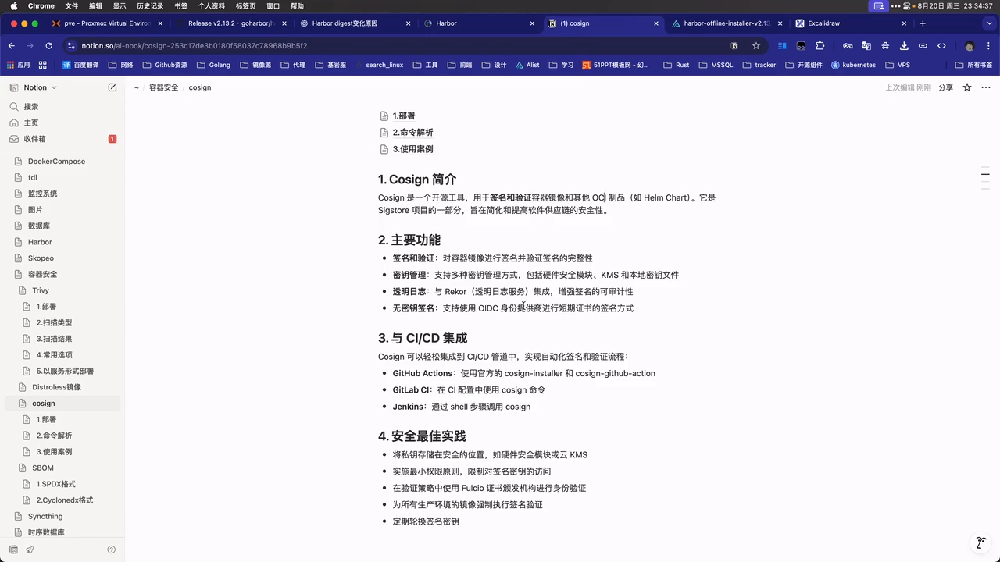

> 术语小抄：**digest** 是内容的哈希值，内容改一个字节，digest 就完全不同；**manifest** 是描述「这个镜像由哪些层（layer）、每层的 digest 和大小是什么」的清单文件。所以「签 digest」等价于「签整份镜像内容」。

### 1.2 安装：一个二进制文件放进 PATH 就算装好

装 cosign 不需要包管理器，直接去 GitHub 的 Sigstore 组织下 cosign 的发布包即可（[【跳转到 00:55】](https://www.bilibili.com/video/BV1Sme3zUExX/?p=1&t=55)）：

- 打开 GitHub 搜 `cosign`，第一个就是，最新 tag 是 **2.5.3**；发布物里有 rpm，也有**直接可用的二进制**（[【跳转到 01:16】](https://www.bilibili.com/video/BV1Sme3zUExX/?p=1&t=76)）；
- 把 `cosign-linux-amd64` 下载下来，**改名为 `cosign`，赋予执行权限，丢进 `/usr/local/bin`** 就算装完（[【跳转到 01:43】](https://www.bilibili.com/video/BV1Sme3zUExX/?p=1&t=103)）——讲者顺带说，部署脚本里把版本号抽成变量，以后升级只改一个版本号就行；
- 用 `cosign version` 验证，会输出**版本号、构建时间（7 月 17 日）、开发语言（Go）** 等信息（[【跳转到 02:58】](https://www.bilibili.com/video/BV1Sme3zUExX/?p=1&t=178)）。

同样的动作他在第二台机器上又做了一遍（下载速度慢就挂代理），这就是后面验证用的那台（[【跳转到 02:14】](https://www.bilibili.com/video/BV1Sme3zUExX/?p=1&t=134)）。

## 二、准备演练环境：两套 Harbor 加一套内部 PKI

### 2.1 为什么要两套 Harbor

cosign 除了「签名/验证」，还支持**带签名的镜像在仓库之间存取、迁移**。为了把「签名随镜像一起走」这件事演示清楚，讲者准备了两套 Harbor（[【跳转到 03:13】](https://www.bilibili.com/video/BV1Sme3zUExX/?p=1&t=193)）：

- **harbor1**：源仓库，镜像在这里被签名；
- **harbor2**：目标仓库，用来演示「镜像 + 签名」如何迁移过去。

迁移有两条路（[【跳转到 03:52】](https://www.bilibili.com/video/BV1Sme3zUExX/?p=1&t=232)）：

- 两个仓库**能互访**（同网段）→ 直接用 `cosign copy`；
- **不能互访**（跨网段/离线环境）→ 用 `cosign save` + `cosign load` 手工搬运。

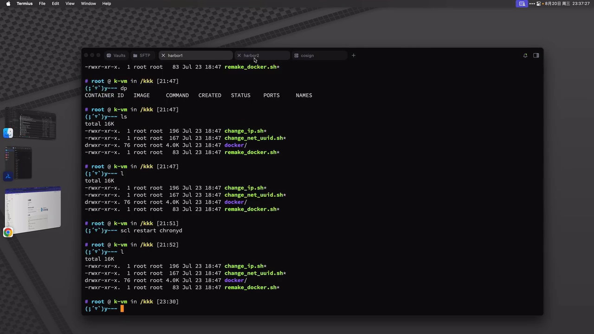

顺便介绍 Harbor 本身：它是一个非常不错的开源镜像仓库（[【跳转到 04:46】](https://www.bilibili.com/video/BV1Sme3zUExX/?p=1&t=286)）。讲者已有的 Harbor 里放着 nodejs、docker、centos、nginx、redis 等常用镜像，把它们收进**本地私有仓库**的好处是：拉取很快，而且「基本 99% 不会失败」，因为大家处在同一个内网（[【跳转到 05:26】](https://www.bilibili.com/video/BV1Sme3zUExX/?p=1&t=326)）。

### 2.2 部署 Harbor：离线包加自定义 TLS 证书

安装 Harbor 有两种取包办法（[【跳转到 05:51】](https://www.bilibili.com/video/BV1Sme3zUExX/?p=1&t=351)）：直接去 GitHub 的 `goharbor/harbor` 找 release（最新 **2.13.2**，分**离线包**与**在线包**两种，讲者习惯用离线包）；GitHub 不好访问时就换国内镜像站（讲者在南大镜像站看到 2.12.4，最新版只有在线包，于是退一版取离线包）。

解压后会得到一个 `harbor` 目录（里面有 `install.sh` 和各种配置模板）。讲者的做法是先把目录分好类：**把 Harhor 运行数据**放进一个独立目录、**TLS 证书**放进一个单独的 `ssl` 目录，尽量「规整一点，模拟真实生产环境」（[【跳转到 07:16】](https://www.bilibili.com/video/BV1Sme3zUExX/?p=1&t=436)）。

证书不是用 openssl 手搓，而是用 **cfssl**——一个专门用来搭内部 PKI 的工具（[【跳转到 12:08】](https://www.bilibili.com/video/BV1Sme3zUExX/?p=1&t=728)）：

- 把 `cfssl` 和 `cfssljson` 两个二进制放进 `/usr/local/bin`；`cfssljson` 的作用是**把 CA 返回的 JSON 转成真实的证书文件**（[【跳转到 08:06】](https://www.bilibili.com/video/BV1Sme3zUExX/?p=1&t=486)）；
- 证书请求配置 `example.json` 里**主要要改的就是 host**：这里定为 `harbor1.line` 和 `harbor2.line`，并且这两台要先能**被解析**（[【跳转到 08:56】](https://www.bilibili.com/video/BV1Sme3zUExX/?p=1&t=536)）；
- 解析在 **dnsmasq** 里做自定义记录，把两个域名分别指到两台机器的 IP，这样**整个局域网都生效**；用 `nslookup` 之类的查询验证一下（[【跳转到 09:21】](https://www.bilibili.com/video/BV1Sme3zUExX/?p=1&t=561)）；
- 中间提了一个容易踩的点：现代 TLS 校验**看的是 SAN（Subject Alternative Name）扩展字段**，不是老的 CN 字段——「以前用 CN 去验证，后来为了安全，基本都要用这个扩展字段」（[【跳转到 11:43】](https://www.bilibili.com/video/BV1Sme3zUExX/?p=1&t=703)）。正因为直接用 openssl 签证书很麻烦，讲者才选了 cfssl；如果需求更高级（多人协作、账号密码、MFA），可以上 **step**（smallstep）（[【跳转到 12:08】](https://www.bilibili.com/video/BV1Sme3zUExX/?p=1&t=728)）；
- 签发命令带上 CA 地址与 `-profile server`，输出 `-bare harbor`，会得到 **`harbor.pem`（证书）** 和 **`harbor-key.pem`（私钥）**；用 `openssl x509 -in harbor.pem -noout -text` 可以核对里面写的 SAN（[【跳转到 10:53】](https://www.bilibili.com/video/BV1Sme3zUExX/?p=1&t=653)）。

接着改 `harbor.yml`（[【跳转到 12:33】](https://www.bilibili.com/video/BV1Sme3zUExX/?p=1&t=753)）：

- `hostname`：harbor1 填 `harbor1.line`，harbor2 单独改成 `harbor2.line`；
- 证书路径：上面填 `harbor.pem`、下面填 `harbor-key.pem`；
- `harbor_admin_password`（管理员密码）与数据库密码自己定；
- `data_volume`：**指定宿主机上的一个目录**——因为 Harbor 是以 **docker compose** 形式部署的，这个目录会被挂载进容器，宿主机目录对应容器里 Harbor 自己的数据目录（[【跳转到 13:48】](https://www.bilibili.com/video/BV1Sme3zUExX/?p=1&t=828)）。

然后执行 `./install.sh` 自动跑 docker compose。讲者补充：如果习惯手动一点，可以**先跑 `./prepare` 把 docker-compose 的 YAML 生成出来、改完再 `docker compose up -d`**——`install.sh` 其实就相当于这两步（[【跳转到 14:13】](https://www.bilibili.com/video/BV1Sme3zUExX/?p=1&t=853)）。

部署完成后浏览器访问能出现登录页、登录进去，默认有一个 `library` project 但里面没有镜像，harbor2 同理——环境就绪（[【跳转到 15:29】](https://www.bilibili.com/video/BV1Sme3zUExX/?p=1&t=929)）。

## 三、生成密钥对：私钥藏好，公钥随便发

cosign 的核心是**一对公私钥**：**私钥用来签名（加密），公钥用来验证（解密）**（[【跳转到 15:59】](https://www.bilibili.com/video/BV1Sme3zUExX/?p=1&t=959)）。讲者给的保管原则很直白：

- **公钥可以随便分发给别人**；
- **私钥一定要保存好**；
- 公钥、私钥都可以**定期轮换**。

生成密钥对的命令是 `cosign generate-key-pair`（[【跳转到 16:24】](https://www.bilibili.com/video/BV1Sme3zUExX/?p=1&t=984)）：它会让你输入一个**用来加密私钥的密码**（讲者为演示方便直接回车跳过），执行完**私钥写入 `cosign.key`、公钥输出到 `cosign.pub`**。之后真正要用的命令其实并不算多。

> 讲者这里也演示了自己「怎么学 cosign 的命令」（[【跳转到 17:32】](https://www.bilibili.com/video/BV1Sme3zUExX/?p=1&t=1052)）：把子命令选项复制给 AI 让它解析、自己再整理成笔记——不过他也直说这种解析「意义不大」，当作参考即可。

## 四、四种使用场景：先想清楚「谁签、谁验、经不经过 registry」

动手前先把场景理清。讲者列出 cosign 的几类典型用法，并通过**画图**说明（[【跳转到 18:06】](https://www.bilibili.com/video/BV1Sme3zUExX/?p=1&t=1086)）：本地签名、远程仓库在线签名+在线验证、远程仓库离线签名+在线验证，以及**运维与安全团队分离**时的变体。下面用「A（发布方）→ B（使用方）」来说明。

### 4.1 场景一：不走 registry，直接面对面传（本地离线签名）

A 和 B 之间想传递镜像，但**不经过 registry**（[【跳转到 18:31】](https://www.bilibili.com/video/BV1Sme3zUExX/?p=1&t=1111)）。这时 A 需要把**三样东西**一起交给 B：

1. **镜像本身**；
2. **签名文件**；
3. **公钥**——因为 B 要验证签名，没有公钥就无法确认「这份镜像确实是 A 发来的、中途没被篡改」。

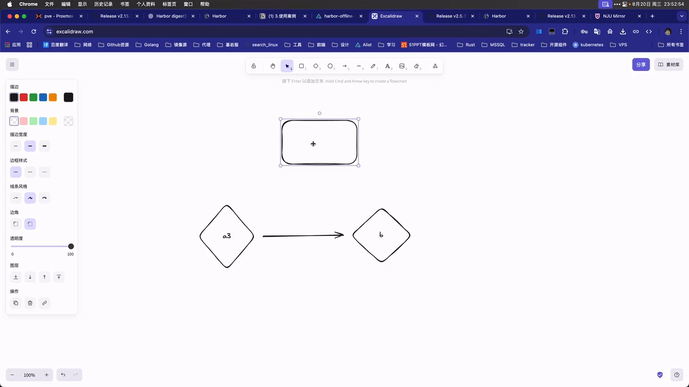

### 4.2 场景二：经过 registry 的在线签名与验证（最常用）

A 把「镜像 + 签名」push 到 registry，B 从 registry 直接拉取（[【跳转到 19:21】](https://www.bilibili.com/video/BV1Sme3zUExX/?p=1&t=1161)）。B 拉完后**仍然要验证**，而验证所需的**公钥依旧要单独拿到**——所以结论是：**签名和公钥缺一不可**（[【跳转到 20:36】](https://www.bilibili.com/video/BV1Sme3zUExX/?p=1&t=1236)）。

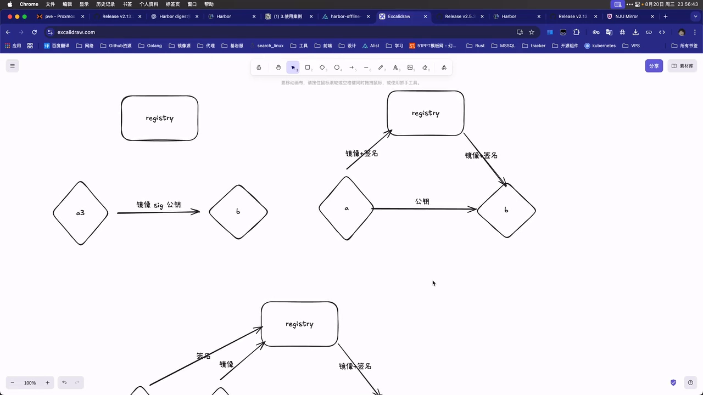

### 4.3 场景三：运维与安全分离（私钥不落在运维手里）

更贴近现实的第三种情况：**运维团队和安全团队分离**（[【跳转到 21:01】](https://www.bilibili.com/video/BV1Sme3zUExX/?p=1&t=1261)）。

- 运维**不掌控私钥**，只负责把做好的镜像 push 到 Harbor；
- 安全团队收到「有镜像上传」的提示后，**单独用私钥给这个镜像签名**；
- 使用方 B 拿到镜像、签名和公钥后照常验证。

这样私钥只掌握在安全团队手里，是权限上的合理切分。

### 4.4 命令与场景的对应关系

把命令和场景对起来记最省事（[【跳转到 33:27】](https://www.bilibili.com/video/BV1Sme3zUExX/?p=1&t=2007)）：

| 场景 | 签名 | 验证 |
| --- | --- | --- |
| 在线（对仓库里的镜像） | `cosign sign` | `cosign verify` |
| 离线（对二进制/载荷文件） | `cosign sign-blob` | `cosign verify-blob` |
| 附加说明类制品（attestation） | `cosign attest` | `cosign verify-attestation` |

一句话概括：**签和验基本是成对出现的，在线对在线、离线对离线。**

## 五、实操一：本地离线签名与验证（不经 registry）

这是最简单的闭环，也是讲者第一个完整演示的场景。

### 5.1 准备一份「要签的东西」：把镜像导出成 tar

先从 Docker Hub 拉一个 nginx 镜像，再用 `docker save` 把它存成 tar 包（[【跳转到 22:27】](https://www.bilibili.com/video/BV1Sme3zUExX/?p=1&t=1347)）——因为「离线的二进制签名」需要一个**具体的文件**作为被签对象。

### 5.2 用 `sign-blob` 对文件签名：别忘了关掉透明日志上传

签名的命令是 `cosign sign-blob`（[【跳转到 24:07】](https://www.bilibili.com/video/BV1Sme3zUExX/?p=1&t=1447)）——注意区分：`cosign sign` 是对**仓库里的镜像**做在线签名，`cosign sign-blob` 是对**二进制/文件**做签名。

执行时要带上 `--key cosign.key`（私钥文件），后面跟要签的文件；**会提示输入私钥密码**（[【跳转到 24:32】](https://www.bilibili.com/video/BV1Sme3zUExX/?p=1&t=1472)）。

这里有个**非常关键的坑**：sign-blob 默认会尝试把签名、时间等信息上传到**透明日志（transparency log，一个国外的服务器）**。讲者的建议是**关掉**（[【跳转到 24:57】](https://www.bilibili.com/video/BV1Sme3zUExX/?p=1&t=1497)）：

- 原因是「国内的网络环境实在不可控」；
- 关掉的方式是加 `--tlog-upload=false`；
- 另一个选择是自己搭一个 transparency log，但那有门槛（比如数据库等配套），所以这里先关掉（[【跳转到 25:22】](https://www.bilibili.com/video/BV1Sme3zUExX/?p=1&t=1522)）。

签名结果（一长串签名内容）可以**重定向保存成文件**，比如 `nginx.signature`；**每次签出来的结果都不一样**，这很正常（[【跳转到 26:12】](https://www.bilibili.com/video/BV1Sme3zUExX/?p=1&t=1572)）。

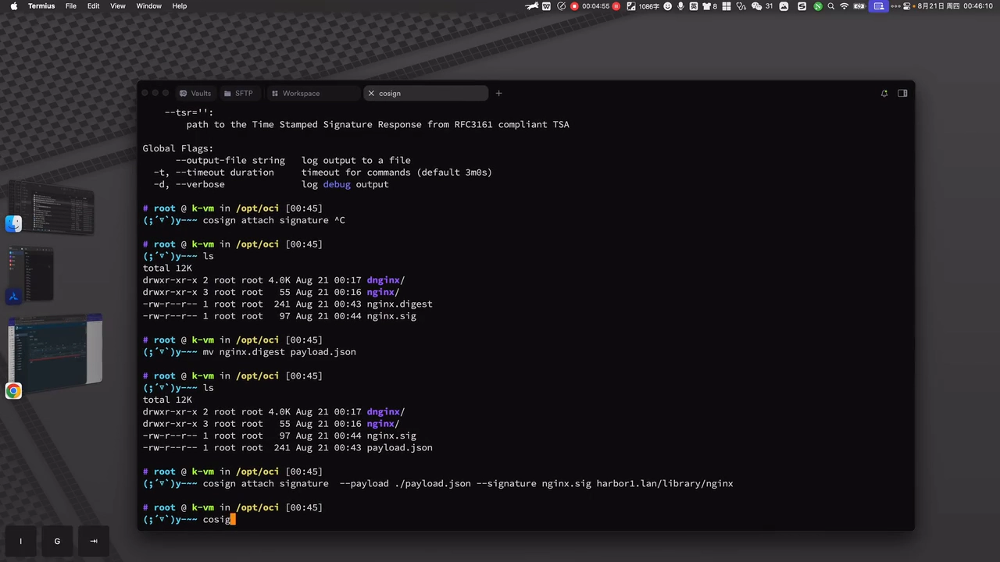

### 5.3 交付给验证方：三样东西一起传

要把**镜像 tar、签名文件、公钥 `cosign.pub`** 一起交给对方（[【跳转到 26:36】](https://www.bilibili.com/video/BV1Sme3zUExX/?p=1&t=1596)）。讲者把它们 `scp` 到另一台机器上验收。

### 5.4 在对方机器上验证：`verify-blob` 加 `--insecure-ignore-tlog`

在验证机上装好 cosign，然后执行 `cosign verify-blob`（[【跳转到 29:03】](https://www.bilibili.com/video/BV1Sme3zUExX/?p=1&t=1743)）。讲者一开始漏了参数、命令卡住，于是 `cosign verify-blob -h` 看帮助（[【跳转到 29:53】](https://www.bilibili.com/video/BV1Sme3zUExX/?p=1&t=1793)），确认需要指定 `--key`、`--signature` 等选项。

**卡住的真正原因是：验证时默认也会去查透明日志**。而签名时我们**没有上传**透明日志，所以验证时要**显式忽略这一步**（[【跳转到 30:43】](https://www.bilibili.com/video/BV1Sme3zUExX/?p=1&t=1843)）：

```bash
# 签名（本地，不上传透明日志）
cosign sign-blob --key cosign.key --tlog-upload=false nginx.tar > nginx.signature

# 验证（本地，忽略透明日志检索）
cosign verify-blob --key cosign.pub --signature nginx.signature \
  --insecure-ignore-tlog=true nginx.tar
```

`--insecure-ignore-tlog=true` 属于「不安全选项」里的一项，含义就是**不去透明日志里找数据**；打开它之后就变成**纯本地签名与验证**，彻底避免网络问题（[【跳转到 34:52】](https://www.bilibili.com/video/BV1Sme3zUExX/?p=1&t=2092)）。

### 5.5 签名和公钥都必须对得上

验证能不能过的判据很实在——**镜像的 digest 要打印出来**；如果验证不认，报错信息通常是**公钥解码失败 / 公钥与签名验证不上**。讲者当场把公钥内容改了一个字符复现了这个错误（[【跳转到 39:58】](https://www.bilibili.com/video/BV1Sme3zUExX/?p=1&t=2398)）。

这正是签名机制的意义所在：**镜像、签名、公钥三者必须严格对应，任何一处被改动都验不过。**

## 六、实操二：远程仓库在线签名与验证（最常用）

讲者说这是**用得最多**的一种方式（[【跳转到 34:52】](https://www.bilibili.com/video/BV1Sme3zUExX/?p=1&t=2092)）：镜像已经在仓库里，直接对仓库里的镜像签名，验证时也从仓库读。

### 6.1 把镜像推到 harbor1

先给本地镜像打上私有仓库的 tag，再登录并 push（[【跳转到 35:17】](https://www.bilibili.com/video/BV1Sme3zUExX/?p=1&t=2117)）：

```bash
docker tag nginx:latest harbor1.line/library/nginx:latest
docker login harbor1.line
docker push harbor1.line/library/nginx:latest
```

第一次 push 会报没权限（no auth），**`docker login` 之后重新 push 即可**（[【跳转到 35:44】](https://www.bilibili.com/video/BV1Sme3zUExX/?p=1&t=2144)）。推完后刷新 Harbor，`library` 下就有这个 nginx 镜像了，但**「已签名」那一列是个叉**（[【跳转到 35:59】](https://www.bilibili.com/video/BV1Sme3zUExX/?p=1&t=2159)）。

### 6.2 在线签名：`cosign sign --key`

```bash
cosign sign --key cosign.key harbor1.line/library/nginx:latest
```

执行时同样要**输入私钥密码**；同样会撞上**透明日志**提示，所以继续用 `--tlog-upload=false` 关掉。命令行还会提示「**你用的是 tag 而不是 digest 来签名**」——讲者说不打紧（[【跳转到 37:30】](https://www.bilibili.com/video/BV1Sme3zUExX/?p=1&t=2250)）。

> 小坑：讲者这台机器的 shell 里还残留着代理环境变量，导致签名/推送绕道，`unset` 掉代理后重新签才正常（[【跳转到 36:49】](https://www.bilibili.com/video/BV1Sme3zUExX/?p=1&t=2209)）。

签完后回 Harbor 刷新，**「已签名」不再是叉**，点开镜像展开，能看到一个 `signature` 层——相当于给镜像**单独附加了一份签名制品**（[【跳转到 38:12】](https://www.bilibili.com/video/BV1Sme3zUExX/?p=1&t=2292)）。

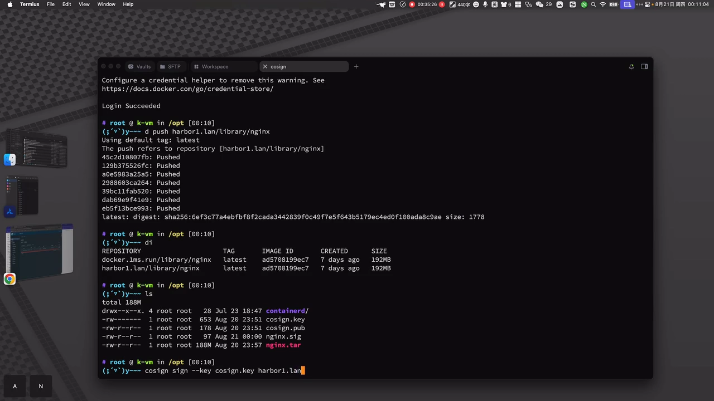

### 6.3 在线验证：`cosign verify --key`

```bash
cosign verify --key cosign.pub --insecure-ignore-tlog=true \
  harbor1.line/library/nginx:latest
```

只要命令行里打印出镜像的 digest（讲者示例中是 `6EF3…` 开头那串），就说明验证通过（[【跳转到 39:33】](https://www.bilibili.com/video/BV1Sme3zUExX/?p=1&t=2373)）。如前所述，把公钥改坏一个字符，立刻就变成「decode 失败 / 验证不上」（[【跳转到 40:08】](https://www.bilibili.com/video/BV1Sme3zUExX/?p=1&t=2408)）。

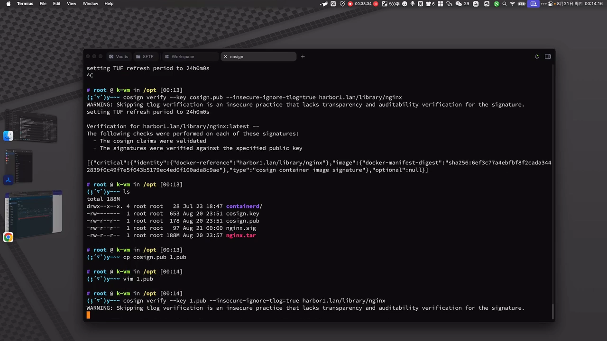

至此 cosign 的两种最基本打法（在线、离线）就都过了一遍。至于「运维与安全分离」那种变体，无非是**换成另一个人拿着私钥单独签名**，流程完全一样（[【跳转到 40:33】](https://www.bilibili.com/video/BV1Sme3zUExX/?p=1&t=2433)）。

## 七、实操三：离线签名并附加到仓库镜像（payload + attach）

这套流程比前面稍微复杂（p2 开场就说「**离线签名稍微有点复杂**」，[【跳转到 00:00】](https://www.bilibili.com/video/BV1Sme3zUExX/?p=2&t=0)）。它的适用理由是：`cosign sign` 直接对仓库在线签名，而 `cosign generate` 这一类命令**更适合 CI/CD 场景**（[【跳转到 00:24】](https://www.bilibili.com/video/BV1Sme3zUExX/?p=2&t=24)）。

### 7.1 先取「载荷（payload）」：其实就是要签的那串 digest

把镜像重新 push 到 harbor1（刷新可见，但**没有签名**），界面上能看到它的 **digest 是 `6EF3…C901` 这样一段 SHA-256 值**（[【跳转到 00:56】](https://www.bilibili.com/video/BV1Sme3zUExX/?p=2&t=56)）。

用 `cosign generate` 拿到这个镜像的**载荷**，并重定向存成文件（[【跳转到 01:01】](https://www.bilibili.com/video/BV1Sme3zUExX/?p=2&t=61)）：

```bash
cosign generate harbor1.line/library/nginx > nginx.payload.json
```

讲者对了一下：输出里的 `latest` digest「`6EF3` 开头、`C901` 结尾」，和 Harbor 界面上显示的**对得上**——说明载荷抓的就是这个镜像。

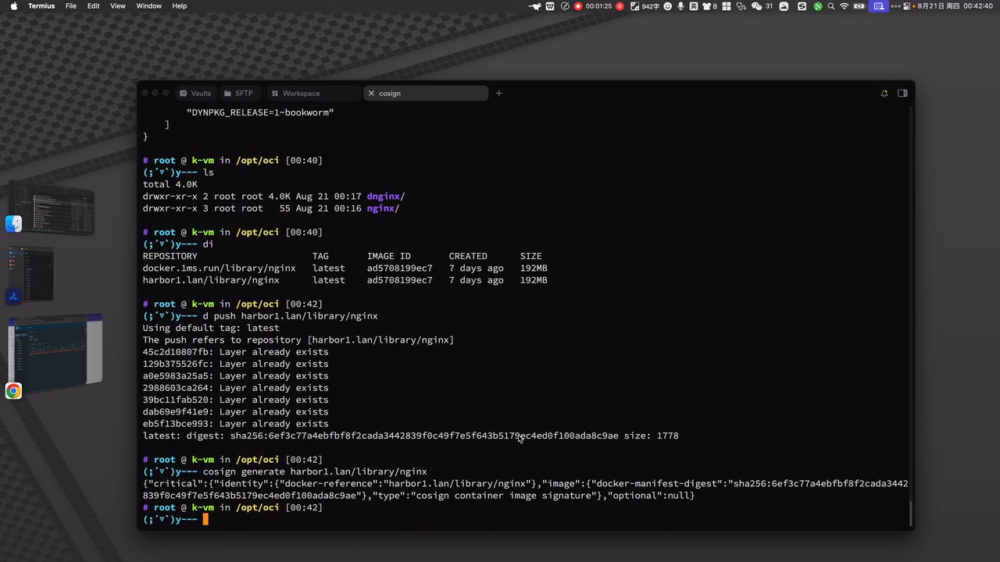

### 7.2 对载荷签名，再把签名「附加」回镜像

**第一步：对载荷文件签名**（等同于「对二进制签名」），把签名结果存成文件；因为每次签名结果都不同，所以要给它起个固定名字（[【跳转到 02:16】](https://www.bilibili.com/video/BV1Sme3zUExX/?p=2&t=136)）：

```bash
cosign sign-blob --key cosign.key --tlog-upload=false nginx.payload.json > nginx.signature
```

**第二步：把签名附加到镜像上**（[【跳转到 02:41】](https://www.bilibili.com/video/BV1Sme3zUExX/?p=2&t=161)）：

```bash
cosign attach signature \
  --payload nginx.payload.json \
  --signature nginx.signature \
  harbor1.line/library/nginx
```

`cosign attach` 的语义就是「**附加**」：除了签名（`signature`），它还能附加**说明性内容**，以及 **SBOM（软件物料清单）**——讲者提醒，SBOM 可以用 syft 之类的工具生成后再附加（[【跳转到 03:09】](https://www.bilibili.com/video/BV1Sme3zUExX/?p=2&t=189)）。

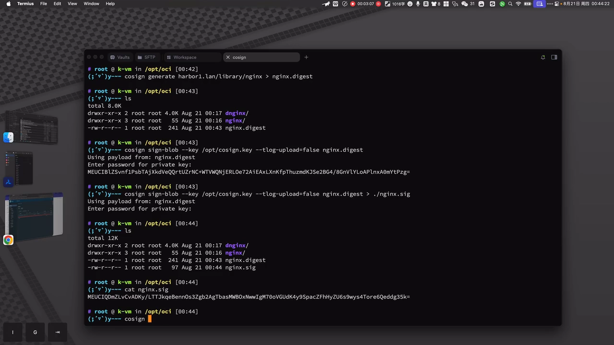

附加命令执行完**没有任何输出**，但回到 Harbor 刷新，就能看到**已经变成已签名**（[【跳转到 04:24】](https://www.bilibili.com/video/BV1Sme3zUExX/?p=2&t=264)）。

### 7.3 验证，并看清签名到底存在哪

验证还是那套（[【跳转到 04:49】](https://www.bilibili.com/video/BV1Sme3zUExX/?p=2&t=289)）：`cosign verify --key cosign.pub --insecure-ignore-tlog=true <镜像>`，digest 对得上即成功。讲者还指出：**签名本身也有一个 SHA-256 值**（示例里 `A134C…` 开头）（[【跳转到 05:49】](https://www.bilibili.com/video/BV1Sme3zUExX/?p=2&t=349)）。

想知道签名在仓库里的**存放结构**，可以用 `cosign triangulate`（树状列出）来看（[【跳转到 05:58】](https://www.bilibili.com/video/BV1Sme3zUExX/?p=2&t=358)）：

```bash
cosign triangulate harbor1.line/library/nginx
```

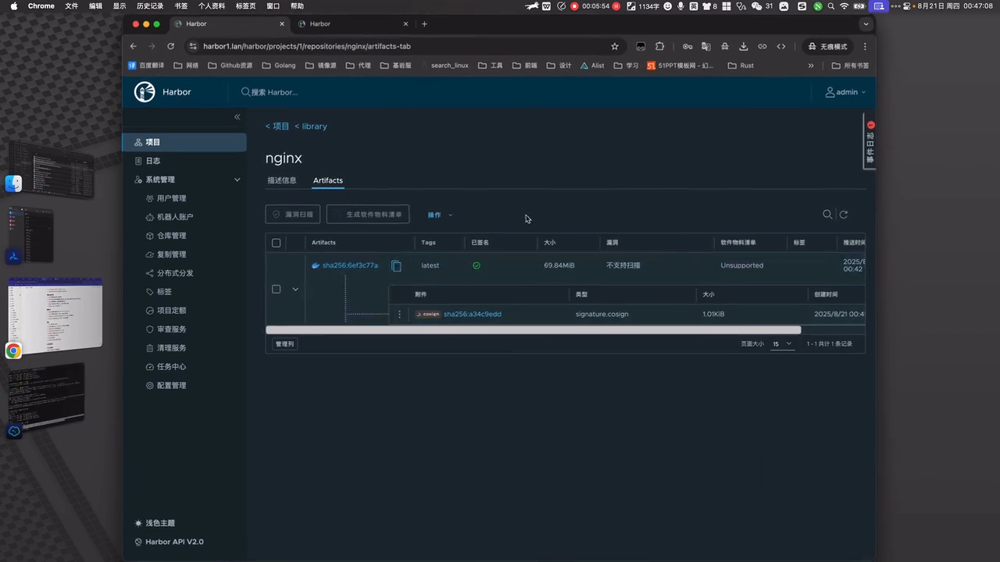

讲者也说 triangulate **不算精确**——想找实际文件，直接点进 Harbor 界面看那一层更直观；或者把镜像 `cosign save` 下来看它的 `index.json`：以前只有镜像自己那一层，**签名之后会多出 cosign 相关的层**，进去用 `jq` 看就能看到真正的签名值（[【跳转到 07:02】](https://www.bilibili.com/video/BV1Sme3zUExX/?p=2&t=422)）。

### 7.4 清理签名：`cosign clean --type`

签名是可以清掉的。`cosign clean` 可以指定类型：`sbom`、`attestation`、`signature`，**全清用 `--type=all`**（[【跳转到 09:09】](https://www.bilibili.com/video/BV1Sme3zUExX/?p=2&t=549)）：

```bash
cosign clean --type=all harbor1.line/library/nginx
```

输入 `Y` 确认后，会显示从镜像上 `remove .sig`，Harbor 刷新一下签名就**清干净了**（[【跳转到 09:34】](https://www.bilibili.com/video/BV1Sme3zUExX/?p=2&t=574)）。典型用途是：**发现镜像有问题 → 清掉签名 → 重新打包、重新上传**。

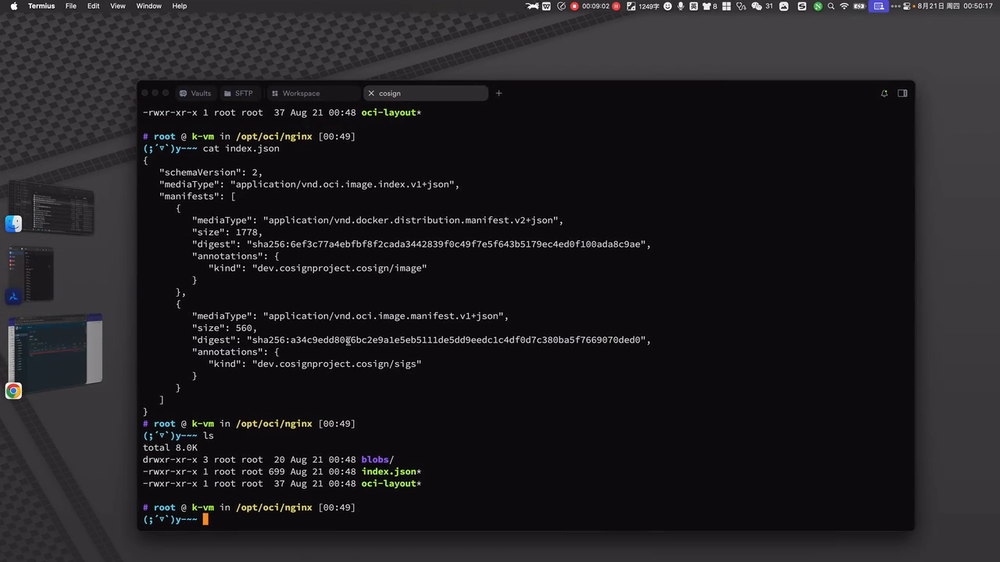

## 八、镜像与签名怎么在仓库之间迁移

这是最初准备两套 Harbor 的目的：验证「**同一个镜像 + 签名**能不能在两个 Harbor 之间迁移」。

### 8.1 能互访时：`cosign copy`

重新给 harbor1 上的镜像签名，然后往 harbor2 复制（[【跳转到 10:16】](https://www.bilibili.com/video/BV1Sme3zUExX/?p=2&t=616)）：

```bash
cosign copy --only=signature --force \
  harbor1.line/library/nginx harbor2.line/library/nginx
```

要点：

- `--only=signature` 表示**只迁签名**；默认是**镜像和签名都迁**，也可以只迁一个（[【跳转到 11:32】](https://www.bilibili.com/video/BV1Sme3zUExX/?p=2&t=692)）；
- `-f/--force` 是**复写**；命令里还能指定**要迁移的平台**；
- 从 harbor1 读不需要权限，但**往 harbor2 写需要权限**，所以得先 `cosign login harbor2.line`（也支持直接在命令里带用户名密码）（[【跳转到 11:57】](https://www.bilibili.com/video/BV1Sme3zUExX/?p=2&t=717)）。

登录后重试即成功：harbor2 上**镜像加签名都到位了**（digest 一致）（[【跳转到 12:47】](https://www.bilibili.com/video/BV1Sme3zUExX/?p=2&t=767)）。

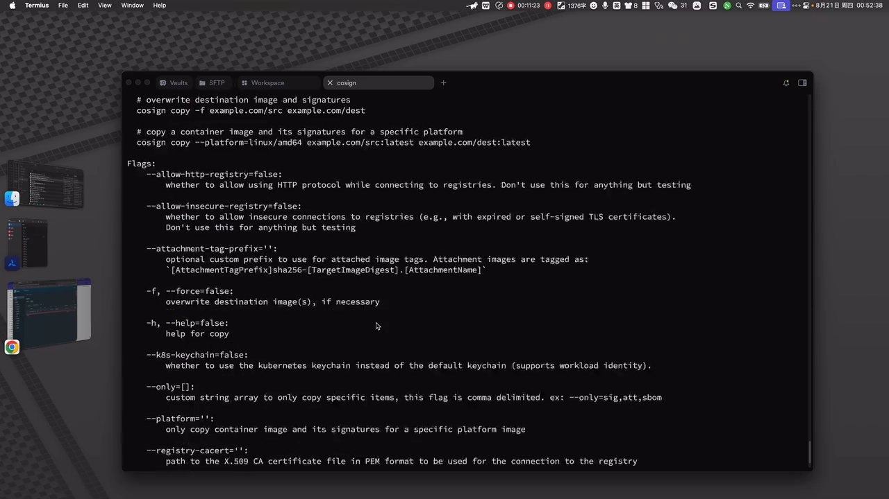

### 8.2 不能互访时：`cosign save` + `cosign load`

如果两个 Harbor **不在同一网段、无法互相访问**，`copy` 就不适用了，改用「先存本地、再加载上去」（[【跳转到 13:42】](https://www.bilibili.com/video/BV1Sme3zUExX/?p=2&t=822)）：

```bash
cosign save harbor1.line/library/nginx --dir nginx     # 导出到本地目录
cosign load --dir nginx harbor2.line/library/nginx     # 从本地目录加载进目标仓库
```

讲者的总结是：**`save` + `load`（顶多再指定个 `--dir`）等价于 `copy`**；区别在于 **`copy` 要求两个仓库能互访（同网段），互访不了就用 `save` + `load`——这就算是一次「迁移」**（[【跳转到 15:12】](https://www.bilibili.com/video/BV1Sme3zUExX/?p=2&t=912)）。

### 8.3 密钥相关：`import-key-pair` 与 `public-key`

- **`cosign import-key-pair`**：当你的私钥**不是 cosign 生成的**（来自其它来源）时，可以用它导入（[【跳转到 15:51】](https://www.bilibili.com/video/BV1Sme3zUExX/?p=2&t=951)）；
- **`cosign public-key`**：如果**公钥丢了**，可以用 `cosign public-key --key cosign.key` **从私钥重新导出公钥**，而且**每次导出的结果都是固定的**——因为公钥本来就是从私钥**推导**出来的（[【跳转到 15:56】](https://www.bilibili.com/video/BV1Sme3zUExX/?p=2&t=956)）。

> 反过来不成立：**私钥丢了就是真丢了**，公钥推导不出私钥。这也是为什么前面反复强调「私钥一定要保存好」。

## 九、签的到底是什么：docker save 与 OCI 目录的区别

最后补一个容易被忽略但很关键的知识点：**被签名的对象**是什么。

讲者用 skopeo 把一个镜像导出成 **OCI 目录**来对照（[【跳转到 41:28】](https://www.bilibili.com/video/BV1Sme3zUExX/?p=1&t=2488)）：

```bash
skopeo copy docker://nginx:latest oci:./nginx:latest
```

- **`docker save` 出来的结构比较「平」**：核心是一个 `manifest`（清单）文件，里面记录**每一层的 digest 和 size**，还有 `schemaVersion`、`mediaType`（这里是 image）、`layers` 各层的类型，以及 `annotations`（注解）如 **revision**（修订版本）、创建时间等信息（[【跳转到 42:43】](https://www.bilibili.com/video/BV1Sme3zUExX/?p=1&t=2563)）；
- **OCI 目录**则包含 **`index.json`（指定整体 digest）**、`oci-layout`，以及装着实际内容的 `blobs` 目录；真正指向 manifest 的是 `index.json` 里那个 digest（[【跳转到 44:10】](https://www.bilibili.com/video/BV1Sme3zUExX/?p=1&t=2650)）；
- **两者结构不一样**。而**签名时实际是对 `index.json` 这个文件去签的**——做「本地签名」时，就是先把 `index.json` 取出来，再用 `cosign sign-blob` 指定私钥去签（[【跳转到 45:03】](https://www.bilibili.com/video/BV1Sme3zUExX/?p=1&t=2703)）。

理解这一层，就能解释为什么前面「离线签名」要先 `generate` 出 payload 再签：**payload 里装的就是这串被签的 digest**，签名和验证其实始终围绕「**同一串 digest**」进行。

## 小结

- **原理**：cosign 用**私钥签镜像 manifest 的 digest、公钥做验证**；digest 一变就验不过，因此它能回答「镜像是不是你信任的那个人做的、有没有被改过」。
- **安装与原理一样轻**：一个二进制丢进 `/usr/local/bin` 即可；签名的对象是**镜像内容的摘要**，不是镜像文件本身。
- **四种场景**：本地离线（不经 registry）、仓库在线（最常用）、离线签名+附加（CI/CD 友好）、运维与安全分离（私钥只归安全团队）。
- **两条命令主线**：`sign`/`verify` 对仓库里的镜像；`sign-blob`/`verify-blob` 对本地文件/载荷——**签名与验证成对使用**。
- **透明日志（tlog）要成对处理**：签名时 `--tlog-upload=false` 关掉上传，验证时 `--insecure-ignore-tlog=true` 忽略检索，否则要么依赖不可控的外网、要么命令直接卡住。
- **黑话速记**：`generate` 取载荷、`sign-blob` 签载荷、`attach signature` 把签名挂回镜像、`verify` 验收、`triangulate` 看存放结构、`clean` 清签名、`copy`/`save`+`load` 做迁移。
- **密钥纪律**：**公钥可随便发、私钥必须藏好**；公钥丢了能由私钥重新导出（且结果固定），私钥丢了只能重新生成密钥对。
- **工程化提示**：先准备**内部 PKI（cfssl，注意用 SAN）** 给 Harbor 上 TLS，再上 cosign；生产上把私钥交给安全团队、把签名放进 CI/CD，是最顺的切分方式。

## 关键术语速查

| 术语 | 一句话解释 |
| --- | --- |
| cosign | Sigstore 项目下用于给镜像/OCI 制品签名与验证的开源工具 |
| 签名 / 验证 | 私钥对 digest 签名；公钥与 digest 比对，一致即「未篡改、来源可信」 |
| digest | 内容的 SHA-256 摘要，内容一变就完全不同；镜像的「唯一指纹」 |
| manifest / index.json | 描述镜像由哪些层组成、每层 digest 与大小的清单；OCI 目录里由 `index.json` 指向 |
| OCI 制品 | 除镜像外凡能推进 registry 的东西（SBOM、二进制、WASM 等）都可签名 |
| 透明日志（tlog） | 公开记录签名与时间的日志服务，用于发现与时间戳；可用 `--tlog-upload=false` / `--insecure-ignore-tlog=true` 在本地绕开 |
| `sign` / `verify` | 对**仓库中的镜像**在线签名与验证 |
| `sign-blob` / `verify-blob` | 对**本地文件/载荷**离线签名与验证 |
| `generate` | 取出待签名的载荷（内含镜像 digest） |
| `attach signature` | 把签名（或 SBOM/attestation）附加到镜像上 |
| `triangulate` | 查询某个镜像对应的签名制品存放结构 |
| `clean --type` | 按类型清除签名/SBOM/attestation，`--type=all` 全清 |
| `copy` / `save`+`load` | 同网段用 copy，跨网段用 save+load 完成镜像与签名的迁移 |
| `public-key` / `import-key-pair` | 由私钥重新导出公钥 / 导入外部生成的密钥对 |
| PKI、cfssl、SAN | 内部证书体系与其工具；TLS 校验看 SAN 扩展字段而非 CN |
