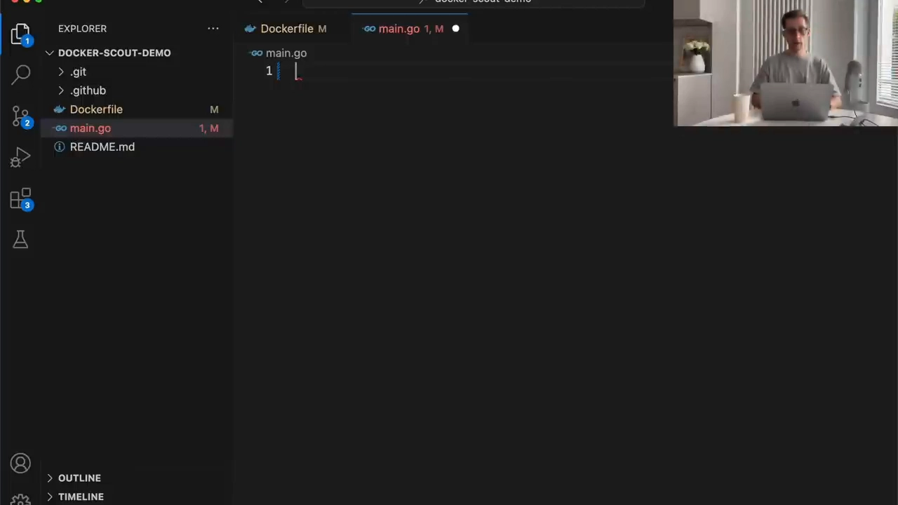
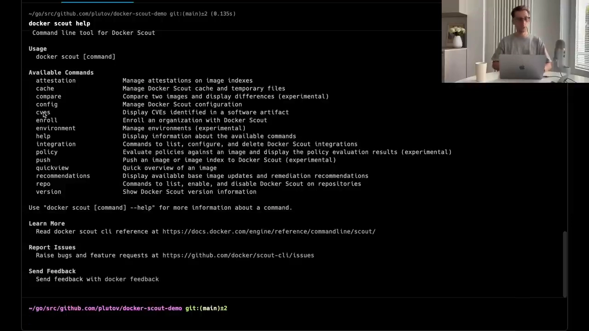
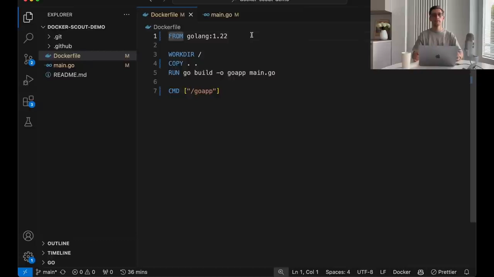
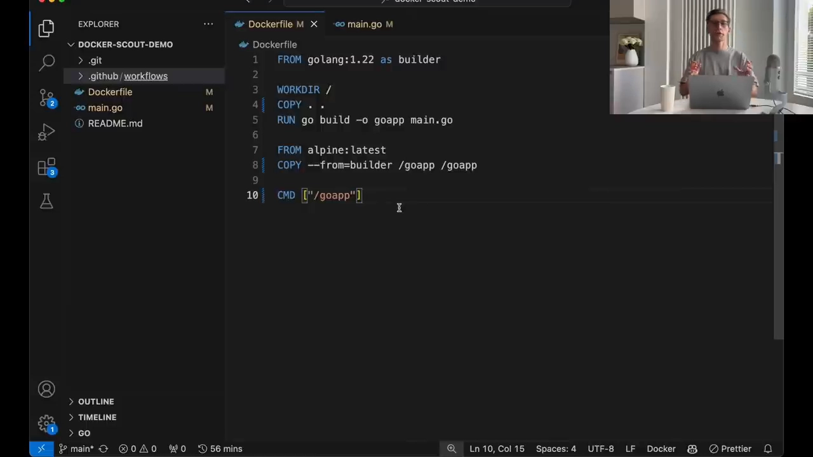

# 用 Docker Scout 扫描容器镜像漏洞：从手动排查到 CI 自动拦截

> 视频来源：[Identifying Container Image vulnerabilities with Docker Scout](https://www.youtube.com/watch?v=t3wv0Fi3ONE)（YouTube · Package Main · 约 10 分钟）
> 主讲：Alex Pluta（Package Main）
> 所属：容器技术 · 第 3 章 镜像、文件系统与供应链 · 3.4 镜像供应链 · 3.4.4 镜像扫描

## 本讲要解决的核心问题（SCQA）

**背景**：容器镜像给我们带来很多好处，但一个镜像往往由**很多层（layer）叠加**而成，每一层都可能携带软件与依赖，也就都可能夹带漏洞；开源项目每天都有新漏洞被发现，维护者忙着打补丁——仅 2023 年一年，就新增了约 **29,000 个漏洞**（[【跳转到 00:44】](https://www.youtube.com/watch?v=t3wv0Fi3ONE&t=44)）。

**冲突**：镜像里的漏洞不会自己消失，而你也不太可能逐个人工去看每个镜像里装了什么、依赖了哪个有问题的版本。现状是"谁能发现问题，谁就焦虑"。

**疑问**：有没有一套可操作的流程——既能**扫描出漏洞**，又能**把它修掉**，还能**在后续每次构建时自动拦截**？

**回答（中心思想）**：**漏洞扫描 + 把它接进开发生命周期**是答案。本讲用一个极简的 Go "Hello World" 镜像做样本，演示一条完整闭环：**写好 Dockerfile → 构建镜像 → 用 Docker Scout 扫描出漏洞 → 按建议修掉（升级基础镜像 / 多阶段构建）→ 再把扫描接进 GitHub Actions，让每次提交都自动体检**。扫描器不止 Docker Scout 一家（还有 Aqua Security、Snyk、Tenable.io 等），它们目标一致——**发现并修补漏洞**（[【跳转到 01:13】](https://www.youtube.com/watch?v=t3wv0Fi3ONE&t=73)）。

## 一、先做一个会被扫出漏洞的样本镜像

### 1.1 为什么用"故意有点旧"的基础镜像

讲者从一个最基础的 Go "Hello World" 程序开始（[【跳转到 02:12】](https://www.youtube.com/watch?v=t3wv0Fi3ONE&t=132)），为它写一个 Dockerfile：

- 基础镜像选用 **`golang:1.19`**——讲者特意说明它"不是最新、但也不算太旧"，因为**现实中很多人仍在项目里用它**，这样演示出来的问题才有代表性；
- 接着定义工作目录、拷贝源码、执行 `go build` 编译，最后设定容器启动时运行编译出的程序。

这份 Dockerfile 本身没错，但它**默认继承了基础镜像里的一切**——包括那些你运行时根本用不到的工具，而漏洞就藏在其中。



### 1.2 构建并跑起来，先确认它能用

扫描之前必须先有镜像，所以先构建再验证（[【跳转到 03:02】](https://www.youtube.com/watch?v=t3wv0Fi3ONE&t=182)）：

```bash
docker build -t go-app .          # 构建镜像
docker run go-app                 # 运行，应输出 "Hello World"
```

看到容器打印出 "Hello World"，说明镜像可用——**接下来才轮到"它安不安全"这个问题**（[【跳转到 03:13】](https://www.youtube.com/watch?v=t3wv0Fi3ONE&t=193)）。

## 二、认识 Docker Scout：它能回答什么问题

### 2.1 使用前提与免费版的限制

如果你用的是较新的 Docker Desktop，命令行工具 **Docker Scout** 通常已经自带（[【跳转到 03:36】](https://www.youtube.com/watch?v=t3wv0Fi3ONE&t=216)）。但有两条要注意：

- 它**需要一个 Docker Hub 账号**才能运行；
- 免费版有**限制**：可以扫描**远程镜像**、但**并非所有仓库都可用**（例如 Google Container Registry 当时还不支持）（[【跳转到 04:01】](https://www.youtube.com/watch?v=t3wv0Fi3ONE&t=241)）。

启用方式是先登录、再注册账号（讲者已登录，故直接 enroll）：

```bash
docker login
docker scout enroll <你的账号名>
```

### 2.2 四条常用子命令

`docker scout` 下有几条关键命令（[【跳转到 04:11】](https://www.youtube.com/watch?v=t3wv0Fi3ONE&t=251)）：

- **`cves`**：列出镜像里识别到的 CVE / 漏洞清单——本讲重点；
- **`recommendations`**：给出"怎么修"的建议；
- **`quickview`**：一份精简汇总，概览建议清单、基础镜像报告与你构建的镜像；
- **`compare`**：比较两个镜像之间的差异。

## 三、照出漏洞，再把它修掉

### 3.1 第一次扫描：一屏红字

对刚构建好的镜像执行扫描，结果相当"壮观"（[【跳转到 04:36】](https://www.youtube.com/watch?v=t3wv0Fi3ONE&t=276)）：

```bash
docker scout cves go-app
```

- **2 个致命（critical）漏洞、9 个高危（high）、12 个中危（medium）、46 个低危（low）**。

一个"什么都没做"的 Hello World，竟然带着这么多问题——**漏洞不是来自你的代码，而是来自基础镜像**。



### 3.2 听建议走一步：升级基础镜像

与其自己研究该升到哪个版本，不如直接问工具（[【跳转到 05:01】](https://www.youtube.com/watch?v=t3wv0Fi3ONE&t=301)）：

```bash
docker scout recommendations go-app
```

它给出的第一条建议是：**把基础镜像从 1.19 升到 1.22**（[【跳转到 05:26】](https://www.youtube.com/watch?v=t3wv0Fi3ONE&t=326)）。改一行 `FROM golang:1.22`、重建、再扫，结果明显好转：

- 仍是 **1 个致命、2 个高危**，但中危少了很多，低危也只剩个位数（[【跳转到 05:51】](https://www.youtube.com/watch?v=t3wv0Fi3ONE&t=351)）。


### 3.3 揪出"剩下的那个致命漏洞"：来自 Git

升级基础镜像后剩下的致命漏洞，来源是 **Git 软件**（[【跳转到 06:16】](https://www.youtube.com/watch?v=t3wv0Fi3ONE&t=386)）。这里有个关键的追问（[【跳转到 06:31】](https://www.youtube.com/watch?v=t3wv0Fi3ONE&t=391)）：

> **运行这个 Hello World 程序，真的需要 Git 吗？**

答案是**不需要**。Git 只在**构建阶段**用来下载模块和依赖仓库；而 Go 是**编译型语言**，编译出的二进制运行时并不依赖 Git。也就是说，**Git 只有构建时才要，运行时纯属多余**——留着它，就等于白白把它的漏洞带进生产镜像。

### 3.4 用多阶段构建把"构建期"和"运行期"分开

解决办法就是大家熟悉的**多阶段构建（multi-stage build）**（[【跳转到 06:44】](https://www.youtube.com/watch?v=t3wv0Fi3ONE&t=404)）：

- 把原基础镜像标记为 **`builder`** 阶段，专门负责编译；
- 用一个**极小的运行镜像**（如 **`alpine:latest`**）作为最终阶段；
- 只把 **builder 里编译好的 Go 程序**拷贝到 Alpine 镜像里运行。

```dockerfile
FROM golang:1.22 AS builder
WORKDIR /app
COPY . .
RUN go build -o app main.go

FROM alpine:latest
COPY --from=builder /app/app /app
CMD ["/app"]
```

> 一句话记住：**多阶段构建 = 把"用得上的那个文件"留下，把"只用于构建的工具"整层丢掉**。建构越简单、装的东西越少，能夹带的漏洞就越少。



重建、再扫（[【跳转到 07:09】](https://www.youtube.com/watch?v=t3wv0Fi3ONE&t=429)），结果令人松一口气：

> **no vulnerabilities found** —— 没有再发现漏洞（至少这个样本是这样）（[【跳转到 07:14】](https://www.youtube.com/watch?v=t3wv0Fi3ONE&t=434)）。

## 四、把扫描搬进 CI/CD：让每次提交都自动体检

### 4.1 手动扫描不够，持续扫描才是正经的漏洞管理

手动扫描有价值，但**把安全检查接进开发生命周期、接进 CI/CD 工作流**，才算得上"严肃的漏洞管理"（[【跳转到 07:35】](https://www.youtube.com/watch?v=t3wv0Fi3ONE&t=455)）。它能做到两件手动做不到的事：

- **每次构建都自动扫描**；
- **确保没有任何带漏洞的软件溜进生产**。

Docker Scout 提供了对应的 **GitHub Action**，让你把 Scout 命令直接跑在流水线里。

### 4.2 一个最小可用的 workflow 长什么样

讲者给出一个示例 workflow（[【跳转到 08:00】](https://www.youtube.com/watch?v=t3wv0Fi3ONE&t=480)）：它在**每次向任意分支 push** 时触发，步骤依次是（[【跳转到 08:05】](https://www.youtube.com/watch?v=t3wv0Fi3ONE&t=485)）：

1. **checkout** 拉取仓库；
2. **setup docker buildx**：准备构建环境；
3. **构建镜像**，并设 `push: false`（示例里不推送到任何仓库）；
4. **`docker/login` 登录 Docker Hub**——因为 Scout 需要 Docker Hub 认证，所以要预先在 Secrets 里放两个变量：**Docker Hub 用户名**和一个**访问令牌**（token，可在 Docker Hub 平台上获取）（[【跳转到 08:30】](https://www.youtube.com/watch?v=t3wv0Fi3ONE&t=510)）；
5. **执行 Docker Scout 命令**：这里可以一次跑多条命令（用逗号分隔），示例里跑的是 `cves`；它还能**在被需要时给你的 Pull Request 自动留言**。



### 4.3 看它跑起来

向演示仓库提交一次改动，就能看到 Action 开始运行（[【跳转到 09:11】](https://www.youtube.com/watch?v=t3wv0Fi3ONE&t=551)）。稍等片刻，运行成功，Scout 命令在下方留下了评论：和本地一样，**没有发现致命或高危漏洞**——但讲者强调，**假如有，它们同样会显示在这里、或出现在你的 Pull Request 上**（[【跳转到 09:20】](https://www.youtube.com/watch?v=t3wv0Fi3ONE&t=560)）。

把这类实践纳入软件开发生命周期，就能让开发者维护一个更安全的容器生态（[【跳转到 09:43】](https://www.youtube.com/watch?v=t3wv0Fi3ONE&t=583)）。

## 小结

- 容器镜像的漏洞**大多来自基础镜像**，而不是你自己写的代码；2023 年新增约 29,000 个漏洞，靠人工盯不过来。
- **Docker Scout** 可以 `cves` 列漏洞、`recommendations` 给修法、`quickview` 汇总、`compare` 比镜像；使用前需 Docker Hub 账号，免费版对远程镜像/仓库有限制。
- **先升级基础镜像**：`1.19 → 1.22` 一步就把漏洞从"2 致命 + 9 高危"降到"1 致命 + 2 高危"。
- 剩下的漏洞要**追根溯源**：本例致命漏洞来自 Git，而 Git **只是构建期工具**，运行期用不到。
- **多阶段构建**把构建期与运行期分离，只保留编译产物，能让镜像漏洞归零。
- 手动扫描之上，用 **GitHub Actions + Docker Scout** 让每次 push 自动扫描、并在 PR 上留言，才是持续、可控的漏洞管理。

## 关键术语速查

| 术语 | 一句话解释 |
| --- | --- |
| 漏洞扫描（vulnerability scanning） | 检查镜像/配置里已知安全问题并输出报告的过程。 |
| Docker Scout | Docker 生态里的镜像漏洞扫描与建议工具，按 CVE 列出问题并给出修法。 |
| CVE | 公开漏洞的通用编号体系；`docker scout cves` 即列出镜像命中的 CVE。 |
| 基础镜像（base image） | Dockerfile 中 `FROM` 指定的起始镜像，它的漏洞会被后镜像继承。 |
| 多阶段构建（multi-stage build） | 在同一个 Dockerfile 里用多个 `FROM` 分阶段构建，最终只保留需要的产物，丢弃构建期工具。 |
| 构建期 / 运行期 | 镜像"被编译出来"的阶段 / 镜像"实际跑起来"的阶段；Git 等工具只属于前者。 |
| Docker Hub token | 用于 CI 中登录 Docker Hub 的访问令牌，配合用户名放进 GitHub Secrets。 |
