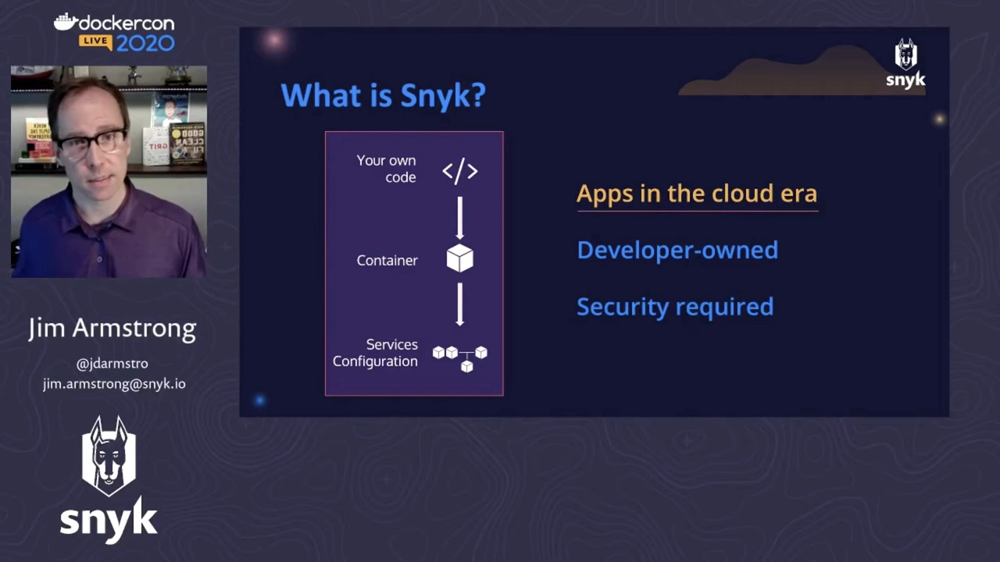
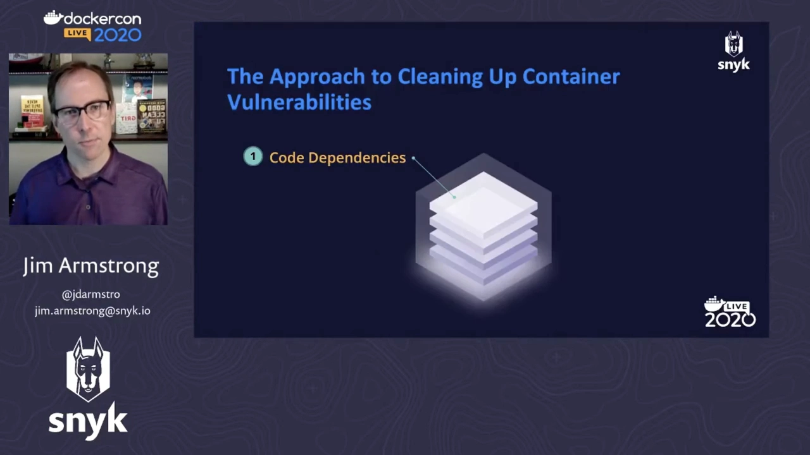
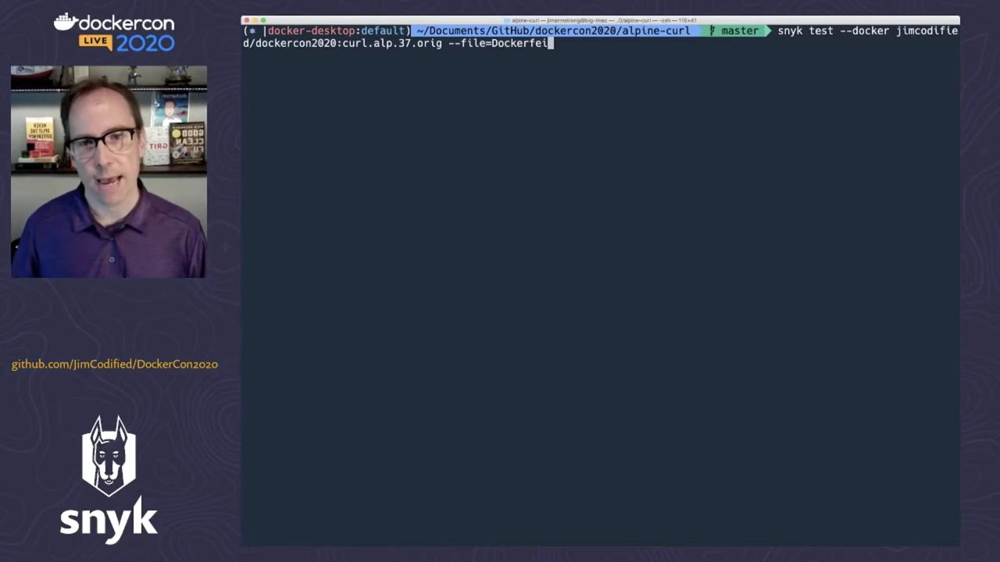
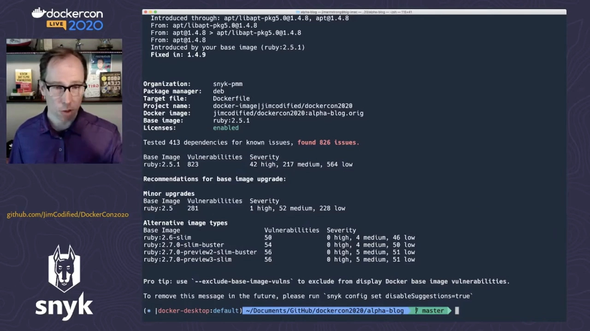
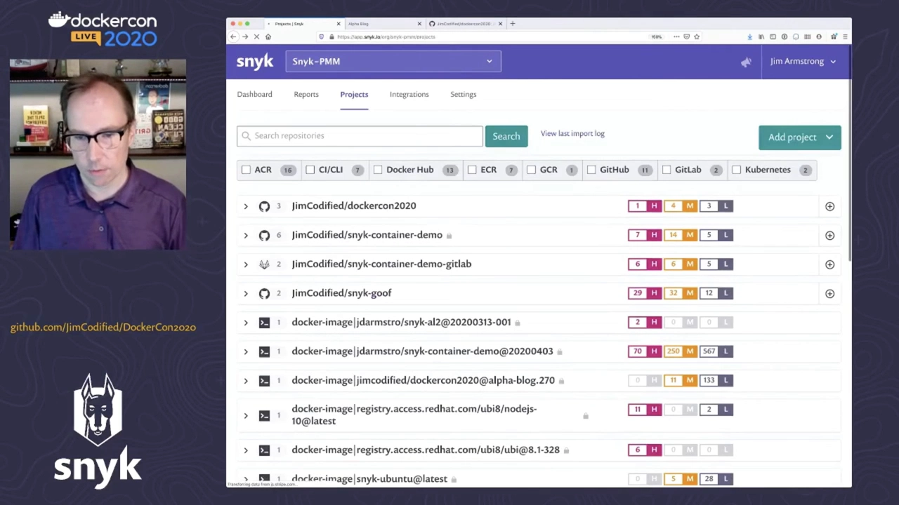
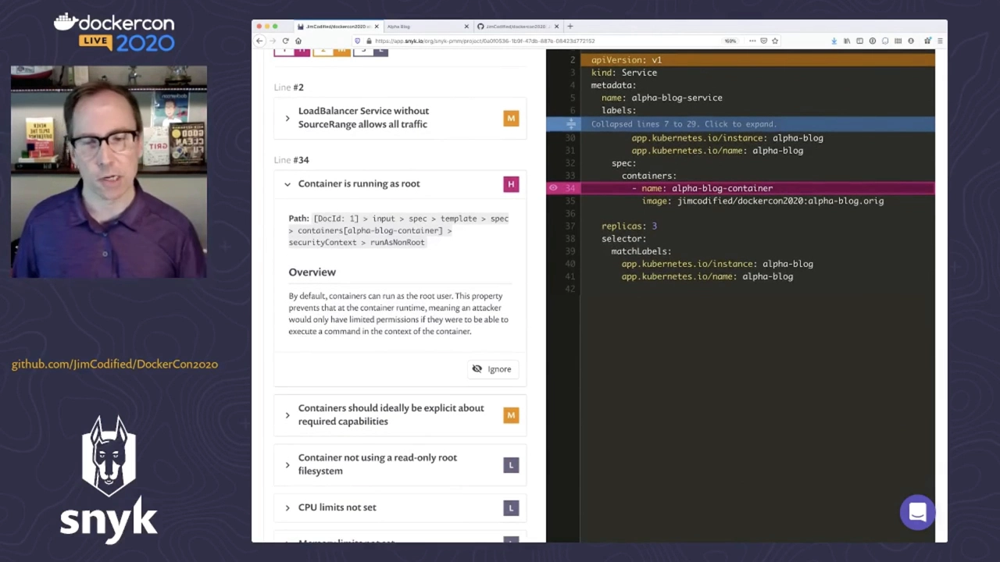

# 容器有漏洞了，然后呢？——用一个四步流程把漏洞清出容器

> 视频来源：[Your Container Has Vulnerabilities. Now What?](https://www.youtube.com/watch?v=-013I3bYDas)（YouTube · DockerCon 演讲 · 约 29 分钟）
> 主讲：Jim（Snyk 产品市场总监）
> 所属：容器技术 · 第 3 章 镜像、文件系统与供应链 · 3.4 镜像供应链 · 3.4.4 镜像扫描
> 说明：本文基于英文自动字幕整理，原始字幕中的听写错误（如把 **Snyk** 听成 "Sneak"、把 **Gemfile** 听成 "gym file"、把 **YAML** 听成 "ammo"、把 **libssh2** 听成 "live SSH2" 等）已在正文中按上下文纠正。

## 本讲要解决的核心问题（SCQA）

**背景**：今天说"一个应用"，早就不只是你写的那点代码了。它通常还包含：一堆**开源依赖**、被打包进的**容器镜像**、以及运行时用到的 **Kubernetes 等编排配置**。（[【跳转到 01:56】](https://www.youtube.com/watch?v=-013I3bYDas&t=116)）

**冲突**：这一整摞东西**都需要各自的安全检查**，可现实是——你扫描后拿到一张漏洞清单，**却往往不知道每个漏洞到底来自哪一层**，也就无从下手：该改代码？换基础镜像？还是删掉某个装进去的工具？

**疑问**：能不能有一套**系统化的流程**，把漏洞一层一层清出去，而不是对着一长串 CVE 干瞪眼？

**回答（中心思想）**：把"应用"拆成四层，按顺序各个击破——**① 代码依赖 → ② 基础镜像 → ③ 你自己的层（工具/库）→ ④ 配置**。本讲用 Snyk 工具演示两个容器：一个极简的 Alpine + curl，一个较真实的 Ruby on Rails 应用，走完整条"清理漏洞"的路。（[【跳转到 05:05】](https://www.youtube.com/watch?v=-013I3bYDas&t=305)）

> 开场花絮：讲者预告 **Docker 与 Snyk 正在合作**，把安全能力直接加进 Docker——将来可直接**在 Docker 桌面端与 Docker Hub 里扫描镜像**，而不必像今天这样跑 Snyk 命令（[【跳转到 00:30】](https://www.youtube.com/watch?v=-013I3bYDas&t=30)）。

## 一、先给"应用"重新画一张图

### 1.1 应用 = 代码 + 依赖 + 容器 + 编排 + 配置

Jim 先把"应用"的定义摊开（[【跳转到 01:56】](https://www.youtube.com/watch?v=-013I3bYDas&t=116)）：

- **你的代码**是显而易见的一部分，但它往往还带**大量开源依赖**——这让"代码"的边界**显著扩大**；
- 这些代码最终被**装进一个容器**；而对今天在场（DockerCon）的人来说，这几乎是默认事实；
- 容器通常**和一堆别的容器一起**跑在 **Kubernetes** 之类的地方，**随之而来的还有配置**。

Jim 主张：**以上所有东西都属于"应用"**——都是"你写的那段代码走到生产"所必需的，也基本都由某个**开发者角色**负责，要经过代码评审、CI 等流程。因此**它们每一项都需要各自的安全检查**。

### 1.2 Snyk 覆盖整摞东西，且强调"帮你修"

这就是 Snyk 的定位（[【跳转到 03:11】](https://www.youtube.com/watch?v=-013I3bYDas&t=191)）——**安全地覆盖这一整摞**：

- **对代码**：扫描你引入的开源依赖，查**漏洞、许可证与版权**信息，并且不满足于"列清单"，而是**自动化地帮你把问题修掉**；
- **对容器**：扫描**镜像**、给出漏洞清单，还能**结合 Dockerfile** 做分析——看清**基础镜像**的影响、以及**你添加的层**在哪里引入了漏洞；
- **对配置**：连 **Kubernetes 配置文件**也能扫描（[【跳转到 04:01】](https://www.youtube.com/watch?v=-013I3bYDas&t=241)）。

这些能力背后是 Snyk 自己的**安全情报服务**：既从社区收集漏洞，也**回馈社区自己的研究**，并且会为漏洞补上**更贴近开发者理解的解释**，而不只是给出面向安全人员的原始 CVE 信息（[【跳转到 04:26】](https://www.youtube.com/watch?v=-013I3bYDas&t=266)）。

## 二、核心方法：清理漏洞的四步流程

讲者把"把漏洞清出容器"总结成一个**简单四步**（[【跳转到 05:14】](https://www.youtube.com/watch?v=-013I3bYDas&t=314)）：

1. **代码依赖**：这是你**最能直接控制**、也最常改动的一层，因此可以**尽早、频繁地检查**；理想情况下，等它进入容器时就该尽量干净。
2. **基础镜像**：这是容器场景里的重头戏。遵循镜像/Dockerfile 最佳实践的人都知道——**选精简（slim）的基础镜像**，再按需往上加；而**厚镜像默认带着一堆你不需要的东西**，会长期抬高漏洞数量（[【跳转到 05:39】](https://www.youtube.com/watch?v=-013I3bYDas&t=339)）。
3. **你自己的层**：你往容器里加的工具与库，会**连带引入额外的依赖与漏洞**，也要一并处理（[【跳转到 06:04】](https://www.youtube.com/watch?v=-013I3bYDas&t=364)）。
4. **配置**：容器"怎么跑起来"——尤其是 **Kubernetes 配置**，也要检查（[【跳转到 06:29】](https://www.youtube.com/watch?v=-013I3bYDas&t=389)）。

## 三、演示一：Alpine + curl 的"极简"容器

### 3.1 一个两年没动的简单镜像

第一个演示很短，只为让人熟悉流程（[【跳转到 06:54】](https://www.youtube.com/watch?v=-013I3bYDas&t=414)）：一个 **Alpine + curl** 的容器，功能就是跑个 curl，别的什么也不干。它的 Dockerfile 也很朴素——用 **Alpine 3.7**，装上 curl 就让它运行（[【跳转到 06:59】](https://www.youtube.com/watch?v=-013I3bYDas&t=419)）。但有个刺眼的细节：**这个镜像已经两年没更新了**（[【跳转到 07:19】](https://www.youtube.com/watch?v=-013I3bYDas&t=439)）。

### 3.2 扫描：21 个问题，且能定位到 Dockerfile 的哪一行

讲者用 `snyk test` 扫描，并**把 Dockerfile 一起接进来**——这一步很关键（[【跳转到 07:44】](https://www.youtube.com/watch?v=-013I3bYDas&t=464)）：

- **结合 Dockerfile**，Snyk 能把漏洞**关联回某条具体指令**，也能判断出**你的基础镜像究竟是什么**并单独分析；
- 结果扫出 **21 个问题**（[【跳转到 08:09】](https://www.youtube.com/watch?v=-013I3bYDas&t=489)）；
- 报告会指明**是 Dockerfile 的哪一行引入了这些漏洞**——本例指向 user layer，也就是**第 3 步（你自己的层）**。

### 3.3 为什么"分清来源"如此重要

报告里能看到一些漏洞（例如 **libssh2** 的问题）。Jim 借此点出一个**很多扫描工具的通病**（[【跳转到 08:59】](https://www.youtube.com/watch?v=-013I3bYDas&t=539)）：

> 很多工具只会给你一张漏洞清单，**却不告诉漏洞来自哪里**。

而"来源"至关重要，因为处理方式完全不同（[【跳转到 09:24】](https://www.youtube.com/watch?v=-013I3bYDas&t=564)）：

- 如果漏洞在**基础镜像**里，就**不能随便去打补丁**——基础镜像（本例里的 Alpine）是**别人维护**的（这里是 Docker），你乱改反而会给后续维护带来更多麻烦；"我不想陷进操作系统维护这摊事里"；
- 只有**能区分"基础镜像漏洞"与"用户层漏洞"**，才知道该修哪里；否则清单再长也无从下手。

Snyk 还额外提示了两点（[【跳转到 09:49】](https://www.youtube.com/watch?v=-013I3bYDas&t=589)）：

- 这个 **Alpine 3.7 已不再被支持**（Alpine 官方已停止维护）；
- 它的**基础镜像已过期**，Docker 上有更新的 Alpine 3.7 版本。

### 3.4 一步到位：直接升级到受支持的基础镜像

既然反正要升级，不如升到**仍在支持中**的版本。讲者把 Dockerfile 里的 **Alpine 3.7 改成 3.10**（[【跳转到 10:39】](https://www.youtube.com/watch?v=-013I3bYDas&t=639)），重建镜像（[【跳转到 11:04】](https://www.youtube.com/watch?v=-013I3bYDas&t=664)），再扫一次（[【跳转到 11:29】](https://www.youtube.com/watch?v=-013I3bYDas&t=689)）：

- 结果**好转**：换成 Alpine 3.10 后，**连"用户层"的漏洞也一并解决了**；
- 原因在于**重建**：在新基础镜像上重建时，**顺带拉进了最新版的 curl**（[【跳转到 12:10】](https://www.youtube.com/watch?v=-013I3bYDas&t=730)）。

于是——**只改一次基础镜像，就把四步里的第 2 步和第 3 步一起处理掉了**。这是最简单的一例。

## 四、演示二：更真实的 Ruby on Rails 应用

第二个演示更接近真实世界：一个**带代码的容器**（Ruby on Rails 项目），里面还装了 **git 和 vim**，并且带有 **Kubernetes 文件**（[【跳转到 12:59】](https://www.youtube.com/watch?v=-013I3bYDas&t=779)）。讲者强调，**不懂 Ruby 也没关系**，重点是流程。

### 4.1 第 1 步：先修代码依赖（让 Snyk 自动开 PR）

讲者把这个代码库**通过 GitHub 导入**成 Snyk 里的一个项目（[【跳转到 14:42】](https://www.youtube.com/watch?v=-013I3bYDas&t=882)）：

- 导入时它就**识别出 Gemfile 清单**，也**找到了 Kubernetes 文件**（后者属于第 4 步，稍后再说）；
- 打开代码视图，能看到**开源依赖里的漏洞**，还能看到**利用成熟度**——其中有 1 个漏洞**已有可用的概念验证（PoC）利用**（[【跳转到 15:11】](https://www.youtube.com/watch?v=-013I3bYDas&t=911)）；
- 更重要的是"**Fix PR**"：点一下，Snyk 就回到 GitHub **自动开一个 Pull Request**，**一次修掉清单里的问题**；只有两个暂时没有修复方案，但它们既不高危也不严重，可以先放过（[【跳转到 15:36】](https://www.youtube.com/watch?v=-013I3bYDas&t=936)）；
- 合并 PR、把改动拉回本地——**第 1 步（代码）就完成了**，而且是 Snyk 帮你做的。

### 4.2 第 2 步：从"厚"基础镜像换到 slim

看当前 Dockerfile：它跑在 **Ruby 2.5.1** 上，并且**装了 git 和 vim**（那就是第 3 步要处理的）（[【跳转到 16:13】](https://www.youtube.com/watch?v=-013I3bYDas&t=973)）。对这个镜像 `snyk test`，结果触目惊心（[【跳转到 16:38】](https://www.youtube.com/watch?v=-013I3bYDas&t=998)）：

- 共 **826 个问题**——比前面多得多，**因为用的是"厚"Ruby 镜像**：从开发角度确实省事（什么都现成），但从最佳实践和安全角度看，**要处理的漏洞一大堆**；
- 其中 **823 个来自 Ruby 基础镜像**，且**有 42 个是高危**（[【跳转到 17:03】](https://www.youtube.com/watch?v=-013I3bYDas&t=1023)）。

Snyk 会给基础镜像的升级建议（[【跳转到 17:28】](https://www.youtube.com/watch?v=-013I3bYDas&t=1048)）：

- 升到 **Ruby 2.5**：漏洞从 **823 → 281**，**高危从 42 → 1**（[【跳转到 17:41】](https://www.youtube.com/watch?v=-013I3bYDas&t=1061)）；
- 更"狠"的是它列出的**替代基础镜像**（之所以叫"替代"，是因为**需要你多想一步、多做一点**）：Ruby 2.6、Ruby 2.7，而且都是 **slim** 的——去掉了大量多余的操作系统组件；到 **Ruby 2.7.0 slim**，漏洞直接降到 **54 个、且零高危**（[【跳转到 17:46】](https://www.youtube.com/watch?v=-013I3bYDas&t=1066)）。

### 4.3 slim 是要"还债"的：改版本、补回开发库

选 slim 不是白拿便宜（[【跳转到 18:11】](https://www.youtube.com/watch?v=-013I3bYDas&t=1091)）。讲者现场把基础镜像换成 **Ruby 2.7 slim** 后直接构建——**构建失败了**，因为**改了 Ruby 版本**，应用对版本有依赖（[【跳转到 18:36】](https://www.youtube.com/watch?v=-013I3bYDas&t=1116)）。

于是他做了两件事（[【跳转到 19:01】](https://www.youtube.com/watch?v=-013I3bYDas&t=1141)）：

1. 在 Dockerfile 里**把依赖版本对齐**到容器里的实际版本，并相应**更新代码**（[【跳转到 19:26】](https://www.youtube.com/watch?v=-013I3bYDas&t=1166)）；
2. **把构建 gems 所需的开发库补回来**——因为 slim 镜像把这些东西都删掉了；你得自己判断构建到底需要哪些（[【跳转到 19:45】](https://www.youtube.com/watch?v=-013I3bYDas&t=1185)）。

改好后构建成功（Ruby 应用构建 gems 大约要 **5 分钟**，讲者快进跳过）（[【跳转到 20:15】](https://www.youtube.com/watch?v=-013I3bYDas&t=1215)）。

> **一句话取舍**：slim 镜像让你摆脱一大批漏洞，代价是**你得自己弄清楚构建真正需要哪些东西**。

### 4.4 用 `snyk monitor` 持续监控

这次讲者换了种扫法：`snyk monitor`（而不是 `snyk test`）（[【跳转到 20:36】](https://www.youtube.com/watch?v=-013I3bYDas&t=1236)）。它会**给镜像拍一张快照**并回传到控制台，于是带来两个好处（[【跳转到 21:01】](https://www.youtube.com/watch?v=-013I3bYDas&t=1261)）：

- 拿到本次测试结果；
- 把**这个镜像登记下来**——**以后若发现新漏洞，只要影响到它，就能收到提醒**。

结果：**0 个高危**（还剩一些中危、低危）（[【跳转到 21:40】](https://www.youtube.com/watch?v=-013I3bYDas&t=1300)）。Snyk 还建议把镜像标签从 `Ruby 2.7` 改成更笼统的 `Ruby 2` 以减少 4 个漏洞，但讲者拒绝了——他更愿意**明确写着 Ruby 2.7**，认为**为省 4 个漏洞而放弃版本清晰度不划算**（[【跳转到 21:56】](https://www.youtube.com/watch?v=-013I3bYDas&t=1316)）。

### 4.5 第 3 步：删掉你（其实并不需要）的工具

进入第 3 步——处理**你自己加进去的东西**（[【跳转到 22:51】](https://www.youtube.com/watch?v=-013I3bYDas&t=1371)）。可以按名字把**基础镜像漏洞和用户指令漏洞分开**，比如专门筛 git、vim 相关的——它们就是"你装进去的工具"带来的（[【跳转到 22:26】](https://www.youtube.com/watch?v=-013I3bYDas&t=1346)）。

讲者的做法干脆：**直接删掉 git 和 vim**（[【跳转到 23:08】](https://www.youtube.com/watch?v=-013I3bYDas&t=1388)）——他现在用 Docker Desktop 开发、只挂载代码，不再把这些工具打进容器，所以根本用不上。

至于那一堆**开发库**，不能马上删——**因为构建依赖时还需要它们**（编译安装 gems）。这正是**多阶段构建（multi-stage build）**的用武之地（[【跳转到 23:33】](https://www.youtube.com/watch?v=-013I3bYDas&t=1413)）：

- 第一个阶段照旧**编译出所有 gems**；
- 第二个阶段**只把最终的 gems 和代码拷过来**运行——这样就能**把开发期的二进制与库留在构建阶段、不进最终镜像**。

> 顺带一提：讲者仓库里有一个 `multi-stage` 分支，专门演示这个多阶段 Dockerfile。方法虽然带点 Ruby 特色，但**换任何语言，流程都一样**。

删掉 git/vim 后重建（这次镜像叫 "no git"）（[【跳转到 24:48】](https://www.youtube.com/watch?v=-013I3bYDas&t=1488)），最终扫描结果（[【跳转到 25:13】](https://www.youtube.com/watch?v=-013I3bYDas&t=1513)）：

- 问题降到 **129 个，且没有高危**；
- 剩下的大多与**开发库**有关——**如果再做多阶段构建把这些库去掉，就能逼近前面那个 54**（[【跳转到 25:38】](https://www.youtube.com/watch?v=-013I3bYDas&t=1538)）。

### 4.6 第 4 步：配置——把运行时"锁死"

最后是**配置**。回到从 GitHub 导入的那个仓库，其中的 **Kubernetes 部署文件**被标出了若干可改进项（[【跳转到 26:28】](https://www.youtube.com/watch?v=-013I3bYDas&t=1588)）。

Jim 强调：**这些本身不是漏洞**，而是**能把这个应用"锁得更紧"的设置**——你平时看 Kubernetes 示例、学 Kubernetes 时，除非专门去找安全设置，否则**很少见到它们**（[【跳转到 26:42】](https://www.youtube.com/watch?v=-013I3bYDas&t=1602)）。例如：

- 这个容器**以 root 运行**——Kubernetes 其实提供一个设置可以阻止它，但配置里没写，于是被标了出来（[【跳转到 27:06】](https://www.youtube.com/watch?v=-013I3bYDas&t=1626)）；
- 还有一串同类问题——它们的意义在于：**万一有人利用漏洞、或混进了你的容器，这些设置能限制他还能做什么**（[【跳转到 27:29】](https://www.youtube.com/watch?v=-013I3bYDas&t=1649)）。

讲者总结：这些设计都是为了让**负责维护的人**更容易**看懂安全的含义**、并**轻松把问题修掉**。（[【跳转到 27:54】](https://www.youtube.com/watch?v=-013I3bYDas&t=1674)）他也提到可以免费注册使用 Snyk，去跑代码、容器、Kubernetes 文件的测试（[【跳转到 27:59】](https://www.youtube.com/watch?v=-013I3bYDas&t=1679)）。

## 小结

- 今天说"应用"，指的是**代码 + 开源依赖 + 容器镜像 + 编排与配置**这一整摞；**每一层都需要各自的安全检查**。
- 清理容器漏洞有一套**四步流程**：**① 代码依赖 → ② 基础镜像 → ③ 你自己的层 → ④ 配置**。
- 扫描时**一定要结合 Dockerfile**：它能告诉你**漏洞来自哪一层、甚至哪一行指令**，而这决定了你**该修哪里**——基础镜像的漏洞不该乱打补丁。
- **基础镜像影响巨大**：同应用从"厚"Ruby 镜像换到 slim，漏洞可从 **823 降到 54、高危从 42 降到 0**；升级基础镜像还能**顺带解决用户层**（拉进了新版工具）。
- 选 slim 要**付代价**：需自行对齐版本、并**补回构建所需的开发库**；把构建期的库留在 builder 阶段要靠**多阶段构建**。
- 用 **`snyk monitor`** 可让镜像**持续被监控**，新漏洞出现时能收到提醒。
- **配置**（如 Kubernetes 里"以非 root 运行"）虽不是漏洞本身，却能**在事后限制攻击者的作为**，属于"锁死运行时"的一环。

## 关键术语速查

| 术语 | 一句话解释 |
| --- | --- |
| 四步流程 | 清理容器漏洞的顺序：代码依赖 → 基础镜像 → 你的层 → 配置。 |
| 基础镜像漏洞 vs 用户层漏洞 | 由 `FROM` 引入的镜像所带的漏洞 / 由你添加的工具与库引入的漏洞；处理方式不同。 |
| `snyk test` / `snyk monitor` | 前者只做本次扫描；后者把镜像登记到控制台，**持续监控**后续新漏洞。 |
| Fix PR | Snyk 自动向 GitHub 提交的修复依赖漏洞的 Pull Request。 |
| 厚镜像 / slim 镜像 | 默认自带大量组件的镜像 / 精简掉多余组件、漏洞更少的镜像。 |
| 多阶段构建（multi-stage build） | 用多个 `FROM` 阶段构建，只把最终产物拷进运行镜像，丢掉构建期工具与库。 |
| 利用成熟度（exploit maturity） | 某漏洞是否已有可用的利用代码（如 PoC），是评估风险的参考。 |
| Kubernetes 配置加固 | 如"不以 root 运行"等运行时设置，非漏洞但能限制入侵后的影响范围。 |
