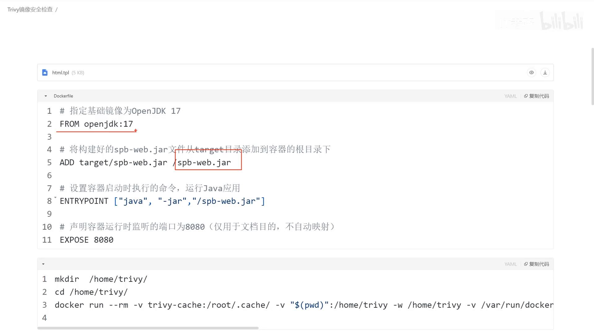
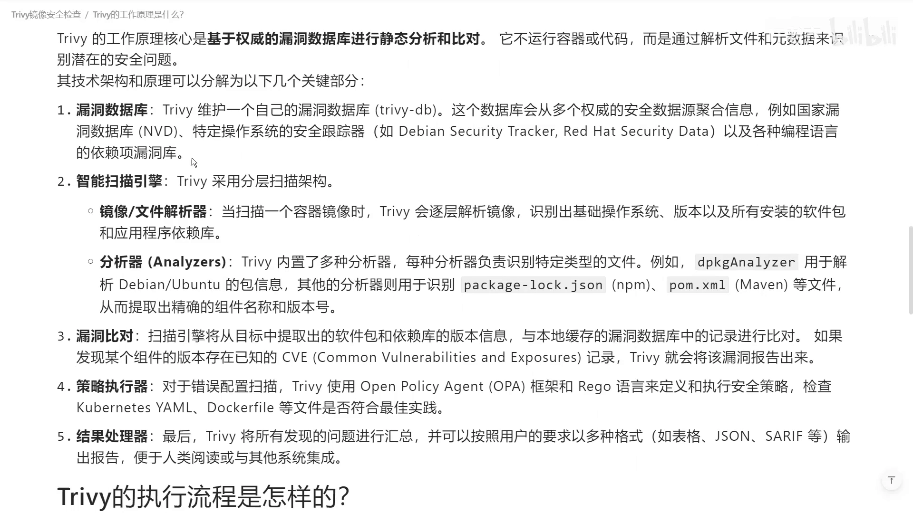
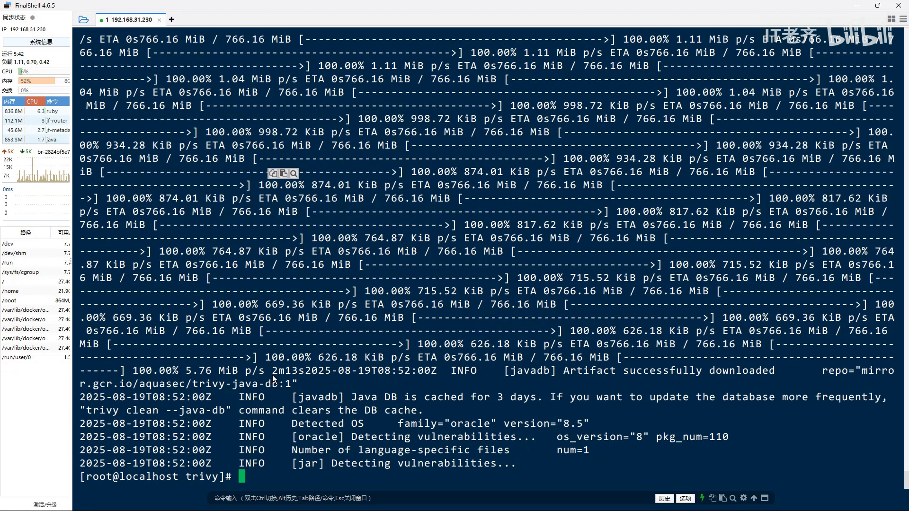
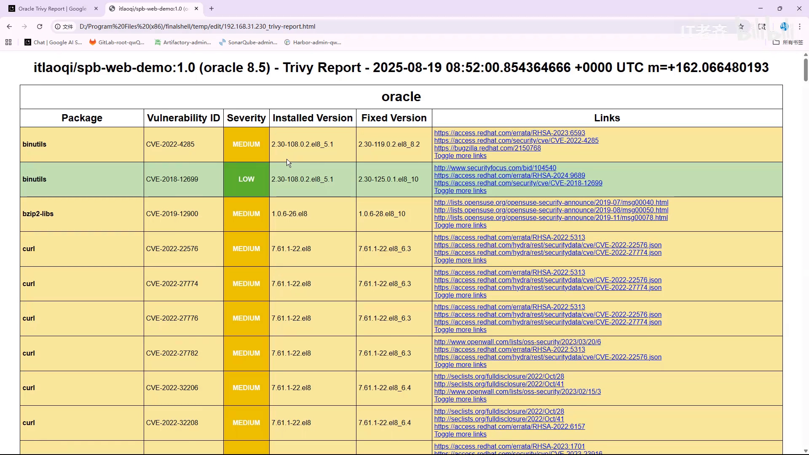
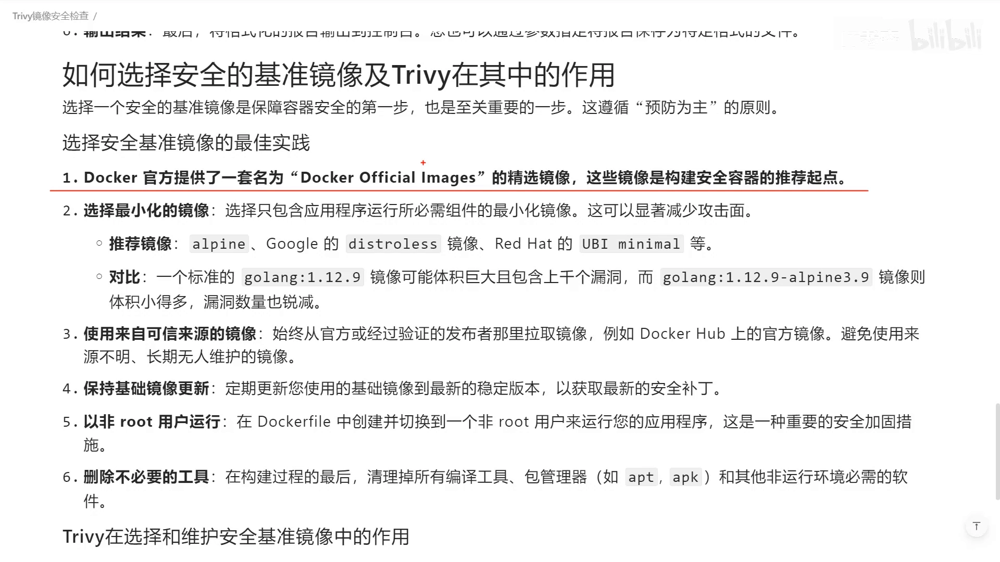
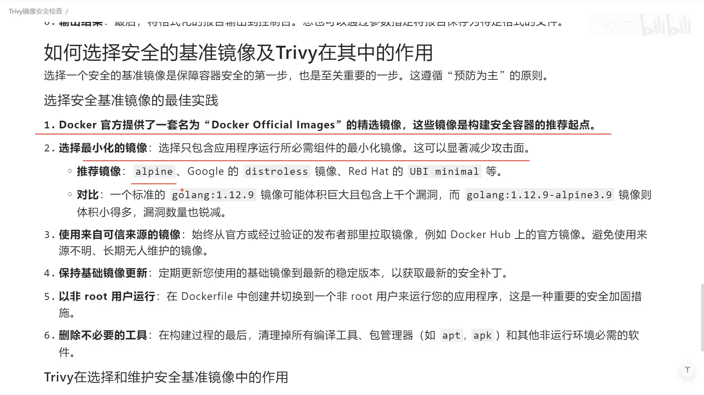

# 用 Trivy 扫描镜像漏洞，外加六条挑基础镜像的安全建议

> 视频来源：[【IT老齐807】Trivy容器镜像漏洞扫描与安全建议](https://www.bilibili.com/video/BV1j7eAzMEtb)（B 站 · IT老齐 · 约 8:48）
> 主讲：IT老齐
> 所属：容器技术 · 第 3 章 镜像、文件系统与供应链 · 3.4 镜像供应链 · 3.4.4 镜像扫描

## 本讲要解决的核心问题（SCQA）

**背景**：开发同学平时基本以实现功能为主，很少主动关注安全与漏洞——讲者自己也不例外（[【跳转到 00:00】](https://www.bilibili.com/video/BV1j7eAzMEtb/?t=0)）。

**冲突**：可一旦要上线运行，一提到安全和镜像扫描，"一看一个不吱声"——讲者用 OpenJDK 17 打包了一个再普通不过的 Spring Boot 应用，上线做安全检查时，**发现这个容器镜像的安全水平"低到令人发指"**（[【跳转到 00:19】](https://www.bilibili.com/video/BV1j7eAzMEtb/?t=19)）。

**疑问**：这些漏洞是怎么被发现的？镜像里到底藏着什么？以后又该如何挑选"干净"的镜像？

**回答（中心思想）**：用一款叫 **Trivy** 的安全扫描工具，把镜像逐层拆开、逐层比对已知漏洞，就能拿到一份可视化报告；看懂报告后，再按**六条选镜像的建议**从源头减少漏洞。本讲按"讲清 Trivy 与原理 → 实扫一个镜像看报告 → 借助 AI 读懂漏洞 → 给出选镜像准则"展开。

## 一、先认识主角 Trivy

讲者做的演示镜像叫 `spring-web-demo`，是一个很简单的 Java Web 应用；打包时用了看似很普通的 **OpenJDK 17**。要发现问题，得先请出扫描器（[【跳转到 01:06】](https://www.bilibili.com/video/BV1j7eAzMEtb/?t=66)）：

- **Trivy** 是行业中很著名的一款**全面安全扫描工具**，主要面向**容器镜像及其相关配置**做扫描；
- 如果镜像或配置文件里有明显的安全漏洞，它会以**报告**的形式输出。

### 1.1 Trivy 的工作原理：三步走

Trivy 的原理其实很简单（[【跳转到 01:31】](https://www.bilibili.com/video/BV1j7eAzMEtb/?t=91)）：

1. **维护并下载漏洞库**：Trivy 官方**定时收集**各大系统、软件的漏洞，维护成一个远程数据库；你**第一次使用时**，它会把数据库下载到本地（[【跳转到 01:46】](https://www.bilibili.com/video/BV1j7eAzMEtb/?t=106)）。
2. **拆解镜像、识别成分**：因为镜像像汉堡一样**一层一层向上堆叠**，Trivy 会把**每一层**的内容拆出来，识别其中的**操作系统信息**以及**安装软件 / 依赖库信息**，并读出它们对应的**版本**（[【跳转到 02:02】](https://www.bilibili.com/video/BV1j7eAzMEtb/?t=122)）。
3. **比对并输出**：用内置的**分析器**，把识别到的成分与本地漏洞库做**漏洞比对**，最后依据策略输出处理结果（[【跳转到 02:27】](https://www.bilibili.com/video/BV1j7eAzMEtb/?t=147)）。

看起来挺麻烦，**实际用起来特别简单**。

## 二、动手扫描：从命令到报告

### 2.1 关键前提：把 docker.sock 挂进 Trivy 容器

演示环境里已经装好 Docker，并构建出镜像 `it老齐/spring-web-demo`（[【跳转到 02:48】](https://www.bilibili.com/video/BV1j7eAzMEtb/?t=168))。讲者强调：Trivy 不只扫自定义镜像，**官方提供的原始镜像同样可以扫**（[【跳转到 03:07】](https://www.bilibili.com/video/BV1j7eAzMEtb/?t=187)）。

以容器方式运行 Trivy 时，有两处挂载：

- 把**当前目录**挂进容器，方便把报告写回宿主机；
- **最关键的一步**：把宿主机的 **`docker.sock`** 挂进容器——因为 Trivy 集成了 Docker 客户端，挂上 socket 后，它就能在容器内部**操作宿主机的容器**（[【跳转到 03:16】](https://www.bilibili.com/video/BV1j7eAzMEtb/?t=196)）。

### 2.2 一条命令扫出 HTML 报告

Trivy 是**无状态应用**，启动时把要执行的动作作为参数传给它即可。最简单的方式是 `image` 子命令加镜像名；讲者用的是当时最新的 **0.65.0** 版本（[【跳转到 03:41】](https://www.bilibili.com/video/BV1j7eAzMEtb/?t=221)）：

- 直接跑 `trivy image <镜像名>` 会把结果**打到控制台**，不便管理；
- 所以讲者改用 Trivy **官方内置的 HTML 模板**，把结果输出成当前目录下的 **`trivy.report`**；又因为前面用 `-v` 做了挂载，这份报告就**相当于直接生成在宿主机的目录里**了（[【跳转到 04:06】](https://www.bilibili.com/video/BV1j7eAzMEtb/?t=246)）。

回车执行后，Trivy 会先连到官网**更新漏洞库**——讲者说这一步"比想象中要长"（[【跳转到 04:31】](https://www.bilibili.com/video/BV1j7eAzMEtb/?t=271)）；大约 3~4 分钟后，检查完成，当前目录下多了一个全新的 `trivy.report`（[【跳转到 04:49】](https://www.bilibili.com/video/BV1j7eAzMEtb/?t=289)）。

## 三、读懂报告：漏洞分两层，来源要分清

### 3.1 基础镜像这层"重灾区"

打开报告可以看到，这个镜像由 **Oracle 官方构建**。报告里大大小小的漏洞——**普通 CVE、低风险、高风险**——都列了出来（[【跳转到 05:04】](https://www.bilibili.com/video/BV1j7eAzMEtb/?t=304)）。

问题出在哪？讲者指出：**Oracle 在它的 OpenJDK 17 镜像里集成了大量我们根本用不到的工具**，而这些工具带来了"这么多的高风险漏洞"（[【跳转到 05:29】](https://www.bilibili.com/video/BV1j7eAzMEtb/?t=329)），他直言"Oracle 的 JDK 镜像是不负责任的"（[【跳转到 05:53】](https://www.bilibili.com/video/BV1j7eAzMEtb/?t=353)）。

这里也体现出一个重要的**分层视角**：报告**上方**是**镜像本身（基础层）**的漏洞，**下方**则是**代码依赖**带来的漏洞（[【跳转到 05:58】](https://www.bilibili.com/video/BV1j7eAzMEtb/?t=358)）。

### 3.2 代码依赖这层：一个中等风险的 Spring MVC

讲者自己使用的版本里，**Spring MVC 是 6.2.9**，报告提示它含有一个**中等风险**问题，右侧给出了对应的描述（[【跳转到 05:58】](https://www.bilibili.com/video/BV1j7eAzMEtb/?t=358)）。

### 3.3 借助 AI 读懂"这些漏洞到底有多严重"

报告里全是不熟悉的安全术语怎么办？讲者的做法很实用：**把结果直接喂给 AI 工具**（[【跳转到 06:23】](https://www.bilibili.com/video/BV1j7eAzMEtb/?t=383)）：

- 让 AI **针对高风险项**做评估，说明这些高危漏洞的**影响范围**——比如 `glibc` 的问题出在哪一块、`OpenSSL` 会造成什么影响；
- 让 AI **结合知识库并联网搜索**，给出更贴合实际的判断（[【跳转到 06:28】](https://www.bilibili.com/video/BV1j7eAzMEtb/?t=388)）；
- 对 Spring MVC，AI 也说明了它**在特定情况下会造成安全风险、应予以修复**（[【跳转到 06:53】](https://www.bilibili.com/video/BV1j7eAzMEtb/?t=413)）。

对此讲者给出务实的取舍态度：**上线时不一定把所有问题都修掉，但高风险的问题应该积极应对**（[【跳转到 07:18】](https://www.bilibili.com/video/BV1j7eAzMEtb/?t=438)）。

## 四、六条挑镜像的安全建议

与其事后逐个补漏洞，不如**从挑选基础镜像的源头就把风险降下来**。讲者给出六条建议（[【跳转到 07:23】](https://www.bilibili.com/video/BV1j7eAzMEtb/?t=443)）：

1. **优先用 Docker 官方的、以安全为起点的容器**：Docker 会**持续维护**一套经过验证的容器基准环境，用它们比第三方镜像问题少很多，因为它**每一次都在做这些方面的检查**。
2. **采用最小化镜像**：经常见到的 **`alpine` / `slim`** 后缀就是相对更小的镜像；**装的软件越多、出问题的概率越大**，镜像越小，风险自然越小（[【跳转到 07:48】](https://www.bilibili.com/video/BV1j7eAzMEtb/?t=468)）。

   

3. **采用可信来源的镜像**：一般说官方镜像更靠谱——但讲者加了引号调侃，像 Oracle 这个镜像就属于"发了也不好用"的例子。
4. **保持基础镜像及时更新**：这条不必多说。
5. **以非 root 用户运行，只给最小的可用权限**。
6. **删除不必要的工具**（[【跳转到 08:13】](https://www.bilibili.com/video/BV1j7eAzMEtb/?t=493)）。

讲者总结：这些都是日常应用里**行之有效**的手段；很多人只盯开发视角，但**换个角度、把视野打开来看，安全与维护性上有非常多值得关注的问题**（[【跳转到 08:43】](https://www.bilibili.com/video/BV1j7eAzMEtb/?t=523)）。

## 小结

- 容器镜像的安全问题常被开发忽视，但**上线扫描时往往问题成堆**；镜像逐层堆叠，每层都可能夹带漏洞。
- **Trivy** 的机制是：下载官方漏洞库 → **逐层拆解镜像**、识别 OS 与依赖版本 → 结合数据库**比对漏洞** → 按策略输出报告。
- 以容器方式跑 Trivy 时，**挂载 `docker.sock`** 是关键；用官方 **HTML 模板**可把结果输出成可读的 `trivy.report`。
- 报告要**分清两层**：**基础镜像层**（本例 Oracle OpenJDK 17 夹带大量用不到的工具与高危漏洞）与**代码依赖层**（本例 Spring MVC 6.2.9 的中危问题）。
- 看不懂漏洞时，可**把报告喂给 AI** 评估影响范围；上线不必修所有问题，但**高危要优先处理**。
- 从源头减少漏洞的**六条准则**：用官方安全基准镜像、用最小化镜像、用可信来源、及时更新、非 root 运行、删除多余工具。

## 关键术语速查

| 术语 | 一句话解释 |
| --- | --- |
| Trivy | 一款面向容器镜像与配置的全面安全扫描工具，输出可视化漏洞报告。 |
| 漏洞库（vulnerability DB） | Trivy 官方定时收集的系统/软件漏洞集合，首次使用时下载到本地。 |
| `trivy image` | Trivy 的镜像扫描子命令，后接镜像名，可扫描自定义或官方镜像。 |
| docker.sock | Docker 守护进程的 Unix socket；挂进 Trivy 容器后即可操作宿主机容器。 |
| CVE | 公开漏洞的通用编号；报告会把普通、低危、高危漏洞分开列出。 |
| 基础镜像层 / 代码依赖层 | 漏洞的两个来源分区：镜像本身携带的 / 你引入的源代码依赖携带的。 |
| 最小化镜像 | 只保留必要内容的镜像，常见后缀 `alpine`、`slim`，能显著减少漏洞。 |
