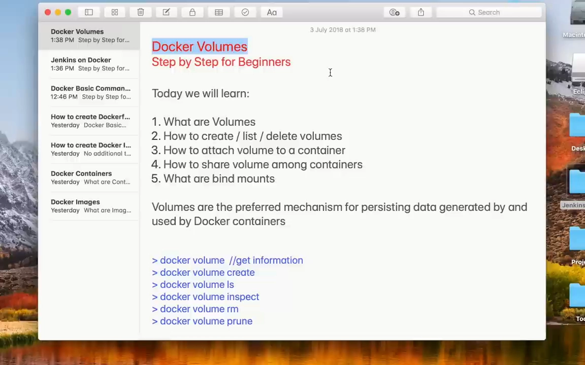
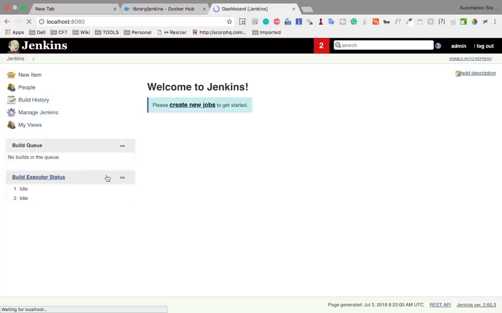
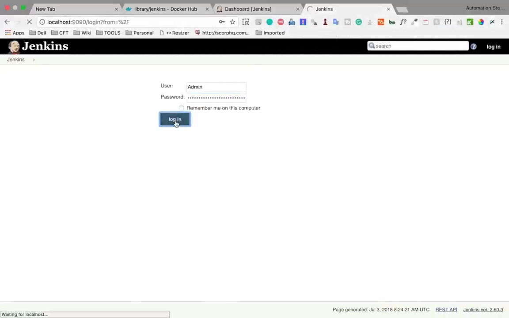
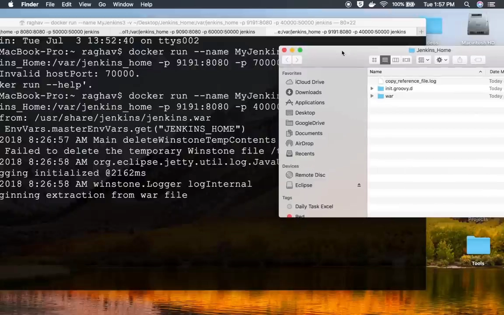

# What is Docker Volume：卷的创建、挂载与在容器间共享

> 视频来源：YouTube 视频 [What is Docker Volume | How to create Volumes | What is Bind Mount | Docker Storage](https://www.youtube.com/watch?v=VOK06Q4QqvE)（Automation Step by Step / Raghav Pal 出品，约 16 分 51 秒，英文讲解）。本文基于视频演说图文稿整理，时间戳可跳转到原视频对应位置；配图取自视频画面。字幕来自 YouTube 自动字幕（英文 ASR），术语与错拼已逐窗口核对纠正（如 "darker / dhaka"→`docker`、"Troon / tune"→`prune`、"be flag"→`-p`）。

## 本讲要解决的核心问题（SCQA）

**背景**：在 Docker 里创建容器时，总得有**某个地方**来存放这个容器的数据。如果你**不显式指定位置**，数据就**存在容器内部**。

**冲突**：一旦**删除（remove）容器**，容器内的数据**也随之丢失**。可到了企业项目里，需求恰恰相反：我们希望**容器可以删，数据必须留住**——甚至还要用**旧数据**去创建**新容器**，或者让**多个容器共享同一份数据**。

**疑问**：怎样把"存储"从容器里**解耦**出来？卷怎么**创建、查看、删除**？怎么**挂到容器**上？多个容器**怎么共享**同一个卷？它和**绑定挂载（bind mount）**又有什么区别？

**回答（中心思想）**：用**卷（volume）**。卷的核心用途是**把容器与存储解耦**——存储独立于容器存在，**删掉容器卷也不会被删**；同一个卷还能**挂给多个容器**从而**共享数据**。用 `docker volume create / ls / inspect / rm / prune` 管理卷的**完整生命周期**，用 `docker run -v <卷名>:<容器内路径>` 把卷挂进容器；如果不想用 Docker 管理的卷、而要**直接用宿主机上的物理目录**，那就用**绑定挂载**。[【跳转到 00:00】](https://www.youtube.com/watch?v=VOK06Q4QqvE&t=0)

---

## 一、为什么需要卷：容器数据的"默认结局"是丢失

### 1.1 不指定位置，删容器就等于删数据

在 Docker 里创建容器时，数据总得有地方存。**如果你不显式提供存储位置，数据就存在容器内部**；而当你**删除或移除容器**时，**这些数据也一并丢失**。[【跳转到 00:35】](https://www.youtube.com/watch?v=VOK06Q4QqvE&t=35)

但**在企业项目里**，我们的诉求是：**数据不能丢**——容器可以删，数据要**持久保存**；而且当需要用**旧数据**创建更多容器、或者在**容器之间共享数据**时，这件事要**能做得到**。[【跳转到 01:00】](https://www.youtube.com/watch?v=VOK06Q4QqvE&t=60)



### 1.2 卷的两大用途

所以卷的用途可以概括为两条：[【跳转到 01:25】](https://www.youtube.com/watch?v=VOK06Q4QqvE&t=85)

1. **把容器与存储解耦**——存储与容器分离，**即使你删除或移除容器，存储依然可用**；
2. **在不同容器之间共享卷（数据）**——卷可以挂到多个容器上；**我们可以删除容器，但卷不会被删除**。[【跳转到 01:50】](https://www.youtube.com/watch?v=VOK06Q4QqvE&t=110)

这就是卷的主要优点与用途。演示的前置条件很简单：**系统上装好 Docker**——可以用 `docker info` 或 `docker -v` 确认。[【跳转到 02:10】](https://www.youtube.com/watch?v=VOK06Q4QqvE&t=130)

## 二、`docker volume` 子命令：卷的完整生命周期

### 2.1 先看帮助：五个子命令

运行 `docker volume` 或 `docker volume --help`，都能看到 `docker volume` 命令的用法与选项。[【跳转到 02:35】](https://www.youtube.com/watch?v=VOK06Q4QqvE&t=155)

| 子命令 | 作用 |
| :--- | :--- |
| `create` | 创建一个卷 |
| `inspect` | 查看卷的详细信息 |
| `ls` | 列出卷 |
| `prune` | 删除**所有未被使用**的本地卷 |
| `rm` | 删除一个或多个卷 |


### 2.2 创建、列出、查看

先创建一个卷。名字可以随便取，这里叫 `my-volume-1`：[【跳转到 03:00】](https://www.youtube.com/watch?v=VOK06Q4QqvE&t=180)

```bash
docker volume create my-volume-1
```

再用 `docker volume ls` 列出卷、用 `docker volume inspect my-volume-1` 查看详情：[【跳转到 03:25】](https://www.youtube.com/watch?v=VOK06Q4QqvE&t=205)

```bash
docker volume ls
docker volume inspect my-volume-1
```


`inspect` 的输出里可以看到这个卷的**创建时间**和它的 **mount point（挂载点）**——卷就实实在在放在你系统上的那个位置；**它不能由本地的一些函数随意编辑，这正是卷的优点之一**：放进卷里的数据是**安全的**。[【跳转到 03:50】](https://www.youtube.com/watch?v=VOK06Q4QqvE&t=230)


### 2.3 删除卷：`rm` 与 `prune`

要删除某个卷，用 `docker volume rm <卷名>`；要一次性清掉所有**没被任何容器使用**的卷，用 `docker volume prune`，输入 `Y` 确认即可删除。[【跳转到 04:15】](https://www.youtube.com/watch?v=VOK06Q4QqvE&t=255)

```bash
docker volume rm my-volume-1
docker volume prune
```

这段演示里作者选了 `n`：**这个卷还要留着用**。随后用 `docker volume ls` 复查，卷还在。[【跳转到 04:40】](https://www.youtube.com/watch?v=VOK06Q4QqvE&t=280)

## 三、把卷挂到容器上：以 Jenkins 为例

### 3.1 先按官方姿势起一个 Jenkins 容器

接下来演示**怎么用这个卷**。作者选了 **Jenkins** 容器做例子，具体做法是先去 **Docker Hub** 找到 Jenkins 镜像页面，那里给了 `pull` 命令和启动容器的 `run` 命令：[【跳转到 04:53】](https://www.youtube.com/watch?v=VOK06Q4QqvE&t=293)

```bash
docker pull jenkins
```

拉取完成后（演示里快进了这段过程），先**不带卷**启动一次容器，用 `-p` 暴露端口：**本地 8080 对应 Jenkins 服务器的 8080**，另外 **Jenkins agent 用的是 50000 端口，也一并暴露**。[【跳转到 05:46】](https://www.youtube.com/watch?v=VOK06Q4QqvE&t=346)

```bash
docker run -p 8080:8080 -p 50000:50000 jenkins
```


### 3.2 加上容器名和卷：`-v my-volume-1:/var/jenkins_home`

这次启动能跑起来（浏览器访问 `localhost:8080` 就能看到 Jenkins），但作者要改两处：[【跳转到 06:11】](https://www.youtube.com/watch?v=VOK06Q4QqvE&t=371)

1. **给容器起个名字**：加 `--name my-jenkins-1`；
2. **挂一个卷**：加 `-v my-volume-1:/var/jenkins_home`——即把刚创建的**卷名**对应到**Jenkins home 目录**，让 Jenkins home 的**所有数据**都落到这个卷里。[【跳转到 06:36】](https://www.youtube.com/watch?v=VOK06Q4QqvE&t=396)

Jenkins home 的路径是从 **Docker Hub 上该镜像的文档**里查到的。[【跳转到 06:52】](https://www.youtube.com/watch?v=VOK06Q4QqvE&t=412)

```bash
docker run --name my-jenkins-1 -p 8080:8080 -p 50000:50000 \
  -v my-volume-1:/var/jenkins_home jenkins
```


### 3.3 初始化 Jenkins，建一个 test job

容器启动后，复制初始管理员密码，在浏览器里完成初始化：**跳过插件安装**（`select plugins to install` 里选 `none`，为省时间连后续步骤一起跳过），然后直接开始使用 Jenkins。[【跳转到 08:01】](https://www.youtube.com/watch?v=VOK06Q4QqvE&t=481)

为了让后面能验证"数据确实被共享"，作者在 Jenkins 里**新建了一个 job**：类型选 **freestyle job**，命名为 `test job`，在描述里随便加一个 build step，然后 **apply / save**；回到 Dashboard 就能看到这个 job。[【跳转到 08:24】](https://www.youtube.com/watch?v=VOK06Q4QqvE&t=504)



## 四、共享卷：两个容器用同一个卷

### 4.1 起第二个 Jenkins 容器：换名字、换端口、同一个卷

关键验证来了：**再启动一个 Jenkins 容器**。作者新开一个终端标签页，**复制刚才那条命令**，只改两处：[【跳转到 09:07】](https://www.youtube.com/watch?v=VOK06Q4QqvE&t=547)

- **容器名改成 `jenkins-2`**；
- **端口必须换**——因为 8080 已被当前 Jenkins 占用，所以改为 **9090**，agent 端口用 **60000**；
- **卷保持与第一个容器相同**（`my-volume-1`）。

```bash
docker run --name jenkins-2 -p 9090:8080 -p 60000:50000 \
  -v my-volume-1:/var/jenkins_home jenkins
```


### 4.2 用旧密码登录 9090 实例，看到同一个 job

第二个实例起来后，访问 `localhost:9090`：**它没有出现初始化的插件页面，而是直接给出登录界面**。[【跳转到 10:25】](https://www.youtube.com/watch?v=VOK06Q4QqvE&t=625)

接着**用第一个 Jenkins 的用户和密码登录**——如果**能登录成功**，就说明**数据在这两个 Jenkins 容器之间被共享**。结果：**登录成功**，而且能看到**同一个 test job**。[【跳转到 10:49】](https://www.youtube.com/watch?v=VOK06Q4QqvE&t=649)



**结论**：运行在 **8080** 和 **9090** 上的两个 Jenkins 容器**共享了同一个卷**；而且这个卷**不随容器存亡而消失**——即便关掉、甚至删除这两个容器，卷**依旧保留**，可以继续给别的容器使用。[【跳转到 11:16】](https://www.youtube.com/watch?v=VOK06Q4QqvE&t=676)

## 五、绑定挂载：用宿主机的物理目录代替卷

除了卷，你还可以用**绑定挂载（bind mount）**。**绑定挂载的意思是：你实际上可以使用一个物理位置，而不是卷**。[【跳转到 11:25】](https://www.youtube.com/watch?v=VOK06Q4QqvE&t=685)

作者复制了刚才启动 Jenkins 容器的命令，**其余部分都不变**，只改三处：[【跳转到 11:35】](https://www.youtube.com/watch?v=VOK06Q4QqvE&t=695)

1. **端口**换成 `70000` 与 `9191`；
2. **容器名**叫 `jenkins-3`；
3. **不用卷，改用宿主机上的物理目录**——即 `-v /Users/Raghav/Desktop/jenkins-home:/var/jenkins_home`，让 Jenkins home 的所有数据都存到这个物理目录里。

```bash
docker run --name jenkins-3 -p 70000:8080 -p 9191:50000 \
  -v /Users/Raghav/Desktop/jenkins-home:/var/jenkins_home jenkins
```


运行时报了一个错：**invalid host port（主机端口无效）**，换个端口（`40000`）就好了。[【跳转到 12:29】](https://www.youtube.com/watch?v=VOK06Q4QqvE&t=749)

随后可以看到两件事：

- 桌面上**真的创建出了一个 `jenkins-home` 文件夹**，打开它能看到**数据正在不断写入**——随着 Jenkins 容器创建，**新文件和新文件夹会持续加进这个目录**；[【跳转到 12:36】](https://www.youtube.com/watch?v=VOK06Q4QqvE&t=756)
- 这个 Jenkins 容器**完全启动**后，访问 `localhost:9191` 就是**新的实例**；由于这份数据现在**物理地存在于你的系统上**，你同样可以"用同一份数据再起一个新容器"。[【跳转到 13:14】](https://www.youtube.com/watch?v=VOK06Q4QqvE&t=794)



> **卷 vs 绑定挂载**：两者都是"容器可见的存储"，区别在于**卷由 Docker 管理、存在 Docker 自己的区域里**（所以更"安全"、不依赖宿主机目录结构），而**绑定挂载直接用宿主机上的物理路径**，你能在宿主机上直接看到并操作这些文件。

## 六、收尾验证：容器全删掉，卷还在

作者最后演示了完整的一轮清理，用来证明卷的"独立性"：

1. `docker ps` 看到**三个 Jenkins 容器**都在运行（jenkins-1、2、3）；[【跳转到 13:29】](https://www.youtube.com/watch?v=VOK06Q4QqvE&t=809)
2. 依次把三个容器 **stop**，再 `docker ps` 已看不到运行中的容器；[【跳转到 13:54】](https://www.youtube.com/watch?v=VOK06Q4QqvE&t=834)
3. `docker ps -a` 显示这些容器**还在、但处于停止状态**；[【跳转到 14:10】](https://www.youtube.com/watch?v=VOK06Q4QqvE&t=850)
4. 再依次 **remove** 掉三个容器（`docker rm my-jenkins-1 / my-jenkins-2 / my-jenkins-3`）；[【跳转到 14:31】](https://www.youtube.com/watch?v=VOK06Q4QqvE&t=871)
5. 再执行 `docker ps -a`：**一个容器都没有了，全部删除**。[【跳转到 14:56】](https://www.youtube.com/watch?v=VOK06Q4QqvE&t=896)

**但是**，这时去看卷：`docker volume ls` —— **`my-volume-1` 依然在那里**。[【跳转到 15:01】](https://www.youtube.com/watch?v=VOK06Q4QqvE&t=901)


再用 `docker volume inspect my-volume-1` 看细节：**卷的信息都在**；而**我们在宿主机上创建的那个物理 Jenkins home（绑定挂载目录）也还在**，数据完整地待在里面——所以你完全可以拿它**创建一个全新的 Jenkins 容器，直接带着原来的 jobs 和插件**。[【跳转到 15:06】](https://www.youtube.com/watch?v=VOK06Q4QqvE&t=906)


**这一点在企业级项目里非常有用**：容器是"可抛弃"的，数据是"可继承"的。[【跳转到 15:15】](https://www.youtube.com/watch?v=VOK06Q4QqvE&t=915)

---

## 小结

- **不指定存储位置时，数据存在容器内部，删容器就丢数据**；而企业项目要求"容器可删、数据不丢"，还要能用旧数据建新容器、在容器间共享。
- **卷的两大用途**：把容器与存储**解耦**（存储独立于容器存在）、在不同容器间**共享**数据。
- **卷的生命周期命令**：`docker volume create / ls / inspect / rm / prune`（`prune` 删除所有未被使用的本地卷）。
- **挂载卷**：`docker run -v <卷名>:<容器内路径> <镜像>`；例如 `-v my-volume-1:/var/jenkins_home` 让 Jenkins 的全部数据进卷。
- **共享卷**：两个容器（`my-jenkins-1` 用 8080、`jenkins-2` 用 9090）挂**同一个卷**，用旧密码就能登录第二个实例、并看到同一个 `test job`——数据确实共享了。
- **绑定挂载**：`-v /宿主机/物理目录:/容器内路径`，用宿主机物理目录代替卷；宿主机上会直接出现该目录，文件持续写入。
- **最关键的验证**：把三个容器全部 stop 再 rm，`docker ps -a` 空空如也，但 `docker volume ls` 里 **`my-volume-1` 依然存在**，`docker volume inspect` 详情完整——卷**不随容器的生命周期消失**。

## 关键术语速查

| 术语 | 一句话解释 |
| :--- | :--- |
| 卷（volume） | Docker 管理的存储，**独立于容器生命周期**，用于持久化与在容器间共享数据 |
| 绑定挂载（bind mount） | 把宿主机上的**物理目录**挂进容器，直接使用真实路径而不是 Docker 管理的卷 |
| `docker volume create` | 创建卷，名字自取（如 `my-volume-1`） |
| `docker volume ls` / `inspect` | 列出卷 / 查看某个卷的创建时间与挂载点等详情 |
| `docker volume rm` / `prune` | 删除指定卷 / 删除所有**未被任何容器使用**的本地卷 |
| `-v <卷名>:<容器内路径>` | 把卷挂载到容器内的某个路径（本例为 `/var/jenkins_home`） |
| `-p <宿主端口>:<容器端口>` | 暴露容器端口（Jenkins 用 8080 与 agent 的 50000） |
| `docker ps -a` | 列出**所有**容器（含已停止的），用来确认容器删干净了 |

> **配套阅读**：本条目另有[《操作 Docker 容器数据卷》](操作Docker容器数据卷.md)，用 B 站中文视频的三个实验讲透**数据卷的模型与四条特点**、`-v` 挂载的注意事项、**`--volumes-from` 数据卷容器**的复用，以及挂载点两侧都有数据时的**数据覆盖**问题（含手改 `config.v2.json` 的底层做法）。
