# 操作 Docker 容器数据卷：数据卷、数据卷容器与数据覆盖的三个实验

> 视频来源：B 站视频 [操作Docker容器数据卷](https://www.bilibili.com/video/BV1Jm411R7j1/)（UP 主「莲城的老李」，约 23 分 35 秒，中文讲解）。本文基于视频演说图文稿整理，时间戳可跳转到原视频对应位置；配图取自视频画面。字幕来自 B 站 AI 字幕，术语与错拼已逐窗口核对纠正（如「数据权 / 数据绝」→ 数据卷、「推车」→ 回车、「excel」→ shell）。

## 本讲要解决的核心问题（SCQA）

**背景**：容器里跑应用，总会产生数据——下载的安装包、程序写下的文件、数据库的数据。这些数据默认写在**容器自己的文件系统**里（镜像之上的那一层，可读可写）。

**冲突**：容器是可以随时停止、随时被 `docker rm` 删掉的。容器一删，它里面的数据连同这个"载体"一起消失。但真实项目几乎没人能接受这一点：数据库容器重建一次就丢一次数据，那还怎么用？

**疑问**：能不能让容器产生的数据**活得比容器更久**？能不能让**多个容器共用同一份数据**，而不用每次重建都重敲一串挂载参数？如果挂载点两侧**本来都有文件**，挂载之后到底听谁的？

**回答（中心思想）**：Docker 用**数据卷（volume）**实现数据持久化——把宿主机的目录（或文件）与容器内的路径做**一对一映射**，这个映射过程叫**挂载**；映射建立后，在容器里读写的就不再是容器自己的目录，而是宿主机上的那个目录。数据卷有**四条性质**：**独立于容器而存在**（容器删了卷还在）、**两侧改动实时同步**、**容器与卷是 N 对 M 关系**、**卷的改动不会进入镜像**。在此之上，`--volumes-from` 能让一个"**数据卷容器**"把整套挂载方案**复用**给其它容器；而当挂载点两侧**都有数据**时，**数据卷会覆盖容器**原有的内容。[【跳转到 00:00】](https://www.bilibili.com/video/BV1Jm411R7j1/?t=0)

---

## 一、先做两个小实验，看清数据的"生死"

数据卷要解决"数据会丢"的问题，所以先要把"什么时候丢、什么时候不丢"看清楚，后面的机制才有落脚点。

### 1.1 容器**停止**，数据还在

视频一上来就抛出问题：在容器里下载一份 Redis 安装包，容器停止以后，这份安装包还在吗？[【跳转到 00:00】](https://www.bilibili.com/video/BV1Jm411R7j1/?t=0)

实验过程（选 Redis 安装包只是因为**体积小、不耽误时间**）：

1. 用已有镜像启动一个容器：`docker run --name ap -itd <镜像名>`；[【跳转到 00:25】](https://www.bilibili.com/video/BV1Jm411R7j1/?t=25)
2. `docker exec -it ap sh` 进入容器，在里面下载 Redis 安装包；[【跳转到 00:50】](https://www.bilibili.com/video/BV1Jm411R7j1/?t=50)
3. 退出容器，`docker stop` 停止它，再 `docker start` 重新启动，然后重新进入；
4. 再执行一次 `ls`，安装包**仍旧在**。[【跳转到 01:15】](https://www.bilibili.com/video/BV1Jm411R7j1/?t=75)

**结论**：容器停止（但没被删除）时，运行过程中产生的数据**仍然是保存的**。

### 1.2 容器**删除**，数据就没了

那容器被删除以后数据还在吗？视频里说，这个问题大家心里都有标准答案：**当然是没了**——容器是数据的"载体"，载体都没了，数据自然也就没了。[【跳转到 01:40】](https://www.bilibili.com/video/BV1Jm411R7j1/?t=100)

而现实需求恰恰相反：我们常常希望**把容器里产生的数据保存下来**。最自然的想法，就是**把数据转移到别的地方去存**，例如放到**宿主机**上。[【跳转到 01:45】](https://www.bilibili.com/video/BV1Jm411R7j1/?t=105)

**完成这个"转移"的技术，就是本讲的主题——数据卷。**

## 二、数据卷：把数据放到宿主机上，再"挂"回容器里

### 2.1 什么是数据卷

**数据卷是 Docker 实现数据持久化的一种技术**——这一句话就点明了它的主要作用：**实现数据的持久化**。它通常表现为**宿主机上的某些目录或文件**。[【跳转到 02:04】](https://www.bilibili.com/video/BV1Jm411R7j1/?t=124)

注意一个说法上的区分：同一份数据，**放在容器里**时我们称它为**普通数据**；**到了宿主机上**，我们就称它为**数据卷**。[【跳转到 02:26】](https://www.bilibili.com/video/BV1Jm411R7j1/?t=146)

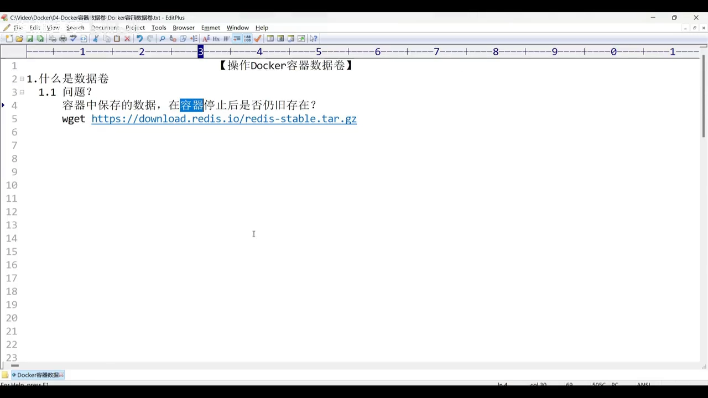

另外，数据卷要**以挂载的方式**为容器提供数据的存取服务。[【跳转到 02:33】](https://www.bilibili.com/video/BV1Jm411R7j1/?t=153)

### 2.2 挂载：两条路径的一对一映射

"挂载"具体是什么意思？用一个例子来说明：

- 数据（比如那份 Redis 安装包）放在宿主机上，比如保存在 `/opt` 目录下；
- 容器里要用这份数据，就要有一个对应的路径，假设是 `/root`；
- 关键前提：**容器中的文件系统与宿主机的文件系统是两套系统**；
- 于是就让**宿主机的路径**与**容器的路径**产生一个**一对一的映射**——这个映射的过程，就叫**挂载**。[【跳转到 02:40】](https://www.bilibili.com/video/BV1Jm411R7j1/?t=160)

挂载好之后，**在容器里对 `/root` 目录的操作，就等同于对宿主机 `/opt` 目录的操作**。[【跳转到 03:05】](https://www.bilibili.com/video/BV1Jm411R7j1/?t=185)

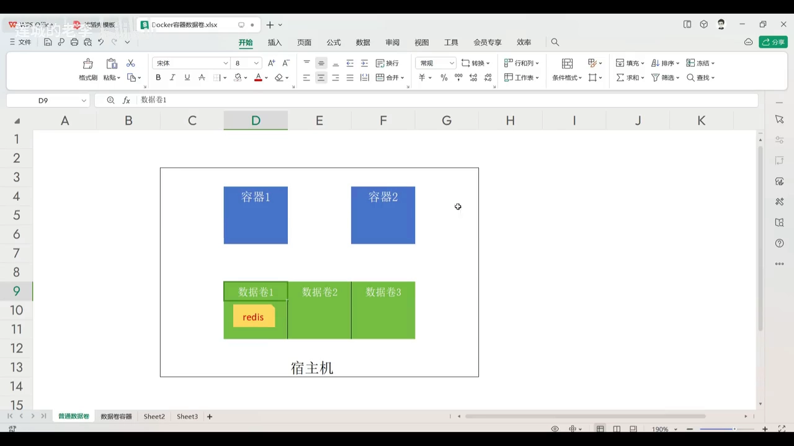

### 2.3 数据卷的四条特点

理解了模型，就能理解数据卷的四条特点。这四条视频里都配了后面的实验来验证：[【跳转到 03:22】](https://www.bilibili.com/video/BV1Jm411R7j1/?t=202)

1. **独立于容器而存在**。数据卷放在宿主机里，所以**容器被删除以后，数据卷仍旧被保存**——这是数据卷最重要的特点。[【跳转到 03:29】](https://www.bilibili.com/video/BV1Jm411R7j1/?t=209)

   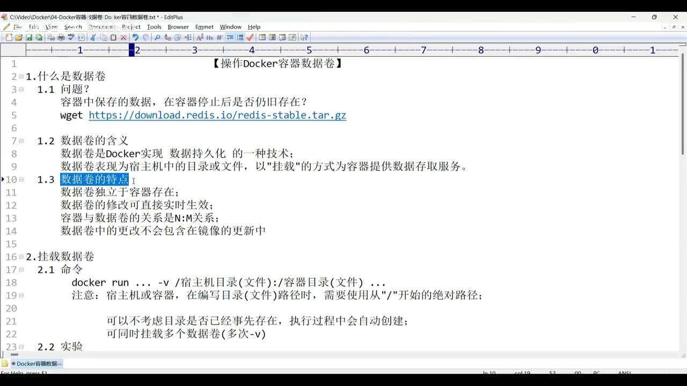

2. **修改可以直接实时生效**。容器侧和宿主机侧操作的是**同一份数据**，是**同步、更新**的：在宿主机上改了，状态会同步反馈到容器里；反过来容器里改了，宿主机上对应的数据也会同步更新。[【跳转到 03:37】](https://www.bilibili.com/video/BV1Jm411R7j1/?t=217)

   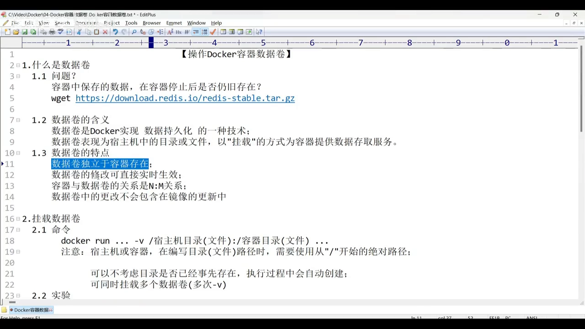

3. **容器与数据卷是 N 对 M 的关系**，也就是**多对多**：一个容器可以和**多个**数据卷关联；一个数据卷也可以被**多个**容器关联。[【跳转到 04:07】](https://www.bilibili.com/video/BV1Jm411R7j1/?t=247)

   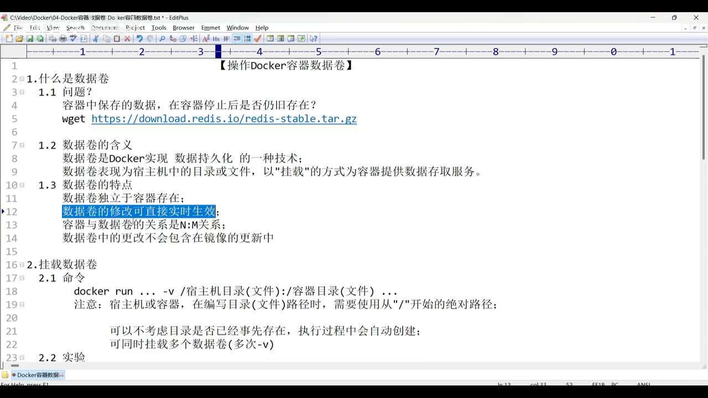

4. **数据卷中的更改不会包含在镜像的更新当中**。[【跳转到 04:25】](https://www.bilibili.com/video/BV1Jm411R7j1/?t=265)

   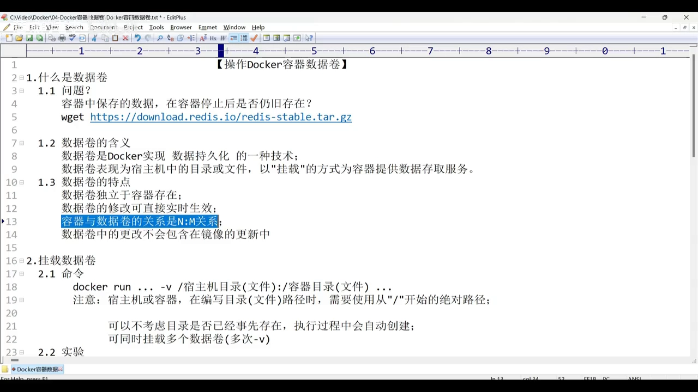

## 三、动手挂载：`-v` 参数

### 3.1 命令写法与三个注意事项

挂载数据卷**最主要用的就是 `-v` 参数**，写在 `docker run` 命令里，后面跟**两个路径**，中间用**冒号**分隔：**前面是宿主机的路径，后面是容器的路径**。[【跳转到 04:50】](https://www.bilibili.com/video/BV1Jm411R7j1/?t=290)

```bash
docker run -itd -v /宿主机/路径:/容器/路径 <镜像名>
```

三个必须记住的细节：[【跳转到 05:15】](https://www.bilibili.com/video/BV1Jm411R7j1/?t=315)

- **目录不必事先存在**：执行过程中如果发现目录没有，Docker 会**自动创建**；有就直接用；
- **两个路径都必须以斜杠开头**，也就是必须写**绝对路径**；
- **可以写多个 `-v`**，从而一次挂载多个数据卷。


### 3.2 实验：挂载、下载、删除容器后再看宿主机

视频设计的实验流程是：运行容器 → 在容器内下载 Redis → 退出容器，查看宿主机挂载点上是否有 Redis → 再停掉并删除容器，重新查看宿主机挂载点。[【跳转到 05:40】](https://www.bilibili.com/video/BV1Jm411R7j1/?t=340)

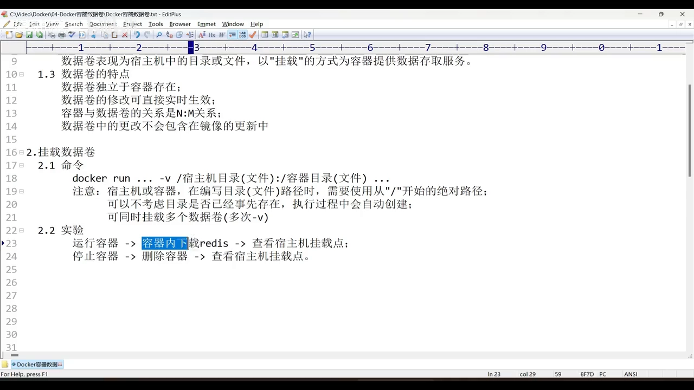

这个实验要证明两件事：一是**容器操作的数据能不能实时同步到宿主机**；二是**容器与数据卷之间没有强依赖**——容器删了，数据仍留在宿主机上。[【跳转到 06:05】](https://www.bilibili.com/video/BV1Jm411R7j1/?t=365)

实验步骤与观察结果：

1. 新建容器 `ap01`，把宿主机 `/opt/soft` 挂到容器 `/root/soft`（两个 `soft` 目录当时都**不存在**，由 Docker 自动创建）：[【跳转到 06:30】](https://www.bilibili.com/video/BV1Jm411R7j1/?t=390)
   ```bash
   docker run --name ap01 -itd -v /opt/soft:/root/soft <镜像名>
   ```
2. 先在宿主机看 `/opt` 下有没有 `soft`——有了；再 `docker exec -it ap01 sh` 进容器看 `/root` 下有没有 `soft`——也有了。至此完成实验第一步。[【跳转到 07:20】](https://www.bilibili.com/video/BV1Jm411R7j1/?t=440)
3. 在容器里进入 `/root/soft` 下载 Redis 安装包。[【跳转到 08:10】](https://www.bilibili.com/video/BV1Jm411R7j1/?t=490)
4. 退出容器，回到宿主机查看 `/opt/soft`：**安装包也出现了**——这一步证明了**实时同步**。[【跳转到 08:30】](https://www.bilibili.com/video/BV1Jm411R7j1/?t=510)
5. 强制停止并删除容器：`docker rm -f ap01`（容器还在运行时不加 `-f` 删不掉）。删除后再看 `/opt/soft`，**Redis 安装包依旧存在**。[【跳转到 09:15】](https://www.bilibili.com/video/BV1Jm411R7j1/?t=555)

**这一段同时验证了特点一和特点二**：数据卷独立于容器存在（容器删了数据还在宿主机上），数据卷的修改实时生效（两侧同步更新）。[【跳转到 09:40】](https://www.bilibili.com/video/BV1Jm411R7j1/?t=580)

## 四、数据卷容器：把一套挂载方案"复用"出去

### 4.1 它要解决什么麻烦

**数据卷容器本质上还是一个容器**，它之所以被特别地称为"数据卷容器"，是因为**它可以成为其它容器数据卷设置的参照**。[【跳转到 10:05】](https://www.bilibili.com/video/BV1Jm411R7j1/?t=605)

场景是这样的：假设**容器一**挂载了**两个数据卷**（宿主机 `/opt/first` → 容器 `/root/first`，宿主机 `/opt/second` → 容器 `/root/second`）。命令要写两个 `-v`：[【跳转到 10:22】](https://www.bilibili.com/video/BV1Jm411R7j1/?t=622)

```bash
docker run --name ap01 -v /opt/first:/root/first -v /opt/second:/root/second -itd <镜像名>
```

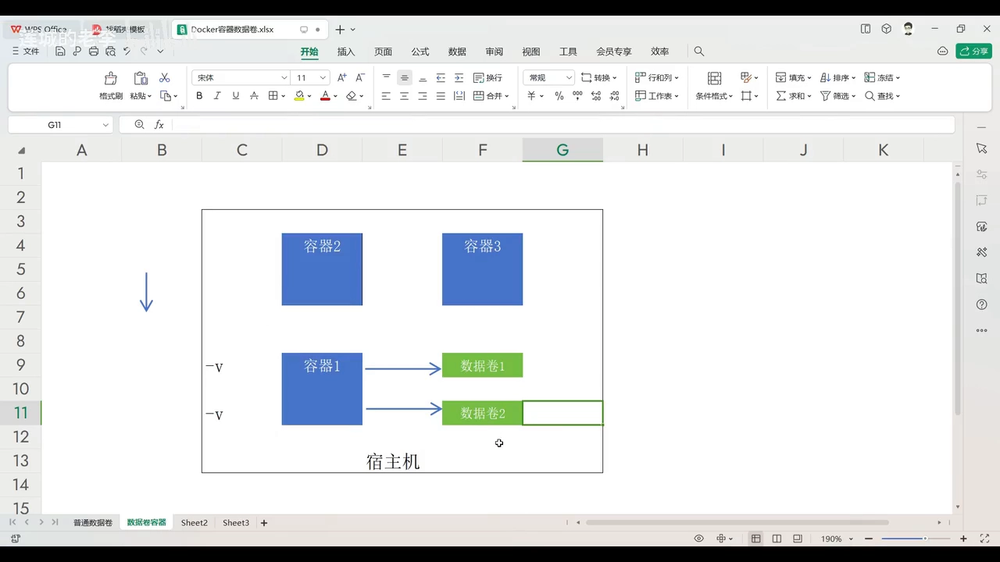

如果**容器二**也要用**和容器一完全相同的数据源**，按老办法就得**把这两个 `-v` 再抄一遍**——非常繁琐，而且这套挂载方案在容器一里明明已经写过了。我们希望的是：**不用重写**，而是**参照**容器一的数据挂载方案。[【跳转到 11:12】](https://www.bilibili.com/video/BV1Jm411R7j1/?t=672)

### 4.2 用 `--volumes-from` 参照

实现方式就是 `--volumes-from` 参数，后面跟**要参照的那个数据卷容器的名称**：[【跳转到 11:45】](https://www.bilibili.com/video/BV1Jm411R7j1/?t=705)

```bash
docker run --name ap02 --volumes-from ap01 -itd <镜像名>
```

这样两个容器就用了**完全相同的挂载方案**。[【跳转到 12:22】](https://www.bilibili.com/video/BV1Jm411R7j1/?t=742)

验证：进入 `ap02` 后，`/root` 下确实已经有了 `first`、`second` 两个目录；进入 `/root/first`，用 `touch hello.txt` 建一个文件，回到宿主机的 `/opt/first`，`hello.txt` 也出现了。**说明通过 `--volumes-from` 创建出来的容器，在数据操作上与直接用 `-v` 的容器没有任何区别。**[【跳转到 13:12】](https://www.bilibili.com/video/BV1Jm411R7j1/?t=792)

### 4.3 参照容器被删掉，其它容器照样用

下一个问题：**如果容器一（被参照的数据卷容器）被删除了，容器二还能正常使用数据卷吗？**[【跳转到 13:44】](https://www.bilibili.com/video/BV1Jm411R7j1/?t=824)

实验：`docker rm -f ap01` 删掉数据卷容器，`docker ps -a` 确认此时只剩 `ap02`。然后**反过来**在宿主机上操作——在 `/opt/second` 里创建 `hello.txt`，再进 `ap02` 的 `/root/second` 查看，**内容同步更新**。[【跳转到 14:48】](https://www.bilibili.com/video/BV1Jm411R7j1/?t=888)

**结论**：当某个容器参照了其它容器来配置数据卷方案时，**被参照的容器即使被删除，其它容器也不受影响**，仍可正常使用。[【跳转到 15:06】](https://www.bilibili.com/video/BV1Jm411R7j1/?t=906)

**一句话理解**：数据卷容器只是"**挂载方案的模板**"，真正承载数据的是宿主机上的那些目录，模板用完即弃也不影响数据本身。

## 五、数据覆盖：挂载点两侧都有数据时，谁说了算

### 5.1 先分情况讨论

挂载之后，容器和数据卷之间就有一组映射关系，也就是**两个路径**：**数据卷的路径**和**容器的路径**。如果这两个目录下**原本都有数据**，会发生什么？拆成几种情况：[【跳转到 15:18】](https://www.bilibili.com/video/BV1Jm411R7j1/?t=918)

| 数据卷侧 | 容器侧 | 结果 |
| :--- | :--- | :--- |
| 空 | 空 | 不会覆盖（两边都是空的） |
| 非空 | 空 | **数据卷覆盖容器**，覆盖后两边都非空 |
| 空 | 非空 | **容器覆盖数据卷**，覆盖后两边都非空 |
| 非空 | 非空 | 需要实验验证（见下） |

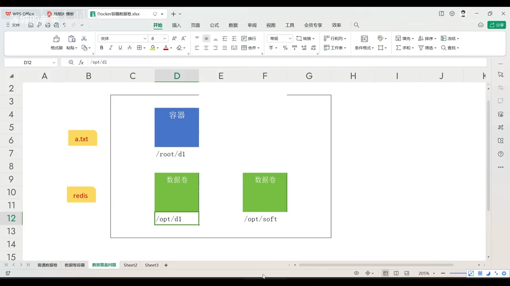

前三种都很好理解，重点讨论**两者都非空**的情况。[【跳转到 16:18】](https://www.bilibili.com/video/BV1Jm411R7j1/?t=978)

### 5.2 实验设计：让同一个容器"换一个卷"

实验分三步（视频用示意图讲解步骤）：[【跳转到 16:30】](https://www.bilibili.com/video/BV1Jm411R7j1/?t=990)

1. **创建容器并挂载**：宿主机 `/opt/first` 是**空目录**，容器首次创建，对应的 `/root/first` 也是**空的**；
2. **在容器里造数据**：`touch a.txt`——因为两侧是映射关系，这个文件会同步出现在数据卷里；
3. **换挂载点**：把容器原本关联的 `first` 目录，**改成换成装了 Redis 安装包的 `soft` 卷**。这样"数据卷非空 + 容器非空"的场景就构造出来了，看看容器里最终变成什么。

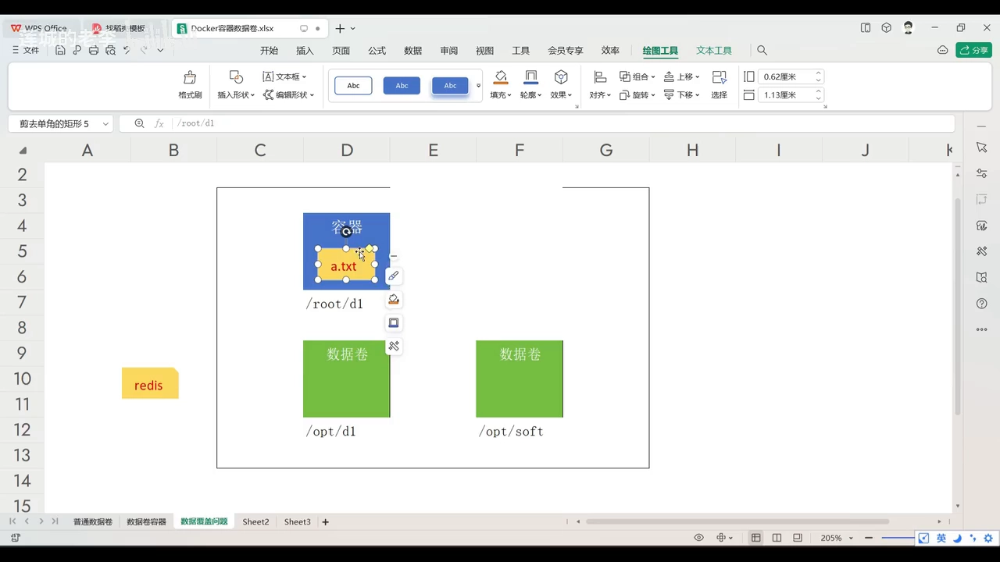

### 5.3 动手做：三步实验

**第一步**，创建容器 `ap`，把宿主机 `/opt/first` 挂到容器 `/root/first`（两边都是空目录）：[【跳转到 17:50】](https://www.bilibili.com/video/BV1Jm411R7j1/?t=1070)

**第二步**，进入容器，在挂载点 `/root/first` 下 `touch a.txt`；退出后在宿主机查 `/opt/first`，`a.txt` 同样存在。（这一步前面已经验证过，属于"实时同步"。）[【跳转到 18:40】](https://www.bilibili.com/video/BV1Jm411R7j1/?t=1120)

**第三步**，改变容器的映射路径——不再关联 `first`，而要关联 `/opt/soft`（里面有 Redis 安装包）。[【跳转到 19:05】](https://www.bilibili.com/video/BV1Jm411R7j1/?t=1145)

要改映射关系，**必须先停掉 Docker 服务**：`systemctl stop docker`。[【跳转到 19:30】](https://www.bilibili.com/video/BV1Jm411R7j1/?t=1170)

> ⚠️ 视频在这里顺带提示了一个坑：**停掉 Docker 服务之后，最好不要再执行任何 `docker` 命令**，否则它会**自动把服务重新拉起来**。

配置文件的路径是：[【跳转到 19:52】](https://www.bilibili.com/video/BV1Jm411R7j1/?t=1192)

```
/var/lib/docker/containers/<容器ID>/config.v2.json
```

用 `docker ps -a` 拿到 `ap` 容器的 ID（输入容器 ID 目录的开头几个字符按 Tab 可自动补全），进去后用 `vim` 编辑 `config.v2.json`：[【跳转到 20:22】](https://www.bilibili.com/video/BV1Jm411R7j1/?t=1222)

1. 在非编辑状态下输入 `/MountPoints` 回车，快速定位到挂载配置；
2. 按 `a` 进入编辑状态，找到其中的 **`source`** 与 **`destination`**：`source` 是**宿主机侧的挂载点**，`destination` 是**容器内的目录**；
3. 把 `source` 从 `/opt/first` **改为 `/opt/soft`**（`destination` 保持容器内的 `/root/first` 不变——正是要制造这个"冲突"）。

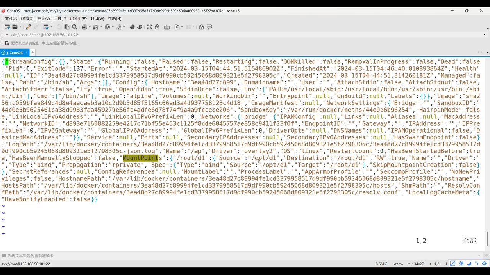

保存文件后，重启 Docker 服务（`systemctl start docker`），再把刚才的容器启动起来，用 `docker ps` 确认启动成功。[【跳转到 21:34 】](https://www.bilibili.com/video/BV1Jm411R7j1/?t=1294)

### 5.4 结果：**数据卷覆盖容器**

进入容器的 `/root/first` 目录，结果揭晓：**里面是 Redis 安装包，原来的 `a.txt` 不见了**；再执行 `ls -a`——**仍然看不到 `a.txt`**。[【跳转到 22:09】](https://www.bilibili.com/video/BV1Jm411R7j1/?t=1329)

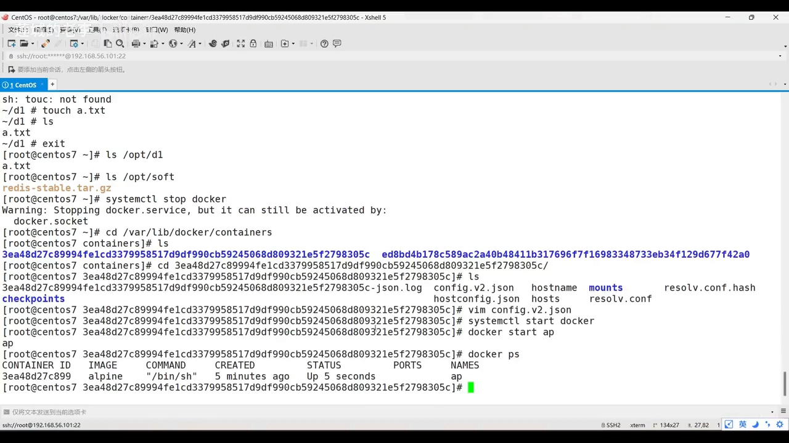

**结论**：两者都非空时会发生**覆盖**，最终结果是**以数据卷里的文件覆盖容器原有的文件**。[【跳转到 22:55】](https://www.bilibili.com/video/BV1Jm411R7j1/?t=1375)

视频作者在这里特别做了一个"较真"的说明：很多资料写的是这种情况下**容器中的数据被"隐藏"了**。但如果"隐藏"只取字面含义、不含更深层的含义，那么这个实验**并不支持"隐藏"的说法**——他看到的是**覆盖**（`ls -a` 也看不到原文件）。作者也坦言这只是自己做的实验、带有一定局限性，欢迎不同的见解。

---

## 小结

- **数据的生死**：容器**停止**时容器内的数据**仍在**；容器**删除**时数据随之丢失——因为容器本身就是数据的载体。
- **数据卷是 Docker 实现数据持久化的技术**：数据落在宿主机上、以**挂载**的方式给容器提供存取；同一份数据在容器里叫普通数据，到宿主机上就叫数据卷。
- **挂载 = 一对一映射**：让宿主机路径与容器路径对应起来；建立之后，容器里操作该目录就等同于操作宿主机的对应目录。
- **四条特点**：独立于容器而存在、两侧修改实时同步、容器与卷是 **N 对 M**（多对多）关系、卷的改动**不会进入镜像**。
- **`-v 宿主机路径:容器路径`** 是挂载的主用手段：目录**不必预先存在**（会自动创建）、两个路径都必须是**绝对路径**、可以写**多个 `-v`**。
- **数据卷容器**是"挂载方案的模板"：用 `--volumes-from <参照容器>` 复用它的挂载方案；**参照容器被删除后，其它容器不受影响**。
- **数据覆盖规则**：空对空不覆盖；非空覆盖空；**两者都非空时，以数据卷覆盖容器**（视频作者的实验结论）。
- **改挂载映射属于底层操作**：需要停 Docker、编辑 `/var/lib/docker/containers/<容器ID>/config.v2.json` 中 `MountPoints` 的 `source`，再重启 Docker 与容器。

## 关键术语速查

| 术语 | 一句话解释 |
| :--- | :--- |
| 数据卷（volume） | Docker 实现数据持久化的技术，通常表现为宿主机上的目录或文件 |
| 挂载（mount） | 把宿主机路径与容器路径建立**一对一映射**，建立后两侧操作等价 |
| `-v` | `docker run -v 宿主机绝对路径:容器绝对路径`，用于挂载数据卷，可写多个 |
| 数据卷容器 | 本身是普通容器，作用是**成为其它容器数据卷设置的参照** |
| `--volumes-from` | 创建新容器时**参照**指定数据卷容器的挂载方案 |
| 数据覆盖 | 挂载点两侧都有数据时，一侧内容替换另一侧；实验结论为**卷覆盖容器** |
| `config.v2.json` | 位于 `/var/lib/docker/containers/<容器ID>/` 下，其中 `MountPoints` 记录挂载的 `source` 与 `destination` |

> **配套阅读**：本条目另有[《What is Docker Volume：卷的创建、使用与共享》](What_is_Docker_Volume_How_to_create_Volumes_What_is_Bind_Mount_Docker_Storage.md)，从"容器与存储解耦"的模型出发，用 `docker volume` 子命令与 Jenkins 容器实操演示**命名卷的完整生命周期**，并顺带解释**绑定挂载**与卷的差别。
