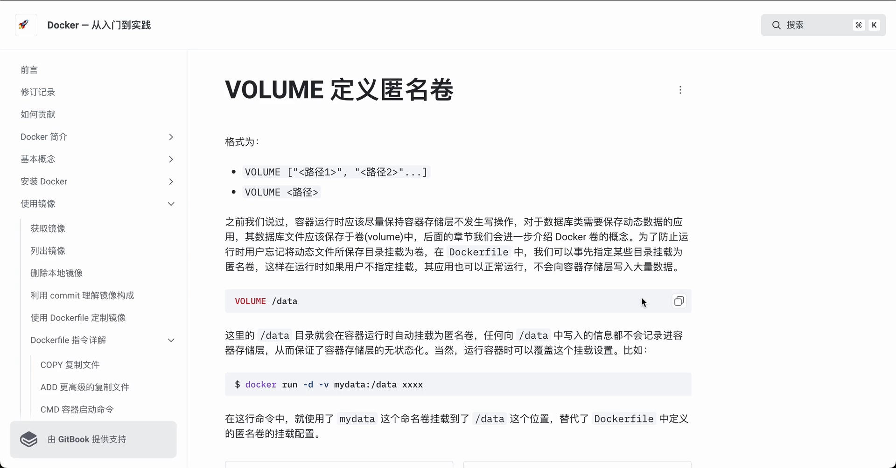
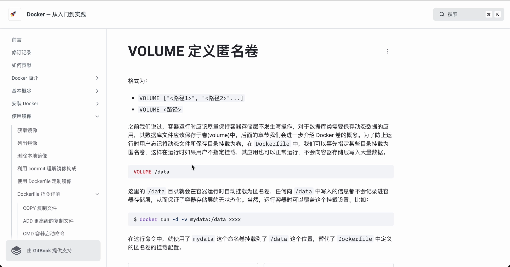

# 用 Dockerfile 的 VOLUME 指令定义匿名卷

> 本文整理自 B 站视频《docker-VOLUME 定义匿名卷》，并依据视频演说图文稿逐窗口核对内容。
> 视频地址：[BV1Ek4y1f7yg](https://www.bilibili.com/video/BV1Ek4y1f7yg/)

## 本讲要解决的核心问题（SCQA）

**背景**：我们已经知道，容器在镜像层之上还有一层可写层（容器存储层）。容器运行时新写入的数据，默认都记在可写层上，而不在镜像里。

**冲突**：对于数据库这类需要不断保存动态数据的应用，如果数据文件老是被写进容器可写层，就会有两个麻烦——一是容器一删除，可写层连同数据一起消失；二是可写层会随着写入不断变大，把容器存储层撑得很"胖"。

**疑问**：能不能在**镜像层面**就预先规定好——某几个目录天生就该放在卷里、不要写进容器存储层？这样即使用户运行时忘了挂载，应用也不会把大量数据写进容器层？

**回答（中心思想）**：可以。Dockerfile 里的 **`VOLUME` 指令**能把某个目录**预先声明为匿名卷**；容器一运行，这个目录就自动挂到匿名卷上，写进去的数据不会记录在容器存储层。运行时我们还可以用 `-v` 指定一个**命名卷**，覆盖掉这个默认的挂载位置。

## 一、为什么要让数据避开"容器存储层"

容器运行时应该尽量保持"容器与存储层不发生写操作"——这句话的意思是：容器存储层是临时的，不该拿去长期保存数据。

- **容器存储层是临时的**：它随容器而生、随容器而灭。容器被删除，写在上面的数据也就没了。
- **动态数据要另找地方**：对于数据库类需要保存动态数据的应用，**数据库文件其实应该保存在卷（volume）中**——卷独立于容器存在，容器删了数据还在（关于 Docker 卷的完整概念我们会在后面的章节展开）。



## 二、VOLUME 指令：在 Dockerfile 里预先声明匿名卷

问题来了：**用户可能会忘记**把该挂载的动态文件目录挂载为卷。等运行起来才发现数据被写进了容器层，就晚了。

解决办法是"未雨绸缪"——**在 Dockerfile 中事先指定某些目录，把它们挂载为匿名卷**：

```dockerfile
VOLUME /data
```

这样在运行时，**如果用户不指定挂载，其应用也可以正常运行**，因为 `/data` 已经被 VOLUME 指令预置成了一个卷挂载点，程序往 `/data` 写的数据不会被写进容器存储层。


### 2.1 目录自动挂载，数据不落在容器层

有了 `VOLUME /data` 之后：

- 这个 **`/data` 目录在容器运行时就会自动挂载为匿名卷**；
- 往 `/data` 中写入的信息**都不会记录在容器的存储层**，从而保证了容器存储层不发生变化。

换句话说，`VOLUME` 指令给数据目录留了一个"出口"，让动态数据绕开易失的容器可写层。



## 三、运行时用命名卷覆盖这个挂载位置

虽然 Dockerfile 已经用 `VOLUME` 定义了匿名卷，但**运行容器时仍然可以指定这个挂载位置**——用一个我们命名、可控的卷去接管它：

```bash
docker run -v mydata:/data …
```

在这个命令中就使用了 `mydata` 这个**命名卷**，把它挂到了对应的挂载位置，从而**覆盖了 Dockerfile 中定义的匿名卷的挂载位置**。

这一步的意义在于：匿名卷的名字是自动生成的、不便管理；在运行时换成有名字的命名卷，数据就更容易复用、备份与排查。


## 小结

- **容器存储层是临时的**，不适合保存数据库等动态数据，这类数据应放进卷。
- Dockerfile 的 **`VOLUME` 指令**可以事先把目录声明为**匿名卷**，容器运行时**自动挂载**，避免用户忘记挂载导致数据写进容器层。
- 用 `VOLUME` 声明后，写往该目录的数据**不会记录在容器存储层**。
- 运行时仍可用 `docker run -v <命名卷>:<目录>` **覆盖** Dockerfile 中定义的匿名卷挂载位置，改用命名卷。

## 关键术语速查

| 术语 | 一句话解释 |
| --- | --- |
| 容器存储层（可写层） | 容器在镜像之上新增的一层，容器运行时的写操作默认落在这里，随容器删除而消失 |
| 卷（volume） | 独立于容器生命周期、用于持久化数据的存储，容器删了它还在 |
| `VOLUME` 指令 | Dockerfile 中的指令，用来把某个目录预先声明为匿名卷 |
| 匿名卷 | 由 Docker 自动创建、名字自动生成的卷；`VOLUME` 指令触发的就是它 |
| 命名卷 | 运行时有明确名字的卷，便于管理和复用；可用于覆盖 VOLUME 定义的匿名卷挂载位置 |
