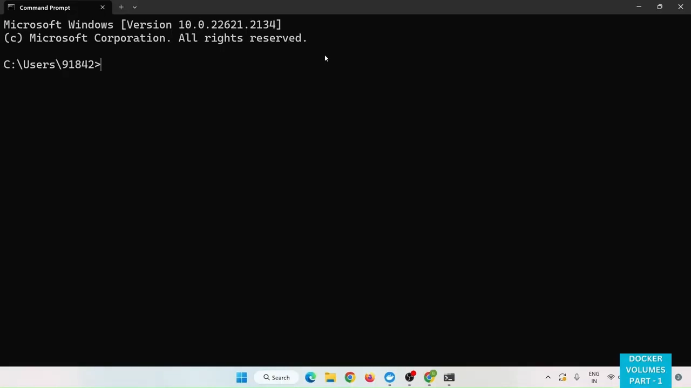
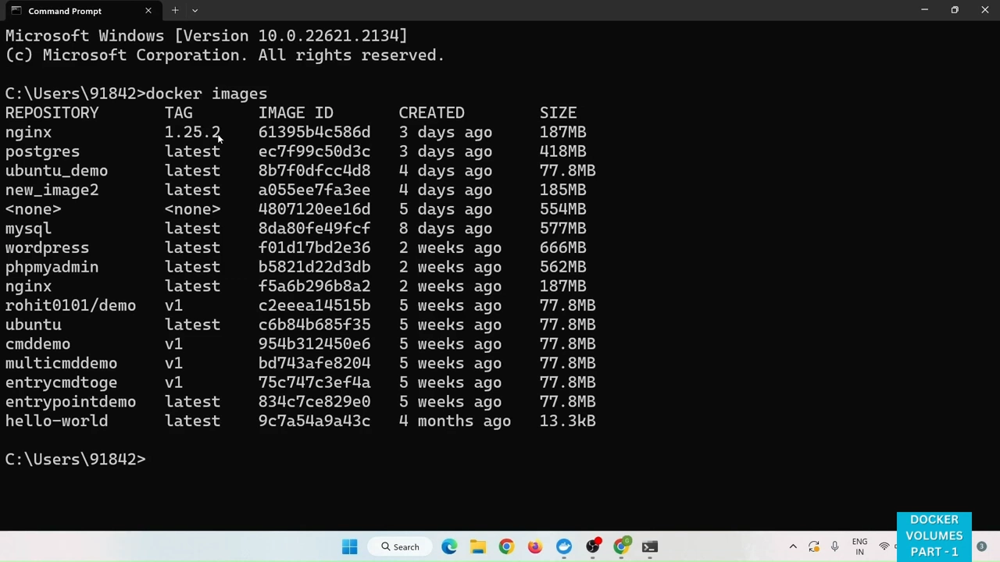
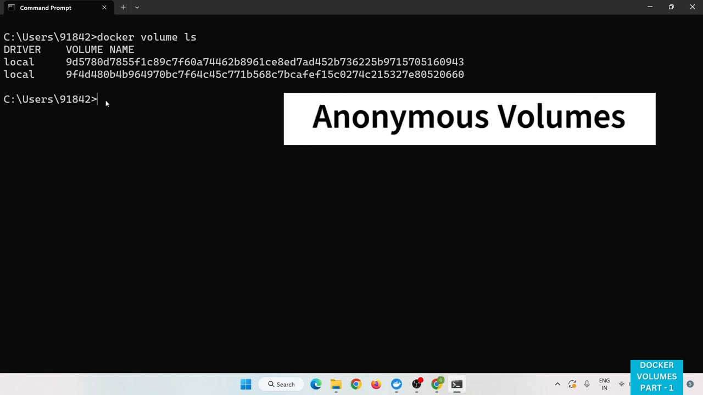
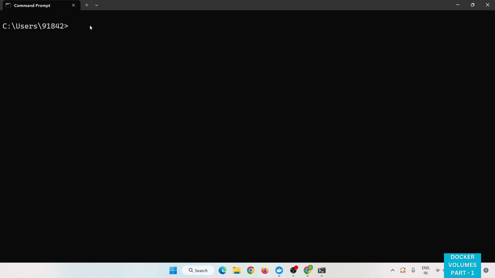
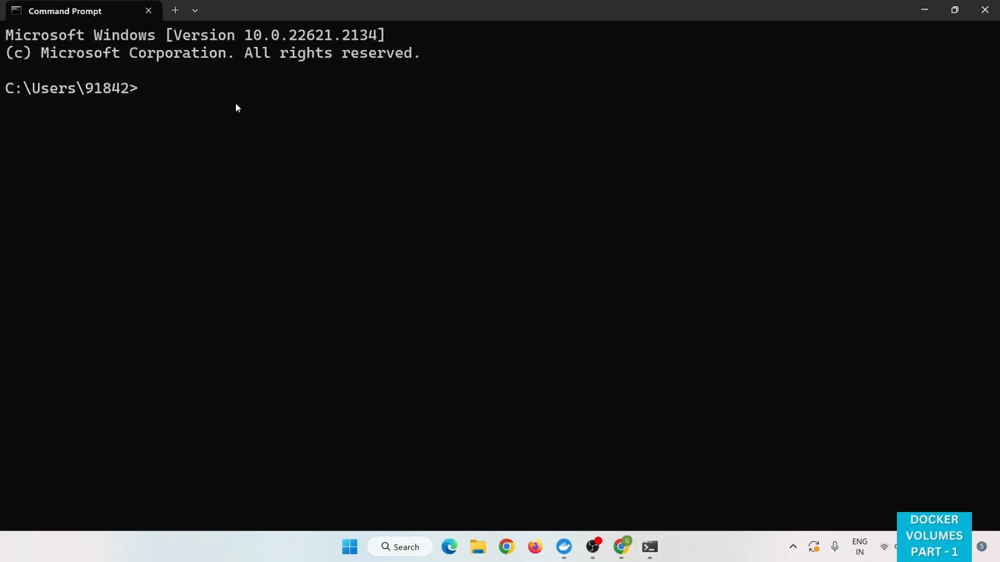
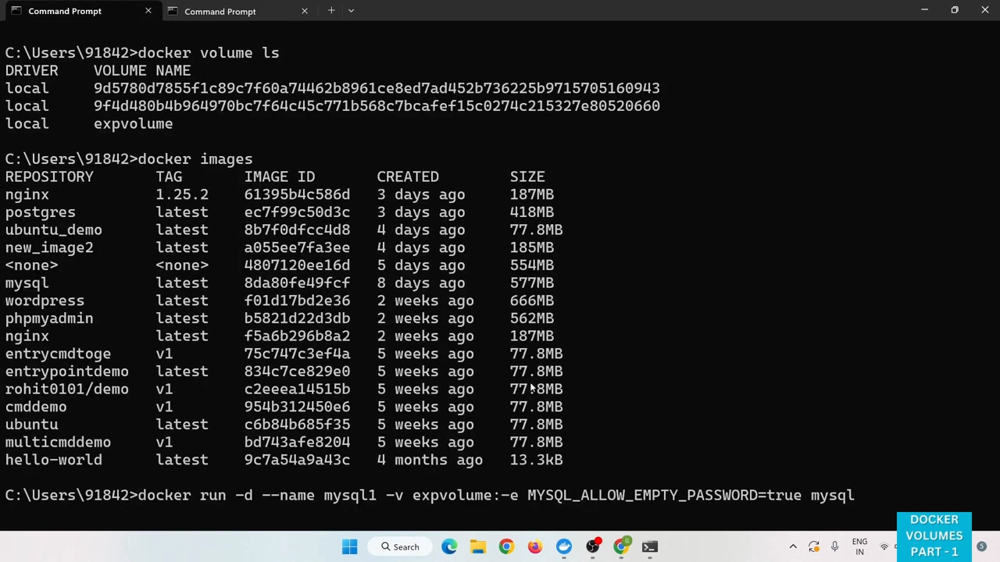
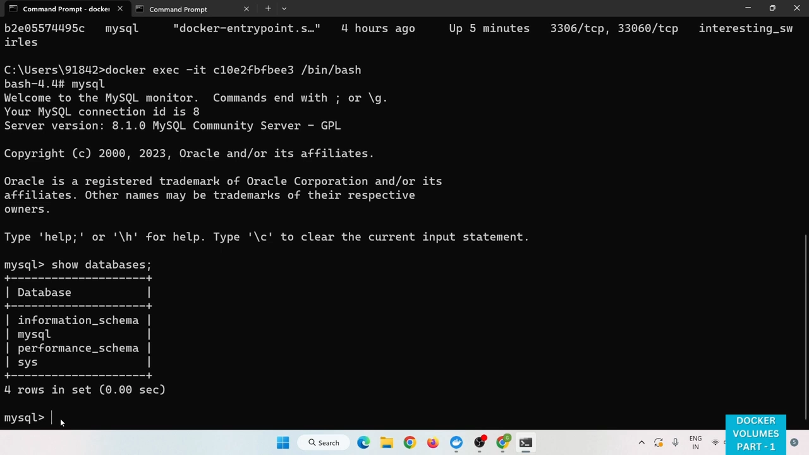
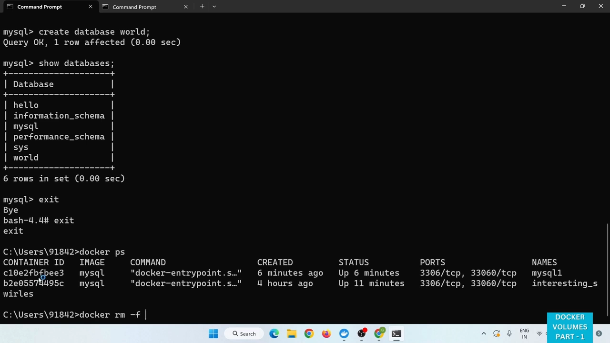
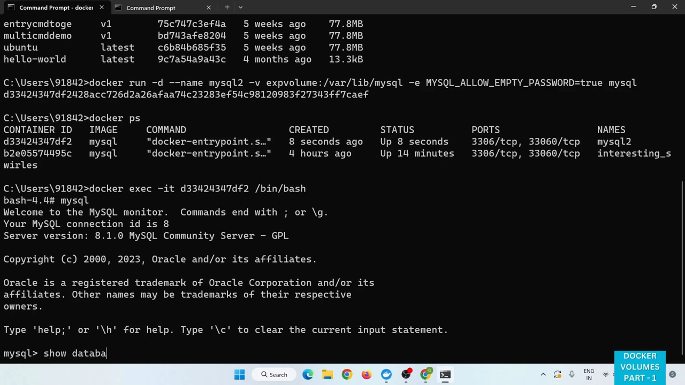

# Docker 数据卷详解：命名卷与匿名卷

> 本文整理自 YouTube 视频《Docker Volumes Explained | Named and Anonymous Volumes Explained》（频道 Code Gem），依据视频演说图文稿逐窗口核对内容。
> 视频地址：[GpnrBMgPKs8](https://www.youtube.com/watch?v=GpnrBMgPKs8)

## 本讲要解决的核心问题（SCQA）

**背景**：容器是"用完即弃"的。你在容器里装好软件、改好配置，一旦把它删掉重建，这些改动就全没了——**Docker 默认把数据存在容器级别，删除容器时数据也随之被删除**。

**冲突**：想象一个真实场景：你基于 `nginx:1.25` 镜像起了一个容器，把配置和内容都改好了；这时客户要求把 nginx 换成 1.1 版本。你只能拉取 `nginx:1.1` 新镜像、重新起容器——新容器是一套**全新的初始安装**，之前所有的改动和配置都得**从头再做一遍**，白费功夫。

**疑问**：有没有办法让数据和容器**解耦**——容器随便换、随便删，数据都还在，甚至能被多个容器共用？

**回答（中心思想）**：有，这就是 **Docker 卷（volume）**：它让我们**独立于容器地管理并持久化数据**，既能跨容器共享，也能在宿主机与容器之间共享。卷分**命名卷**和**匿名卷**两大类——**匿名卷由 Docker 自动创建、随手清理**，**命名卷则由我们显式创建、有名字、可长期存活并被多个容器共享**。

## 一、为什么需要 Docker 卷

用一句最直白的话概括视频的动机：**"给容器换个版本，不该让所有配置重来一遍。"**

Docker 卷提供了在**容器之间、以及宿主机与容器之间共享和存储数据**的能力。核心区别只有两条：

- **不用卷**：数据默认存在容器级别，**删除容器，数据一起被删**。
- **用卷**：可以**独立于容器来管理和持久化数据**——容器是容器，数据是数据。



## 二、Docker 卷的四种类型

在真正动手前，先建立一张"地图"——环境里常见**四种**卷：

1. **命名卷（named）**：有名字、显式创建的卷。
2. **匿名卷（anonymous）**：没有名字、由 Docker 自动创建的卷。
3. **绑定挂载（bind mount）**：直接把宿主机的某个目录挂进容器。
4. **临时文件系统（tmpfs）**：挂在内存里，容器一停就没了。

本篇聚焦前两种——**命名卷与匿名卷**（绑定挂载与 tmpfs 属于另外的话题）。



## 三、先看一眼：卷到底存在哪儿

用一条命令就能列出当前主机上所有的卷：

```bash
docker volume ls
```

输出里能看到每条卷的 **driver**（驱动，默认是 `local`）和 **volume name**（卷名）。比如视频开始时，系统里已经存在一个卷，`docker volume ls` 一眼就能看到。


## 四、匿名卷：随着容器被自动创建

视频用一个实验把匿名卷"抓了个正着"。先从一个镜像起一个容器，这里用的是 MySQL：

```bash
docker run -it -e MYSQL_ROOT_PASSWORD=<密码> mysql
```

容器跑起来后，**再回头执行一次 `docker volume ls`**——你会看到**多了一个卷**。它不是你创建的，而是**在创建容器的过程中自动生成的**。

**这种自动生成的卷，就叫匿名卷（anonymous volume）。**

匿名卷的特征与用途：

- **由 Docker 自动创建**，不需要你操心；
- 通常用于**临时或一次性的存储**；
- 也常用于**缓存**，或者你**不需要显式管理卷**的场合。

一句话：**匿名卷就是在创建容器时被顺带创建出来的临时卷。**

> 提示：匿名卷和被删除的容器之间的关系很微妙——容器虽然被手动删了，当初自动生成、挂在它身上的那个卷可能还留在 Docker 的默认目录里。这也是"删了容器，卷却还在"这类现象的由来。



## 五、命名卷：显式创建、独立于容器生命周期

再看命名卷。**命名卷是被显式创建、并给定一个友好名字的卷**：

- **独立于容器的生命周期**——容器删了，它还在；
- **可以在多个容器之间共享**；
- 用于**在容器之间共享数据**、**跨容器重启持久化数据**；
- 也让数据管理**更有条理**。

创建命名卷只需一条命令：

```bash
docker volume create example-volume
```

创建后再 `docker volume ls`，就能看到这个新卷。接下来，这个卷就可以被挂到**任意一个容器**上，容器的数据会存进这个卷，而且能被多个容器共享。



## 六、实战：用命名卷保住 MySQL 的数据

下面跟着视频把整个流程走一遍——**这是一个"删掉容器、数据仍在"的完整闭环**。

### 6.1 找到 MySQL 存数据的目录

挂卷时要告诉 Docker"卷接到容器里的哪个路径"。对 MySQL 来说，数据目录在镜像里已经定义好了。用 `docker inspect` 看这个容器的**挂载路径**：

```bash
docker inspect <容器名>
```

在输出的 **`Volumes`** 字段里，能看到 MySQL 的数据目录是 **`/var/lib/mysql`**。我们要做的，就是**把命名卷挂到容器的这个路径上**。



### 6.2 用 -v 把卷挂进容器

创建容器时使用 `-v` 选项来挂卷，格式是 **`-v <卷名>:<容器内路径>`**：

```bash
docker run -d --name mysql1 \
  -v exp_volume:/var/lib/mysql \
  -e MYSQL_ROOT_PASSWORD=<密码> \
  mysql
```

这里 `exp_volume` 是我们自己命名的卷，`/var/lib/mysql` 就是上一步查到的 MySQL 数据目录。



### 6.3 在容器里造点数据

进入容器操作 MySQL，先看看默认有哪些库：

```bash
docker exec -it mysql1 bash
# 进入 MySQL 交互界面后：
show databases;         # 默认有 4 个库
create database hello;
create database world;
```

看到 `hello`、`world` 两个库建好了。**由于数据目录已经挂到了 `exp_volume` 这个卷上，这两条新建的库其实是存进了卷里。**



### 6.4 删掉容器，卷和数据都还在

现在做那个关键动作——**删除 MySQL 容器**。删除后：

```bash
docker volume ls
```

**卷 `exp_volume` 依然躺在列表里。** 容器没了，卷还在——这正是命名卷"独立于容器生命周期"的直接体现。



### 6.5 用新容器挂同一个卷，数据还在

再从同一个镜像创建一个**新容器**，挂上**同一个命名卷** `exp_volume`，并把 MySQL 数据目录映射过去。进入新容器一看：

```bash
show databases;
```

**`hello` 和 `world` 都还在！** 说明当初写进卷里的数据完好无损——数据成功跑赢了容器。

而且，**你可以创建两个甚至更多 MySQL 容器，把它们都挂到同一个 `exp_volume` 上**，从而实现容器之间的数据共享。



## 七、总结

- **默认情况下数据存在容器级别**，删容器就删数据；**卷把数据与容器解耦**，做到持久化与共享。
- Docker 卷常见**四类**：命名卷、匿名卷、绑定挂载、tmpfs；本篇聚焦**命名卷与匿名卷**。
- **匿名卷**由 Docker **自动创建**，适合**临时、一次性、缓存**等不必显式管理的场景。
- **命名卷**由我们**显式创建并命名**，**独立于容器生命周期**，可在**多个容器间共享**，适合持久化数据。
- `docker volume create` 建卷、`docker volume ls` 看卷、`docker inspect` 找容器内的挂载路径、`docker run -v <卷名>:<路径>` 挂卷——这套组合就能完成"删容器、数据不丢"。

## 关键术语速查

| 术语 | 一句话解释 |
| --- | --- |
| Docker 卷（volume） | 独立于容器生命周期、用于持久化与共享数据的存储 |
| 匿名卷 | 创建容器时由 Docker 自动生成、没有名字的临时卷 |
| 命名卷 | 用 `docker volume create` 显式创建、有名字、可被多容器共享的卷 |
| 绑定挂载（bind mount） | 把宿主机上的某个目录直接挂进容器 |
| tmpfs | 挂在内存中的临时文件系统，容器停止即消失 |
| `docker volume ls` | 列出当前主机上的所有卷 |
| `docker inspect` | 查看容器的详细信息，其中 `Volumes` 段给出数据目录（如 `/var/lib/mysql`） |
| `-v <卷名>:<容器路径>` | 挂载卷的标准写法，冒号左边是卷名、右边是容器内路径 |
