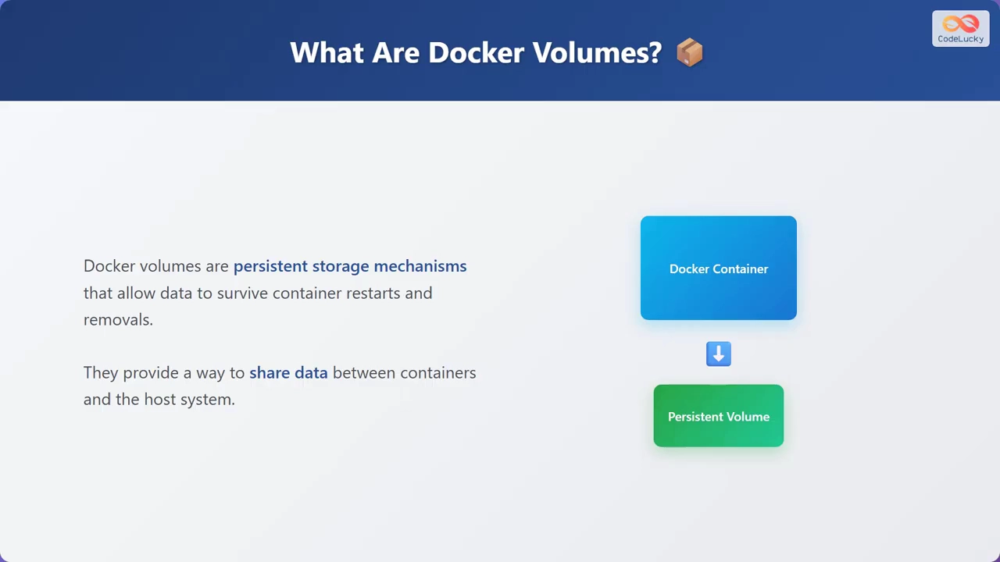
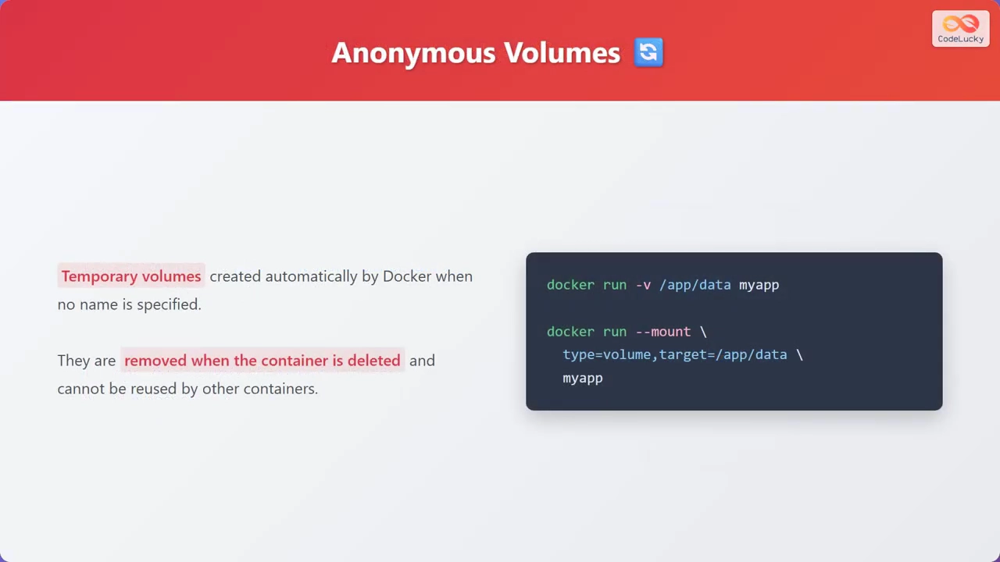
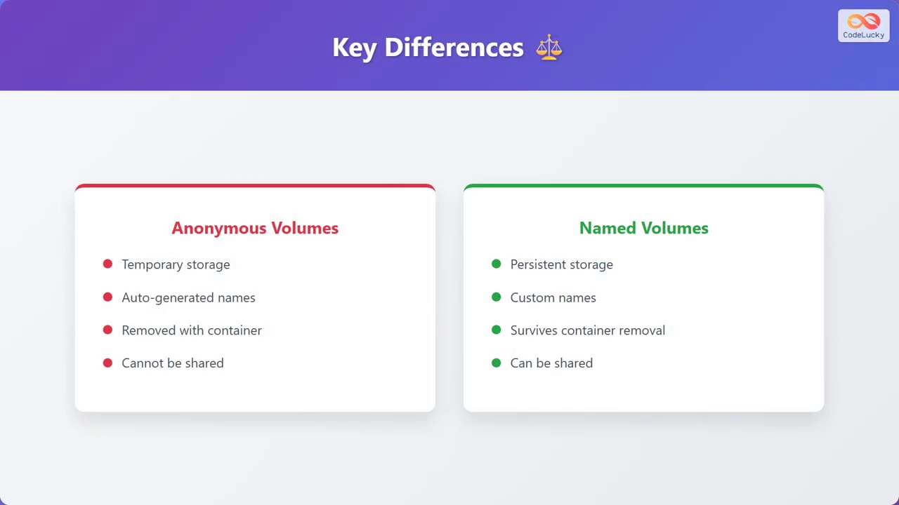
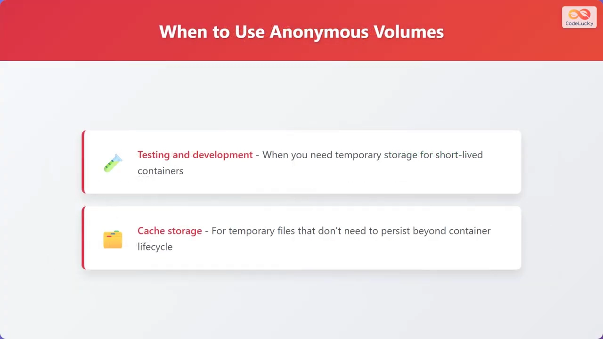
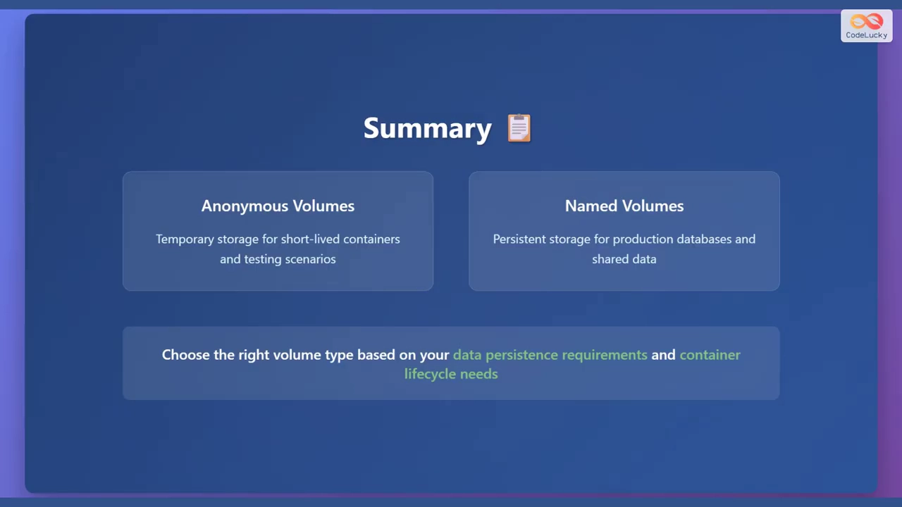

# 命名卷与匿名卷：到底该用哪一个

> 本文整理自 YouTube 视频《Docker Volumes Explained: Named vs Anonymous (Beginner's Guide)》（频道 CodeLucky），依据视频演说图文稿逐窗口核对内容。
> 视频地址：[C7hFjyyOTUg](https://www.youtube.com/watch?v=C7hFjyyOTUg)

## 本讲要解决的核心问题（SCQA）

**背景**：容器默认是"一次性的"——容器被停止、删除或重建时，写在容器里的数据会随之丢失。为了让重要数据活下来，Docker 提供了**卷（volume）**这种持久化存储机制。

**冲突**：卷不只一种。给容器挂卷时，有时候我们写了名字，有时候只写了一个路径——这两种写法产生的卷，在"名字、能否共享、容器删了以后还在不在"上完全不同。选错了，要么数据莫名消失，要么留下了一堆没人认识、又不敢删的卷。

**疑问**：**命名卷（named volume）和匿名卷（anonymous volume）到底有什么区别？各自适合什么场景？**

**回答（中心思想）**：**匿名卷**是 Docker 在没给名字时自动创建、随容器一起删除、不能被别的容器复用的**临时**存储，适合测试、缓存、短命容器；**命名卷**是有明确名字、独立于容器生命周期、可被多个容器共享的**持久**存储，适合数据库、需要共享的数据和**生产环境**。

## 一、卷是什么：给容器配一块"独立硬盘"

卷（volume）是一种**持久化存储机制**，它让数据能在容器的重启与删除中存活下来：

- **数据能存活**：容器重启、被移除、被重建，卷里的数据都不会丢。
- **能在容器之间、以及容器与宿主机之间共享数据**。
- **确保重要数据不会因容器被停止、删除或重建而丢失**。

可以把它理解为**容器的一块独立硬盘**——硬盘挂在哪台"电脑"（容器）上不重要，重要的是数据本身存在硬盘里。



## 二、匿名卷：Docker 帮你临时开一块空间

**匿名卷（anonymous volume）是 Docker 在没有指定名字时自动创建的临时卷。**

它的特点：

- **临时性**：随容器一起创建，也随容器一起被清理掉。
- **名字是自动生成的**：你没法给它起名字，只能靠一串随机标识去认。
- **不能复用**：删除容器后，匿名卷也被移除，**不能被其它容器复用**。

可以把它理解为**"用完即清"的临时存储空间**。

创建匿名卷的两种写法：

```bash
# 写法一：-v 只给容器内路径（不给卷名）
docker run -v /app my-app

# 写法二：--mount
docker run --mount type=volume,target=/app my-app
```

这里的共同点就是：**只在冒号右边（或 target=）给了容器内路径，没有给卷的名字**——Docker 于是自动生成一个匿名卷来顶上。



## 三、命名卷：有名字、可共享、能长期存活

**命名卷（named volume）是有明确名字的持久卷，可以跨容器共享。**

它的特点：

- **持久**：**能存活于容器被移除之后**。
- **有自定义名字**：由你（或镜像作者）显式命名，便于管理和复用。
- **可共享**：**多个容器可以复用同一个命名卷**，从而共享数据。

创建命名卷的两种写法：

```bash
# 写法一：-v <卷名>:<容器内路径>
docker run -v my-volume:/app/data my-app

# 写法二：--mount
docker run --mount source=my-volume,target=/app/data my-app
```

对比匿名卷，关键差别就是**冒号左边（或 source=）多了一个卷名** `my-volume`——有了名字，它就成了一个可被反复复用的命名卷。


## 四、一句话对照：关键区别

视频用一张对照表把两者的差异讲得很清楚：

| 维度 | 匿名卷（anonymous） | 命名卷（named） |
| --- | --- | --- |
| 存储性质 | 临时存储 | 持久存储 |
| 名字 | 自动生成 | 可自定义名字 |
| 容器删除后 | 随容器一起被移除 | 存活下来 |
| 能否共享 | 不能共享 | 可在多个容器间共享 |



## 五、各自适合什么场景

**匿名卷适合**：

- **测试与开发**：需要一个短命容器用的临时空间时；
- **缓存存储**：作为可随时丢弃的缓存；
- **临时文件**：不需要在容器生命周期之外保留的临时文件。

**命名卷适合**：

- **数据库存储**：需要**长期存活**、即使容器更新也不丢的数据；
- **共享数据**：**多个容器需要访问同一份数据**时；
- **生产环境**：需要可靠数据持久化的应用。



## 六、总结

- **匿名卷**用于**临时存储**，适合**短命容器**与**测试场景**，也常用于缓存与临时文件。
- **命名卷**用于**持久存储**，适合**生产数据库**与**需要共享的数据**。
- 选择哪种卷，取决于你的**数据持久化需求**和**容器生命周期**的实际情况：数据要跟着容器一起走，就用匿名卷；数据要跑赢容器，就用命名卷。



## 关键术语速查

| 术语 | 一句话解释 |
| --- | --- |
| 卷（volume） | Docker 提供的持久化存储机制，数据独立于容器而存在 |
| 匿名卷 | 未指定名字时 Docker 自动创建的临时卷，随容器删除而移除，不能共享 |
| 命名卷 | 有明确名字的持久卷，独立于容器生命周期，可被多个容器共享 |
| `-v` | `docker run` 里挂卷的简写：给了卷名就是命名卷，只给路径就是匿名卷 |
| `--mount` | 挂卷的另一种写法，用 `type=`/`source=`/`target=` 显式描述挂载 |
