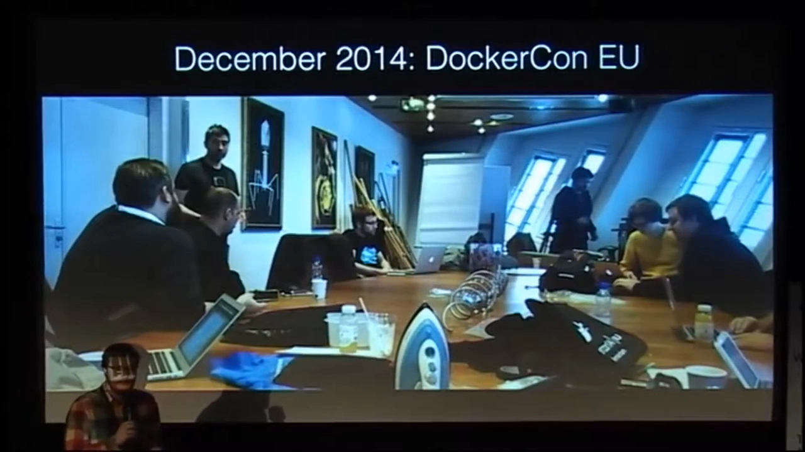
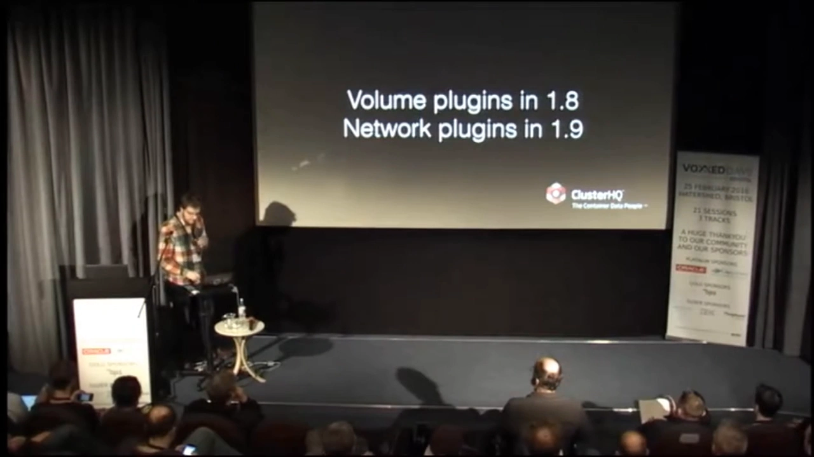
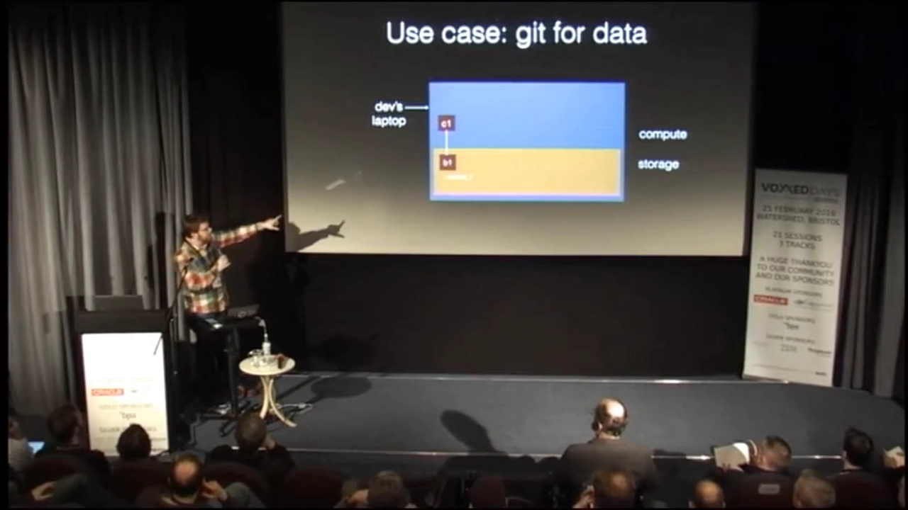
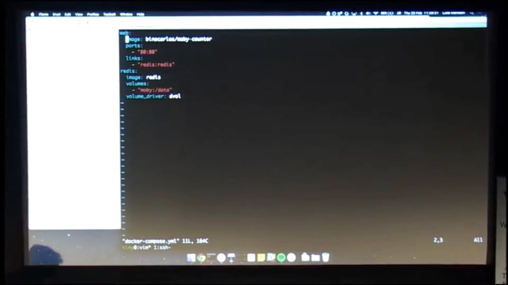
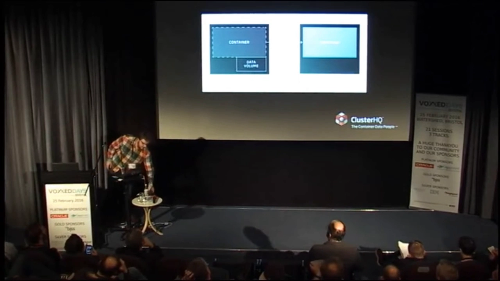
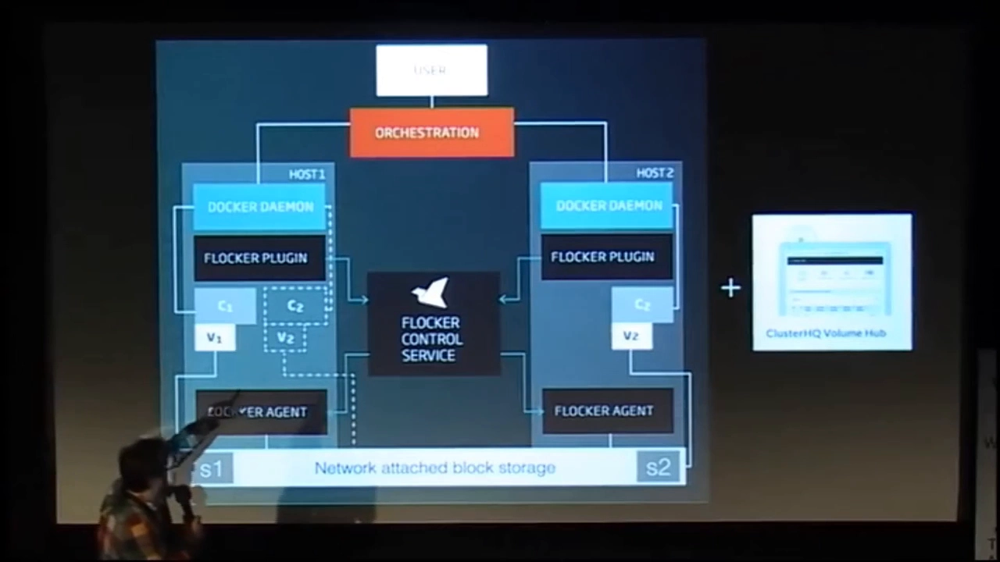
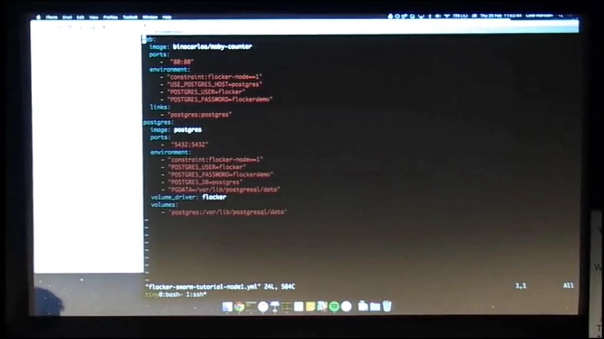
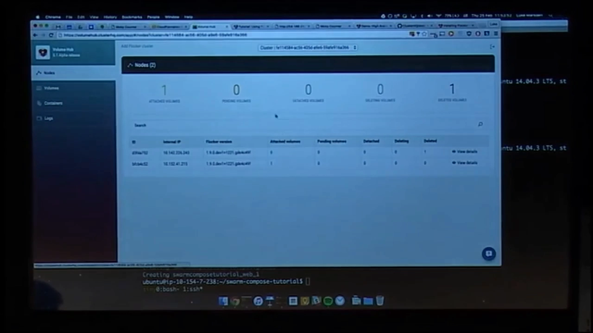
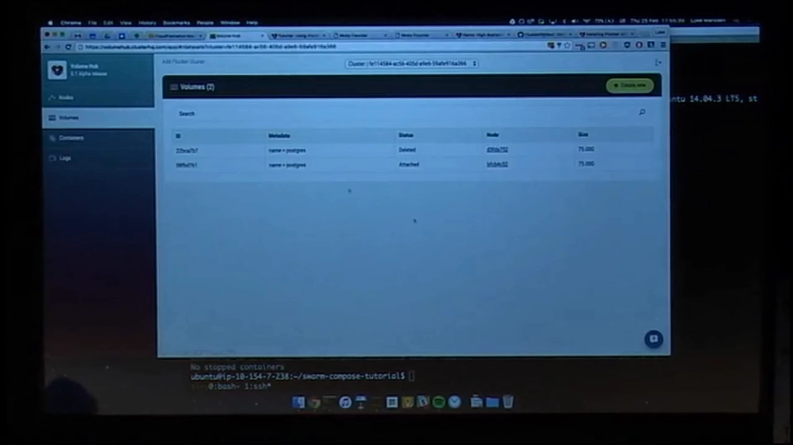
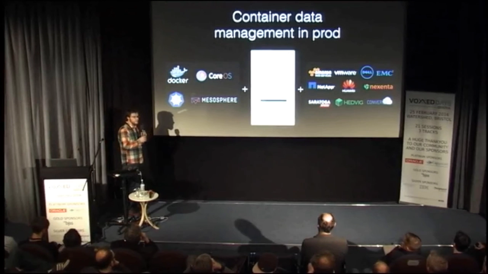

# Docker 卷插件幕后：从 Powerstrip 到 Volume Hub

> 视频来源：YouTube 视频《Behind the scenes with Docker plugin volumes》（主讲人 Luke Marsden，ClusterHQ 联合创始人兼 CTO，约 47 分钟，英文讲解）。本文基于视频演说图文稿整理，时间戳可跳转到原视频对应位置；配图取自视频画面。字幕为 YouTube 英文 ASR 轨，术语与错拼已逐窗口核对纠正。
> 视频地址：[TDz5XN_pEqw](https://www.youtube.com/watch?v=TDz5XN_pEqw)

## 本讲要解决的核心问题（SCQA）

**背景**：2014 年夏天，容器开始爆发式增长。但当时生态里有个大缺口——**有状态容器**（比如装了数据库、需要往磁盘写文件的容器）**根本没有好办法在生产环境运行**。ClusterHQ 决定专门解决 Docker 的数据问题，Weave 则在同一时期解决网络问题。

**冲突**：想解决数据问题，却**无处可插**。外部工具只能**包一层（wrap）Docker CLI**：用 ClusterHQ 的 Flocker 就得敲 `flocker deploy`，用 Weave 的网络就得敲 `weave run`——**二者不能同时用**，因为同一个应用只能挑一条命令。"包裹"最大的毛病就是**不能组合**。

**疑问**：**卷插件究竟是怎样被做进 Docker 的？有了卷插件，我们又能在它之上做出什么？**

**回答（中心思想）**：前半段讲一个"三个时区、往返旧金山"的协作故事——社区用 **Powerstrip** 这个原型机制**倒逼** Docker 官方把"**延迟绑定（late bound）、可组合（composable）、可选（optional）**"的插件机制做了出来，最终**卷插件在 1.8 稳定、网络插件在 1.9 稳定**，成为 Docker 主线的一部分。后半段用两个实机 demo 展示卷插件能干什么：**dvol**——像 Git 一样给开发数据库做版本控制（commit / branch / checkout）；**Flocker + Volume Hub**——把容器与卷作为**一个原子单位**在集群中迁移，从而把有状态应用**搬上生产**。

---

## 一、问题：有状态容器无处安放

先看一张简化的容器栈图。视频用它说明"人们到底怎么在生产里跑容器"：[【跳转到 01:48】](https://www.youtube.com/watch?v=TDz5XN_pEqw&t=108)

- **顶层**负责**编排与调度**——可以是 Docker Swarm + Compose，也可以是 Kubernetes，或者 Mesosphere + Marathon；
- 它控制**一组主机（host）**；
- 主机上跑着 **Docker daemon**，真正运行你的进程、负载、应用。

ClusterHQ 想在这个栈里解决**存储问题**，Weave 想解决**网络问题**，但两者都被同一件事卡住：**没有地方插进去**，只能 wrap。wrap 的致命伤是**不能组合**：[【跳转到 03:19】](https://www.youtube.com/watch?v=TDz5XN_pEqw&t=199)

- 想跑有状态容器并把它从一台机器迁到另一台，就要敲 `flocker deploy`，它再通过 Docker API 去和每台机器上的 daemon 通信；
- 想用 Weave 让容器互通，就要敲 `weave run`；
- 但你**没法既 `weave run` 又 `flocker deploy` 同一个应用**——只能二选一。

## 二、插件机制是怎么被"逼"出来的

### 2.1 时代背景：Rocket 与"可组合生态"

2014 年 12 月，CoreOS 发布了一个叫 **Rocket** 的项目，定位为 Docker 的竞品，整个生态一时议论纷纷。它客观上给 Docker Inc. 施加了压力，也呼应了当时生态里的一种情绪：有人觉得 Docker 从"容器运行时"野心扩张成"整个栈"，却在挤压自家生态的伙伴。于是 Docker 有动力去**证明自己愿意建设一个可组合的生态**。[【跳转到 04:19】](https://www.youtube.com/watch?v=TDz5XN_pEqw&t=259)

在这一背景下，DockerCon EU（阿姆斯特丹）上一场"**小房间会议**"成了关键节点：一群想聊插件的人聚在一起，包括 Solomon Hykes（Docker CTO）、Alexis Richardson（Weave，牵头促成）、Rancher 的 Darren、Docker 的 Ben（原 Fig）以及 VMware 的若干人。这张照片后来被戏称为"DockerCon 的水壶"，在推特上小小地火了一把。[【跳转到 06:03】](https://www.youtube.com/watch?v=TDz5XN_pEqw&t=363)

### 2.2 收敛到最简协议，与三条设计原则

讨论一开始甚至**连"插件该用什么协议与引擎对话"都定不下来**，不少人提出了相当"聪明"的方案。最终大家**同意用最简单的**：**JSON over HTTP over a Unix socket**。[【跳转到 07:41】](https://www.youtube.com/watch?v=TDz5XN_pEqw&t=461)

再加上**九个月**的磨合，大家达成了几条共识，其中三条是主讲人反复强调的"插件项目成功的必要条件"：[【跳转到 08:49】](https://www.youtube.com/watch?v=TDz5XN_pEqw&t=529)

- **延迟绑定（late bound）**：插件**不能被编译进 Docker**。因为人们是从 Ubuntu 包仓库或 macOS 安装 Docker 的，不可能让生态里所有插件都随 Docker 一起编译、分发，也不能让它们**被 Docker 的发布节奏绑架**（我们想发新版 Flocker，不该求 Docker 批准）。
- **可组合（composable）**：必须能**同时加载多个**插件——这正是当初"包裹方案"要解决的问题（要能同时加载 Weave 和 Flocker）。
- **可选（optional）**：插件是可选件，Docker 自己的"电池"也要**用同一套插件机制**来实现。

Docker 就此喊出的口号是"**batteries included but removable**（电池自带，但可拆卸）"——虽然"换一块不同形状的电池"这个比喻有点怪，但重点在于：**官方自带的实现，和第三方插件走的是同一套机制**。[【跳转到 09:52】](https://www.youtube.com/watch?v=TDz5XN_pEqw&t=592)

### 2.3 Powerstrip：先用原型逼出机制

为了在这场讨论里抢占一点主动权（也顺便给 Docker 一点压力——"如果你们不做这个扩展机制，我们就自己做"），主讲人和 Weave 的 Ilia 在奥地利的一间小屋里**联合开发了 Powerstrip**。[【跳转到 10:58】](https://www.youtube.com/watch?v=TDz5XN_pEqw&t=658)

Powerstrip 是一套"**给 Docker 做扩展原型**"的机制。它的工作原理是：[【跳转到 11:43】](https://www.youtube.com/watch?v=TDz5XN_pEqw&t=703)

- 底层的 Docker 客户端（CLI、Swarm、Kubernetes 等，任何说 Docker remote API 的东西）以为自己在跟 daemon 说话；
- 实际上它**被"带偏"到 Powerstrip**（Powerstrip 去 bind daemon 的端口或 `/var/run/docker.sock`）；
- Powerstrip 允许执行一组 **pre-hooks**，可以**延迟请求、修改请求内容**，再把请求转发给真正的 Docker server；返回路上同样可以改响应、延迟响应。

这套看似简单的机制已经**足以原型化 Weave 与 Flocker 插件**——比如"在启动容器前把这个卷就位""启动前把网络建好""关闭容器时拆掉网络"等。两人用它**第一次把 Flocker 和 Weave 插件以可组合的方式跑通**并发了博客，引起了关注，也让整个项目有了"赶在 DockerCon 之前做完"的动力。[【跳转到 13:43】](https://www.youtube.com/watch?v=TDz5XN_pEqw&t=823)

**结果**：卷插件**没赶上 1.7 稳定版**，但在 **1.8 稳定**发布；不久之后**网络插件在 1.9 稳定**发布。至此，插件成为 **Docker 主线**的一部分，"你大概都装了的那个 Docker"里**白送**这套能力。[【跳转到 18:31】](https://www.youtube.com/watch?v=TDz5XN_pEqw&t=1111)

## 三、Demo 1：dvol —— 给开发数据库做版本控制

后半段进入实机演示。第一个是 **dvol**，主讲人称之为"**面向开发的 Flocker**"。[【跳转到 19:29】](https://www.youtube.com/watch?v=TDz5XN_pEqw&t=1169)

**它解决的场景**：你是个开发者，在笔记本上敲代码，用 Docker Compose 把应用"容器化"成开发环境。你已经有**代码的版本控制**了，那**开发用的数据库**能不能也像版本控制系统一样？——比如同事遇到一个 bug，你想**把当前数据库的某个状态分享给他**；或者只是想**给自己拍个快照**，回头再来调。[【跳转到 19:54】](https://www.youtube.com/watch?v=TDz5XN_pEqw&t=1194)

**它的心智模型**：计算与存储在同一台物理机上（开发者笔记本），一个容器 C1 指向某个 Docker 卷的**分支 B1**；你可以对它**取一次提交（commit）**，再从该提交**开新分支**，继续加提交；也可以回到第一个分支，再开一条分支——于是不同分支就各自带上不同的提交历史。这几乎就是 Git 的那套 `commit / branch / checkout`。[【跳转到 20:32】](https://www.youtube.com/watch?v=TDz5XN_pEqw&t=1232)

**实操流程**（用一个"点屏幕就画 Docker 小图标、并存进 Redis"的应用演示）：

1. Compose 文件里定义**两个容器**：无状态的应用容器 + 有状态的数据存储（这里用 **Redis**）；关键是定义里带了 **volume driver 标志**，指明要用哪个卷插件。这个标志正是他们努力塞进 Docker API 与 CLI、又被 Compose 继承下来的。[【跳转到 22:12】](https://www.youtube.com/watch?v=TDz5XN_pEqw&t=1332)
2. `docker compose up -d` 起服务；因为 Compose 文件指定了名为 `dvol` 的卷驱动，Docker **按需自动创建**了一个叫 `Mobi` 的 dvol 卷。dvol 卷的特殊之处是**带分支与提交**，不只是宿主机上的一个目录。[【跳转到 24:02】](https://www.youtube.com/watch?v=TDz5XN_pEqw&t=1442)
3.
   - `dvol list` 看到 `Mobi` 卷（当前在 `master` 分支）；
   - 在"干净状态"下先做一次 **commit**，方便随时回来；`dvol log` / `dvol branch` 查看；
   - `dvol checkout -b branch-a` 切到新分支，在页面上画一个 **"A"**（存进 Redis），再 `dvol commit`；
   - 切回 `master`，页面**回到干净状态**；再 `dvol checkout -b branch-b`，画一个 **"B"**，提交；
   - `dvol checkout branch-a` → 页面显示 **"A"**；切回 `branch-b` → 显示 **"B"**。
4. 把这一切**接到真实应用**上想一想：开发一个复杂 CMS 时，你可以**把数据库的某个状态连同代码状态一起**打包发给 QA 或同事，逐渐积累一座"数据快照库"；将来甚至可以从**生产环境**拍快照拉进开发环境——想想看，一个以往很难复现的 bug，如果**自带一份生产数据快照**，直接拉到开发机就能调。[【跳转到 27:35】](https://www.youtube.com/watch?v=TDz5XN_pEqw&t=1655)

## 四、Flocker 101：让容器跟着数据一起搬家

第二个 demo 是 **Flocker（Flocker Cluster）+ Volume Hub**。先补一段"Flocker 101"。[【跳转到 28:59】](https://www.youtube.com/watch?v=TDz5XN_pEqw&t=1739)

**要解决的具体问题**：按 Docker 最佳实践，跑一个有状态容器时会挂一个**卷**，于是容器把所有改动写进**宿主机上的目录**。问题在于——**只要应用往那个卷写了一个字节，这个容器就再也没法搬走了**，因为那份数据在别的机器上并不存在。这**破坏了容器本该有的可移植性承诺**。[【跳转到 29:04】](https://www.youtube.com/watch?v=TDz5XN_pEqw&t=1744)

**Flocker 的做法**：让容器与数据卷**作为一个原子单位一起移动**。也就是说，把容器迁到另一台机器时，Flocker 会用**底层相应的存储机制**确保**卷也如容器所预期地出现在那里**，而不是让新机器上跑起一个空数据库。[【跳转到 30:10】](https://www.youtube.com/watch?v=TDz5XN_pEqw&t=1810)

**架构**（以 Swarm 集群为例，一张稍显绕的图）：[【跳转到 30:36】](https://www.youtube.com/watch?v=TDz5XN_pEqw&t=1836)

- 用户 → **编排层**（如 Docker Swarm）→ 各 **Docker daemon**；
- **Flocker 插件**挂在 Docker daemon 上，用它争取来的那套接口（**四个 API 调用**）与 **Flocker 控制服务**通信；
- 节点上还跑着 **Flocker agent**，它负责与**网络块存储**打交道；
- 举例：如果两台机器在同一 EC2 可用区，Flocker agent 可以**把一块 EBS 卷从一台机器 detach 下来、attach 到另一台**，从而把带虚线的那台"**C2**"迁到 host 2。

## 五、Demo 2：Flocker + Volume Hub，把有状态应用搬上生产

**Volume Hub** 是 ClusterHQ 托管的**Web 界面**，接到你的 Flocker 集群上，让你**更容易看清集群里在发生什么**。[【跳转到 31:46】](https://www.youtube.com/watch?v=TDz5XN_pEqw&t=1906)

**演示场景**：应用在开发环境做好了，现在要**部署进生产**。而**从 dev 到 prod，你关心的事变了**——不再关心"能给数据打提交"，而是关心"**服务器太忙了怎么办**"：能不能把应用**连同数据**搬到另一台服务器（更大的机器）上？或者一台机器上跑着两个应用、把其中一个挪到更空闲的机器上？这其实是系统管理员再普通不过的诉求。[【跳转到 32:15】](https://www.youtube.com/watch?v=TDz5XN_pEqw&t=1935)

### 5.1 环境搭建与卷的创建

视频跳过繁琐的安装，只说明：通过 CloudFormation 在 AWS 上装 Flocker（有图示、步骤简单），再接到 Volume Hub 上即可。

进入实操后可以看到：[【跳转到 34:05】](https://www.youtube.com/watch?v=TDz5XN_pEqw&t=2045)

- 客户端节点上预装了 **Compose、Docker CLI 与 Flocker 客户端**；它通过控制节点（跑着 Swarm）与集群通信；
- `docker info` 显示"我是 Swarm，有两个节点"——**node 243 与 node 215**，与 Flocker 的视角**完全一致**；
- Flocker 视图里当前没有已挂载卷、没有 pending 卷，有一个之前删掉的卷。

**Compose 文件**与之前类似，只是把 Redis 换成了 **Postgres**，并带有两个关键配置：[【跳转到 34:30】](https://www.youtube.com/watch?v=TDz5XN_pEqw&t=2070)

- 一条 **Swarm 约束**：请把服务调度到 **node one**；
- **volume driver = Flocker**（替代之前的 dvol），卷名为 `postgres`。

执行 `docker compose up -d` 后，观察卷的**状态流转**：[【跳转到 34:45】](https://www.youtube.com/watch?v=TDz5XN_pEqw&t=2085)

- Volume Hub 里出现一个 **pending** 卷；
- 因为 Flocker 配置了 **EBS**，它其实是在**向 AWS 申请一块块设备**，你会看到它"忙着供给"的过程；
- 卷随即变为 **detached**，再变为 **attached**；`docker compose up` 也随之完成（耗时大约就是**供给一块 EBS 卷**的时间）。

### 5.2 把容器和卷一起搬到另一台机器

应用部署到了 node one，可以正常访问。接下来演示**迁移**：[【跳转到 37:32】](https://www.youtube.com/watch?v=TDz5XN_pEqw&t=2252)

- 迁移的办法就是**停掉并删除容器**——这里有个**极其重要**的点：**容器被销毁了，但卷仍然存在**。这正是有状态卷的全部意义所在：**它必须持久**，因为你不希望丢掉生产数据。
- 删完容器后去 `volumes` 一看，卷**依旧安然无恙**地待在那里，并且**仍被 Flocker 看见**。

- 然后在 node two（另一台机器）上重新起容器：Volume Hub 里卷先进入 **detached**（Flocker 正在把它从一台 VM "拔下"、插到另一台 VM，之后容器才被允许启动），随后 **pending → attached**；Web 界面会**晚几秒**，但"**布丁的证明在吃**"——去 node two 访问应用，数据**如约而至**。[【跳转到 40:15】](https://www.youtube.com/watch?v=TDz5XN_pEqw&t=2415)

## 六、总结、展望与 Q&A

视频结尾做一个收束：[【跳转到 44:51】](https://www.youtube.com/watch?v=TDz5XN_pEqw&t=2691)

- **Docker 插件**让你能在**卷和网络**上做出很酷的事——既可以**用别人写好的插件**，也可以**自己写一个**（Docker 文档里有指南）。
- **dvol 的下一步**：让**提交与分支能 push / pull 到 Volume Hub**，从而支持与同事/协作者基于 dvol 协作。
- **Flocker 的定位**：可以插到任何**编排框架**上（Docker、CoreOS、Kubernetes、Mesos），再与任何**存储**组合（AWS；GCE 支持即将推出；数据中心的 on-premise 存储等）。
- **结论**：这样你就**可以在生产环境运行有状态容器**了。[【跳转到 42:53】](https://www.youtube.com/watch?v=TDz5XN_pEqw&t=2573)
- 另一个重要的使用场景是 **HA（高可用）**：**节点故障时把容器重新调度到别处**——视频把它列为进阶主题，并在博客里用 **Kubernetes** 演示了做法。[【跳转到 42:13】](https://www.youtube.com/watch?v=TDz5XN_pEqw&t=2533)

**Q&A 里关于卷管理命令的要点**：

- 你已经可以**用 Docker 自己的卷命令**（`docker volume create` / `docker volume rm`）来管理 **Flocker 或 dvol 的卷**；
- 但它有个**限制**：这些命令**做不了提交 / 分支（commit / branch）**那类操作——要那些，就得改用 **dvol 工具**或 **Flocker 命令行**；
- 有人问"dvol 里有很多分支时 `volumes ls` 会看到什么"——主讲人本想演示，但坦言 **dvol 还没实现 `list`**（Flocker 里已实现），届时你只会看到**一串不透明的短哈希**，除此之外没有更多信息。[【跳转到 45:18】](https://www.youtube.com/watch?v=TDz5XN_pEqw&t=2718)

## 关键术语速查

| 术语 | 一句话解释 |
| --- | --- |
| 有状态容器 | 需要把数据写到磁盘/卷上的容器（如数据库），是当时生产落地的难点 |
| wrap（包裹） | 用外部命令包一层 Docker CLI 的做法，痛点是不能组合多个工具 |
| 插件（volume / network plugin） | 以"延迟绑定、可组合、可选"为原则扩展 Docker 卷或网络的机制 |
| late bound | 插件不编译进 Docker，可独立发布、随装随用 |
| Powerstrip | ClusterHQ 与 Weave 做的插件原型机制，用 pre-hooks 修改/延迟请求 |
| dvol | 面向开发的 Flocker，像 Git 一样给开发数据库卷做 commit / branch / checkout |
| Flocker | 让容器与数据卷作为原子单位一起迁移的系统 |
| Volume Hub | ClusterHQ 托管的 Web 界面，接入 Flocker 集群查看卷与容器状态 |
| Flocker agent | 节点上的组件，负责与网络块存储（如 EBS）交互，完成卷的 detach / attach |
| `docker volume create/rm` | 可管理 Flocker / dvol 卷，但做不了 commit / branch 等版本控制操作 |
