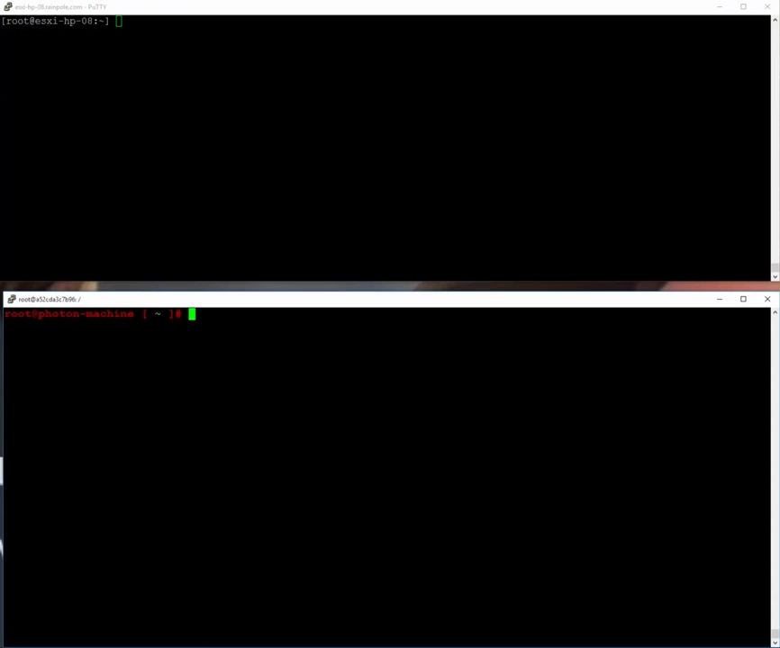
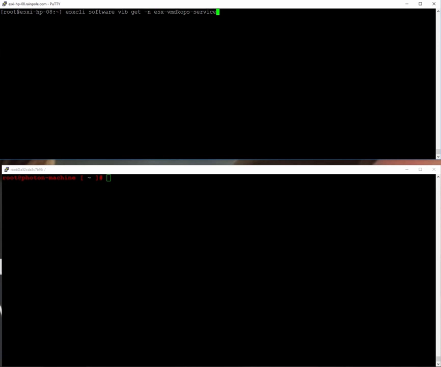
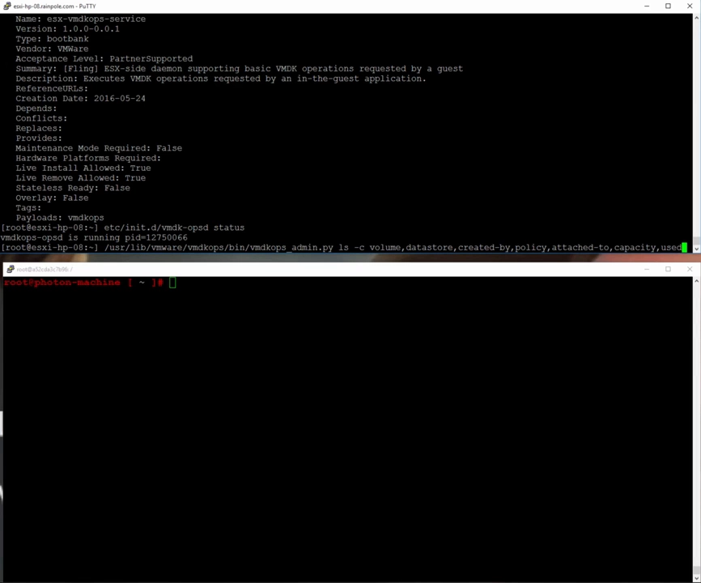
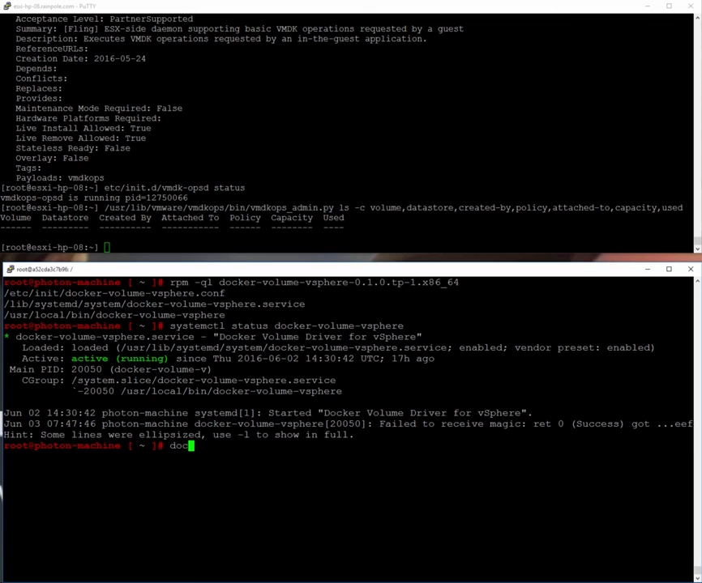
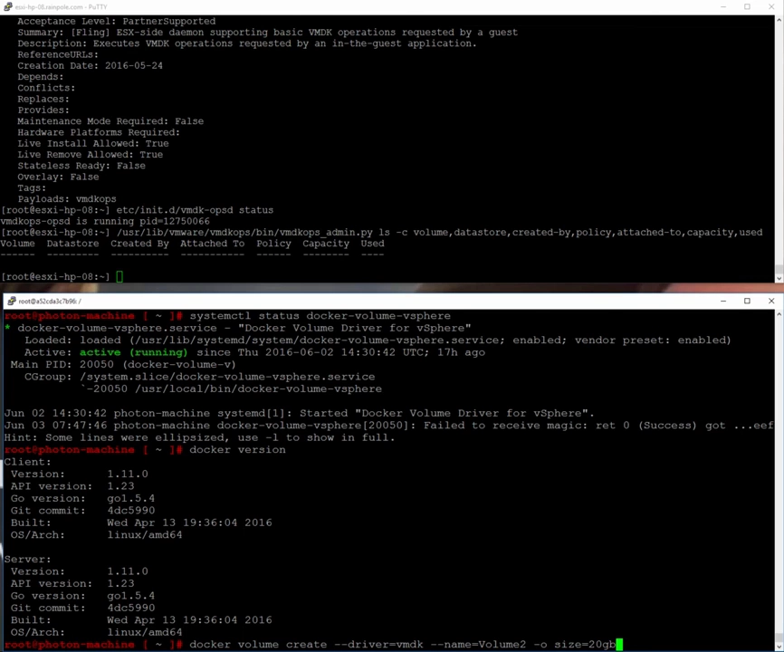
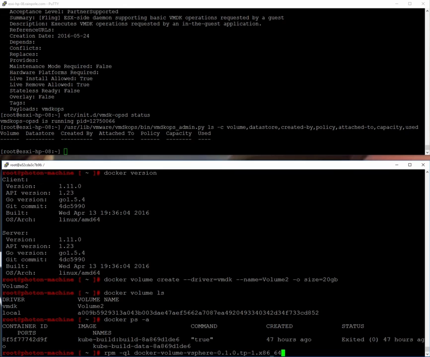
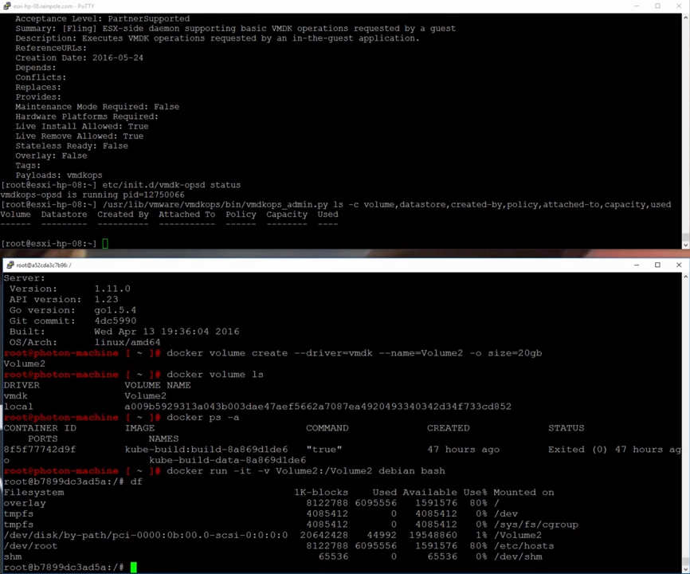
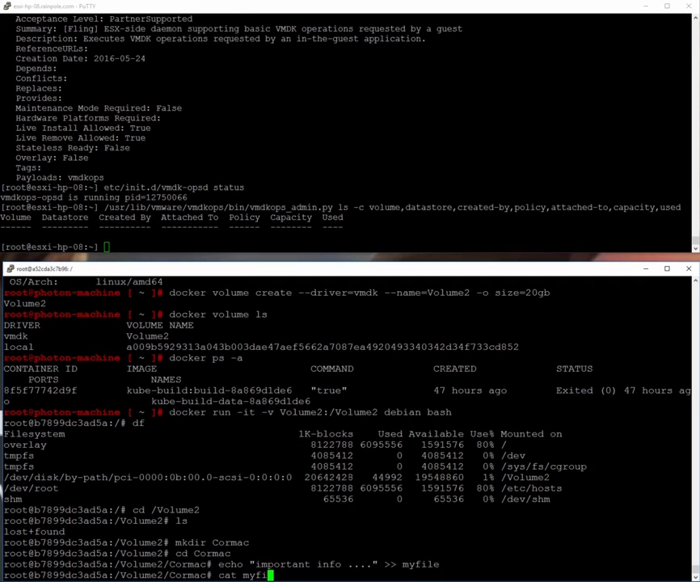
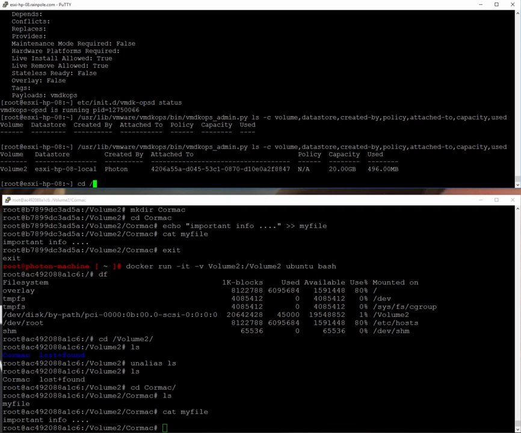
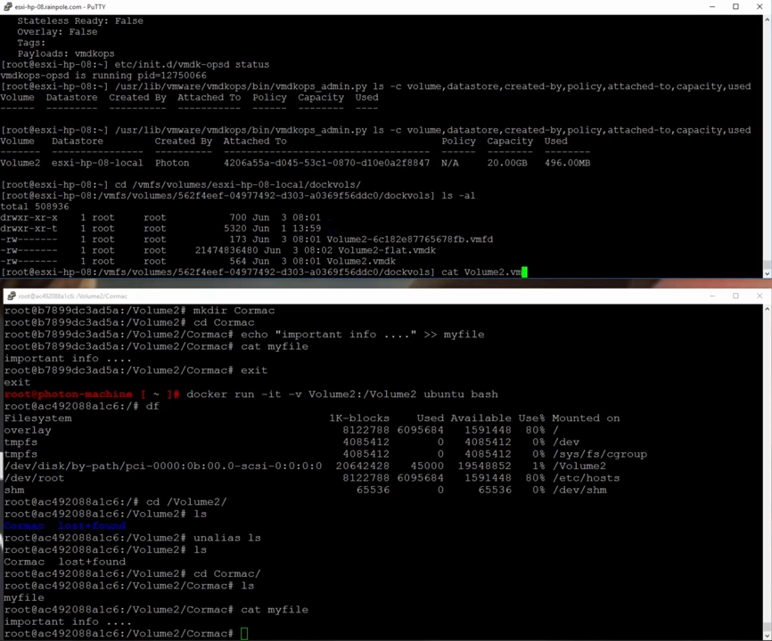

# Docker Volume for vSphere：在 ESXi 上跑卷驱动

> 视频来源：YouTube 视频《Demo of the docker volume driver for vSphere》（主讲人 Cormac Hogan，VMware，约 4 分 35 秒，英文讲解）。本文基于视频演说图文稿整理，时间戳可跳转到原视频对应位置；配图取自视频画面。字幕为 YouTube 英文 ASR 轨，术语与错拼已逐窗口核对纠正。
> 视频地址：[TPxEsTK2kg4](https://www.youtube.com/watch?v=TPxEsTK2kg4)

## 本讲要解决的核心问题（SCQA）

**背景**：vSphere 是 VMware 的虚拟化平台，虚拟机里普遍跑着 Linux（如 Photon OS），而容器又要靠**卷**来持久化数据。

**冲突**：Docker 的卷默认落在**本地**，单机够用，却用不上 vSphere 真正的存储能力（**VMFS 数据存储**）。要打通"容器卷"与"vSphere 存储"，并不是装一个东西就完事——**ESXi 主机侧和虚拟机侧需要两套组件配合**，少一边都不行。

**疑问**：**这个 vSphere 卷驱动由哪些组件组成？装好之后，卷怎么创建？能不能被不同容器共享？数据最终落在哪里？**

**回答（中心思想）**：**Docker Volume for vSphere** 有两个组件——装在 **ESXi 主机**上的 **VIB**（提供 `vmdk-opsy` 服务）和装在**虚拟机**里的 **RPM**（提供客户端服务）。用 `docker volume create -d vmdk` 创建卷后，**同一个卷可以被不同镜像的容器同时挂载并共享数据**（演示中一个容器写入的文件，换个镜像的容器仍能读到），卷最终落在 **VMFS 数据存储的 `docker-vols` 子目录**里。

---

## 一、两个组件：ESXi 上的 VIB 与 VM 里的 RPM

演示一开始就点明：**Docker Volume for vSphere 由两个组件构成**。[【跳转到 00:00】](https://www.youtube.com/watch?v=TPxEsTK2kg4&t=0)

- **第一个组件**：作为 **VIB** 装在 **ESXi 主机**上；
- **第二个组件**：作为 **RPM** 装在**虚拟机**里——也就是**真正跑容器的地方**。



## 二、ESXi 主机侧：确认 VIB 与 vmdk-opsy 服务

先看 ESXi 主机上的 VIB（为了省时间，演示里已经装好）。[【跳转到 00:25】](https://www.youtube.com/watch?v=TPxEsTK2kg4&t=25)

- 这个 VIB 名叫 **ESX VMDK Ops service**，可以用命令查询它的安装情况；
- 它提供在 ESXi 主机上运行的服务 **vmdk-opsy**，演示里该服务**正在运行**；
- 主机上还能拿到另一条有用信息：**当卷被创建后**，可以用一个 **Python 脚本**查询"**已为容器创建了哪些卷**"——此刻**还没有任何卷**。



## 三、虚拟机侧：确认 RPM、服务与 Docker 版本

接着转到**运行容器的虚拟机**。演示用的是 VMware 的 **Photon OS**，上面需要装一个 RPM，叫 **Docker Volume for vSphere**。[【跳转到 00:50】](https://www.youtube.com/watch?v=TPxEsTK2kg4&t=50)

- 查看这个（已安装的）RPM，可以看到它提供了**一批文件**；
- 其中包含一个**服务**，可以查询它在虚拟机上**是否在运行**——演示里它**正在运行**；
- 于是"万事俱备"，可以开始创建 Docker 卷了。

还有一点很重要——**Docker 的版本要求**：Photon OS 自带 **1.11**，而这个特性**至少需要 1.9**；所以只要用 Photon OS，基本可以直接用（当时最新就是 1.11）。[【跳转到 01:40】](https://www.youtube.com/watch?v=TPxEsTK2kg4&t=100)



## 四、创建一个卷：指定 vmdk 驱动

准备工作就绪，开始**创建卷**：[【跳转到 01:40】](https://www.youtube.com/watch?v=TPxEsTK2kg4&t=100)

```bash
# 用 vmdk 驱动创建一个名为 volume2、大小 28 GB 的卷
docker volume create -d vmdk volume2 --opt size=28
```

创建完成后，用 `docker volume ls` 就能看到新出现的 **volume2**。同时还可以看到**本地卷 local**——因为演示环境里已经有另一个容器在用卷了。[【跳转到 02:05】](https://www.youtube.com/watch?v=TPxEsTK2kg4&t=125)





## 五、关键验证：同一卷被不同镜像的容器共享

接下来构建一个新容器，**特意换一个镜像**来验证。[【跳转到 02:05】](https://www.youtube.com/watch?v=TPxEsTK2kg4&t=125)

- 用一个 **Ubuntu 镜像**启动容器，把 **volume2** 挂给它，同时（这个镜像运行的其实是 Debian）开一个 **Bash shell**；
- 进入容器后执行 `df`，可以看到 **volume2 已经就位**。[【跳转到 02:30】](https://www.youtube.com/watch?v=TPxEsTK2kg4&t=150)
- 在 `volume2` 里**建一个目录**（如 `cormac`），把一个文件写进去（`echo "important info"`），验证它**能持久化存储**。[【跳转到 02:55】](https://www.youtube.com/watch?v=TPxEsTK2kg4&t=175)





然后**退出这个容器**，再**换一个完全不同的镜像**起另一个容器，检查同一个卷：[【跳转到 03:20】](https://www.youtube.com/watch?v=TPxEsTK2kg4&t=200)

- 在新的容器里，**同样能看到 volume2**；
- 进入 `volume2/cormac`，`cat` 出刚才写的文件——**内容还在**，说明**数据在容器之间持久共享**。



## 六、数据落在哪里：VMFS 的 docker-vols 目录

最后回到 **ESXi 主机**收尾，看看卷到底存在了什么地方。[【跳转到 03:45】](https://www.youtube.com/watch?v=TPxEsTK2kg4&t=225)

- 再用那个 **Python 脚本**查询卷：能看到卷**由那台 Photon VM 创建**，符合预期；
- 到 **VMFS 卷**下看——也就是那台 Photon OS 虚拟机所在**本地数据存储**——卷正是在这里创建的；
- 进入子目录 **`docker-vols`**（Docker 卷的创建位置），就能看到刚创建的卷**及其相关信息**。



## 七、总结

这段很短的演示，完整走通了"**ESXi 侧 VIB + 虚拟机侧 RPM**"两组件配合下的卷生命周期：[【跳转到 04:35】](https://www.youtube.com/watch?v=TPxEsTK2kg4&t=275)

1. **两侧组件就位**：ESXi 上 `vmdk-opsy` 服务运行、虚拟机上客户端服务运行；
2. **创建卷**：`docker volume create -d vmdk` 指定 vmdk 驱动与大小；
3. **跨容器共享**：不同镜像的容器挂载同一卷，数据互通且持久；
4. **数据落位**：卷最终存储在与 Photon VM 相同的 **VMFS 数据存储**的 `docker-vols` 子目录中。



## 关键术语速查

| 术语 | 一句话解释 |
| --- | --- |
| Docker Volume for vSphere | VMware 提供的 vSphere 卷驱动，含 ESXi 侧 VIB 与虚拟机侧 RPM 两个组件 |
| VIB | VMware 的 ESXi 软件包格式；本驱动用它把组件装入 ESXi 主机 |
| vmdk-opsy | VIB 在 ESXi 主机上提供的服务，供卷的创建与管理使用 |
| RPM | 装入虚拟机（如 Photon OS）的软件包，提供卷驱动的客户端与服务 |
| Photon OS | VMware 的轻量 Linux，演示中作为运行容器的虚拟机系统 |
| vmdk 驱动 | `docker volume create -d vmdk` 使用的卷驱动名 |
| VMFS | VMware 的集群文件系统；本驱动的卷创建在其数据存储的 `docker-vols` 子目录下 |
| `--opt size=28` | 创建卷时指定大小的选项（此处为 28 GB） |
