# 扩展 Docker 的三种方式：从 API、插件到执行驱动

> 视频来源：YouTube 视频《Docker for Ops: Extending Docker with APIs, Drivers and Plugins》（Docker 官方，主讲人 Anusha 与 Arnaud，约 46 分钟，英文讲解）。本文基于视频演说图文稿整理，时间戳可跳转到原视频对应位置；配图取自视频画面。字幕为 YouTube 英文 ASR 轨，术语与错拼已逐窗口核对纠正。
> 视频地址：[yzbpEx0qywk](https://www.youtube.com/watch?v=yzbpEx0qywk)

## 本讲要解决的核心问题（SCQA）

**背景**：Docker 安装之后**开箱即用**——存储、网络、认证这些子系统都自带一套默认实现，用户不必额外装包、装二进制，敲一条 `docker run` 就能把容器跑起来。

**冲突**：但真实世界总有默认实现覆盖不到的场景：想让卷落到远端的分布式存储、想换成自己写的网络、甚至想换一种"跑容器"的方式。Docker 既不愿意把世界上所有的实现都**编译进引擎**（那样每个用户的下载包都会膨胀、每家的发布节奏都被 Docker 绑架），也不愿意让用户面对这些需求时束手无策。

**疑问**：**Docker 到底留了哪些扩展口子？每一层的代价和收益又分别是什么？**

**回答（中心思想）**：Docker 用一句口号概括自己的设计哲学——"**batteries included but swappable**（电池自带，但可替换）"，并把扩展能力组织成**三层金字塔**：底层的**用户态 API**（改动最小、能力最弱，却足以覆盖约 80% 的用例）、中间的**插件（plugins）**（用来扩展卷、网络、授权等具体子系统）、顶层的**驱动（drivers）**，也就是**执行后端驱动**（最费力，但能替换引擎里最深的一层，比如把默认的 `runc` 换成任何符合 OCI 规范的运行时）。

---

## 一、"batteries included but swappable"：为什么要给 Docker 留口子

Docker 一开始就把"**开箱即用**"当成卖点。视频开场这样解释这条哲学：[【跳转到 00:17】](https://www.youtube.com/watch?v=yzbpEx0qywk&t=17)

- **自带默认**：运行 Docker 所需的一切子系统与 API 都有默认实现，不需要用户额外安装任何包或二进制；
- **可以替换**：在此之上，Docker 给你**扩展**的口子——想做不一样的事，不必等官方发版。

这套思路的产物，就是下面这张"扩展金字塔"。

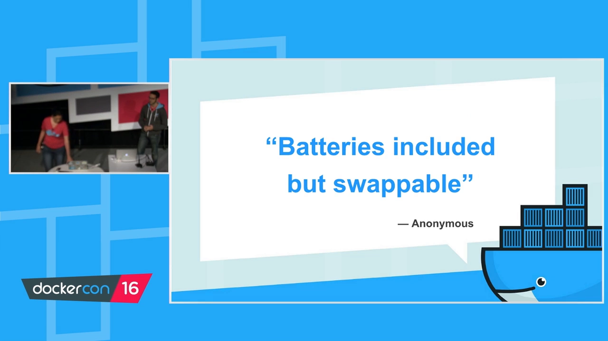

## 二、扩展的三层金字塔：API / 插件 / 驱动

视频用一个金字塔模型，把"扩展 Docker 的三种方式"与"各自的代价"对齐起来：[【跳转到 01:12】](https://www.youtube.com/watch?v=yzbpEx0qywk&t=72)

- **金字塔纵向**代表**扩展所需的代价**：越往上，付出的努力越多；
- **底层是用户态 API**：改动最小，代价最低；
- **中层是插件（plugins）**：扩展某个具体子系统，代价中等；
- **顶层是驱动（drivers）**：这里指**执行后端驱动**，代价最高。

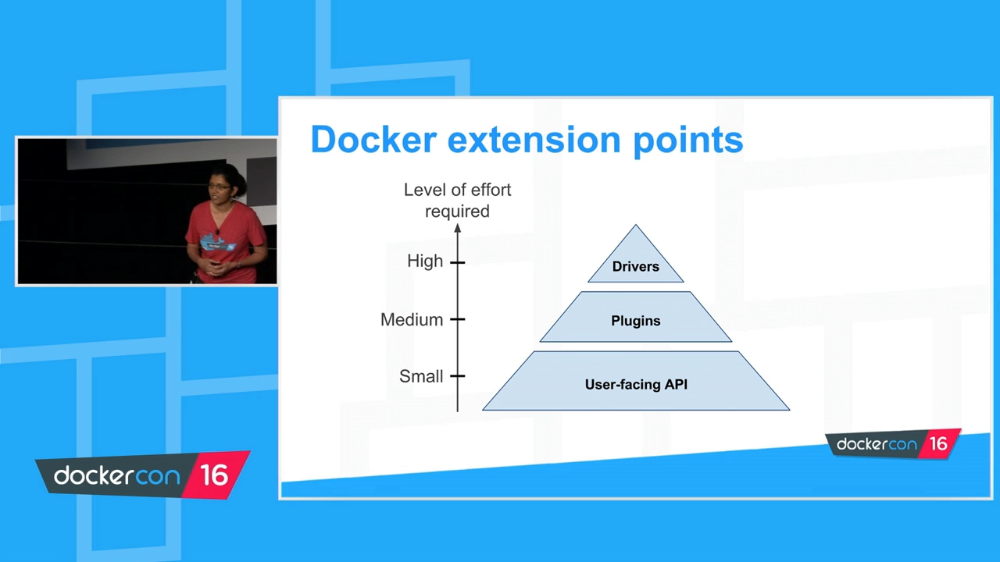

需要特别注意"**driver**"是个**重载词**。在这段语境里，它专指**执行后端（execution backend）**——也就是"**用什么去真正把容器跑起来**"。例如大家熟悉的 `runc` 就是一个执行后端；替换它的难度很高，但收益也最深。

## 三、最省力的扩展：用户态 API

### 3.1 一切交互都是 HTTP JSON API

扩展 Docker 最容易的一条路，是**用户态 API**。它的前提是理解一件事：**所有与 Docker 的交互都走一套 HTTP + JSON 的 API**。[【跳转到 03:13】](https://www.youtube.com/watch?v=yzbpEx0qywk&t=193)

- Docker daemon 默认在磁盘上监听一个 **Unix socket**：`/var/run/docker.sock`；
- 你敲的每一条 `docker` 命令（例如 `docker network ls`）其实都被翻译成一个 **HTTP 请求**发给引擎，引擎返回 JSON；
- 我们熟悉的 **Docker CLI，本质上只是 API 客户端库之上的一层很薄的封装**——没有任何特殊权限，也不直接访问 daemon。

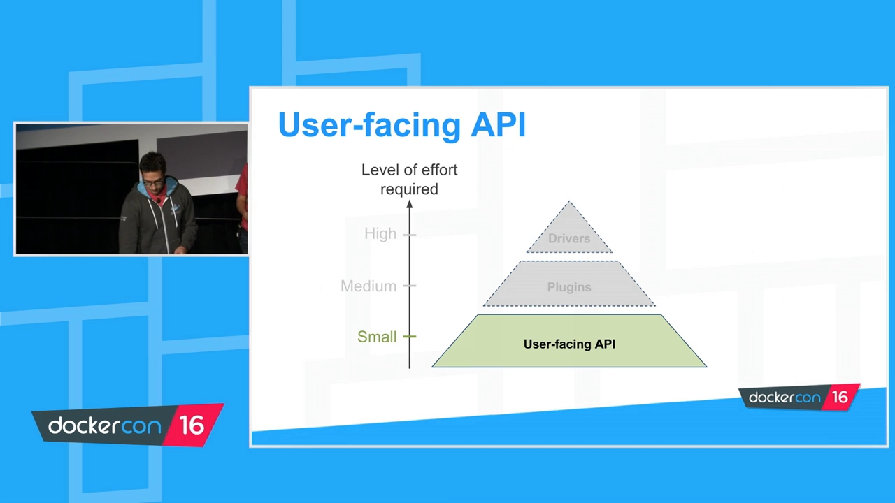

### 3.2 用 socat 看清"线上"到底发生了什么

为了证明这一点，视频用 `socat` 把通信代理出来，亲眼看看客户端与 daemon 之间"真正流过线缆"的东西：[【跳转到 04:42】](https://www.youtube.com/watch?v=yzbpEx0qywk&t=282)

```bash
# 在 8080 端口起一个 TCP 监听，把另一端接到 Docker 默认 socket
socat -v TCP-LISTEN:8080,reuseaddr,fork UNIX-CONNECT:/var/run/docker.sock
# 让 CLI 指向这个端口
export DOCKER_HOST=tcp://localhost:8080
docker version
```

`socat` 的 `-v` 会把往来的内容都打印出来。于是能看到：`docker version` 不过是客户端发了一个普通 HTTP 请求（还带着 user-agent，方便区分 Windows/Mac 等不同客户端），daemon 回一个 HTTP 响应（200）加一段描述版本信息的 JSON。[【跳转到 05:32】](https://www.youtube.com/watch?v=yzbpEx0qywk&t=332)

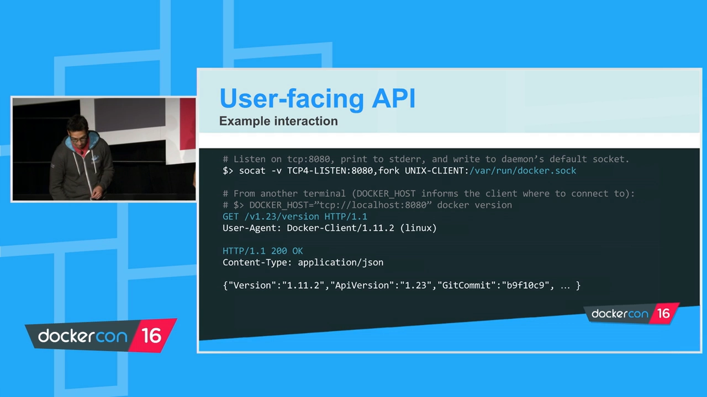

### 3.3 最有价值的端点：events

API 端点很多，视频挑出**扩展能力最强的一个**重点讲：**events 端点**。[【跳转到 06:11】](https://www.youtube.com/watch?v=yzbpEx0qywk&t=371)

- events 端点提供对 **daemon 每个动作的实时、外部可见性**：创建容器、拉取镜像、接入网络、创建网络……都会通知；
- 而且**即时、带上下文**：例如容器创建事件里会带上容器 ID、所用的镜像、容器名等。

它也有对应的 CLI 命令 `docker events`。这是一条**阻塞命令**，不会自行返回，会一直打印 daemon 上发生的事。例如在另一个终端里跑一个"秒退"的容器 `docker run busybox true`，就能看到 daemon 依次走过的**创建、附着、网络连接、启动**等每一步。[【跳转到 06:59】](https://www.youtube.com/watch?v=yzbpEx0qywk&t=419)

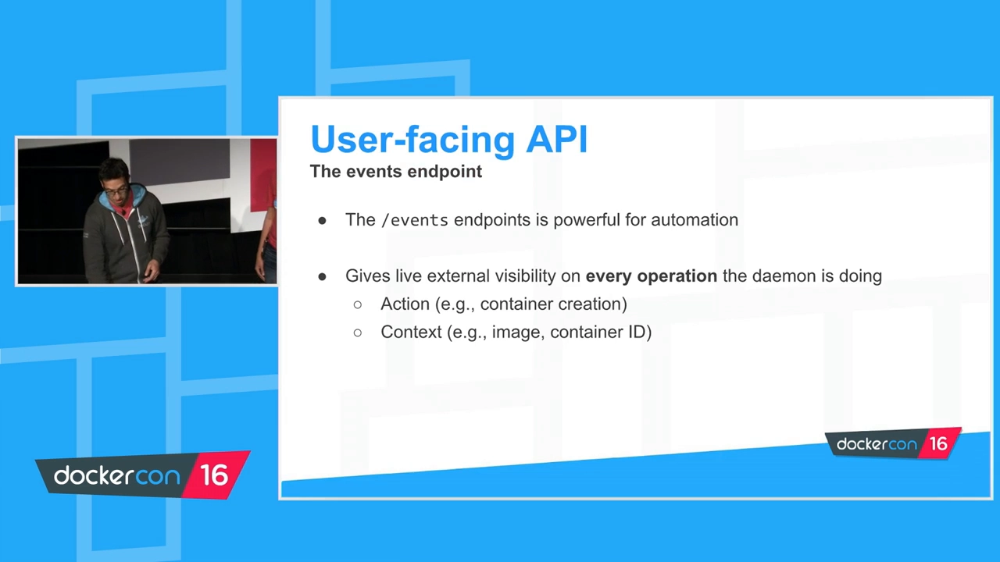

### 3.4 纯靠 API 的经典案例：Interlock

视频举了一个"**不给引擎改一行代码就能加功能**"的漂亮例子——**Interlock**，由 Docker 员工 Evan Hazlett 所写，是个**事件驱动的插件系统**：[【跳转到 07:49】](https://www.youtube.com/watch?v=yzbpEx0qywk&t=469)

- 它订阅 events 端点，观察 daemon 上发生的事；
- 当出现"容器创建"事件时，把事件**路由给扩展**（典型是 HAProxy），去更新 HAProxy 配置；容器下线时，同样更新配置把该容器移除；
- 相当于实现了**第一个 Docker 负载均衡器**，而引擎里**没有任何一处改动**；
- 更好的是，Interlock 本身就打包成一个容器，**即插即用**；用任何编程语言都能实现。

连 Docker 内部也常靠这套方式来**做原型**：例如 Docker for Mac 能在 macOS 上"神奇地"支持 `-v` 主机挂载，其实是它**拦截了 `docker run` 调用、抓取 `-v` 并改写**映射目标，使其指向宿主而非 Linux VM——同样没有改引擎。[【跳转到 09:51】](https://www.youtube.com/watch?v=yzbpEx0qywk&t=591)

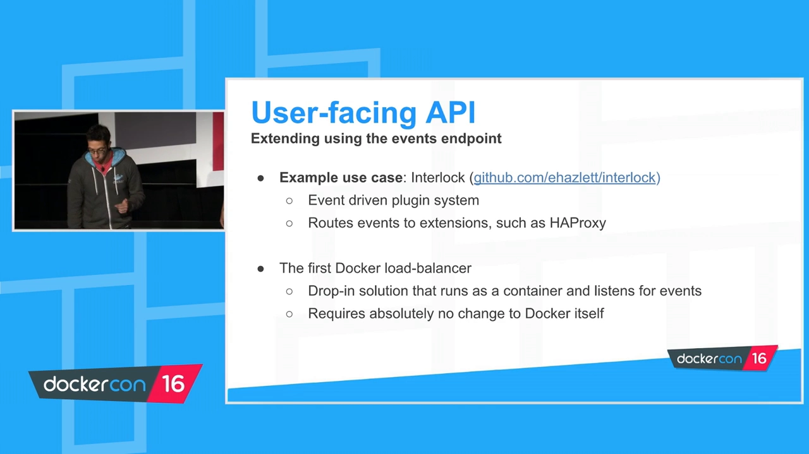

## 四、更自然但更费力的扩展：插件

金字塔中层是**插件**。用一句话定义：**插件是运行在引擎之外的一个（或一组）进程，用来扩展某个特定子系统的功能**。[【跳转到 11:11】](https://www.youtube.com/watch?v=yzbpEx0qywk&t=671)

插件目前可用于三类子系统：**卷（volumes）、网络（networks）、授权（authorization）**。

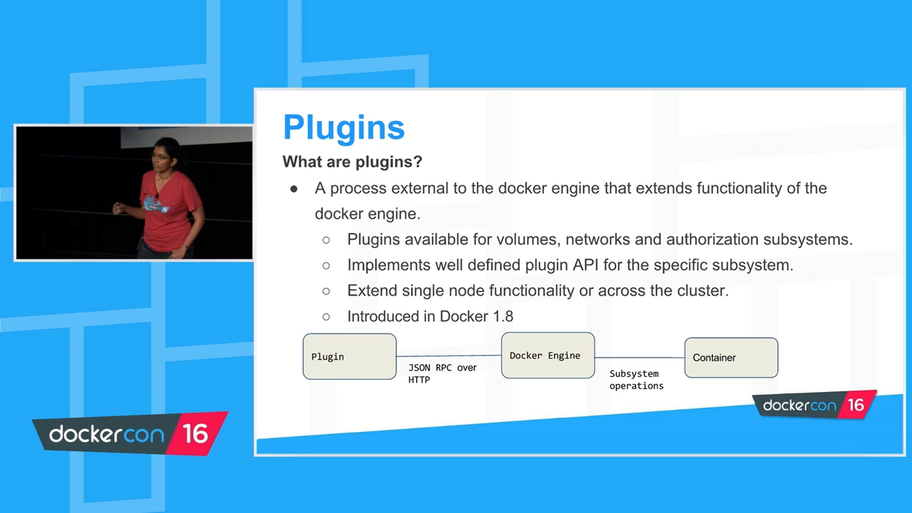

### 4.1 以卷插件为例：满足接口就是"卷驱动"

以**卷**为例。卷插件要管理若干事情（可以创建本地卷，也可以创建分布式卷，取决于插件厂商提供什么），而 daemon 对它有**一套约定好的接口**，通常要求实现这些方法：

> **创建、删除、挂载、卸载、列举、获取能力（create / remove / mount / unmount / list / capabilities）** 等。

**只要你满足这套接口，就可以自称一个"卷驱动"**，从而提供本地卷驱动之外的能力。[【跳转到 12:01】](https://www.youtube.com/watch?v=yzbpEx0qywk&t=721)

### 4.2 插件怎么和引擎通信

插件是 1.8 引入的特性。它与引擎之间用 **JSON-RPC over HTTP** 通信，并且有一套**发现机制 + 握手 API**：一旦发现与握手建立，引擎就知道"有这么一个插件提供某功能"，之后就能为容器服务。容器在**创建或运行**时需要**指定要用哪个驱动**，随后即可使用插件提供的能力。[【跳转到 12:26】](https://www.youtube.com/watch?v=yzbpEx0qywk&t=746)

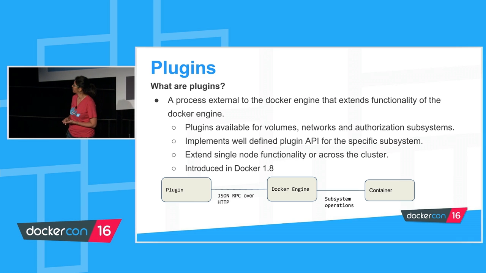

### 4.3 插件要面对的三大难题，以及 1.12 的解法

插件是引擎的自然延伸，因此有几个天然要求：

- **要和引擎一样高可用**——有容器依赖它；
- **要有强大的分发渠道**——厂商希望能像分发镜像一样触达整个用户群；
- **要有可预测的运行时行为**——插件往往比普通容器进程需要**更多权限**（卷插件可能要访问宿主文件系统或分布式存储，用来创建特定数据目录等）。

而 1.8 的**老架构**在这三点上都没解决利索：把插件当容器发布会导致**启动顺序不确定**（用插件的容器可能比插件先起）；**发现与分发渠道**混乱（只能用 Google 去找卷/网络驱动列表，厂商各搞一套 yum/apt 仓库）；还**缺少一份规范**来定义插件行为。视频坦言这"从 1.8 起就被反复吐槽，现在终于修好了"。[【跳转到 14:31】](https://www.youtube.com/watch?v=yzbpEx0qywk&t=871)

1.12 引入**新的插件基础设施**，对应地解决了这三个问题：[【跳转到 17:01】](https://www.youtube.com/watch?v=yzbpEx0qywk&t=1021)

- **高可用**：让插件**随 daemon 一起启动、停止**，容器不用等依赖；
- **分发**：插件通过 **Docker Store** 分发，触达整个 Docker 用户群；
- **规范**：新增**插件清单（plugin manifest）**文件，用来**定义插件的运行时行为与所需权限**。

而且从 1.12 起，插件成了"**一等公民**"，像容器、镜像一样拥有了 `docker plugin` 子命令，可以用熟悉的 CLI 与 API 管理它的生命周期。该特性在 1.12 中是**实验性支持**（API 与 manifest 规范仍在演进），官方鼓励用户试用并反馈。[【跳转到 17:51】](https://www.youtube.com/watch?v=yzbpEx0qywk&t=1071)

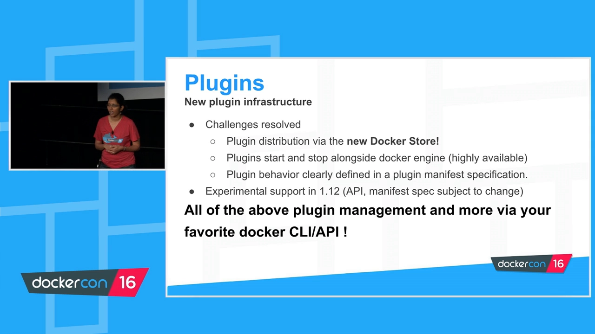

### 4.4 从使用者视角看插件

作为**插件使用者**，体验大致是：[【跳转到 19:45】](https://www.youtube.com/watch?v=yzbpEx0qywk&t=1185)

1. `docker plugin install <插件名>`：从 Store **拉取插件**，并**计算该插件要求的权限**（例子里要求访问网络 host、本地文件系统和一个设备），让你确认；
2. 确认后，插件**自动启用**，任何容器都能直接使用它；
3. `docker plugin ls` 会显示插件**状态**——最后一个字段为 `true` 表示"可用"，同时也隐含"**随 daemon 重启自动启用**"；
4. 若不想要自动启用，用 `docker plugin disable` 关闭（`plugin ls` 里 active 列变 `false`），随后可 `plugin enable` 重新开启，或用 `plugin set` 给插件传选项，或在安装时直接加 `--no-enable`。

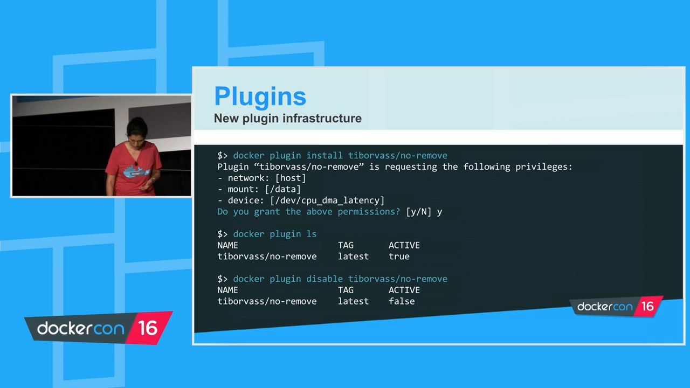

### 4.5 从作者视角看插件清单

作为**插件作者**，要定义 **manifest 文件**；作为**使用者**，可以 `docker plugin inspect` 查看它要求的权限。inspect 输出很大，视频只聚焦 manifest 段：[【跳转到 22:40】](https://www.youtube.com/watch?v=yzbpEx0qywk&t=1360)

- **description / documentation**：描述与文档（文档可指向 GitHub 仓库或用户手册链接）；
- **interface**：本插件实现的是哪个插件 API——做卷插件就写 `docker volume driver`，以及 API 版本（当时是 1）；
- **network**：从网络角度需要哪些权限（例子里的插件要求整个 host 网络栈）；
- **mounts**：指定 **source（宿主机路径）与 destination（容器内路径）**。

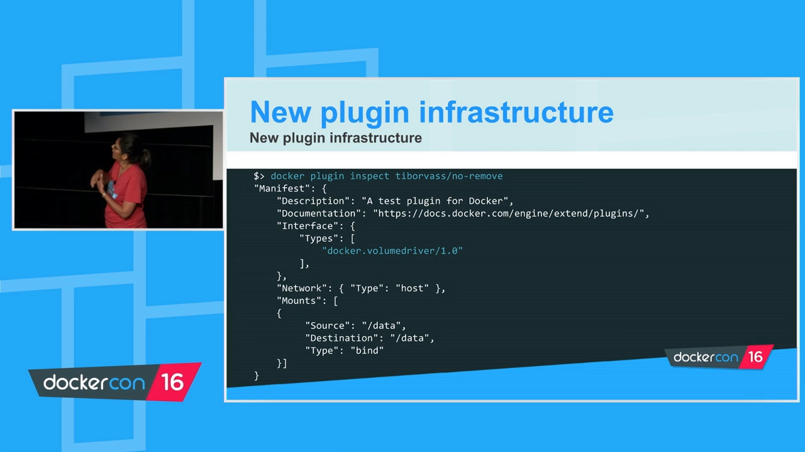

后续规划：插件在 **1.13** 转为稳定支持，并会把**插件部署扩展到 Swarm**（多数插件对分布式系统才有意义）；再往后还考虑用插件**自定义编排**，比如换一套放置策略或调度模式。

## 五、最彻底的扩展：执行驱动与 OCI

金字塔顶端是**驱动**——这里专指**执行后端驱动**。这条路**代价很高**，但能替换引擎里很深的部件。[【跳转到 25:20】](https://www.youtube.com/watch?v=yzbpEx0qywk&t=1520)

### 5.1 先认识 OCI、runc 与 containerd

- **OCI（Open Container Initiative）**：Linux 基金会伞下、由众多厂商与个人共同制定的**行业标准**，为运行时定义了一套**业界通用接口**（当时处于 1.0 RC1）。这跟"插件接口"不同——插件接口只存在于 Docker 自己定义并开放的范围内，而 OCI 是**跨行业的**。[【跳转到 25:33】](https://www.youtube.com/watch?v=yzbpEx0qywk&t=1533)
- **runc**：按 OCI 规范运行容器的工具，是 OCI 规范的**参考实现**，主要脱胎于 Michael Crosby 的 `libcontainer`（Docker 引擎过去的最底层，后被捐给 Linux 基金会来启动 OCI 与 runc）。
- **containerd**：用来**控制多个 runc 实例**的 daemon，同样出自 Michael Crosby。

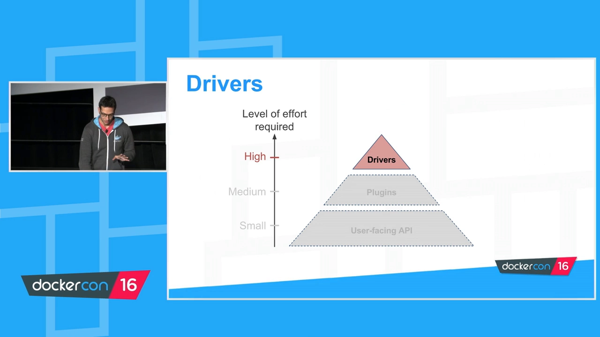

### 5.2 Docker 1.11 之后：daemon 自己已经不会跑容器了

一个"令人吃惊"的事实：**从 Docker 1.11 起，Docker daemon 单独已无法运行容器**。它只做一件事——通过 **gRPC 向 containerd 发请求**，由 containerd 去 fork 出 runc 进程来创建容器。[【跳转到 27:38】](https://www.youtube.com/watch?v=yzbpEx0qywk&t=1658)

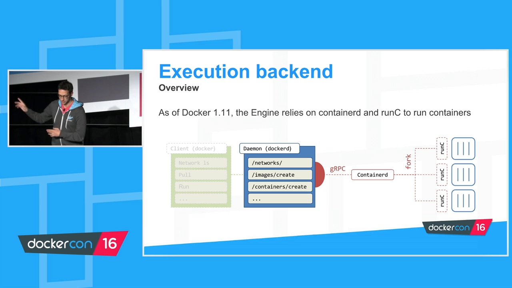

这件事之所以重要，是因为**在 containerd 与 runc 之间、在 daemon 与 containerd 之间，横着的正是 OCI 规范**——也就是说，Docker 引擎"跑容器"这件事本身，已经建立在**一份你能读、能实现、能采纳、能拿来创新**的行业标准之上。

### 5.3 从 1.12 起，可以换掉 runc

1.12 引入的新能力：**允许用别的东西替换 runc**。runc 仍是默认（Linux 上人人都在用），但你可以：

- 启动 daemon（现在叫 `dockerd`）时**加载多个运行时**，例如指向磁盘上任意一个二进制：

```bash
dockerd --add-runtime custom=/bin/my-runtime
```

- 用 `docker info` 查看该 daemon 上可用的运行时（例子里有 `default` 和 `custom`）；
- **按容器**选择运行时：`docker run --runtime custom ...`——它甚至不一定是"跑容器"，可能是在起一个 VM 或 unikernel。[【跳转到 29:37】](https://www.youtube.com/watch?v=yzbpEx0qywk&t=1777)
- 这带来一个很实用的玩法：**可以按镜像是否签名来决定用哪个运行时**——可信的镜像用一个运行时，来源不明、未签名的镜像换另一个（甚至不信任的运行时）。[【跳转到 30:02】](https://www.youtube.com/watch?v=yzbpEx0qywk&t=1802)
- 也能直接替换默认运行时：`dockerd --default-runtime custom`。

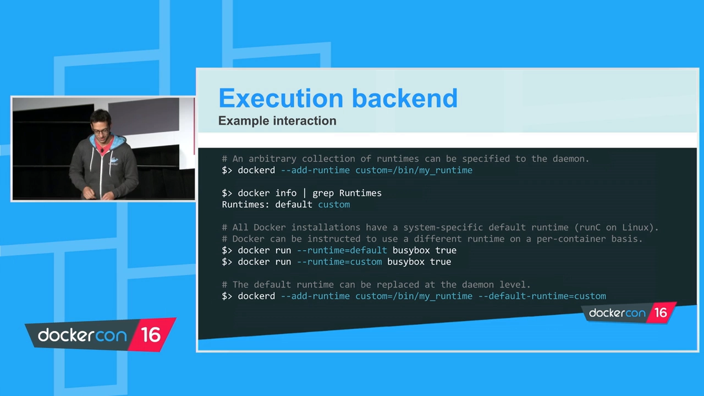

### 5.4 已经存在的用例与权衡

视频给出几个已经落地的执行后端用例：[【跳转到 31:22】](https://www.youtube.com/watch?v=yzbpEx0qywk&t=1882)

- **平台特定运行时**：Oracle 在做 `runz`，用 **Solaris zones** 跑 OCI 兼容容器。把 Docker 引擎搬到 Solaris、再用 `runz` 取代 runc，于是 `docker run busybox` 背后跑的其实是 Solaris zone；
- **基于虚拟化的运行时**：Intel 的 **Clear Containers** 用虚拟化扩展跑**轻量 VM**；Hyper 的 `runv` 也是 hypervisor 型运行时。

它们提供的是**性能与安全的不同权衡**：runc 跑 Linux 容器，性能极高，但因为与宿主**共享内核**，隔离性不是最强；换用 Clear Containers / runv，则能拿到"**VM 级别的安全属性**"（与宿主不共享任何东西），代价是**性能下降**（毕竟引入了虚拟化）。[【跳转到 33:02】](https://www.youtube.com/watch?v=yzbpEx0qywk&t=1982)

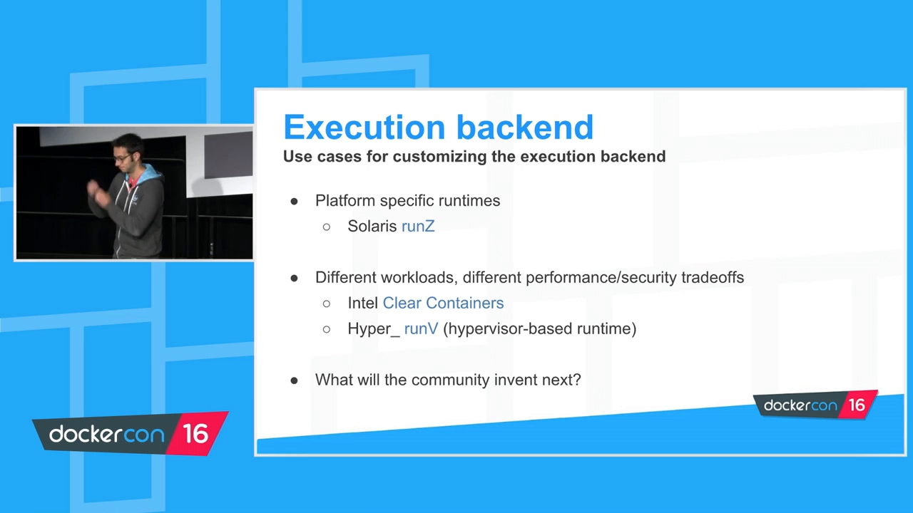

## 六、总结：三种方式，三种代价

视频结尾把三条路总结成一张对照：[【跳转到 33:27】](https://www.youtube.com/watch?v=yzbpEx0qywk&t=2007)

| 扩展方式 | 代价 | 适合什么 | 建议 |
| --- | --- | --- | --- |
| **用户态 API** | 小 | 自动化、定制、观察与反应 | 很值得先学，**约 80% 的用例都能覆盖** |
| **插件（plugins）** | 中 | 存储、网络等专门子系统 | 试用 1.12 的实验插件基础设施，写并分发自己的插件 |
| **驱动（drivers）** | 高 | 换执行后端 | 在目标平台上实现一个 OCI 兼容运行时（如 Solaris zones、BSD jails） |

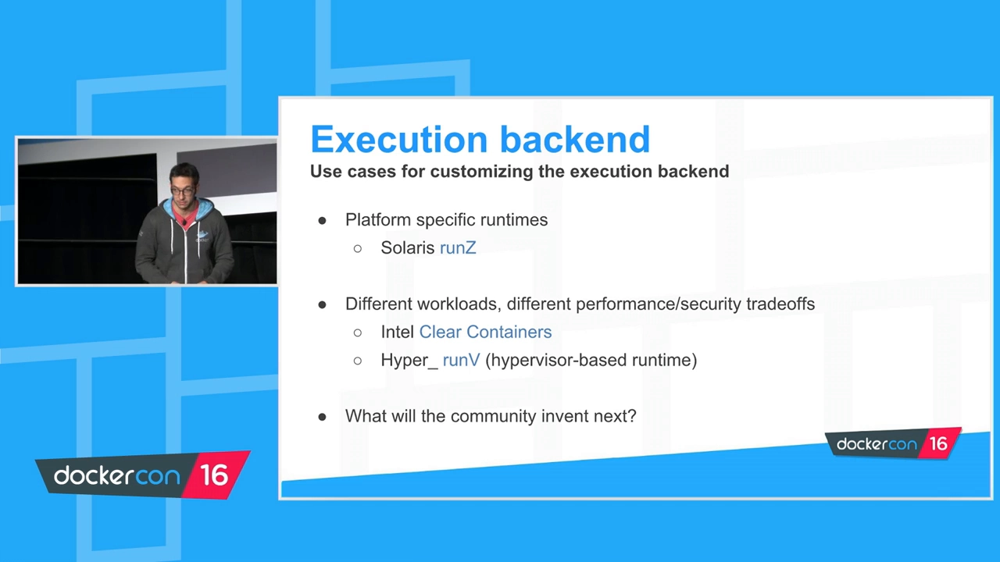

**Q&A 里还澄清了几个常见疑问**，值得一并记下：

- **为什么不给 CLI 加别名（alias）？** 官方**不做**。理由是要保持**用户体验一致**、让 CLI 尽量保持"API 之上的薄层"；一旦允许自定义命令，会走向碎片化——别人博客里的 Docker 命令在你这里可能根本不存在。[【跳转到 36:15】](https://www.youtube.com/watch?v=yzbpEx0qywk&t=2175)
- **插件能否从私有 registry 获取？** 可以，唯一要求是 **registry 版本不低于 2.3**；因为插件复用镜像那套分发机制，所以也能**对插件签名**。[【跳转到 37:55】](https://www.youtube.com/watch?v=yzbpEx0qywk&t=2275)
- **Store 上的插件会像镜像一样被审查吗？** 会有一个认证流程（进行中）：既有 Docker 认证的**官方插件**，也有你自己仓库里的**非官方插件**。[【跳转到 38:45】](https://www.youtube.com/watch?v=yzbpEx0qywk&t=2325)
- **能否基于事件"拦截"容器启动？** events 是**事后**的——收到 container start 事件时容器**已经启动了**，它适合观察与自动化，不适合改变行为；要"拦截"，应该用**授权插件（authorization plugin）**，它能拿到进来的请求并决定是否转发给 daemon。[【跳转到 40:25】](https://www.youtube.com/watch?v=yzbpEx0qywk&t=2425)
- **网络插件的控制力度有多大？** 有定义好的网络插件接口（创建、删除、join 等）。一旦指定某网络驱动，请求就**路由到该驱动**、而不是 Docker 自带的本地驱动。[【跳转到 41:40】](https://www.youtube.com/watch?v=yzbpEx0qywk&t=2500)
- **manifest 是标签（labels）还是文件？** 是一个 **JSON 规范文件**，随插件镜像一起分发；之所以不用 labels，是因为 **labels 更像注解、可变**，而规范字段是**不可变、被期望稳定**的，并尽量与 OCI、镜像 manifest 等已有规范保持一致。[【跳转到 42:55】](https://www.youtube.com/watch?v=yzbpEx0qywk&t=2575)
- **插件到底是不是容器？** 底层确实以容器实现，但官方**刻意不叫它容器**，而叫"插件"——这是个**抽象**，免得用户把它当成容器进去乱改、"搬起石头砸自己的脚"。[【跳转到 44:53】](https://www.youtube.com/watch?v=yzbpEx0qywk&t=2693)

## 关键术语速查

| 术语 | 一句话解释 |
| --- | --- |
| 用户态 API | Docker 的 HTTP + JSON 接口，daemon 默认监听 `/var/run/docker.sock`，CLI 只是它的薄封装 |
| events 端点 | 提供 daemon 每个动作的实时外部可见性，适合观察与自动化，但属"事后" |
| 插件（plugin） | 运行在引擎之外、扩展某子系统（卷/网络/授权）的进程，与引擎用 JSON-RPC over HTTP 通信 |
| 卷驱动（volume driver） | 实现了 create/remove/mount/unmount/list/capabilities 等接口的卷插件 |
| plugin manifest | 定义插件运行时行为与所需权限的 JSON 文件，随插件镜像分发 |
| 执行后端驱动（execution backend driver） | "drivers"在此专指真正把容器跑起来的后端，如 runc |
| OCI | Open Container Initiative，Linux 基金会下的运行时行业标准 |
| runc | OCI 规范的参考实现，源于 libcontainer |
| containerd | 控制多个 runc 实例的 daemon；1.11 起 daemon 通过 gRPC 请求它来跑容器 |
| dockerd | Docker 守护进程的现名（`--add-runtime` / `--default-runtime` 可管理运行时） |
