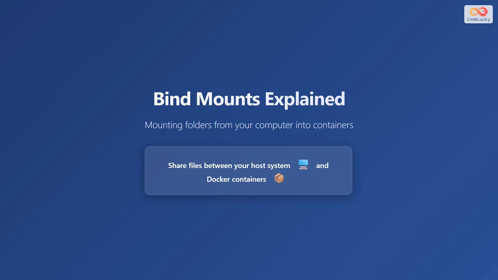
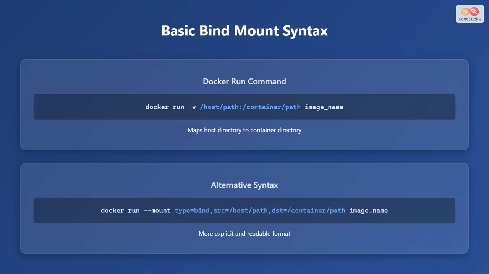
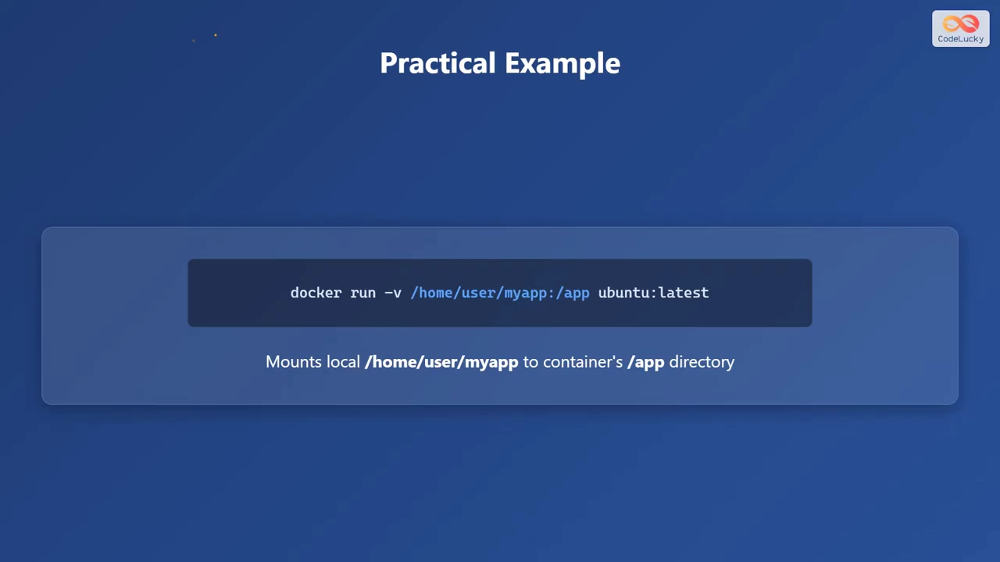
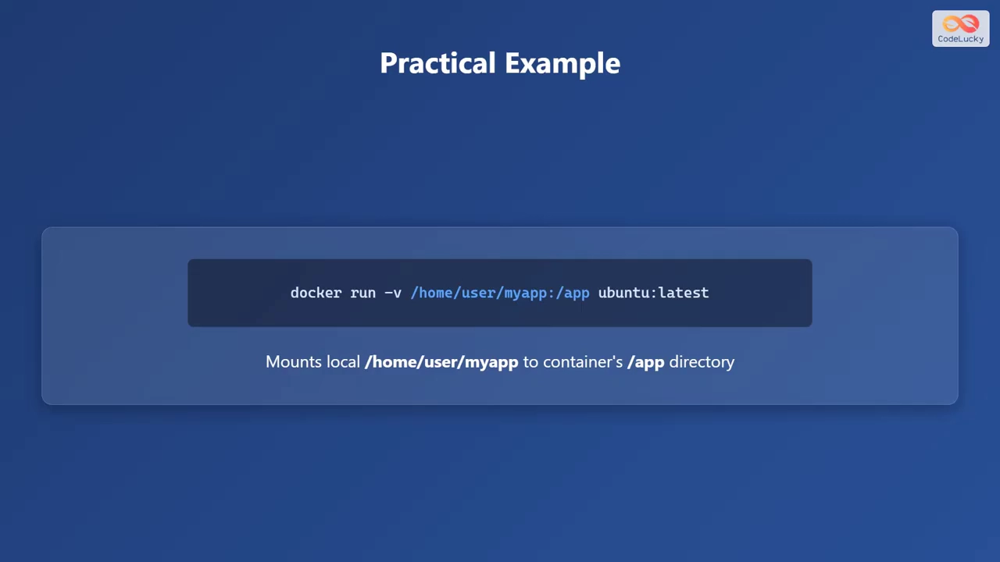
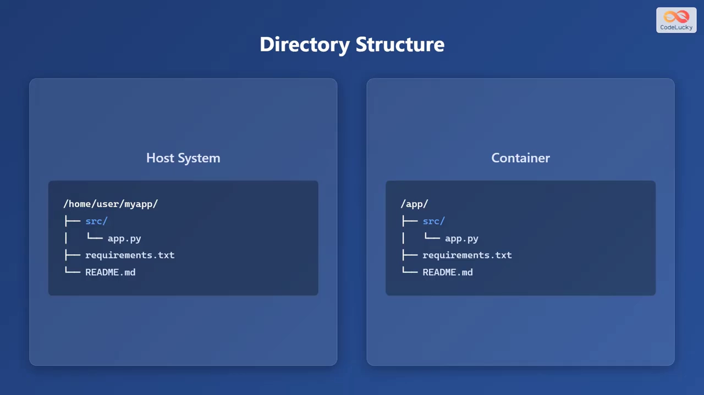
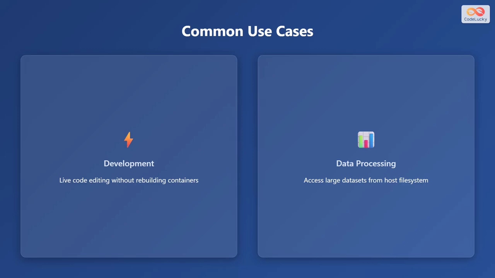
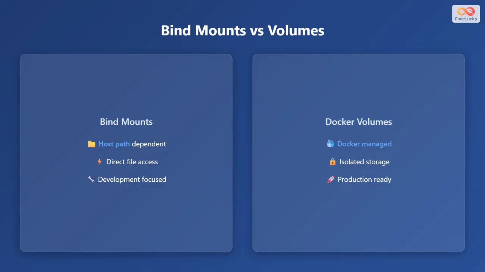

# 绑定挂载（Bind Mount）入门：定义、语法、用例与避坑

> 本文整理自 YouTube 视频《Docker Bind Mounts Explained: Share Files Between Host and Container!》（频道：CodeLucky），依据视频演说图文稿逐窗口核对、纠正自动字幕错拼后整理。
> 视频地址：[eqZ79j_8fsg](https://www.youtube.com/watch?v=eqZ79j_8fsg)

## 本讲要解决的核心问题（SCQA）

**背景**：容器和宿主机的文件系统默认是**隔离**的。可现实中我们又常常希望"**两边共用同一份文件**"——比如在宿主机上改代码，容器里立刻就能跑。

**冲突**：要在宿主机和容器之间共享文件，最直接的手段就是**绑定挂载（bind mount）**。但它和 Docker 自己管理的"卷（volume）"很容易混淆：两者命令长得像、名字都带 mount/volume，**该用哪个、怎么写，常常让人犯迷糊**。

**疑问**：绑定挂载到底是什么？它的命令怎么写？在什么场景下该用它？又有哪些坑要避开？

**回答（中心思想）**：绑定挂载是"**把宿主机的一个目录或文件挂进容器**"的机制，它在宿主机与容器的文件系统之间建立**直接连接**——**宿主机上的改动会在容器里同步可见**。它用 `-v` 或 `--mount` 都很方便，**适合开发与数据处理**；但它**依赖宿主机路径、面向开发**，生产环境更适合用 Docker 管理的卷。使用时记住两条最佳实践（只读、绝对路径），并避开两个常见坑（**路径必须先存在**、**UID 不匹配导致权限问题**）。

## 一、什么是绑定挂载

绑定挂载用来**把宿主机的文件夹挂进容器**，从而在**宿主机与 Docker 容器之间共享文件**。[【跳转到 00:00】](https://www.youtube.com/watch?v=eqZ79j_8fsg&t=0)

它的定义非常清晰：

> **绑定挂载是一种把宿主机文件系统里的一个目录或文件挂载进容器的机制。它在宿主机和容器的文件系统之间建立起直接连接（direct connection）。**



正因为是"直接连接"，宿主机和容器看到的是**同一份内容**：你在宿主机上修改文件，容器里会**同步反映**出来。

## 二、两种写法：`-v` 与 `--mount`

绑定挂载有两种基本语法。[【跳转到 00:25】](https://www.youtube.com/watch?v=eqZ79j_8fsg&t=25)

**写法一：`-v`（`--volume`）** ——把宿主目录映射到容器目录：

```bash
docker run -v /host/path:/container/path image_name
```

**写法二：`--mount`** ——更显式、可读性更好：

```bash
docker run --mount type=bind,source=/host/path,destination=/container/path image_name
```



| 写法 | 关键点 | 适用 |
| --- | --- | --- |
| `-v /host:/container` | 冒号分隔，简短 | 日常命令、快速试验 |
| `--mount type=bind,source=…,destination=…` | 键值对，语义清晰 | 脚本、需要可读性时 |

## 三、一个例子：把本地目录挂进容器

视频用一个具体命令演示：把本地目录 `/home/user/myapp` 挂载到容器的 `/app` 目录——[【跳转到 01:15】](https://www.youtube.com/watch?v=eqZ79j_8fsg&t=75)

```bash
docker run -v /home/user/myapp:/app ubuntu:latest
```



**目录结构对照**最能说明"直接连接"的含义：

- **左侧（宿主机）**：`/home/user/myapp/` 里有源代码目录，包含 `app.py`、`requirements.txt`、`readme.md`。
- **右侧（容器）**：`/app/` 里的内容**与宿主机源文件完全对应**——同样是 `app.py`、`requirements.txt`、`readme.md`。



也就是说，容器里的 `/app` 并不是一份拷贝，而是**指向宿主机目录的同一个视图**——**宿主机改，容器立刻变**。[【跳转到 02:05】](https://www.youtube.com/watch?v=eqZ79j_8fsg&t=125)

## 四、常见用例

绑定挂载最典型的两个使用场景：[【跳转到 02:05】](https://www.youtube.com/watch?v=eqZ79j_8fsg&t=125)

1. **开发（development）**：**不用重建镜像**就能实时编辑代码——在宿主机改文件，容器里即刻生效（所谓 live code editing）。
2. **数据处理（data processing）**：让容器**直接访问宿主机上的大数据集**，无需先把数据复制进容器。



## 五、绑定挂载 vs Docker 卷

绑定挂载常和 Docker 卷放在一起比较，视频给出一张对照表：[【跳转到 02:30】](https://www.youtube.com/watch?v=eqZ79j_8fsg&t=150)

| 维度 | 绑定挂载（bind mount） | Docker 卷（volume） |
| --- | --- | --- |
| 存储位置 | **宿主机的具体路径**（你自己指定） | 由 **Docker 管理** |
| 访问方式 | 对宿主文件**直接访问** | 提供**隔离的存储** |
| 定位 | **面向开发** | **面向生产** |



一句话概括：**绑定挂载"路径依赖、直连宿主机、偏开发"；Docker 卷"由 Docker 托管、隔离、偏生产"。**

## 六、最佳实践与常见坑

**最佳实践（best practices）：**[【跳转到 02:55】](https://www.youtube.com/watch?v=eqZ79j_8fsg&t=175)

1. **使用只读模式**：不需要写权限时，加上 `:ro` 标志（只读），以避免容器意外写入宿主机文件。
2. **使用绝对路径**：始终用绝对路径，避免歧义、避免挂错位置。

**常见坑（common pitfalls）：**[【跳转到 02:55】](https://www.youtube.com/watch?v=eqZ79j_8fsg&t=175)

1. **路径不存在**：**挂载前宿主机的路径必须已经存在**，否则会出问题。
2. **权限问题**：宿主机与容器之间的 **UID（用户 ID）不匹配**会导致权限错误。



## 小结

- **绑定挂载 = 把宿主机目录/文件挂进容器**，二者之间建立**直接连接**，内容实时同步。
- 两种写法：简写的 **`-v /host:/container`** 与显式的 **`--mount type=bind,source=…,destination=…`**。
- 典型用例：**开发**（改码即生效，不重建镜像）与**数据处理**（直接访问宿主机大数据集）。
- 与卷的分工：**绑定挂载面向开发、路径依赖、直连宿主机；卷面向生产、由 Docker 管理、隔离**。
- 最佳实践：**`:ro` 只读、用绝对路径**；常见坑：**宿主路径必须先存在、UID 不匹配导致权限问题**。

## 关键术语速查

| 术语 | 一句话解释 |
| --- | --- |
| 绑定挂载（bind mount） | 把宿主机的一个目录/文件挂进容器，二者共享同一份数据。 |
| `-v` / `--volume` | 简写的挂载参数，格式为 `宿主机路径:容器内路径`。 |
| `--mount type=bind,source=…,destination=…` | 更显式的挂载写法，用键值对描述来源与目标。 |
| `:ro`（只读） | 挂载选项，令容器对该目录**只读**，保护宿主机文件。 |
| UID | 用户 ID；宿主机与容器 UID 不一致会引发权限错误。 |
