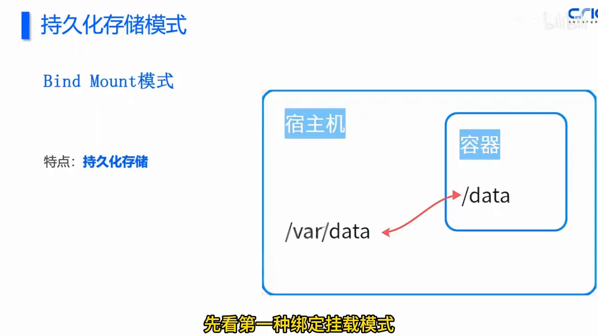
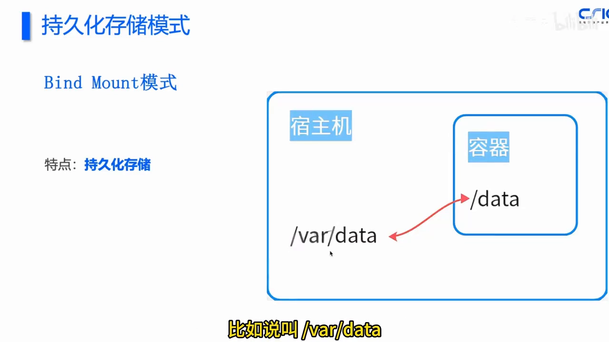
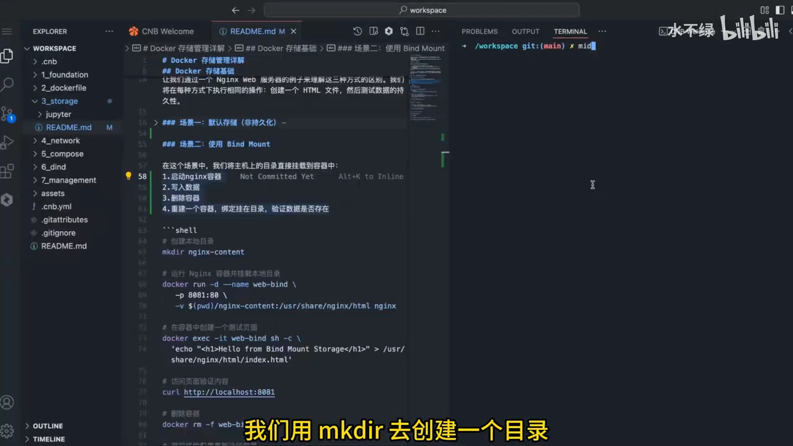
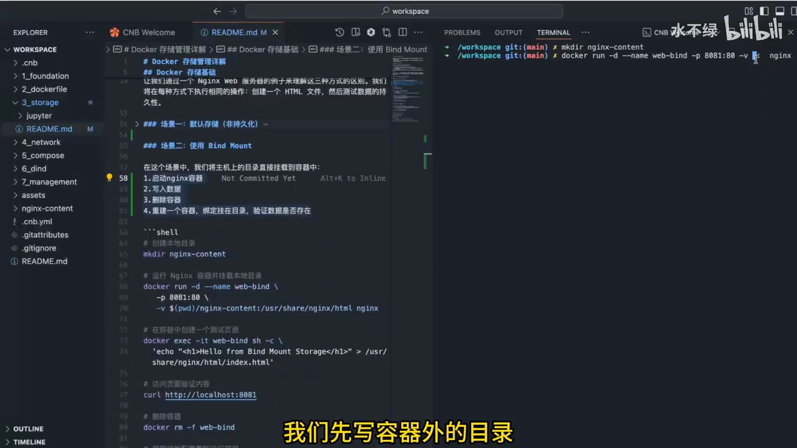
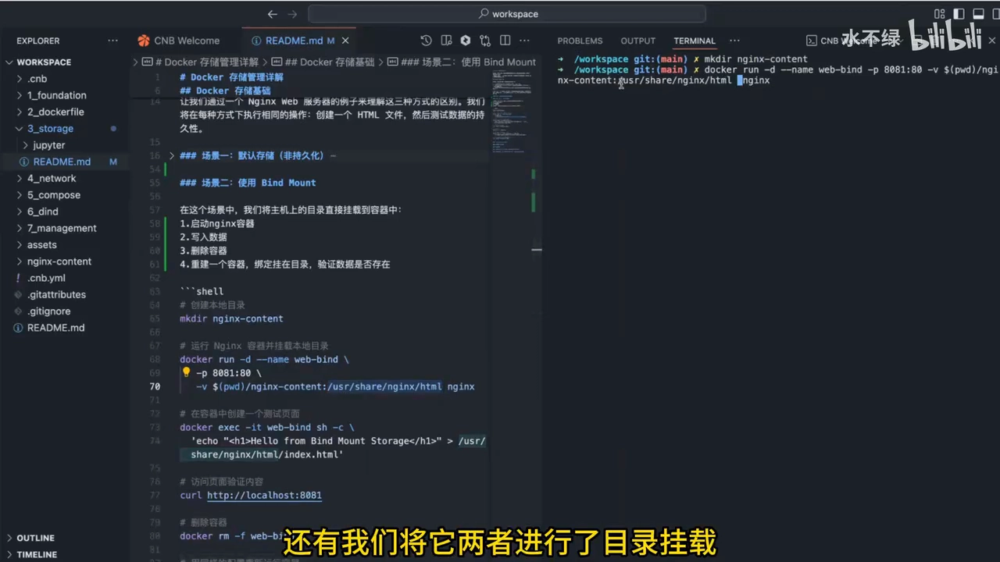
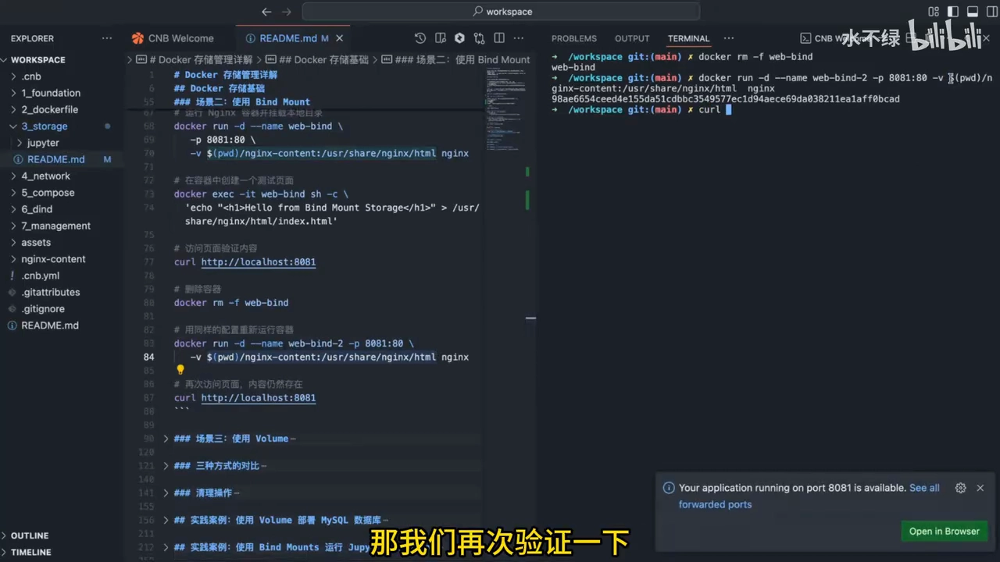
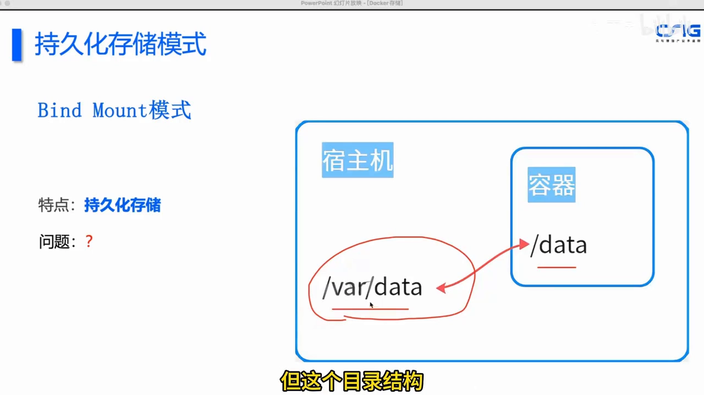
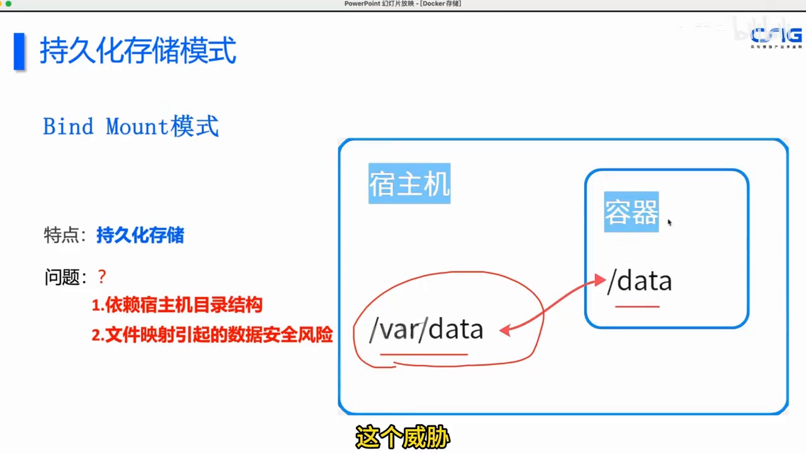

# 绑定挂载（Bind Mount）模型：让容器数据留在宿主机

> 本文整理自 Bilibili 视频《【Docker存储基础】场景二——Bind Mount 模式：docker 持久化存储，容器数据安全绑定挂载隐患。》（UP 主：CNB-云原生构建），依据视频演说图文稿逐窗口核对内容。
> 视频地址：[BV1k9AmzaEwS](https://www.bilibili.com/video/BV1k9AmzaEwS/)

## 本讲要解决的核心问题（SCQA）

**背景**：容器是"用完即弃"的——删掉容器重建，写在容器里的数据就没了。上一类内容里，我们已经见过 volume（数据卷）这种持久化方案。

**冲突**：但 Docker 其实提供了**两种**持久化存储方案：一种是 **bind mount（绑定挂载）**，另一种才是 volume。绑定挂载把**宿主机上的一个目录**直接映射进容器，往容器里写数据时"两边一起变"，容器删了数据还在。看起来很好用，可一旦用歪——宿主目录写错、或者把敏感文件挂进了一个来路不明的镜像——就会踩坑，甚至酿成安全事故。

**疑问**：绑定挂载到底是怎么"绑定"的？为什么它能持久化？它在真实场景里又会带来哪些隐患？

**回答（中心思想）**：绑定挂载用一个"容器外目录 ↔ 容器内目录"的**双向映射**实现了持久化——**只要宿主机目录还在，容器删了数据也不丢**。代价是它**强依赖宿主机的目录结构**、带来明显的心智负担，并且**误把高敏感文件挂进容器会引入严重的安全风险**。因此它更适合**开发场景**（改代码即时生效），生产数据的持久化则应优先考虑数据卷。

## 一、绑定挂载的核心原理：把宿主机目录"接"进容器

Docker 给我们带来了两种持久化存储的解决方案：一种是 **bind mount 绑定挂载模式**，另一种叫 **volume 数据卷模式**。绑定挂载模式是如何实现持久化存储的呢？其实非常简单。[【跳转到 00:10】](https://www.bilibili.com/video/BV1k9AmzaEwS/?t=10)

来看这张架构图：我们往容器里的 `/data` 目录写一个数据，绑定挂载其实是尝试把**容器外**——也就是宿主机上**一个目录**（比如 `vd/data`）——和**容器内**的目录 `/data` 两者进行**挂载和映射**。这样我们在容器里往 `/data` 写数据，**同时也会落到容器外的那个目录**里。[【跳转到 00:23】](https://www.bilibili.com/video/BV1k9AmzaEwS/?t=23)



于是可以推想：**将来有一天容器被删掉，数据依然存在**、没有丢失——这就是绑定挂载实现持久化存储的**基本原理**。[【跳转到 00:48】](https://www.bilibili.com/video/BV1k9AmzaEwS/?t=48)



一句话记住它与卷的分工：**绑定挂载是"借"宿主机的目录来存数据，卷是 Docker 自己管理一块区域来存数据**。绑定挂载的"借"，就是它灵活、也是它麻烦的根源。

## 二、动手实验：四步验证"删容器，数据不丢"

回到课程仓库，用同一个例子来体验绑定挂载。实验分四步：**① 在容器外建目录 → ② 启动容器并挂载该目录、写入数据 → ③ 删除容器 → ④ 重建容器、挂同一目录，验证数据还在。**[【跳转到 01:26】](https://www.bilibili.com/video/BV1k9AmzaEwS/?t=86)

第一步，先在**容器外**建立存储数据的目录：

```bash
mkdir nginx-content
```



第二步，启动 NGINX 容器，起名 `weband`，做端口映射（这次用 `8081`，与上一个实验区分），**最关键的是用 `-v` 参数把容器外的目录和容器内的目录挂载起来**。[【跳转到 02:37】](https://www.bilibili.com/video/BV1k9AmzaEwS/?t=157)

`-v` 的值由两部分构成，用**冒号**区分：**冒号前是容器外的目录，冒号后是容器内的目录**。容器外的目录我们直接拷贝过来——`$PWD` 指当前目录，再拼上 `nginx-content`；冒号后填容器内的目录，也就是 NGINX **欢迎页所在的目录**。[【跳转到 03:18】](https://www.bilibili.com/video/BV1k9AmzaEwS/?t=198)

```bash
docker run -d --name weband -p 8081:80 \
  -v $PWD/nginx-content:/usr/share/nginx/html nginx
```



容器起来后，跟上一个实验一样，`exec` 进容器写入数据：往 NGINX 欢迎页文件里写一句话 `Hello from bind mount storage`，再用 `cat` 输出验证，写入成功。[【跳转到 04:05】](https://www.bilibili.com/video/BV1k9AmzaEwS/?t=245)



退出容器后在宿主机做**二次验证**：用 `curl` 访问 `localhost:8081`，NGINX 会把刚写的数据打印出来。下一步——**删除容器**：这里有个 `-f` 参数的细节，直接 `docker remove` 不加 `-f` 是删不掉运行中的容器的（运行中的容器不允许删除），可以强行 `-f` 删，但更推荐先 `docker stop` 停止容器再删除。[【跳转到 05:20】](https://www.bilibili.com/video/BV1k9AmzaEwS/?t=320)

第四步，**重建一个全新的容器**，配置和刚才一模一样（同样把容器外目录和容器内 NGINX 欢迎页目录绑定），再次 `curl localhost:8081`——**数据还在**！这就说明：**即便把第一个容器删掉，数据依然保留，之后的新容器可以继续使用**。[【跳转到 06:10】](https://www.bilibili.com/video/BV1k9AmzaEwS/?t=370)



## 三、绑定挂载的两个隐患

介绍完这个模式，视频抛出两个"值得停下来想一想"的问题。

### 3.1 依赖宿主机目录结构，是持续的心智负担

**结论**：绑定挂载虽然能持久化，但它的**可移植性差**，并且要求你时时刻刻操心宿主机的目录。

绑定挂载的核心，就是把"容器外的目录"和"容器内的目录"**绑定映射**在一起。那么在真实使用中，你存储容器数据就**依赖容器的那个外目录**，于是这个目录结构就需要特别关注：**要保证它存在，还要保证挂载时路径写得准确**。写得不对或有问题，就可能产生意外。这种依赖主机目录的结构，会给使用过程**带来很多心智负担**。此外它还可能带来"容易误删""不好迁移"等问题。[【跳转到 08:12】](https://www.bilibili.com/video/BV1k9AmzaEwS/?t=492)



### 3.2 误挂高敏感文件，可能酿成安全事故

**结论**：绑定挂载最常见的、也是最严重的问题，是**安全风险**。

设想这样一个场景：主机上有一些**高敏感文件**，里面存着密钥或其他敏感信息。假如使用者不太了解 Docker 的机制，**错误地把这种高敏感文件映射绑定进了容器**；而容器又常常是通过**下载来的镜像**启动的——镜像里完全可能被塞进黑客故意构造的危险程序。这些程序在容器里就能**读取**（甚至操作不当时会**写入**）你那个敏感目录下的文件，安全风险极高。[【跳转到 09:27】](https://www.bilibili.com/video/BV1k9AmzaEwS/?t=567)



这两点合起来，正好呼应了本条目所属章节的主题——绑定挂载是把"容器外的目录"和"容器内的目录"绑在一起，**方便的同时也把宿主机的目录结构、以及它的权限与安全面暴露给了容器**。

## 小结

- **绑定挂载的本质是一次双向映射**：宿主机的一个目录 ↔ 容器内的一个目录，写数据时两边同步变化。
- **持久化靠的是"数据本就在宿主机上"**：容器删了，宿主目录还在，换新容器挂同一目录即可继续读。
- **`-v` 的写法是"容器外:容器内"**，冒号前后不能写反；宿主机目录一般用 `$PWD` 或绝对路径。
- **两个隐患**：① 强依赖宿主机目录结构，可移植性差、心智负担重；② 误挂高敏感文件会引入严重安全风险。
- **适用定位**：绑定挂载适合**开发**（改宿主文件即时进容器）；生产数据的持久化更推荐用 Docker 管理的数据卷。

## 关键术语速查

| 术语 | 一句话解释 |
| --- | --- |
| 绑定挂载（bind mount） | 把宿主机的一个目录/文件直接映射进容器，容器内外共用同一份数据。 |
| 持久化存储 | 让数据在容器删除后依然保留的机制（如绑定挂载、数据卷）。 |
| `-v`（`--volume`） | docker run 的挂载参数，格式为 `宿主机路径:容器内路径`。 |
| `$PWD` | Shell 变量，表示当前工作目录；常用来拼出宿主机的绝对路径。 |
| 数据卷（volume） | 由 Docker 管理、独立于容器的存储区域，可跨容器共享。 |
