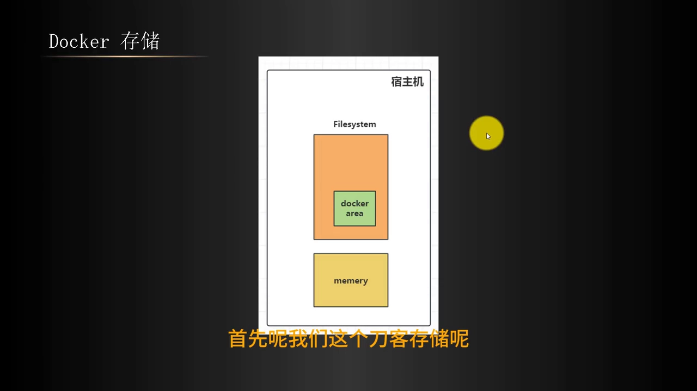
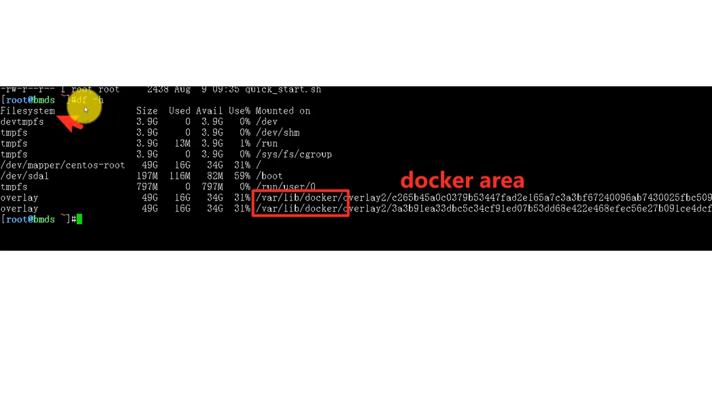
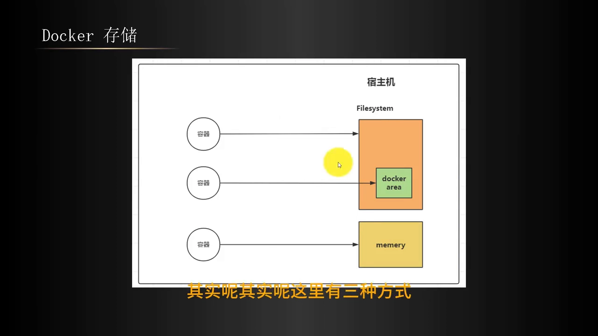
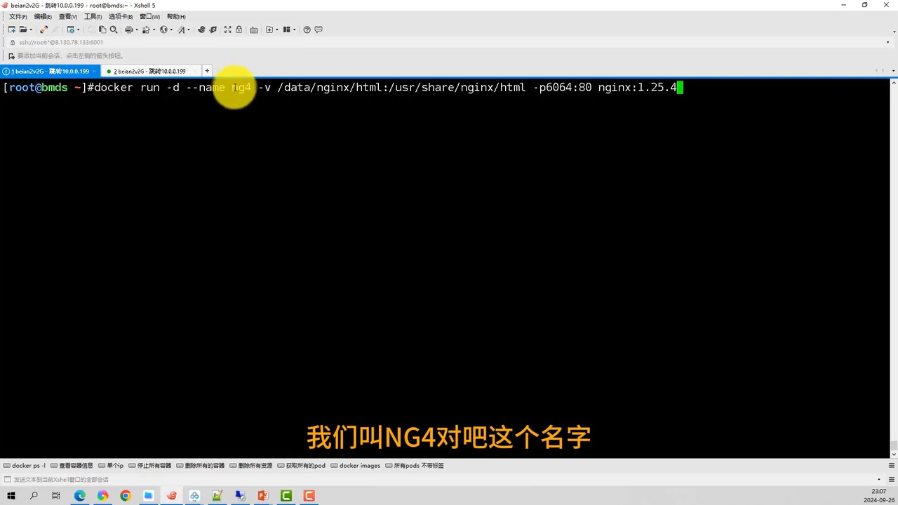
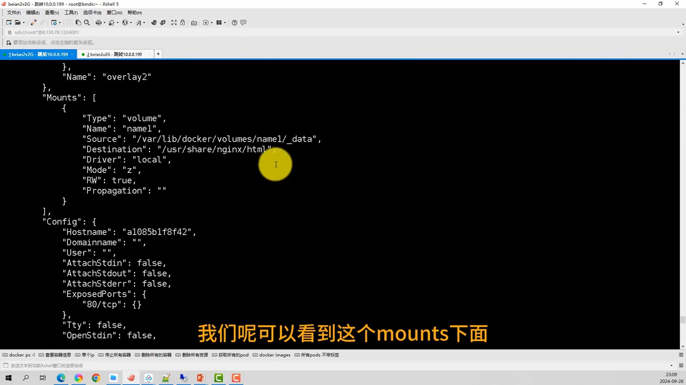
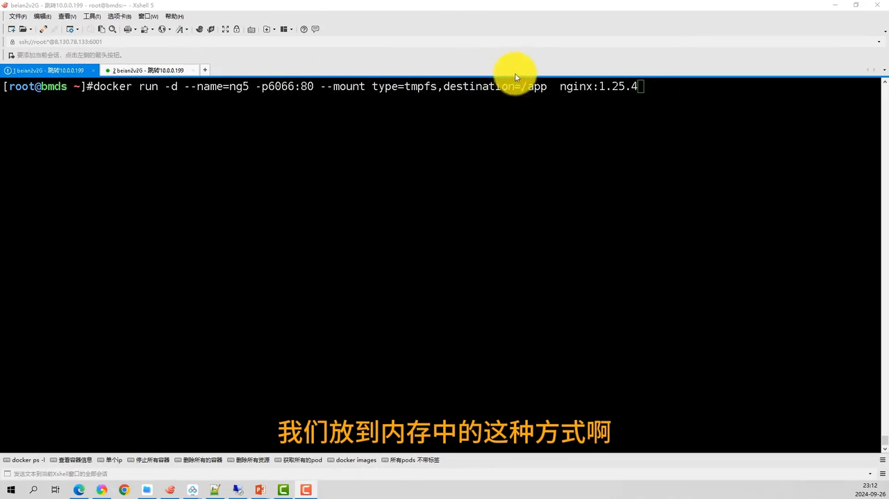
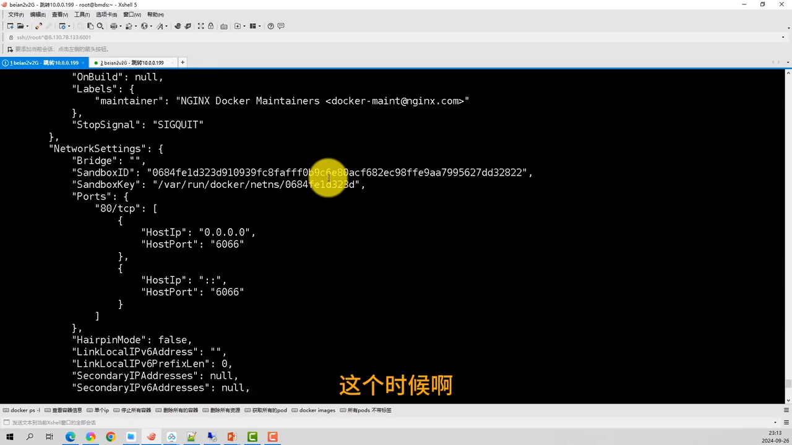
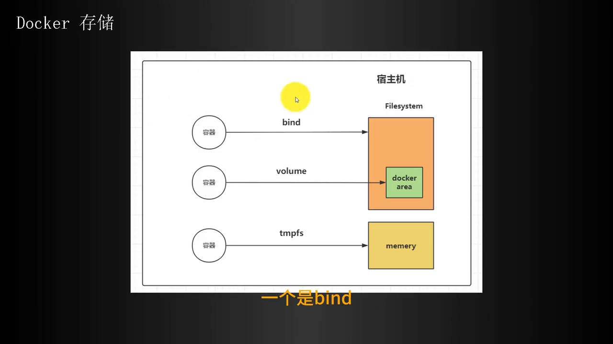

# Docker 存储的三种类型：bind、volume 与 tmpfs 分别把数据放在哪

> 本文整理自 Bilibili 视频《42-docker volume 存储卷的3种类型（volume, bind mount , tmpfs mount)》（UP 主：白眉大叔89），依据视频演说图文稿逐窗口核对内容。
> 视频地址：[BV1w3xCe1ENY](https://www.bilibili.com/video/BV1w3xCe1ENY/)

## 本讲要解决的核心问题（SCQA）

**背景**：我们平时用 `docker -v` 挂载数据，一会儿写一个路径、一会儿写一个卷名，命令长得差不多，但数据到底存到了哪里，很多人是稀里糊涂的。

**冲突**：其实 Docker 存储**一共有三种类型**，它们分别对应宿主机上**三个不同的区域**——文件系统、Docker 区域、内存。但 `docker -v` 的两种写法（写路径 vs 写卷名）表面上很像，**只有看清"数据最终落在哪个目录"，才能判断自己用的到底是哪一种**。

**疑问**：这三种类型分别是什么？它们各自把数据放在哪里？`docker -v` 又怎么区分它们？

**回答（中心思想）**：Docker 存储分 **bind mount、volume、tmpfs** 三类，分别落在 **宿主机的普通目录、`/var/lib/docker` 下的 Docker 区域、内存**中。判断方法很简单：`-v` 后面以宿主机 `/` 开头的路径就是 **bind**，其余（匿名卷或命名卷）都是 **volume**；而挂到内存必须改用 `--mount` 并指定 `type=tmpfs`。

## 一、先把"地图"铺开：三种类型对应三个区域

Docker 存储分三种类型，它们主要针对三个不同的区域：**一个针对宿主机、一个针对内存，还有一部分在 Docker 这个区域里**。[【跳转到 00:13】](https://www.bilibili.com/video/BV1w3xCe1ENY/?t=13)



至于"**Docker 区域**"，我们平时看得比较多的是 `/var/lib/docker` 这个目录——它其实也是文件系统中的一个目录，**存储卷（volume）的数据就放在这里**。这个区域主要是给宿主机和容器共享数据用的。[【跳转到 00:43】](https://www.bilibili.com/video/BV1w3xCe1ENY/?t=43)

在宿主机上直接执行 `df -h`，就能看到整个文件系统，以及它下面那个 `/var/lib/docker`：



那么如何让容器去共享这三个区域呢？**一共三种方式**：[【跳转到 01:03】](https://www.bilibili.com/video/BV1w3xCe1ENY/?t=63)

1. **bind（bind mount）**：直接挂载**宿主机的文件系统目录**。
2. **volume**：挂载 **Docker 区域**（`/var/lib/docker`）里的位置。
3. **tmpfs**：挂载到**内存**。



## 二、`docker -v` 如何区分 bind 与 volume

回到熟悉的 `docker -v`。它的形式是「**卷名（或路径）:容器内的目录**」，冒号后边是容器内的目录；冒号前边则有两种可能：**以宿主机 `/` 开头的路径**，或者**一个存储卷的名称**。[【跳转到 01:26】](https://www.bilibili.com/video/BV1w3xCe1ENY/?t=86)

**如果冒号前是"宿主机根 `/` + 具体路径"，这种方式就是 bind**；否则（写的是卷名）就是 volume。视频用两个容器做了对照演示。[【跳转到 01:43】](https://www.bilibili.com/video/BV1w3xCe1ENY/?t=103)

### 验证一：bind 类型的容器（NG4）

先启动一个**以宿主机路径挂载**的容器（视频里叫 `NG4`），然后用 `docker inspect` 查看它的挂载信息：会看到 **`Mounts` 的类型是 `bind`**，它的 **Source 是宿主机上的那个目录**，目标（Destination）是容器内的目录。[【跳转到 02:06】](https://www.bilibili.com/video/BV1w3xCe1ENY/?t=126)



### 验证二：volume 类型的容器（NG3）

再跑一个**以存储卷名称挂载**的容器（`NG3`），同样 `docker inspect`：这次 **`Mounts` 的类型变成了 `volume`**，说明它是以存储卷的形式绑定的。它的 Source **不再是宿主机任意目录，而是 `/var/lib/docker/volumes/...` 下面的一个路径**——**只要数据落在这个路径下，它就是 volume 类型**。[【跳转到 03:03】](https://www.bilibili.com/video/BV1w3xCe1ENY/?t=183)



**总结一句**：`docker -v` 加上 `宿主机绝对路径`（以 `/` 开头）就是 **bind**；其余格式——**匿名卷、命名卷**——都是 **volume**。[【跳转到 03:34】](https://www.bilibili.com/video/BV1w3xCe1ENY/?t=214)

## 三、第三种：tmpfs——把数据放进内存

前两种都在磁盘上，第三种 **tmpfs** 则是把数据**放进内存**。

要挂到内存，**必须用一个不同的参数 `--mount`**，而且它的写法和 `-v` 不一样：**必须显式指定 `type=tmpfs`**，再跟上容器内的数据目录、镜像名。[【跳转到 04:06】](https://www.bilibili.com/video/BV1w3xCe1ENY/?t=246)



```bash
docker run --mount type=tmpfs,destination=/app ... <镜像>
```

启动容器（视频里叫 `NG5`）后用 `docker inspect` 一看，**`Mounts` 下的 Type 是 `tmpfs`**——它的意思就是：**把这个容器里 `/app` 的数据直接加载到宿主机的内存中**。[【跳转到 04:56】](https://www.bilibili.com/video/BV1w3xCe1ENY/?t=296)



> 顺带一提：**`-v` 其实就是 `--volume`**，而 **`--mount` 与 `-v` 是有区别的**（更显式、可读性更好）——视频把这个对比留到了下一节，这里只需记住"**挂内存只能用 `--mount` + `type=tmpfs`**"。

## 四、三种类型对照总结

| 类型 | 数据落在哪 | 挂载写法 |
| --- | --- | --- |
| **bind（绑定挂载）** | 宿主机的普通目录（自己指定） | `-v /宿主机/路径:/容器内路径` |
| **volume（数据卷）** | `/var/lib/docker/volumes/...`（Docker 管理） | `-v 卷名:/容器内路径` |
| **tmpfs（临时文件系统）** | 宿主机内存 | `--mount type=tmpfs,destination=/容器内路径` |

它们分别对应的宿主目录并不一样：**bind 是宿主机的一个目录，volume 是 `/var/lib/docker` 这个路径下的，tmpfs 是内存中的**。[【跳转到 05:19】](https://www.bilibili.com/video/BV1w3xCe1ENY/?t=319)



## 小结

- Docker 存储分 **三类**：bind mount、volume、tmpfs。
- 三者分别落在 **宿主机的普通目录、`/var/lib/docker`（Docker 区域）、内存**。
- **`docker -v` 的判据**：冒号前以宿主机 `/` 开头 → **bind**；写的是卷名（匿名卷/命名卷）→ **volume**。
- **`docker inspect` 看 `Mounts.Type`**：`bind` / `volume` / `tmpfs` 一目了然，`Source` 还能告诉你数据具体落在哪。
- **挂内存必须用 `--mount` + `type=tmpfs`**，`-v` 做不到。

## 关键术语速查

| 术语 | 一句话解释 |
| --- | --- |
| bind mount（绑定挂载） | 把宿主机的某个目录直接挂进容器，数据存在宿主机普通目录里。 |
| volume（数据卷） | Docker 自己管理的存储，数据存放在 `/var/lib/docker/volumes` 下。 |
| tmpfs | 把数据挂到内存里的临时文件系统，速度极快但不持久。 |
| `docker inspect` | 查看容器/镜像详细信息的命令，其中 `Mounts` 段能看到挂载类型与来源。 |
| `df -h` | 查看文件系统磁盘使用情况的命令。 |
