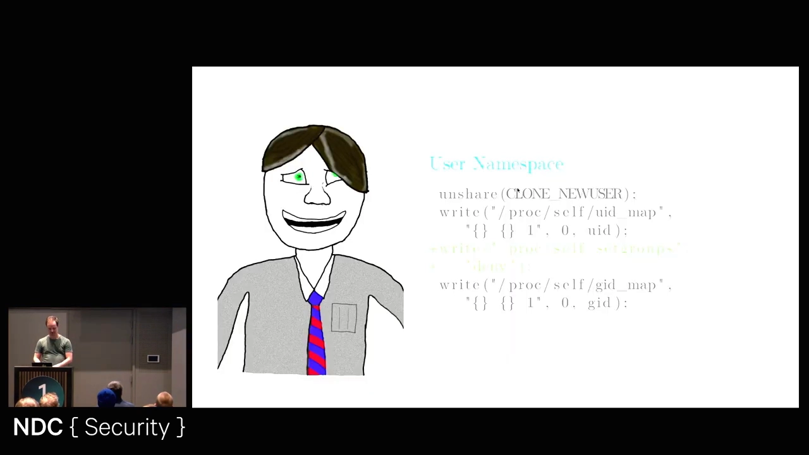
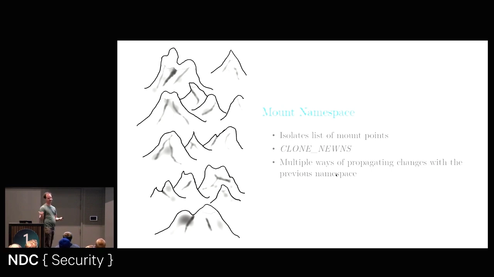
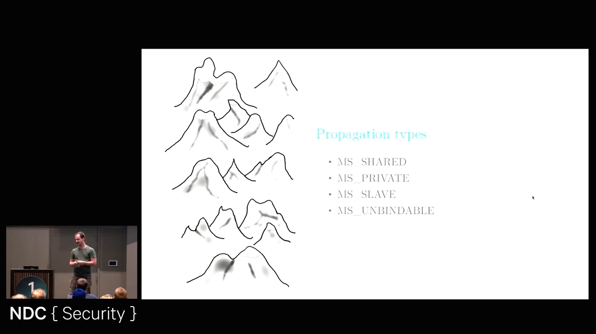
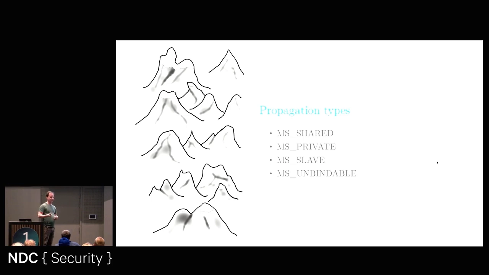
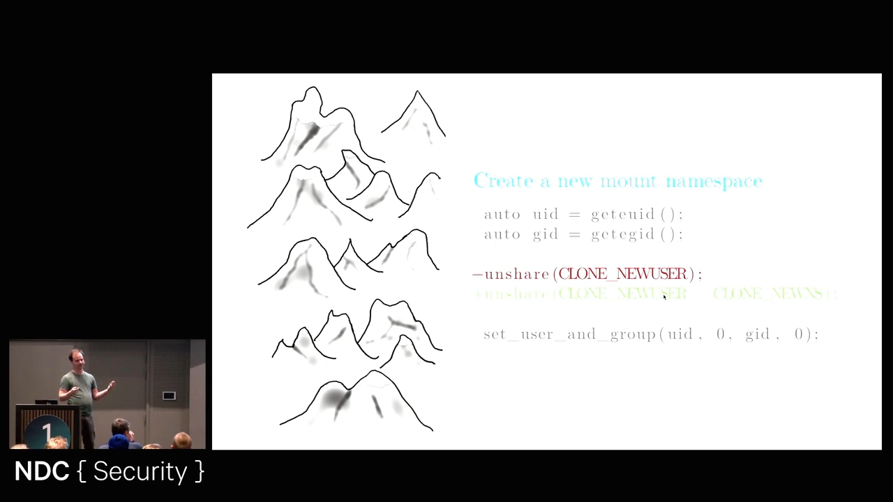
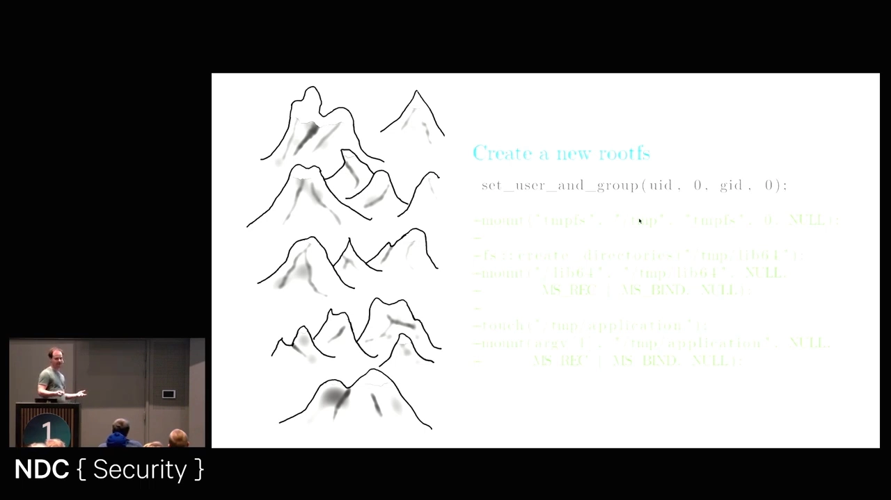
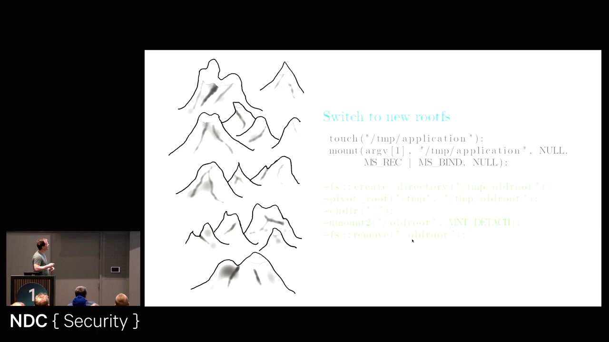

# 挂载命名空间与挂载传播：共享、私有、从属与不可绑定

> 本文整理自 YouTube 视频《Linux Namespaces for Fun and Isolation》（讲者：Martin Ertsås，Cisco，NDC Security 2024）的「挂载命名空间与挂载传播」段落（约 11:13–20:00），依据视频演说图文稿逐窗口核对、纠正自动字幕错拼后整理。原字幕为英文自动识别，错拼（如 `cisv`→SysV、`system D`→systemd、`unbindable`）已在本文中纠正，术语按 Linux man 页规范还原。
> 视频地址：[kjCKOVmaIRw](https://www.youtube.com/watch?v=kjCKOVmaIRw)
> 该演讲其余部分还介绍用户、PID、时间、UTS、IPC 等命名空间，属于其它条目主题，不在本文范围。

## 本讲要解决的核心问题（SCQA）

**背景**：容器靠**命名空间（namespace）**隔离全局内核资源。其中**挂载命名空间（mount namespace）**让一个进程拥有**自己的一份挂载点列表**，于是容器里的文件系统视图可以和宿主机完全不同——这正是"容器有一个独立根目录"的来源。

**冲突**：但新建挂载命名空间后，它和原来的命名空间之间**默认并不井水不犯河水**。挂载点之间存在**挂载传播（mount propagation）**：在一边挂载或卸载，另一边可能跟着变。更麻烦的是，**默认传播模式随系统而异**——用 SysV init 时默认 `private`，systemd 一来就改成了 `shared`。用错模式轻则 `pivot_root` 失败，重则**误卸载宿主机的目录、拖垮整台机器**。[【跳转到 12:28】](https://www.youtube.com/watch?v=kjCKOVmaIRw&t=748)

**疑问**：挂载传播到底有哪几种模式、各自什么含义？默认是哪一种？要构建一个真正隔离的 rootfs，应该怎么设置、怎么切换？

**回答（中心思想）**：挂载传播有**四种模式**——`shared`（共享/互相镜像）、`private`（私有/完全隔离）、`slave`（从属/单向接收）、`unbindable`（不可再被绑定）；它是**按"每个挂载点"设置**的，不是全局开关，且**默认值不可假设**，创建挂载命名空间后应**显式设置**。做隔离的标准套路是：**新建挂载命名空间 → 把根上的所有挂载点递归设为 `private`（先彻底切断传播）→ 构建新 rootfs → 用 `pivot_root` 切过去**（并避免用 `chroot`，因为它会限制你后续的能力）。

## 一、挂载命名空间：一份"属于你自己"的挂载点列表

挂载命名空间是最**灵活**的命名空间之一。它做的一件事是：[【跳转到 11:13】](https://www.youtube.com/watch?v=kjCKOVmaIRw&t=673)

> 在每个命名空间里，都有一份**挂载点列表（list of mount points）**，也就是"这个命名空间里都挂了什么"。当你创建一个新的挂载命名空间时，内核**把当前这份列表复制一份**给你——但从此**这份列表就是你的了**，你想怎么改就怎么改。

因此你可以用它**彻底重写文件系统视图**——所谓"给容器换一个根目录"，本质就是换了一份挂载点列表。[【跳转到 11:38】](https://www.youtube.com/watch?v=kjCKOVmaIRw&t=698)

创建方式是在调用 `unshare`（或 `clone`）时加上 `CLONE_NEWNS` 标志。这个名字看着奇怪，是因为**它是最早被造出来的命名空间**——"当年没人想到以后还会有别的命名空间"，于是直接占了 `NEWNS` 这个泛名。[【跳转到 12:03】](https://www.youtube.com/watch?v=kjCKOVmaIRw&t=723)

## 二、挂载传播的四种模式

挂载命名空间的威力也带来一个副作用：你可以把改动**传播（propagate）**到原来的命名空间，也可以反过来由它传播给你。演讲者把传播模式归纳为四种。[【跳转到 12:28】](https://www.youtube.com/watch?v=kjCKOVmaIRw&t=748)

**1. `shared`（共享）**——两边的挂载点**互为镜像**：无论在原命名空间还是新命名空间里做挂载/卸载，都会传播到对方。[【跳转到 12:53】](https://www.youtube.com/watch?v=kjCKOVmaIRw&t=773)

**2. `private`（私有）**——**完全不传播**，两边是彻底隔离的集合，你在这份挂载点列表里做什么都行。

需要澄清一个常见误解：传播控制的是**"挂载点列表的改动"**（挂载/卸载），不是**挂载点里的文件内容**。如果两个命名空间里挂了**同一个挂载点**，你在里面写文件，对两边都可见——因为那本来就是同一份内容，并没有"传播"什么。

**3. `slave`（从属）**——**单向**传播：原命名空间里的变化会传播到你新建的这个命名空间，**但你在新命名空间里做的改动保持私有、不会传回去**。[【跳转到 13:18】](https://www.youtube.com/watch?v=kjCKOVmaIRw&t=798)

**4. `unbindable`（不可绑定）**——表示这个挂载点**不能再被绑定挂载（bind mount）到别的地方**，它被"钉"在当前位置。[【跳转到 13:43】](https://www.youtube.com/watch?v=kjCKOVmaIRw&t=823)

最后一个要点：**这些模式是按每个挂载点单独设置的**，并不需要（通常也不应该）对整个系统一刀切。

## 三、默认传播模式：从 SysV 的 private 到 systemd 的 shared

最容易踩坑的地方在于**默认值会变**。[【跳转到 14:08】](https://www.youtube.com/watch?v=kjCKOVmaIRw&t=848)

- 早期用 **SysV init** 时，默认传播模式是 **`private`**；
- **systemd** 出现后，把它改成了 **`shared`**。

于是同一个"只挂了点东西"的程序，在不同机器上可能表现出**完全不同的传播行为**。

## 四、结论：永远显式设置传播模式

正因为默认值不可信，创建挂载命名空间后**应当显式地设置你想要的传播模式**，而不要依赖系统的默认。否则，你可能在完全不知情的机器上，把一次本应隔离的挂载操作传播到了宿主机上。

## 五、实战套路：先切断传播，再构建 rootfs

演讲者给出的"造一个自己的根文件系统"的流程，**正是 Docker 在做的事**：容器引擎会给你造一个新的根文件系统，让它看起来像 Ubuntu、Debian 或任何你想要的样子。[【跳转到 14:33】](https://www.youtube.com/watch?v=kjCKOVmaIRw&t=873)

策略四步走：

1. **创建新的挂载命名空间**；
2. **把（根上的）所有挂载点设为 `private`**——因为你**不希望任何东西再被传播出去**；
3. **构建新的 rootfs 结构**；
4. **切换过去**，并丢掉旧的根。

### 5.1 建命名空间：用用户命名空间"兜底"

具体做法是在 `unshare` 里同时加上 `CLONE_NEWUSER` 和 `CLONE_NEWNS`。这一步有个**内核保证**很关键：当一次性请求多个命名空间、且其中包含用户命名空间时，**用户命名空间会被最先创建，并"治理（govern）"其余命名空间**——也就是说，新挂载命名空间处在新建的用户命名空间之下。[【跳转到 15:23】](https://www.youtube.com/watch?v=kjCKOVmaIRw&t=923) 此时新的挂载命名空间内容与原来**一模一样**（列表是复制来的）。

### 5.2 关键一步：把所有挂载点递归设为 private

接着**从当前文件系统的根出发，把所有挂载点递归地设为 `private`**。[【跳转到 16:13】](https://www.youtube.com/watch?v=kjCKOVmaIRw&t=973)

做完这一步，你**不再共享、也不再传播改动**，才真正拿到了隔离：可以放心大胆地摆弄自己那份挂载点列表。

### 5.3 搭建新根：可以随便折腾

因为改动**不会再传播**，你就可以放心操作，比如把 `tmpfs` 挂到 `/tmp`（选 `/tmp` 是因为它"反正就在那儿、应用通常也用不到"），再创建目录、按需 `bind mount` 各种东西。**因为这些都是只存在于你这个命名空间里的挂载点，你在里面建多大目录结构、写多少文件，别人都看不见。**[【跳转到 16:38】](https://www.youtube.com/watch?v=kjCKOVmaIRw&t=998) [【跳转到 17:03】](https://www.youtube.com/watch?v=kjCKOVmaIRw&t=1023)

### 5.4 切换根：用 pivot_root，而不用 chroot

换根有两种选择，演讲者选 **`pivot_root`**。[【跳转到 17:53】](https://www.youtube.com/watch?v=kjCKOVmaIRw&t=1073)

- **`pivot_root` 的工作方式**：传入**新的根**，以及一个**用来存放旧根的目录**（调用后旧根还在，需要你自己处理）；
- **紧接着必须 `cd` 进新根**：否则进程的工作目录还停留在原处，**可能通过路径泄漏信息**；
- **然后卸载并删除旧根**：如果保留那个指向旧根的句柄，你又能 `pivot_root` 切回去，**隔离就破了**。[【跳转到 18:18】](https://www.youtube.com/watch?v=kjCKOVmaIRw&t=1098)

**为什么不用 `chroot`？** 因为它更**受限**——例如它会挡住你后续创建新的用户命名空间。而 `pivot_root` **glibc 没有直接暴露**，需要用 `syscall()` 自己调用，但代码量很小，却能保留全部可能性（比如在容器里再跑子容器：Docker 里套 Docker 就是靠这一点）。[【跳转到 18:43】](https://www.youtube.com/watch?v=kjCKOVmaIRw&t=1123) [【跳转到 19:33】](https://www.youtube.com/watch?v=kjCKOVmaIRw&t=1173)

## 六、把这条思路放回日常

这套"挂载命名空间 + 递归 private + pivot_root"的组合不只为容器而生。演讲者分享了一个自用场景：**给单元测试一个独立的文件系统视图**——测试里可以随便折腾文件系统、验证行为是否符合预期，而**别人完全看不到**。[【跳转到 19:58】](https://www.youtube.com/watch?v=kjCKOVmaIRw&t=1198)

## 小结

- **挂载命名空间**给进程一份**私有的挂载点列表**，容器"独立根目录"就源于此；用 `CLONE_NEWNS` 创建。
- **挂载传播**控制的是"挂载/卸载事件"是否在命名空间之间流动，共**四种模式**：`shared`（双向镜像）、`private`（隔离）、`slave`（单向接收）、`unbindable`（禁止再绑定）。
- 传播模式**按每个挂载点**设置；**不要假设默认值**——SysV 默认 `private`，systemd 默认 `shared`，应**显式设置**。
- 构建隔离 rootfs 的套路：**建挂载命名空间 → 根上递归设为 private → 搭建新根 → `pivot_root` 切换 → cd 进新根 → 卸载删除旧根**。
- 换根**优先 `pivot_root` 而非 `chroot`**：前者保留了后续能力（如创建新的用户命名空间、跑子容器）。

## 关键术语速查

| 术语 | 一句话解释 |
| --- | --- |
| 挂载命名空间（mount namespace） | 让进程拥有一份私有的挂载点列表，可独立于其它命名空间改写文件系统视图 |
| `CLONE_NEWNS` | 创建挂载命名空间所用的标志（历史上第一个命名空间，故名字泛化） |
| 挂载传播（mount propagation） | 挂载/卸载事件是否在命名空间之间"流动"的机制 |
| `shared`（共享） | 两边互为镜像，任一方的挂载/卸载都传播到另一方 |
| `private`（私有） | 完全不传播，两边彻底隔离 |
| `slave`（从属） | 单向：接收对方的改动，但自己的改动不外传 |
| `unbindable`（不可绑定） | 该挂载点不能再被绑定挂载到别处 |
| `pivot_root` | 系统调用：把新根提升为当前挂载命名空间的真正根，并把旧根挪到指定目录 |
| `chroot` | 仅修改进程的"根"路径解析指针；比 `pivot_root` 受限，不宜作安全边界 |
