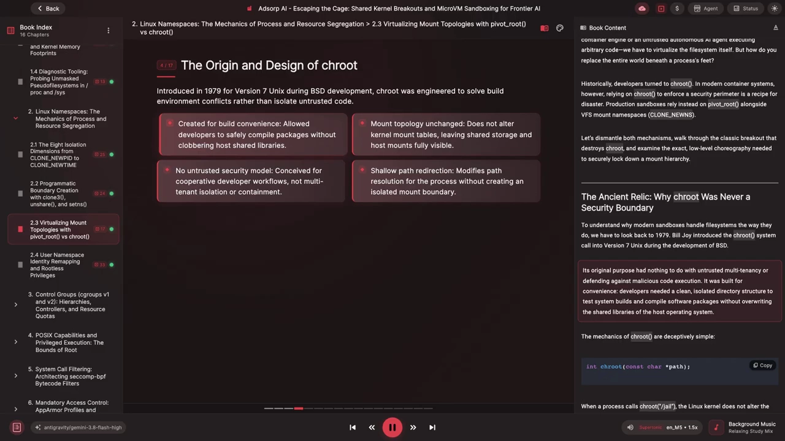
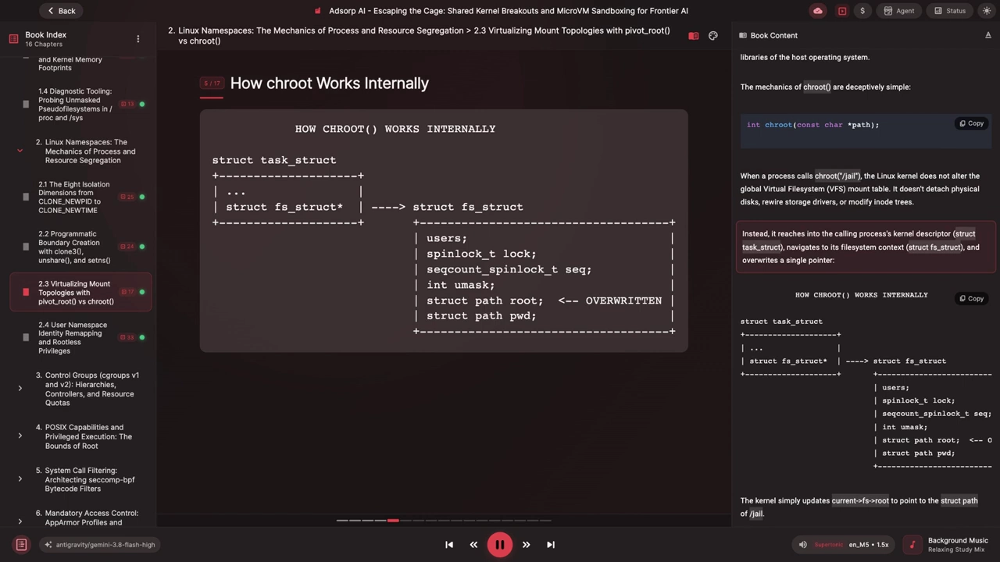
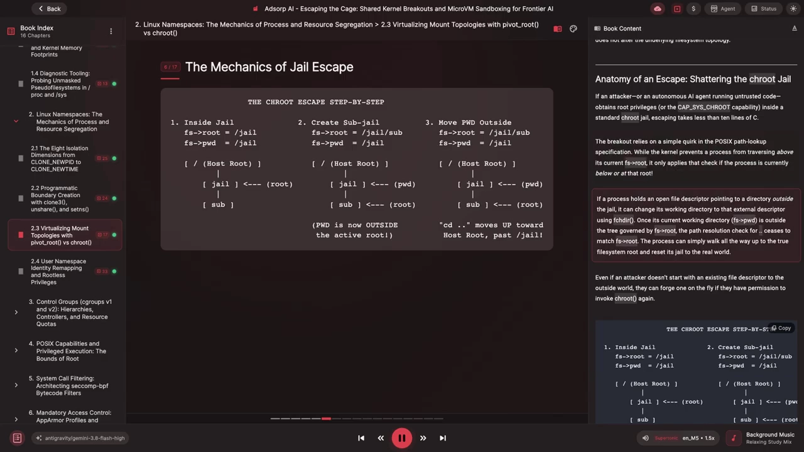
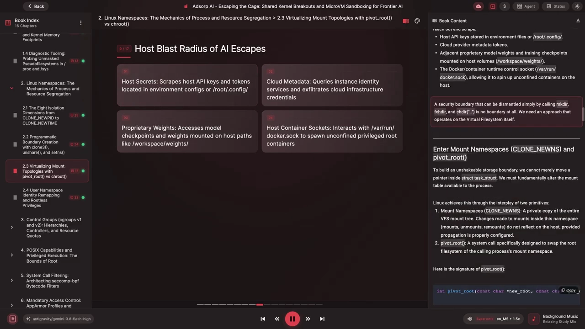
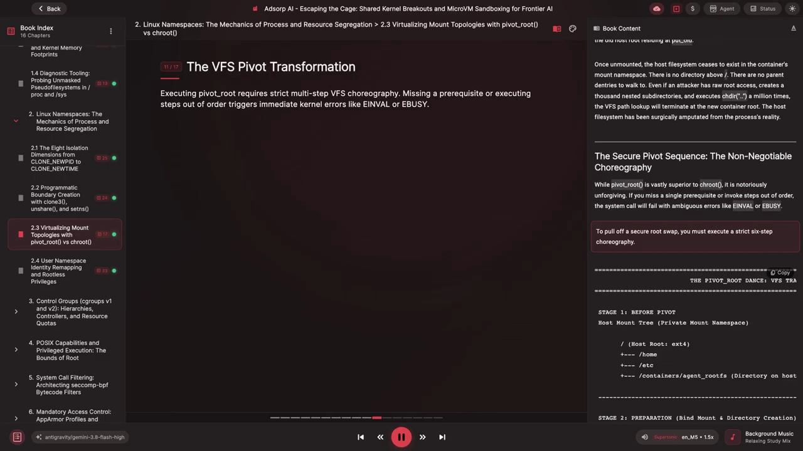
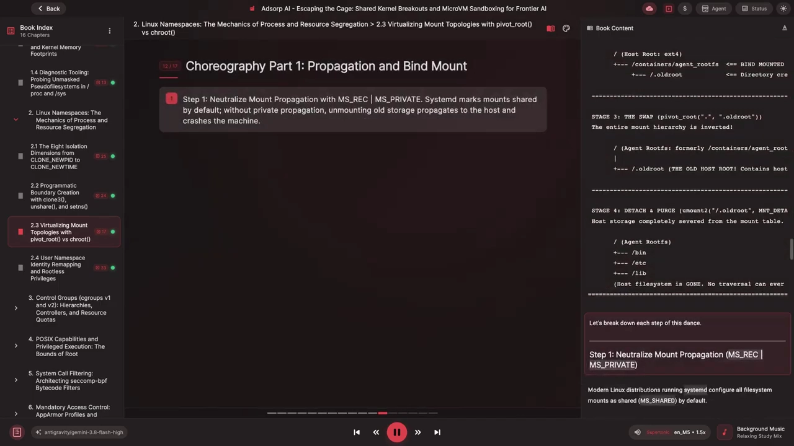
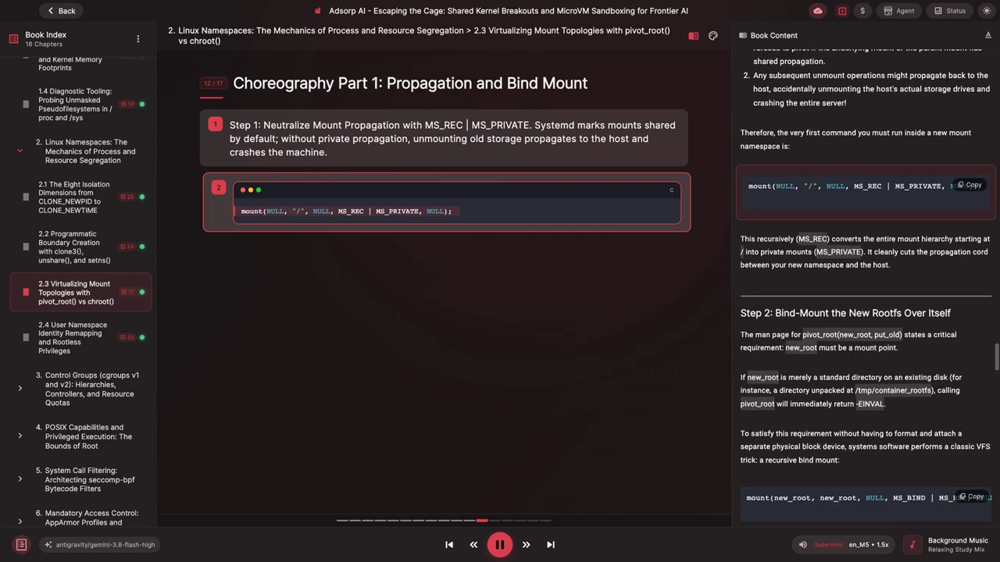
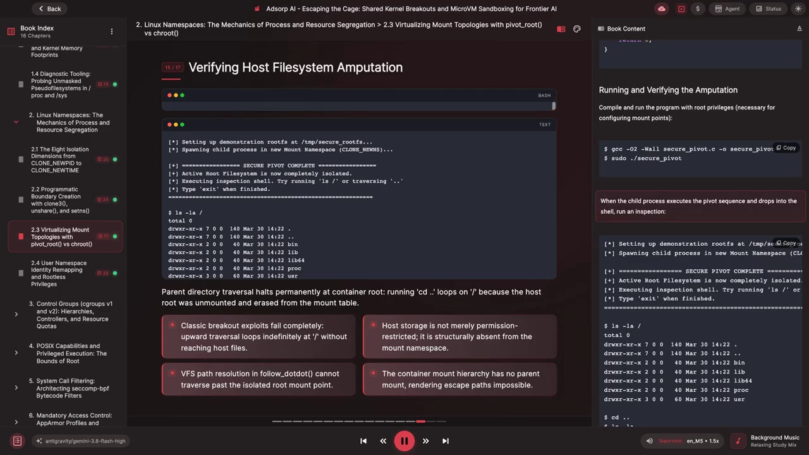
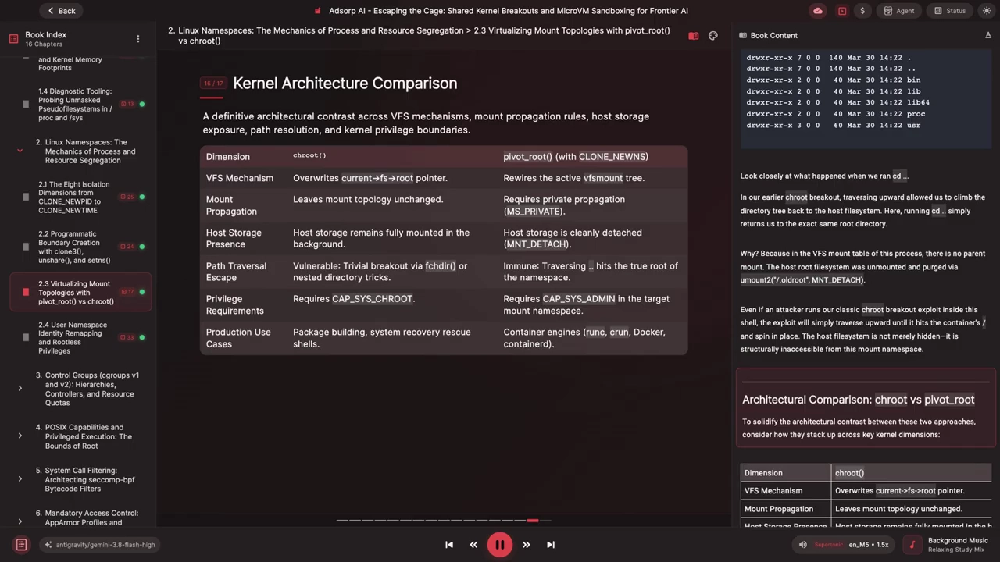

# 挂载传播与 pivot_root：让容器真正切断与宿主的挂载事件

> 本文整理自 YouTube 视频《Virtualizing Mount Topologies: pivot_root》（系列：The Mechanics of Process & Resource Segregation，频道：Adsorp AI），依据视频演说图文稿逐窗口核对、纠正自动字幕错拼后整理。原字幕为英文自动识别（如 `crruit`→chroot、`pivot route`→pivot_root、`amount two`→umount2、`mnt detach`→MNT_DETACH、`MSRSC`→`MS_REC`），术语已在本文中纠正。
> 视频地址：[QRDORAsQ14M](https://www.youtube.com/watch?v=QRDORAsQ14M)

## 本讲要解决的核心问题（SCQA）

**背景**：容器要隔离的东西里，最难的一种是**文件系统**。历史上人们用 `chroot` 把进程"关"进一个目录树；现代容器则用**挂载命名空间（mount namespace）**加 **`pivot_root`** 来替换整个挂载表。

**冲突**：`chroot` 从来**不是一个安全边界**——它只改一个指针，几行 C 就能逃逸。可就算升级到"挂载命名空间 + `pivot_root`"，**挂载传播（mount propagation）没配对**照样出大问题：现代发行版默认把挂载点做成 **`shared`（共享）**，此时 `pivot_root` 会直接失败，而后续的卸载甚至可能**传播回宿主机、把真实磁盘卸载掉**。[【跳转到 8:57】](https://www.youtube.com/watch?v=QRDORAsQ14M&t=537)

**疑问**：怎样才能搭出一个真正不可逃逸的文件系统边界？挂载传播在这一过程里扮演什么角色？安全的换根到底要按什么顺序做？

**回答（中心思想）**：要真正替换文件系统边界，必须**挂载命名空间 + `pivot_root`** 组合，而且**第一步就是切断挂载传播**（在根上递归 `MS_PRIVATE`）。此后严格按六步走——**递归绑定挂载新根、建 `oldroot`、`pivot_root`、`chdir` 重定位、卸载并删除旧根**——旧根就被从挂载表里"截肢"，`cd ..` 再也上不去，`chroot` 式逃逸彻底失效。`chroot` 与 `pivot_root` 的本质差别也在于此：一个只改路径解析指针，一个真正改写挂载拓扑。

## 一、chroot：一个便利工具，而不是安全边界

视频先带我们回到源头。`chroot` 由 Bill Joy 在 **1979 年**引入 **Version 7 Unix**（随 BSD 开发）——它的初衷**与多租户隔离、对抗恶意代码毫无关系**：只是为了让开发者有一个"干净的目录结构"去**测试系统构建、编译软件包**，而不会覆盖宿主机上共享的系统库。[【跳转到 1:20】](https://www.youtube.com/watch?v=QRDORAsQ14M&t=80)

`chroot` 的机制**简单到具有欺骗性**。它并不改动全局虚拟文件系统（VFS）的挂载表，也不摘掉物理磁盘、不重连存储驱动、不改 inode 树；它只是**深入到调用进程的内核描述符 `task_struct`，找到它的文件系统上下文 `fs_struct`，然后改写其中一个指针**。[【跳转到 1:45】](https://www.youtube.com/watch?v=QRDORAsQ14M&t=105)



具体地说，`fs_struct` 里有一个 `struct path root` 字段被**覆写**，指向目标目录（例如 `/jail`）的 `path`。从那一刻起，这个进程解析任何绝对路径（如 `/etc/hosts`）都从 `/jail` 开始，而不再从机器的真实根开始。[【跳转到 2:10】](https://www.youtube.com/watch?v=QRDORAsQ14M&t=130)



如果进程试图用 `cd ..` 往上爬，内核的 `follow_dotdot` 例程会检查"当前目录是否等于 `fs->root`"——**相等就停下**，进程爬不出被分配的这个根。**听起来没问题**，但把 `chroot` 当作安全屏障，就忽略了一个根本缺陷：**它只约束路径解析，不改变底层的文件系统拓扑。**

## 二、逃逸：chroot"监狱"是怎么被破的

如果一个攻击者（或跑不受信代码的自主 AI agent）在标准 `chroot` 监狱里拿到了 root 权限或 `CAP_SYS_CHROOT` 能力，**逃逸只需不到 10 行 C**。[【跳转到 3:00】](https://www.youtube.com/watch?v=QRDORAsQ14M&t=180)

突破口在于一个微妙的规则：内核**只在进程当前位于"根之下或正好等于根"时**才阻止它往上爬。如果进程持有一个**指向监狱之外目录的打开文件描述符**，它就能把工作目录切到那个外部描述符上；一旦 `fs->pwd` 落到 `fs->root` 管辖之外，`cd ..` 的检查便不再命中，进程就能一路爬到**真正的文件系统根**，再把监狱"重置"回真实世界。[【跳转到 3:25】](https://www.youtube.com/watch?v=QRDORAsQ14M&t=205)



经典 exploit 的步骤是：**打开当前目录句柄 → 创建并进入一个嵌套子目录 → `chroot` 到这个子目录（于是工作目录被留在新边界之外）→ 用保存的句柄移出边界 → 沿父目录一路爬到真正的系统根 → 在此重置根环境 → 启动一个 shell**。在"裸的" chroot 监狱里运行它，循环会直接**走出监狱边界**。[【跳转到 3:50】](https://www.youtube.com/watch?v=QRDORAsQ14M&t=230)

**这在现代 AI 系统里为什么格外危险？** 视频指出：给 LLM agent 开放 shell 权限（自动调试、数据分析、跑基准测试）的部署架构很常见，而宿主编排节点上往往放着**专有基础模型、工作区权重、云凭据，以及容器运行时控制套接字 `/var/run/docker.sock`**。一旦 agent 逃逸到宿主文件系统，就能读取密钥与令牌、拿到宿主的容器控制权，甚至**起不受约束的容器**——此时"边界"形同虚设。[【跳转到 4:40】](https://www.youtube.com/watch?v=QRDORAsQ14M&t=280)

## 三、换根的两块基石：挂载命名空间与 pivot_root

**只移动 `task_struct` 里的指针是不够的**——要真正换掉进程脚下的"世界"，必须**根本性地改写进程可见的挂载表**。Linux 用两个原语配合完成这件事。[【跳转到 6:20】](https://www.youtube.com/watch?v=QRDORAsQ14M&t=380)

- **挂载命名空间**（`clone(CLONE_NEWNS)`）：给进程一份**整个 VFS 挂载树的私有副本**。此后在这个命名空间里做的挂载、卸载、重挂载**不会反映到宿主机**——*前提是挂载传播（propagation）配置正确*。
- **`pivot_root`**：一个专门用来**替换调用进程所属挂载命名空间的根文件系统**的系统调用。它的签名是：

```c
int pivot_root(const char *new_root, const char *put_old);
```

关键在于它与 `chroot` 的**本质差别**：`chroot` 只是改一个路径解析指针，而 `pivot_root` **搬动的是整棵文件系统挂载树**——它接收一个已存在的挂载点 `new_root`，把它**提升**为该挂载命名空间的真正根，同时把**原先的根文件系统挪到 `put_old`**。[【跳转到 6:45】](https://www.youtube.com/watch?v=QRDORAsQ14M&t=405)



换根完成后，沙盒进程就可以**卸载**停在 `put_old` 上的旧宿主根。一旦卸载，宿主文件系统**就在容器的挂载命名空间里彻底不存在了**：根之上没有目录，没有父条目可爬。哪怕攻击者手握裸的 root 权限、造出上千层嵌套子目录、执行 `cd ..` 上百万次，**VFS 路径查找也会止步于新的容器根**。宿主文件系统，被从进程的"现实"里**外科手术式地截肢**了。[【跳转到 7:10】](https://www.youtube.com/watch?v=QRDORAsQ14M&t=430)

## 四、安全换根的"六步舞"：顺序不可错、一步不能少

`pivot_root` 比 `chroot` 强得多，却**出了名的挑剔**：漏掉任何前置条件、或步骤顺序错乱，系统调用就会以含糊的错误码（如 `EINVAL`、`EBUSY`）失败。要走完一次安全换根，必须严格按**六步编排**执行。[【跳转到 7:35】](https://www.youtube.com/watch?v=QRDORAsQ14M&t=455)

先用一张"变换图"建立整体印象（视频把它拆成 Stage 1–4）：

- **Stage 1（pivot 前）**：宿主挂载树位于一个私有挂载命名空间里；`/` 是宿主根（一个含 `/home`、`/etc` 的 ext4 文件系统），而目标是 `/container/agent_root`——宿主磁盘上装容器镜像的目录。
- **Stage 2（准备）**：把 `agent_root` **绑定挂载到它自己身上**，使其成为一个独立的挂载点；在其中创建 `old_root` 目录，用来接收旧根。
- **Stage 3（换根）**：`pivot_root(".", "old_root")` 把整棵挂载层级**颠倒**过来——根变成了 `agent_root`（原 `/container/agent_root`），其下直挂着 `old_root`（即原宿主根，含 `/home`、`/bin`）。
- **Stage 4（脱离清理）**：对 `old_root` 调用 `umount2("/oldroot", MNT_DETACH)`，再 `rmdir` 删除——宿主存储被从挂载表里**彻底剪断**。



### 第 1 步：切断挂载传播（`MS_PRIVATE`）

跑 systemd 的现代 Linux 发行版**默认把所有文件系统挂载设成 `shared`（`MS_SHARED`）**。在 shared 挂载下，一个命名空间里发生的任何挂载/卸载事件，都会**自动传播给共享同一 peer group 的所有其它命名空间**。如果你用 `unshare(CLONE_NEWNS)` 建好私有挂载命名空间就急着 pivot 或卸载，会撞上**两桩灾难**：[【跳转到 8:57】](https://www.youtube.com/watch?v=QRDORAsQ14M&t=537)

1. **`pivot_root` 立即失败**，返回 `-EINVAL`——只要底层挂载或父挂载处于共享传播，内核就拒绝 pivot；
2. **后续的卸载可能传播回宿主机**，把宿主机**真实的存储盘卸载掉**，甚至让**整台服务器崩溃**。

因此，进入新的挂载命名空间后**必须执行的第一个命令**是：

```c
mount(NULL, "/", NULL, MS_REC | MS_PRIVATE, NULL);
```

它借助 **`MS_REC` 递归**地把从 `/` 开始的整棵挂载层级都转成 **private**；`MS_PRIVATE` 则**干净地剪断**新命名空间与宿主之间的传播链路。[【跳转到 9:22】](https://www.youtube.com/watch?v=QRDORAsQ14M&t=562)



### 第 2 步：把新根绑定挂载到自身上

`pivot_root(new_root, put_old)` 的手册页有一条**硬性要求**：**`new_root` 必须已经是一个挂载点**。如果它只是某块已挂磁盘上的普通目录（比如解包在 `/tmp/container_root` 的目录），调用 `pivot_root` 会立刻返回 `-EINVAL`。为了**不必去格式化并挂载一块独立块设备**来满足它，系统软件用一个经典 VFS 技巧——**递归绑定挂载**：把目标目录**绑定挂载到它自身上**，内核便会给该路径分配一条新的 `struct mount` 记录，它从此被**正式认作一个独立挂载点**。[【跳转到 9:47】](https://www.youtube.com/watch?v=QRDORAsQ14M&t=587)



### 第 3 步：创建临时挂载点 put_old

`pivot_root` 需要一个地方**暂存旧根文件系统**，这个位置通常命名为 `old_root`。它有两条**严格约束**：**必须位于 `new_root` 之下**，且**不能与 `new_root` 是同一目录**。做法很简单——在准备好的新根里建一个临时目录（权限收紧即可）。

### 第 4 步：执行 pivot

进入新根目录并调用 `pivot_root`。在内核里，VFS 会**锁住挂载命名空间 → 取出该命名空间的根挂载 → 把我们的新挂载点滑入根位置 → 把旧根挂到 `/oldroot` 上**：

```c
chdir(new_root);
syscall(SYS_pivot_root, ".", "old_root");   /* 具体写法视实现而定 */
```

### 第 5 步：重定位工作目录

即便 `pivot_root` 已经**颠倒了挂载层级**，调用进程的工作目录（`fs_struct` 里的 `pwd`）**可能仍指向换根前那个未重定位的位置**。紧跟在系统调用之后，必须**强制进程把内部指针重新对齐到新根**：

```c
chdir("/");
```

此后 `/` 指向新容器根，`.` 也指向新根。

### 第 6 步：脱离并清除旧根

此刻宿主文件系统**仍挂在 `/oldroot` 路径下**——如果就此收手，攻击者只要 `cat /oldroot/shadow` 就能读到宿主凭据。必须**干净地剪断连接**：

```c
umount2("/oldroot", MNT_DETACH);   /* 惰性卸载 */
rmdir("/oldroot");
```

`MNT_DETACH` 告诉内核**立刻把这个挂载点从文件系统树上断开**，使任何新的路径查找都找不到它；待所有仍持有打开句柄的进程关闭句柄后再回收资源。这一步返回后，宿主挂载就**从我们命名空间的挂载表里被完全抹去**——打开 `/proc/self/mountinfo`，你将只看到干净、孤立的容器根。[【跳转到 11:52】](https://www.youtube.com/watch?v=QRDORAsQ14M&t=712)

## 五、动手：`secure_pivot.c` 与验证

把整套编排落成一份**独立的 C 实现**：程序先建一个私有挂载命名空间，搭出最小沙盒目录结构并放入一个可用的 shell，执行**完整的 pivot_root 流程**，再干净地脱离宿主，最后把你丢进一个"宿主文件系统已不存在"的 shell。[【跳转到 12:17】](https://www.youtube.com/watch?v=QRDORAsQ14M&t=737)

编译运行（配置挂载点需要 root 特权）：

```bash
gcc -O2 -Wall secure_pivot.c -o secure_pivot
sudo ./secure_pivot
```

**验证"截肢"是否成功**——进壳后照旧 `cd ..`：



- 回想前面那个 `chroot` 逃逸：在那里，`cd ..` 能一路爬回宿主文件系统。
- 而在这里，`cd ..` **只是回到同一个根目录**。原因很直接：在这个进程的 **VFS 挂载表里根本没有父挂载**——宿主根已被 `umount2("/oldroot", MNT_DETACH)` 卸载清除。哪怕把经典的 chroot 逃逸 exploit 拿进来跑，它也只会**一路向上撞到容器根，然后原地打转**。宿主文件系统**不是"被藏起来了"，而是从该挂载命名空间里结构性地不可达**。[【跳转到 13:32】](https://www.youtube.com/watch?v=QRDORAsQ14M&t=812)

## 六、架构对照：`chroot` vs. `pivot_root`



| 维度 | `chroot` | `pivot_root` + `clone(CLONE_NEWNS)` |
| :--- | :--- | :--- |
| VFS 机制 | 覆写进程的 `fs_struct` 根指针 | 重写当前活动的挂载树 |
| 挂载传播 | 完全不改挂载拓扑 | 要求设为 private（`MS_PRIVATE`） |
| 宿主存储 | 仍完整挂在后台 | 用 `MNT_DETACH` 干净脱离 |
| 路径穿越逃逸 | 极易被破（chdir / 嵌套目录技巧） | 免疫——`cd ..` 撞到命名空间的真正根 |
| 特权要求 | `CAP_SYS_CHROOT` | 目标挂载命名空间里的 `CAP_SYS_ADMIN` |
| 典型用途 | 软件包构建、系统救援 shell | 容器引擎：runc、Docker、containerd |

**收尾的伏笔**：注意我们是用 `sudo` 以**真实的全局 root（uid 0）**跑起来的——因为配置挂载点需要 **`CAP_SYS_ADMIN`**，也就是**整个内核里最危险的能力**。如果 runner 在 pivot 舞步完成前被攻陷，或者沙盒进程保留了特权、又意外漏出一个宿主设备节点或共享卷，它就能**反过来完全掌控宿主机**。怎么才能让进程**拿到调用 `pivot_root` 所需的特权，而又不必交出宿主 root**？视频把答案留给了下一节——**用户命名空间（user namespace）**的身份重映射与无根特权。[【跳转到 15:12】](https://www.youtube.com/watch?v=QRDORAsQ14M&t=912) [【跳转到 16:02】](https://www.youtube.com/watch?v=QRDORAsQ14M&t=962)

## 小结

- **`chroot` 从来不是安全边界**：它只改写进程 `fs_struct` 里的一个根指针，挂载拓扑分毫不变——拿到 root 或 `CAP_SYS_CHROOT` 后，**不到 10 行 C** 就能逃逸。
- **现代 AI 沙盒尤其危险**：给 agent 开放 shell 是常见做法，而宿主编排节点上往往放着模型权重、云凭据与容器控制套接字 `/var/run/docker.sock`；chroot 式逃逸等于把这些**直接交给不受信代码**。
- **真正换根要两块基石**：**挂载命名空间**（`CLONE_NEWNS`，一份私有挂载树）+ **`pivot_root`**（搬动整棵挂载树），而不是改一个指针。
- **顺序不能错**：`pivot_root` 挑剔到"漏一步、错一步就 `EINVAL`/`EBUSY`"，必须严格按编排执行。
- **六步舞**：① 根上递归 `MS_PRIVATE` 切断传播 → ② 把新根绑定挂载到自身使其成为挂载点 → ③ 创建 `old_root` → ④ `pivot_root` 换根 → ⑤ `chdir("/")` 重定位工作目录 → ⑥ `umount2(MNT_DETACH)` + `rmdir` 清除旧根。
- **第一步（`MS_PRIVATE|MS_REC`）最要命**：现代发行版默认 `shared`，不切断传播，轻则 pivot 失败，重则**把宿主机真实磁盘卸载、整机崩溃**。
- **换根后 `cd ..` 永远停在新根**：宿主根被从挂载表里结构性移除，`chroot` 式逃逸**彻底失效**。
- **遗留问题**：这一套需要 `CAP_SYS_ADMIN`（以真实 root 运行）——如何在不交出宿主 root 的前提下完成换根，是**用户命名空间**的课题。

## 关键术语速查

| 术语 | 一句话解释 |
| :--- | :--- |
| 挂载命名空间（mount namespace） | 进程的一份私有 VFS 挂载树副本；`clone(CLONE_NEWNS)` 创建，内部挂载/卸载不影响宿主 |
| `chroot` | 只改写进程 `fs_struct` 里的根指针，不改挂载拓扑，故不是安全边界 |
| `pivot_root` | 系统调用：把新根提升为挂载命名空间的真正根，并把旧根挪到 `put_old` |
| `new_root` / `put_old` | `pivot_root` 的两个参数：新根（必须已是挂载点）、暂存旧根的目录 |
| 挂载传播（mount propagation） | 挂载/卸载事件是否在命名空间间传播；现代发行版默认 `shared`，换根前必须改 `private` |
| `MS_PRIVATE` / `MS_REC` | 把挂载点设为私有/递归应用到整棵挂载层级；`MS_REC｜MS_PRIVATE` 是切断传播的第一步 |
| `MNT_DETACH` | `umount2` 的惰性卸载标志：立即从文件系统树断开挂载点，句柄关闭后再回收 |
| `CAP_SYS_CHROOT` | 调用 `chroot` 所需的能力 |
| `CAP_SYS_ADMIN` | 配置挂载点、调用 `pivot_root` 所需的能力；内核中最危险的能力 |
| `secure_pivot.c` | 视频里把六步舞落地成可编译运行的独立 C 示例 |
