# 容器安全加固（下）：文件属主、不可变容器与构建期密钥

> 本文整理自 YouTube 视频《Container Security Hardening — File Ownership, Immutable Containers & Secrets》，依据视频演说图文稿逐窗口核对、纠正自动字幕错拼后整理。原字幕为英文自动识别（如 `gate`→Vite、`chon`/`ch own`→`chown`、`app user`→appuser、`read only`→`--read-only`、`build kit`→BuildKit、`Shy Hulu`→Shai-Hulud），术语已在本文中纠正。
> 视频地址：[zKTo8prAsX8](https://www.youtube.com/watch?v=zKTo8prAsX8)

## 本讲要解决的核心问题（SCQA）

**背景**：容器安全加固是"**一整套彼此配合的小决定**"，用来限制应用被攻陷后攻击者能造成的伤害。上一讲已经做了两件大事：**用非 root 用户运行**、把 Dockerfile **拆成多阶段构建**（让 `gcc`、`npm` 等构建工具不进最终镜像）。[【跳转到 0:00】](https://www.youtube.com/watch?v=zKTo8prAsX8&t=0)

**冲突**：这两步已经显著缩小攻击面，**但仍不够**。视频抛出三个容易被忽视的缺口：

1. `COPY` 的 `--chown` 看着不起眼，**删掉它整个安全模型就崩了**；
2. 镜像的**用户 ID 是 10001** 的非 root 用户，可运行后文件**却属主 root**；
3. 更隐蔽的是——**构建参数会把密钥永久写进镜像历史**；而且就算文件属主是应用用户，**攻击者仍能改写它**。

**疑问**：`COPY --chown` 到底解决了什么？容器里的文件属主为什么是 root？怎么让文件**连应用用户都改不动**？构建时用到的密钥怎样才能**不留在镜像里**？

**回答（中心思想）**：三条新原则——① **`COPY --chown=appuser:appuser`**（用 UID/GID 10001）在拷贝时即修正属主，让运行时文件的属主与运行用户一致（"安全上下文"）；② 运行时加 **`--read-only`** 让整个文件系统**不可变**，连属主是应用用户的文件也改不动；③ 构建期密钥**别用 `--build-arg`**（会写进镜像层/历史），改用 **BuildKit `--secret`**，只在用到的瞬间临时挂载、用完即消失。三招合起来，回答的是"**当攻击者终将拿到代码执行权时，他最多能造成多大伤害**"。

## 一、`COPY --chown`：让文件属主对齐运行用户

视频先盯住一条指令：把构建阶段的产物拷进运行阶段时，用了 `COPY` 的一个新标志 **`--chown`**。

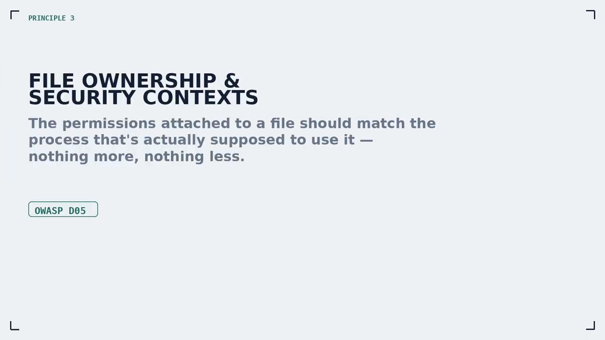

**先做对照实验**：故意**删掉 `--chown`**，重新 `docker build` 并启动新容器，进容器 `ls -al` 一看——**目录里所有文件的属主都是 `root`**。[【跳转到 1:47】](https://www.youtube.com/watch?v=zKTo8prAsX8&t=107)

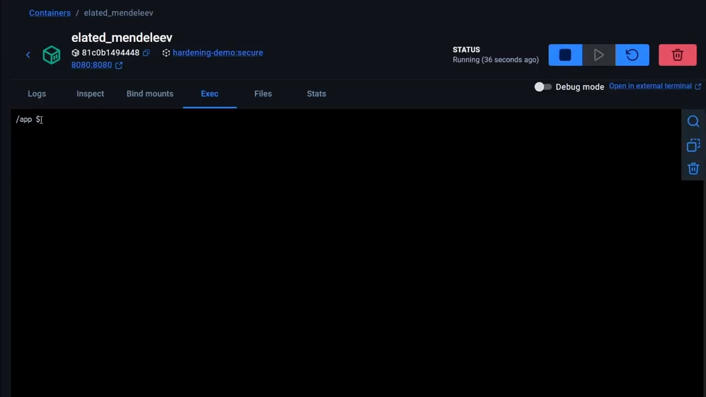

**为什么会这样？** 视频解释：`--chown` 标志在构建阶段被去掉了，我们**第一次的构建阶段（build stage）默认以 root 运行**，`npm install`、构建命令生成的所有文件**天然属主就是 root**；运行阶段虽然切到了非 root 用户，但 `COPY` 把文件连同**属主信息**一起搬了过来，于是文件在运行阶段仍属 root。[【跳转到 2:26】](https://www.youtube.com/watch?v=zKTo8prAsX8&t=146)

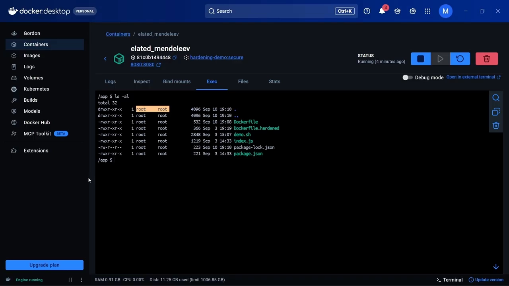

视频特别警告一个**常见错误**：开发者看到文件属主是 root，**误以为干脆继续用 root 跑容器就行**——这恰恰**丢掉了上一讲最大的安全收益**。正确做法是**在拷贝时顺手改属主**，这正是 `COPY --chown` 的用途：

```dockerfile
COPY --chown=appuser:appuser --from=build /app /app
```

因为运行用的自定义用户 **UID/GID 是 10001**，`--chown` 就写 `appuser:appuser`（对应 10001）。[【跳转到 3:16】](https://www.youtube.com/watch?v=zKTo8prAsX8&t=196)

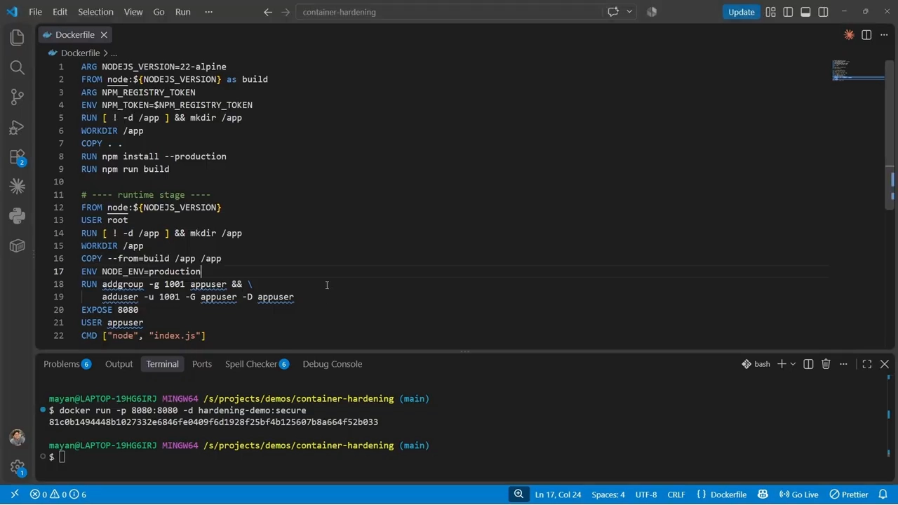

重建镜像、`ls -al` 再看——现在**所有文件都属主 `appuser`**（自定义用户，UID 10001）。视频把这叫**维持"安全上下文"**：**文件权限应当与真正要使用它的进程相匹配**。[【跳转到 4:20】](https://www.youtube.com/watch?v=zKTo8prAsX8&t=260)

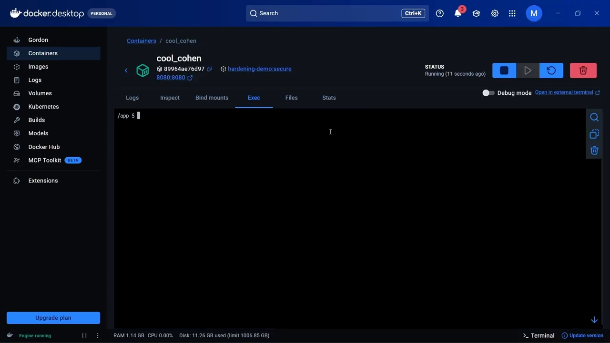

## 二、可变的隐患：属主是应用用户，反而能被改

进入容器 `whoami`，结果正是 `appuser`。[【跳转到 4:45】](https://www.youtube.com/watch?v=zKTo8prAsX8&t=285)

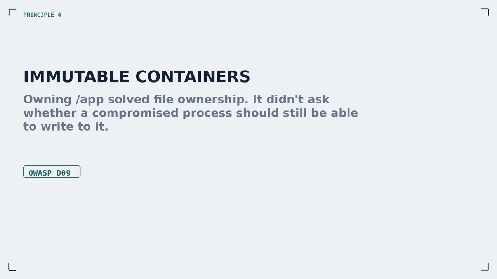

视频接着假设"**应用明天就被攻陷**"，来看攻击者能做什么：

- **新建文件**：失败。因为**父目录属主是 root**，而当前是 `appuser`，写新文件会 **permission denied**。
- **改已有文件**：**成功**。`index.js` 属主是 `appuser`，例如用管道往里面塞一段恶意 JavaScript（先是最简单的 `console.log`），命令**居然通过了**，`cat` 一看内容被彻底改写。

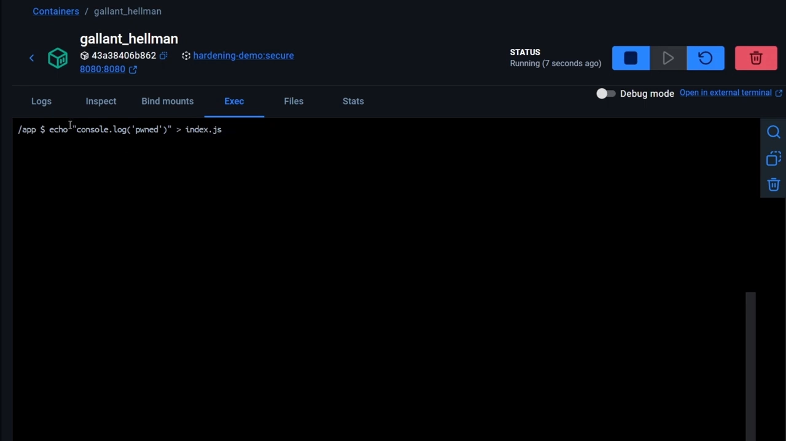

**这是不是说明 `--chown` 做错了？** 不是。视频澄清：`--chown` 解决的是**文件属主**这个"完全不同的问题"——我们**故意**把 app 目录内容的属主给了 UID 10001。要堵住"连属主文件也能被改"这个洞，需要的是**另一条原则：不可变容器**，它**与 Dockerfile 无关，属于运行时加固**。[【跳转到 6:19】](https://www.youtube.com/watch?v=zKTo8prAsX8&t=379)

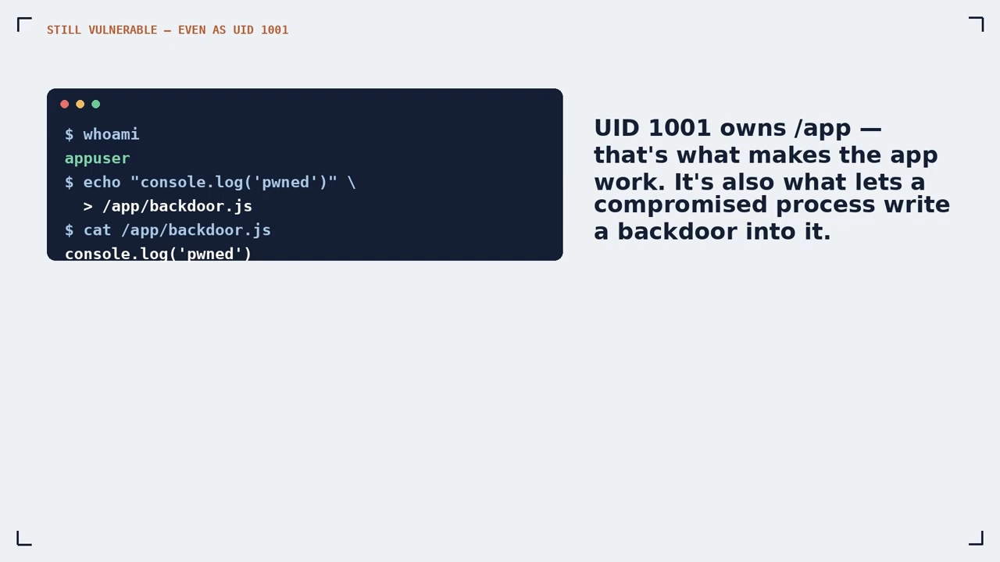

## 三、不可变容器：加 `--read-only`

做法只有**一个标志**。删掉旧容器，启动时加上 **`--read-only`**：

```bash
docker run --read-only ...
```

[【跳转到 6:35】](https://www.youtube.com/watch?v=zKTo8prAsX8&t=395)

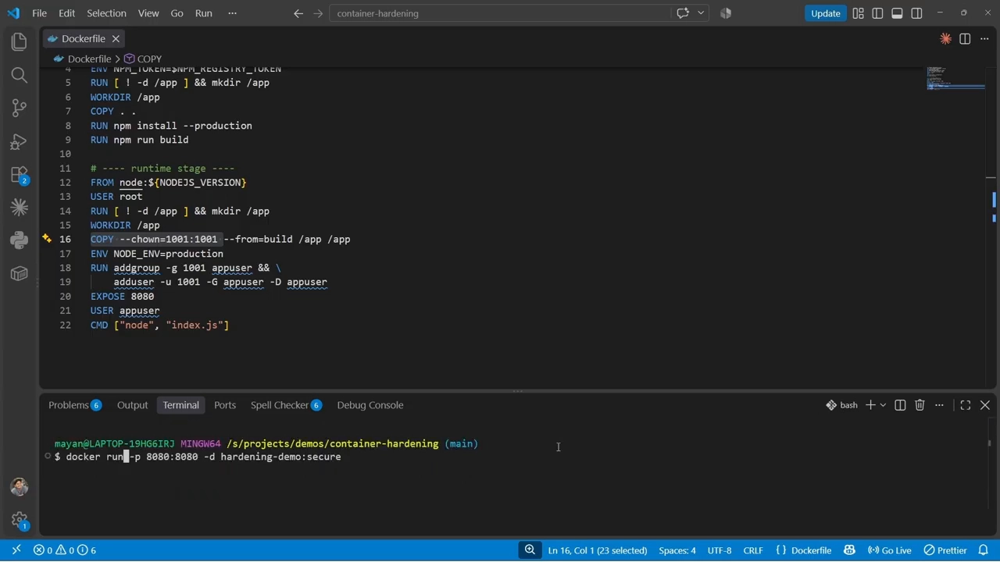

重新进容器、再试同样的注入——**这次不灵了**。日志明确显示**整个文件系统现在是只读**：当前用户**仍是 `appuser`**，`index.js` **仍属主 `appuser`**，但**就是改不动了**。[【跳转到 6:57】](https://www.youtube.com/watch?v=zKTo8prAsX8&t=417)

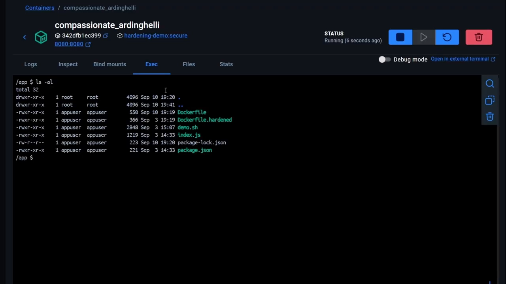

对比一下两个层次的差别：

| 层次 | 手段 | 能挡住什么 |
| :--- | :--- | :--- |
| 文件属主 | `COPY --chown=appuser:appuser` | 让运行时文件的属主与运行用户一致；防的是"属主错乱导致的提权/越权读写" |
| 运行时不可变 | `docker run --read-only` | 整个文件系统只读；**连属主是应用用户的文件也改不动**，堵住"篡改已存在文件" |

## 四、构建期密钥：别让 token 留在镜像历史里

最后一条原则**与权限无关，而与密钥有关**，也是 Dockerfile 里**最容易犯的错之一**：把敏感值在**构建时**传进镜像。

视频故意用了一个叫 **`npm registry token`** 的构建参数，并在 `docker build` 命令行**明文**传入它的值。直觉上很"合理"——token 只在构建时需要，构建一完就该消失了。**但 Docker 构建不是这样工作的**：[【跳转到 7:36】](https://www.youtube.com/watch?v=zKTo8prAsX8&t=456)

> **每一条 Docker 指令都会产生一个新的不可变镜像层**。密钥一旦被写进某一层，就**成为镜像构建历史的一部分**。

所以 Docker 官方安全文档建议：**永远不要用构建参数传密钥**，并给出了解决方案——**BuildKit secrets**。做法是把 `--build-arg` 换成 **`--secret`**，先给出密钥的 **id**（与 Dockerfile 里引用的 ID 一致），再给出**取值来源**——从一个**文本文件**读取，而不是把值硬编码在命令里：[【跳转到 8:06】](https://www.youtube.com/watch?v=zKTo8prAsX8&t=486)

```bash
docker build --secret id=npm_registry_token,src=./npm_token.txt ...
```

[【跳转到 8:28】](https://www.youtube.com/watch?v=zKTo8prAsX8&t=508)

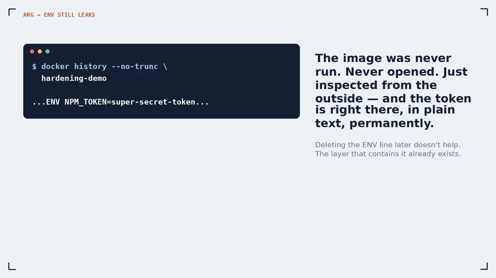

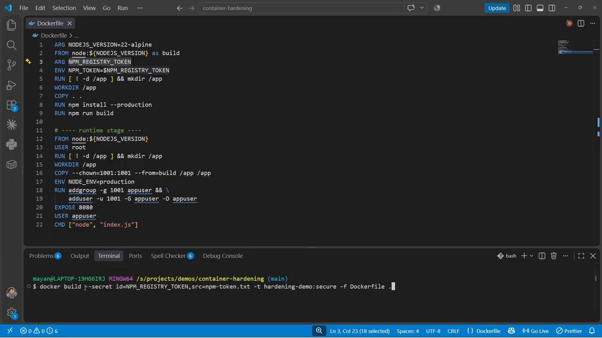

在 **CI/CD 流水线**里，这个密钥文件可以由**专门拉取密钥的脚本**先生成，`docker build` 只是消费它。`--secret` 与 `--build-arg` 的根本差别在于：**它只在"用到的那一刻"临时挂载该值，不写进任何镜像层**——用完即走，构建结束密钥**彻底消失**。视频的结论很干脆：**镜像构建需要密钥时，别用 `--build-arg`，永远用 `--secret`**。

## 小结

- **`COPY --chown` 不是小事**：删掉它，构建阶段（默认 root）的产物会以 root 属主进入运行镜像，整个"非 root 运行"的安全模型随之失效；正确写法是 `--chown=appuser:appuser`（UID/GID 10001）。
- **安全上下文**：**文件权限应与真正使用它的进程匹配**——文件属主是 `appuser`，容器也以 `appuser` 运行。
- **属主对了也不够**：`appuser` 虽不能新建文件（父目录属 root），却能**改写属主为自己的 `index.js`**——用管道即可注入恶意代码。
- **不可变容器**：运行时加 **`--read-only`**，让整个文件系统只读，**连属主是应用用户的文件也改不动**；这是运行时加固，与 Dockerfile 无关。
- **构建期密钥会泄漏**：每条 Docker 指令都生成不可变镜像层，`--build-arg` 传的密钥会**留在镜像历史**里；应改用 **BuildKit `--secret`**，从文件取值、临时挂载、用完即删。
- **加固的边界**：这些手段**挡不住漏洞本身**——依赖被投毒或像 Shai-Hulud 那样的供应链攻击，Docker 无能为力。加固的前提是"**假设攻击者终将拿到代码执行权**"，它回答的是"**那时攻击者能造成多大伤害**"。

## 关键术语速查

| 术语 | 一句话解释 |
| :--- | :--- |
| `COPY --chown=<用户>:<组>` | 拷贝文件的同时改变属主；不写则沿用源文件属主（构建阶段常为 root） |
| 安全上下文（security context） | 文件权限应与真正使用它的进程一致；本文中即"文件属 `appuser`、容器以 `appuser` 运行" |
| 多阶段构建（multi-stage build） | Dockerfile 里用多个 `FROM` 阶段，只把运行所需产物 `COPY` 进最终镜像，剔除构建工具 |
| 不可变容器（immutable container） | 运行时让文件系统只读，容器内无法修改任何文件 |
| `--read-only` | `docker run` 标志：把整个文件系统挂载为只读，连属主是应用用户的文件也无法改写 |
| 构建参数（`--build-arg`） | 构建期传入的值；**每条指令生成不可变镜像层**，密钥会被永久写进镜像历史 |
| BuildKit `--secret` | 用 `--secret id=...,src=...` 把密钥只在"用到的瞬间"临时挂载，**不写进镜像层**，用完即消失 |
| 供应链攻击（Shai-Hulud 等） | 通过污染上游依赖/包发起的攻击；Docker 无法阻止，只能限制其后果 |
