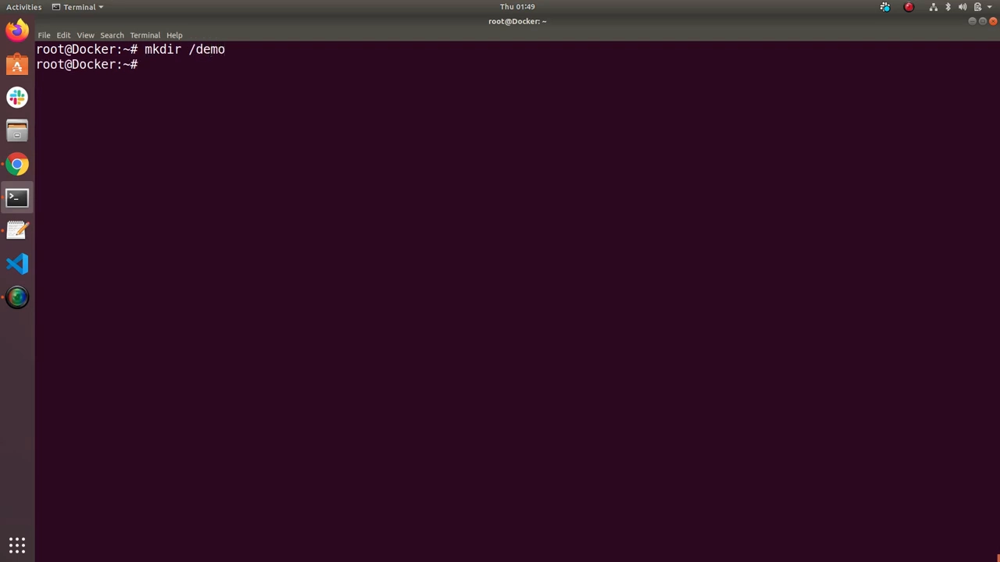
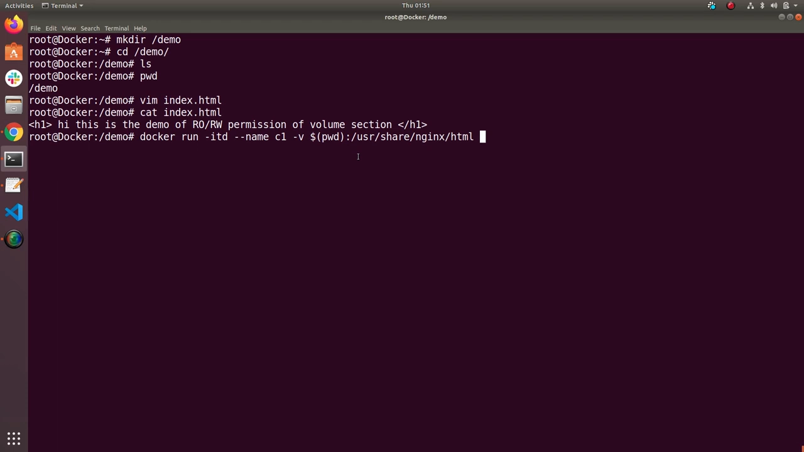
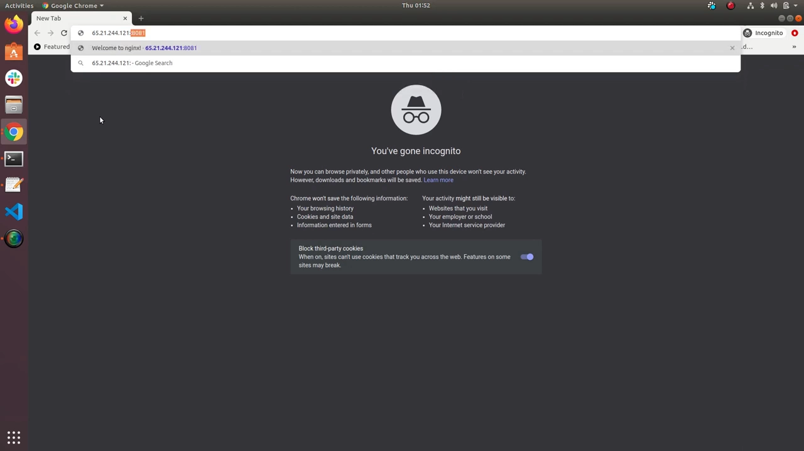
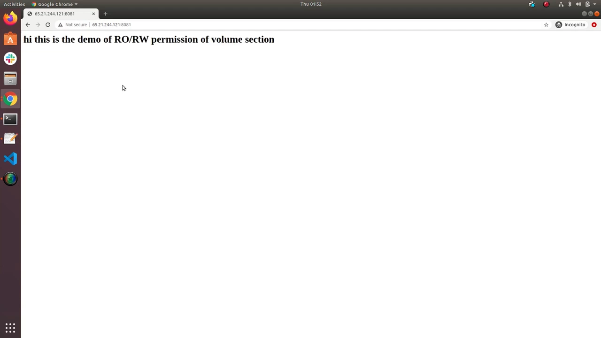
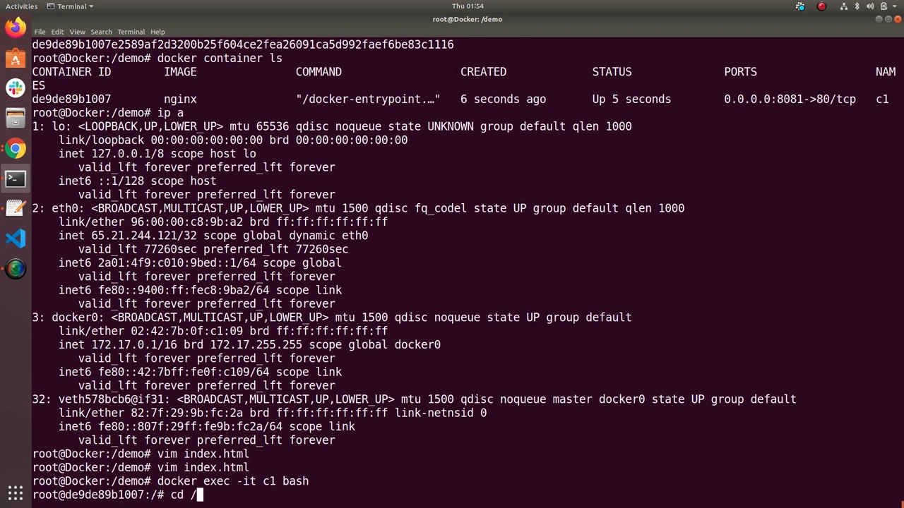
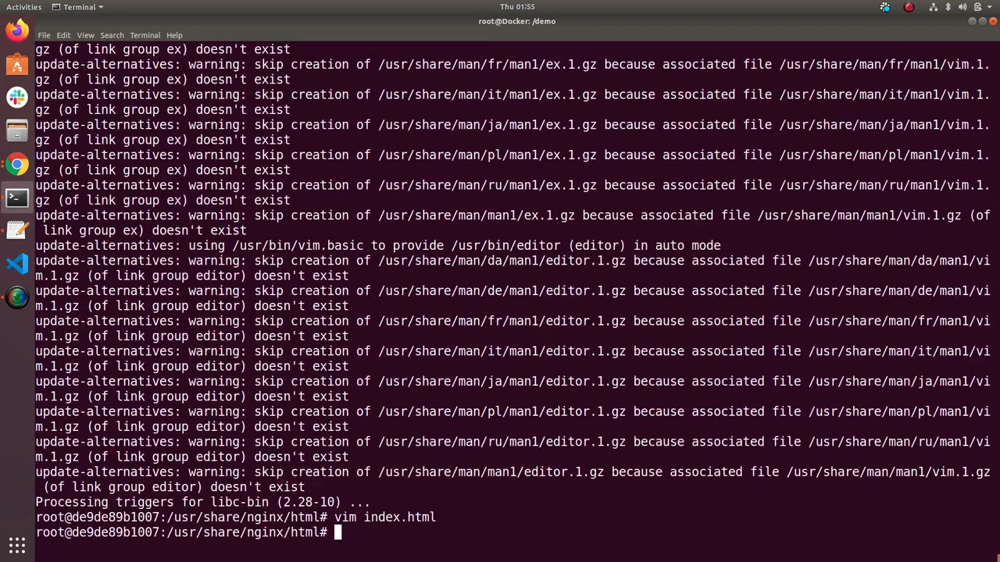
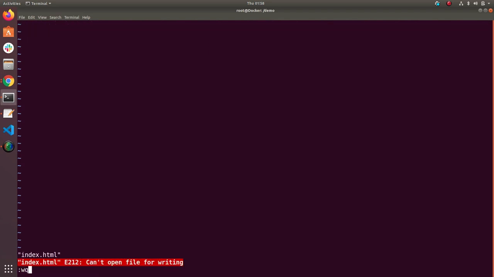

# 绑定挂载的只读与读写：默认可写，加 `:ro` 一键锁死

> 本文整理自 YouTube 视频《Docker volume with RO/RW permission》，依据视频演说图文稿逐窗口核对、纠正自动字幕错拼后整理。原字幕为英文自动识别（如 `rate write`→read-write、`hyphen v`→`-v`、`pwd`→`$(pwd)`、`usain genius`→`usr/share/nginx`、`changing a readon file`→changing a read-only file），术语已在本文中纠正。
> 视频地址：[oAoOAcmZDms](https://www.youtube.com/watch?v=oAoOAcmZDms)

## 本讲要解决的核心问题（SCQA）

**背景**：用 `-v` 把宿主机目录绑定挂载（bind mount）进容器时，默认权限是**读写（read-write）**——容器里的进程可以随意改写挂载进来的文件。

**冲突**：很多场景下这是**安全隐患**。视频里说得很直白：默认情况下"**任何人都能进入你的容器、改动里面的文件**"。对一个只提供静态内容、本该一动不动的容器来说，这种可写性没有意义，反而放大了被篡改的风险。

**疑问**：怎么把绑定挂载从"可写"改成"只读"？改成只读之后，**容器内**和**宿主机侧**的修改行为分别会怎样？默认值到底是哪一个？

**回答（中心思想）**：绑定挂载**默认就是读写**；只要在 `-v` 参数的目标路径后追加 `:ro`，整条挂载立刻变为只读——**容器内部无法再保存任何修改**（编辑器会提示 `changing a read-only file`），但**宿主机侧对该文件的修改仍然生效**、并能实时反映到容器提供的服务上。只读约束只作用于"从容器里往外改"这一个方向。

## 一、先搭一个能看见改动的实验

视频先准备一个最小可见的实验环境。在一个目录（如 `/demo`）里创建一个 `index.html`，内容随手写成一段可以一眼辨认的文案——"hi this is the demo of read-only and read-write permission of volume section"。[【跳转到 0:50】](https://www.youtube.com/watch?v=oAoOAcmZDms&t=50)



然后启动一个 nginx 容器，把这个目录**绑定挂载**到 nginx 的默认欢迎页目录 `/usr/share/nginx/html`：

```bash
docker run -itd --name c1 \
  -v $(pwd):/usr/share/nginx/html \
  -p 8081:80 nginx
```

[【跳转到 1:34】](https://www.youtube.com/watch?v=oAoOAcmZDms&t=94)

这里的几个要点，视频逐一交代：`-v` 就是 volume，`$(pwd)` 表示**当前所在目录**（也就是刚才那个 `demo` 目录），冒号后面是**容器内要挂载到的路径**，选 `/usr/share/nginx/html` 是因为那是 nginx 默认欢迎页所在的位置——挂上去就会**覆盖** "Welcome to nginx" 这一页，换成我们自己的内容。[【跳转到 1:59】](https://www.youtube.com/watch?v=oAoOAcmZDms&t=119)



容器起来后，从浏览器访问 `8081` 端口，看到的不再是 "Welcome to nginx"，而是我们自己写的 "hi this is the demo…"。[【跳转到 3:18】](https://www.youtube.com/watch?v=oAoOAcmZDms&t=198)



## 二、默认权限：读写（read-write）

视频在这里做了一次小回顾——到目前为止已经完成了"**建目录 → 建文件 → 把目录挂载到欢迎页路径、覆盖原页面**"这条链路。[【跳转到 3:23】](https://www.youtube.com/watch?v=oAoOAcmZDms&t=203)



接下来验证**默认到底可不可写**，分两个方向测：

1. **宿主机侧改**：在宿主机的 `demo` 目录里直接编辑 `index.html` 并保存，刷新浏览器——改动立刻出现在页面上。
2. **容器内改**：`docker exec -it c1 bash` 进入容器，`cd /usr/share/nginx/html`，发现这就是同一份文件；容器里没有 vim，于是先 `apt update` 再 `apt install vim`，装好后打开 `index.html`。

[【跳转到 4:58】](https://www.youtube.com/watch?v=oAoOAcmZDms&t=298)




结果：**容器内也能成功保存修改**。视频由此得出结论——**默认权限是读写**，容器可以随意改动挂载进来的内容。[【跳转到 6:16】](https://www.youtube.com/watch?v=oAoOAcmZDms&t=376)



## 三、改成只读：追加 `:ro`

既然默认可写、而"任何人都能进容器改文件"是风险，视频下一步就是**把它改掉**。做法很轻：

先删掉现有容器：

```bash
docker rm -f c1
```

[【跳转到 6:50】](https://www.youtube.com/watch?v=oAoOAcmZDms&t=410)

再**用同一条命令重新启动，只在挂载目标后面加上 `:ro`**——即 `ro`（read-only）：

```bash
docker run -itd --name c1 \
  -v $(pwd):/usr/share/nginx/html:ro \
  -p 8081:80 nginx
```

[【跳转到 7:06】](https://www.youtube.com/watch?v=oAoOAcmZDms&t=426)


### 3.1 宿主机侧：照样能改

重新进浏览器或目录确认：从**宿主机**的 `demo` 目录里修改 `index.html`，改动依旧被接受、依旧能在页面上看到。[【跳转到 8:11】](https://www.youtube.com/watch?v=oAoOAcmZDms&t=491)


这一点很关键：`:ro` **限制的是容器内部的写入，不限制宿主机**。挂载仍然是同一个目录、同一份文件，只是"从容器里往外写"这条路被封了。

### 3.2 容器内：写不进去了

再次 `docker exec` 进容器，`cd` 到 `/usr/share/nginx/html`，编辑 `index.html`——这一次：

> **warning: changing a read-only file**

改动**无法保存**。[【跳转到 8:52】](https://www.youtube.com/watch?v=oAoOAcmZDms&t=532)


视频收尾把这套结论一句话总结：**默认是读写；加 `:ro` 就变成只读**，于是任何人（包括你自己）都**无法再从容器内部改动内容**；而这个改动"非常简单"。[【跳转到 9:47】](https://www.youtube.com/watch?v=oAoOAcmZDms&t=587)



## 小结

- **默认是读写**：`-v 宿主目录:容器路径` 不写权限时，容器内进程可以随意修改挂载内容。
- **`:ro` 即只读**：在挂载目标后追加 `:ro`，整条挂载变为只读，容器内保存会报 `changing a read-only file`。
- **只读是单向的**：`:ro` 只封"容器内往外写"，**宿主机侧对该目录/文件的修改依然生效**，并能实时反映到容器提供的服务上。
- **改权限要重建容器**：挂载权限写在 `docker run` 的 `-v` 参数里，**运行中的容器改不了**——必须 `docker rm` 后按新参数重新 `run`。
- **适用场景**：为 nginx 之类只提供静态内容、容器本不该改文件的场景，挂上 `:ro` 可避免容器被攻陷后篡改页面内容。

## 关键术语速查

| 术语 | 一句话解释 |
| :--- | :--- |
| 绑定挂载（bind mount） | 用 `-v 宿主路径:容器路径` 把宿主机上的真实目录/文件直接挂进容器，两侧共享同一份数据 |
| `:ro`（read-only） | 挂载选项，写在容器路径后（如 `...:ro`），把该挂载设为只读，容器内无法写入 |
| 读写挂载（read-write，默认） | 不加权限选项时的默认行为，容器对挂载内容可读可写 |
| `docker exec -it <容器> bash` | 进入一个正在运行的容器，在里面开一个交互式 shell 做调试 |
| `changing a read-only file` | 在只读挂载里尝试保存文件时，编辑器给出的提示，代表写入被拒 |
| `docker rm -f <容器>` | 强制删除容器；因为挂载权限只能在启动时指定，改权限前必须先删旧容器 |
