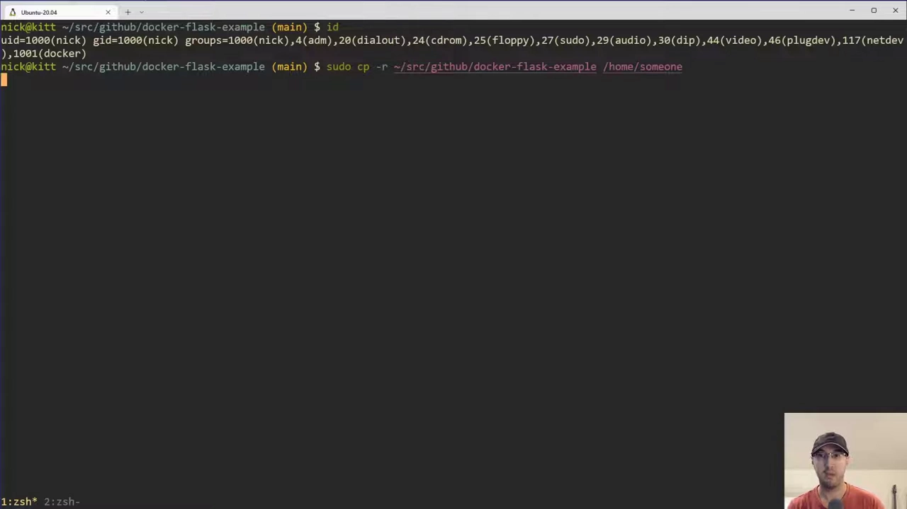
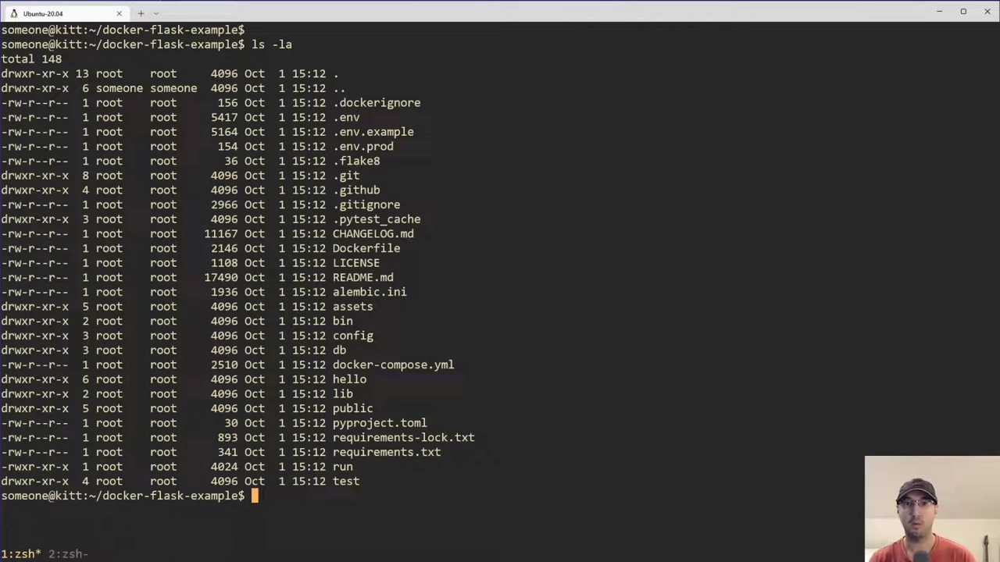
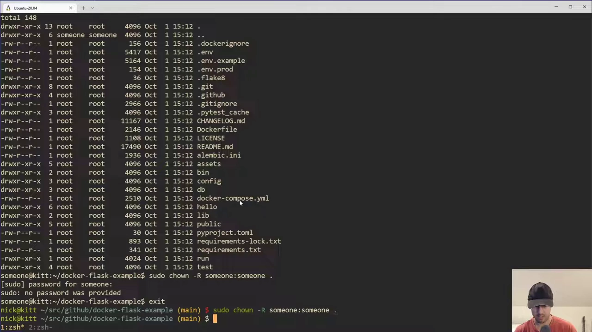
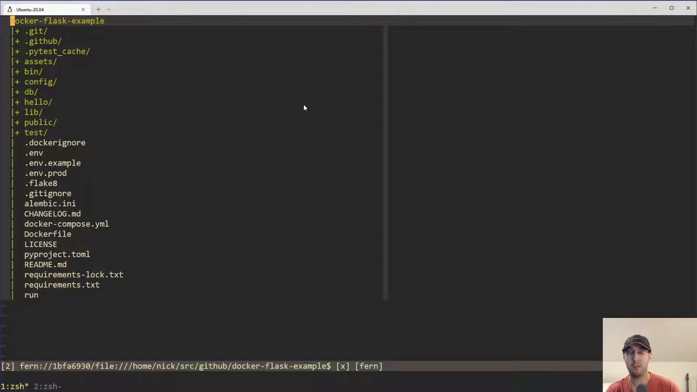
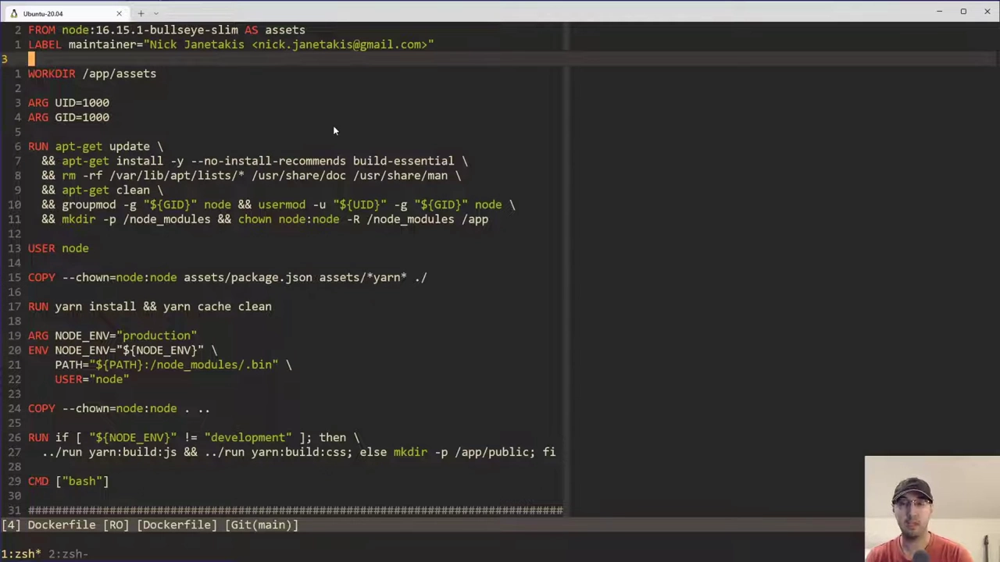
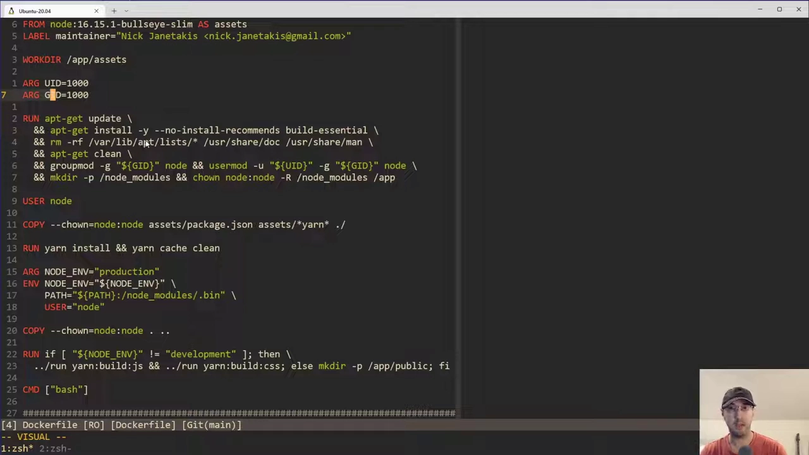
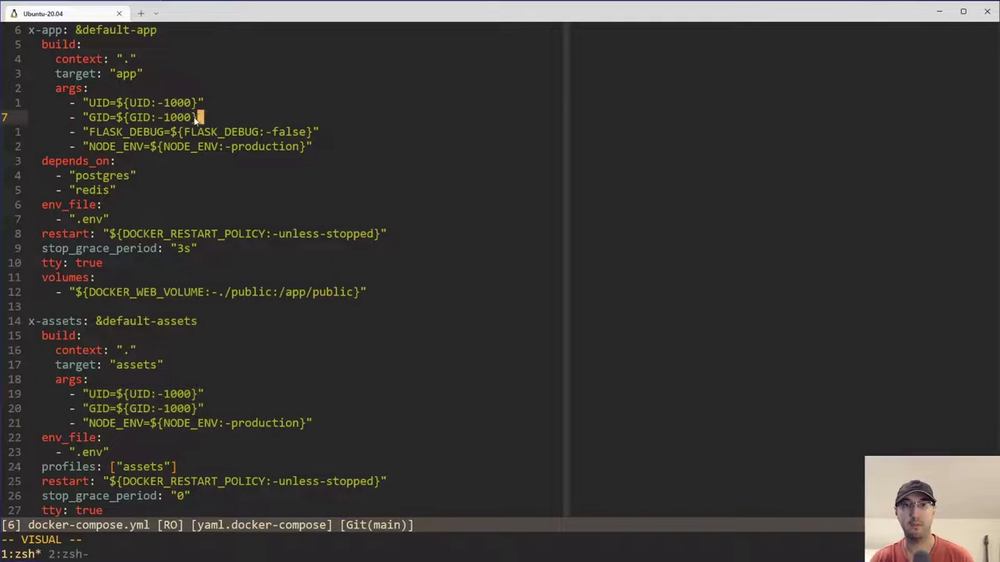
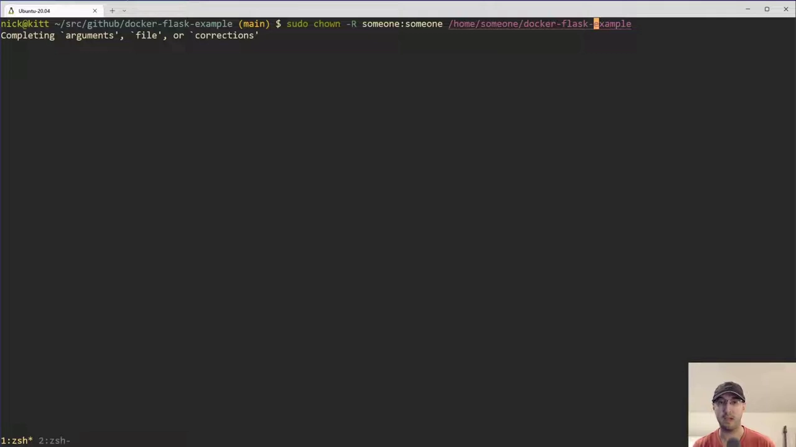
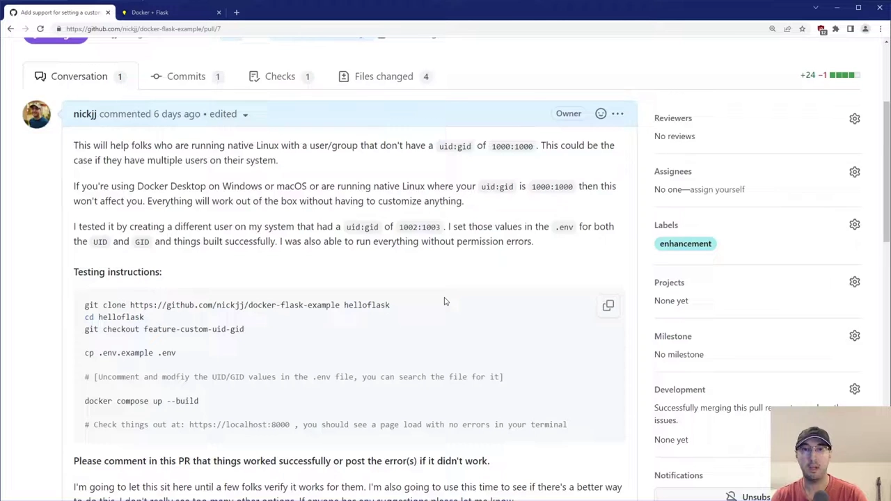

# 非 root 运行容器：把镜像里的 UID/GID 对齐宿主机

> 本文整理自 YouTube 视频《Running Docker Containers as a Non-root User with a Custom UID / GID》，依据视频演说图文演稿逐窗口核对、纠正自动字幕错拼后整理。原字幕为英文自动识别（如 `daer compose`→`docker compose`、`a doer image`→a Docker image、`Dr flas example`→docker-flask-example、`ARGs`→build args、`CH own`→`chown`、`sudo`/`pseudo`→`sudo`），术语已在本文中纠正。
> 视频地址：[sXfaogNlc7Y](https://www.youtube.com/watch?v=sXfaogNlc7Y)

## 本讲要解决的核心问题（SCQA）

**背景**：用**非 root 用户**跑容器是安全加固的常见做法：在镜像里建一个专用用户（如 `node`、`python`），让应用以它运行。可一旦同时用**绑定挂载**把宿主机目录挂进容器，麻烦就来了。

**冲突**：镜像里**第一个被创建的用户**，在 Linux 上默认是 **UID/GID = 1000**；而宿主机上你的用户却往往不是 1000——多用户机器上可能是 1002、1003，甚至 10002、10003。**UID/GID 对不上**，挂载进来的文件在容器里就被判成"别人的文件"，于是**写不进去：permission denied**，开发时改文件不生效、生产里容器读不了挂载的静态目录。视频特别点明：**Docker Desktop 会自动帮你修好权限**，所以你会误以为没问题；一旦换成**原生 Linux、WSL2，或在 Linux 服务器上部署**，这个问题立刻暴露。

**疑问**：怎么让**容器内的 UID/GID 与宿主机用户精确对齐**？改动应该写在哪——Dockerfile 里怎么建用户？`docker compose` 又怎么把外面的 UID/GID 传进构建？

**回答（中心思想）**：用 **构建参数（build args）`ARG UID` / `ARG GID`**（默认 1000）在 Dockerfile 里**改写用户与组的 ID**（`groupmod` 改组、`usermod`/新建用户改人），再在 **`docker-compose.yml` 的 `build.args` 里用 `${UID}` / `${GID}` 变量插值**，值来自 `.env` 文件（`UID=10002`、`GID=10003`）。这样**构建时**就把镜像内的用户 ID 对齐到宿主机，挂载权限随即正常。代价是：**改了 UID/GID 就得重新构建镜像**——它发生在构建期，而非运行期。

## 一、复现问题：默认 UID/GID 是 1000

视频先展示一个**正常可用**的场景。以一个开源示例仓库 `docker-flask-example` 为例，`docker compose up` 后应用正常访问；查看项目目录，**所有文件的属主都是 `nick nick`**（当前用户自己），因为它被**绑定挂载**进了容器用于开发。[【跳转到 1:19】](https://www.youtube.com/watch?v=sXfaogNlc7Y&t=79)


此时改一个文件（如 `app.css` 把背景改成绿色），**浏览器立刻生效**——卷挂载工作正常。[【跳转到 1:44】](https://www.youtube.com/watch?v=sXfaogNlc7Y&t=104)


但把整个项目复制到**另一个用户**（视频里叫 `someone`）的家目录下再跑，就会出问题。先用 `id` 看重这个用户的身份：

```text
uid=10002(someone) gid=10003(someone) groups=10003(someone),...
```

**UID 是 10002、GID 是 10003**，都不是 1000。[【跳转到 3:02】](https://www.youtube.com/watch?v=sXfaogNlc7Y&t=182)



而镜像里那个用户（`python` / `node` / `nick` 之类）是**第一个被创建的用户**，默认 **UID/GID=1000**。两边不一致，挂载进来的文件就写不了了。视频顺带提到一个中间现象：复制过来的文件一开始**属主是 `root`**，需要先 `chown` 给目标用户。[【跳转到 3:52】](https://www.youtube.com/watch?v=sXfaogNlc7Y&t=232)



属性理好后重新 `docker compose up`，预期中的错误出现了——**permission denied**，容器无法写入这些文件。[【跳转到 4:16】](https://www.youtube.com/watch?v=sXfaogNlc7Y&t=256)



## 二、Dockerfile：用构建参数改写用户 ID

解决办法在 **Dockerfile** 里。视频以多阶段构建为例，重点只看两处改动，都围绕 **build args** 展开。[【跳转到 5:06】](https://www.youtube.com/watch?v=sXfaogNlc7Y&t=306)



首先声明两个构建参数，**默认值都是 1000**（与"新用户默认 1000"一致）：

```dockerfile
ARG UID=1000
ARG GID=1000
```

[【跳转到 5:31】](https://www.youtube.com/watch?v=sXfaogNlc7Y&t=331)


然后按基础镜像的不同分两种情况处理：

**情况 A：官方镜像已经替你建好了用户**（例如官方 `node` 镜像会自带一个 `node` 用户）。这是问题所在——这个 `node` 用户的 UID/GID 就是 1000。所以要**改掉它的组 ID，再改掉它本人的 UID/GID**，用 `groupmod` 和 `usermod` 把它们对齐到 `$GID` / `$UID`：

```dockerfile
RUN groupmod -g $GID node \
 && usermod  -u $UID -g $GID node
```

[【跳转到 6:21】](https://www.youtube.com/watch?v=sXfaogNlc7Y&t=381)



**情况 B：基础镜像没有替你建用户**（例如 `python` 镜像需要你自己建）。那就先改造同名组，再新建一个用户，并把它的 UID/GID 直接设成 `$UID` / `$GID`。[【跳转到 7:11】](https://www.youtube.com/watch?v=sXfaogNlc7Y&t=431)



> 关键概念区分：**build args 是"构建时"参数**，跟你在"运行时"才想改的环境变量是两回事。正因为用户 ID 在**构建期**就被写进镜像，所以**改了 UID/GID 必须重新 build**——这是本方案的固有代价。

## 三、docker-compose：用 `.env` 提供 UID/GID

每次手敲 `--build-arg UID=...` 太麻烦，视频把它交给 **`docker-compose.yml` 的变量插值**。[【跳转到 8:51】](https://www.youtube.com/watch?v=sXfaogNlc7Y&t=531)


配置的写法要点：

- **`build.args` 下写 `UID` / `GID`**，值用 `${UID}` / `${GID}` **变量插值**；
- 若多个服务（如 `web` 与 `worker`）共享同一批构建参数，可用 **YAML 锚点（anchor）**复用；
- 插值会去 **`.env` 文件**里找 `UID` / `GID`，**找不到就回退到默认值 1000**。

对应的 **`.env`** 文件里设置实际值；仓库通常还提供一份**提交进版本库的 `.env.example`** 作模板（`cp .env.example .env` 即可）。示例值默认被**注释掉**——因为默认 1000 通常够用；**只有当你在原生 Linux 上、`id` 显示不是 1000 时**，才需要取消注释并填上真实值。[【跳转到 10:31】](https://www.youtube.com/watch?v=sXfaogNlc7Y&t=631)



对本例的 `someone` 用户（`uid=10002`、`gid=10003`），就把 `.env` 写成：

```dotenv
UID=10002
GID=10003
```

[【跳转到 12:11】](https://www.youtube.com/watch?v=sXfaogNlc7Y&t=731)



> 别忘了一处细节：Dockerfile 里用 `COPY` 把文件拷进镜像时，**要把属主改到目标用户**（`chown`），否则拷进来的文件仍属 root。视频提到 `usermod`/`useradd` 有一些可自动建组的标志位有坑，最后还是选择**先显式把组改好、再改用户**，稳妥可靠。

## 四、验证：重建后权限正常

改完 `.env`，重新构建镜像（这一步会花一点时间）：

```bash
docker compose build
```

[【跳转到 12:36】](https://www.youtube.com/watch?v=sXfaogNlc7Y&t=756)

构建完成后，`docker compose down` 清掉旧容器、再 `docker compose up`——**不再出现 permission denied**。[【跳转到 13:58】](https://www.youtube.com/watch?v=sXfaogNlc7Y&t=838)




最后回到浏览器改文件（如给模板加感叹号）验证：**改动照旧实时生效**，卷挂载完全正常。[【跳转到 15:16】](https://www.youtube.com/watch?v=sXfaogNlc7Y&t=916)

## 小结

- **默认 1000 是祸根**：Linux 上第一个创建的用户 UID/GID=1000，而宿主用户常不是 1000；UID 不一致时，挂载进来的文件在非 root 容器里**写不进去**。
- **Docker Desktop 会掩盖问题**：它自动修正权限，所以你要在**原生 Linux / WSL2 / 生产 Linux 服务器**上才会踩到这个坑。
- **两处改动**：Dockerfile 里用 `ARG UID`/`ARG GID`（默认 1000）+ `groupmod`/`usermod`（或新建用户）改写镜像内用户 ID；`docker-compose.yml` 里用 `build.args` + `${UID}`/`${GID}` 插值。
- **值从 `.env` 来**：复制 `.env.example` → `.env`，把 `UID`/`GID` 设成 `id` 命令输出的真实值；缺省时回退 1000。
- **拷贝要 `chown`**：`COPY` 进镜像/挂载的文件需要把属主改到目标用户，否则仍属 root。
- **构建期决定，改完要重建**：UID/GID 在构建时写入镜像，**改一次就得重新 `docker compose build`**，这是方案绕不开的代价。

## 关键术语速查

| 术语 | 一句话解释 |
| :--- | :--- |
| UID / GID | 用户 ID / 组 ID；Linux 里第一个创建的用户默认 1000，挂载权限按这两个数字比对，而非按用户名 |
| 构建参数（build arg） | Dockerfile 里 `ARG` 声明的构建期变量，用 `--build-arg` 或 `build.args` 传值，**构建后固化进镜像** |
| 构建期 vs 运行期 | build args 在构建时生效、需重新构建才能改；环境变量在运行时生效——两者用途不同 |
| `groupmod -g` | 修改一个组的 GID |
| `usermod -u -g` | 修改一个用户的 UID 与所属 GID |
| `chown` | 修改文件/目录的属主与属组；把 `COPY` 进来的文件改到目标用户 |
| `build.args` | `docker-compose.yml` 中给各服务传构建参数的字段，支持 `${VAR}` 变量插值 |
| `.env` / `.env.example` | 供 compose 插值取值的文件；后者作模板提交进版本库，前者本地填写、通常不入库 |
| `docker compose build` | 按 compose 配置重新构建镜像；改了 UID/GID 后必须执行它 |
