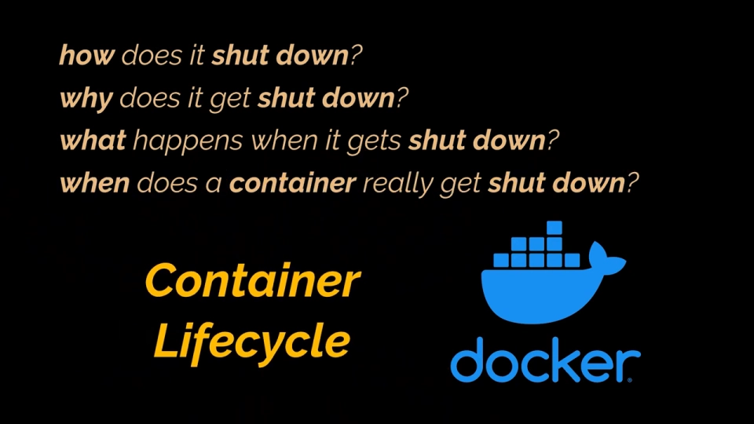
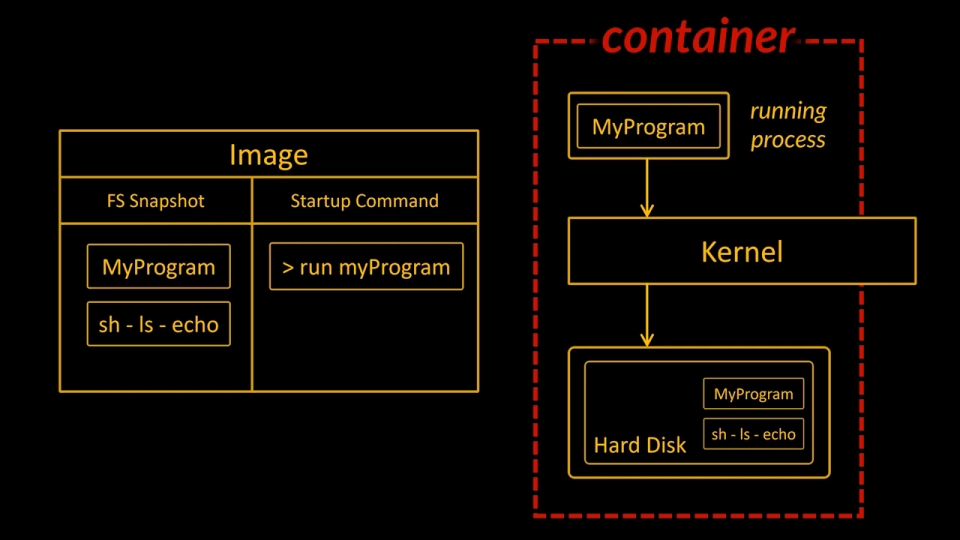
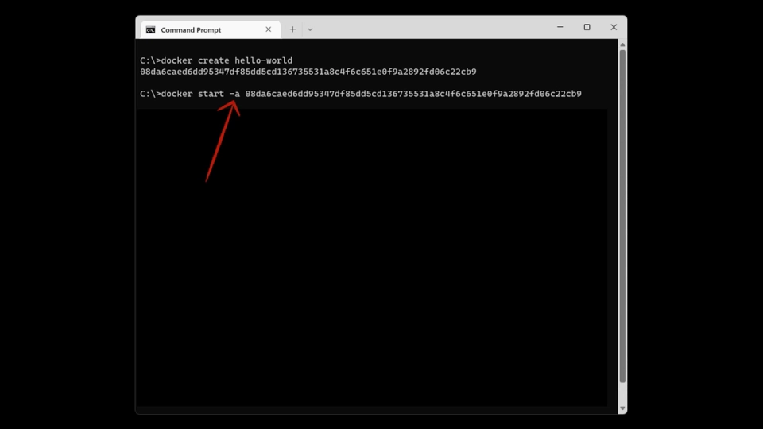
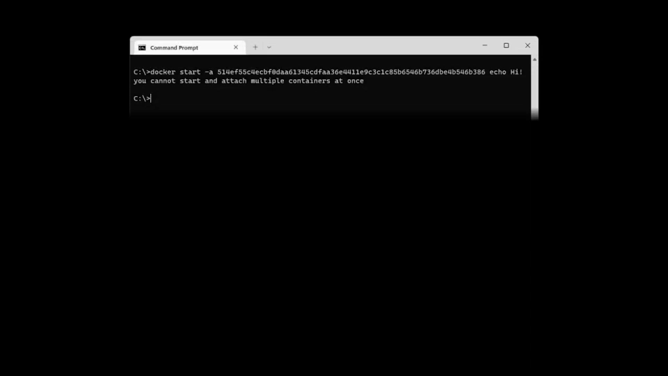
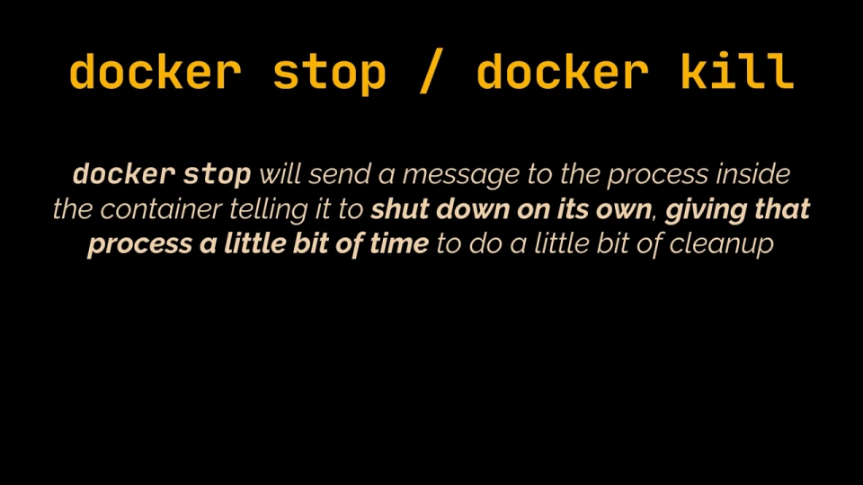

# Docker 容器生命周期：create、start、run、stop、kill 到底做了什么

> 本文整理自 YouTube 视频《Docker Containers Lifecycle | create, start, run, stop and kill a container》（频道：Geekific），依据视频演说图文稿逐窗口核对、纠正自动字幕错拼后整理。原字幕为英文自动识别，关键术语已核对。
> 视频地址：[nFeJum_UuMg](https://www.youtube.com/watch?v=nFeJum_UuMg)

## 本讲要解决的核心问题（SCQA）

**背景**：前面几讲里，我们已经在用 `docker run`、`docker exec` 之类的命令**运行和摆弄容器**了——用各种镜像把容器跑起来、再操作它。

**冲突**：可这些操作只回答了「**怎么把容器跑起来**」，却没回答另一半问题：如果我只是不停地运行、操作容器，那**这个容器是怎么被关掉的？什么时候关？为什么会关？关掉之后又发生了什么？**[【跳转到 0:00】](https://www.youtube.com/watch?v=nFeJum_UuMg&t=0)

**疑问**：`docker run` 一句话就把容器跑起来，它背后到底做了哪些事？**创建容器**和**启动容器**有什么区别？为什么有的容器会**自己退出**？一个**一直在运行**的容器，我要怎么**手动停掉**它？停掉之后它去哪了？

**回答（中心思想）**：容器的生命是一条**状态流水线**——**创建（create）→ 启动（start）→ 运行（run）→ 退出 / 停止（exit/stop）→ 清理（rm/prune）**；而 `docker run` 不过是 `docker create` 加 `docker start -a` 的**语法糖**。理解这条流水线的价值在于：**它决定了你排障时该按哪个「开关」**。

## 一、创建 ≠ 启动：`docker run` 只是 `create + start` 的语法糖

要理解关闭之前发生了什么，得先回到**容器被创建的那一刻**。[【跳转到 0:33】](https://www.youtube.com/watch?v=nFeJum_UuMg&t=33)

我们一直用 `docker run` 从镜像启动新容器，但**「创建一个容器」和「启动一个容器」其实是两个独立的过程**。所以除了 `docker run`，Docker 还提供了两个命令，把它们**连起来跑就等价于 `docker run`**：[【跳转到 0:41】](https://www.youtube.com/watch?v=nFeJum_UuMg&t=41)

- `docker create`：从镜像**创建一个容器**（尚未运行）；
- `docker start`：**启动**这个容器。

要区分二者，得先回想**镜像的构成**：一个镜像 = **一份文件系统快照** + **一条启动命令**（startup command）。于是：[【跳转到 1:06】](https://www.youtube.com/watch?v=nFeJum_UuMg&t=66)

- **创建（create）** = 把那个文件系统**准备好**、供这个新容器使用——说白了就是**准备文件系统**（对应上一讲的**可写层**就是在这时准备好的）；
- **启动（start）** = 执行镜像里的那条**启动命令**，让容器里该跑的进程（比如 `hello-world`、或 busybox 的 `echo`）真正跑起来。

**动手验证**：先 `docker create hello-world`，命令结束会返回**新容器的 ID**；再用 `docker start -a <容器ID>`，就能看到熟悉的 `Hello from Docker` 打印出来。[【跳转到 1:11】](https://www.youtube.com/watch?v=nFeJum_UuMg&t=71)

这里多了一个 `-a` 参数，它很关键。再跑一次 `docker start <容器ID>`，**这次不带 `-a`**，你会发现**只返回了容器 ID、没有任何输出**——可见 `-a` 的作用是**让 Docker 盯着容器的输出、并打印到我们的终端**。[【跳转到 1:36】](https://www.youtube.com/watch?v=nFeJum_UuMg&t=96)

**回头看 `docker run`**：它也会**把输出完整返回**、**盯着容器**，所以它**等价于 `docker create` + `docker start -a`**。这条等价关系，是本讲最该记住的一句话。[【跳转到 1:61】](https://www.youtube.com/watch?v=nFeJum_UuMg&t=101)

## 二、容器「退出」不等于「死亡」：停下来的容器还能再启动

hello-world 容器打印完问候语就**自动退出了**。但**退出（exited）不等于容器死了、不能再用**——在之后的任何时候，我们都可以**再次启动它**。[【跳转到 1:74】](https://www.youtube.com/watch?v=nFeJum_UuMg&t=114)

拿容器的 ID 再执行一次 `docker start <ID>`，你会发现它**又打印了一遍**问候语。

对基于 **busybox**、启动命令是 `echo` 的容器做同样的试验，也能看到 `Hello from Geekific!` **在两次调用里都打印了出来**。为什么会这样？视频解释：**容器创建时指定的那条「主命令」会被再次执行**——也就是说，**[容器一旦创建，它的默认命令就固定了]**。[【跳转到 1:96】](https://www.youtube.com/watch?v=nFeJum_UuMg&t=116)

这带来一条容易被误解的规则：**我们不能在启动时替换掉容器的默认命令**。也就是说，**不存在** `docker start <ID> <新命令>` 这种写法——那等于想再替换一次默认命令，是做不到的。**一旦容器被创建，`docker start` 只会重新执行它在创建时定下的那条默认命令**。[【跳转到 2:21】](https://www.youtube.com/watch?v=nFeJum_UuMg&t=141)

> 视频特意强调：这套生命周期知识看起来不起眼，但**在排障、调试一个正在运行的容器时极其有用**——你知道该在哪个状态、用哪条命令去干预它。[【跳转到 2:42】](https://www.youtube.com/watch?v=nFeJum_UuMg&t=162)

## 三、怎么停掉一直在运行的容器：`docker stop` 与 `docker kill`

上面那些容器是**自己退出**的。真正的难点是：**一个跑起来就不肯停的容器，怎么手动停？**[【跳转到 3:44】](https://www.youtube.com/watch?v=nFeJum_UuMg&t=224)

视频用 `ping youtube.com` 作启动命令跑一个容器——它**不会自己退出，而是一直跑下去**。停它有两种命令：[【跳转到 3:49】](https://www.youtube.com/watch?v=nFeJum_UuMg&t=229)

| 命令 | 行为 | 类比 |
| --- | --- | --- |
| `docker stop` | 向容器内的进程**发消息、要求它自己优雅退出**，给进程一点时间做清理 | **礼貌地请它下班** |
| `docker kill` | 向容器的主进程**发 kill 信号**，要求**立刻**停止，不给任何额外操作的机会 | **直接拉闸** |

所以**理想做法是永远优先用 `docker stop`**，给进程时间去自己收尾；只有当容器**卡死、对 `docker stop` 没反应**时，才改用 `docker kill`。[【跳转到 3:74】](https://www.youtube.com/watch?v=nFeJum_UuMg&t=239)

还有一条重要的自动兜底规则：**执行 `docker stop` 后，如果容器在 10 秒内还没停下，Docker 会自动改用 `docker kill`。**[【跳转到 3:99】](https://www.youtube.com/watch?v=nFeJum_UuMg&t=244)

**演示印证了这一点**：对那个 `ping` 容器执行 `docker stop`，结果**等了整整 10 秒**才停——因为 `ping` 命令**不能正确响应 stop 消息**，于是 10 秒后一条 kill 信号被发下去，**强制**它停下。[【跳转到 4:19】](https://www.youtube.com/watch?v=nFeJum_UuMg&t=259)

再把这个容器跑起来，改用 `docker kill`——这次**瞬间就停了、没有任何宽限期**。[【跳转到 4:44】](https://www.youtube.com/watch?v=nFeJum_UuMg&t=284)

## 四、善后：用 `prune` 清理、用 `logs` 翻旧账

容器停下来后并不是就没影了，它们会**以「已退出」的状态留在机器上、占着空间**。这时可以主动清理：[【跳转到 2:58】](https://www.youtube.com/watch?v=nFeJum_UuMg&t=178)

- **`docker container prune`**：**删除所有已停止的容器**。命令会先提示它要做什么、并**要求一次确认**；执行完还会告诉你**回收了多少空间**。执行后 `docker ps --all` 就看不到任何容器了。
- **`docker image prune`**：**删除所有悬空镜像**（dangling images，即没有名字和标签的未被使用的镜像）。

**另一个重要动作是「翻旧账」——取回已停止容器的日志**：跑一个用 `echo` 作启动命令的 busybox 容器，它打印完就立刻退出；之后若想回看它当时输出的内容，可以执行 `docker logs <容器ID>`，就能看到当初打印的 `Hello from Geekific!`。[【跳转到 3:23】](https://www.youtube.com/watch?v=nFeJum_UuMg&t=203)

要**特别注意**：**执行 `docker logs` 并不会重新运行或重启这个容器**，它只是**读取已经产生过的日志记录**。视频也提到，`logs` 是日常里用得非常多的一条命令，是**观察容器内部发生了什么**的好手段。[【跳转到 3:23】](https://www.youtube.com/watch?v=nFeJum_UuMg&t=203)

## 小结

- 镜像 = **文件系统快照 + 启动命令**；**创建容器**是准备文件系统，**启动容器**是执行那条启动命令。
- **`docker run` = `docker create` + `docker start -a`**；`-a` 让 Docker 盯着容器输出并打印到终端。
- 容器**退出 ≠ 死亡**，可以 `docker start` 再启动，但它**只会重新执行创建时定下的默认命令**，不能事后替换。
- 停止运行中的容器优先用 **`docker stop`**（优雅、给进程清理时间）；**`docker kill`** 是拉闸、立即停止；`docker stop` 10 秒不成功会**自动降级为 kill**。
- 清理：`docker container prune` 删已停止容器，`docker image prune` 删悬空镜像。
- `docker logs <ID>` 可以**读**已停止容器的历史日志，**不会**重启容器。

## 关键术语速查

| 术语 | 一句话解释 |
| --- | --- |
| `docker create` | 从镜像创建容器但**不启动**，只准备文件系统 |
| `docker start` | 启动一个已创建的容器，重新执行它的默认命令 |
| `docker run` | `docker create` + `docker start -a` 的语法糖 |
| `-a`（attach） | 让终端接管容器输出、打印到当前终端 |
| `docker stop` | 优雅停止：请求进程自行退出，10 秒不成功自动改 kill |
| `docker kill` | 向容器主进程发 kill 信号，立即强制停止 |
| `docker container prune` | 删除所有已停止的容器并回收空间 |
| `docker image prune` | 删除所有悬空（无名字无标签）镜像 |
| `docker logs` | 读取容器（含已停止容器）的输出日志，不重启容器 |
