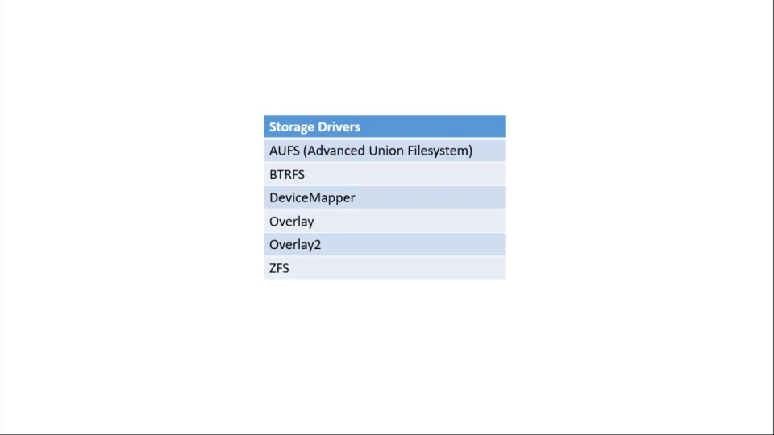
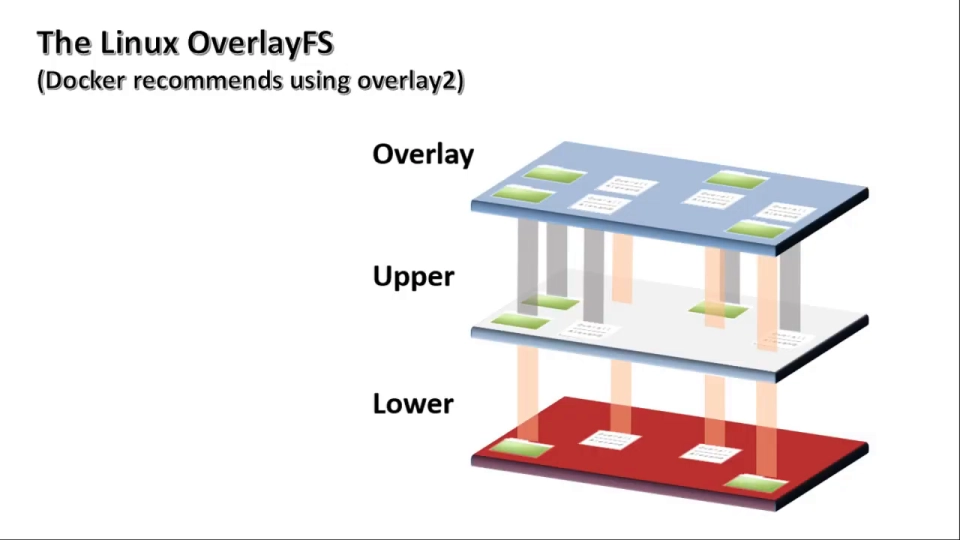
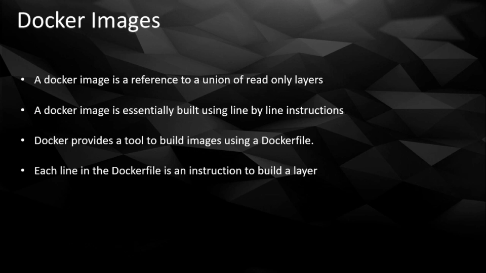
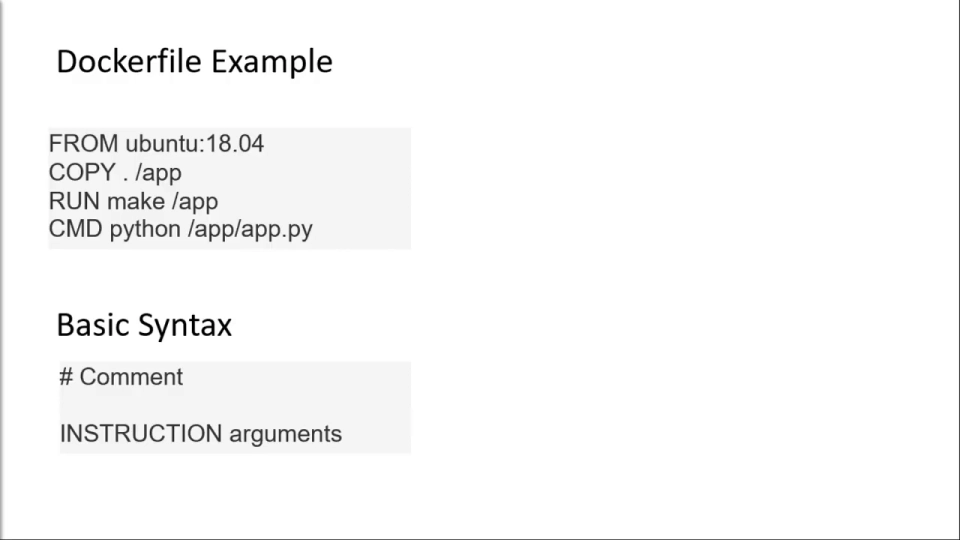
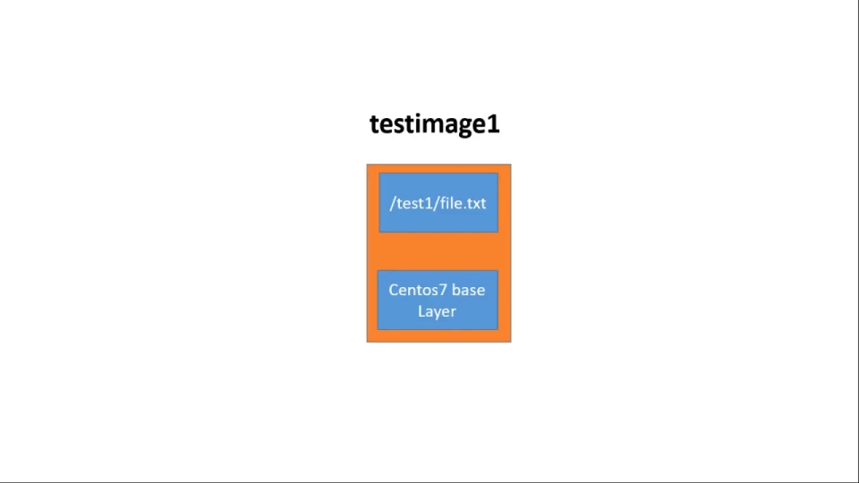
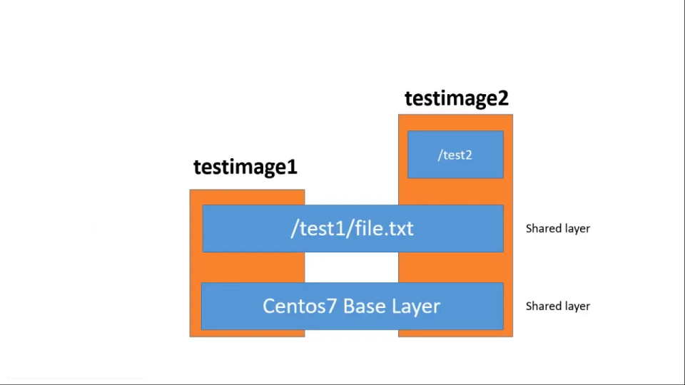
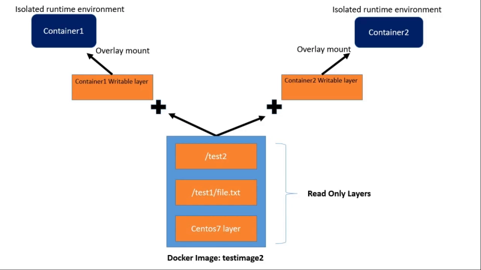
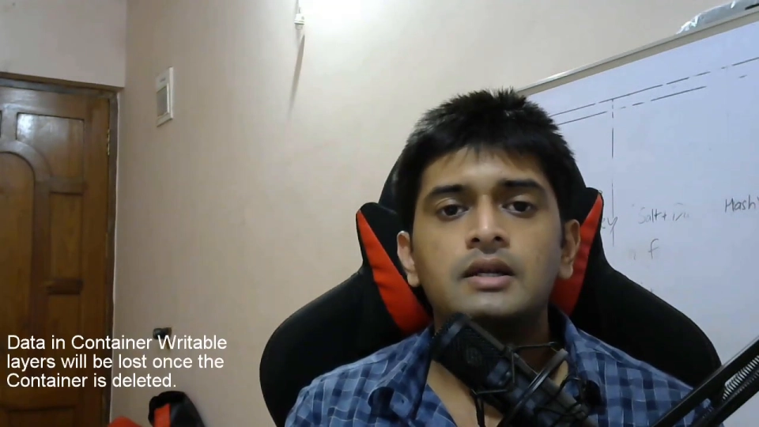

# Docker 存储驱动：可写层、写时复制与联合文件系统如何撑起容器

> 本文整理自 YouTube 视频《Docker Internals Session 2: Docker Storage Drivers (Copy on Write, UFS & Docker Images)》（频道：TheITNoob，讲师 Karthik Mahesh），依据视频演说图文稿逐窗口核对、纠正自动字幕错拼后整理。原字幕为英文自动识别（如 `au fs`→AUFS、`better FS`→BTRFS、`overlay -`→overlay2、`Centaurs`→CentOS、`cash`→cache、`rideable`→writable），术语已在本文中纠正。
> 视频地址：[3BkCaBxq5Ag](https://www.youtube.com/watch?v=3BkCaBxq5Ag)

## 本讲要解决的核心问题（SCQA）

**背景**：上一讲我们从操作系统视角把「容器到底是什么」拆开看过了——容器不过是**跑在 `cgroups` 与 `namespaces` 造出的隔离运行时环境里的一个普通进程**。这一讲，我们要接着往下一块「Docker 内部机制」走：**存储驱动（storage driver）**。[【跳转到 0:00】](https://www.youtube.com/watch?v=3BkCaBxq5Ag&t=0)

**冲突**：可这里有个很反直觉的地方。一个镜像动辄几个 G，里面装着整套 `CentOS` 系统库；我们却能在一瞬间用同一个镜像**并行启动几十个容器**，而且在某个容器里改一个文件，**别的容器居然完全不受影响**。如果每起一个容器就要把镜像里的库**原样复制一份**，那启动慢得没人愿意用 Docker——视频说得很直白：那样的话，人们会**看不出 Docker 相对传统虚拟机有任何优势**。[【跳转到 0:32】](https://www.youtube.com/watch?v=3BkCaBxq5Ag&t=32)

**疑问**：那么 Docker 到底**用了什么办法，避免为每个容器复制整套系统库**？容器里「改一个文件」这件事，最终**落在磁盘的什么地方**？为什么「在容器里写、别的容器看不到」？

**回答（中心思想）**：Docker 存储驱动的两大支柱是 **写时复制（copy-on-write）** 与 **联合文件系统（union filesystem）**。用一句话概括本讲的全部结论：

> **镜像被切成一堆「只读层」供所有容器共享；每个容器只在最顶上多出一层「专属可写层」；只有当你真的要改某个来自只读层的文件时，它才在那一刻被复制到可写层里。**

本讲会把这句话从「为什么要这样设计」，一路讲到「**亲手在 `/var/lib/docker` 里把可写层挖出来**」。

## 一、为什么需要存储驱动：为每个容器复制整套系统库根本跑不通

要在容器里跑任何一个应用，你都需要**一长串操作系统库和依赖**。[【跳转到 0:27】](https://www.youtube.com/watch?v=3BkCaBxq5Ag&t=27)

**最朴素的做法**是：为**每一个**容器化的进程，把那些库**各复制一份**。这条路的两个致命问题，视频点得很清楚：[【跳转到 0:52】](https://www.youtube.com/watch?v=3BkCaBxq5Ag&t=52)

- **极度低效**：磁盘上白白堆满重复的库文件；
- **不可行**：启动容器会慢到令人绝望，于是**没人会为了 Docker 放弃传统虚拟机**。

**存储驱动的价值，就在于找到了一条绕开「复制整套库」的路**——靠的是两个机制：**写时复制** 与 **联合文件系统**。[【跳转到 0:52】](https://www.youtube.com/watch?v=3BkCaBxq5Ag&t=52)

先认识**写时复制（copy-on-write）**。这个概念本身并不新，它有时也被叫作**隐式共享（implicit sharing）**或**影子（shadowing）**，在历史上一直是一种**资源管理技术**：它在**内存资源管理**里被大量使用（例如进程创建时的页共享），也出现在一些**存储与快照技术**中。[【跳转到 1:17】](https://www.youtube.com/watch?v=3BkCaBxq5Ag&t=77)

而 Docker **正是借用它来解决眼前这个难题**：设计出一套机制，**有效地在多个容器之间共享文件与库**。早在 Docker 还叫 **dotCloud** 的时代，开发团队就一直在物色一套「合用的写时复制系统」。[【跳转到 1:17】](https://www.youtube.com/watch?v=3BkCaBxq5Ag&t=77)

## 二、从 AUFS 到 overlay2：存储驱动的「进化史」

据视频讲述，Docker 用来构建容器的**第一个写时复制存储驱动**，是 **AUFS（Advanced Union File System，高级联合文件系统）**。[【跳转到 2:07】](https://www.youtube.com/watch?v=3BkCaBxq5Ag&t=127)

但当时有个麻烦：**主流 Linux 内核本身还不支持任何写时复制功能**，于是这套能力只能由 **Docker 团队在内核外打补丁、自行维护**——既繁琐又凌乱。后来**随着 Docker 走红、发行版意识到把 Docker 集成进系统的重要性**，它们才开始把写时复制功能**向上游贡献、做进 Linux 内核**里。[【跳转到 2:31】](https://www.youtube.com/watch?v=3BkCaBxq5Ag&t=151)

此后 Docker 陆续开发并支持了**一批**写时复制存储驱动：[【跳转到 2:44】](https://www.youtube.com/watch?v=3BkCaBxq5Ag&t=164)

| 驱动 | 一句话说明 |
| --- | --- |
| **AUFS**（Advanced Union File System） | 最早的写时复制驱动 |
| **BTRFS** | 自带写时复制与快照能力的文件系统 |
| **Device Mapper** | 块设备层的映射机制（**LVM 也用它**） |
| **OverlayFS / overlay2** | 现代联合文件系统，如今的默认选择 |
| **ZFS** | 另一种支持快照的文件系统驱动 |

这些驱动可以按一个重要维度**分成两大类**：它们究竟工作在**文件层（file level）**，还是**块层（block level）**。[【跳转到 2:44】](https://www.youtube.com/watch?v=3BkCaBxq5Ag&t=164)



而**今天在 Red Hat 与 CentOS 7 系统上的默认存储驱动是 `overlay2`**——这一点你可以在 `docker info` 的输出里亲眼看到。**本讲后续的所有实操，都以 `overlay2` 为对象展开。**[【跳转到 3:06】](https://www.youtube.com/watch?v=3BkCaBxq5Ag&t=186)

## 三、联合文件系统：把许多层「叠」成一个统一视图

`overlay2` 背后的 `OverlayFS`，是**联合文件系统（union file system）的现代版本**。[【跳转到 3:13】](https://www.youtube.com/watch?v=3BkCaBxq5Ag&t=193)

**联合文件系统的核心是「分层存储」**：文件和目录**仍然存在你原生的操作系统文件系统里**（例如 `XFS`）；联合文件系统的职责，是**从顶上造出一个「合并视图（merged view）」**，把底下所有层**累积、汇总成一份统一的视图**。[【跳转到 3:24】](https://www.youtube.com/watch?v=3BkCaBxq5Ag&t=204)

`OverlayFS` 也属于联合（统一）文件系统，它把**单个的文件和目录当作「分支（branch）」或「层（layer）」**，再对这些层做一次**虚拟合并**，从而呈现一个统一视图。要特别记住一点：**这些底层可以位于不同的卷、甚至不同的文件系统上。**[【跳转到 3:24】](https://www.youtube.com/watch?v=3BkCaBxq5Ag&t=204)



这种分层做法**为什么必要**？答案在「共享」二字：正因为分了层，**层才能被多个容器共享**。视频也预告，后面动手实操时会看得更清楚。[【跳转到 3:49】](https://www.youtube.com/watch?v=3BkCaBxq5Ag&t=229)

## 四、镜像 = 只读层的联合；Dockerfile = 一行一层

要理解共享，先要理解**镜像和层的关系**。[【跳转到 4:08】](https://www.youtube.com/watch?v=3BkCaBxq5Ag&t=248)

> **一个 Docker 镜像，本质上是对「一个或多个只读层之联合」的引用。**

镜像是**逐行构建**出来的：**每一行其实都是一条「如何构建某一层」的指令**。Docker 提供的构建工具就是 **Dockerfile**——它本质上是一个**文本文件**，里面**一行一行写着构建层的指令**。[【跳转到 4:32】](https://www.youtube.com/watch?v=3BkCaBxq5Ag&t=272)



## 五、动手起点：从 Docker Hub 拉一个 CentOS 7 镜像

在进入 Linux 终端之前，视频先介绍了 **Docker Hub**——一个**基于云的镜像仓库**，Docker 社区用它来**创建、测试、分发**容器镜像。几乎**所有知名 Linux 发行版和应用**都能在这里找到镜像。[【跳转到 5:02】](https://www.youtube.com/watch?v=3BkCaBxq5Ag&t=302)

一条默认规则：**如果本地没有某个镜像，Docker 会自动尝试从 Docker Hub 经互联网下载它。**[【跳转到 5:18】](https://www.youtube.com/watch?v=3BkCaBxq5Ag&t=318)

实验环境是一台**全新装了 Docker、并已启动 daemon 的 CentOS 7**。此刻用 `docker image ls` 可以看到**本地没有任何镜像**。接着从 Docker Hub 拉取官方 CentOS 7 镜像：[【跳转到 5:28】](https://www.youtube.com/watch?v=3BkCaBxq5Ag&t=328)

```bash
docker image pull <镜像名>:<标签>
```

关于**标签（tag）**：它可以理解为 Docker 镜像的**一种版本控制手段**——你创建的每个镜像**默认会被打上 `latest` 标签**，你也可以自定义标签，用来向使用者**传达某个具体版本的信息**（比如 `centos:7.6.1810`）。在 Docker Hub 的 CentOS 页面上，就能看到可供下载的**一长串标签/版本**。[【跳转到 5:48】](https://www.youtube.com/watch?v=3BkCaBxq5Ag&t=348)

下载完成后，用 `docker image ls` 即可确认。视频顺手点出了一个通用的 **CLI 语法**：[【跳转到 6:18】](https://www.youtube.com/watch?v=3BkCaBxq5Ag&t=378)

```text
docker  <docker 组件>  [OPTIONS]  <COMMAND/动作>  [ARGS]
```

其中「**组件（component）**」指的是 Docker 环境的基础积木——**image、container、volume、network** 等；**任意组件下可用哪些动作，都能用 `--help` 查出来**（例如 `docker image --help`）。[【跳转到 6:36】](https://www.youtube.com/watch?v=3BkCaBxq5Ag&t=396)

## 六、走进 `/var/lib/docker`：镜像层在磁盘上长什么样

现在有了基础镜像，视频要去**一个平时没人会碰的地方**看一眼——Docker 的**默认存储目录 `/var/lib/docker`**。[【跳转到 7:00】](https://www.youtube.com/watch?v=3BkCaBxq5Ag&t=420)

> ⚠️ 视频反复强调：**绝不要直接操作这个目录**，不要改、不要更新里面任何文件。它**完全由 Docker 托管**，你一动就可能**把整个 Docker 环境搞坏**。之所以进去，纯粹是为了**看见 Docker 平时藏在幕后的东西**。[【跳转到 7:25】](https://www.youtube.com/watch?v=3BkCaBxq5Ag&t=445)

进入 `overlay2` 子目录，你会看到**每一层都有一个自己的目录**。**层的目录名是一个哈希值**——Docker 对层的内容做哈希运算得到，所以名字**又长又怪**。[【跳转到 7:50】](https://www.youtube.com/watch?v=3BkCaBxq5Ag&t=470)

找到**刚才拉下来的 CentOS 7 镜像对应的那一层**，进去看，有两样东西：[【跳转到 8:15】](https://www.youtube.com/watch?v=3BkCaBxq5Ag&t=495)

- **`diff/`**：这一层**实际包含的所有文件和目录**（这里就是 CentOS 7 的整套库与目录）——**「层的内容」就装在 `diff` 里**；
- **`link`**：一个**缩短的符号链接标识符**——把长名字缩短，是为了**避开挂载选项里对名称长度的限制**。

对只读的镜像层而言，此时你看到的就是一个装着 `diff` 与 `link` 的普通目录；「层」真正的含义，要等到**你亲手构建出新的一层**时才会显形。

## 七、用 Dockerfile 构建第一个镜像：亲眼看到「只读层」被创建

要构建自己的镜像，就得用 **Dockerfile**。**简单说，Dockerfile 就是一个文本文件，里面列着一串「如何构建镜像」的指令**；这些指令是**分层书写**的——**每一行指令，最终都会被转换成一个 overlay 文件系统层**。[【跳转到 9:02】](https://www.youtube.com/watch?v=3BkCaBxq5Ag&t=542)

**Dockerfile 的标准格式**是「**指令 + 参数**」：[【跳转到 9:22】](https://www.youtube.com/watch?v=3BkCaBxq5Ag&t=562)

```dockerfile
# 注释
INSTRUCTION arguments
```

Dockerfile 支持的指令有一长串，可以随时在网上查到（本节只用到两个）。**必须以 `FROM` 开头**——它指定我们的**基础镜像**，我们就在它之上叠加自己的层。本例的基础镜像就是刚下载的 **CentOS 7**。下一条指令是 **`RUN`**，用来执行 shell 命令。[【跳转到 9:39】](https://www.youtube.com/watch?v=3BkCaBxq5Ag&t=579)



视频里的示例 Dockerfile 很短——`FROM centos:7` 打底，再用两条 `RUN` 命令**在一个名为 `/test1` 的目录下创建一个内容为 `hello` 的文件**：[【跳转到 9:44】](https://www.youtube.com/watch?v=3BkCaBxq5Ag&t=584)

```dockerfile
FROM centos:7
RUN mkdir /test1 && echo "hello" > /test1/file.txt
```

保存后执行构建，把镜像取名为 `testimage1`：[【跳转到 10:09】](https://www.youtube.com/watch?v=3BkCaBxq5Ag&t=609)

```bash
docker image build -t testimage1 .
```

构建输出会**一条指令一条指令地执行**；**每条指令都会在后台创建一个对应的 overlay 层**（若该层尚不存在）。构建完成后用 `docker image ls` 就能看到新镜像。**回到 `overlay2` 后端目录，会多出一个新层**——这正是刚构建的镜像带来的。[【跳转到 10:34】](https://www.youtube.com/watch?v=3BkCaBxq5Ag&t=634)

关键来了：**进入这个新层看 `diff`，你只会看到 `test1` 这个目录**。为什么？因为——**每一层只需保存它相对于「下一层」的差异**。[【跳转到 10:59】](https://www.youtube.com/watch?v=3BkCaBxq5Ag&t=659)



视频随后指出新层里多出的一个文件 **`lower`**：它**保存着「它下面那一层」的缩短名字**——本例中就是 **CentOS 7 基础镜像层**。`overlay2` 驱动最终会**利用这些信息**去构造那个统一的合并视图。[【跳转到 11:17】](https://www.youtube.com/watch?v=3BkCaBxq5Ag&t=677)

## 八、层不认识「镜像」，是镜像记住了层的清单

这里有一条绕但很关键的分界，视频特意强调：[【跳转到 11:22】](https://www.youtube.com/watch?v=3BkCaBxq5Ag&t=682)

- **层本身没有「属于哪个镜像」的概念**——它**不过是一堆文件和目录**；
- **是「镜像」记住了它所包含的那些层的汇总信息**。

所以我看**镜像**里的层清单，要看命令而不是目录：[【跳转到 11:47】](https://www.youtube.com/watch?v=3BkCaBxq5Ag&t=707)

- **`docker image inspect testimage1`**：输出里会列出**属于这个镜像的那些 overlay 目录**；
- **`docker image history <镜像名>`**：会列出**构建该镜像时，一层一层走过来的那些指令**。[【跳转到 12:00】](https://www.youtube.com/watch?v=3BkCaBxq5Ag&t=720)

## 九、再建一个镜像：`Using cache` 是怎么冒出来的

接着视频构建**第二个**镜像 `testimage2`。它**复用同一个 Dockerfile**：**前两条指令完全一样**，只是**再加一条**——创建另一个目录 `/test2`。[【跳转到 12:05】](https://www.youtube.com/watch?v=3BkCaBxq5Ag&t=725)

构建时，屏幕上**出现了耐人寻味的一幕：它打印出 `Using cache`**。[【跳转到 12:30】](https://www.youtube.com/watch?v=3BkCaBxq5Ag&t=750)

这就是 **构建缓存（build cache / layer caching）**——它的目的是**避免在构建过程中重复制造相同的层**，从而**优化镜像构建**。它主要作用于 **`COPY`、`RUN`、`ADD`** 这几类指令：Docker 存有一份**历史镜像的缓存**，构建新镜像时会把指令**与旧镜像逐条比对**，看是否存在**完全相同的指令、且处于相同顺序**；一旦命中，Docker 就**直接复用现成的层**，而不是新建。[【跳转到 12:50】](https://www.youtube.com/watch?v=3BkCaBxq5Ag&t=770)

落到本例：**前两条指令被两个镜像共享**，Docker**直接复用**；**只为第三条指令新建了一层**。[【跳转到 13:15】](https://www.youtube.com/watch?v=3BkCaBxq5Ag&t=795)



去 `overlay2` 后端一验证：**只多出一层**，其 `diff` 里只有 `test2` 目录；**其余两层被两个镜像共享、并未重建**。这一机制**极大优化了构建过程**。[【跳转到 13:24】](https://www.youtube.com/watch?v=3BkCaBxq5Ag&t=804)

## 十、缓存的「坑」：当 `RUN` 每次结果都不同

天下没有只赚不赔的事——**构建缓存也有副作用**。当某条 `RUN` 指令的**输出每次都不一样**时（视频举的例子是 `git pull`：每次都要拉取新代码），Docker 会**误以为这条指令是重复的**，于是**复用旧层、而不是新建一层**——结果你**拿到的是过时的内容**。[【跳转到 14:03】](https://www.youtube.com/watch?v=3BkCaBxq5Ag&t=843)

视频专门造了个场景来复现这个坑：写一个 Dockerfile，第一条是 `FROM centos:7`，第二条**往文件里写入一段随机文本**（`base64 /dev/urandom | head -c 100`）。因为随机数**理论上每次都不同**，按理**每次构建都该产生新层**。[【跳转到 14:03】](https://www.youtube.com/watch?v=3BkCaBxq5Ag&t=843)

先用它构建 `testimage3`，再用同一个 Dockerfile 构建 `testimage4`。**结果正如所料——Docker 把第二条指令判定为「重复」，直接复用了缓存层，没有创建新层。**[【跳转到 14:47】](https://www.youtube.com/watch?v=3BkCaBxq5Ag&t=887)

**怎么绕开？** 用 **`--no-cache`** 选项，它会**强制 Docker 不去查构建缓存，为每条构建指令都创建新层**。[【跳转到 15:08】](https://www.youtube.com/watch?v=3BkCaBxq5Ag&t=908)

**由此引出一条 Dockerfile 设计的重要经验**（视频称为「经验法则」）：[【跳转到 15:15】](https://www.youtube.com/watch?v=3BkCaBxq5Ag&t=915)

- **把「重复、会产生相似层」的指令放在 Dockerfile 开头**；
- **把「非重复」的指令尽量放到最后**；
- 这样能**最大化跨镜像的层共享**；
- 并且**顺序至关重要**——Docker **一旦检测到第一处不匹配，就会把它之后的所有层全部重建**。[【跳转到 15:36】](https://www.youtube.com/watch?v=3BkCaBxq5Ag&t=936)

视频也说明：本讲**不是** Dockerfile 教程（那是后续章节的事），**这一节的全部意图，是让你理解「overlay 的分层做法」如何优化镜像构建**。[【跳转到 16:01】](https://www.youtube.com/watch?v=3BkCaBxq5Ag&t=961)

## 十一、从镜像启动容器：只读层共享、可写层各一份

镜像建好了，**该用它启动容器了**。上一讲已经讲清容器的本质：从操作系统视角看，它就是**跑在 `cgroups` + `namespaces` 造出的隔离运行时环境里的进程**。[【跳转到 16:24】](https://www.youtube.com/watch?v=3BkCaBxq5Ag&t=984)

**而「启动容器」在存储层面做了什么？** 视频给出了本讲最核心的一张图：[【跳转到 16:29】](https://www.youtube.com/watch?v=3BkCaBxq5Ag&t=989)

1. Docker 先**创建那个隔离环境**；
2. 然后**挂载 overlay 层**——这里，**镜像充当最底层、被共享的只读层**；
3. **在此基础上再加一层「每个容器专属的可写层」**。

**容器层面的一切操作，只会写进它自己最顶上那层可写层**；而**这个可写层随着容器的删除一起消失**——**容器没了，层里的数据也就没了**。[【跳转到 16:37】](https://www.youtube.com/watch?v=3BkCaBxq5Ag&t=997)



## 十二、亲手验证：两个容器的可写层与 `-init` 层

照例上终端。**管理容器的 CLI 是 `docker container`**（和 `docker image` 对称），用 `--help` 可以看全部可用动作；**启动容器最直接的一条是 `docker container run`**。[【跳转到 17:22】](https://www.youtube.com/watch?v=3BkCaBxq5Ag&t=1042)

视频要**在容器里跑 `bash`，这需要一个交互式终端**，所以要带上 **`-it`**（interactive + terminal）：[【跳转到 17:22】](https://www.youtube.com/watch?v=3BkCaBxq5Ag&t=1042)

```bash
docker container run -it testimage2 bash
```

跑起第一个容器后，**再到另一个标签页，用同一个镜像起第二个容器**，此时 `docker container ls` 里就有两个容器了。[【跳转到 17:47】](https://www.youtube.com/watch?v=3BkCaBxq5Ag&t=1067)

**回到 `overlay2` 目录，关键现象出现了：**

- 多出**两个容器各自专属的可写层**，**怎么认？认那个带 `merged` 目录的层**；此刻它们的 `diff` 都是**空的**——因为还没往容器里写任何东西。[【跳转到 18:12】](https://www.youtube.com/watch?v=3BkCaBxq5Ag&t=1092)
- 还有一些**以 `-init` 结尾的层目录**。视频坦白这里之前忘了提：它们是**容器专属的只读层**，**专门用来为每个容器初始化一些必需的文件和目录**（比如 `hosts`、`hostname` 之类）。[【跳转到 18:12】](https://www.youtube.com/watch?v=3BkCaBxq5Ag&t=1092)
- **务必记住**：在容器**启动之前**，这些层**不过是原生 Linux 文件系统上的一些普通目录**；**只有在启动容器的那一刻，overlay 驱动才登场，把这些层统一合并成 `merged` 视图、挂载进容器**。[【跳转到 18:37】](https://www.youtube.com/watch?v=3BkCaBxq5Ag&t=1117)

**进容器的 `merged` 目录看一眼**：这里就是**其下所有层的合并视图**——你能看到**累积而来的 `CentOS` 基础镜像目录，加上 `test1`、`test2` 两个目录**。[【跳转到 19:15】](https://www.youtube.com/watch?v=3BkCaBxq5Ag&t=1155)

再用 **`mount` 过滤 `overlay`** 一看便知：**挂进容器里的，正是这个 `merged` 目录，文件系统类型为 `overlay`**。[【跳转到 19:20】](https://www.youtube.com/watch?v=3BkCaBxq5Ag&t=1160)

## 十三、写时复制：改只读层里的文件时，到底发生了什么

既然容器内的一切操作**都限于最顶上的可写层**，那**先在容器里建一个测试文件**，再去看**可写层的 `diff`**——文件果然出现在那里。[【跳转到 19:45】](https://www.youtube.com/watch?v=3BkCaBxq5Ag&t=1185)

接下来是视频**留到最后才讲的那个概念——写时复制（copy-on-write）**。之所以压轴，是因为**它最适合「先看现象、再下定义」**：[【跳转到 19:56】](https://www.youtube.com/watch?v=3BkCaBxq5Ag&t=1196)

前面已经说过：**容器层面的一切文件操作都留在最顶上的可写层**，**容器不能修改底下的只读镜像层**——这正是为了**保证「一个容器里的改动不会传播给共享同一镜像的其它容器」**。可是问题来了：**如果我确实需要修改一个来自底层只读层的文件，怎么办？**[【跳转到 20:11】](https://www.youtube.com/watch?v=3BkCaBxq5Ag&t=1211)

**这就是写时复制登场的地方**：一旦你要修改某个**属于底层只读层**的文件或目录，**这个文件（或目录）就会在那一刻被复制到容器最顶上的可写层**——于是容器便拥有了一份**它自己的本地副本**，可以在这份副本上操作。整个过程**对用户不可见**。[【跳转到 20:36】](https://www.youtube.com/watch?v=3BkCaBxq5Ag&t=1236)

视频现场演示：在**其中一个容器**里修改 **`/test1/file.txt`**（它来自第二层），写入 `hello Karthik` 并保存。**与此同时，另一个共享同样镜像层的容器里，这个文件的内容依然是老样子、没有被更新**——这**恰好反证了「写时复制已在后台悄悄发生」**。[【跳转到 21:01】](https://www.youtube.com/watch?v=3BkCaBxq5Ag&t=1261)

再到 backend 的 `overlay2` 里查**那个容器的可写层**，会发现**`file.txt` 的本地副本已经躺在那儿了**。[【跳转到 21:26】](https://www.youtube.com/watch?v=3BkCaBxq5Ag&t=1286)

**由此得到一条设计经验**：**设计镜像层时，应尽量避免「容器内进程需要去更新或写底层镜像层」的情形**——因为**对较大文件做写时复制相当耗费资源，可能拖累性能**。[【跳转到 21:26】](https://www.youtube.com/watch?v=3BkCaBxq5Ag&t=1286)

**最后，回到「数据会去哪」这个绕不开的问题：**



- **容器可写层与容器同生命周期**：**容器一删，可写层里的数据随之丢失**；[【跳转到 21:45】](https://www.youtube.com/watch?v=3BkCaBxq5Ag&t=1305)
- 因此**它极少被当作存储手段**来用。绝大多数情况下，你会看到的是**挂载出来的、持久或非持久的 Docker 数据卷**——**它们把数据存放在容器之外**（关于卷的细节留到后面的章节）。[【跳转到 22:10】](https://www.youtube.com/watch?v=3BkCaBxq5Ag&t=1330)

视频收尾说：**理解 Docker 的存储层，是熟悉 Docker 内部机制与工作原理的关键一环**，也会显著提升你使用 Docker 的整体体验。[【跳转到 22:10】](https://www.youtube.com/watch?v=3BkCaBxq5Ag&t=1330)

## 小结

- **为什么需要存储驱动**：若为每个容器复制整套系统库，既低效又慢到不可用；存储驱动用 **写时复制 + 联合文件系统** 绕开了「复制整套库」。
- **存储驱动谱系**：AUFS 是 Docker 最早的写时复制驱动（当时内核不支持、只能外挂补丁）；主流内核支持后，AUFS / BTRFS / Device Mapper / OverlayFS / ZFS 陆续出现，可**按文件层与块层分类**；**如今默认是 `overlay2`**。
- **联合文件系统**：底下的层仍存在原生文件系统（如 XFS）里，UFS **从顶上造出一个合并视图**；分层让**层得以跨容器共享**。
- **镜像 = 只读层的联合**；Dockerfile **一行一层**，`FROM` 打底、`RUN` 叠加。
- **磁盘真相**：镜像层落在 `/var/lib/docker/overlay2/<哈希>/`，里面 **`diff/` 是层的内容**、**`link` 是别名短名**、新层还有 **`lower` 记录下一层的短名**；**每层只保存相对下一层的差异**。
- **构建缓存**：相同指令、相同顺序会被复用（`Using cache`）；它对 `COPY`/`RUN`/`ADD` 生效；**`--no-cache` 可强制重建**；经验法则是**把重复指令放前面、非重复放后面，且顺序不能乱**。
- **启动容器**：镜像作为共享只读层打底，**每个容器在最上面新增一层专属可写层**；`merged` 目录才是被挂进容器的统一视图，`-init` 结尾的层负责初始化必需文件。
- **写时复制**：要改只读层里的文件时，它才被**复制到可写层**，因此**改动不会传播到共享镜像的其它容器**；对大文件做 COW 有性能代价。
- **数据生命周期**：**可写层与容器同生死**，容器一删数据即失，持久数据应交给**数据卷**。

## 关键术语速查

| 术语 | 一句话解释 |
| --- | --- |
| 存储驱动（storage driver） | 决定镜像分层与容器可写层如何在磁盘上组织、共享的机制 |
| 写时复制（copy-on-write，COW） | 只在真正要修改某文件时，才把它复制到可写层；旧称隐式共享/影子 |
| 联合文件系统（union filesystem / UFS） | 把多层目录叠加成一个统一视图的技术，OverlayFS 是其一 |
| OverlayFS / overlay2 | Docker 现代默认的存储驱动；来自联合文件系统家族 |
| 只读层（read-only layer） | 镜像的层，被多个容器共享、不允许修改 |
| 可写层（writable layer） | 容器专属的顶层，所有容器内写操作都落在这里，随容器删除而消失 |
| `merged` 目录 | overlay2 层里被实际挂载进容器的「合并视图」目录 |
| `diff` 目录 | overlay2 层里真正存放该层内容（相对下一层的差异）的目录 |
| `link` / `lower` 文件 | 记录本层/下层的缩短名，避免挂载名称过长 |
| `-init` 层 | 容器专属的只读层，为容器初始化 `hosts`、`hostname` 等必需文件 |
| 构建缓存（build cache） | 相同指令与顺序时复用旧层；作用于 `COPY`/`RUN`/`ADD`，可用 `--no-cache` 关闭 |
| Docker Hub | 基于云的公共镜像仓库，本地缺失镜像时默认从它拉取 |
