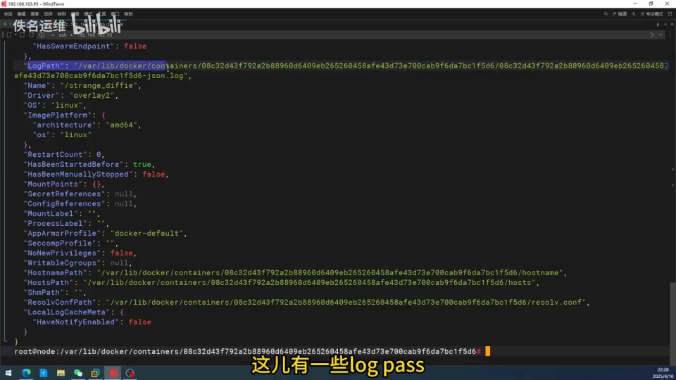
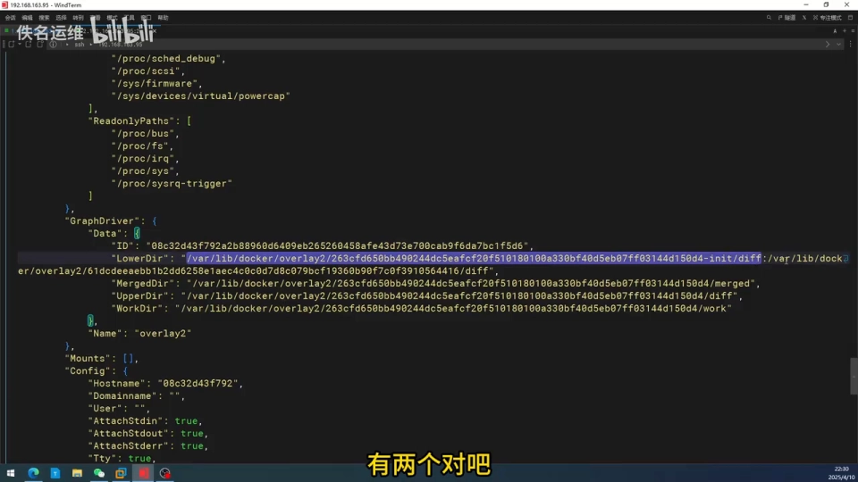
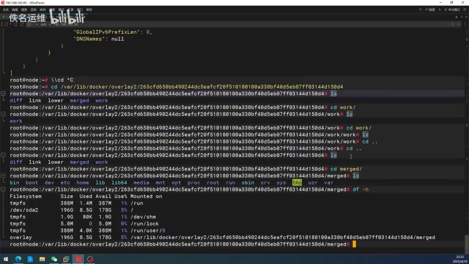

# Docker 原理11：容器是如何分层的——读懂容器的「可写层」

> 本文整理自 B 站视频《Docker原理（11）--容器是如何分层的》（UP 主：佚名运维），依据视频演说图文稿逐窗口核对、纠正自动字幕错拼后整理。
> 视频地址：[BV16AdSYnEyy](https://www.bilibili.com/video/BV16AdSYnEyy)

## 本讲要解决的核心问题（SCQA）

**背景**：上一讲我们已经清楚「**镜像是怎么分层存储的**」——一个镜像由一堆**只读层**叠加而成，层与层之间靠联合文件系统（Union Filesystem）拼成一个统一的文件系统视图。[【跳转到 0:00】](https://www.bilibili.com/video/BV16AdSYnEyy/?t=0)

**冲突**：现在我们把镜像跑起来、变成一个**容器**，就开始往里面写东西——新建一个文件、改一个配置、`echo` 一句话。可是容器**并没有真的复制一份镜像**（否则每个容器都得好几个 G）。那么问题就来了：**这些改动到底落在宿主机的什么地方？**

**疑问**：容器的数据在磁盘上究竟放在哪？镜像的**只读层**和容器自己的那一层是什么关系？为什么「在容器里改文件、别的容器却不受影响」？

**回答（中心思想）**：容器 = **一份大家共享的只读镜像层** + **一份该容器专属的可写层**，两者被联合文件系统**叠在一起**，给容器呈现出一个「联合视图」。本讲的全部内容，就是用最原始的命令把这三样东西**在宿主机上亲手找出来**：

> ① 先在 `/var/lib/docker/containers/<容器ID>/` 看清容器的**元数据与日志**；
> ② 再用 `docker inspect` 找到真正的存储目录——**LowerDir（只读层）/ UpperDir（可写层）/ MergedDir（联合视图）**；
> ③ 于是「容器数据存在哪」这个问题，答案就落在那个 **UpperDir** 上。

## 一、容器在宿主机上留下两份「台账」：元数据/日志 与 文件数据

容器一跑起来，Docker 就会在 `/var/lib/docker` 下为它记账。我们先不看文件数据，而是先看**最好理解的元数据目录**：`/var/lib/docker/containers/<容器ID>/`。[【跳转到 0:25】](https://www.bilibili.com/video/BV16AdSYnEyy/?t=25)

视频里先进入这个目录（目录名前几位就是容器 ID），`ls` 一看，里面主要有这么几样东西：

| 文件 | 作用 |
| --- | --- |
| `<容器ID>-json.log` | 容器标准输出的日志，就是 `docker logs` 读到的内容 |
| `config.v2.json` | 容器的**全部配置**：创建时间、ID、启动命令、环境变量、所用镜像、日志路径等 |
| `hostname` / `hosts` / `resolv.conf` | 容器的**主机名、hosts 与 DNS 配置**，每个都是单独的文件 |

先在容器里随便 `echo` 打印点东西，再回头看日志文件，就能看到内容多出来了——里面记录了我们执行过的命令、返回值、时间。这印证了：**这个 `-json.log` 文件的内容，就是 `docker logs` 的输出来源**。[【跳转到 1:15】](https://www.bilibili.com/video/BV16AdSYnEyy/?t=75)

**顺带一个运维提醒**：视频特别点出——如果我们**没有在 Docker 配置里限制日志大小**，一个长时间运行的容器会把日志文件撑得**非常大**。这就是生产环境里常说的「日志要配 `max-size`/`max-file`」。

接着看 `config.v2.json`：这个文件里记录了容器的一堆信息——创建时间、ID、路径、启动命令、环境变量、镜像，以及 `LogPath`（日志路径）等。[【跳转到 2:21】](https://www.bilibili.com/video/BV16AdSYnEyy/?t=141)

同时它的日志路径确实指向刚才那个 `-json.log`；hostname、host、DNS 配置则各自是独立文件。也就是说，**这些文件都是容器的「配置」，但都不是容器里那套文件系统本身**。

目录里还有**两个空目录**，什么也没有。那这些**配置之外的、容器里真正被写入的文件数据**，到底存在哪？[【跳转到 3:11】](https://www.bilibili.com/video/BV16AdSYnEyy/?t=191)

## 二、用 `docker inspect` 找出真身：只读层、可写层与联合视图

答案不在 `containers/` 目录，而要去问 **Docker 自己的存储驱动（联合文件系统）**。

**第一步——先看到挂载点**：在容器里执行 `df -h`（视频里口播的「DF 杠 H」），会看到一个 **overlay 类型的挂载**，挂载点路径里带着一长串 **UUID**。问题在于：光看这串 UUID，你**根本不知道它对应哪个容器**，所以要顺着容器 ID 一步步反查。[【跳转到 3:11】](https://www.bilibili.com/video/BV16AdSYnEyy/?t=191)

**第二步——查容器详情、找关键字**：先拿到容器 ID，执行 `docker inspect <容器ID>`，在输出里找存储相关的关键字。这里会看到容器存储驱动（`GraphDriver`）暴露出来的**三个关键目录**：[【跳转到 4:01】](https://www.bilibili.com/video/BV16AdSYnEyy/?t=241)

| 目录 | 含义 | 对应概念 |
| --- | --- | --- |
| `LowerDir` | 底层的**多个只读层**（用冒号分隔的多个路径） | 镜像层 + 容器初始化层 |
| `UpperDir` | 顶层的**可写目录**，容器里的所有改动都写在这里 | **可写层** |
| `MergedDir` | 把上、下各层**合并**后的联合目录 | **联合视图** |

**先看 `LowerDir`**：它包含镜像的多个只读层。仔细数，这里其实有**两个路径、以冒号分隔**：[【跳转到 4:26】](https://www.bilibili.com/video/BV16AdSYnEyy/?t=266)

- 一个是**镜像层**的地址（视频里这个镜像基于 **Ubuntu 24.04**）；
- 前边那个则是**容器初始化时**生成的地址，它也是一个**只读层**（用来准备 `hostname`、`hosts` 这类必需文件）。

**再看 `UpperDir` 与合并**：`UpperDir` 是一个**顶层目录**——你在这个容器里的**所有改动**（改了哪些文件、新增了哪些文件）都会保存在这一层里。而中间还有一个目录，负责把**底层只读层**和**这个可写层**合并到一块，形成**联合层**，也就是容器的「联合视图」。[【跳转到 4:51】](https://www.bilibili.com/video/BV16AdSYnEyy/?t=291)

**去磁盘上验证**：进入 `docker inspect` 给出的 overlay2 层目录，可以看到每一层都是由 `diff`（该层实际新增/修改的文件）、`link`（本层的短标识）、`lower`（指向下层）、`merged`（联合视图）、`work`（内部工作目录）这几个部分组成。[【跳转到 5:56】](https://www.bilibili.com/video/BV16AdSYnEyy/?t=356)

再看那个 `merged`（联合视图）目录，里面就是**容器里的所有文件**；回头对照 `df -h` 显示的挂载路径，**两者完全一致**——这正说明「容器挂载的就是这个联合视图」。[【跳转到 5:41】](https://www.bilibili.com/video/BV16AdSYnEyy/?t=341)

## 三、把三层摆在一起看：容器为什么「用完即弃」

到这里，整条链路就清楚了。容器从始至终都由**三样东西**拼成：

1. **只读层（LowerDir）**：来自镜像，多个容器**共享同一份**，谁也改不了；
2. **可写层（UpperDir）**：每个容器**独有一份**，容器里的所有写操作都只会落到这里；
3. **联合视图（MergedDir）**：把上面两层虚拟地叠起来，是**容器进程真正看到的文件系统**。

对初学者来说，抓住一句话就够了：**「改文件不是改镜像，而是写进自己那层可写层」**。这也正好解释了两件事：

- **为什么两个容器各自改同一个文件却互不影响**——它们各有各的可写层，共享的只读层谁也没动；
- **为什么容器「用完即弃」**——可写层是**跟着容器走的**，容器一删，可写层连同里面的数据就一起没了。所以真正需要长期保存的数据，必须放进**数据卷（volume）**或**绑定挂载（bind mount）**里，而不是留在可写层。

> 📌 本讲把「可写层长什么样」讲透了；至于「在可写层上改一个只读层里的文件时，Docker 具体怎么处理」，就是下一讲的**写时复制（Copy-on-Write）**要解决的问题。

## 小结

- 容器的元数据与日志在 `/var/lib/docker/containers/<容器ID>/`：`-json.log` 对应 `docker logs`，`config.v2.json` 记录配置，hostname/hosts/resolv.conf 是独立配置。
- 容器文件数据的真身要用 `docker inspect` 找：**LowerDir（只读层）**、**UpperDir（可写层）**、**MergedDir（联合视图）**。
- overlay2 下每一个层目录由 `diff` / `link` / `lower` / `merged` / `work` 组成，其中 `diff` 是该层实际内容。
- **可写层（UpperDir）是容器专属的**，容器内所有写操作都落在这里；只读层（镜像层）被多个容器共享、不可修改。
- 可写层**随容器生命周期存在**，容器删除即丢失——长期数据要交给数据卷。

## 关键术语速查

| 术语 | 一句话解释 |
| --- | --- |
| 只读层（LowerDir） | 镜像的层，多个容器共享、不允许修改 |
| 可写层（UpperDir） | 容器专属的顶层，容器内所有改动都写在这里，随容器删除而消失 |
| 联合视图（MergedDir） | 把只读层与可写层虚拟合并后、容器进程实际看到的文件系统 |
| 联合文件系统 | 把多层目录叠加成单一视图的技术（Docker 默认用 overlay2） |
| `config.v2.json` | 放在 `containers/<ID>/` 下的容器配置文件，记录启动命令、环境变量、LogPath 等 |
| `-json.log` | 容器标准输出的日志文件，即 `docker logs` 的数据来源 |
