# 内核与运维视角的 tmpfs：从 devtmpfs、/dev/shm 到实测的 1000MB/s

> 本文整理自 B 站视频《Linux内核-tmpfs文件系统》（UP 主：运维小路），依据视频演说图文稿逐窗口核对、纠正自动字幕错拼后整理。
> 字幕来自 B 站 AI 字幕，已纠正 proc、sysfs、devtmpfs、cgroup、cloud-init、chronyd 等识别错误，术语按标准写法呈现。
> 视频地址：[BV1eB1aYTEGc](https://www.bilibili.com/video/BV1eB1aYTEGc/)

## 本讲要解决的核心问题（SCQA）

**背景**：在前面讲完 `/proc`、`/sys` 这些内核虚拟文件系统之后，内核还提供了第三个内存文件系统——**tmpfs**，以及和它很像的 **devtmpfs**。任何一台装好系统的服务器，基本都挂着它们。

**冲突**：我们对这两个文件系统"习以为常"，却常常忽略它们——装好系统就有、平时几乎不用管。可它们到底是什么、给谁用、会不会占内存、真实性能有多快，很多人说不清。

**疑问**：tmpfs 和 devtmpfs 有什么区别？tmpfs 的大小能调吗？调大它会真的占掉内存吗？写 tmpfs 到底有多快？`/run`、`/dev/shm` 里又放着什么？

**回答（中心思想）**：**devtmpfs 是给"设备"用的**——它挂在 `/dev`、由内核在启动时自动创建，并具备**热插拔**能力；**tmpfs 是给"应用程序"用的**——它把文件放在内存（必要时换到交换空间）里，读写飞快、但重启即失。tmpfs 的**大小可以调整，但调大并不会预先占用内存**，只有你真正写入数据时才会申请真实的物理内存；实测写内存约 **1000MB/s**，比写磁盘的几十 MB/s 快出**几十倍**。因此它天生适合放那些"临时、要求快、不需要持久化"的文件。

## 一、tmpfs 与 devtmpfs：一个给应用，一个给设备

这是本讲的定位：内核里针对内核有 `/proc`、（针对 cgroup 有 `/sys`），而 **tmpfs 是第三个"内存文件系统"**，还有一个和它相似的 **devtmpfs**。[【跳转到 00:22】](https://www.bilibili.com/video/BV1eB1aYTEGc/?t=22)

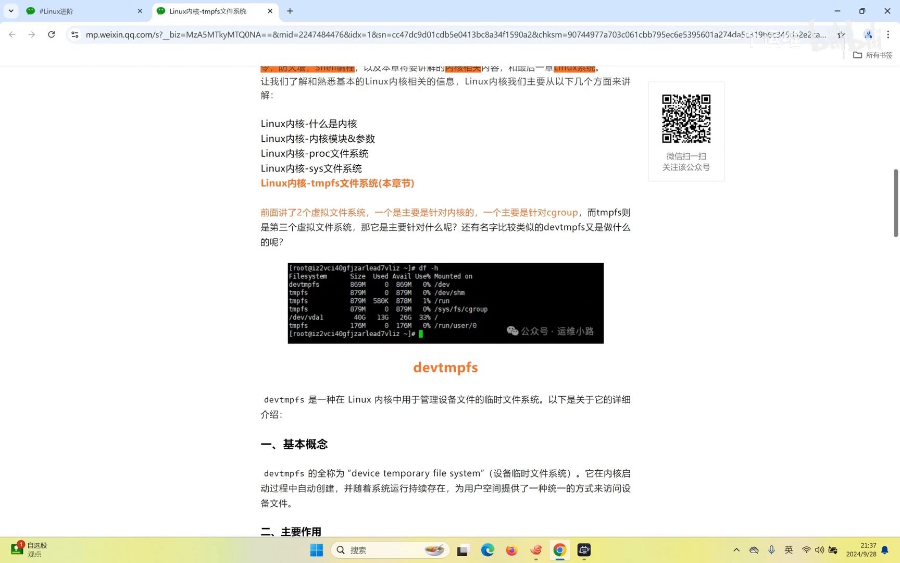

**devtmpfs** 全称"设备临时文件系统"，是一种在内核中用于管理设备（设备节点）的临时文件系统，内核启动时自动创建、随系统运行持续存在。它最实用的能力是**热插拔**：传统 Linux 里设备文件往往在启动时静态创建、或在检测到设备时手动创建；而在 devtmpfs 下，**插一个 U 盘进去，它立马就能被识别，并自动在设备目录里创建一个链接**，你就能直接用了。[【跳转到 01:02】](https://www.bilibili.com/video/BV1eB1aYTEGc/?t=62)

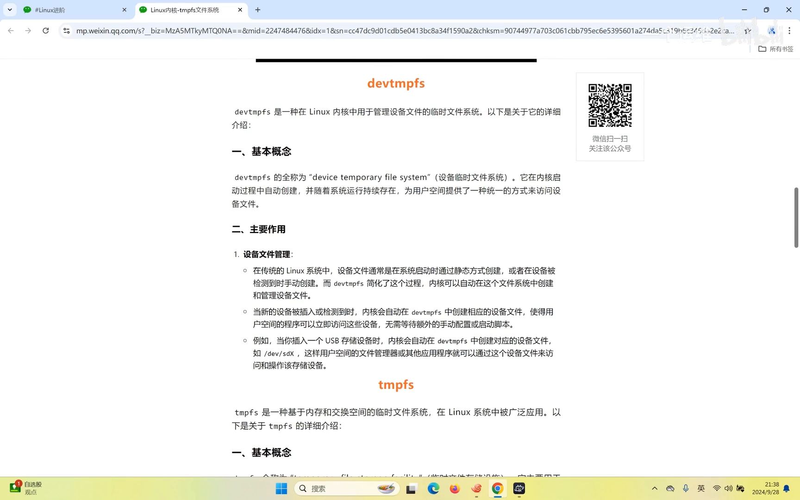

而 **tmpfs 和 devtmpfs 的区别**就在"服务对象"上：**devtmpfs 给设备用，tmpfs 给应用程序用**——tmpfs 主要利用**内存和交换空间**做临时运行空间。[【跳转到 01:12】](https://www.bilibili.com/video/BV1eB1aYTEGc/?t=112)

## 二、tmpfs 的大小可以调，但不会预先占用

应用程序可以把 tmpfs 挂载点当成一个**普通目录**来用；但它的真实内容不在磁盘里，而在内存里，所以速度特别快。它的第一个特点就是：**大小可以调整**。[【跳转到 02:13】](https://www.bilibili.com/video/BV1eB1aYTEGc/?t=133)

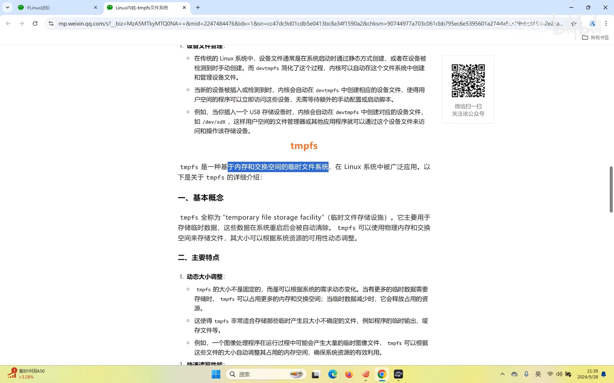

在机器上可以直观看到这些挂载：某些目录（如 `/run`、`/dev/shm` 等）都挂着 tmpfs；用 `df -h` 只能看到其中一部分，但这没关系。[【跳转到 02:51】](https://www.bilibili.com/video/BV1eB1aYTEGc/?t=171)

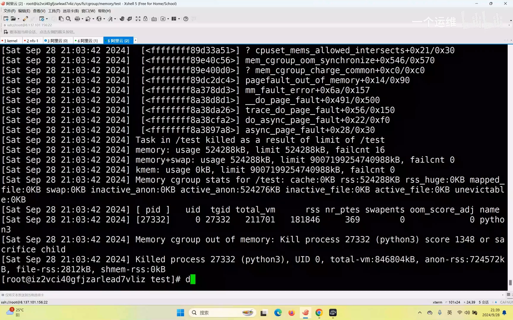

它**非常适合放临时文件**：因为放在内存里、重启会丢，所以对持久化没要求；而对速度要求又高——比如各种**缓存**，放到这里既快，又不需要持久化，享受的就是那份快速的读写性能。[【跳转到 03:22】](https://www.bilibili.com/video/BV1eB1aYTEGc/?t=202)

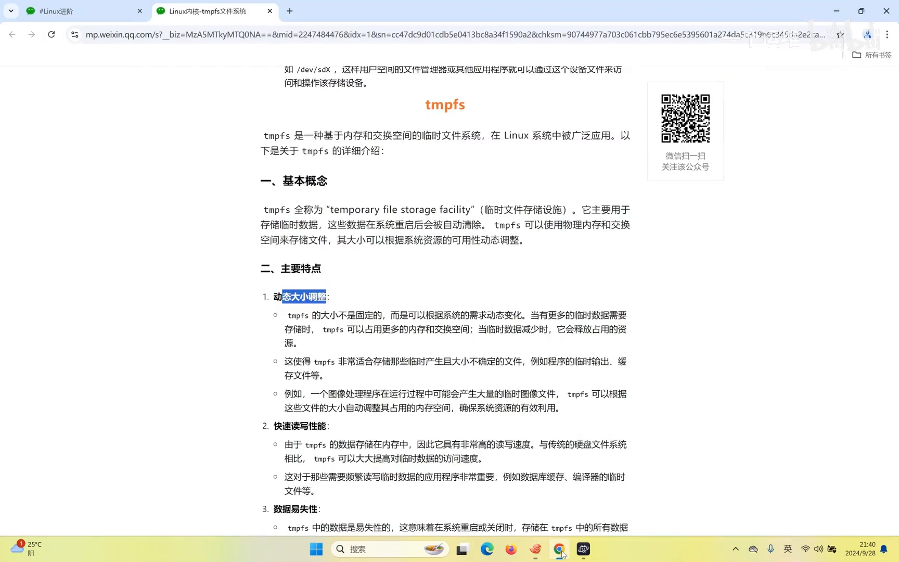

## 三、动手实测：写内存约 1000MB/s，写磁盘约几十 MB/s

为了直观对比，视频用 `dd` 分别写内存和写磁盘。**第一步写到内存**时，目标是 `/run` 这个 tmpfs：[【跳转到 04:02】](https://www.bilibili.com/video/BV1eB1aYTEGc/?t=242)

```bash
# 写内存（/run 是 tmpfs）
dd if=/dev/zero of=/run/test1 bs=1M count=256
```

结果是**一两秒就写完**，速度达到 **读 1000 多兆每秒**，时间还不到一毫秒级别的响应——非常快。[【跳转到 04:02】](https://www.bilibili.com/video/BV1eB1aYTEGc/?t=242)

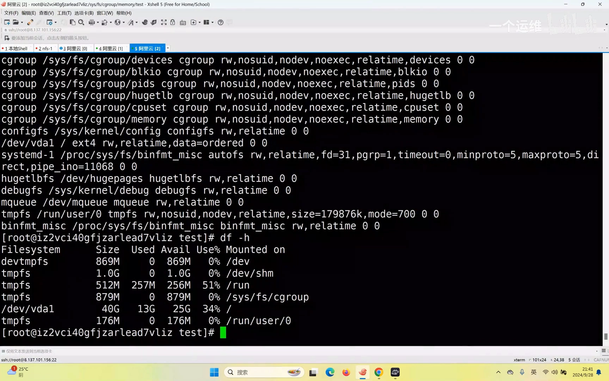

接着**换到写磁盘**做对比——这一次要"等"了：磁盘比内存慢得多，速度只有**几十 MB/s**，和刚才的 1000MB/s 差了将近 **50 倍**。[【跳转到 06:04】](https://www.bilibili.com/video/BV1eB1aYTEGc/?t=364)

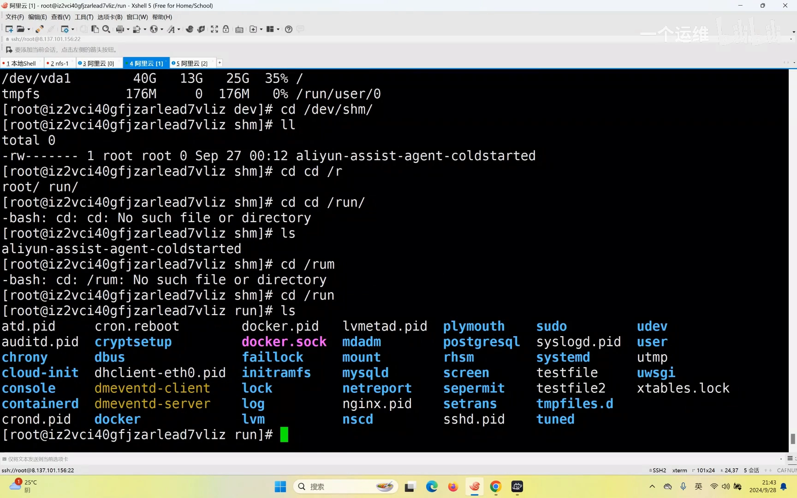

顺带，视频用 `df -h` 和 `/dev` 目录做了一次设备认知：`/dev` 下这些都属于设备，最明显的就是磁盘设备 **vda、vda1**。[【跳转到 05:04】](https://www.bilibili.com/video/BV1eB1aYTEGc/?t=304)

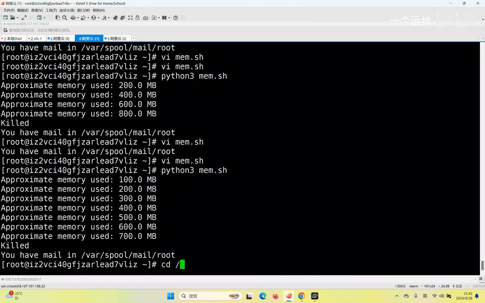

> 视频演示时还写满过 `/run`：先写了一个 512MB 的文件，又写了 256MB，很快就把那块 tmpfs "打满"了——删掉文件后内存立刻释放。这正好印证了上一节的结论：**df 里 tmpfs 的"已用"，就是它真实占用的内存**。

## 四、/run 里到底放了什么

从 `/run` 目录里的文件名可以看出，它放着很多**临时的 pid 文件**：有些程序运行时会把 pid 写到一个文件里，别的操作再去读/操作这个文件，借此实现应用的进一步交互；此外还有 **socket 文件**，用于两个进程之间的通信。[【跳转到 06:29】](https://www.bilibili.com/video/BV1eB1aYTEGc/?t=389)

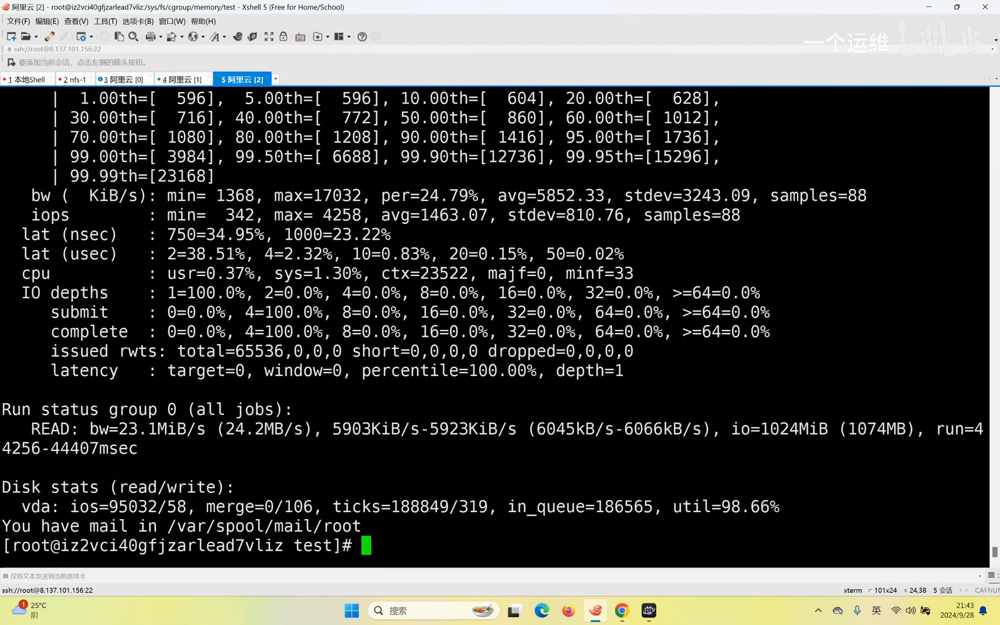

很多程序都会产生 pid 文件，比如 `cron`、`docker`，以及 `nginx` 等。**pid 文件的用途**就是：把某个运行进程的 pid 记下来，其它进程通过给这个 pid 发信号，来促使它内部做某些操作（例如 reload）。[【跳转到 07:19】](https://www.bilibili.com/video/BV1eB1aYTEGc/?t=439)

除了业务程序，`/run` 里放的更多是**系统自带的运行时组件**：总线、`docker` 及其 container 相关文件、`cloud-init`（虚拟化里负责初始化）、`chronyd`（时间同步）等——把它们放到内存里，就是为了**提高速度**。[【跳转到 07:54】](https://www.bilibili.com/video/BV1eB1aYTEGc/?t=474)

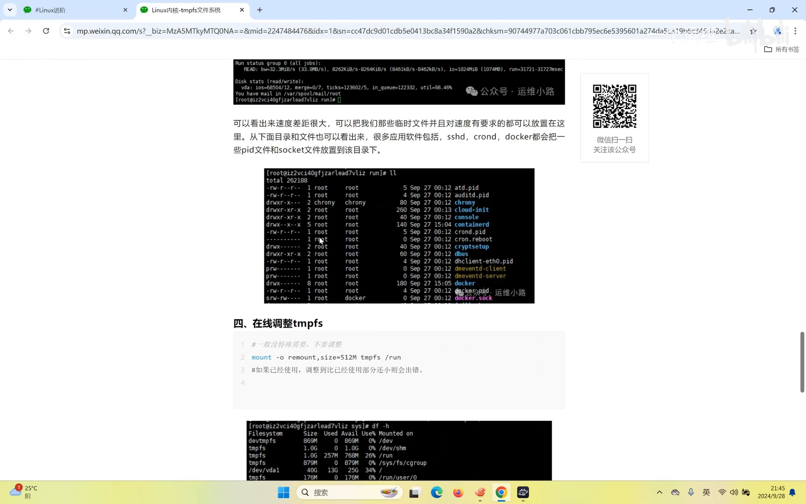

要使用 tmpfs 也很简单：**直接把它当成一个普通目录来用**就行；但必须清楚——**里面的数据不会持久化，重启就丢**。[【跳转到 08:19】](https://www.bilibili.com/video/BV1eB1aYTEGc/?t=499)

## 五、把 /run 从 512MB 调到 1G：df 变了，占用没变

视频做了一次调整实验：把 `/run` 从 **512MB 调到 1G**。调整前后对比 `df -h`——**大小（容量）确实变成了 1G，但"已用/可用"那几列几乎没有变化**。[【跳转到 09:12】](https://www.bilibili.com/video/BV1eB1aYTEGc/?t=552)

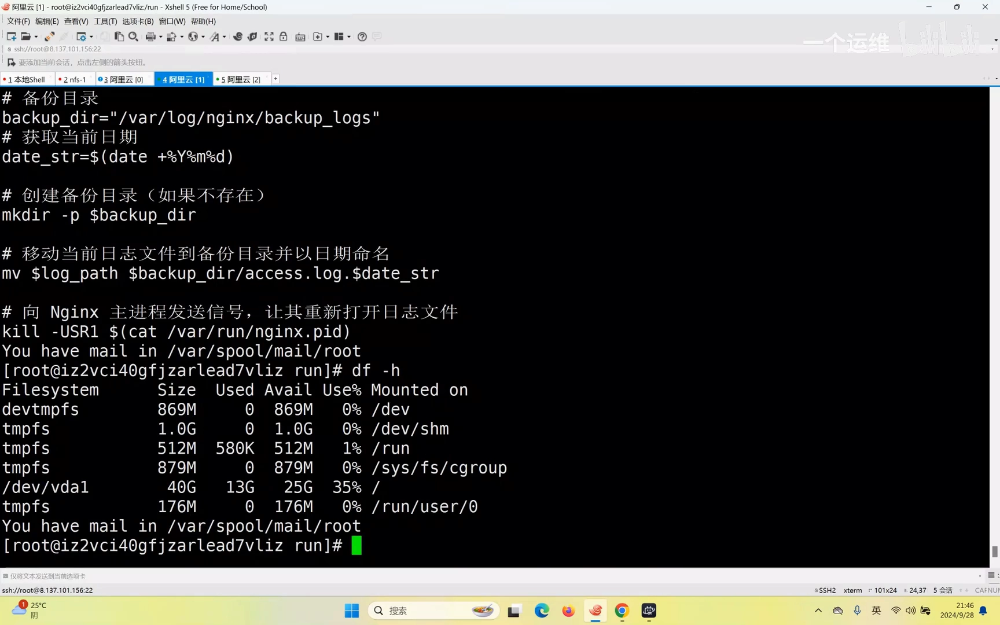

这个现象揭示了 tmpfs 的一个重要机制：**调大它的上限，并不会真的把内存"预分配"给它**——内核只是允许你最多用到这么多，并不会当场把这些内存占住；**只有当你真的往里面写几百兆数据时，它才会去申请真实的物理内存**。[【跳转到 09:37】](https://www.bilibili.com/video/BV1eB1aYTEGc/?t=577)

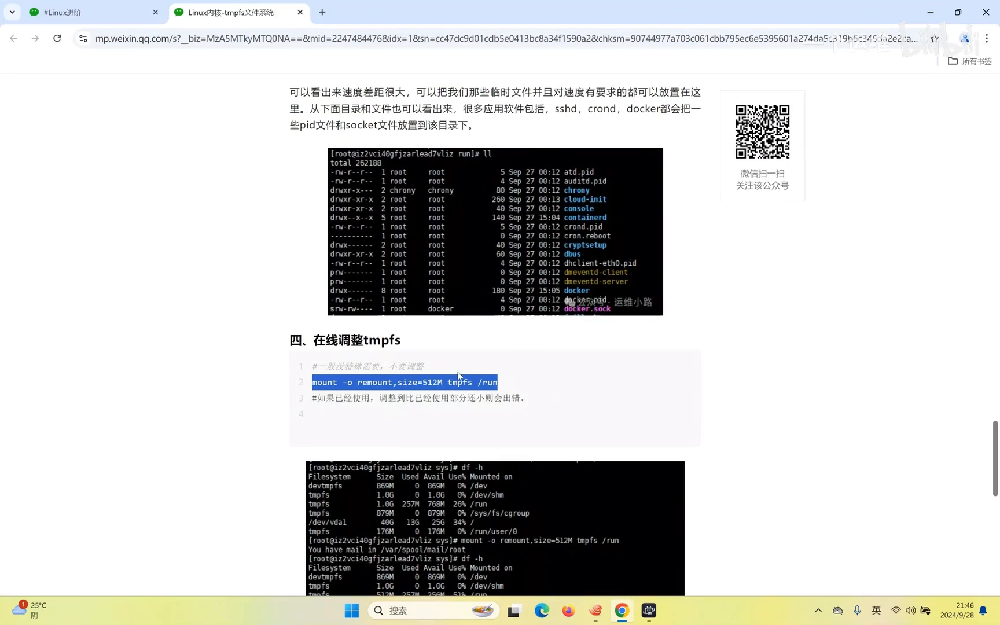

这也解释了为什么可以把 tmpfs 的 size 设得很大——它是"额度"而非"预扣"。

## 六、回到内核全貌：proc / sysfs / tmpfs 三件套

课程最后对本部分做了总结。内核相关内容讲了：如何升级内核、加载管理内核模块、内核参数的调整与持久化，以及**基于内存的三个虚拟文件系统**：[【跳转到 10:02】](https://www.bilibili.com/video/BV1eB1aYTEGc/?t=602)

- **`/proc`**：记录当前内核的**运行状态**，很多监控数据都来源于此；
- **`/sys`（sysfs）**：记录**设备信息**和 **cgroup 的限制**——通过 cgroup 可以实现对 CPU、内存、磁盘、网络等的限制；
- **tmpfs**：放**临时文件**、用来**提高应用速度**。

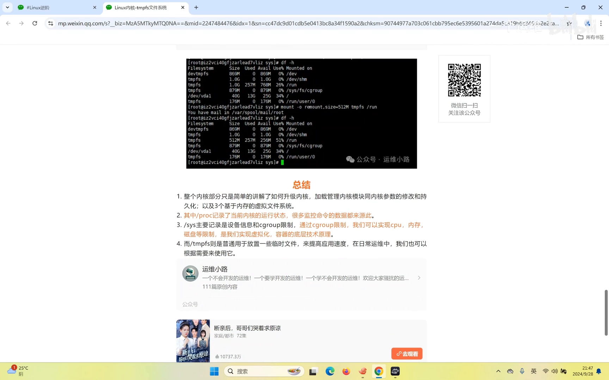

其中，**cgroup 与 namespace 等特性正是虚拟化/容器的底层原理**——后面讲 Docker 时会讲到，Docker 就建立在 Linux 的这些特性之上。[【跳转到 10:27】](https://www.bilibili.com/video/BV1eB1aYTEGc/?t=627)

而在日常运维中，**普通应用基本"不会直接用到" tmpfs**；只有当你的应用专门要做缓存、为了提高速度时，才会用到它。[【跳转到 10:52】](https://www.bilibili.com/video/BV1eB1aYTEGc/?t=652)

## 小结

- 内核里有 **proc / sysfs / tmpfs** 三个内存（虚拟）文件系统，此外还有一个相似的 **devtmpfs**。
- **devtmpfs 给设备用**（挂在 `/dev`、内核启动时创建、支持热插拔）；**tmpfs 给应用用**（内存 + swap）。
- tmpfs **大小可调，但调大不预占内存**，只有真正写入才申请物理内存。
- 实测：**写 tmpfs ≈ 1000MB/s**，**写磁盘只有几十 MB/s**，相差约 50 倍。
- `/run`、`/dev/shm` 里放的是 pid 文件、socket、cloud-init、chronyd 等**运行时/临时文件**，**重启即失**。
- tmpfs 适合放**缓存等临时、要快、不需持久化**的数据。
- **cgroup、namespace 等正是容器（Docker）的底层原理。**

## 关键术语速查

| 术语 | 一句话解释 |
| --- | --- |
| tmpfs | 使用内存与交换空间的临时文件系统，给应用程序用 |
| devtmpfs | 挂在 `/dev`、内核启动时自动创建的设备临时文件系统，支持热插拔 |
| `/run` | 存放开机运行时数据（pid、socket 等）的 tmpfs 挂载点 |
| `/dev/shm` | POSIX 共享内存的默认落点，也是 tmpfs |
| pid 文件 | 记录进程 pid 的文件，供其它进程据此发信号 |
| socket 文件 | 进程间通信（IPC）用的文件 |
| cgroup | 限制进程组 CPU/内存/磁盘/网络的控制组，容器底层机制之一 |
| namespace | 做资源隔离的内核特性，容器底层机制之一 |
| `dd` | 用于测试读写速度/造数据的命令 |
| 按需分配 | tmpfs 只在你写入数据时才申请真实物理内存 |
