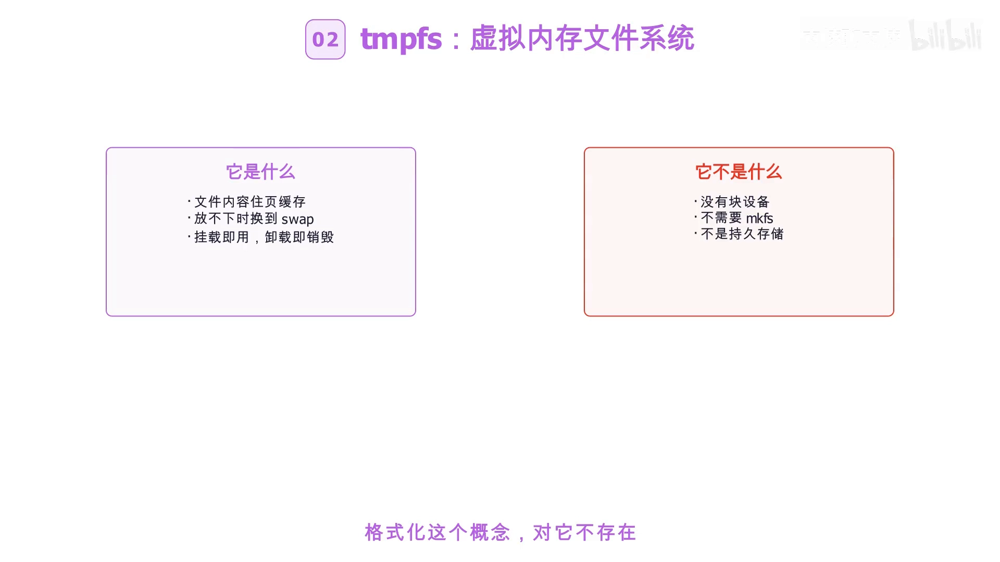
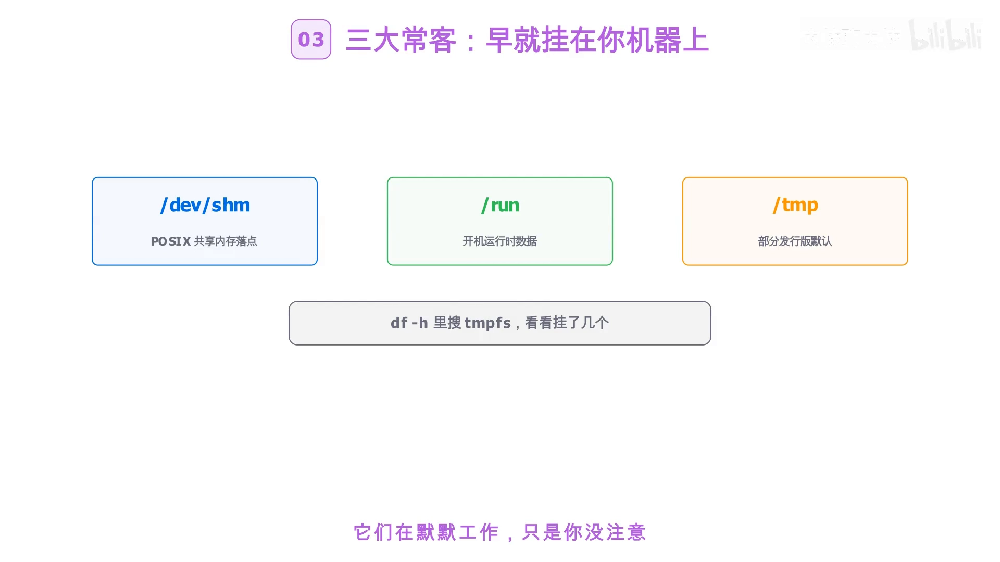
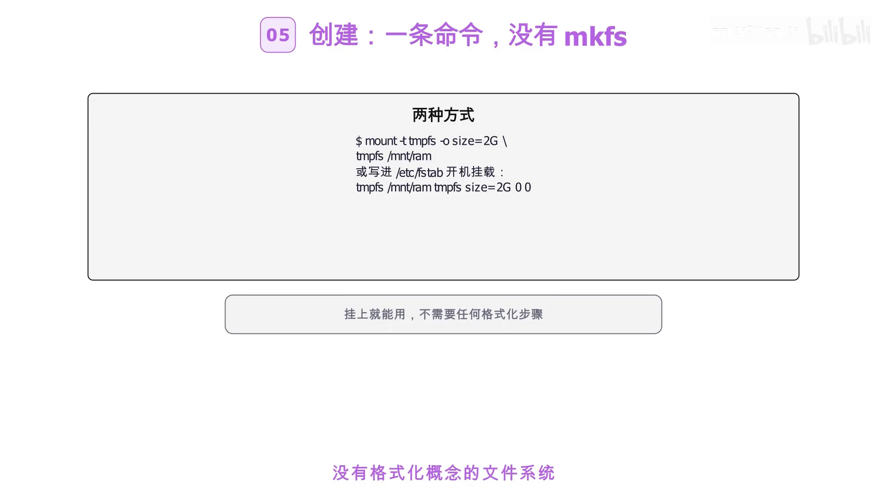
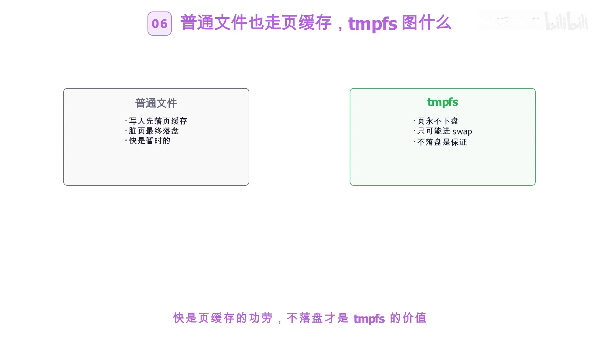
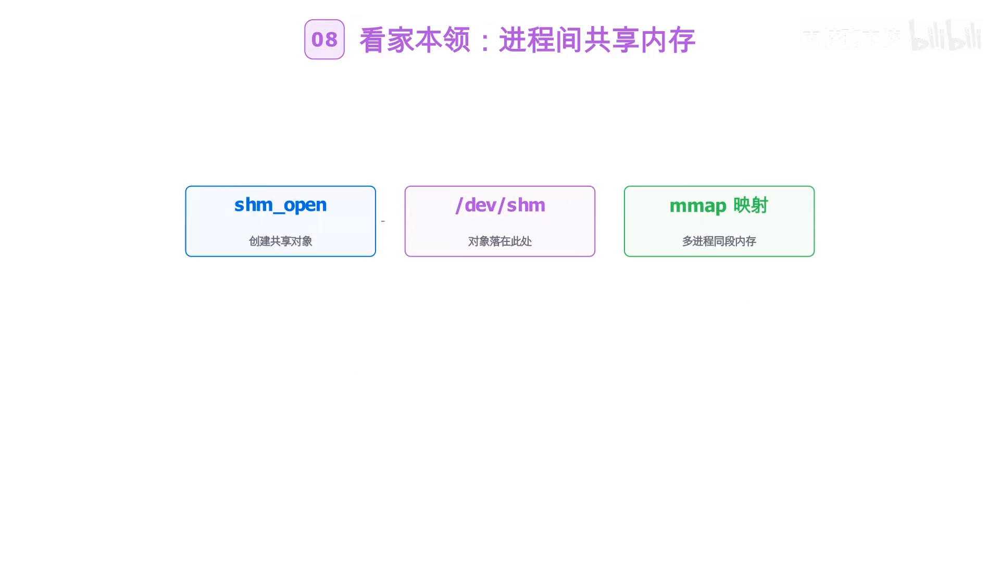
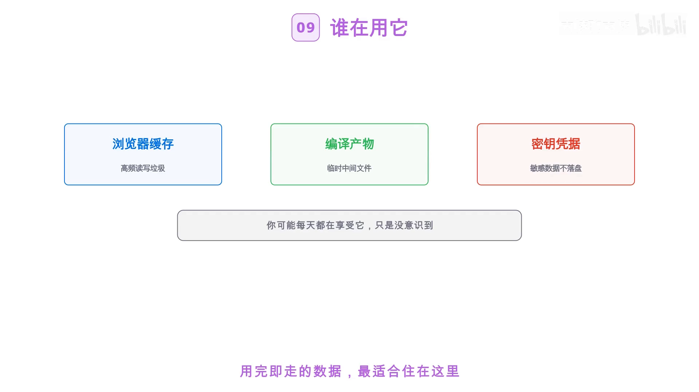
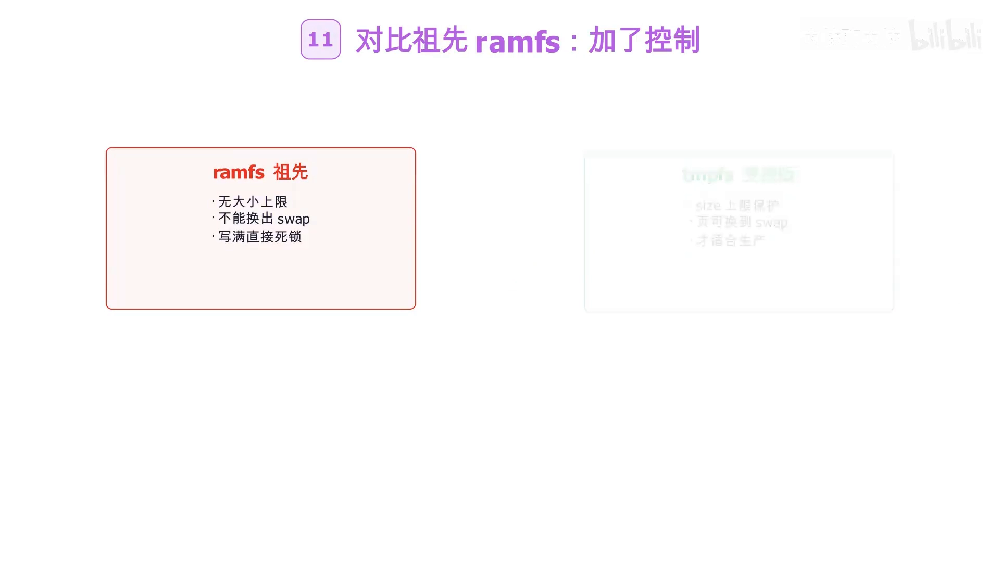
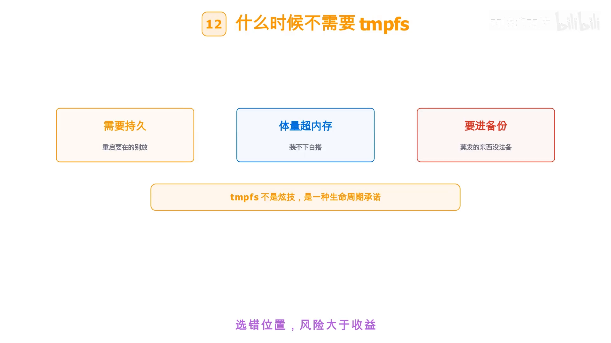
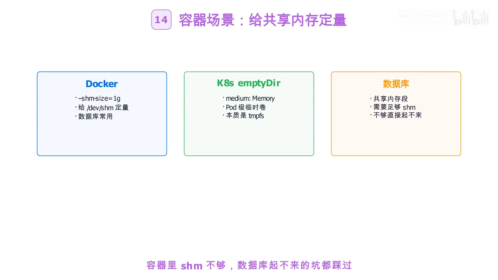
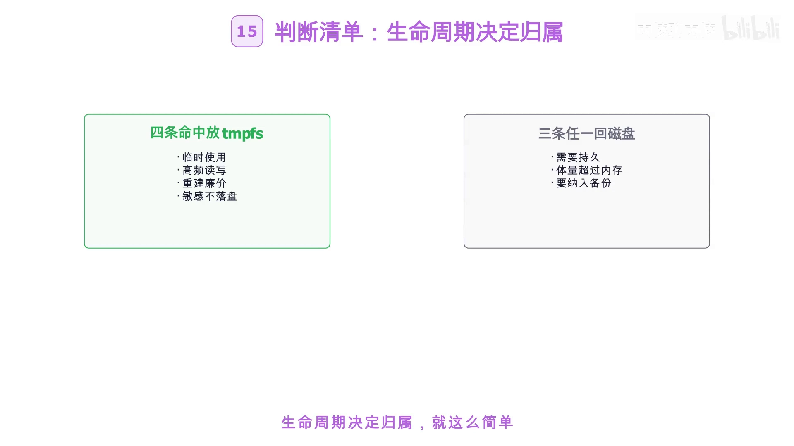

# tmpfs：挂载即用、卸载即蒸发，住在内存里的文件系统

> 本文整理自 B 站视频《tmpfs：读写接近内存带宽、断电即蒸发，住在内存里的文件系统完整拆解！》（UP 主：内核聊内核），依据视频演说图文稿逐窗口核对、纠正自动字幕错拼后整理。
> 字幕来自 B 站 AI 字幕，已纠正 `/dev/shm`、页缓存、ramfs、overlayfs、emptyDir、OOM 等识别错误，术语按标准写法呈现。
> 视频地址：[BV1FKHC6yE8B](https://www.bilibili.com/video/BV1FKHC6yE8B/)

## 本讲要解决的核心问题（SCQA）

**背景**：我们熟悉的文件大多躺在磁盘（或 SSD）上，读写要经过块设备。但其实 Linux 里还住着一类文件系统——它的文件根本不落盘，而是"住"在内存里：`/dev/shm`、不少发行版的 `/run` 和 `/tmp`，挂的就是它。

**冲突**：这类文件系统断电即蒸发、重启就清空，听起来"不靠谱"；可它的读写速度却接近内存带宽。既然数据迟早会没，为什么还要把东西放进去？它和磁盘文件系统、和另一个"内存文件系统" ramfs 到底差在哪？什么时候该用、什么时候绝不能用？

**疑问**：tmpfs 究竟是一种什么文件系统？它的数据放在哪里、有多大、怎么创建？它真正的价值是什么？容器场景里又该怎么用？

**回答（中心思想）**：tmpfs 是一种**虚拟内存文件系统**——文件内容驻留在页缓存里，放不下时被换到 swap；它没有块设备、没有 `mkfs`，**挂载即用、卸载即销毁**。它默认大小为物理内存的一半，可用 `size` 调整；df 里显示的"已用"就是真实占掉的内存，写满它等于吃满内存。**快**是页缓存的功劳，**不落盘**才是 tmpfs 的价值——它的生命周期绑定在挂载点上，天然是"用完即走"的载体。因此它适合四类数据：临时、高频读写、重建廉价、敏感不落盘；反之需要持久、体量超内存、要进备份的数据，就该老实回到磁盘文件系统。

## 一、tmpfs 是什么：一份"住"在内存里的文件系统

开场就把 tmpfs 的定位点明了：`/dev/shm` 那里挂着一个文件系统，读写接近内存带宽、断电即蒸发；你的共享内存、浏览器缓存，甚至不该落盘的密钥，可能都"住"在里面。tmpfs 就是一种**虚拟内存文件系统（virtual memory filesystem）**。[【跳转到 00:00】](https://www.bilibili.com/video/BV1FKHC6yE8B/?t=0)



它的几个关键特征，视频用一句话串了起来——**文件内容驻留在页缓存（page cache）里，放不下时被换到 swap；它没有块设备，`mkfs`（格式化）与它无关，挂载即用、卸载即销毁**。而它其实早就挂在你机器上了，最常见的"三大常客"是：`/dev/shm`（共享内存的默认落点）、`/run`（存放开机运行时数据）、以及不少发行版的 `/tmp`。[【跳转到 00:25】](https://www.bilibili.com/video/BV1FKHC6yE8B/?t=25)

> "页缓存"是内核为文件内容在内存里保留的缓存。- 普通文件也会经由页缓存读写，只是它最终会落盘；tmpfs 的文件则**只**存在于页缓存中。

## 二、默认多大、怎么创建

tmpfs 的**默认大小是物理内存的一半**，挂载时可以用 `size` 参数调整。一个容易踩的点是：`df` 里显示 tmpfs 的"已用空间"，就是它**已经真实占掉的内存**——所以**写满 tmpfs，等于吃满内存**。[【跳转到 00:50】](https://www.bilibili.com/video/BV1FKHC6yE8B/?t=50)



创建极其简单，**一条 `mount` 命令指定类型 `tmpfs` 和 `size` 即可**：

```bash
mount -t tmpfs -o size=512M tmpfs /mnt/ramdisk
```

挂上就能用；想开机自动挂载，就把它写进 `/etc/fstab`。值得一提的是：**没有 `mkfs` 步骤，"格式化"这个概念对 tmpfs 根本不存在**。[【跳转到 01:15】](https://www.bilibili.com/video/BV1FKHC6yE8B/?t=75)



## 三、为什么用它：快是页缓存的功劳，不落盘才是价值

有人会问：写普通文件也走页缓存、也很快，那 tmpfs 图什么？视频把差别讲得很清楚——**普通文件的脏页（dirty page）最终会落盘，而 tmpfs 的"页"永不下盘，只可能被换到 swap**。[【跳转到 01:15】](https://www.bilibili.com/video/BV1FKHC6yE8B/?t=75)

一句话概括：**快，是页缓存的功劳；不落盘，才是 tmpfs 的价值。** 它的（数据）生命周期绑定在挂载点上：**挂载点在，文件在；卸载或重启，全部蒸发**。所以 tmpfs 天然就是"用完即走"的载体，不需要任何清理脚本。[【跳转到 01:40】](https://www.bilibili.com/video/BV1FKHC6yE8B/?t=100)



## 四、典型用途：共享内存、缓存与密钥

**进程间共享内存是 tmpfs 的看家本领**：`shm_open` 创建的对象就落在 `/dev/shm`，多个进程映射同一段内存交换数据；内核 3.17 之后还有 `memfd_create`，连名字都不留（匿名内存文件）。[【跳转到 02:05】](https://www.bilibili.com/video/BV1FKHC6yE8B/?t=125)



除了共享内存，它还被用在：浏览器的缓存目录、编译的临时产物、数据库的共享内存段，以及**不该落盘的密钥与临时凭据**。你可能每天都在享受它，只是没意识到。[【跳转到 02:05】](https://www.bilibili.com/video/BV1FKHC6yE8B/?t=125)

## 五、风险与边界：写满 tmpfs 就是写满内存

tmpfs 的风险也要说透：**写满 tmpfs 就是在写满内存加 swap，最后走向 OOM（内存耗尽）**。所以运维上要盯住 `df`、查看 `/dev/shm` 的用量；容器里则用 `--shm-size` 给它定量（见下一节）。[【跳转到 02:30】](https://www.bilibili.com/video/BV1FKHC6yE8B/?t=150)



和它的"祖先" **ramfs** 对比，差别一目了然：

| 特性 | ramfs | tmpfs |
| --- | --- | --- |
| 大小限制 | 没有上限 | 有 `size` 限制 |
| 能否换出到 swap | 不能 | 允许页被换到 swap |
| 写满的后果 | 直接死锁 | 受 `size` 约束、可被换出 |
| 是否适合生产 | 否 | 加上控制后才适合 |

所以**什么时候"不需要" tmpfs**？当数据需要持久、体量超过内存，或者要纳入备份时——那就老老实实用磁盘文件系统。[【跳转到 02:55】](https://www.bilibili.com/video/BV1FKHC6yE8B/?t=175)



## 六、家族盘点与容器场景

视频最后做了一次"家族盘点"：**devtmpfs** 管设备节点、**ramfs** 是无控鼻祖、**tmpfs** 是它的受控版、**overlayfs** 做分层叠加——它们都住在"内存与页缓存"的世界里。[【跳转到 03:20】](https://www.bilibili.com/video/BV1FKHC6yE8B/?t=200)



落到**容器场景**：Docker 用 `--shm-size` 给 `/dev/shm` 定量（很多数据库的共享内存靠它）；Kubernetes 里把 `emptyDir` 的 `medium` 设成 `Memory`，其实就是挂一个 tmpfs。[【跳转到 03:45】](https://www.bilibili.com/video/BV1FKHC6yE8B/?t=225)



视频给出了一张**判断清单（四条）**：

- **临时**：数据本身就是临时的；
- **高频读写**：对读写性能要求高；
- **重建廉价**：丢了也能快速重建；
- **敏感不落盘**：不希望数据落到磁盘上。

四条命中就放 tmpfs；如果需要持久、体量超内存、要进备份，就回磁盘。

## 小结



- **一句话：生命周期决定归属。** 把 tmpfs 串起来——**挂载即用、写入落在页缓存、swap 兜底、卸载蒸发**。
- tmpfs 是**虚拟内存文件系统**：数据驻留页缓存、超限换到 swap、无块设备、无 `mkfs`。
- 默认大小为**物理内存的一半**，`size` 可调；`df` 的"已用"就是真实占用，**写满即吃满内存**。
- **快是页缓存的功劳，不落盘才是 tmpfs 的价值**；它也是 Linux"把一切皆文件贯彻到内存"的证明。
- 容器场景：Docker `--shm-size`、K8s `emptyDir medium: Memory`。
- 它是**虚拟内存和文件系统两大机制的结合体**，也是 Linux"一切皆文件"理念延伸到内存的产物。

## 关键术语速查

| 术语 | 一句话解释 |
| --- | --- |
| tmpfs | 虚拟内存文件系统，文件内容只在内存/页缓存中，不落盘 |
| 页缓存（page cache） | 内核为文件内容在内存里保留的缓存 |
| swap | 内存不足时，被换出到磁盘的交换空间 |
| `shm_open` | 创建 POSIX 共享内存对象的系统调用，落在 `/dev/shm` |
| `memfd_create` | 内核 3.17+ 的匿名内存文件系统调用，不留文件名 |
| ramfs | tmpfs 的祖先，无大小上限、不能被换出，写满会死锁 |
| devtmpfs | 挂载在 `/dev`、由内核管理设备节点的临时文件系统 |
| overlayfs | 做分层叠加的文件系统，容器镜像分层的基础 |
| `--shm-size` | Docker 给 `/dev/shm` 设定大小的参数 |
| `emptyDir medium: Memory` | Kubernetes 把临时卷放到内存（即 tmpfs）的写法 |

> 视频结尾预告了下一集：overlayfs——容器镜像分层背后的文件系统。[【跳转到 04:35】](https://www.bilibili.com/video/BV1FKHC6yE8B/?t=275)
