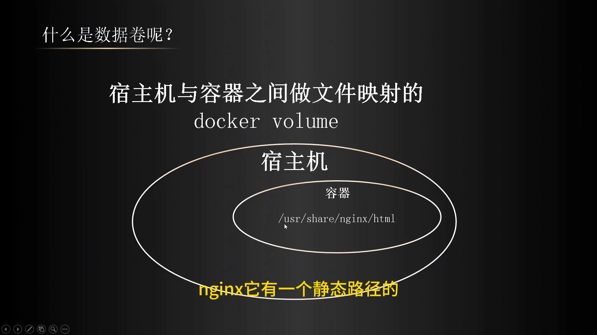
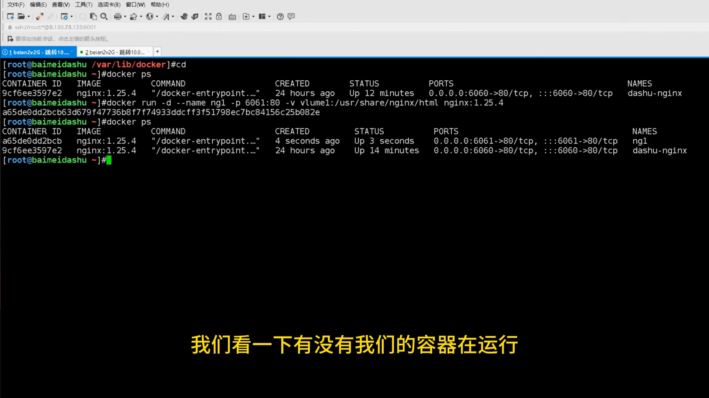
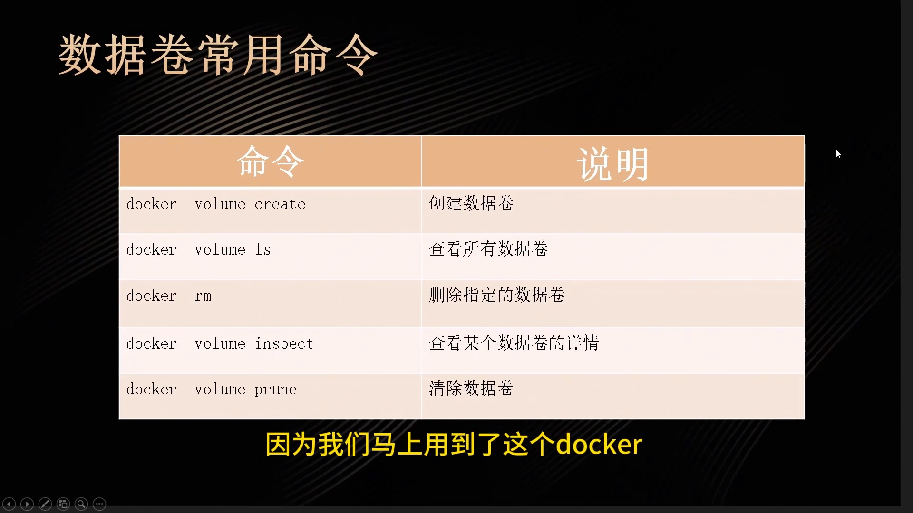
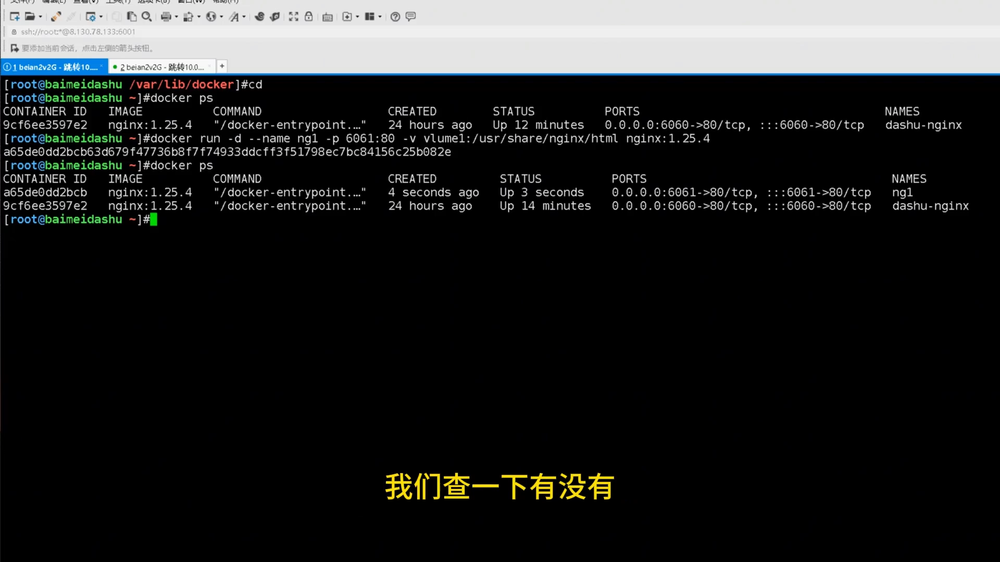
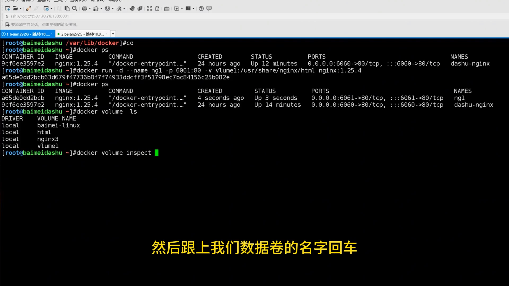
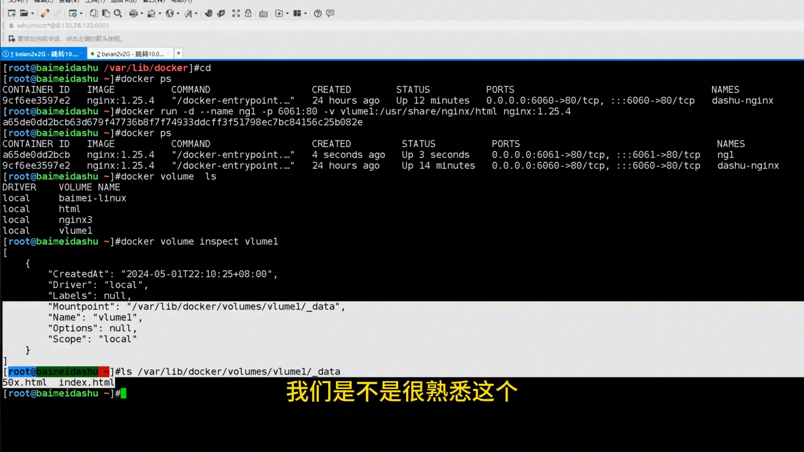
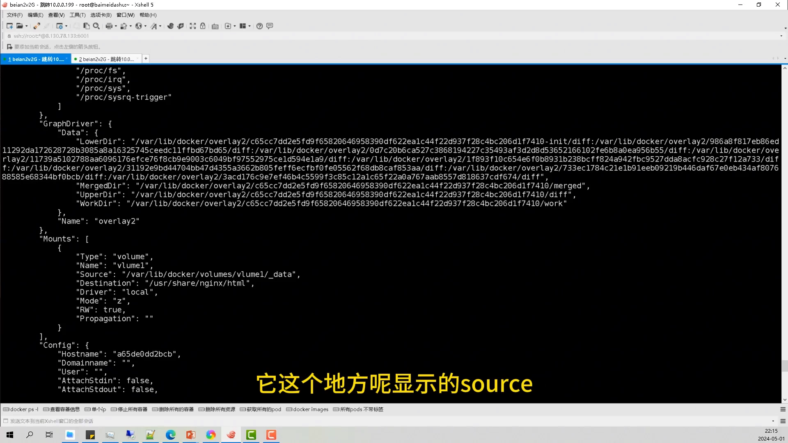
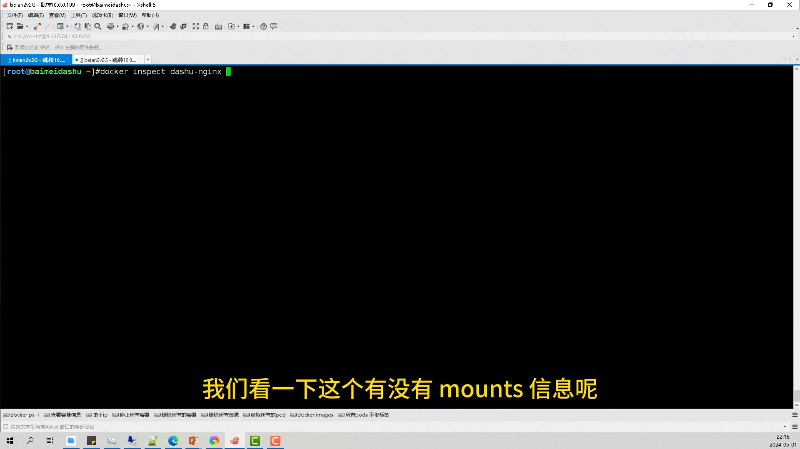
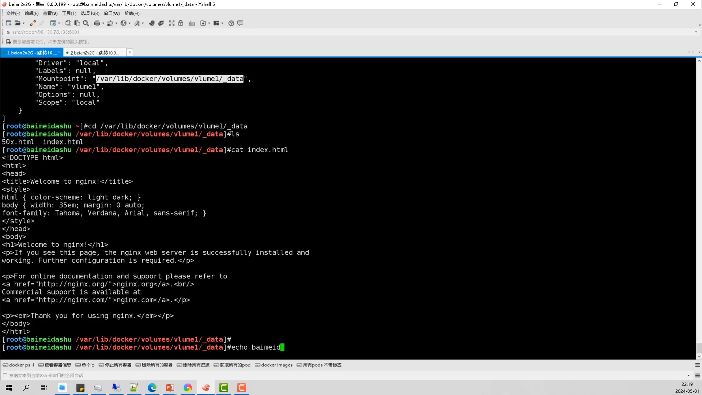

# Docker 数据卷（volume）入门：存储卷是什么、怎么挂载、怎么查看

> 本文整理自 B 站视频《4- docker volume 数据卷介绍》（UP 主：白眉大叔），依据视频演说图文稿逐窗口核对、纠正自动字幕错拼后整理。
> 视频地址：[BV1oy411b7Jx](https://www.bilibili.com/video/BV1oy411b7Jx)

## 本讲要解决的核心问题（SCQA）

**背景**：用 Docker 跑应用时，我们经常要改容器里的文件（比如 nginx 的网页、配置），也经常要把容器里的数据搬走做备份、迁移。

**冲突**：每次改文件都得 `docker exec` 进容器、搬数据也得先进容器，很麻烦；更麻烦的是容器一删，写进去的数据就没了。

**疑问**：有没有办法**在宿主机上就能改容器的文件、搬容器的数据**，并且让这些数据不被容器删除带走？

**回答（中心思想）**：有——用 **Docker 数据卷（volume，也叫存储卷）**。它的本质是**把宿主机的目录映射到容器内的目录**，从而提供两个能力：①在宿主机上改文件、容器同步；②方便数据迁移，且数据不随容器丢失。本讲把"是什么、怎么挂、怎么查"一次讲清：

> ① 挂载方式：`docker run -v 数据卷名:容器内目录`；
> ② 查看方式：`docker volume ls / inspect`（挂载点在 `/var/lib/docker/volumes` 下）、`docker inspect <容器>` 看 `Mounts`；
> ③ 一条直观判据：**挂了卷的容器 `Mounts` 有内容，没挂的容器 `Mounts` 是空的**。

## 一、什么是数据卷

数据卷也叫存储卷，英文就是 `docker volume`。它的主要功能是**在宿主机与容器之间做文件映射**。[【跳转到 0:13】](https://www.bilibili.com/video/BV1oy411b7Jx/?t=13)

它主要解决两类场景：

- **改文件不用进容器**：有没有一种功能，可以让我们在宿主机上改文件，改完容器里的文件也跟着改？这样就不用每次都切进容器了。[【跳转到 0:13】](https://www.bilibili.com/video/BV1oy411b7Jx/?t=13)
- **方便数据迁移**：做数据迁移时，直接把宿主机上相关的文件目录拷走就行，不用进容器再拷贝一遍。

平时我们接触比较多的就是 nginx——它有一个静态路径的目录，放在那里。[【跳转到 1:03】](https://www.bilibili.com/video/BV1oy411b7Jx/?t=63)

## 二、怎么挂载：docker run -v

在执行 `docker run` 命令时加一个 `-v` 参数，写成 **`数据卷名:容器内目录`**，就完成挂载。[【跳转到 1:03】](https://www.bilibili.com/video/BV1oy411b7Jx/?t=63)

一个例子：运行一个 `NG1` 容器，把宿主机端口 6061 映射到容器的 80 端口，并把数据卷 `volume1` 挂到容器的 `/usr/share/nginx/html`。[【跳转到 1:51】](https://www.bilibili.com/video/BV1oy411b7Jx/?t=111) 创建完成后访问 6061 端口，能正常打开 nginx 界面。[【跳转到 3:06】](https://www.bilibili.com/video/BV1oy411b7Jx/?t=186)

**一个重要的知识点**：创建容器时如果挂载了数据卷、而该数据卷**不存在**，Docker 会**自动帮我们创建**它。

## 三、数据卷常用命令与查看

数据卷相关的常用命令有：[【跳转到 3:24】](https://www.bilibili.com/video/BV1oy411b7Jx/?t=204)

- `docker volume create`：创建数据卷；
- `docker volume ls`：查看所有数据卷；
- `docker volume rm`：删除指定数据卷（`rm` 后跟卷名）；
- `docker volume inspect`：查看某个数据卷的详情。

> 提示：作者强调这些命令**平时很少用**，重点是会看即可。

先 `docker volume ls` 看看：能看到刚才创建的 `volume1`。[【跳转到 4:13】](https://www.bilibili.com/video/BV1oy411b7Jx/?t=253)

再看详情：`docker volume inspect volume1`，可以看到它的 **Mountpoint（挂载点）在 `/var/lib/docker/volumes`** 下。[【跳转到 4:38】](https://www.bilibili.com/video/BV1oy411b7Jx/?t=278)

进那个目录 `ls` 一下，会看到**两个很熟悉的文件**——它们正是容器 `/usr/share/nginx/html` 里对应的文件。[【跳转到 5:00】](https://www.bilibili.com/video/BV1oy411b7Jx/?t=300)

## 四、docker inspect：看容器挂了哪些卷（一条"边界"判据）

除了看数据卷本身，还可以看**容器**的详情：`docker inspect <容器名>`。在输出里可以找到一个 `Mounts` 字段，这就是存储卷信息，里面给出 `Source`（源地址，宿主机侧）和 `Destination`（目标地址，容器侧），两边一一对应。[【跳转到 6:06】](https://www.bilibili.com/video/BV1oy411b7Jx/?t=366)

再拿**之前没用数据卷的那个容器**对比一下：它的 `Mounts` 是**空的**——因为没有指定数据卷。[【跳转到 6:31】](https://www.bilibili.com/video/BV1oy411b7Jx/?t=391)

> 记住这条判据：**挂了卷 → `Mounts` 有内容；没挂 → `Mounts` 为空。**

## 五、宿主机改文件、容器同步；迁移直接迁目录

在宿主机上修改文件、再刷新 6061 页面，容器内的文件**也跟着改了**。[【跳转到 7:22】](https://www.bilibili.com/video/BV1oy411b7Jx/?t=442)

因此后面做**数据迁移**时，其实只要把 `volume` 这个文件夹整体迁走就可以了。[【跳转到 7:51】](https://www.bilibili.com/video/BV1oy411b7Jx/?t=471)

## 六、命令规律与补充

这些命令其实**很好记**，都很有规律：

- 跟数据卷相关 → 都带 `volume`：`docker volume ls` 查看数据卷；
- 跟镜像相关 → 是 `docker image`；
- 跟容器相关 → 完整是 `docker container`，但平时常用的命令把 `container` 省略了，直接用 `docker` 加子命令，再跟上容器名称。[【跳转到 9:00】](https://www.bilibili.com/video/BV1oy411b7Jx/?t=540)

此外还有一个命令 `prune`——**删除未使用的数据卷**（平时也用得不多）。[【跳转到 9:50】](https://www.bilibili.com/video/BV1oy411b7Jx/?t=590)

## 小结

- 数据卷（volume / 存储卷）= **把宿主机目录映射到容器目录**，用于"宿主机改文件、容器同步"和"方便数据迁移"。
- 挂载：`docker run -v 数据卷名:容器内目录`；卷不存在时 Docker **自动创建**。
- 查看：`docker volume ls / inspect`（挂载点在 `/var/lib/docker/volumes` 下）；`docker inspect <容器>` 的 `Mounts` 段看容器的挂载。
- 判据：**挂了卷 `Mounts` 非空、没挂则 `Mounts` 为空**。
- 迁移：直接迁走数据卷目录即可；`prune` 可清理未使用的卷。

## 关键术语速查

| 术语 | 一句话解释 |
| --- | --- |
| 数据卷 / 存储卷（volume） | 把宿主机目录映射进容器的机制，用于数据同步与迁移 |
| `-v` | `docker run` 中挂载数据卷的参数：`数据卷名:容器内目录` |
| `docker volume ls` | 列出所有数据卷 |
| `docker volume inspect` | 查看某个数据卷详情，含 Mountpoint（挂载点） |
| Mountpoint | 数据卷在宿主机上的落地目录，通常在 `/var/lib/docker/volumes` 下 |
| `docker inspect <容器>` | 查看容器详情，其 `Mounts` 段列出容器挂载的卷（Source/Destination） |
| `prune` | 删除未使用的数据卷 |
